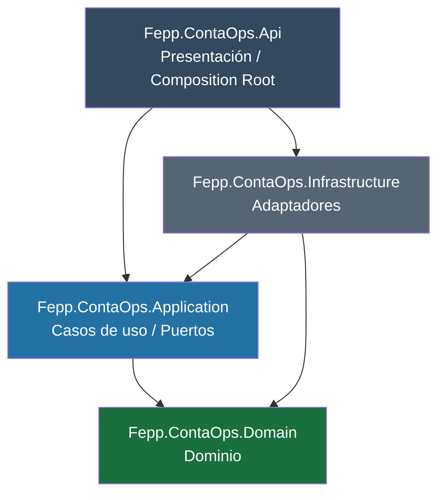
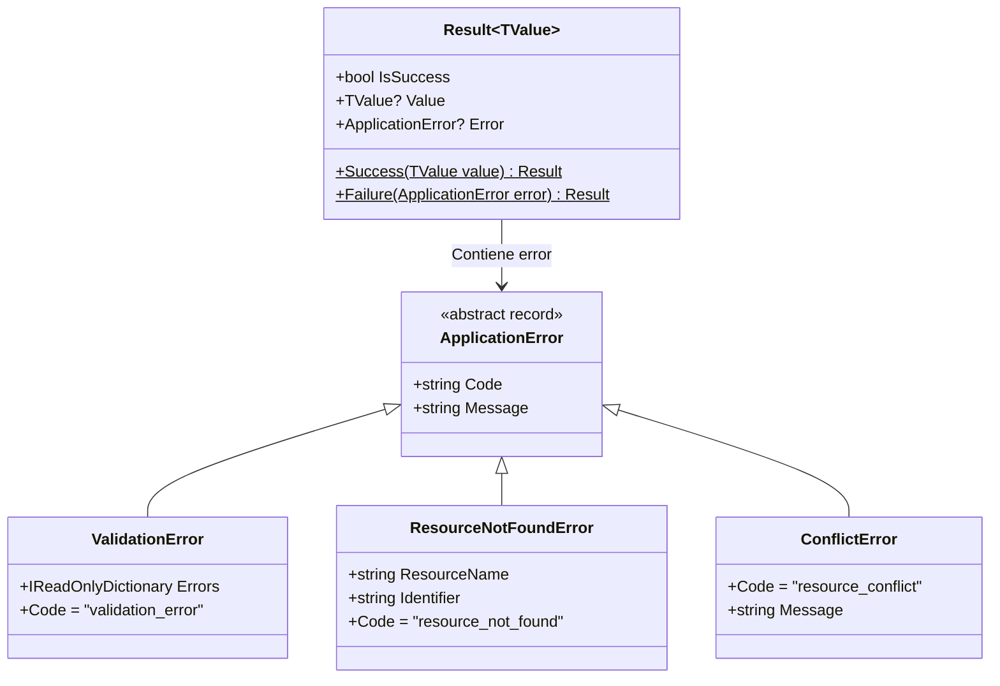
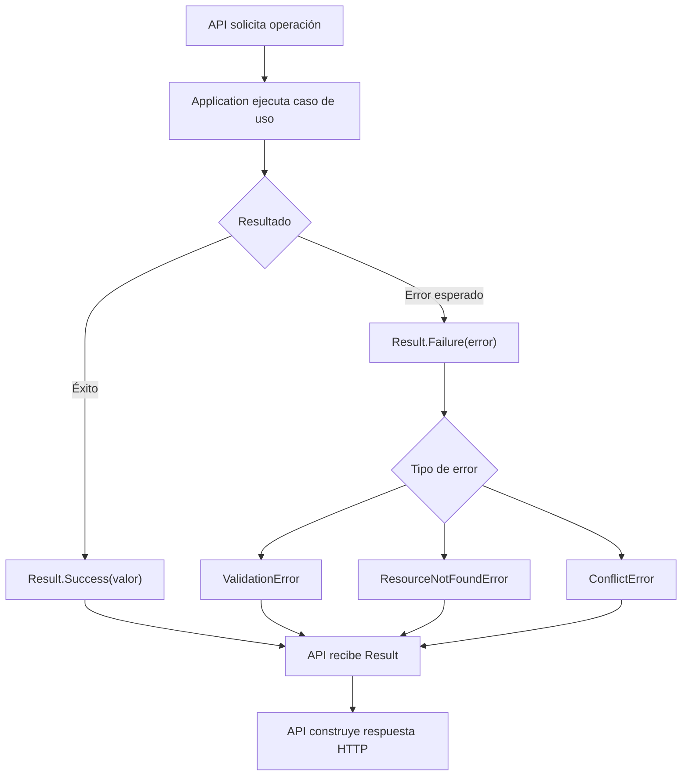
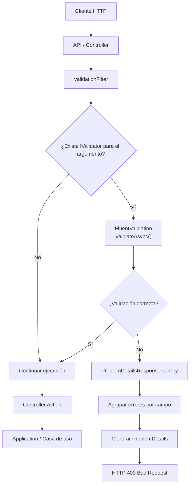

# Implementar 01-base-api-arquitectura

## PASOS

### 1. Crear solución, cuatro proyectos productivos y dos proyectos de pruebas.

#### Arquitectura Hexagonal y DDD — Relación entre proyectos

La solución `FEPP-ContaOps` utiliza **Arquitectura Hexagonal (Ports & Adapters)** y **Domain-Driven Design (DDD)** para separar la lógica de negocio, los casos de uso y las implementaciones técnicas.

##### Diagrama de dependencias



Las flechas representan referencias entre proyectos (`ProjectReference`), no el flujo de ejecución.

##### Responsabilidades y dependencias

| Proyecto           | Responsabilidad                                                                    | Depende de                  |
| ------------------ | ---------------------------------------------------------------------------------- | --------------------------- |
| **Domain**         | Entidades, Value Objects, Aggregates y reglas de negocio (DDD).                    | Ninguno                     |
| **Application**    | Casos de uso, orquestación y puertos (interfaces).                                 | Domain                      |
| **Infrastructure** | Adaptadores técnicos: repositorios, persistencia, correo e integraciones externas. | Application, Domain         |
| **API**            | Endpoints HTTP, controladores y configuración de dependencias (Composition Root).  | Application, Infrastructure |

##### Justificación arquitectónica

| Principio                        | Aplicación                                                                                                            |
| -------------------------------- | --------------------------------------------------------------------------------------------------------------------- |
| **DDD**                          | Domain concentra el modelo y las reglas del negocio.                                                                  |
| **Arquitectura Hexagonal**       | Application define puertos e Infrastructure implementa adaptadores secundarios; API funciona como adaptador primario. |
| **Dependency Inversion (DIP)**   | Los casos de uso dependen de abstracciones, no de implementaciones técnicas.                                          |
| **Separation of Concerns (SoC)** | Cada proyecto tiene responsabilidades claramente delimitadas.                                                         |
| **Bajo acoplamiento**            | Permite sustituir implementaciones sin modificar los casos de uso.                                                    |
| **Testabilidad**                 | Facilita probar la lógica de negocio independientemente de la infraestructura.                                        |

##### Reglas de dependencia

1. **Domain** no depende de ningún otro proyecto de la solución.
2. **Application** depende únicamente de Domain.
3. **Infrastructure** implementa los puertos definidos en Application o Domain.
4. **API** integra Application e Infrastructure mediante inyección de dependencias.
5. Las dependencias del núcleo apuntan hacia Domain, nunca hacia Infrastructure.

**Conclusión:** la estructura protege la lógica de negocio frente a cambios tecnológicos y permite mantener una aplicación modular, testeable y escalable sin introducir complejidad innecesaria.

---

### 2. Configurar referencias e inyección de dependencias.

#### Registro de dependencias (DependencyInjection)

En **Clean Architecture**, las clases `DependencyInjection` permiten centralizar el registro de servicios y sus implementaciones mediante el mecanismo de **inyección de dependencias (Dependency Injection, DI)** de .NET.

Cada capa encapsula sus propios registros, mientras que la capa **API actúa como Composition Root**, integrando las dependencias necesarias para ejecutar la aplicación.

#### Comparación entre Application e Infrastructure

| Característica                     | Application                                          | Infrastructure                                                                           |
| ---------------------------------- | ---------------------------------------------------- | ---------------------------------------------------------------------------------------- |
| **Clase**                          | `DependencyInjection`                                | `DependencyInjection`                                                                    |
| **Ubicación**                      | `Fepp.ContaOps.Application`                          | `Fepp.ContaOps.Infrastructure`                                                           |
| **Método**                         | `AddApplication()`                                   | `AddInfrastructure()`                                                                    |
| **Propósito**                      | Registrar servicios y casos de uso de Application.   | Registrar adaptadores e implementaciones técnicas de Infrastructure.                     |
| **Dependencias de .NET**           | `Microsoft.Extensions.DependencyInjection`           | `Microsoft.Extensions.DependencyInjection` y `Microsoft.Extensions.Configuration`        |
| **Parámetros**                     | `IServiceCollection services`                        | `IServiceCollection services`, `IConfiguration configuration`                            |
| **Servicios registrados**          | Casos de uso, validadores y servicios de aplicación. | Repositorios, persistencia, correo electrónico, almacenamiento e integraciones externas. |
| **Ejemplo**                        | `services.AddScoped<ValidateBalanceUseCase>();`      | `services.AddScoped<IBalanceRepository, SqlBalanceRepository>();`                        |
| **Configuración externa**          | Generalmente no requiere `IConfiguration`.           | Utiliza `IConfiguration` para conexiones y parámetros de servicios externos.             |
| **Responsabilidad arquitectónica** | Encapsular los registros de la lógica de aplicación. | Vincular abstracciones con implementaciones técnicas concretas.                          |
| **Invocación desde API**           | `builder.Services.AddApplication();`                 | `builder.Services.AddInfrastructure(builder.Configuration);`                             |
| **Valor de retorno**               | `IServiceCollection`                                 | `IServiceCollection`                                                                     |

#### Dependencias utilizadas

| Dependencia                                | Descripción                                                                                                         | Utilización                           |
| ------------------------------------------ | ------------------------------------------------------------------------------------------------------------------- | ------------------------------------- |
| `Microsoft.Extensions.DependencyInjection` | Proporciona las abstracciones y métodos de registro de servicios del sistema de DI de .NET.                         | Application e Infrastructure.         |
| `Microsoft.Extensions.Configuration`       | Proporciona las abstracciones para acceder a la configuración de la aplicación.                                     | Infrastructure.                       |
| `IServiceCollection`                       | Colección que almacena los registros de servicios y sus ciclos de vida.                                             | Parámetro principal de ambos métodos. |
| `IConfiguration`                           | Interfaz que permite consultar configuraciones provenientes de archivos JSON, variables de entorno y otras fuentes. | Parámetro de `AddInfrastructure()`.   |

#### Ejemplos de implementación

[**Application — DependencyInjection.cs**](../../src/Fepp.ContaOps.Application/DependencyInjection.cs)

```csharp
using Microsoft.Extensions.DependencyInjection;

namespace Fepp.ContaOps.Application;

public static class DependencyInjection
{
    public static IServiceCollection AddApplication(
        this IServiceCollection services)
    {
        services.AddScoped<ValidateBalanceUseCase>();

        return services;
    }
}
```

Este método registra los servicios propios de Application.

[**Infrastructure — DependencyInjection.cs**](../../src/Fepp.ContaOps.Infrastructure/DependencyInjection.cs)

```csharp
using Microsoft.Extensions.Configuration;
using Microsoft.Extensions.DependencyInjection;

namespace Fepp.ContaOps.Infrastructure;

public static class DependencyInjection
{
    public static IServiceCollection AddInfrastructure(
        this IServiceCollection services,
        IConfiguration configuration)
    {
        services.AddScoped<
            IBalanceRepository,
            SqlBalanceRepository>();

        return services;
    }
}
```

Este método registra implementaciones concretas de los contratos utilizados por Application o Domain. El parámetro `configuration` permite incorporar configuraciones externas cuando sean necesarias.

**API — Program.cs**

```csharp
builder.Services
    .AddApplication()
    .AddInfrastructure(builder.Configuration);
```

La capa API invoca ambos métodos para configurar los servicios que utilizará la aplicación.

#### ¿Por qué se implementan?

Las clases `DependencyInjection` permiten:

1. **Separación de responsabilidades:** cada capa centraliza el registro de sus propios servicios.
2. **Bajo acoplamiento:** Application depende de abstracciones, sin conocer las implementaciones de Infrastructure.
3. **Mantenibilidad:** los nuevos servicios se registran en su capa correspondiente, evitando modificar continuamente `Program.cs`.
4. **Modularidad:** cada proyecto encapsula su configuración de dependencias.
5. **Testabilidad:** las dependencias pueden sustituirse por implementaciones simuladas durante las pruebas.
6. **Configuración centralizada:** Infrastructure puede utilizar parámetros externos sin incorporarlos directamente en los casos de uso.

#### Conceptos relacionados

| Concepto                                 | Descripción                                                                                                                                    |
| ---------------------------------------- | ---------------------------------------------------------------------------------------------------------------------------------------------- |
| **Dependency Injection (DI)**            | Técnica que proporciona las dependencias de una clase desde el exterior, habitualmente mediante su constructor.                                |
| **Dependency Inversion Principle (DIP)** | Principio SOLID que establece que los módulos de alto nivel no deben depender de módulos de bajo nivel; ambos deben depender de abstracciones. |
| **Extension Method**                     | Método estático que utiliza `this` en su primer parámetro para permitir su invocación mediante la sintaxis de instancia.                       |
| **Composition Root**                     | Punto donde se integran los registros y se configura la construcción de dependencias. Normalmente se encuentra en API (`Program.cs`).          |
| **AddScoped**                            | Registra una instancia compartida dentro de un ámbito; en aplicaciones ASP.NET Core, generalmente una petición HTTP.                           |
| **AddTransient**                         | Crea una nueva instancia cada vez que se solicita el servicio.                                                                                 |
| **AddSingleton**                         | Mantiene una instancia compartida durante la vida del contenedor.                                                                              |

**Conclusión:** `DependencyInjection` permite organizar la configuración del contenedor por capas, manteniendo las responsabilidades delimitadas. Application registra sus casos de uso, Infrastructure proporciona las implementaciones técnicas y API realiza la composición final. Esta organización favorece la mantenibilidad, la modularidad y la aplicación del principio de inversión de dependencias.

---

### 3. Definir resultados y errores tipados en Application.

#### Manejo de resultados y errores — Result Pattern

Las clases del namespace `Fepp.ContaOps.Application.Results` implementan el patrón **Result**, que permite a los casos de uso devolver un resultado exitoso o un error esperado de forma explícita y tipada.

##### Diagrama de clases



##### Responsabilidades

| Clase                   | Responsabilidad                                                                              | Ejemplo                                  |
| ----------------------- | -------------------------------------------------------------------------------------------- | ---------------------------------------- |
| `Result<TValue>`        | Encapsula el resultado de un caso de uso, indicando éxito o fallo.                           | `Result<BalanceDto>`                     |
| `ApplicationError`      | Clase base abstracta que define los contratos `Code` y `Message` para los errores esperados. | Base de los errores específicos.         |
| `ValidationError`       | Representa errores de validación agrupados por campo.                                        | Importe inválido o campo obligatorio.    |
| `ResourceNotFoundError` | Indica que un recurso solicitado no existe.                                                  | Balance contable inexistente.            |
| `ConflictError`         | Representa conflictos con el estado actual de un recurso.                                    | Intentar registrar un balance duplicado. |

##### Flujo de ejecución



##### Ejemplo de uso

**Caso de uso — Application**

```csharp
public async Task<Result<BalanceDto>> ExecuteAsync(Guid id)
{
    var balance = await repository.GetByIdAsync(id);

    if (balance is null)
    {
        return Result<BalanceDto>.Failure(
            new ResourceNotFoundError("Balance", id.ToString()));
    }

    return Result<BalanceDto>.Success(
        new BalanceDto(balance.Id, balance.Total));
}
```

**Controlador — API**

```csharp
var result = await useCase.ExecuteAsync(id);

if (result.IsSuccess)
    return Ok(result.Value);

return result.Error switch
{
    ValidationError => BadRequest(result.Error),
    ResourceNotFoundError => NotFound(result.Error),
    ConflictError => Conflict(result.Error),
    _ => StatusCode(500)
};
```

##### Justificación arquitectónica

| Principio                           | Beneficio                                                                            |
| ----------------------------------- | ------------------------------------------------------------------------------------ |
| **Result Pattern**                  | Representa éxitos y errores esperados mediante valores explícitos.                   |
| **Clean Architecture**              | Application no depende de códigos HTTP ni de componentes de API.                     |
| **Arquitectura Hexagonal**          | Los casos de uso devuelven resultados independientes del adaptador que los consume.  |
| **DDD**                             | Permite comunicar fallos esperados de las operaciones sin acoplar el dominio a HTTP. |
| **Separación de responsabilidades** | Application identifica el error; API determina cómo comunicarlo al cliente.          |

**Consideraciones:**

- `Result<TValue>` utiliza `Success()` y `Failure()` como métodos de fábrica.
- `IsSuccess` se determina comprobando si `Error` es `null`.
- Los errores heredan de `ApplicationError`, que establece un código estable y un mensaje.
- Los errores esperados se representan mediante `Result`; los fallos técnicos inesperados deben gestionarse mediante mecanismos apropiados de excepciones y observabilidad.
- La correspondencia entre errores y códigos HTTP es responsabilidad de API. Una asociación habitual es `ValidationError` → 400, `ResourceNotFoundError` → 404 y `ConflictError` → 409.

**Conclusión:** estas clases proporcionan un mecanismo común para comunicar los resultados de los casos de uso, manteniendo Application independiente de HTTP y de las implementaciones de Infrastructure.

---

### 4. Incorporar validación explícita y traducción a ProblemDetails.

#### Validación de solicitudes HTTP — FluentValidation y ProblemDetails

Las clases `ValidationFilter` y `ProblemDetailsResponseFactory`, ubicadas en `Fepp.ContaOps.Api.Validation`, implementan un mecanismo centralizado para validar solicitudes HTTP y devolver respuestas de error uniformes.

##### Diagrama de funcionamiento



**Nota:** `ValidationFilter` se ejecuta antes del método del controlador, aunque dentro del pipeline de ASP.NET Core. El diagrama representa el flujo lógico de validación.

##### Responsabilidades

| Clase                           | Responsabilidad                                                                                                             | Métodos principales                     |
| ------------------------------- | --------------------------------------------------------------------------------------------------------------------------- | --------------------------------------- |
| `ValidationFilter`              | Intercepta la ejecución de acciones MVC y valida sus argumentos utilizando los validadores registrados en FluentValidation. | `OnActionExecutionAsync()`              |
| `ProblemDetailsResponseFactory` | Construye respuestas HTTP de error con una estructura uniforme basada en `ProblemDetails`.                                  | `Create()` y `CreateValidationResult()` |

##### Dependencias

| Clase                           | Dependencias         | Propósito                                                           |
| ------------------------------- | -------------------- | ------------------------------------------------------------------- |
| `ValidationFilter`              | `IAsyncActionFilter` | Integrarse en el pipeline de filtros de ASP.NET Core MVC.           |
| `ValidationFilter`              | `IServiceProvider`   | Resolver dinámicamente los validadores registrados.                 |
| `ValidationFilter`              | `IValidator<T>`      | Ejecutar las reglas de validación mediante FluentValidation.        |
| `ProblemDetailsResponseFactory` | `ProblemDetails`     | Representar errores HTTP mediante un contrato estandarizado.        |
| `ProblemDetailsResponseFactory` | `ValidationResult`   | Obtener los errores generados por FluentValidation.                 |
| `ProblemDetailsResponseFactory` | `HttpContext`        | Obtener la ruta de la solicitud y el identificador de trazabilidad. |

##### Ejemplo de uso

Supongamos que una solicitud intenta registrar un balance contable con un importe inválido.

**Request:**

```json
{
  "accountCode": "1.1.01",
  "amount": -100
}
```

Si existe un validador registrado para el tipo de argumento recibido, `ValidationFilter` ejecuta sus reglas.

Cuando la validación falla, `ProblemDetailsResponseFactory` genera una respuesta con estado **HTTP 400 Bad Request**.

**Ejemplo ilustrativo de respuesta:**

```json
{
  "type": "https://httpstatuses.com/400",
  "title": "Request validation failed.",
  "status": 400,
  "detail": "One or more request fields are invalid.",
  "instance": "/api/balances",
  "code": "validation_error",
  "traceId": "0HN123456789",
  "errors": {
    "Amount": ["El importe debe ser mayor que cero."]
  }
}
```

El contenido de `errors` depende de las reglas definidas en el validador. El formato de respuesta corresponde a `application/problem+json`.

##### Justificación arquitectónica

| Principio                        | Aplicación                                                                         |
| -------------------------------- | ---------------------------------------------------------------------------------- |
| **Arquitectura Hexagonal**       | La validación HTTP permanece en el adaptador de entrada (API).                     |
| **Separation of Concerns (SoC)** | Los controladores no necesitan ejecutar manualmente los validadores.               |
| **Dependency Injection (DI)**    | Los validadores se resuelven mediante el contenedor de dependencias.               |
| **Reutilización**                | `ProblemDetailsResponseFactory` centraliza la construcción de respuestas de error. |
| **Observabilidad**               | `traceId` permite relacionar una respuesta con la solicitud procesada.             |
| **Estandarización**              | Los errores HTTP mantienen una estructura consistente basada en `ProblemDetails`.  |

##### Consideraciones de implementación

- `ValidationFilter` valida los argumentos no nulos para los que encuentre un `IValidator<T>` registrado.
- Si no existe un validador, el argumento continúa sin validación por este filtro.
- Ante el primer argumento inválido, devuelve HTTP 400 y detiene la ejecución de la acción.
- Si la validación es correcta, continúa mediante `await next()`.
- `ProblemDetailsResponseFactory` agrupa los errores por propiedad y elimina mensajes duplicados.
- Estas clases gestionan la validación de entrada HTTP; no sustituyen las reglas e invariantes del dominio.
- El filtro utiliza resolución dinámica de servicios mediante `IServiceProvider`, por lo que los validadores deben registrarse correctamente en el contenedor.

**Conclusión:** `ValidationFilter` ejecuta las validaciones antes de que el controlador procese la solicitud, mientras que `ProblemDetailsResponseFactory` transforma los errores en respuestas HTTP uniformes. Esta separación mantiene los controladores más simples y evita acoplar la lógica de negocio a los mecanismos de validación HTTP.

---
