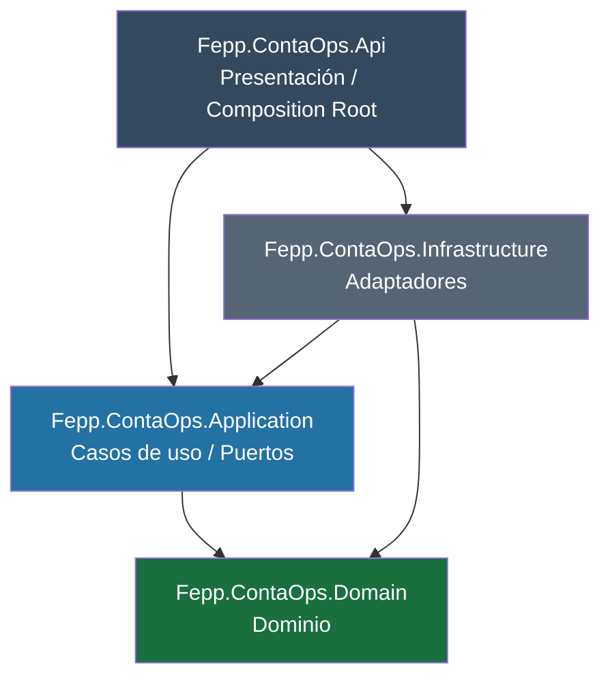
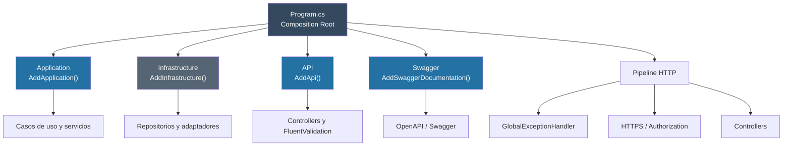
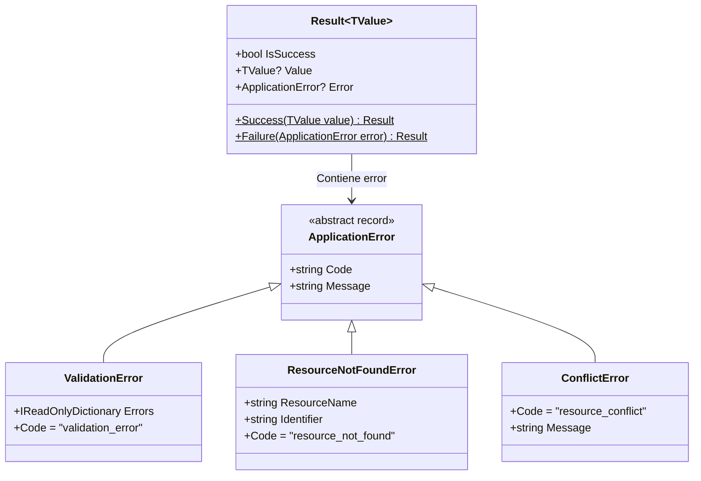
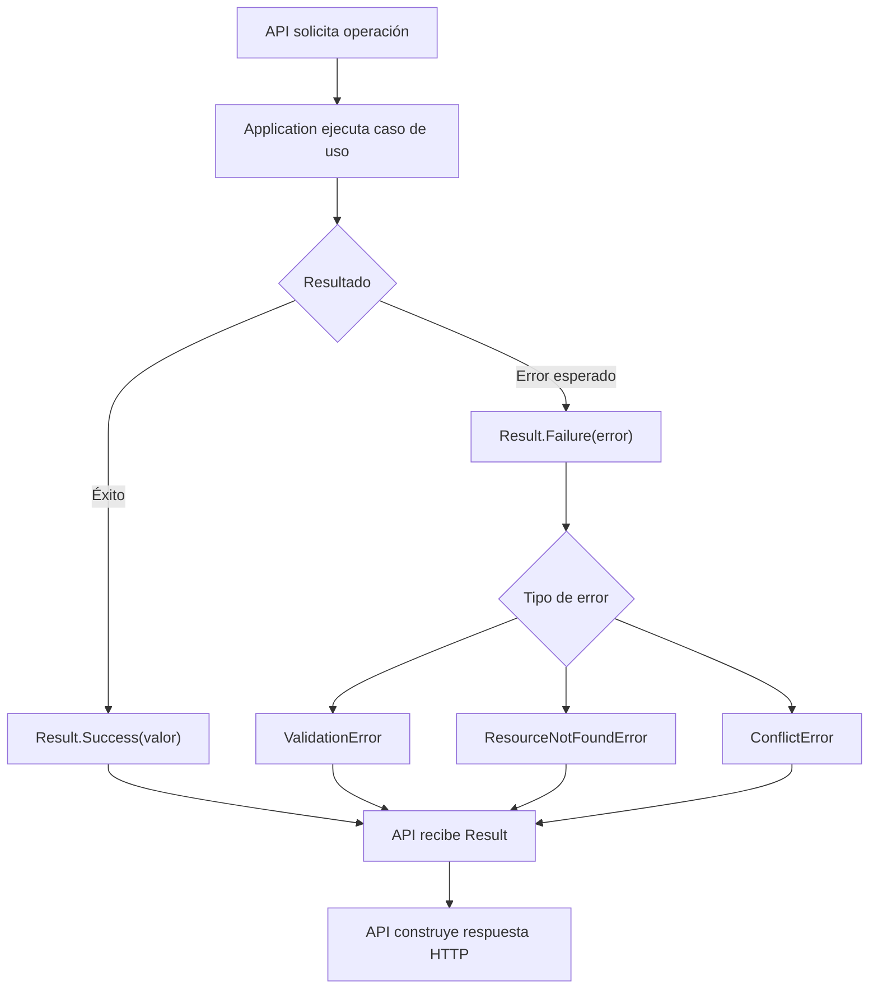
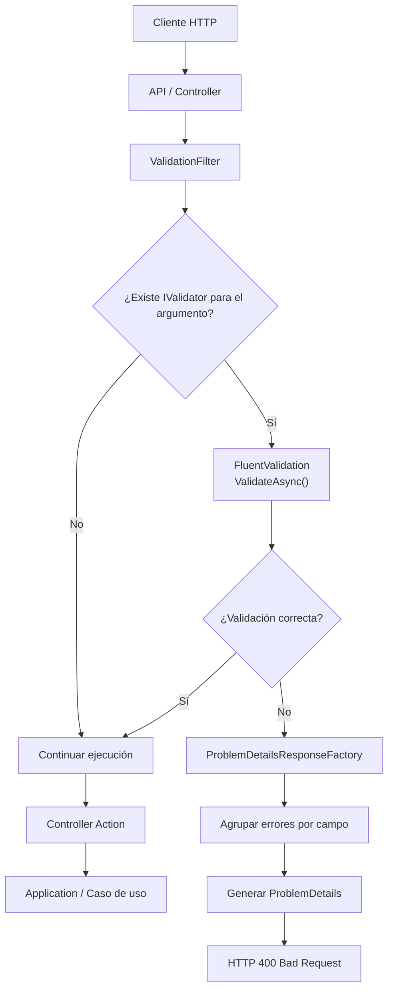
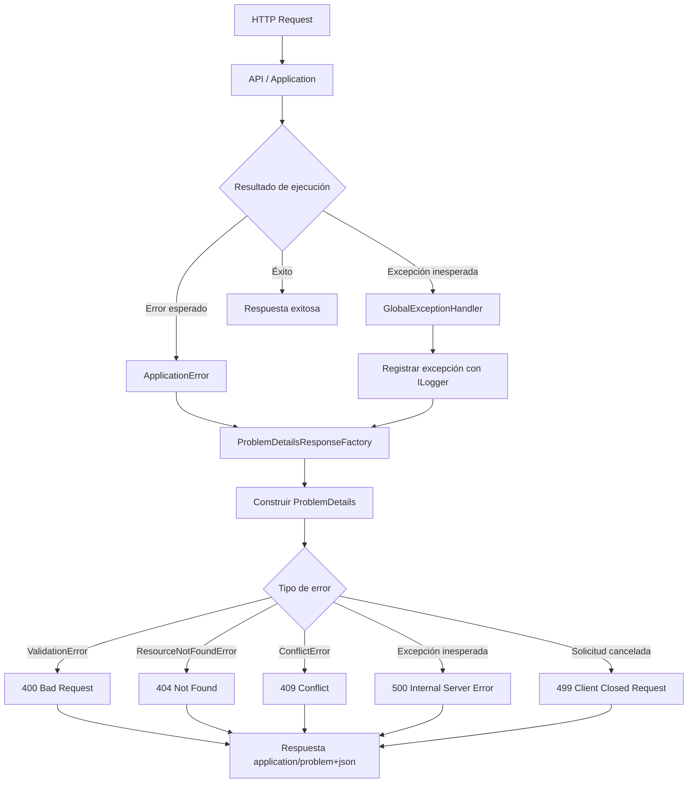
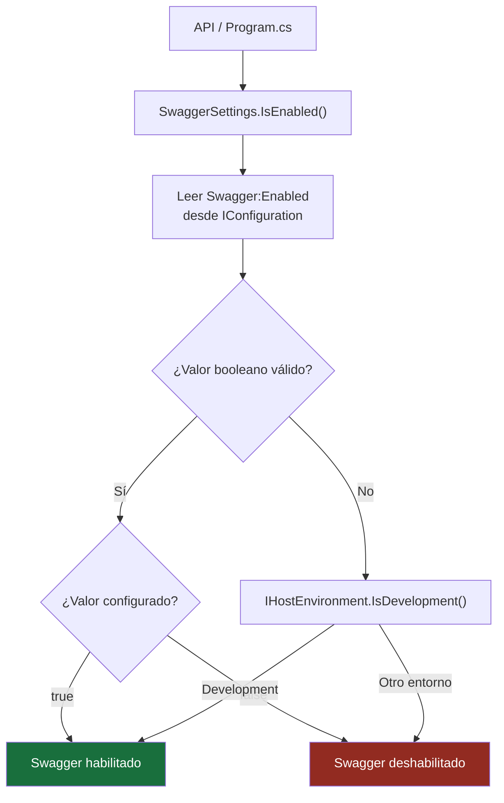
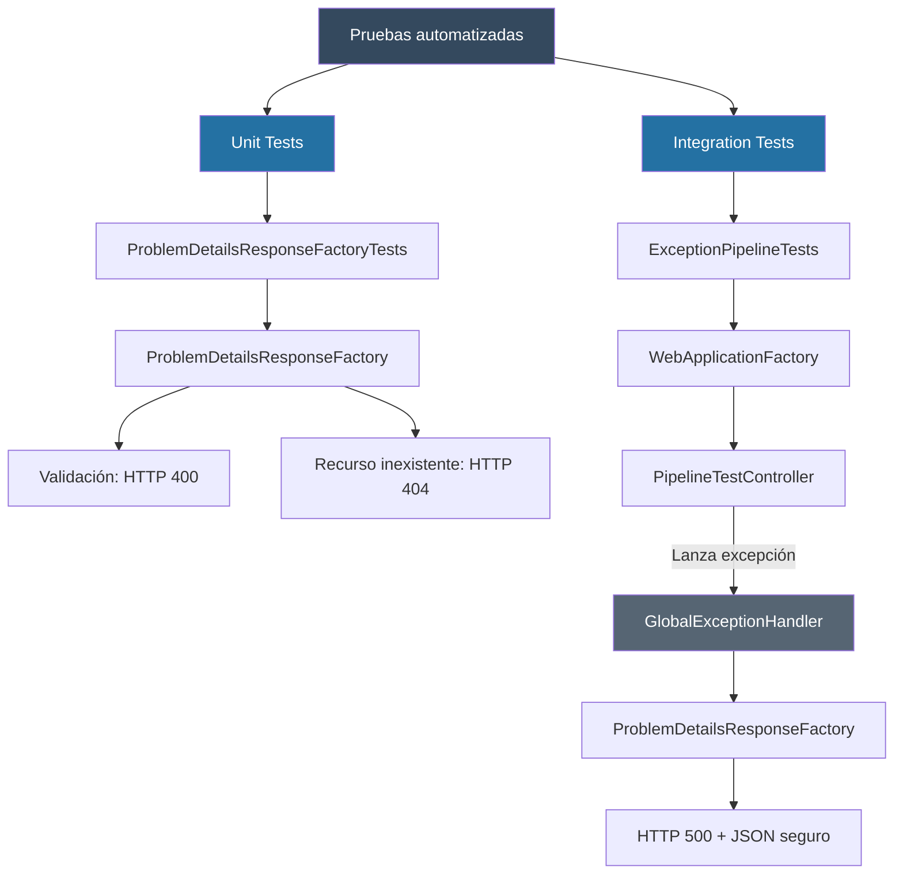

# Implementar 01-base-api-arquitectura

## PASOS

### 1. Crear solución, cuatro proyectos productivos y dos proyectos de pruebas.

#### Arquitectura Hexagonal y DDD — Relación entre proyectos

La solución `FEPP-ContaOps` utiliza **Arquitectura Hexagonal (Ports & Adapters)** y **Domain-Driven Design (DDD)** para separar la lógica de negocio, los casos de uso y las implementaciones técnicas.

##### Diagrama de dependencias



Las flechas representan referencias entre proyectos (`ProjectReference`), no el flujo de ejecución.

##### Responsabilidades y dependencias

| Proyecto           | Responsabilidad                                                                    | Depende de                  |
| ------------------ | ---------------------------------------------------------------------------------- | --------------------------- |
| **Domain**         | Entidades, Value Objects, Aggregates y reglas de negocio (DDD).                    | Ninguno                     |
| **Application**    | Casos de uso, orquestación y puertos (interfaces).                                 | Domain                      |
| **Infrastructure** | Adaptadores técnicos: repositorios, persistencia, correo e integraciones externas. | Application, Domain         |
| **API**            | Endpoints HTTP, controladores y configuración de dependencias (Composition Root).  | Application, Infrastructure |

##### Justificación arquitectónica

| Principio                        | Aplicación                                                                                                            |
| -------------------------------- | --------------------------------------------------------------------------------------------------------------------- |
| **DDD**                          | Domain concentra el modelo y las reglas del negocio.                                                                  |
| **Arquitectura Hexagonal**       | Application define puertos e Infrastructure implementa adaptadores secundarios; API funciona como adaptador primario. |
| **Dependency Inversion (DIP)**   | Los casos de uso dependen de abstracciones, no de implementaciones técnicas.                                          |
| **Separation of Concerns (SoC)** | Cada proyecto tiene responsabilidades claramente delimitadas.                                                         |
| **Bajo acoplamiento**            | Permite sustituir implementaciones sin modificar los casos de uso.                                                    |
| **Testabilidad**                 | Facilita probar la lógica de negocio independientemente de la infraestructura.                                        |

##### Reglas de dependencia

1. **Domain** no depende de ningún otro proyecto de la solución.
2. **Application** depende únicamente de Domain.
3. **Infrastructure** implementa los puertos definidos en Application o Domain.
4. **API** integra Application e Infrastructure mediante inyección de dependencias.
5. Las dependencias del núcleo apuntan hacia Domain, nunca hacia Infrastructure.

**Conclusión:** la estructura protege la lógica de negocio frente a cambios tecnológicos y permite mantener una aplicación modular, testeable y escalable sin introducir complejidad innecesaria.

---

### 2. Configurar referencias e inyección de dependencias

#### Registro de dependencias (DependencyInjection)

En **Arquitectura Hexagonal y Clean Architecture**, las clases `DependencyInjection` centralizan el registro de servicios de cada capa mediante el contenedor de **inyección de dependencias (DI)** de .NET.

La capa **API**, mediante `Program.cs`, actúa como **Composition Root**, integrando las dependencias y configurando el procesamiento de solicitudes HTTP.

#### Diagrama de configuración



**Nota:** `AddApplication()` y `AddInfrastructure()` todavía no contienen registros de servicios. El diagrama muestra sus responsabilidades previstas.

#### Responsabilidades por capa

| Clase / Archivo                                                                                          | Método                      | Responsabilidad                                                                        |
| -------------------------------------------------------------------------------------------------------- | --------------------------- | -------------------------------------------------------------------------------------- |
| [API — DependencyInjection.cs](../../src/Fepp.ContaOps.Api/DependencyInjection.cs)                       | `AddApi()`                  | Registra controllers, validadores FluentValidation y `ValidationFilter`.               |
| API — DependencyInjection.cs                                                                             | `AddSwaggerDocumentation()` | Configura la documentación OpenAPI/Swagger e incorpora comentarios XML cuando existen. |
| [Application — DependencyInjection.cs](../../src/Fepp.ContaOps.Application/DependencyInjection.cs)       | `AddApplication()`          | Centraliza el registro de casos de uso y servicios de aplicación.                      |
| [Infrastructure — DependencyInjection.cs](../../src/Fepp.ContaOps.Infrastructure/DependencyInjection.cs) | `AddInfrastructure()`       | Centraliza el registro de repositorios, adaptadores e integraciones externas.          |
| [API — Program.cs](../../src/Fepp.ContaOps.Api/Program.cs)                                               | Punto de entrada            | Integra las dependencias y configura el pipeline HTTP.                                 |

#### Configuración de Program.cs

**1. Registro de servicios**

```csharp
var builder = WebApplication.CreateBuilder(args);

builder.Logging.AddJsonConsole();

builder.Services.AddApplication();
builder.Services.AddInfrastructure(builder.Configuration);
builder.Services.AddApi();
builder.Services.AddSwaggerDocumentation();
builder.Services.AddProblemDetails();
builder.Services.AddExceptionHandler<GlobalExceptionHandler>();
```

| Configuración               | Función                                                                   |
| --------------------------- | ------------------------------------------------------------------------- |
| `AddJsonConsole()`          | Habilita logging JSON en consola.                                         |
| `AddApplication()`          | Incorpora los registros de Application.                                   |
| `AddInfrastructure()`       | Incorpora los registros de Infrastructure.                                |
| `AddApi()`                  | Registra controllers y validación HTTP.                                   |
| `AddSwaggerDocumentation()` | Configura Swagger/OpenAPI.                                                |
| `AddProblemDetails()`       | Registra servicios para generar respuestas de error estandarizadas.       |
| `AddExceptionHandler()`     | Registra `GlobalExceptionHandler` para gestionar excepciones inesperadas. |

**2. Configuración del pipeline HTTP**

```csharp
var app = builder.Build();

app.UseExceptionHandler();

if (SwaggerSettings.IsEnabled(builder.Configuration, app.Environment))
{
    app.UseSwagger();
    app.UseSwaggerUI(options =>
    {
        options.SwaggerEndpoint(
            "/swagger/v1/swagger.json",
            "FEPP-ContaOps API v1");
    });
}

app.UseHttpsRedirection();
app.UseAuthorization();
app.MapControllers();

app.Run();
```

| Configuración                 | Función                                                                   |
| ----------------------------- | ------------------------------------------------------------------------- |
| `UseExceptionHandler()`       | Gestiona excepciones no controladas.                                      |
| `SwaggerSettings.IsEnabled()` | Determina si Swagger está habilitado según la configuración y el entorno. |
| `UseHttpsRedirection()`       | Redirige solicitudes HTTP hacia HTTPS.                                    |
| `UseAuthorization()`          | Aplica el middleware de autorización.                                     |
| `MapControllers()`            | Habilita los endpoints definidos en controllers.                          |
| `Run()`                       | Inicia la aplicación.                                                     |

#### Justificación arquitectónica

| Principio                      | Aplicación                                                                              |
| ------------------------------ | --------------------------------------------------------------------------------------- |
| **Composition Root**           | `Program.cs` centraliza la integración de dependencias.                                 |
| **Separation of Concerns**     | Cada capa encapsula el registro de sus propios servicios.                               |
| **Dependency Inversion (DIP)** | Application utiliza abstracciones implementadas por Infrastructure.                     |
| **Arquitectura Hexagonal**     | API actúa como adaptador de entrada e Infrastructure proporciona adaptadores de salida. |
| **Mantenibilidad**             | Permite incorporar servicios sin concentrar sus configuraciones en `Program.cs`.        |

**Conclusión:** las clases `DependencyInjection` organizan el registro de servicios por capa, mientras que `Program.cs` integra estos registros y configura el pipeline HTTP. Esta separación mantiene una estructura modular, facilita las pruebas y respeta los principios de Arquitectura Hexagonal y Clean Architecture.

---

### 3. Definir resultados y errores tipados en Application.

#### Manejo de resultados y errores — Result Pattern

Las clases del namespace `Fepp.ContaOps.Application.Results` implementan el patrón **Result**, que permite a los casos de uso devolver un resultado exitoso o un error esperado de forma explícita y tipada.

##### Diagrama de clases



##### Responsabilidades

| Clase                   | Responsabilidad                                                                              | Ejemplo                                  |
| ----------------------- | -------------------------------------------------------------------------------------------- | ---------------------------------------- |
| `Result<TValue>`        | Encapsula el resultado de un caso de uso, indicando éxito o fallo.                           | `Result<BalanceDto>`                     |
| `ApplicationError`      | Clase base abstracta que define los contratos `Code` y `Message` para los errores esperados. | Base de los errores específicos.         |
| `ValidationError`       | Representa errores de validación agrupados por campo.                                        | Importe inválido o campo obligatorio.    |
| `ResourceNotFoundError` | Indica que un recurso solicitado no existe.                                                  | Balance contable inexistente.            |
| `ConflictError`         | Representa conflictos con el estado actual de un recurso.                                    | Intentar registrar un balance duplicado. |

##### Flujo de ejecución



##### Ejemplo de uso

**Caso de uso — Application**

```csharp
public async Task<Result<BalanceDto>> ExecuteAsync(Guid id)
{
    var balance = await repository.GetByIdAsync(id);

    if (balance is null)
    {
        return Result<BalanceDto>.Failure(
            new ResourceNotFoundError("Balance", id.ToString()));
    }

    return Result<BalanceDto>.Success(
        new BalanceDto(balance.Id, balance.Total));
}
```

**Controlador — API**

```csharp
var result = await useCase.ExecuteAsync(id);

if (result.IsSuccess)
    return Ok(result.Value);

return result.Error switch
{
    ValidationError => BadRequest(result.Error),
    ResourceNotFoundError => NotFound(result.Error),
    ConflictError => Conflict(result.Error),
    _ => StatusCode(500)
};
```

##### Justificación arquitectónica

| Principio                           | Beneficio                                                                            |
| ----------------------------------- | ------------------------------------------------------------------------------------ |
| **Result Pattern**                  | Representa éxitos y errores esperados mediante valores explícitos.                   |
| **Clean Architecture**              | Application no depende de códigos HTTP ni de componentes de API.                     |
| **Arquitectura Hexagonal**          | Los casos de uso devuelven resultados independientes del adaptador que los consume.  |
| **DDD**                             | Permite comunicar fallos esperados de las operaciones sin acoplar el dominio a HTTP. |
| **Separación de responsabilidades** | Application identifica el error; API determina cómo comunicarlo al cliente.          |

**Consideraciones:**

- `Result<TValue>` utiliza `Success()` y `Failure()` como métodos de fábrica.
- `IsSuccess` se determina comprobando si `Error` es `null`.
- Los errores heredan de `ApplicationError`, que establece un código estable y un mensaje.
- Los errores esperados se representan mediante `Result`; los fallos técnicos inesperados deben gestionarse mediante mecanismos apropiados de excepciones y observabilidad.
- La correspondencia entre errores y códigos HTTP es responsabilidad de API. Una asociación habitual es `ValidationError` → 400, `ResourceNotFoundError` → 404 y `ConflictError` → 409.

**Conclusión:** estas clases proporcionan un mecanismo común para comunicar los resultados de los casos de uso, manteniendo Application independiente de HTTP y de las implementaciones de Infrastructure.

---

### 4. Incorporar validación explícita y traducción a ProblemDetails.

#### Validación de solicitudes HTTP — FluentValidation y ProblemDetails

Las clases `ValidationFilter` y `ProblemDetailsResponseFactory`, ubicadas en `Fepp.ContaOps.Api.Validation`, implementan un mecanismo centralizado para validar solicitudes HTTP y devolver respuestas de error uniformes.

##### Diagrama de funcionamiento



**Nota:** `ValidationFilter` se ejecuta antes del método del controlador, aunque dentro del pipeline de ASP.NET Core. El diagrama representa el flujo lógico de validación.

##### Responsabilidades

| Clase                           | Responsabilidad                                                                                                             | Métodos principales                     |
| ------------------------------- | --------------------------------------------------------------------------------------------------------------------------- | --------------------------------------- |
| `ValidationFilter`              | Intercepta la ejecución de acciones MVC y valida sus argumentos utilizando los validadores registrados en FluentValidation. | `OnActionExecutionAsync()`              |
| `ProblemDetailsResponseFactory` | Construye respuestas HTTP de error con una estructura uniforme basada en `ProblemDetails`.                                  | `Create()` y `CreateValidationResult()` |

##### Dependencias

| Clase                           | Dependencias         | Propósito                                                           |
| ------------------------------- | -------------------- | ------------------------------------------------------------------- |
| `ValidationFilter`              | `IAsyncActionFilter` | Integrarse en el pipeline de filtros de ASP.NET Core MVC.           |
| `ValidationFilter`              | `IServiceProvider`   | Resolver dinámicamente los validadores registrados.                 |
| `ValidationFilter`              | `IValidator<T>`      | Ejecutar las reglas de validación mediante FluentValidation.        |
| `ProblemDetailsResponseFactory` | `ProblemDetails`     | Representar errores HTTP mediante un contrato estandarizado.        |
| `ProblemDetailsResponseFactory` | `ValidationResult`   | Obtener los errores generados por FluentValidation.                 |
| `ProblemDetailsResponseFactory` | `HttpContext`        | Obtener la ruta de la solicitud y el identificador de trazabilidad. |

##### Ejemplo de uso

Supongamos que una solicitud intenta registrar un balance contable con un importe inválido.

**Request:**

```json
{
  "accountCode": "1.1.01",
  "amount": -100
}
```

Si existe un validador registrado para el tipo de argumento recibido, `ValidationFilter` ejecuta sus reglas.

Cuando la validación falla, `ProblemDetailsResponseFactory` genera una respuesta con estado **HTTP 400 Bad Request**.

**Ejemplo ilustrativo de respuesta:**

```json
{
  "type": "https://httpstatuses.com/400",
  "title": "Request validation failed.",
  "status": 400,
  "detail": "One or more request fields are invalid.",
  "instance": "/api/balances",
  "code": "validation_error",
  "traceId": "0HN123456789",
  "errors": {
    "Amount": ["El importe debe ser mayor que cero."]
  }
}
```

El contenido de `errors` depende de las reglas definidas en el validador. El formato de respuesta corresponde a `application/problem+json`.

##### Justificación arquitectónica

| Principio                        | Aplicación                                                                         |
| -------------------------------- | ---------------------------------------------------------------------------------- |
| **Arquitectura Hexagonal**       | La validación HTTP permanece en el adaptador de entrada (API).                     |
| **Separation of Concerns (SoC)** | Los controladores no necesitan ejecutar manualmente los validadores.               |
| **Dependency Injection (DI)**    | Los validadores se resuelven mediante el contenedor de dependencias.               |
| **Reutilización**                | `ProblemDetailsResponseFactory` centraliza la construcción de respuestas de error. |
| **Observabilidad**               | `traceId` permite relacionar una respuesta con la solicitud procesada.             |
| **Estandarización**              | Los errores HTTP mantienen una estructura consistente basada en `ProblemDetails`.  |

##### Consideraciones de implementación

- `ValidationFilter` valida los argumentos no nulos para los que encuentre un `IValidator<T>` registrado.
- Si no existe un validador, el argumento continúa sin validación por este filtro.
- Ante el primer argumento inválido, devuelve HTTP 400 y detiene la ejecución de la acción.
- Si la validación es correcta, continúa mediante `await next()`.
- `ProblemDetailsResponseFactory` agrupa los errores por propiedad y elimina mensajes duplicados.
- Estas clases gestionan la validación de entrada HTTP; no sustituyen las reglas e invariantes del dominio.
- El filtro utiliza resolución dinámica de servicios mediante `IServiceProvider`, por lo que los validadores deben registrarse correctamente en el contenedor.

**Conclusión:** `ValidationFilter` ejecuta las validaciones antes de que el controlador procese la solicitud, mientras que `ProblemDetailsResponseFactory` transforma los errores en respuestas HTTP uniformes. Esta separación mantiene los controladores más simples y evita acoplar la lógica de negocio a los mecanismos de validación HTTP.

---

### 5. Configurar handler global, logging JSON y traceId.

#### Manejo global de excepciones y respuestas HTTP — ProblemDetails

Las clases `GlobalExceptionHandler` y `ProblemDetailsResponseFactory` permiten gestionar excepciones inesperadas y errores esperados mediante respuestas HTTP uniformes basadas en **ProblemDetails (RFC 9457)**.

Ambas pertenecen a la capa `Fepp.ContaOps.Api` y mantienen los detalles HTTP separados de la lógica de Application.

##### Diagrama de funcionamiento



**Nota:** los errores esperados se transforman en respuestas mediante `CreateApplicationErrorResult()`. Las excepciones inesperadas son procesadas por `GlobalExceptionHandler`, que utiliza `Create()` para construir el `ProblemDetails`.

##### Responsabilidades

| Clase                           | Responsabilidad                                                                                      | Métodos                                                                  |
| ------------------------------- | ---------------------------------------------------------------------------------------------------- | ------------------------------------------------------------------------ |
| `GlobalExceptionHandler`        | Captura excepciones no controladas, registra información de diagnóstico y genera respuestas seguras. | `TryHandleAsync()`, `WriteProblemDetailsAsync()`                         |
| `ProblemDetailsResponseFactory` | Centraliza la construcción de errores HTTP utilizando el contrato `ProblemDetails`.                  | `Create()`, `CreateValidationResult()`, `CreateApplicationErrorResult()` |

##### Tipos de errores gestionados

| Origen               | Error                   | HTTP | Código               |
| -------------------- | ----------------------- | ---- | -------------------- |
| Application          | `ValidationError`       | 400  | `validation_error`   |
| Application          | `ResourceNotFoundError` | 404  | `resource_not_found` |
| Application          | `ConflictError`         | 409  | `resource_conflict`  |
| API / Infrastructure | Excepción inesperada    | 500  | `unexpected_error`   |
| Solicitud HTTP       | Cancelación del cliente | 499  | `request_cancelled`  |

El código **499** es una convención no estandarizada que representa una solicitud cancelada por el cliente. La implementación intenta devolverlo cuando detecta una `OperationCanceledException` asociada a `RequestAborted`; sin embargo, si el cliente ya se desconectó, la respuesta podría no llegar a transmitirse.

##### Ejemplo de respuesta HTTP

Ante una excepción inesperada, la API construye una respuesta similar a:

```json
{
  "type": "https://httpstatuses.com/500",
  "title": "An unexpected error occurred.",
  "status": 500,
  "detail": "The request could not be completed.",
  "instance": "/api/balances",
  "code": "unexpected_error",
  "traceId": "0HN123456789"
}
```

La respuesta evita exponer mensajes internos, stack traces o información sensible de la excepción.

##### Justificación arquitectónica

| Principio                  | Aplicación                                                                             |
| -------------------------- | -------------------------------------------------------------------------------------- |
| **Arquitectura Hexagonal** | La conversión de errores a respuestas HTTP permanece en el adaptador API.              |
| **Separation of Concerns** | Application identifica errores esperados; API gestiona su representación HTTP.         |
| **Centralización**         | `ProblemDetailsResponseFactory` evita duplicar la construcción de respuestas.          |
| **Observabilidad**         | `ILogger` registra excepciones y `traceId` facilita su correlación.                    |
| **Seguridad**              | Las excepciones inesperadas producen mensajes genéricos sin revelar detalles internos. |
| **Estandarización**        | Los errores mantienen un contrato uniforme mediante `application/problem+json`.        |

##### Consideraciones

- `GlobalExceptionHandler` implementa `IExceptionHandler` de ASP.NET Core.
- Debe registrarse en el contenedor y habilitarse mediante el middleware correspondiente para capturar excepciones.
- `ProblemDetailsResponseFactory` es una clase estática reutilizable.
- `CreateApplicationErrorResult()` es el método incorporado para transformar errores tipados de Application en respuestas HTTP.
- `ValidationFilter` continúa utilizando `CreateValidationResult()` para los errores de FluentValidation.
- Los errores esperados no necesitan convertirse en excepciones; pueden comunicarse mediante `Result<TValue>`.
- El manejo global está orientado a excepciones inesperadas y cancelaciones de solicitudes.

**Conclusión:** `GlobalExceptionHandler` centraliza el tratamiento de excepciones, mientras que `ProblemDetailsResponseFactory` unifica la representación de errores HTTP. Ambas clases permiten mantener una API consistente, segura y desacoplada de la lógica de negocio.

---

### 6. Configurar Swagger

#### Configuración de Swagger por entorno — SwaggerSettings

La clase `SwaggerSettings`, ubicada en `Fepp.ContaOps.Api.Swagger`, determina si Swagger debe habilitarse utilizando la configuración de la aplicación (`IConfiguration`) y el entorno de ejecución (`IHostEnvironment`).

Su objetivo es **centralizar la decisión de habilitar Swagger**, permitiendo configurarlo explícitamente o utilizar un comportamiento predeterminado según el entorno.

##### Diagrama de funcionamiento



##### Responsabilidades y dependencias

| Componente         | Responsabilidad                                                 |
| ------------------ | --------------------------------------------------------------- |
| `SwaggerSettings`  | Centraliza la regla para habilitar Swagger.                     |
| `IsEnabled()`      | Devuelve `true` o `false` según la configuración y el entorno.  |
| `IConfiguration`   | Obtiene el valor de `Swagger:Enabled`.                          |
| `IHostEnvironment` | Identifica si la aplicación se ejecuta en Development.          |
| `bool.TryParse()`  | Verifica si el valor configurado representa un booleano válido. |

##### Reglas de configuración

| `Swagger:Enabled` | Entorno     | Resultado     |
| ----------------- | ----------- | ------------- |
| `true`            | Cualquiera  | Habilitado    |
| `false`           | Cualquiera  | Deshabilitado |
| No configurado    | Development | Habilitado    |
| No configurado    | Production  | Deshabilitado |
| No configurado    | Staging     | Deshabilitado |
| Valor inválido    | Development | Habilitado    |
| Valor inválido    | Production  | Deshabilitado |

**Prioridad:** la configuración explícita prevalece sobre el entorno. Si no existe un valor booleano válido, Swagger solamente se habilita en Development.

##### Ejemplo de configuración

**appsettings.json**

```json
{
  "Swagger": {
    "Enabled": false
  }
}
```

**appsettings.Development.json**

```json
{
  "Swagger": {
    "Enabled": true
  }
}
```

**Program.cs**

```csharp
if (SwaggerSettings.IsEnabled(
    builder.Configuration,
    app.Environment))
{
    app.UseSwagger();
    app.UseSwaggerUI();
}
```

El ejemplo supone que Swagger y sus servicios correspondientes ya están registrados en la aplicación.

##### Justificación arquitectónica

| Principio                  | Aplicación                                                                              |
| -------------------------- | --------------------------------------------------------------------------------------- |
| **Separation of Concerns** | Separa la decisión de habilitar Swagger de la configuración del pipeline HTTP.          |
| **Configuración externa**  | Permite modificar el comportamiento mediante `appsettings.json` o variables de entorno. |
| **Clean Architecture**     | La configuración de Swagger permanece en API, sin afectar Application ni Domain.        |
| **Seguridad**              | Deshabilita Swagger por defecto fuera de Development, salvo configuración explícita.    |
| **Mantenibilidad**         | Centraliza una regla que puede reutilizarse desde la configuración de API.              |

##### Consideraciones

- `SwaggerSettings` es una clase estática y no necesita registrarse mediante inyección de dependencias.
- `IsEnabled()` únicamente evalúa una condición; no registra servicios ni activa Swagger directamente.
- Un valor inválido de `Swagger:Enabled` no genera una excepción: utiliza el entorno como alternativa.
- Habilitar Swagger en Production debe ser una decisión explícita, considerando los requisitos de seguridad y exposición de la documentación.

**Conclusión:** `SwaggerSettings` proporciona un mecanismo sencillo y centralizado para controlar la disponibilidad de Swagger por configuración y entorno, manteniendo esta responsabilidad dentro de la capa API.

---

### 7. Agregar pruebas unitarias e HTTP

#### Pruebas del manejo de excepciones y errores HTTP

Se incorporan pruebas automatizadas para verificar que la API gestione correctamente los errores esperados y las excepciones inesperadas, utilizando respuestas estandarizadas **ProblemDetails**.

Las pruebas se organizan en dos niveles: **Unit Tests** e **Integration Tests**.

##### Diagrama de funcionamiento



##### Clases y responsabilidades

| Clase                                | Proyecto         | Responsabilidad                                                                                          |
| ------------------------------------ | ---------------- | -------------------------------------------------------------------------------------------------------- |
| `ProblemDetailsResponseFactoryTests` | UnitTests        | Verifica la transformación de errores esperados en respuestas `ProblemDetails`.                          |
| `ExceptionPipelineTests`             | IntegrationTests | Comprueba el manejo de excepciones mediante una solicitud HTTP real dentro del servidor de pruebas.      |
| `PipelineTestController`             | IntegrationTests | Proporciona un endpoint exclusivo para provocar una excepción controlada durante las pruebas.            |
| `GlobalExceptionHandler`             | API              | Captura excepciones inesperadas, registra información de diagnóstico y devuelve respuestas HTTP seguras. |

##### Pruebas implementadas

| Prueba                                                  | Validaciones                                                                                                                          |
| ------------------------------------------------------- | ------------------------------------------------------------------------------------------------------------------------------------- |
| `CreateValidationResult_ReturnsUniformProblemDetails()` | Comprueba HTTP 400, código `validation_error`, `traceId` y existencia de errores de validación.                                       |
| `CreateApplicationErrorResult_NotFound_Returns404()`    | Comprueba HTTP 404, código `resource_not_found` y que el identificador interno no aparezca en el detalle.                             |
| `UnexpectedException_ReturnsSafeProblemDetails()`       | Comprueba HTTP 500, `application/problem+json`, código `unexpected_error`, `traceId` y ausencia de detalles internos de la excepción. |

##### Modificación de GlobalExceptionHandler

Se reemplazó `WriteAsJsonAsync()` por una serialización explícita utilizando `JsonSerializer.Serialize()` y `Response.WriteAsync()`.

```csharp
httpContext.Response.StatusCode = status;
httpContext.Response.ContentType = "application/problem+json";

string responseBody = JsonSerializer.Serialize(
    ProblemDetailsResponseFactory.Create(
        httpContext, status, title, detail, code));

await httpContext.Response.WriteAsync(
    responseBody,
    cancellationToken);
```

**Objetivo:** conservar explícitamente el tipo de contenido `application/problem+json` y mantener un contrato uniforme para las respuestas de error.

##### Justificación arquitectónica

| Principio                  | Aplicación                                                                                     |
| -------------------------- | ---------------------------------------------------------------------------------------------- |
| **Unit Testing**           | Verifica la construcción de respuestas sin iniciar el servidor HTTP.                           |
| **Integration Testing**    | Comprueba el funcionamiento conjunto del pipeline, controladores y middleware.                 |
| **Arquitectura Hexagonal** | Las pruebas verifican el comportamiento del adaptador HTTP sin modificar el núcleo de negocio. |
| **Seguridad**              | Comprueba que los errores HTTP no expongan información interna sensible.                       |
| **Observabilidad**         | Verifica la presencia de `traceId` en las respuestas.                                          |
| **Estandarización**        | Garantiza que las respuestas mantengan el contrato `ProblemDetails`.                           |

**Conclusión:** los cambios fortalecen el manejo de errores de `Fepp.ContaOps`, incorporando pruebas que verifican tanto la transformación de errores esperados como la respuesta ante excepciones inesperadas. Además, la modificación de `GlobalExceptionHandler` permite controlar explícitamente la serialización y el tipo de contenido de las respuestas HTTP.
