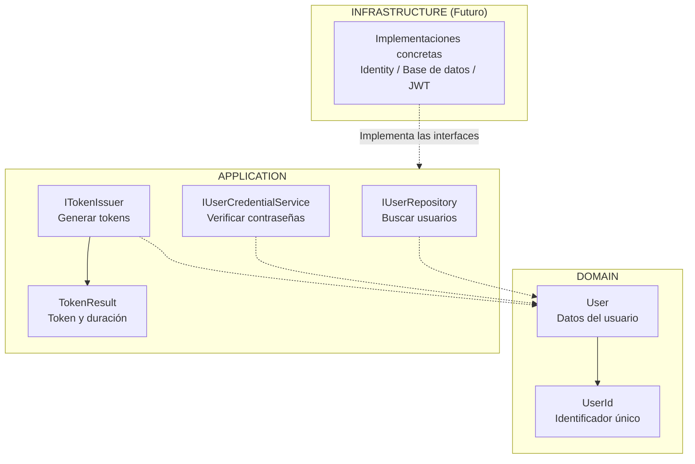
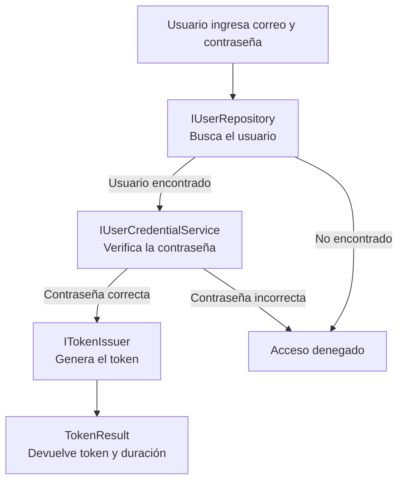
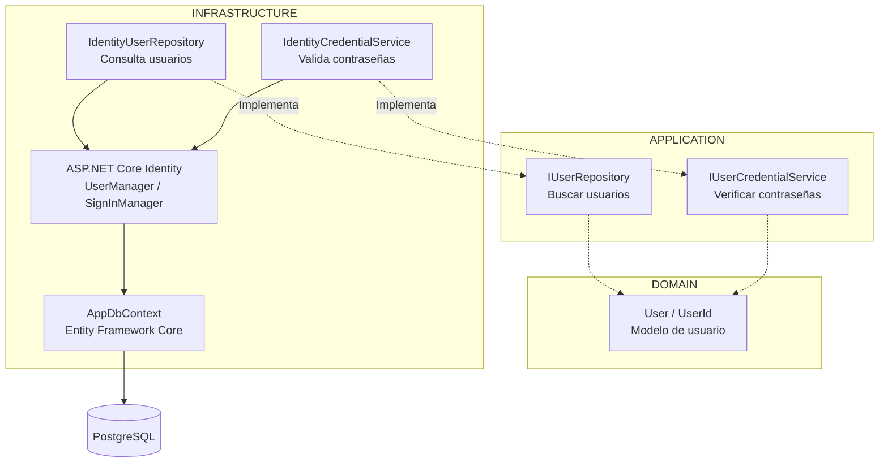
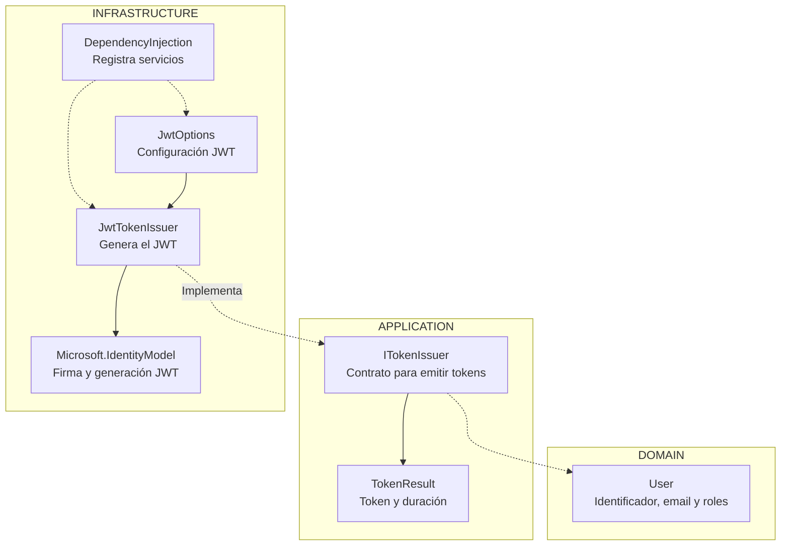
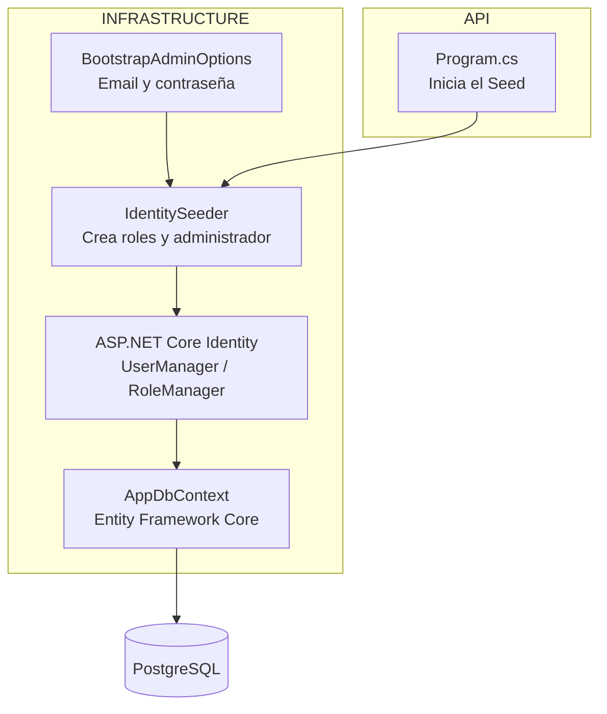
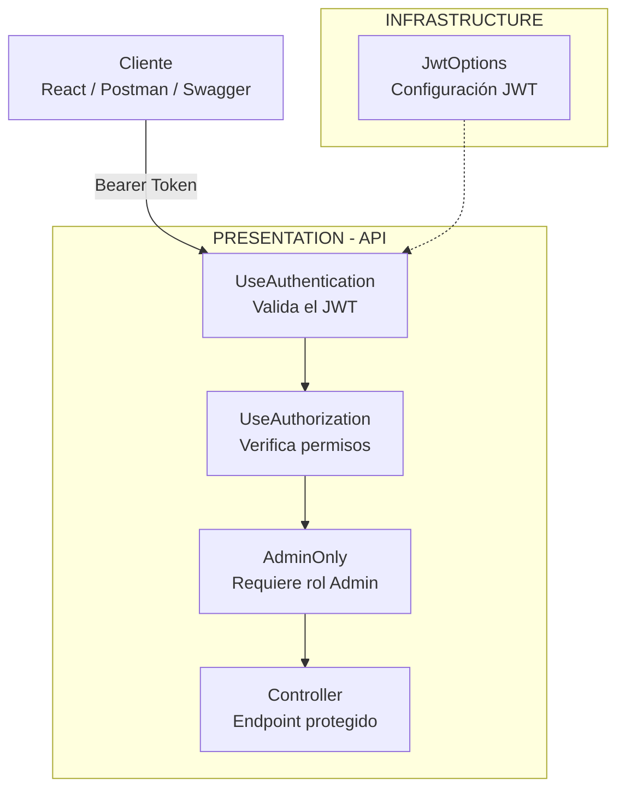
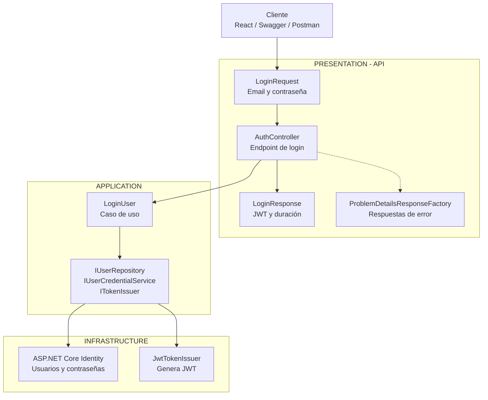

```powershell

7. Pruebas unitarias e integración con PostgreSQL efímero.
```

# Implementar 01-base-api-arquitectura

## PASOS

### 1. Modelo de usuario y puertos de Application.

Este módulo define **cómo se representa un usuario y qué operaciones necesita la aplicación para autenticarlo**.

Se divide en dos capas:

- **Domain:** define el modelo de usuario.
- **Application:** define las interfaces (puertos) necesarias para buscar usuarios, verificar contraseñas y generar tokens de acceso.

Las implementaciones de estas interfaces se desarrollarán en **Infrastructure**.

#### 1. Diagrama de componentes



#### 2. Responsabilidad de cada componente

| Componente               | Capa        | ¿Para qué sirve?                                                                   |
| ------------------------ | ----------- | ---------------------------------------------------------------------------------- |
| `User`                   | Domain      | Representa un usuario con su identificador, correo electrónico y roles.            |
| `UserId`                 | Domain      | Representa el identificador del usuario y permite comprobar que no esté vacío.     |
| `IUserRepository`        | Application | Define cómo buscar un usuario mediante su correo electrónico.                      |
| `IUserCredentialService` | Application | Define cómo verificar una contraseña y aplicar las reglas de bloqueo configuradas. |
| `ITokenIssuer`           | Application | Define cómo emitir un token para un usuario autenticado.                           |
| `TokenResult`            | Application | Contiene el token generado y su duración en segundos.                              |

#### 3. ¿Cómo trabajan juntos?

Cuando un usuario intenta iniciar sesión, el proceso esperado es el siguiente:



**Ejemplo:**

1. El usuario ingresa su correo y contraseña.
2. `IUserRepository` permite buscar sus datos y obtener un objeto `User`.
3. `IUserCredentialService` permite comprobar si su contraseña es correcta.
4. `ITokenIssuer` permite generar un token de acceso.
5. `TokenResult` devuelve el token y su duración.

Este flujo será coordinado por un caso de uso de Application cuando se implemente la autenticación.

#### 4. ¿Por qué se utilizan interfaces?

Porque **Application debe definir qué necesita hacer, sin depender de cómo se hace**.

Por ejemplo:

- `IUserRepository` define la búsqueda de usuarios, pero no conoce la base de datos.
- `IUserCredentialService` define la verificación de contraseñas, pero no depende directamente de ASP.NET Core Identity.
- `ITokenIssuer` define la emisión de tokens, pero no depende directamente de JWT.

**Infrastructure implementará estas interfaces** utilizando las tecnologías correspondientes.

Esto aplica el principio de inversión de dependencias (**DIP**) y permite cambiar tecnologías sin modificar la lógica de negocio.

#### 5. Resumen

| Capa               | Responsabilidad                                               |
| ------------------ | ------------------------------------------------------------- |
| **Domain**         | Define qué es un usuario.                                     |
| **Application**    | Define qué operaciones necesita la autenticación.             |
| **Infrastructure** | Implementa esas operaciones utilizando tecnologías concretas. |

**Conclusión:** Este spec establece la estructura básica para autenticar usuarios, separando los modelos y contratos de las tecnologías que se utilizarán posteriormente.

---

### 2. Identity y persistencia PostgreSQL

Este spec implementa los componentes necesarios para **almacenar usuarios en PostgreSQL y verificar sus credenciales mediante ASP.NET Core Identity**.

Complementa el Spec 1, donde se definieron el modelo `User` y las interfaces de Application.

#### 1. Diagrama de componentes



**Idea principal:** Application define las operaciones mediante interfaces, mientras que Infrastructure las implementa utilizando ASP.NET Core Identity y PostgreSQL.

#### 2. Responsabilidad de cada componente

| Componente                  | ¿Para qué sirve?                                                               |
| --------------------------- | ------------------------------------------------------------------------------ |
| `ApplicationIdentityUser`   | Representa al usuario de ASP.NET Core Identity. Hereda de `IdentityUser`.      |
| `IdentityUserRepository`    | Busca usuarios mediante Identity y los convierte al modelo `User` de Domain.   |
| `IdentityCredentialService` | Verifica contraseñas y aplica las reglas de bloqueo configuradas.              |
| `UserManager`               | Servicio de Identity para administrar usuarios, contraseñas y roles.           |
| `SignInManager`             | Servicio de Identity para gestionar la autenticación y verificar credenciales. |
| `AppDbContext`              | Gestiona el acceso a los datos mediante Entity Framework Core.                 |
| `DependencyInjection`       | Configura PostgreSQL, Identity y registra los servicios de Infrastructure.     |
| `PostgreSQL`                | Almacena usuarios, roles y datos de autenticación.                             |

#### 3. Métodos proporcionados por ASP.NET Core Identity

**ASP.NET Core Identity** es un framework de Microsoft para gestionar usuarios, contraseñas, roles y autenticación.

Proporciona clases como `UserManager<TUser>` y `SignInManager<TUser>`, que incluyen métodos para realizar estas operaciones sin tener que implementarlas manualmente.

Los métodos utilizados en este spec son:

| Método                                           | Clase de .NET   | ¿Qué hace?                                                                                   | ¿Dónde se utiliza?          |
| ------------------------------------------------ | --------------- | -------------------------------------------------------------------------------------------- | --------------------------- |
| `FindByEmailAsync(email)`                        | `UserManager`   | Busca un usuario por su correo electrónico.                                                  | `IdentityUserRepository`    |
| `GetRolesAsync(user)`                            | `UserManager`   | Obtiene los roles asignados a un usuario.                                                    | `IdentityUserRepository`    |
| `FindByIdAsync(id)`                              | `UserManager`   | Busca un usuario mediante su identificador.                                                  | `IdentityCredentialService` |
| `CheckPasswordSignInAsync(user, password, true)` | `SignInManager` | Comprueba la contraseña y registra los intentos fallidos para aplicar las reglas de bloqueo. | `IdentityCredentialService` |

**Ejemplo 1: Buscar un usuario**

```csharp
ApplicationIdentityUser? identityUser =
    await _userManager.FindByEmailAsync(email);
```

`FindByEmailAsync` es un método de `UserManager` que consulta el usuario utilizando el almacenamiento configurado para Identity.

Si existe, devuelve un objeto `ApplicationIdentityUser`; caso contrario, devuelve `null`.

**Ejemplo 2: Obtener los roles**

```csharp
IList<string> roles =
    await _userManager.GetRolesAsync(identityUser);
```

`GetRolesAsync` obtiene los nombres de los roles asignados al usuario, por ejemplo: `Admin`, `Contador` o `Asistente`.

Estos roles pueden utilizarse posteriormente para implementar reglas de autorización.

**Ejemplo 3: Verificar una contraseña**

```csharp
SignInResult result =
    await _signInManager.CheckPasswordSignInAsync(
        identityUser,
        password,
        lockoutOnFailure: true);
```

`CheckPasswordSignInAsync` comprueba si la contraseña proporcionada es válida.

El parámetro `lockoutOnFailure: true` permite contabilizar los intentos fallidos para aplicar las reglas de bloqueo configuradas.

El resultado se consulta mediante:

```csharp
return result.Succeeded;
```

Devuelve `true` si la verificación fue satisfactoria y `false` en caso contrario.

**¿Por qué se utilizan estos métodos?**

Porque ASP.NET Core Identity proporciona funcionalidades de seguridad ya implementadas y probadas, como:

- Almacenamiento y verificación de hashes de contraseñas.
- Administración de usuarios y roles.
- Control de intentos fallidos y bloqueo de cuentas.
- Integración con Entity Framework Core.

De esta manera, no es necesario desarrollar manualmente estos mecanismos de seguridad.

#### 4. ¿Cómo trabajan juntos?

Cuando un usuario intenta iniciar sesión, el proceso esperado es:

1. **Application** solicita buscar al usuario mediante `IUserRepository`.
2. **IdentityUserRepository** utiliza `FindByEmailAsync` y `GetRolesAsync` para recuperar sus datos.
3. El repositorio convierte `ApplicationIdentityUser` en `User`, el modelo de Domain.
4. **Application** solicita verificar la contraseña mediante `IUserCredentialService`.
5. **IdentityCredentialService** utiliza `FindByIdAsync` para localizar al usuario y `CheckPasswordSignInAsync` para verificar la contraseña.
6. Finalmente, devuelve `true` o `false` según el resultado.

Las operaciones de persistencia se realizan a través de Identity, Entity Framework Core y PostgreSQL.

Este flujo será coordinado por el caso de uso de autenticación correspondiente.

#### 5. Configuración de seguridad

En `DependencyInjection` se establecieron las siguientes reglas:

| Configuración                 | Valor         |
| ----------------------------- | ------------- |
| Longitud mínima de contraseña | 12 caracteres |
| Mayúsculas y minúsculas       | Obligatorias  |
| Números                       | Obligatorios  |
| Caracteres especiales         | Obligatorios  |
| Caracteres distintos          | Mínimo 6      |
| Intentos fallidos permitidos  | 5             |
| Duración del bloqueo          | 15 minutos    |
| Correo electrónico único      | Obligatorio   |

Estas reglas son administradas por ASP.NET Core Identity.

#### 6. Integración con Application

Las clases `IdentityUserRepository` e `IdentityCredentialService` implementan las interfaces definidas en el Spec 1.

Su vinculación se realiza mediante **inyección de dependencias**:

```csharp
services.AddScoped<IUserRepository, IdentityUserRepository>();

services.AddScoped<IUserCredentialService, IdentityCredentialService>();
```

Esto significa que:

- **Application** utiliza `IUserRepository` e `IUserCredentialService`.
- **Infrastructure** proporciona sus implementaciones concretas.
- **ASP.NET Core Identity** realiza las operaciones de autenticación.
- **Entity Framework Core** permite acceder a PostgreSQL.

La configuración de PostgreSQL se realiza mediante:

```csharp
services.AddDbContext<AppDbContext>(
    options => options.UseNpgsql(connectionString));
```

`UseNpgsql` configura Entity Framework Core para utilizar PostgreSQL como proveedor de base de datos.

**Ventaja:** Application no necesita conocer ASP.NET Core Identity ni PostgreSQL. Si cambia la tecnología, se pueden sustituir las implementaciones sin modificar los contratos.

#### 7. Resumen

| Capa               | Responsabilidad                                                                     |
| ------------------ | ----------------------------------------------------------------------------------- |
| **Domain**         | Define el modelo `User` y su identificador `UserId`.                                |
| **Application**    | Define las interfaces para buscar usuarios y verificar contraseñas.                 |
| **Infrastructure** | Implementa las interfaces utilizando ASP.NET Core Identity y Entity Framework Core. |
| **PostgreSQL**     | Almacena los usuarios, roles y datos de autenticación.                              |

**Conclusión:** El Spec 2 implementa los contratos del Spec 1 utilizando ASP.NET Core Identity para gestionar usuarios y verificar contraseñas, y PostgreSQL para almacenar su información.

Esta separación mantiene **Application independiente de las tecnologías utilizadas en Infrastructure**, siguiendo los principios de Clean Architecture.

**Nota:** La generación de tokens JWT mediante `ITokenIssuer` todavía no está implementada en este spec.

---

### 3. Emisión JWT

Este spec implementa la **generación de tokens JWT (JSON Web Token)** para usuarios autenticados.

Complementa los specs anteriores:

- **Spec 1:** define el modelo `User` y la interfaz `ITokenIssuer`.
- **Spec 2:** implementa la búsqueda de usuarios y la validación de contraseñas mediante ASP.NET Core Identity.
- **Spec 3:** implementa `ITokenIssuer` para generar tokens JWT firmados.

Un JWT permite identificar a un usuario en solicitudes posteriores sin enviar nuevamente su contraseña.

#### 1. Diagrama de componentes



**Idea principal:** Application define cómo solicitar un token mediante `ITokenIssuer`, mientras que Infrastructure implementa su generación utilizando las librerías JWT de Microsoft.

#### 2. Responsabilidad de cada componente

| Componente            | Capa           | ¿Para qué sirve?                                                      |
| --------------------- | -------------- | --------------------------------------------------------------------- |
| `User`                | Domain         | Contiene el identificador, correo y roles que se incluirán en el JWT. |
| `ITokenIssuer`        | Application    | Define el método `IssueAsync` para solicitar un token.                |
| `TokenResult`         | Application    | Representa el token generado y su duración en segundos.               |
| `JwtOptions`          | Infrastructure | Contiene la configuración necesaria para generar y firmar tokens.     |
| `JwtTokenIssuer`      | Infrastructure | Implementa `ITokenIssuer` y genera el JWT.                            |
| `DependencyInjection` | Infrastructure | Configura, valida y registra los servicios JWT.                       |

#### 3. ¿Cómo se genera un JWT?

El método `IssueAsync` de `JwtTokenIssuer` realiza las siguientes operaciones:

1. Recibe un objeto `User` que representa al usuario autenticado.
2. Calcula la fecha de emisión y expiración del token.
3. Crea los **claims**, que contienen la información del usuario.
4. Obtiene la clave secreta configurada.
5. Firma el token utilizando el algoritmo `HmacSha256`.
6. Convierte el JWT en una cadena de texto.
7. Devuelve el token generado junto con su duración.

**Ejemplo de los claims utilizados:**

```csharp
List<Claim> claims =
[
    new(JwtRegisteredClaimNames.Sub, user.Id.Value),
    new(JwtRegisteredClaimNames.Email, user.Email),
    new(JwtRegisteredClaimNames.Jti, Guid.NewGuid().ToString("N"))
];

claims.AddRange(
    user.Roles.Select(role => new Claim(ClaimTypes.Role, role))
);
```

| Claim   | ¿Qué representa?                |
| ------- | ------------------------------- |
| `Sub`   | Identificador del usuario.      |
| `Email` | Correo electrónico del usuario. |
| `Jti`   | Identificador único del token.  |
| `Role`  | Roles asignados al usuario.     |

Los claims permiten que posteriormente la API identifique al usuario y evalúe sus permisos, siempre que el JWT sea validado correctamente.

#### 4. ¿Qué componentes pertenecen a .NET y cuáles son dependencias?

En `JwtTokenIssuer` se utilizan clases del lenguaje C#, de .NET y de paquetes de Microsoft.

| Componente                      | Origen                                    | ¿Para qué sirve?                                               |
| ------------------------------- | ----------------------------------------- | -------------------------------------------------------------- |
| `Task<T>`                       | .NET (`System.Threading.Tasks`)           | Representa una operación que devuelve un resultado.            |
| `Task.FromResult()`             | .NET (`System.Threading.Tasks`)           | Crea un `Task` completado con un resultado disponible.         |
| `DateTime.UtcNow`               | .NET (`System`)                           | Obtiene la fecha y hora UTC.                                   |
| `Guid.NewGuid()`                | .NET (`System`)                           | Genera un identificador único.                                 |
| `Claim`                         | .NET (`System.Security.Claims`)           | Representa un dato de identidad del usuario.                   |
| `ClaimTypes.Role`               | .NET (`System.Security.Claims`)           | Identifica un claim de rol.                                    |
| `Encoding.UTF8`                 | .NET (`System.Text`)                      | Convierte la clave secreta en bytes.                           |
| `JwtSecurityToken`              | Paquete `System.IdentityModel.Tokens.Jwt` | Representa un token JWT.                                       |
| `JwtSecurityTokenHandler`       | Paquete `System.IdentityModel.Tokens.Jwt` | Permite serializar un JWT a texto.                             |
| `JwtRegisteredClaimNames`       | Paquete `System.IdentityModel.Tokens.Jwt` | Proporciona los nombres estándar de claims JWT.                |
| `SymmetricSecurityKey`          | Paquete `Microsoft.IdentityModel.Tokens`  | Representa una clave criptográfica simétrica.                  |
| `SigningCredentials`            | Paquete `Microsoft.IdentityModel.Tokens`  | Define la clave y el algoritmo de firma.                       |
| `SecurityAlgorithms.HmacSha256` | Paquete `Microsoft.IdentityModel.Tokens`  | Identifica el algoritmo de firma HMAC-SHA256.                  |
| `IOptions<T>`                   | Microsoft.Extensions.Options              | Permite acceder a la configuración mediante el patrón Options. |

**Importante:** `System.IdentityModel.Tokens.Jwt` y `Microsoft.IdentityModel.Tokens` son librerías de Microsoft que se utilizan con .NET, pero no son clases creadas en el proyecto.

En cambio, `JwtOptions`, `JwtTokenIssuer`, `ITokenIssuer` y `TokenResult` son componentes propios de la aplicación.

#### 5. ¿Qué hace `Task.FromResult(new TokenResult(accessToken, expiresIn))`?

En `JwtTokenIssuer` encontramos:

```csharp
return Task.FromResult(
    new TokenResult(accessToken, expiresIn)
);
```

Esta instrucción realiza dos operaciones.

**Primero: crea un objeto `TokenResult`.**

```csharp
new TokenResult(accessToken, expiresIn)
```

Por ejemplo:

```csharp
new TokenResult("eyJhbGciOiJIUzI1NiIs...", 3600);
```

Donde:

- `AccessToken`: JWT generado.
- `ExpiresIn`: duración del token en segundos.

**Segundo: devuelve ese objeto dentro de un `Task`.**

```csharp
Task.FromResult(resultado);
```

`Task.FromResult<T>()` es un método de .NET que permite devolver un resultado ya calculado mediante un `Task<T>` completado.

Esto es necesario porque `IssueAsync` está definido con el siguiente tipo de retorno:

```csharp
public Task<TokenResult> IssueAsync(
    User user,
    CancellationToken cancellationToken = default)
```

**¿Por qué no se utiliza `async/await`?**

Porque la generación del JWT se realiza en memoria y no necesita esperar operaciones asíncronas, como consultas a una base de datos o llamadas HTTP.

Por eso se utiliza:

```csharp
return Task.FromResult(resultado);
```

En lugar de declarar innecesariamente un método `async`.

La ventaja es que se mantiene el contrato `Task<TokenResult>` de Application, permitiendo que otras implementaciones puedan utilizar operaciones asíncronas si lo necesitan.

#### 6. ¿Qué hace `public sealed record TokenResult(...)`?

En Application se definió:

```csharp
public sealed record TokenResult(
    string AccessToken,
    long ExpiresIn
);
```

`record` es una característica de C# que permite definir tipos orientados a almacenar datos con menos código.

Esta declaración crea un tipo llamado `TokenResult` con dos propiedades:

| Elemento      | Significado                                                                      |
| ------------- | -------------------------------------------------------------------------------- |
| `public`      | Puede utilizarse desde otras clases y proyectos que tengan acceso al ensamblado. |
| `sealed`      | Impide que otras clases hereden de `TokenResult`.                                |
| `record`      | Define un tipo de referencia con igualdad basada en sus valores.                 |
| `AccessToken` | Propiedad `string` que contiene el JWT.                                          |
| `ExpiresIn`   | Propiedad `long` que contiene la duración en segundos.                           |

**Ejemplo de uso:**

```csharp
TokenResult result = new(
    "eyJhbGciOiJIUzI1NiIs...",
    3600
);

Console.WriteLine(result.AccessToken);
Console.WriteLine(result.ExpiresIn);
```

El resultado contiene los datos necesarios para entregar el token al cliente.

**¿Por qué se utiliza `record` en lugar de `class`?**

Porque `TokenResult` únicamente necesita transportar información, sin implementar lógica de negocio.

Además, proporciona automáticamente un constructor, propiedades de solo inicialización e igualdad por valor.

Esto reduce código y facilita el mantenimiento.

#### 7. Configuración mediante `JwtOptions`

La clase `JwtOptions` contiene cuatro propiedades:

| Propiedad                    | ¿Para qué sirve?                              |
| ---------------------------- | --------------------------------------------- |
| `Issuer`                     | Identifica quién emite el JWT.                |
| `Audience`                   | Identifica a quién está destinado el JWT.     |
| `SigningKey`                 | Clave secreta utilizada para firmar el token. |
| `AccessTokenLifetimeMinutes` | Tiempo de validez del token en minutos.       |

Estas propiedades se obtienen de la sección `Jwt` de la configuración.

En `DependencyInjection` se utiliza:

```csharp
services.AddOptions<JwtOptions>()
    .Bind(configuration.GetSection(JwtOptions.SectionName))
    .ValidateOnStart();
```

El código real también incluye validaciones para comprobar que:

- `Issuer` no esté vacío.
- `Audience` no esté vacío.
- `SigningKey` contenga al menos 32 bytes UTF-8.
- `AccessTokenLifetimeMinutes` sea mayor que cero.

El método `ValidateOnStart()` permite ejecutar estas validaciones durante el inicio de la aplicación, evitando comenzar con una configuración JWT inválida.

**Nota de seguridad:** La clave `SigningKey` debe mantenerse fuera del código fuente y gestionarse mediante configuración segura, como variables de entorno o un gestor de secretos.

#### 8. Integración con Application

`JwtTokenIssuer` implementa la interfaz `ITokenIssuer` definida en el Spec 1.

```csharp
public sealed class JwtTokenIssuer : ITokenIssuer
```

La implementación se registra mediante inyección de dependencias:

```csharp
services.AddSingleton<ITokenIssuer, JwtTokenIssuer>();
```

Esto significa que:

- **Application** utiliza la interfaz `ITokenIssuer`.
- **Infrastructure** proporciona la implementación `JwtTokenIssuer`.
- **JwtTokenIssuer** genera el token utilizando las librerías JWT.
- **Application** recibe un `TokenResult`, sin depender de la tecnología utilizada.

`AddSingleton` indica que el contenedor de dependencias utiliza una única instancia del servicio durante la vida de la aplicación.

#### 9. Resumen

| Capa               | Responsabilidad                                                     |
| ------------------ | ------------------------------------------------------------------- |
| **Domain**         | Proporciona el modelo `User` con los datos del usuario autenticado. |
| **Application**    | Define `ITokenIssuer` y `TokenResult`.                              |
| **Infrastructure** | Implementa `JwtTokenIssuer` y configura `JwtOptions`.               |
| **Librerías JWT**  | Construyen, firman y serializan los tokens JWT.                     |

**Conclusión:** El Spec 3 implementa la emisión de tokens JWT mediante una clase de Infrastructure que cumple el contrato definido en Application.

La generación del token utiliza los datos del usuario, incorpora sus roles y firma el JWT mediante HMAC-SHA256.

La arquitectura mantiene **Application independiente de las librerías JWT**, siguiendo los principios de Clean Architecture.

**Nota:** Este spec implementa la emisión de JWT, pero no demuestra todavía la configuración del middleware de autenticación JWT Bearer para validar los tokens recibidos por la API. Esa funcionalidad debe configurarse por separado.

---

### 4. Seed de roles y administrador

Este spec implementa la **creación automática de los roles `Admin` y `User`, y de un usuario administrador inicial**.

El proceso se ejecuta al iniciar la API y utiliza ASP.NET Core Identity para administrar los usuarios y roles almacenados en PostgreSQL.

Se utiliza un mecanismo llamado **Seed**, que consiste en insertar los datos iniciales necesarios para que una aplicación pueda funcionar.

La implementación es **idempotente**: puede ejecutarse varias veces sin crear duplicados de los roles o del administrador identificado por su correo electrónico.

#### 1. Diagrama de componentes



**Idea principal:** Cuando arranca la API, `Program.cs` ejecuta `IdentitySeeder`, que utiliza ASP.NET Core Identity para crear los roles y el administrador inicial en PostgreSQL.

#### 2. Responsabilidad de cada componente

| Componente                | Capa           | ¿Para qué sirve?                                                   |
| ------------------------- | -------------- | ------------------------------------------------------------------ |
| `BootstrapAdminOptions`   | Infrastructure | Contiene el correo y la contraseña del administrador inicial.      |
| `IdentitySeeder`          | Infrastructure | Comprueba y crea los roles y el administrador cuando es necesario. |
| `ApplicationIdentityUser` | Infrastructure | Representa al usuario que administra ASP.NET Core Identity.        |
| `UserManager`             | Identity       | Permite buscar y crear usuarios, además de asignarles roles.       |
| `RoleManager`             | Identity       | Permite consultar y crear roles.                                   |
| `AppDbContext`            | Infrastructure | Gestiona el acceso a PostgreSQL mediante Entity Framework Core.    |
| `DependencyInjection`     | Infrastructure | Registra `IdentitySeeder` y configura `BootstrapAdminOptions`.     |
| `Program.cs`              | API            | Ejecuta el proceso de inicialización al arrancar la aplicación.    |

#### 3. ¿Cómo funciona el proceso?

Cuando la API inicia, se ejecuta el siguiente proceso:

1. **Program.cs** obtiene una instancia de `IdentitySeeder`.
2. **IdentitySeeder** comprueba que existe el esquema de base de datos necesario.
3. Verifica si existe el rol `Admin`; si no existe, lo crea.
4. Verifica si existe el rol `User`; si no existe, lo crea.
5. Busca al administrador mediante el correo configurado.
6. Si el administrador no existe, lo crea utilizando `UserManager`.
7. Comprueba si el administrador tiene asignado el rol `Admin`.
8. Si no tiene el rol, se lo asigna.

**¿Qué ocurre si se reinicia la API?**

El proceso vuelve a ejecutarse, pero comprueba previamente la existencia de los roles y del usuario.

De esta manera, evita crear registros duplicados.

**Importante:** Si el administrador ya existe, no se modifica su contraseña. Únicamente se comprueba que tenga asignado el rol `Admin`.

#### 4. Métodos proporcionados por ASP.NET Core Identity y Entity Framework Core

`IdentitySeeder` utiliza métodos de Microsoft para gestionar usuarios, roles y persistencia.

| Método                        | Clase / Framework          | ¿Qué hace?                                                        |
| ----------------------------- | -------------------------- | ----------------------------------------------------------------- |
| `EnsureCreatedAsync()`        | EF Core (`DatabaseFacade`) | Crea la base de datos y su esquema si todavía no existen.         |
| `RoleExistsAsync(role)`       | Identity (`RoleManager`)   | Comprueba si existe un rol.                                       |
| `CreateAsync(role)`           | Identity (`RoleManager`)   | Crea un rol nuevo.                                                |
| `FindByEmailAsync(email)`     | Identity (`UserManager`)   | Busca un usuario por su correo electrónico.                       |
| `CreateAsync(user, password)` | Identity (`UserManager`)   | Crea un usuario y almacena su contraseña mediante un hash seguro. |
| `IsInRoleAsync(user, role)`   | Identity (`UserManager`)   | Comprueba si un usuario tiene asignado un rol.                    |
| `AddToRoleAsync(user, role)`  | Identity (`UserManager`)   | Asigna un rol a un usuario.                                       |

**Ejemplo 1: Comprobar y crear un rol**

```csharp
if (!await _roleManager.RoleExistsAsync("Admin"))
{
    await _roleManager.CreateAsync(
        new IdentityRole("Admin")
    );
}
```

`RoleExistsAsync` comprueba si el rol existe.

Si no existe, `CreateAsync` lo registra mediante ASP.NET Core Identity.

**Ejemplo 2: Crear el administrador**

```csharp
ApplicationIdentityUser? admin =
    await _userManager.FindByEmailAsync(_options.Email);

if (admin is null)
{
    admin = new ApplicationIdentityUser
    {
        UserName = _options.Email,
        Email = _options.Email,
        EmailConfirmed = true
    };

    await _userManager.CreateAsync(
        admin,
        _options.Password
    );
}
```

`FindByEmailAsync` busca al usuario.

Si no existe, `CreateAsync` lo crea y procesa su contraseña utilizando las reglas de ASP.NET Core Identity.

**Ejemplo 3: Asignar el rol de administrador**

```csharp
if (!await _userManager.IsInRoleAsync(admin, "Admin"))
{
    await _userManager.AddToRoleAsync(
        admin,
        "Admin"
    );
}
```

Primero se comprueba si el usuario pertenece al rol `Admin`.

Si no pertenece, se le asigna.

**¿Por qué se utilizan estos métodos?**

Porque ASP.NET Core Identity ya proporciona mecanismos para administrar usuarios, contraseñas y roles.

Esto evita implementar manualmente consultas SQL, almacenamiento de contraseñas y relaciones entre usuarios y roles.

#### 5. ¿Qué hace `BootstrapAdminOptions`?

Esta clase representa la configuración del administrador inicial.

```csharp
public sealed class BootstrapAdminOptions
{
    public const string SectionName = "BootstrapAdmin";

    public string Email { get; set; } = string.Empty;

    public string Password { get; set; } = string.Empty;
}
```

| Propiedad     | Descripción                                              |
| ------------- | -------------------------------------------------------- |
| `SectionName` | Identifica la sección `BootstrapAdmin` de configuración. |
| `Email`       | Correo electrónico del administrador inicial.            |
| `Password`    | Contraseña inicial del administrador.                    |

También incorpora el método `IsValid()`:

```csharp
public bool IsValid()
{
    return new EmailAddressAttribute().IsValid(Email)
        && !string.IsNullOrWhiteSpace(Password);
}
```

Este método utiliza `EmailAddressAttribute`, proporcionado por .NET, para comprobar el formato del correo electrónico.

Además, verifica que la contraseña no esté vacía.

**Importante:** `IsValid()` no comprueba todas las reglas de seguridad de la contraseña. Esas reglas se aplican posteriormente mediante ASP.NET Core Identity cuando se crea el administrador.

#### 6. ¿Qué hace `SeedAsync()`?

Es el método principal de `IdentitySeeder`.

```csharp
public async Task SeedAsync(
    CancellationToken cancellationToken = default)
{
    await _dbContext.Database.EnsureCreatedAsync(
        cancellationToken
    );

    await EnsureRoleAsync(AdminRole);
    await EnsureRoleAsync(UserRole);

    // Buscar o crear administrador.
    // Asignarle el rol Admin cuando sea necesario.
}
```

**Elementos importantes:**

| Elemento               | ¿Qué significa?                                                                       |
| ---------------------- | ------------------------------------------------------------------------------------- |
| `async`                | Permite utilizar operaciones asíncronas mediante `await`.                             |
| `Task`                 | Representa una operación asíncrona sin valor de retorno.                              |
| `await`                | Espera la finalización de una operación sin bloquear el hilo mientras está pendiente. |
| `CancellationToken`    | Permite comunicar una solicitud de cancelación a las operaciones que lo admiten.      |
| `EnsureCreatedAsync()` | Comprueba la existencia de la base de datos y, cuando corresponde, crea el esquema.   |
| `EnsureRoleAsync()`    | Método propio del proyecto que comprueba y crea un rol si es necesario.               |

A diferencia del `JwtTokenIssuer` del Spec 3, **aquí sí se realizan operaciones asíncronas de acceso a datos**, por lo que utilizar `async/await` está justificado.

#### 7. ¿Cómo se ejecuta al iniciar la API?

En `Program.cs` se agregó:

```csharp
using (IServiceScope scope = app.Services.CreateScope())
{
    IdentitySeeder seeder =
        scope.ServiceProvider
            .GetRequiredService<IdentitySeeder>();

    await seeder.SeedAsync();
}
```

Este código utiliza el sistema de inyección de dependencias de .NET.

| Método / Componente       | ¿Qué hace?                                                                        |
| ------------------------- | --------------------------------------------------------------------------------- |
| `CreateScope()`           | Crea un ámbito para resolver servicios registrados como `Scoped`.                 |
| `IServiceScope`           | Representa el ámbito y permite liberar sus recursos al finalizar.                 |
| `GetRequiredService<T>()` | Obtiene una instancia del servicio registrado; genera una excepción si no existe. |
| `SeedAsync()`             | Ejecuta la inicialización de los roles y del administrador.                       |

**¿Por qué se utiliza `CreateScope()`?**

Porque `IdentitySeeder` depende de servicios como `AppDbContext` y `UserManager`, que utilizan un ciclo de vida `Scoped`.

`CreateScope()` permite utilizarlos correctamente durante el inicio de la aplicación y liberar sus recursos al terminar.

El proceso se ejecuta antes de que la API comience a atender solicitudes HTTP.

#### 8. Integración mediante DependencyInjection

En `DependencyInjection` se agregaron dos configuraciones.

**Configuración del administrador:**

```csharp
services.AddOptions<BootstrapAdminOptions>()
    .Bind(
        configuration.GetSection(
            BootstrapAdminOptions.SectionName
        )
    )
    .Validate(
        options => options.IsValid(),
        "BootstrapAdmin configuration is invalid."
    )
    .ValidateOnStart();
```

Esta configuración:

1. Obtiene los valores de la sección `BootstrapAdmin`.
2. Los asigna a `BootstrapAdminOptions`.
3. Comprueba que sean válidos.
4. Configura su validación durante el inicio de la aplicación.

**Registro del servicio:**

```csharp
services.AddScoped<IdentitySeeder>();
```

`AddScoped` registra `IdentitySeeder` para que el contenedor de dependencias pueda crear una instancia dentro de un ámbito.

#### 9. ¿Qué componentes pertenecen a .NET y cuáles son propios?

| Componente                | Origen                                   | Responsabilidad                                        |
| ------------------------- | ---------------------------------------- | ------------------------------------------------------ |
| `Task`, `async`, `await`  | .NET / C#                                | Permiten implementar operaciones asíncronas.           |
| `CancellationToken`       | .NET                                     | Permite solicitar la cancelación de operaciones.       |
| `EmailAddressAttribute`   | .NET                                     | Valida el formato de una dirección de correo.          |
| `UserManager<T>`          | ASP.NET Core Identity                    | Administra usuarios.                                   |
| `RoleManager<T>`          | ASP.NET Core Identity                    | Administra roles.                                      |
| `IdentityRole`            | ASP.NET Core Identity                    | Representa un rol del sistema.                         |
| `IdentityResult`          | ASP.NET Core Identity                    | Contiene el resultado de una operación de Identity.    |
| `EnsureCreatedAsync()`    | Entity Framework Core                    | Crea la base de datos y el esquema cuando corresponde. |
| `IOptions<T>`             | Microsoft.Extensions.Options             | Proporciona acceso a configuración tipada.             |
| `CreateScope()`           | Microsoft.Extensions.DependencyInjection | Crea un ámbito de servicios.                           |
| `GetRequiredService<T>()` | Microsoft.Extensions.DependencyInjection | Obtiene un servicio registrado.                        |
| `IdentitySeeder`          | Proyecto                                 | Inicializa roles y administrador.                      |
| `BootstrapAdminOptions`   | Proyecto                                 | Define la configuración del administrador inicial.     |

#### 10. Resumen

| Componente                | Responsabilidad                                             |
| ------------------------- | ----------------------------------------------------------- |
| **Program.cs**            | Ejecuta el proceso de inicialización.                       |
| **IdentitySeeder**        | Comprueba y crea los roles y el administrador.              |
| **BootstrapAdminOptions** | Proporciona las credenciales iniciales.                     |
| **ASP.NET Core Identity** | Administra la creación de usuarios, roles y sus relaciones. |
| **Entity Framework Core** | Gestiona la persistencia.                                   |
| **PostgreSQL**            | Almacena los registros creados.                             |

**Conclusión:** El Spec 4 automatiza la configuración inicial de seguridad de la aplicación mediante la creación de los roles `Admin` y `User`, junto con un administrador inicial.

La implementación utiliza ASP.NET Core Identity y Entity Framework Core, evitando desarrollar manualmente la gestión de usuarios y roles.

El proceso es idempotente, por lo que puede ejecutarse en cada arranque sin duplicar los registros existentes.

---

### 5. Login, 401, 403 y AdminOnly

Este spec configura la **autenticación JWT y la autorización mediante roles** para proteger los endpoints de la API.

Complementa los specs anteriores:

- **Spec 2:** permite consultar usuarios y verificar contraseñas mediante ASP.NET Core Identity.
- **Spec 3:** permite generar tokens JWT para usuarios autenticados.
- **Spec 4:** crea los roles `Admin` y `User`, junto con el administrador inicial.
- **Spec 5:** configura la validación de tokens JWT, los errores HTTP `401` y `403`, y la política de autorización `AdminOnly`.

Es importante distinguir dos conceptos:

| Concepto          | ¿Qué hace?                            | Ejemplo                             |
| ----------------- | ------------------------------------- | ----------------------------------- |
| **Autenticación** | Comprueba quién es el usuario.        | Verificar que el JWT sea válido.    |
| **Autorización**  | Comprueba qué puede hacer el usuario. | Verificar que tenga el rol `Admin`. |

#### 1. Diagrama de componentes



**Idea principal:** La API recibe un JWT, comprueba que sea válido y verifica si el usuario tiene los permisos necesarios antes de ejecutar un endpoint protegido.

Cuando falla alguna comprobación, responde con `401` o `403`, según corresponda.

#### 2. Responsabilidad de cada componente

| Componente                      | Capa           | ¿Para qué sirve?                                                      |
| ------------------------------- | -------------- | --------------------------------------------------------------------- |
| `Program.cs`                    | Presentation   | Configura el orden de ejecución de los middlewares.                   |
| `DependencyInjection`           | Presentation   | Registra la autenticación JWT, autorización y políticas de acceso.    |
| `JwtBearer`                     | Framework      | Extrae y valida los tokens JWT recibidos por la API.                  |
| `TokenValidationParameters`     | Framework      | Define las reglas para validar un JWT.                                |
| `JwtBearerEvents`               | Framework      | Permite personalizar las respuestas de autenticación y autorización.  |
| `AdminOnly`                     | Presentation   | Política que permite el acceso únicamente a usuarios con rol `Admin`. |
| `JwtOptions`                    | Infrastructure | Proporciona los valores necesarios para validar el JWT.               |
| `ProblemDetailsResponseFactory` | Presentation   | Componente propio que construye respuestas de error HTTP uniformes.   |

#### 3. ¿Cómo funciona el proceso?

El proceso completo esperado se divide en dos partes.

**A. Inicio de sesión (Login)**

1. El cliente envía su correo y contraseña.
2. Application solicita buscar el usuario y comprobar sus credenciales.
3. Si las credenciales son correctas, se solicita un JWT mediante `ITokenIssuer`.
4. El cliente recibe el token y lo utiliza en las siguientes solicitudes.

Este flujo depende de los componentes implementados en los specs anteriores y de un endpoint de login que no aparece entre los archivos proporcionados.

**B. Acceso a un endpoint protegido**

1. El cliente envía una solicitud HTTP incluyendo el JWT.
2. `UseAuthentication()` ejecuta la autenticación configurada y valida el token.
3. Si el token es válido, ASP.NET Core construye la identidad del usuario a partir de sus claims.
4. `UseAuthorization()` comprueba los requisitos de acceso del endpoint.
5. Si el endpoint utiliza `AdminOnly`, se verifica que el usuario tenga el rol `Admin`.
6. Si cumple los requisitos, se ejecuta el endpoint; de lo contrario, la API devuelve un error HTTP.

#### 4. ¿Qué significan los errores 401 y 403?

Ambos códigos HTTP indican problemas de acceso, pero tienen significados diferentes.

| Código | Nombre       | ¿Cuándo ocurre?                                                  | Ejemplo                                                              |
| ------ | ------------ | ---------------------------------------------------------------- | -------------------------------------------------------------------- |
| `401`  | Unauthorized | El usuario no está autenticado correctamente.                    | Token ausente, inválido o expirado.                                  |
| `403`  | Forbidden    | El usuario está autenticado, pero no tiene permisos suficientes. | Un usuario con rol `User` intenta acceder a un endpoint `AdminOnly`. |

**Ejemplo:**

Supongamos que existe un endpoint protegido con la política `AdminOnly`.

| Solicitud                  | Resultado          |
| -------------------------- | ------------------ |
| Sin JWT                    | `401 Unauthorized` |
| JWT expirado               | `401 Unauthorized` |
| JWT con firma inválida     | `401 Unauthorized` |
| JWT válido con rol `User`  | `403 Forbidden`    |
| JWT válido con rol `Admin` | Acceso permitido   |

Estos resultados corresponden al comportamiento esperado de un endpoint que exige autenticación y aplica la política `AdminOnly`.

#### 5. Métodos y componentes proporcionados por ASP.NET Core

En `DependencyInjection` y `Program.cs` se utilizan métodos y clases del framework de Microsoft.

| Método / Componente         | Origen                                        | ¿Qué hace?                                                                         |
| --------------------------- | --------------------------------------------- | ---------------------------------------------------------------------------------- |
| `AddAuthentication()`       | ASP.NET Core                                  | Registra los servicios de autenticación.                                           |
| `AddJwtBearer()`            | Microsoft.AspNetCore.Authentication.JwtBearer | Configura la autenticación mediante JWT Bearer.                                    |
| `TokenValidationParameters` | Microsoft.IdentityModel.Tokens                | Define cómo debe validarse un token.                                               |
| `JwtBearerEvents`           | ASP.NET Core JWT Bearer                       | Permite personalizar eventos de autenticación.                                     |
| `OnChallenge`               | JWT Bearer                                    | Se ejecuta durante una respuesta de desafío de autenticación, habitualmente `401`. |
| `OnForbidden`               | JWT Bearer                                    | Se ejecuta cuando el acceso está prohibido, habitualmente `403`.                   |
| `AddAuthorization()`        | ASP.NET Core                                  | Registra los servicios de autorización.                                            |
| `AddPolicy()`               | ASP.NET Core                                  | Define una política de autorización.                                               |
| `RequireRole()`             | ASP.NET Core                                  | Exige que el usuario pertenezca a un rol.                                          |
| `UseAuthentication()`       | ASP.NET Core                                  | Incorpora el middleware de autenticación a las solicitudes HTTP.                   |
| `UseAuthorization()`        | ASP.NET Core                                  | Incorpora el middleware que evalúa las políticas de autorización.                  |

**¿Por qué se utilizan estos componentes?**

Porque ASP.NET Core proporciona mecanismos para validar identidades y controlar el acceso a recursos.

No es necesario implementar manualmente la verificación criptográfica del JWT ni las comprobaciones básicas de roles.

#### 6. ¿Qué hace `AddAuthentication().AddJwtBearer()`?

En `DependencyInjection` se configura:

```csharp
services.AddAuthentication(
    JwtBearerDefaults.AuthenticationScheme
)
.AddJwtBearer(options =>
{
    options.TokenValidationParameters =
        new TokenValidationParameters
        {
            ValidateIssuer = true,
            ValidIssuer = jwtOptions.Issuer,

            ValidateAudience = true,
            ValidAudience = jwtOptions.Audience,

            ValidateIssuerSigningKey = true,
            IssuerSigningKey = new SymmetricSecurityKey(
                Encoding.UTF8.GetBytes(jwtOptions.SigningKey)
            ),

            ValidateLifetime = true,
            ClockSkew = TimeSpan.Zero,

            NameClaimType = JwtRegisteredClaimNames.Email,
            RoleClaimType = ClaimTypes.Role
        };
});
```

Este código configura JWT Bearer como mecanismo de autenticación y establece las reglas para validar los tokens.

| Configuración               | ¿Qué verifica?                                                                  |
| --------------------------- | ------------------------------------------------------------------------------- |
| `ValidateIssuer`            | Que el emisor del token sea el configurado.                                     |
| `ValidateAudience`          | Que el token esté destinado a la aplicación correspondiente.                    |
| `ValidateIssuerSigningKey`  | Que se valide la clave utilizada para verificar la firma del token.             |
| `ValidateLifetime`          | Que el token se encuentre dentro de su periodo de validez.                      |
| `ClockSkew = TimeSpan.Zero` | Elimina la tolerancia adicional de tiempo al validar su vigencia.               |
| `NameClaimType`             | Identifica qué claim representa el nombre del usuario; en este caso, su correo. |
| `RoleClaimType`             | Identifica qué claims representan los roles del usuario.                        |

**Ejemplo:** Si un cliente modifica el contenido de un JWT firmado, la firma deja de ser válida y la API debe rechazarlo.

#### 7. ¿Qué hacen `OnChallenge` y `OnForbidden`?

La configuración incorpora dos eventos de `JwtBearerEvents` para generar respuestas HTTP uniformes.

**A. `OnChallenge`: error 401**

```csharp
OnChallenge = context =>
{
    context.HandleResponse();

    return WriteAuthenticationErrorAsync(
        context.HttpContext,
        StatusCodes.Status401Unauthorized,
        "Authentication is required.",
        "authentication_required"
    );
};
```

Se utiliza cuando la API debe responder con un desafío de autenticación.

`context.HandleResponse()` indica que el evento controlará la respuesta, evitando que JWT Bearer escriba su respuesta predeterminada.

Posteriormente, `WriteAuthenticationErrorAsync()` genera el error HTTP con el formato definido por la aplicación.

**B. `OnForbidden`: error 403**

```csharp
OnForbidden = context =>
    WriteAuthenticationErrorAsync(
        context.HttpContext,
        StatusCodes.Status403Forbidden,
        "You do not have permission to access this resource.",
        "forbidden"
    );
```

Se utiliza cuando el usuario está autenticado, pero no cumple los requisitos de autorización.

**¿Por qué se personalizan estos eventos?**

Para que la API devuelva errores con una estructura consistente, utilizando `application/problem+json` y los códigos de error definidos por la aplicación.

Esto facilita que React u otros clientes HTTP interpreten y presenten correctamente los errores.

#### 8. ¿Qué es la política `AdminOnly`?

Es una regla de autorización creada por la aplicación que exige que el usuario tenga el rol `Admin`.

Se configura mediante:

```csharp
services.AddAuthorization(options =>
{
    options.AddPolicy(
        "AdminOnly",
        policy => policy.RequireRole(IdentitySeeder.AdminRole)
    );
});
```

**Explicación:**

| Elemento                      | ¿Qué hace?                                               |
| ----------------------------- | -------------------------------------------------------- |
| `AddAuthorization()`          | Configura los servicios de autorización.                 |
| `AddPolicy("AdminOnly", ...)` | Registra una política con el nombre `AdminOnly`.         |
| `RequireRole()`               | Exige que el usuario tenga el rol indicado.              |
| `IdentitySeeder.AdminRole`    | Constante definida en el Spec 4 cuyo valor es `"Admin"`. |

Esta política puede utilizarse en un controlador:

```csharp
[Authorize(Policy = "AdminOnly")]
[HttpGet("admin")]
public IActionResult GetAdminData()
{
    return Ok("Acceso autorizado");
}
```

**Nota:** Este controlador es un ejemplo de uso; no forma parte de los dos archivos proporcionados.

En este ejemplo, el endpoint solo permite acceder a usuarios autenticados con el rol `Admin`.

#### 9. ¿Por qué son necesarios `UseAuthentication()` y `UseAuthorization()`?

En `Program.cs` se configuró:

```csharp
app.UseAuthentication();

app.UseAuthorization();

app.MapControllers();
```

Estos métodos incorporan middlewares al procesamiento de solicitudes HTTP.

Un **middleware** es un componente que participa en el procesamiento de una solicitud antes de que llegue al controlador.

| Middleware            | Responsabilidad                                                       |
| --------------------- | --------------------------------------------------------------------- |
| `UseAuthentication()` | Intenta identificar al usuario utilizando el JWT recibido.            |
| `UseAuthorization()`  | Comprueba si el usuario cumple los requisitos del recurso solicitado. |
| `MapControllers()`    | Registra los endpoints definidos en los controladores.                |

**¿Por qué importa el orden?**

Porque primero debe identificarse al usuario y después comprobarse qué permisos tiene.

Por eso:

```text
UseAuthentication()
        ↓
UseAuthorization()
        ↓
Controller
```

Si se ejecutara la autorización antes de establecer la identidad, las políticas podrían evaluarse sin la información necesaria del usuario.

#### 10. ¿Cómo se integra con los specs anteriores?

| Spec       | Componente                  | Integración                                      |
| ---------- | --------------------------- | ------------------------------------------------ |
| **Spec 1** | `User`                      | Representa la identidad del usuario en Domain.   |
| **Spec 2** | `IdentityUserRepository`    | Permite consultar el usuario.                    |
| **Spec 2** | `IdentityCredentialService` | Permite verificar sus credenciales.              |
| **Spec 3** | `JwtTokenIssuer`            | Genera el JWT con los datos y roles del usuario. |
| **Spec 4** | `IdentitySeeder`            | Crea los roles `Admin` y `User`.                 |
| **Spec 5** | JWT Bearer                  | Valida los tokens recibidos por la API.          |
| **Spec 5** | `AdminOnly`                 | Restringe el acceso a usuarios administradores.  |

#### 11. Resumen

| Componente                    | Responsabilidad                                                                 |
| ----------------------------- | ------------------------------------------------------------------------------- |
| **JWT Bearer**                | Valida los tokens enviados por el cliente.                                      |
| **TokenValidationParameters** | Define las reglas para aceptar o rechazar un JWT.                               |
| **UseAuthentication**         | Establece la identidad del usuario autenticado.                                 |
| **UseAuthorization**          | Comprueba sus permisos.                                                         |
| **AdminOnly**                 | Restringe el acceso al rol `Admin`.                                             |
| **OnChallenge**               | Personaliza los errores de autenticación `401`.                                 |
| **OnForbidden**               | Personaliza los errores de autorización `403`.                                  |
| **Swagger**                   | Documenta el esquema Bearer para facilitar las pruebas de endpoints protegidos. |

**Conclusión:** El Spec 5 incorpora la autenticación JWT Bearer y la autorización basada en roles.

La API puede validar los tokens recibidos, identificar al usuario, comprobar sus permisos y responder con códigos HTTP apropiados cuando el acceso no está permitido.

**Nota:** La configuración de JWT Bearer no protege automáticamente todos los endpoints. Cada endpoint debe tener los requisitos de autorización correspondientes, mediante `[Authorize]`, políticas como `AdminOnly` o una política global de autorización.

---

### 6. Swagger Bearer y respuestas de error

Este spec implementa el **endpoint de inicio de sesión y un mecanismo uniforme para devolver errores HTTP**.

Complementa los specs anteriores:

- **Spec 1:** define el modelo `User` y los puertos de Application.
- **Spec 2:** implementa la consulta de usuarios y verificación de contraseñas.
- **Spec 3:** implementa la generación de tokens JWT.
- **Spec 4:** crea los roles y el administrador inicial.
- **Spec 5:** configura JWT Bearer, autorización y políticas de acceso.
- **Spec 6:** integra los componentes anteriores para ejecutar el login y devolver respuestas HTTP estandarizadas.

El endpoint implementado es:

`POST /api/auth/login`

#### 1. Diagrama de componentes



**Idea principal:** `AuthController` recibe las credenciales, `LoginUser` coordina la autenticación y las implementaciones de Infrastructure verifican el usuario y generan el token.

Si ocurre un error esperado, la API utiliza `ProblemDetails` para devolver una respuesta HTTP uniforme.

#### 2. Responsabilidad de cada componente

| Componente                             | Capa        | ¿Para qué sirve?                                                                      |
| -------------------------------------- | ----------- | ------------------------------------------------------------------------------------- |
| `AuthController`                       | API         | Expone el endpoint `POST /api/auth/login`.                                            |
| `LoginRequest`                         | API         | Representa el correo y la contraseña recibidos.                                       |
| `LoginRequestValidator`                | API         | Valida los datos enviados por el cliente.                                             |
| `LoginResponse`                        | API         | Contiene el JWT, el tipo de token y su duración.                                      |
| `LoginUser`                            | Application | Coordina la búsqueda del usuario, validación de contraseña y emisión del JWT.         |
| `AuthenticationError`                  | Application | Representa un error de credenciales inválidas o una cuenta que no puede autenticarse. |
| `ProblemDetailsResponseFactory`        | API         | Construye respuestas de error HTTP estandarizadas.                                    |
| `ApplicationErrorProblemDetailsMapper` | API         | Traduce errores de Application a respuestas HTTP.                                     |
| `DependencyInjection`                  | Application | Registra `LoginUser` en el contenedor de dependencias.                                |

#### 3. ¿Cómo funciona el login?

El proceso comienza cuando el cliente envía una solicitud:

```http
POST /api/auth/login
Content-Type: application/json
```

```json
{
  "email": "admin@example.com",
  "password": "************"
}
```

El flujo es el siguiente:

1. **AuthController** recibe las credenciales mediante `LoginRequest`.
2. **LoginRequestValidator** verifica el formato del correo y que los campos obligatorios estén presentes.
3. **AuthController** invoca el caso de uso `LoginUser`.
4. **LoginUser** utiliza `IUserRepository` para buscar al usuario.
5. Si existe, utiliza `IUserCredentialService` para verificar la contraseña.
6. Si las credenciales son correctas, utiliza `ITokenIssuer` para generar el JWT.
7. **AuthController** devuelve un `LoginResponse` con el token generado.
8. Si las credenciales no son válidas, devuelve un error HTTP `401`.

**Ejemplo de respuesta exitosa:**

```json
{
  "accessToken": "eyJhbGciOiJIUzI1NiIs...",
  "tokenType": "Bearer",
  "expiresIn": 3600
}
```

| Campo         | Descripción                                                 |
| ------------- | ----------------------------------------------------------- |
| `accessToken` | JWT que utilizará el cliente en las siguientes solicitudes. |
| `tokenType`   | Tipo de autenticación; en este caso, `Bearer`.              |
| `expiresIn`   | Duración del token en segundos.                             |

#### 4. ¿Qué hace `LoginUser`?

`LoginUser` es un **caso de uso de Application** que coordina el proceso de autenticación.

Su constructor recibe tres interfaces:

```csharp
public LoginUser(
    IUserRepository userRepository,
    IUserCredentialService credentialService,
    ITokenIssuer tokenIssuer)
```

Cada una tiene una responsabilidad específica:

| Interfaz                 | Responsabilidad               |
| ------------------------ | ----------------------------- |
| `IUserRepository`        | Buscar al usuario por correo. |
| `IUserCredentialService` | Verificar la contraseña.      |
| `ITokenIssuer`           | Generar el JWT.               |

El método principal es:

```csharp
public async Task<Result<TokenResult>> ExecuteAsync(
    string email,
    string password,
    CancellationToken cancellationToken = default)
```

**¿Qué significa `Task<Result<TokenResult>>`?**

Es un tipo de retorno compuesto por tres elementos:

| Elemento      | Significado                                                              |
| ------------- | ------------------------------------------------------------------------ |
| `Task<T>`     | Representa una operación asíncrona.                                      |
| `Result<T>`   | Representa el resultado de una operación que puede tener éxito o fallar. |
| `TokenResult` | Contiene el token generado y su duración.                                |

Por tanto:

`Task<Result<TokenResult>>`

Significa que el método ejecuta una operación asíncrona cuyo resultado puede contener un `TokenResult` exitoso o un error.

**Ejemplo de resultado exitoso:**

```csharp
TokenResult token = await _tokenIssuer.IssueAsync(
    user,
    cancellationToken
);

return Result<TokenResult>.Success(token);
```

**Ejemplo de resultado fallido:**

```csharp
if (user is null)
{
    return Result<TokenResult>.Failure(
        AuthenticationError.Instance
    );
}
```

`Success()` y `Failure()` son métodos propios del patrón `Result` utilizado en Application, no métodos de ASP.NET Core.

Este patrón permite representar errores esperados sin utilizar excepciones como mecanismo habitual de control de flujo.

#### 5. ¿Qué hace `AuthenticationError`?

Es un tipo de error definido en Application:

```csharp
public sealed record AuthenticationError : ApplicationError
{
    public static AuthenticationError Instance { get; } = new();

    public override string Code => "invalid_credentials";

    public override string Message =>
        "The supplied credentials are invalid.";
}
```

Se utiliza cuando:

- El usuario no existe.
- La contraseña es incorrecta.
- La verificación de credenciales no permite autenticar al usuario.

**¿Por qué se utiliza el mismo error?**

Para evitar revelar información sobre la existencia de cuentas.

Por ejemplo, la API no necesita indicar si el correo existe o si únicamente falló la contraseña.

Ambas situaciones producen un error genérico de autenticación.

**¿Qué hace `Instance`?**

```csharp
public static AuthenticationError Instance { get; } = new();
```

Define una instancia compartida e inmutable del error.

Esto permite reutilizarla:

```csharp
AuthenticationError.Instance
```

En lugar de crear un nuevo objeto cada vez que falla una autenticación.

#### 6. Validación de LoginRequest mediante FluentValidation

`LoginRequestValidator` utiliza **FluentValidation**, una librería externa para definir reglas de validación mediante expresiones.

```csharp
public sealed class LoginRequestValidator
    : AbstractValidator<LoginRequest>
{
    public LoginRequestValidator()
    {
        RuleFor(request => request.Email)
            .NotEmpty()
            .EmailAddress()
            .MaximumLength(256);

        RuleFor(request => request.Password)
            .NotEmpty();
    }
}
```

**Explicación de los métodos:**

| Método                 | Origen           | ¿Qué hace?                                            |
| ---------------------- | ---------------- | ----------------------------------------------------- |
| `AbstractValidator<T>` | FluentValidation | Clase base para definir validadores.                  |
| `RuleFor()`            | FluentValidation | Selecciona una propiedad que será validada.           |
| `NotEmpty()`           | FluentValidation | Comprueba que el valor no esté vacío.                 |
| `EmailAddress()`       | FluentValidation | Comprueba el formato básico de un correo electrónico. |
| `MaximumLength()`      | FluentValidation | Establece la longitud máxima permitida.               |

**¿Por qué se utiliza FluentValidation?**

Porque permite separar las reglas de validación de los controladores.

De esta forma, `AuthController` se concentra en recibir solicitudes y ejecutar casos de uso.

**Importante:** El validador comprueba la estructura de los datos recibidos, pero no verifica que el usuario exista ni que la contraseña sea correcta. Esa responsabilidad corresponde a `LoginUser`.

#### 7. ¿Qué es ProblemDetails?

`ProblemDetails` es una clase de ASP.NET Core utilizada para representar errores HTTP de forma estructurada.

Su formato está basado en el estándar RFC 7807, actualizado por RFC 9457.

En lugar de devolver mensajes diferentes para cada error, la API utiliza un formato común.

**Ejemplo de error de autenticación:**

```json
{
  "type": "https://httpstatuses.com/401",
  "title": "Authentication failed.",
  "status": 401,
  "detail": "The supplied credentials are invalid.",
  "instance": "/api/auth/login",
  "code": "invalid_credentials",
  "traceId": "..."
}
```

| Campo      | ¿Para qué sirve?                                                          |
| ---------- | ------------------------------------------------------------------------- |
| `type`     | Identifica el tipo de problema.                                           |
| `title`    | Describe brevemente el error.                                             |
| `status`   | Código HTTP correspondiente.                                              |
| `detail`   | Explica el problema.                                                      |
| `instance` | Identifica la ruta donde ocurrió.                                         |
| `code`     | Código de error definido por la aplicación.                               |
| `traceId`  | Identificador para relacionar el error con los registros de la solicitud. |

Los campos `code` y `traceId` son extensiones agregadas por el proyecto.

#### 8. ¿Qué hace `ProblemDetailsResponseFactory`?

Es una clase propia de la API que centraliza la construcción de respuestas de error.

Proporciona tres métodos principales:

| Método                           | Responsabilidad                                               |
| -------------------------------- | ------------------------------------------------------------- |
| `CreateApplicationErrorResult()` | Convierte errores de Application en respuestas HTTP.          |
| `CreateValidationResult()`       | Convierte errores de FluentValidation en respuestas HTTP 400. |
| `Create()`                       | Construye un objeto `ProblemDetails` con los campos comunes.  |

**Ejemplo: Conversión de errores de Application**

```csharp
int status = error switch
{
    ValidationError => StatusCodes.Status400BadRequest,
    AuthenticationError => StatusCodes.Status401Unauthorized,
    ResourceNotFoundError => StatusCodes.Status404NotFound,
    ConflictError => StatusCodes.Status409Conflict,
    _ => StatusCodes.Status500InternalServerError
};
```

Este código utiliza una **switch expression de C#** para determinar el código HTTP según el tipo de error.

| Error de Application     | HTTP | Significado                          |
| ------------------------ | ---- | ------------------------------------ |
| `ValidationError`        | 400  | Datos inválidos.                     |
| `AuthenticationError`    | 401  | Credenciales inválidas.              |
| `ResourceNotFoundError`  | 404  | Recurso no encontrado.               |
| `ConflictError`          | 409  | Conflicto con el estado del recurso. |
| Otro error no reconocido | 500  | Error del servidor.                  |

**¿Por qué se utiliza esta clase?**

Para que todos los controladores puedan devolver errores con la misma estructura, sin repetir la lógica de construcción de respuestas HTTP.

#### 9. ¿Cómo funciona AuthController?

`AuthController` es el adaptador HTTP encargado de recibir las solicitudes de autenticación.

```csharp
[ApiController]
[Route("api/auth")]
public sealed class AuthController : ControllerBase
```

El endpoint se define mediante:

```csharp
[AllowAnonymous]
[HttpPost("login")]
public async Task<IActionResult> Login(
    LoginRequest request,
    CancellationToken cancellationToken)
```

**Componentes utilizados:**

| Elemento                 | Origen                     | ¿Qué hace?                                                   |
| ------------------------ | -------------------------- | ------------------------------------------------------------ |
| `ApiController`          | ASP.NET Core MVC           | Habilita comportamientos propios de controladores API.       |
| `Route()`                | ASP.NET Core MVC           | Define la ruta base del controlador.                         |
| `ControllerBase`         | ASP.NET Core MVC           | Clase base para controladores HTTP sin vistas.               |
| `AllowAnonymous`         | ASP.NET Core Authorization | Permite ejecutar el endpoint sin autenticación previa.       |
| `HttpPost()`             | ASP.NET Core MVC           | Define un endpoint HTTP POST.                                |
| `IActionResult`          | ASP.NET Core MVC           | Representa una respuesta HTTP.                               |
| `Ok()`                   | ASP.NET Core MVC           | Devuelve una respuesta HTTP 200.                             |
| `ProducesResponseType()` | ASP.NET Core MVC           | Declara posibles respuestas para la documentación de la API. |

**¿Por qué se utiliza `[AllowAnonymous]`?**

Porque un usuario debe poder iniciar sesión antes de tener un JWT.

Sin este atributo, una política global que exigiera autenticación podría impedir acceder al endpoint de login.

**¿Qué hace el controlador con el resultado?**

```csharp
Result<TokenResult> result = await _loginUser.ExecuteAsync(
    request.Email,
    request.Password,
    cancellationToken
);

if (!result.IsSuccess)
{
    return _errorMapper.Map(
        HttpContext,
        result.Error!
    );
}

TokenResult token = result.Value!;

return Ok(
    new LoginResponse(
        token.AccessToken,
        "Bearer",
        token.ExpiresIn
    )
);
```

Si la autenticación falla, el error se convierte en una respuesta HTTP.

Si tiene éxito, devuelve el token mediante `LoginResponse`.

**Importante:** El controlador no consulta directamente PostgreSQL ni genera el JWT. Estas responsabilidades permanecen separadas en Application e Infrastructure.

#### 10. Swagger Bearer

Swagger permite documentar y probar los endpoints de la API.

La configuración JWT Bearer incorporada en el Spec 5 permite indicar a Swagger que la API acepta tokens de autenticación.

El flujo esperado es:

1. Ejecutar `POST /api/auth/login`.
2. Obtener el valor `accessToken`.
3. Abrir la opción **Authorize** de Swagger.
4. Introducir el JWT según el esquema Bearer configurado.
5. Ejecutar los endpoints protegidos.

Swagger utilizará el token para enviar solicitudes autenticadas.

**Nota:** La configuración de Swagger Bearer ya estaba presente en el archivo `DependencyInjection` del Spec 5. El aporte visible de este spec es incorporar el endpoint que permite obtener el token y documentar sus respuestas `200`, `400` y `401`.

#### 11. Resumen

| Componente                        | Responsabilidad                                       |
| --------------------------------- | ----------------------------------------------------- |
| **AuthController**                | Recibe solicitudes HTTP de autenticación.             |
| **LoginRequest**                  | Contiene las credenciales del usuario.                |
| **LoginRequestValidator**         | Valida los datos recibidos.                           |
| **LoginUser**                     | Coordina el proceso de autenticación.                 |
| **AuthenticationError**           | Representa credenciales inválidas.                    |
| **ITokenIssuer**                  | Permite solicitar la generación del JWT.              |
| **LoginResponse**                 | Devuelve el token generado.                           |
| **ProblemDetailsResponseFactory** | Construye errores HTTP uniformes.                     |
| **Swagger Bearer**                | Permite documentar y probar solicitudes autenticadas. |

**Conclusión:** El Spec 6 incorpora el flujo de inicio de sesión mediante un controlador HTTP y un caso de uso de Application.

La autenticación reutiliza los contratos e implementaciones de los specs anteriores, mientras que los errores se devuelven mediante una estructura común basada en `ProblemDetails`.

Esta organización mantiene separadas las responsabilidades de Presentation, Application e Infrastructure, siguiendo los principios de Clean Architecture.

---

### 7. Pruebas unitarias e integración con PostgreSQL efímero.

---

#### Validación de la implementación

- Ejecutar agente:

```powershell
/spec-acceptance-validator @specs/spec-02-identidad-roles-jwt.md
```

- Verificar actualización del [`Spec`](../02-identidad-roles-jwt.md)

- Acciones Git y PullRequest:

```powershell
git add .
git commit -m "FEPP-ContaOps - spec-02-identidad-roles-jwt - Implemented"
git push -u origin spec-02-identidad-roles-jwt
```

- Aprobar pullrequest en GitHub

- Actualizar rama main

```powershell
git switch main
git pull
git branch -d spec-02-identidad-roles-jwt
```

---

**NOTA**: Comandos de verificación:

```powershell
dotnet restore FEPP-ContaOps.slnx
dotnet build FEPP-ContaOps.slnx
dotnet test FEPP-ContaOps.slnx
dotnet run --project src/Fepp.ContaOps.Api
```
