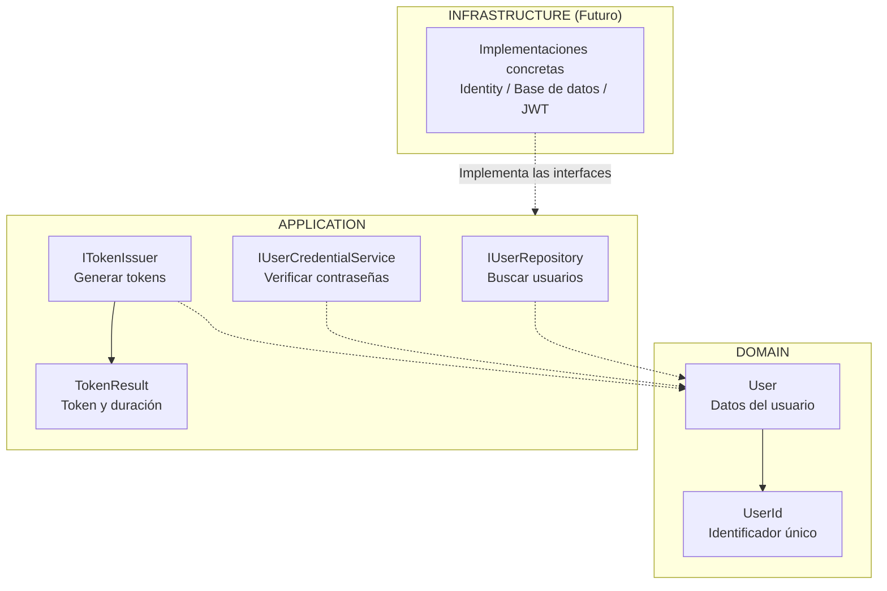
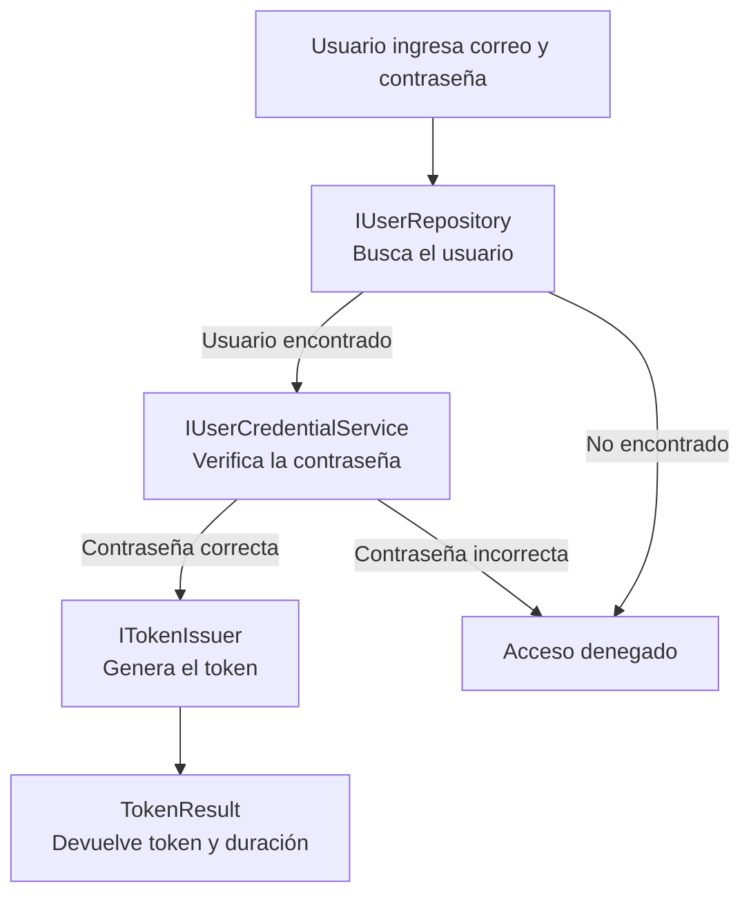

```powershell
1.
2. Identity y persistencia PostgreSQL.
3. Emisión JWT.
4. Seed de roles y administrador.
5. Login, 401, 403 y AdminOnly.
6. Swagger Bearer y respuestas de error.
7. Pruebas unitarias e integración con PostgreSQL efímero.
```

# Implementar 01-base-api-arquitectura

## PASOS

### 1. Modelo de usuario y puertos de Application.

Este módulo define **cómo se representa un usuario y qué operaciones necesita la aplicación para autenticarlo**.

Se divide en dos capas:

- **Domain:** define el modelo de usuario.
- **Application:** define las interfaces (puertos) necesarias para buscar usuarios, verificar contraseñas y generar tokens de acceso.

Las implementaciones de estas interfaces se desarrollarán en **Infrastructure**.

#### 1. Diagrama de componentes



#### 2. Responsabilidad de cada componente

| Componente               | Capa        | ¿Para qué sirve?                                                                   |
| ------------------------ | ----------- | ---------------------------------------------------------------------------------- |
| `User`                   | Domain      | Representa un usuario con su identificador, correo electrónico y roles.            |
| `UserId`                 | Domain      | Representa el identificador del usuario y permite comprobar que no esté vacío.     |
| `IUserRepository`        | Application | Define cómo buscar un usuario mediante su correo electrónico.                      |
| `IUserCredentialService` | Application | Define cómo verificar una contraseña y aplicar las reglas de bloqueo configuradas. |
| `ITokenIssuer`           | Application | Define cómo emitir un token para un usuario autenticado.                           |
| `TokenResult`            | Application | Contiene el token generado y su duración en segundos.                              |

#### 3. ¿Cómo trabajan juntos?

Cuando un usuario intenta iniciar sesión, el proceso esperado es el siguiente:



**Ejemplo:**

1. El usuario ingresa su correo y contraseña.
2. `IUserRepository` permite buscar sus datos y obtener un objeto `User`.
3. `IUserCredentialService` permite comprobar si su contraseña es correcta.
4. `ITokenIssuer` permite generar un token de acceso.
5. `TokenResult` devuelve el token y su duración.

Este flujo será coordinado por un caso de uso de Application cuando se implemente la autenticación.

#### 4. ¿Por qué se utilizan interfaces?

Porque **Application debe definir qué necesita hacer, sin depender de cómo se hace**.

Por ejemplo:

- `IUserRepository` define la búsqueda de usuarios, pero no conoce la base de datos.
- `IUserCredentialService` define la verificación de contraseñas, pero no depende directamente de ASP.NET Core Identity.
- `ITokenIssuer` define la emisión de tokens, pero no depende directamente de JWT.

**Infrastructure implementará estas interfaces** utilizando las tecnologías correspondientes.

Esto aplica el principio de inversión de dependencias (**DIP**) y permite cambiar tecnologías sin modificar la lógica de negocio.

#### 5. Resumen

| Capa               | Responsabilidad                                               |
| ------------------ | ------------------------------------------------------------- |
| **Domain**         | Define qué es un usuario.                                     |
| **Application**    | Define qué operaciones necesita la autenticación.             |
| **Infrastructure** | Implementa esas operaciones utilizando tecnologías concretas. |

**Conclusión:** Este spec establece la estructura básica para autenticar usuarios, separando los modelos y contratos de las tecnologías que se utilizarán posteriormente.

---

### 2. Identity y persistencia PostgreSQL.

---

### 3. Emisión JWT.

---

### 4. Seed de roles y administrador.

---

### 5. Login, 401, 403 y AdminOnly.

---

### 6. Swagger Bearer y respuestas de error.

---

### 7. Pruebas unitarias e integración con PostgreSQL efímero.

---

#### Validación de la implementación

- Ejecutar agente:

```powershell
/spec-acceptance-validator @specs/spec-02-identidad-roles-jwt.md
```

- Verificar actualización del [`Spec`](../02-identidad-roles-jwt.md)

- Acciones Git y PullRequest:

```powershell
git add .
git commit -m "FEPP-ContaOps - spec-02-identidad-roles-jwt - Implemented"
git push -u origin spec-02-identidad-roles-jwt
```

- Aprobar pullrequest en GitHub

- Actualizar rama main

```powershell
git switch main
git pull
git branch -d spec-02-identidad-roles-jwt
```

---

**NOTA**: Comandos de verificación:

```powershell
dotnet restore FEPP-ContaOps.slnx
dotnet build FEPP-ContaOps.slnx
dotnet test FEPP-ContaOps.slnx
dotnet run --project src/Fepp.ContaOps.Api
```
