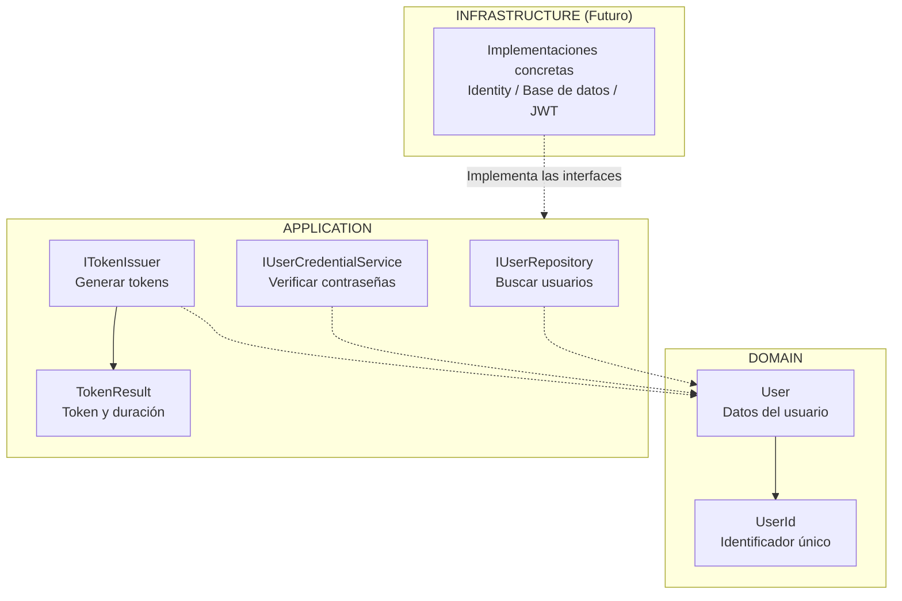
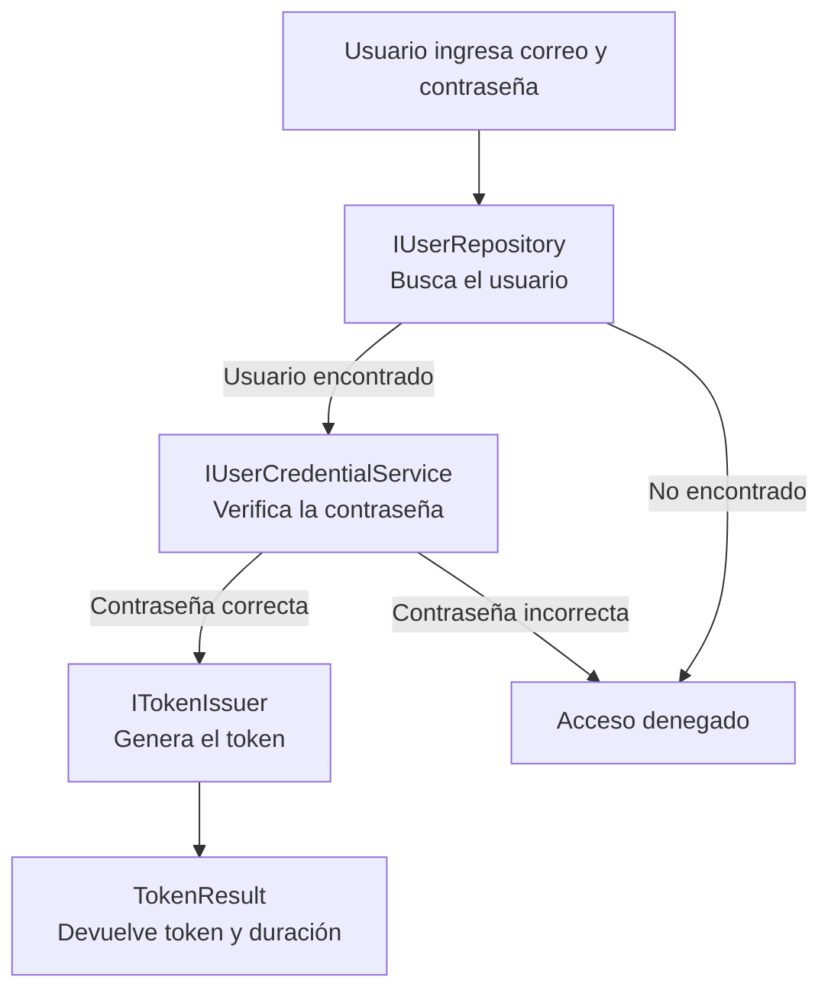
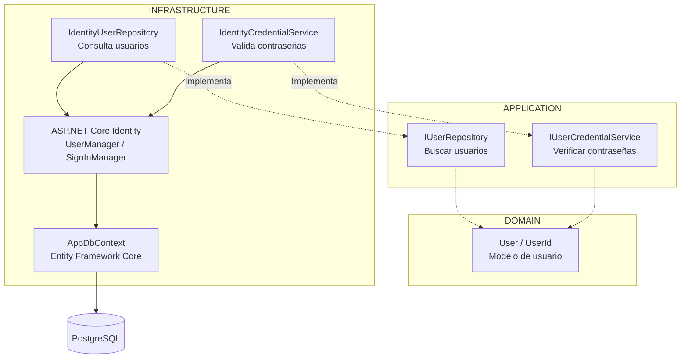

```powershell
1.
2. Identity y persistencia PostgreSQL.
3. Emisión JWT.
4. Seed de roles y administrador.
5. Login, 401, 403 y AdminOnly.
6. Swagger Bearer y respuestas de error.
7. Pruebas unitarias e integración con PostgreSQL efímero.
```

# Implementar 01-base-api-arquitectura

## PASOS

### 1. Modelo de usuario y puertos de Application.

Este módulo define **cómo se representa un usuario y qué operaciones necesita la aplicación para autenticarlo**.

Se divide en dos capas:

- **Domain:** define el modelo de usuario.
- **Application:** define las interfaces (puertos) necesarias para buscar usuarios, verificar contraseñas y generar tokens de acceso.

Las implementaciones de estas interfaces se desarrollarán en **Infrastructure**.

#### 1. Diagrama de componentes



#### 2. Responsabilidad de cada componente

| Componente               | Capa        | ¿Para qué sirve?                                                                   |
| ------------------------ | ----------- | ---------------------------------------------------------------------------------- |
| `User`                   | Domain      | Representa un usuario con su identificador, correo electrónico y roles.            |
| `UserId`                 | Domain      | Representa el identificador del usuario y permite comprobar que no esté vacío.     |
| `IUserRepository`        | Application | Define cómo buscar un usuario mediante su correo electrónico.                      |
| `IUserCredentialService` | Application | Define cómo verificar una contraseña y aplicar las reglas de bloqueo configuradas. |
| `ITokenIssuer`           | Application | Define cómo emitir un token para un usuario autenticado.                           |
| `TokenResult`            | Application | Contiene el token generado y su duración en segundos.                              |

#### 3. ¿Cómo trabajan juntos?

Cuando un usuario intenta iniciar sesión, el proceso esperado es el siguiente:



**Ejemplo:**

1. El usuario ingresa su correo y contraseña.
2. `IUserRepository` permite buscar sus datos y obtener un objeto `User`.
3. `IUserCredentialService` permite comprobar si su contraseña es correcta.
4. `ITokenIssuer` permite generar un token de acceso.
5. `TokenResult` devuelve el token y su duración.

Este flujo será coordinado por un caso de uso de Application cuando se implemente la autenticación.

#### 4. ¿Por qué se utilizan interfaces?

Porque **Application debe definir qué necesita hacer, sin depender de cómo se hace**.

Por ejemplo:

- `IUserRepository` define la búsqueda de usuarios, pero no conoce la base de datos.
- `IUserCredentialService` define la verificación de contraseñas, pero no depende directamente de ASP.NET Core Identity.
- `ITokenIssuer` define la emisión de tokens, pero no depende directamente de JWT.

**Infrastructure implementará estas interfaces** utilizando las tecnologías correspondientes.

Esto aplica el principio de inversión de dependencias (**DIP**) y permite cambiar tecnologías sin modificar la lógica de negocio.

#### 5. Resumen

| Capa               | Responsabilidad                                               |
| ------------------ | ------------------------------------------------------------- |
| **Domain**         | Define qué es un usuario.                                     |
| **Application**    | Define qué operaciones necesita la autenticación.             |
| **Infrastructure** | Implementa esas operaciones utilizando tecnologías concretas. |

**Conclusión:** Este spec establece la estructura básica para autenticar usuarios, separando los modelos y contratos de las tecnologías que se utilizarán posteriormente.

---

### 2. Identity y persistencia PostgreSQL

Este spec implementa los componentes necesarios para **almacenar usuarios en PostgreSQL y verificar sus credenciales mediante ASP.NET Core Identity**.

Complementa el Spec 1, donde se definieron el modelo `User` y las interfaces de Application.

#### 1. Diagrama de componentes



**Idea principal:** Application define las operaciones mediante interfaces, mientras que Infrastructure las implementa utilizando ASP.NET Core Identity y PostgreSQL.

#### 2. Responsabilidad de cada componente

| Componente                  | ¿Para qué sirve?                                                               |
| --------------------------- | ------------------------------------------------------------------------------ |
| `ApplicationIdentityUser`   | Representa al usuario de ASP.NET Core Identity. Hereda de `IdentityUser`.      |
| `IdentityUserRepository`    | Busca usuarios mediante Identity y los convierte al modelo `User` de Domain.   |
| `IdentityCredentialService` | Verifica contraseñas y aplica las reglas de bloqueo configuradas.              |
| `UserManager`               | Servicio de Identity para administrar usuarios, contraseñas y roles.           |
| `SignInManager`             | Servicio de Identity para gestionar la autenticación y verificar credenciales. |
| `AppDbContext`              | Gestiona el acceso a los datos mediante Entity Framework Core.                 |
| `DependencyInjection`       | Configura PostgreSQL, Identity y registra los servicios de Infrastructure.     |
| `PostgreSQL`                | Almacena usuarios, roles y datos de autenticación.                             |

#### 3. Métodos proporcionados por ASP.NET Core Identity

**ASP.NET Core Identity** es un framework de Microsoft para gestionar usuarios, contraseñas, roles y autenticación.

Proporciona clases como `UserManager<TUser>` y `SignInManager<TUser>`, que incluyen métodos para realizar estas operaciones sin tener que implementarlas manualmente.

Los métodos utilizados en este spec son:

| Método                                           | Clase de .NET   | ¿Qué hace?                                                                                   | ¿Dónde se utiliza?          |
| ------------------------------------------------ | --------------- | -------------------------------------------------------------------------------------------- | --------------------------- |
| `FindByEmailAsync(email)`                        | `UserManager`   | Busca un usuario por su correo electrónico.                                                  | `IdentityUserRepository`    |
| `GetRolesAsync(user)`                            | `UserManager`   | Obtiene los roles asignados a un usuario.                                                    | `IdentityUserRepository`    |
| `FindByIdAsync(id)`                              | `UserManager`   | Busca un usuario mediante su identificador.                                                  | `IdentityCredentialService` |
| `CheckPasswordSignInAsync(user, password, true)` | `SignInManager` | Comprueba la contraseña y registra los intentos fallidos para aplicar las reglas de bloqueo. | `IdentityCredentialService` |

**Ejemplo 1: Buscar un usuario**

```csharp
ApplicationIdentityUser? identityUser =
    await _userManager.FindByEmailAsync(email);
```

`FindByEmailAsync` es un método de `UserManager` que consulta el usuario utilizando el almacenamiento configurado para Identity.

Si existe, devuelve un objeto `ApplicationIdentityUser`; caso contrario, devuelve `null`.

**Ejemplo 2: Obtener los roles**

```csharp
IList<string> roles =
    await _userManager.GetRolesAsync(identityUser);
```

`GetRolesAsync` obtiene los nombres de los roles asignados al usuario, por ejemplo: `Admin`, `Contador` o `Asistente`.

Estos roles pueden utilizarse posteriormente para implementar reglas de autorización.

**Ejemplo 3: Verificar una contraseña**

```csharp
SignInResult result =
    await _signInManager.CheckPasswordSignInAsync(
        identityUser,
        password,
        lockoutOnFailure: true);
```

`CheckPasswordSignInAsync` comprueba si la contraseña proporcionada es válida.

El parámetro `lockoutOnFailure: true` permite contabilizar los intentos fallidos para aplicar las reglas de bloqueo configuradas.

El resultado se consulta mediante:

```csharp
return result.Succeeded;
```

Devuelve `true` si la verificación fue satisfactoria y `false` en caso contrario.

**¿Por qué se utilizan estos métodos?**

Porque ASP.NET Core Identity proporciona funcionalidades de seguridad ya implementadas y probadas, como:

- Almacenamiento y verificación de hashes de contraseñas.
- Administración de usuarios y roles.
- Control de intentos fallidos y bloqueo de cuentas.
- Integración con Entity Framework Core.

De esta manera, no es necesario desarrollar manualmente estos mecanismos de seguridad.

#### 4. ¿Cómo trabajan juntos?

Cuando un usuario intenta iniciar sesión, el proceso esperado es:

1. **Application** solicita buscar al usuario mediante `IUserRepository`.
2. **IdentityUserRepository** utiliza `FindByEmailAsync` y `GetRolesAsync` para recuperar sus datos.
3. El repositorio convierte `ApplicationIdentityUser` en `User`, el modelo de Domain.
4. **Application** solicita verificar la contraseña mediante `IUserCredentialService`.
5. **IdentityCredentialService** utiliza `FindByIdAsync` para localizar al usuario y `CheckPasswordSignInAsync` para verificar la contraseña.
6. Finalmente, devuelve `true` o `false` según el resultado.

Las operaciones de persistencia se realizan a través de Identity, Entity Framework Core y PostgreSQL.

Este flujo será coordinado por el caso de uso de autenticación correspondiente.

#### 5. Configuración de seguridad

En `DependencyInjection` se establecieron las siguientes reglas:

| Configuración                 | Valor         |
| ----------------------------- | ------------- |
| Longitud mínima de contraseña | 12 caracteres |
| Mayúsculas y minúsculas       | Obligatorias  |
| Números                       | Obligatorios  |
| Caracteres especiales         | Obligatorios  |
| Caracteres distintos          | Mínimo 6      |
| Intentos fallidos permitidos  | 5             |
| Duración del bloqueo          | 15 minutos    |
| Correo electrónico único      | Obligatorio   |

Estas reglas son administradas por ASP.NET Core Identity.

#### 6. Integración con Application

Las clases `IdentityUserRepository` e `IdentityCredentialService` implementan las interfaces definidas en el Spec 1.

Su vinculación se realiza mediante **inyección de dependencias**:

```csharp
services.AddScoped<IUserRepository, IdentityUserRepository>();

services.AddScoped<IUserCredentialService, IdentityCredentialService>();
```

Esto significa que:

- **Application** utiliza `IUserRepository` e `IUserCredentialService`.
- **Infrastructure** proporciona sus implementaciones concretas.
- **ASP.NET Core Identity** realiza las operaciones de autenticación.
- **Entity Framework Core** permite acceder a PostgreSQL.

La configuración de PostgreSQL se realiza mediante:

```csharp
services.AddDbContext<AppDbContext>(
    options => options.UseNpgsql(connectionString));
```

`UseNpgsql` configura Entity Framework Core para utilizar PostgreSQL como proveedor de base de datos.

**Ventaja:** Application no necesita conocer ASP.NET Core Identity ni PostgreSQL. Si cambia la tecnología, se pueden sustituir las implementaciones sin modificar los contratos.

#### 7. Resumen

| Capa               | Responsabilidad                                                                     |
| ------------------ | ----------------------------------------------------------------------------------- |
| **Domain**         | Define el modelo `User` y su identificador `UserId`.                                |
| **Application**    | Define las interfaces para buscar usuarios y verificar contraseñas.                 |
| **Infrastructure** | Implementa las interfaces utilizando ASP.NET Core Identity y Entity Framework Core. |
| **PostgreSQL**     | Almacena los usuarios, roles y datos de autenticación.                              |

**Conclusión:** El Spec 2 implementa los contratos del Spec 1 utilizando ASP.NET Core Identity para gestionar usuarios y verificar contraseñas, y PostgreSQL para almacenar su información.

Esta separación mantiene **Application independiente de las tecnologías utilizadas en Infrastructure**, siguiendo los principios de Clean Architecture.

**Nota:** La generación de tokens JWT mediante `ITokenIssuer` todavía no está implementada en este spec.

---

### 3. Emisión JWT.

---

### 4. Seed de roles y administrador.

---

### 5. Login, 401, 403 y AdminOnly.

---

### 6. Swagger Bearer y respuestas de error.

---

### 7. Pruebas unitarias e integración con PostgreSQL efímero.

---

#### Validación de la implementación

- Ejecutar agente:

```powershell
/spec-acceptance-validator @specs/spec-02-identidad-roles-jwt.md
```

- Verificar actualización del [`Spec`](../02-identidad-roles-jwt.md)

- Acciones Git y PullRequest:

```powershell
git add .
git commit -m "FEPP-ContaOps - spec-02-identidad-roles-jwt - Implemented"
git push -u origin spec-02-identidad-roles-jwt
```

- Aprobar pullrequest en GitHub

- Actualizar rama main

```powershell
git switch main
git pull
git branch -d spec-02-identidad-roles-jwt
```

---

**NOTA**: Comandos de verificación:

```powershell
dotnet restore FEPP-ContaOps.slnx
dotnet build FEPP-ContaOps.slnx
dotnet test FEPP-ContaOps.slnx
dotnet run --project src/Fepp.ContaOps.Api
```
