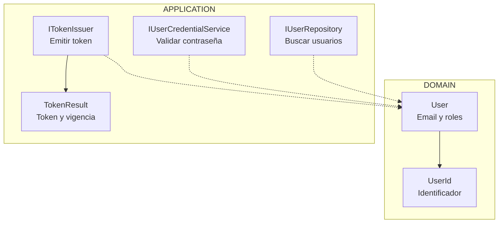
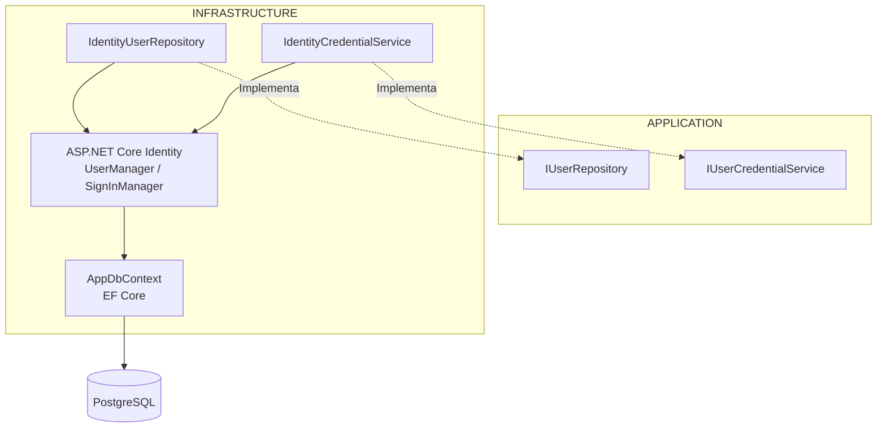
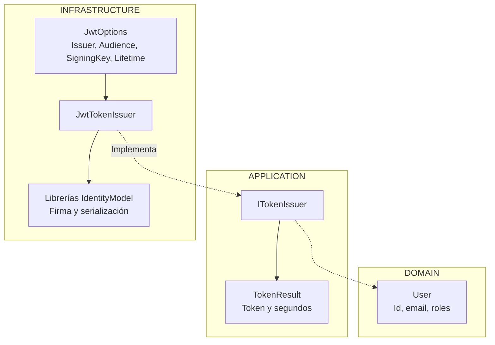
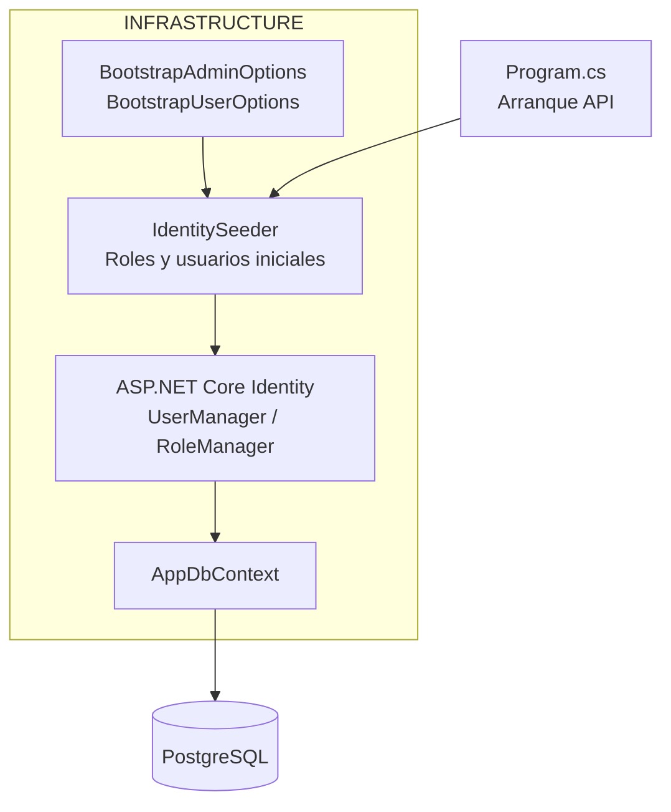
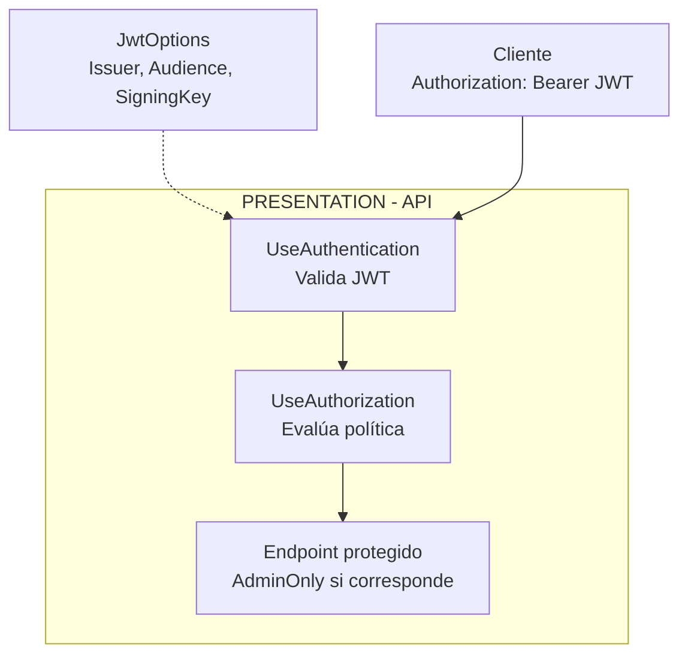
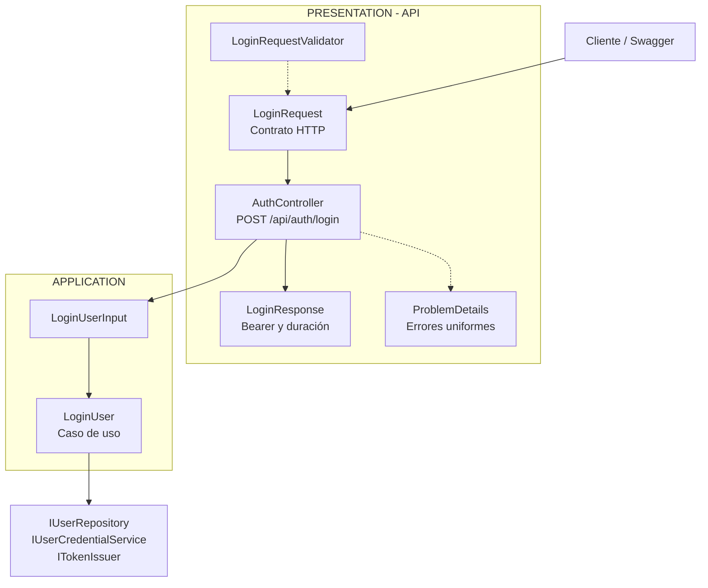
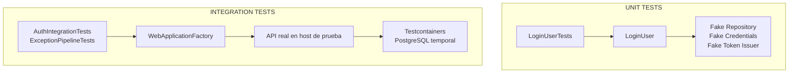

# Implementar: 02-identidad-roles-jwt-imp

## PASOS

**Convención de las tablas:** _Clase propietaria_ identifica dónde se declara un método o propiedad; _dónde se utiliza_ señala la clase de este proyecto que lo invoca. Se indica también su capa (Domain, Application, Infrastructure o API/Presentation) o su biblioteca cuando pertenece a .NET o a una dependencia externa.

### 1. Modelo de usuario y puertos de Application

Se establece **cómo representar un usuario en Domain** y **qué operaciones necesita Application** para autenticarlo. Esta base no depende de ASP.NET Core Identity, PostgreSQL ni de una librería JWT.

#### 1. Diagrama de componentes



#### 2. Componentes y responsabilidades

| Componente o método                   | Clase / interfaz propietaria | Capa        | Responsabilidad                                                                   |
| ------------------------------------- | ---------------------------- | ----------- | --------------------------------------------------------------------------------- |
| `User`                                | `User`                       | Domain      | Modelo con `Id`, `Email` y `Roles`; valida datos y normaliza roles.               |
| `UserId`                              | `UserId`                     | Domain      | Identificador tipado (`readonly record struct`).                                  |
| `IsValid()`                           | `UserId`                     | Domain      | Comprueba que el identificador no esté vacío; lo usa `User` (Domain).             |
| `FindByEmailAsync(email)`             | `IUserRepository`            | Application | Declara `Task<User?>`; lo implementa `IdentityUserRepository` (Infrastructure).   |
| `VerifyPasswordAsync(user, password)` | `IUserCredentialService`     | Application | Declara `Task<bool>`; lo implementa `IdentityCredentialService` (Infrastructure). |
| `IssueAsync(user)`                    | `ITokenIssuer`               | Application | Declara `Task<TokenResult>`; lo implementa `JwtTokenIssuer` (Infrastructure).     |
| `TokenResult`                         | `TokenResult`                | Application | `record` con `AccessToken` y `ExpiresIn` (segundos).                              |

#### 3. ¿Por qué se utilizan interfaces?

Application define **qué debe hacerse**; Infrastructure proporciona **cómo hacerlo**. Así, el caso de uso puede usar `IUserRepository`, `IUserCredentialService` e `ITokenIssuer` sin importar si la persistencia es PostgreSQL, si las credenciales se validan con Identity o cómo se genera el token. Esto aplica **Dependency Inversion (DIP)**.

**Integración:** las implementaciones de los puertos aparecen en los Specs 2 y 3; el caso de uso que coordina las tres operaciones se explica en el Spec 6.

---

### 2. Identity y persistencia PostgreSQL

Se implementan los adaptadores que conectan los contratos de Application con **ASP.NET Core Identity** y **Entity Framework Core (EF Core)**. Tras las pruebas manuales también se incorporó un entorno local con **Docker Compose, PostgreSQL y pgAdmin**.

#### 1. Diagrama de componentes



#### 2. Componentes y métodos de Identity

| Componente                  | Origen / capa                    | Responsabilidad                                                                   |
| --------------------------- | -------------------------------- | --------------------------------------------------------------------------------- |
| `ApplicationIdentityUser`   | Proyecto · Infrastructure        | Usuario técnico derivado de `IdentityUser`; no es el `User` de Domain.            |
| `IdentityUserRepository`    | Proyecto · Infrastructure        | Implementa `IUserRepository` y transforma usuarios de Identity a `User`/`UserId`. |
| `IdentityCredentialService` | Proyecto · Infrastructure        | Implementa `IUserCredentialService` y verifica contraseñas y bloqueo.             |
| `AppDbContext`              | Proyecto · Infrastructure        | Hereda de `IdentityDbContext<...>` y proporciona persistencia EF Core.            |
| `UserManager<TUser>`        | ASP.NET Core Identity · librería | Gestiona usuarios y sus roles.                                                    |
| `SignInManager<TUser>`      | ASP.NET Core Identity · librería | Comprueba credenciales y contabiliza intentos fallidos cuando procede.            |

Los métodos llamados por los adaptadores **no son implementaciones propias**, sino operaciones de ASP.NET Core Identity:

| Método                                           | Clase propietaria / biblioteca                                       | Se utiliza en (capa)                                       | ¿Qué hace?                                                               |
| ------------------------------------------------ | -------------------------------------------------------------------- | ---------------------------------------------------------- | ------------------------------------------------------------------------ |
| `FindByEmailAsync(email)`                        | `UserManager<ApplicationIdentityUser>` · Identity                    | `IdentityUserRepository` · Infrastructure                  | Busca usuario por correo o devuelve `null`.                              |
| `GetRolesAsync(user)`                            | `UserManager<ApplicationIdentityUser>` · Identity                    | `IdentityUserRepository` · Infrastructure                  | Obtiene los nombres de roles asignados.                                  |
| `FindByIdAsync(id)`                              | `UserManager<ApplicationIdentityUser>` · Identity                    | `IdentityCredentialService` · Infrastructure               | Recupera al usuario técnico por ID.                                      |
| `CheckPasswordSignInAsync(user, password, true)` | `SignInManager<ApplicationIdentityUser>` · Identity                  | `IdentityCredentialService` · Infrastructure               | Verifica contraseña; `true` permite contabilizar fallos para el bloqueo. |
| `UseNpgsql(connectionString)`                    | Extensión `NpgsqlDbContextOptionsBuilderExtensions` · Npgsql EF Core | `DependencyInjection.AddInfrastructure()` · Infrastructure | Selecciona PostgreSQL como proveedor de EF Core.                         |

En el repositorio, el resultado técnico se adapta al modelo de dominio:

```csharp
ApplicationIdentityUser? identityUser = await _userManager.FindByEmailAsync(email);
if (identityUser is null) return null;

IList<string> roles = await _userManager.GetRolesAsync(identityUser);
return new User(new UserId(identityUser.Id), identityUser.Email ?? email, roles);
```

**Por qué:** Identity resuelve almacenamiento de contraseñas con hash, usuarios, roles y bloqueos sin escribir manualmente esas operaciones. Application recibe el modelo `User`, no `ApplicationIdentityUser`.

#### 3. Seguridad y registro de servicios

`Infrastructure.DependencyInjection` mantiene esta política de Identity:

| Regla      | Configuración                                                                        |
| ---------- | ------------------------------------------------------------------------------------ |
| Contraseña | Mínimo 12 caracteres, mayúsculas, minúsculas, dígitos y caracteres no alfanuméricos. |
| Variedad   | Mínimo 6 caracteres distintos.                                                       |
| Bloqueo    | 5 fallos; 15 minutos; habilitado para usuarios nuevos.                               |
| Correo     | Único por usuario.                                                                   |

```csharp
services.AddDbContext<AppDbContext>(
    options => options.UseNpgsql(connectionString));

services.AddScoped<IUserRepository, IdentityUserRepository>();
services.AddScoped<IUserCredentialService, IdentityCredentialService>();
```

`connectionString` procede de `ConnectionStrings:Default`. El contenedor de inyección de dependencias entrega las implementaciones de Infrastructure cuando Application solicita los puertos.

#### 4. Ajuste tras las pruebas: PostgreSQL y pgAdmin locales

Se agregó `docker-compose.yml` para ejecutar estos servicios sin instalarlos manualmente en Windows:

| Servicio   | Imagen                | Puerto del host | Persistencia             |
| ---------- | --------------------- | --------------- | ------------------------ |
| PostgreSQL | `postgres:18.6`       | `5432`          | Volumen `postgres_data`. |
| pgAdmin    | `dpage/pgadmin4:9.12` | `5050`          | Volumen `pgadmin_data`.  |

El contenedor PostgreSQL incorpora `healthcheck`; pgAdmin espera a que la base de datos esté saludable. Los **volúmenes conservan los datos** cuando se detienen o recrean contenedores, a diferencia del PostgreSQL efímero del Spec 7.

Se añadió `.env.example` como **plantilla** de valores locales. Las variables relevantes son:

| Variable                                            | Uso                                                           |
| --------------------------------------------------- | ------------------------------------------------------------- |
| `POSTGRES_PASSWORD`                                 | Contraseña del contenedor PostgreSQL.                         |
| `PGADMIN_DEFAULT_EMAIL`, `PGADMIN_DEFAULT_PASSWORD` | Acceso a pgAdmin.                                             |
| `ConnectionStrings__Default`                        | Conexión de la API a PostgreSQL cuando se ejecuta en el host. |

La doble raya baja (`__`) representa secciones de configuración .NET; por ejemplo, `ConnectionStrings__Default` corresponde a `ConnectionStrings:Default`. **Docker Compose puede leer `.env` para interpolar variables; `dotnet run` no importa ese archivo automáticamente.** El procedimiento de carga manual aparece al final del documento.

**Precauciones:** `.env` debe quedar fuera de Git; para desarrollo exclusivamente local conviene restringir los puertos publicados a `127.0.0.1`. No reutilizar directamente volúmenes de PostgreSQL 16 en PostgreSQL 18 sin migración de datos.

---

### 3. Emisión JWT

Se implementa `ITokenIssuer` mediante `JwtTokenIssuer`, que **genera y firma** un JWT con el identificador, correo y roles del usuario autenticado. Emitir el token es distinto de validarlo: la validación de JWT recibidos se configura en el Spec 5.

#### 1. Diagrama de componentes



#### 2. ¿Qué hace `IssueAsync()`?

1. Recibe un `User` previamente autenticado; **no verifica la contraseña**.
2. Calcula `issuedAt` y `expiresAt` en UTC.
3. Agrega claims `sub` (Id), `email`, `jti` (Id único del token) y roles.
4. Construye `SymmetricSecurityKey` a partir de `SigningKey` y la firma `HmacSha256`.
5. Crea el `JwtSecurityToken`, lo convierte a texto con `JwtSecurityTokenHandler.WriteToken()` y calcula la vigencia en segundos.
6. Devuelve el resultado conforme al contrato de Application.

```csharp
List<Claim> claims =
[
    new(JwtRegisteredClaimNames.Sub, user.Id.Value),
    new(JwtRegisteredClaimNames.Email, user.Email),
    new(JwtRegisteredClaimNames.Jti, Guid.NewGuid().ToString("N"))
];
claims.AddRange(user.Roles.Select(role => new Claim(ClaimTypes.Role, role)));
```

| Elemento / método                            | Clase propietaria y origen                                    | Se utiliza en (capa)                           | Propósito                                     |
| -------------------------------------------- | ------------------------------------------------------------- | ---------------------------------------------- | --------------------------------------------- |
| `Claim`, `ClaimTypes.Role`                   | `Claim`, `ClaimTypes` · .NET (`System.Security.Claims`)       | `JwtTokenIssuer` · Infrastructure              | Crea los datos de identidad y roles.          |
| `DateTime.UtcNow`                            | `DateTime` · .NET                                             | `JwtTokenIssuer` · Infrastructure              | Fecha UTC de emisión.                         |
| `Guid.NewGuid()`                             | `Guid` · .NET                                                 | `JwtTokenIssuer` · Infrastructure              | ID único del token (`jti`).                   |
| `Encoding.UTF8.GetBytes()`                   | `Encoding` · .NET                                             | `JwtTokenIssuer` · Infrastructure              | Convierte la clave de firma a bytes.          |
| `JwtRegisteredClaimNames.Sub/Email/Jti`      | `JwtRegisteredClaimNames` · `System.IdentityModel.Tokens.Jwt` | `JwtTokenIssuer` · Infrastructure              | Nombres estándar de claims JWT.               |
| `JwtSecurityToken`                           | `JwtSecurityToken` · `System.IdentityModel.Tokens.Jwt`        | `JwtTokenIssuer` · Infrastructure              | Construye el JWT.                             |
| `WriteToken()`                               | `JwtSecurityTokenHandler` · `System.IdentityModel.Tokens.Jwt` | `JwtTokenIssuer` · Infrastructure              | Serializa el JWT a texto.                     |
| `SymmetricSecurityKey`, `SigningCredentials` | Tipos de `Microsoft.IdentityModel.Tokens`                     | `JwtTokenIssuer` · Infrastructure              | Definen clave y credenciales de firma.        |
| `SecurityAlgorithms.HmacSha256`              | `SecurityAlgorithms` · `Microsoft.IdentityModel.Tokens`       | `JwtTokenIssuer` · Infrastructure              | Selecciona el algoritmo HMAC-SHA256.          |
| `IOptions<JwtOptions>.Value`                 | `IOptions<T>` · Microsoft.Extensions.Options                  | `JwtTokenIssuer` · Infrastructure              | Proporciona las opciones JWT configuradas.    |
| `Task.FromResult()`                          | `Task` · .NET                                                 | `JwtTokenIssuer.IssueAsync()` · Infrastructure | Entrega un `Task<TokenResult>` ya completado. |

#### 3. ¿Qué significan `Task.FromResult()` y `TokenResult`?

```csharp
public sealed record TokenResult(string AccessToken, long ExpiresIn);

return Task.FromResult(new TokenResult(accessToken, expiresIn));
```

- `TokenResult` es un **`record` de C#**: guarda el JWT (`string`) y su duración (`long`, segundos). `public` permite utilizarlo desde otros proyectos; `sealed` impide heredar; `record` aporta constructor, propiedades de solo inicialización e igualdad por valor.
- `Task<TokenResult>` representa una operación que entrega ese resultado. `Task.FromResult(...)` crea un **Task ya completado**: no ejecuta el trabajo en otro hilo y no convierte la firma JWT en una operación asíncrona.
- Se usa porque **`ITokenIssuer.IssueAsync()` exige `Task<TokenResult>`**, aunque esta implementación firma el JWT de forma síncrona en memoria. Otra implementación podría esperar a un proveedor externo mediante `await` sin cambiar la interfaz.

**Diferencia útil:** `TokenResult` retorna el valor directamente; `Task<TokenResult>` encapsula la operación que lo proporciona. `async/await` sirve para esperar trabajo asíncrono, pero la sola presencia de `Task` no garantiza que exista espera asíncrona real.

#### 4. Configuración e inyección de dependencias

`JwtOptions` contiene `Issuer`, `Audience`, `SigningKey` y `AccessTokenLifetimeMinutes` (60 por defecto). Infrastructure enlaza la sección `Jwt`, valida emisor y audiencia no vacíos, clave secreta de **al menos 32 bytes UTF-8** y vigencia positiva; `ValidateOnStart()` programa la validación al inicio.

```csharp
services.AddOptions<JwtOptions>()
    .Bind(configuration.GetSection(JwtOptions.SectionName))
    // Validaciones de Issuer, Audience, SigningKey y Lifetime.
    .ValidateOnStart();

services.AddSingleton<ITokenIssuer, JwtTokenIssuer>();
```

**Ajuste operativo:** `.env.example` ahora documenta `Jwt__Issuer`, `Jwt__Audience`, `Jwt__SigningKey` y `Jwt__AccessTokenLifetimeMinutes`. Son variables de configuración .NET; la clave debe permanecer secreta y no incluirse en el repositorio. El `Singleton` es apropiado para esta implementación porque solo utiliza configuración mediante `IOptions<JwtOptions>`.

---

### 4. Seed de roles y administrador

El **seed** prepara los datos de identidad al arrancar la API. La versión inicial creaba los roles `Admin` y `User`, y el administrador. **Después de las pruebas manuales se agregó un usuario regular opcional**, útil para comprobar restricciones por rol.

#### 1. Diagrama de componentes



#### 2. Funciones y configuración

| Componente                             | Capa / origen                       | Propósito                                             |
| -------------------------------------- | ----------------------------------- | ----------------------------------------------------- |
| `IdentitySeeder`                       | Infrastructure · Proyecto           | Orquesta la creación idempotente de roles y usuarios. |
| `BootstrapAdminOptions`                | Infrastructure · Proyecto           | Configuración obligatoria del administrador inicial.  |
| `BootstrapUserOptions`                 | Infrastructure · Proyecto           | Configuración opcional del usuario regular.           |
| `UserManager<ApplicationIdentityUser>` | ASP.NET Core Identity               | Busca y crea usuarios; administra sus roles.          |
| `RoleManager<IdentityRole>`            | ASP.NET Core Identity               | Verifica y crea roles.                                |
| `AppDbContext`                         | Infrastructure · Proyecto (EF Core) | Expone `Database` para comprobar o crear el esquema.  |

La tabla distingue los **métodos propios del proyecto** de los proporcionados por ASP.NET Core Identity y Entity Framework Core:

| Método / propiedad                     | Clase propietaria / biblioteca                              | Se utiliza en (capa)                                       | ¿Qué hace?                                                       |
| -------------------------------------- | ----------------------------------------------------------- | ---------------------------------------------------------- | ---------------------------------------------------------------- |
| `SeedAsync()`                          | `IdentitySeeder` · Proyecto                                 | `Program.cs` · API/Presentation                            | Ejecuta el seed de identidad al arrancar.                        |
| `EnsureRoleAsync()`                    | `IdentitySeeder` · Proyecto                                 | `IdentitySeeder.SeedAsync()` · Infrastructure              | Crea el rol únicamente si no existe.                             |
| `EnsureBootstrapUserAsync()`           | `IdentitySeeder` · Proyecto                                 | `IdentitySeeder.SeedAsync()` · Infrastructure              | Crea o completa la asignación del rol `User` al usuario regular. |
| `EnsureCreatedAsync()`                 | `DatabaseFacade` · Entity Framework Core                    | `IdentitySeeder.SeedAsync()` · Infrastructure              | Crea la base/esquema cuando corresponde; no aplica migraciones.  |
| `RoleExistsAsync()`                    | `RoleManager<IdentityRole>` · Identity                      | `IdentitySeeder.EnsureRoleAsync()` · Infrastructure        | Comprueba si un rol existe.                                      |
| `CreateAsync(role)`                    | `RoleManager<IdentityRole>` · Identity                      | `IdentitySeeder.EnsureRoleAsync()` · Infrastructure        | Crea un rol.                                                     |
| `FindByEmailAsync()`                   | `UserManager<ApplicationIdentityUser>` · Identity           | `IdentitySeeder` · Infrastructure                          | Localiza al administrador o usuario regular.                     |
| `CreateAsync(user, password)`          | `UserManager<ApplicationIdentityUser>` · Identity           | `IdentitySeeder` · Infrastructure                          | Crea usuario y hash de contraseña según política de Identity.    |
| `IsInRoleAsync()` / `AddToRoleAsync()` | `UserManager<ApplicationIdentityUser>` · Identity           | `IdentitySeeder` · Infrastructure                          | Comprueba o asigna roles.                                        |
| `IdentityResult.Succeeded`             | `IdentityResult` · Identity                                 | `IdentitySeeder.EnsureSuccess()` · Infrastructure          | Indica si la operación finalizó correctamente.                   |
| `IsValid()`                            | `BootstrapAdminOptions` / `BootstrapUserOptions` · Proyecto | `DependencyInjection.AddInfrastructure()` · Infrastructure | Valida la configuración inicial.                                 |
| `BootstrapUserOptions.IsConfigured`    | `BootstrapUserOptions` · Proyecto                           | `IdentitySeeder.SeedAsync()` · Infrastructure              | Indica si se solicitó crear un usuario regular.                  |

#### 3. Flujo del arranque y ajuste del usuario regular

```csharp
public async Task SeedAsync(CancellationToken cancellationToken = default)
{
    await _dbContext.Database.EnsureCreatedAsync(cancellationToken);
    await EnsureRoleAsync(AdminRole);
    await EnsureRoleAsync(UserRole);

    // Buscar o crear administrador y garantizar su rol Admin.

    if (_userOptions.IsConfigured)
    {
        await EnsureBootstrapUserAsync();
    }
}
```

`EnsureBootstrapUserAsync()` utiliza el correo de `BootstrapUserOptions`: busca al usuario, lo crea si no existe y le asigna el rol `User` si todavía no lo tiene. Ambos usuarios se crean con `EmailConfirmed = true`.

| Configuración                                       | Comportamiento                                                                            |
| --------------------------------------------------- | ----------------------------------------------------------------------------------------- |
| `BootstrapAdmin__Email`, `BootstrapAdmin__Password` | Requeridos; admin inicial con rol `Admin`.                                                |
| `BootstrapUser__Email`, `BootstrapUser__Password`   | Opcionales: ambos ausentes = no crear usuario; ambos válidos = crear/asegurar rol `User`. |
| Solo una de las dos variables del usuario regular   | Configuración inválida: `ValidateOnStart()` la rechaza.                                   |

`BootstrapAdminOptions.IsValid()` y `BootstrapUserOptions.IsValid()` comprueban correo válido con `EmailAddressAttribute` (.NET) y contraseña no vacía. **Las políticas de complejidad se aplican cuando Identity crea el usuario**, no en estos métodos.

**Idempotencia:** reiniciar la API no duplica roles ni usuarios encontrados por correo, ni actualiza contraseñas existentes. Si falta una asignación de rol, la agrega. Si una operación falla, `EnsureSuccess()` lanza una excepción con los códigos de error de Identity, sin incluir la contraseña.

#### 4. ¿Cómo se ejecuta y registra?

```csharp
// Program.cs
using (IServiceScope scope = app.Services.CreateScope())
{
    IdentitySeeder seeder = scope.ServiceProvider.GetRequiredService<IdentitySeeder>();
    await seeder.SeedAsync();
}

// Infrastructure.DependencyInjection
services.AddOptions<BootstrapAdminOptions>()
    .Bind(configuration.GetSection(BootstrapAdminOptions.SectionName))
    .Validate(options => options.IsValid(), "BootstrapAdmin inválido")
    .ValidateOnStart();

services.AddOptions<BootstrapUserOptions>()
    .Bind(configuration.GetSection(BootstrapUserOptions.SectionName))
    .Validate(options => options.IsValid(), "BootstrapUser inválido")
    .ValidateOnStart();

services.AddScoped<IdentitySeeder>();
```

`CreateScope()` crea un ámbito para los servicios **Scoped** del seed (incluido `AppDbContext`); `GetRequiredService<T>()` resuelve `IdentitySeeder`; `await` espera sus operaciones asíncronas de persistencia antes de que arranque el procesamiento normal de solicitudes.

**Precaución:** las credenciales iniciales son sensibles. El usuario regular agregado para probar `AdminOnly` debería restringirse a entornos controlados; el código mostrado lo crea si está configurado, sin comprobar explícitamente el ambiente. Conviene planificar migraciones EF Core para la evolución del esquema: `EnsureCreatedAsync()` no sustituye a `MigrateAsync()`.

---

### 5. Login, 401, 403 y AdminOnly

Este spec configura la **validación de JWT entrantes** y las reglas de autorización de endpoints. El login que **emite** el JWT se documenta en el Spec 6; aquí se explica qué ocurre cuando el cliente utiliza ese token para acceder a un recurso.

#### 1. Diagrama de componentes



#### 2. Autenticación frente a autorización

| Concepto          | Acción                                                                 | Resultado en un endpoint protegido            |
| ----------------- | ---------------------------------------------------------------------- | --------------------------------------------- |
| **Autenticación** | Verifica identidad, firma, emisor, audiencia y vigencia del JWT.       | Si falta o es inválido: **401 Unauthorized**. |
| **Autorización**  | Verifica los requisitos del recurso; `AdminOnly` exige el rol `Admin`. | JWT válido sin permisos: **403 Forbidden**.   |

Para un endpoint con `[Authorize(Policy = "AdminOnly")]`:

| Solicitud                                | Resultado esperado  |
| ---------------------------------------- | ------------------- |
| Sin token, expirado o con firma inválida | `401 Unauthorized`. |
| JWT válido con rol `User`                | `403 Forbidden`.    |
| JWT válido con rol `Admin`               | Acceso permitido.   |

#### 3. Framework y configuración JWT Bearer

| Método / miembro                             | Clase propietaria / biblioteca                                       | Se utiliza en (capa)                              | ¿Qué hace?                                    |
| -------------------------------------------- | -------------------------------------------------------------------- | ------------------------------------------------- | --------------------------------------------- |
| `AddAuthentication()`                        | Extensión `AuthenticationServiceCollectionExtensions` · ASP.NET Core | `DependencyInjection.AddApi()` · API/Presentation | Registra la autenticación.                    |
| `AddJwtBearer()`                             | Extensión `JwtBearerExtensions` · paquete JWT Bearer                 | `DependencyInjection.AddApi()` · API/Presentation | Configura el esquema Bearer y validación JWT. |
| `TokenValidationParameters`                  | `TokenValidationParameters` · Microsoft.IdentityModel.Tokens         | `DependencyInjection.AddApi()` · API/Presentation | Define las reglas de validación del JWT.      |
| `AddAuthorization()`                         | Extensión de autorización · ASP.NET Core                             | `DependencyInjection.AddApi()` · API/Presentation | Registra los servicios de autorización.       |
| `AddPolicy()` / `RequireRole()`              | `AuthorizationOptions` / `AuthorizationPolicyBuilder` · ASP.NET Core | `DependencyInjection.AddApi()` · API/Presentation | Define `AdminOnly` y exige el rol `Admin`.    |
| `UseAuthentication()` / `UseAuthorization()` | Middlewares / extensiones ASP.NET Core                               | `Program.cs` · API/Presentation                   | Ejecuta autenticación antes de autorización.  |
| `OnChallenge` / `OnForbidden`                | Propiedades de `JwtBearerEvents` · JWT Bearer                        | `DependencyInjection.AddApi()` · API/Presentation | Controlan respuestas `401` y `403`.           |

```csharp
services.AddAuthentication(JwtBearerDefaults.AuthenticationScheme)
    .AddJwtBearer(options =>
    {
        options.TokenValidationParameters = new TokenValidationParameters
        {
            ValidateIssuer = true,
            ValidIssuer = jwtOptions.Issuer,
            ValidateAudience = true,
            ValidAudience = jwtOptions.Audience,
            ValidateIssuerSigningKey = true,
            IssuerSigningKey = new SymmetricSecurityKey(
                Encoding.UTF8.GetBytes(jwtOptions.SigningKey)),
            ValidateLifetime = true,
            ClockSkew = TimeSpan.Zero,
            NameClaimType = JwtRegisteredClaimNames.Email,
            RoleClaimType = ClaimTypes.Role
        };
        // Eventos OnChallenge y OnForbidden de la respuesta de error.
    });

services.AddAuthorization(options =>
    options.AddPolicy("AdminOnly", p => p.RequireRole(IdentitySeeder.AdminRole)));
```

`ClockSkew = TimeSpan.Zero` elimina la tolerancia adicional de reloj para el periodo de validez. La política usa la constante `IdentitySeeder.AdminRole`, cuyo valor es `"Admin"`.

Ejemplo de protección de un endpoint (**ejemplo ilustrativo, no un controlador adjunto**):

```csharp
[Authorize(Policy = "AdminOnly")]
[HttpGet("admin")]
public IActionResult Admin() => Ok();
```

La configuración de JWT Bearer **no protege automáticamente todos los endpoints**: es necesario aplicar `[Authorize]`, una política o una regla de autorización global.

#### 4. Errores `401` y `403`

- **`OnChallenge`** llama a `context.HandleResponse()` y escribe una respuesta con estado **401** y código `authentication_required`.
- **`OnForbidden`** escribe una respuesta con estado **403** y código `forbidden`.
- Ambas se serializan como `application/problem+json` mediante `WriteAuthenticationErrorAsync()` y `ProblemDetailsResponseFactory`. El formato común se detalla una sola vez en el Spec 6.

```csharp
// Program.cs: el orden es importante.
app.UseAuthentication();
app.UseAuthorization();
app.MapControllers();
```

#### 5. Ajuste transversal de la API: Serilog

**Después de las pruebas manuales**, se reemplazó el registro JSON en consola por una configuración de **Serilog** (librería externa) para logging estructurado en archivos.

```csharp
builder.Services.AddSerilog((services, loggerConfiguration) =>
{
    loggerConfiguration
        .ReadFrom.Configuration(builder.Configuration)
        .ReadFrom.Services(services)
        .Enrich.FromLogContext();
});
```

`appsettings.json` configura `Serilog.Sinks.File` con formato JSON compacto (`Serilog.Formatting.Compact`), archivos diarios, tamaño máximo por archivo de **10 MiB**, hasta **14 archivos** retenidos y escritura periódica en disco. La ruta configurada es **`logs/fepp-contaops-.json` relativa al directorio de trabajo del proceso**.

`UseSerilogRequestLogging()` asigna niveles según la respuesta:

| Resultado HTTP                                 | Nivel      |
| ---------------------------------------------- | ---------- |
| Éxito (<400)                                   | `Debug`.   |
| Error del cliente (4xx)                        | `Warning`. |
| Error del servidor (5xx) o excepción observada | `Error`.   |

Con el mínimo global `Information` configurado, los eventos HTTP en `Debug` **normalmente se descartan**. `UseExceptionHandler()` se mantiene para transformar excepciones no controladas; logging y respuesta HTTP son responsabilidades distintas.

`Program.cs` ahora muestra al iniciar la API las URL, Swagger/OpenAPI y `POST /api/auth/login` mediante `Console.WriteLine`. Es una ayuda operativa; no constituye la configuración de rutas ni garantiza que la ruta impresa de logs coincida con el directorio de trabajo usado al ejecutar la aplicación.

---

### 6. Swagger Bearer y respuestas de error

Este spec integra el **login HTTP** con Application y estandariza la respuesta de éxito y de error. Los ajustes posteriores reorganizaron los contratos en carpetas y agregaron `LoginUserInput`, sin modificar el objetivo del flujo.

#### 1. Diagrama de componentes



#### 2. Contratos y cambios de organización

| Componente                             | Método / miembro relevante                                               | Capa / ubicación                | Responsabilidad                                                 |
| -------------------------------------- | ------------------------------------------------------------------------ | ------------------------------- | --------------------------------------------------------------- |
| `LoginRequest`                         | `Email`, `Password`                                                      | API · `Contracts.Requests`      | DTO de entrada HTTP.                                            |
| `LoginResponse`                        | `AccessToken`, `TokenType`, `ExpiresIn`                                  | API · `Contracts.Responses`     | DTO de salida HTTP.                                             |
| `LoginRequestValidator`                | `RuleFor()` (de FluentValidation)                                        | API · `Validation`              | Declara las reglas de correo y contraseña del request.          |
| `AuthController`                       | `Login()`                                                                | API · `Controllers`             | Expone `POST /api/auth/login`; convierte resultado a HTTP.      |
| `LoginUserInput`                       | `Email`, `Password`                                                      | Application · `Users.LoginUser` | `record` de entrada al caso de uso, independiente del DTO HTTP. |
| `LoginUser`                            | `ExecuteAsync(LoginUserInput, ...)`                                      | Application · `Users.LoginUser` | Orquesta búsqueda, credenciales y token.                        |
| `AuthenticationError`                  | `Instance`, `Code`                                                       | Application · `Results`         | Error tipado `invalid_credentials`.                             |
| `ApplicationErrorProblemDetailsMapper` | `Map()`                                                                  | API · `Validation`              | Convierte errores de Application a resultados HTTP.             |
| `ProblemDetailsResponseFactory`        | `CreateApplicationErrorResult()`, `CreateValidationResult()`, `Create()` | API · `Validation`              | Construye errores `ProblemDetails` consistentes.                |

**Antes:** `LoginUser.ExecuteAsync(email, password, cancellationToken)`.

**Ahora:** `LoginUser.ExecuteAsync(new LoginUserInput(email, password), cancellationToken)`.

```csharp
// Application: dato del caso de uso.
public sealed record LoginUserInput(string Email, string Password);

// API: adapta el contrato HTTP al caso de uso.
Result<TokenResult> result = await _loginUser.ExecuteAsync(
    new LoginUserInput(request.Email, request.Password),
    cancellationToken);
```

**Por qué:** `LoginRequest` representa el contrato externo HTTP; `LoginUserInput`, la entrada de Application. El cambio facilita evolucionar cada contrato de forma independiente. También se actualizaron sus namespaces y los `using` de las pruebas.

#### 3. Flujo de autenticación y resultado

Los métodos propios que intervienen en el flujo se identifican con su clase y capa:

| Orden | Método / clase propietaria                                                            | Capa                  | Acción                                                                                      |
| ----- | ------------------------------------------------------------------------------------- | --------------------- | ------------------------------------------------------------------------------------------- |
| 1     | `AuthController.Login()`                                                              | API/Presentation      | Recibe `LoginRequest` (API) y crea `LoginUserInput` (Application).                          |
| 2     | `LoginUser.ExecuteAsync()`                                                            | Application           | Coordina la autenticación mediante los puertos de Application.                              |
| 3     | `IUserRepository.FindByEmailAsync()` / `IUserCredentialService.VerifyPasswordAsync()` | Application (puertos) | Infraestructura implementa la búsqueda y verificación con Identity.                         |
| 4     | `ITokenIssuer.IssueAsync()`                                                           | Application (puerto)  | `JwtTokenIssuer` (Infrastructure) genera `TokenResult` cuando las credenciales son válidas. |
| 5     | `AuthController.Login()` / `ApplicationErrorProblemDetailsMapper.Map()`               | API/Presentation      | Devuelve `LoginResponse` (200) o traduce el error a HTTP.                                   |

```http
POST /api/auth/login
Content-Type: application/json
```

```json
{ "email": "admin@example.com", "password": "<contraseña>" }
```

Respuesta exitosa de ejemplo (**token abreviado**):

```json
{
  "accessToken": "eyJhbGciOiJIUzI1NiIs...",
  "tokenType": "Bearer",
  "expiresIn": 3600
}
```

`[AllowAnonymous]` permite ejecutar el login sin tener un JWT previo. `[HttpPost("login")]` y `[Route("api/auth")]` definen la ruta. `[ProducesResponseType]` documenta las posibles respuestas para OpenAPI/Swagger.

**¿Qué representa `Task<Result<TokenResult>>`?** `Task<T>` permite esperar la operación; `Result<T>` (tipo del proyecto) expresa **éxito o fallo esperado**; `TokenResult` contiene el JWT y los segundos de vigencia. `Result.Success()` / `Result.Failure()` **no son métodos de ASP.NET Core** y evitan usar excepciones para errores previsibles de autenticación.

#### 4. Validaciones y respuestas de error

**FluentValidation** es una dependencia externa: `AbstractValidator<T>`, `RuleFor()`, `NotEmpty()`, `EmailAddress()` y `MaximumLength()` declaran las reglas del request. No verifican si las credenciales coinciden: esa tarea corresponde a Application e Identity.

El método `ProblemDetailsResponseFactory.CreateApplicationErrorResult()` (**API/Presentation, `Validation`**) realiza la conversión de errores tipados de Application a HTTP.

`ProblemDetails` de ASP.NET Core utiliza un formato HTTP estándar (`application/problem+json`). `ProblemDetailsResponseFactory` agrega `code` y `traceId`, además de `type`, `title`, `status`, `detail` e `instance`.

```json
{
  "type": "https://httpstatuses.com/401",
  "title": "Authentication failed.",
  "status": 401,
  "detail": "The supplied credentials are invalid.",
  "instance": "/api/auth/login",
  "code": "invalid_credentials",
  "traceId": "..."
}
```

| Error (clase)                    | Capa donde se define           | Respuesta HTTP                                    |
| -------------------------------- | ------------------------------ | ------------------------------------------------- |
| `ValidationError`                | Application · `Results`        | `400 Bad Request`; detalle `errors` por campo.    |
| `AuthenticationError`            | Application · `Results`        | `401 Unauthorized`; código `invalid_credentials`. |
| `ResourceNotFoundError`          | Application · `Results`        | `404 Not Found`.                                  |
| `ConflictError`                  | Application · `Results`        | `409 Conflict`.                                   |
| Error no reconocido por el mapeo | Conversión en API/Presentation | `500 Internal Server Error`.                      |

El controlador no informa si falló el correo o la contraseña: ambas situaciones regresan el mismo `AuthenticationError`, evitando revelar la existencia de usuarios. Para errores del middleware Bearer, el Spec 5 establece los códigos `authentication_required` y `forbidden`.

#### 5. Swagger Bearer

Swagger documenta el esquema HTTP `Bearer` para enviar el JWT en `Authorization: Bearer <token>`. La **configuración del esquema** ya existía en el Spec 5; este spec incorpora el endpoint que permite obtenerlo y documenta `200`, `400` y `401`.

Uso manual: ejecutar `POST /api/auth/login`, copiar `accessToken`, usar **Authorize** en Swagger UI y realizar solicitudes a endpoints protegidos. Swagger no reemplaza las comprobaciones reales de autenticación y autorización.

---

### 7. Pruebas unitarias e integración con PostgreSQL efímero

El spec comprueba la lógica de login por separado y su integración con la API y PostgreSQL real. Después de las pruebas manuales, las pruebas unitarias se adaptaron a `LoginUserInput` y la prueba de excepciones dejó de verificar los registros de logging.

#### 1. Diagrama de componentes



#### 2. Pruebas y resultados esperados

| Clase de prueba          | Método de prueba                                                  | Proyecto de pruebas / componente evaluado          | ¿Qué comprueba?                                          |
| ------------------------ | ----------------------------------------------------------------- | -------------------------------------------------- | -------------------------------------------------------- |
| `LoginUserTests`         | `ValidCredentials_ReturnsToken()`                                 | UnitTests → `LoginUser` (Application)              | Éxito con `TokenResult` simulado.                        |
| `LoginUserTests`         | `UnknownUser_ReturnsInvalidCredentials()`                         | UnitTests → `LoginUser` (Application)              | Usuario inexistente → `invalid_credentials`.             |
| `LoginUserTests`         | `InvalidPassword_ReturnsInvalidCredentials()`                     | UnitTests → `LoginUser` (Application)              | Contraseña incorrecta → `invalid_credentials`.           |
| `AuthIntegrationTests`   | `LoginWithBootstrapAdmin_ReturnsBearerToken()`                    | IntegrationTests → API + Identity (Infrastructure) | Seed y login → 200 y token Bearer.                       |
| `AuthIntegrationTests`   | `LoginWithInvalidCredentials_ReturnsUnauthorizedProblemDetails()` | IntegrationTests → API + Application               | Credenciales inválidas → 401 y `ProblemDetails`.         |
| `ExceptionPipelineTests` | `UnexpectedException_ReturnsSafeProblemDetails()`                 | IntegrationTests → middleware de errores (API)     | Excepción → 500, código, `traceId` y sin datos internos. |

**Ajuste en pruebas unitarias:** antes se llamaba a `ExecuteAsync(email, password)`; ahora se utiliza:

```csharp
var result = await login.ExecuteAsync(
    new LoginUserInput("user@example.com", "Password123!"));
```

Las dependencias Fake implementan los puertos de Application y devuelven resultados conocidos mediante `Task.FromResult()`; **no llaman a Identity, PostgreSQL ni a la generación real de JWT**.

```csharp
private sealed class FakeTokenIssuer : ITokenIssuer
{
    public Task<TokenResult> IssueAsync(
        User user, CancellationToken cancellationToken = default)
        => Task.FromResult(new TokenResult("token", 900));
}
```

#### 3. PostgreSQL efímero y WebApplicationFactory

`Testcontainers.PostgreSql` crea un contenedor basado en **`postgres:16-alpine`** para las pruebas. `WebApplicationFactory<Program>` (paquete `Microsoft.AspNetCore.Mvc.Testing`) ejecuta la API con `HttpClient`, sin publicar un servidor externo. `TestApiFactory.ConfigureWebHost()` reemplaza la conexión y proporciona valores de prueba para JWT y el administrador inicial.

```csharp
private readonly PostgreSqlContainer _database =
    new PostgreSqlBuilder("postgres:16-alpine").Build();

public Task InitializeAsync() => _database.StartAsync();
public Task DisposeAsync() => _database.DisposeAsync().AsTask();
```

`IAsyncLifetime` pertenece a **xUnit** y permite preparar y liberar el contenedor de cada instancia de pruebas. `StartAsync()` inicia PostgreSQL y `DisposeAsync()` libera recursos; `AsTask()` adapta el `ValueTask` a `Task`. Es necesario disponer de Docker o un entorno compatible.

**Diferencia de entornos:** Docker Compose mantiene **PostgreSQL 18.6 persistente** para desarrollo; Testcontainers utiliza **PostgreSQL 16 efímero** para integración. La diferencia de versiones debe ser deliberada; conviene alinear versiones o probar compatibilidad explícitamente.

#### 4. Manejo de excepciones: cambio tras las pruebas manuales

La versión anterior de `ExceptionPipelineTests` capturaba logs mediante `TestLoggerProvider` y exigía que existiera un evento con el `traceId`. Tras integrar Serilog, el archivo actualizado **ya no prueba el contenido de los logs**; conserva las comprobaciones de seguridad de la respuesta HTTP:

- Estado **500** y `Content-Type: application/problem+json`.
- Código `unexpected_error` y existencia de `traceId`.
- Ausencia de detalles internos (`InternalOperationDetails`) o texto `StackTrace` en el cuerpo.

**Cobertura pendiente:** agregar una prueba compatible con Serilog para verificar registro y correlación, y pruebas para JWT inválido/expirado, `AdminOnly` y respuesta **403**. Estas comprobaciones no aparecen en los archivos adjuntos y no deben considerarse verificadas.

#### 5. Librerías de pruebas y operaciones utilizadas

| Método / componente                        | Clase propietaria / biblioteca                                      | Se utiliza en (proyecto / clase)                                           | ¿Para qué sirve?                                 |
| ------------------------------------------ | ------------------------------------------------------------------- | -------------------------------------------------------------------------- | ------------------------------------------------ |
| `[Fact]`                                   | `FactAttribute` · xUnit                                             | `LoginUserTests`, `AuthIntegrationTests`, `ExceptionPipelineTests` · Tests | Marca un método de prueba.                       |
| `Assert.*`                                 | `Assert` · xUnit                                                    | Clases de pruebas · UnitTests/IntegrationTests                             | Verifica resultados.                             |
| `IAsyncLifetime`                           | `IAsyncLifetime` · xUnit                                            | `AuthIntegrationTests`, `ExceptionPipelineTests` · IntegrationTests        | Declara inicialización y limpieza asíncronas.    |
| `InitializeAsync()` / `DisposeAsync()`     | Implementación de `IAsyncLifetime` · clases de prueba               | `AuthIntegrationTests`, `ExceptionPipelineTests` · IntegrationTests        | Inicia y libera PostgreSQL temporal.             |
| `PostgreSqlBuilder`, `PostgreSqlContainer` | Tipos de Testcontainers.PostgreSql                                  | `AuthIntegrationTests`, `ExceptionPipelineTests` · IntegrationTests        | Definen contenedor de PostgreSQL.                |
| `CreateClient()`                           | `WebApplicationFactory<Program>` · Microsoft.AspNetCore.Mvc.Testing | `AuthIntegrationTests`, `ExceptionPipelineTests` · IntegrationTests        | Crea un cliente para llamar a la API de pruebas. |
| `PostAsJsonAsync()`                        | `HttpClientJsonExtensions` · .NET (`System.Net.Http.Json`)          | `AuthIntegrationTests` · IntegrationTests                                  | Envía el cuerpo JSON por HTTP POST.              |
| `JsonDocument.Parse()`                     | `JsonDocument` · .NET (`System.Text.Json`)                          | `AuthIntegrationTests`, `ExceptionPipelineTests` · IntegrationTests        | Inspecciona respuestas JSON.                     |
| `Task.FromResult()`                        | `Task` · .NET                                                       | Clases `Fake*` dentro de `LoginUserTests` · UnitTests                      | Devuelve tareas ya completadas, sin E/S real.    |

#### 6. Validación, ejecución local y Git

**Prerrequisitos:** Docker disponible; crear un archivo `.env` local a partir de `.env.example` y sustituir todos los valores de ejemplo por credenciales y secretos propios. **No subir `.env` a Git.**

**Levantar PostgreSQL y pgAdmin:**

```powershell
docker compose up -d
```

**Cargar `.env` en el proceso actual de PowerShell para ejecutar la API desde el host** (Docker Compose y `dotnet run` no comparten automáticamente todas las variables):

```powershell
Get-Content .env | ForEach-Object {
    $line = $_.Trim()
    if (-not [string]::IsNullOrWhiteSpace($line) -and -not $line.StartsWith('#')) {
        $parts = $line -split '=', 2
        $value = $parts[1].Trim()
        if (($value.StartsWith("'") -and $value.EndsWith("'")) -or
            ($value.StartsWith('"') -and $value.EndsWith('"'))) {
            $value = $value.Substring(1, $value.Length - 2)
        }
        [Environment]::SetEnvironmentVariable($parts[0].Trim(), $value, 'Process')
    }
}
```

**Compilación y pruebas:**

```powershell
dotnet restore FEPP-ContaOps.slnx
dotnet build FEPP-ContaOps.slnx
dotnet test FEPP-ContaOps.slnx
```

**Iniciar API:**

```powershell
dotnet run --project src/Fepp.ContaOps.Api
```

El `Program.cs` actualizado imprime URL de la API, Swagger/OpenAPI y ruta de login. El middleware de Serilog guarda los archivos en `logs/` **relativo al directorio de trabajo**; verificar esa ruta real al ejecutar. Para probar manualmente, ejecutar `POST /api/auth/login` en Swagger y utilizar después el Bearer token en endpoints protegidos que tengan autorización configurada.

**Validación del spec (flujo de trabajo existente):**

```powershell
/spec-acceptance-validator @specs/spec-02-identidad-roles-jwt.md
```

Revisar el spec: [`02-identidad-roles-jwt.md`](../02-identidad-roles-jwt.md).

**Comandos Git / PR** (una vez validada la implementación y revisados los cambios):

```powershell
git add .
git commit -m "FEPP-ContaOps - spec-02-identidad-roles-jwt -  Implementado parcialmente — validación pendiente"
git push -u origin spec-02-identidad-roles-jwt

# Después de aprobar y fusionar el Pull Request:
git switch main
git pull
git branch -d spec-02-identidad-roles-jwt
```

**Conclusión general:** Los siete specs establecen el modelo de usuario, los adaptadores de Identity, JWT, el seed, la autorización, el login HTTP y las pruebas automatizadas. Los ajustes manuales añadieron configuración local con Docker/.env, logging estructurado, un usuario regular opcional y una separación más explícita de los contratos HTTP y Application. Se preserva el sentido de Clean Architecture; los puntos pendientes de pruebas y operación se indican donde corresponden, sin presentarlos como funcionalidades ya verificadas.
