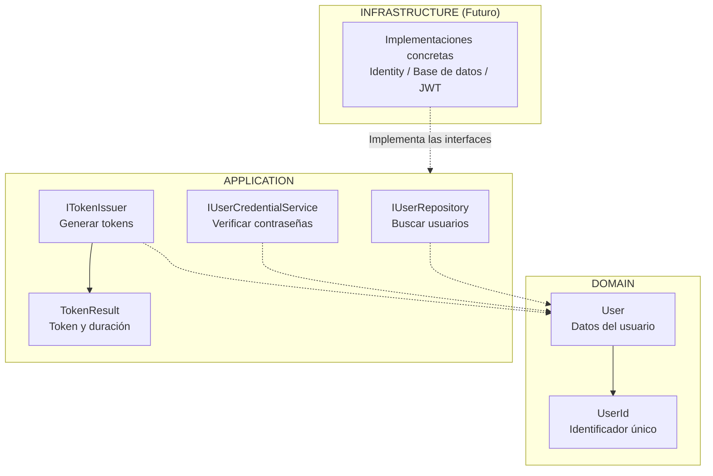
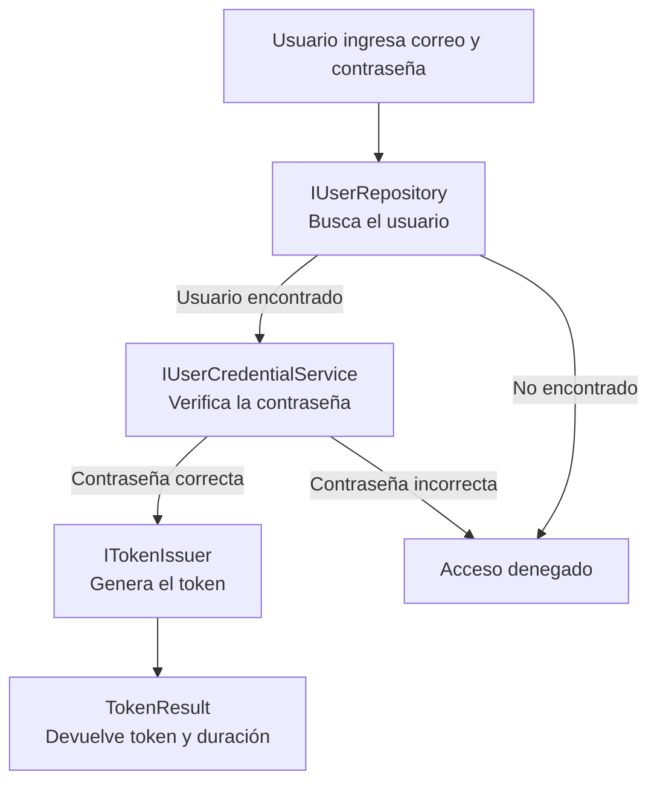
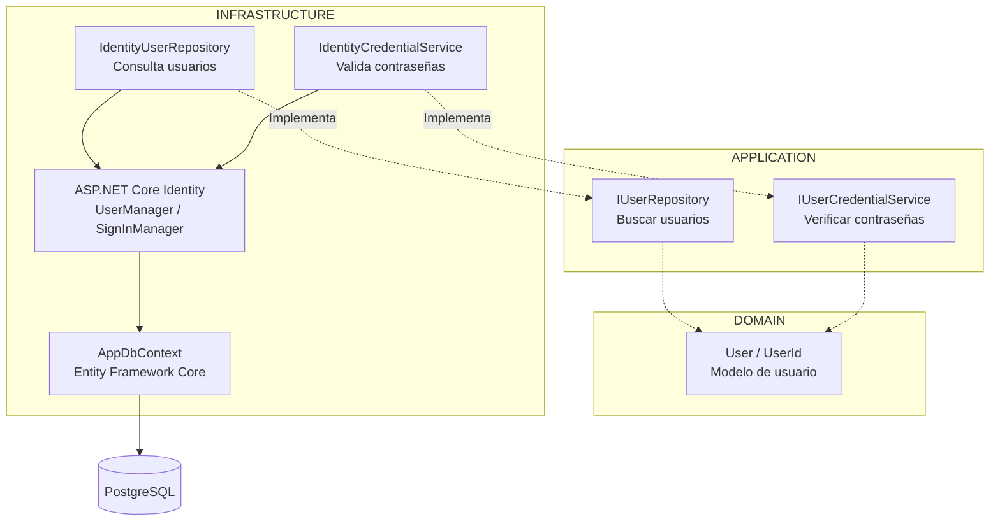
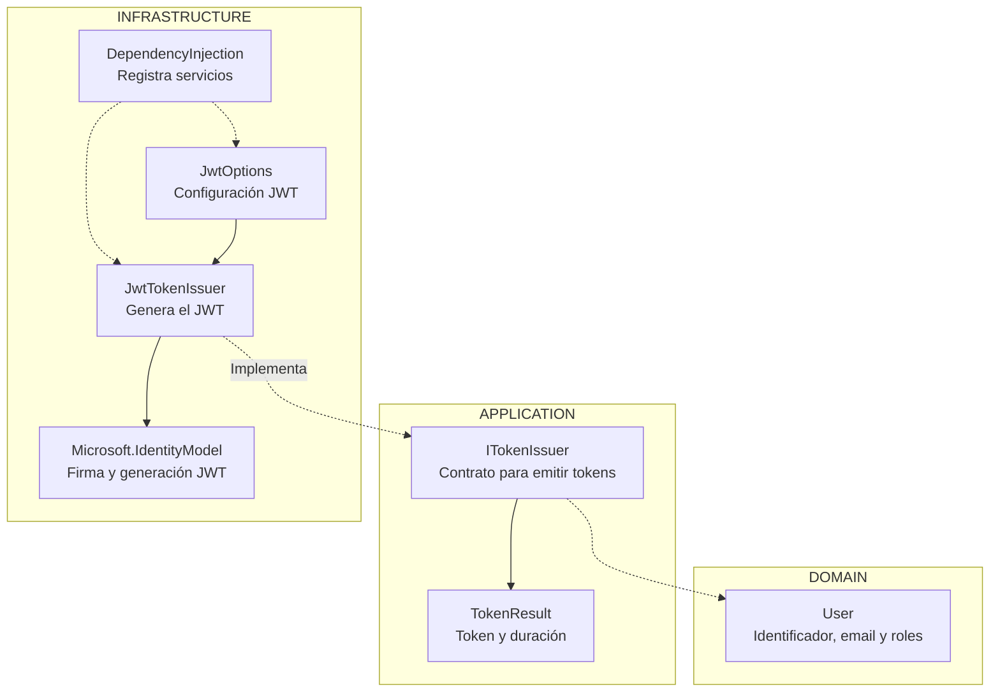

```powershell
1.
2. Identity y persistencia PostgreSQL.
3. Emisión JWT.
4. Seed de roles y administrador.
5. Login, 401, 403 y AdminOnly.
6. Swagger Bearer y respuestas de error.
7. Pruebas unitarias e integración con PostgreSQL efímero.
```

# Implementar 01-base-api-arquitectura

## PASOS

### 1. Modelo de usuario y puertos de Application.

Este módulo define **cómo se representa un usuario y qué operaciones necesita la aplicación para autenticarlo**.

Se divide en dos capas:

- **Domain:** define el modelo de usuario.
- **Application:** define las interfaces (puertos) necesarias para buscar usuarios, verificar contraseñas y generar tokens de acceso.

Las implementaciones de estas interfaces se desarrollarán en **Infrastructure**.

#### 1. Diagrama de componentes



#### 2. Responsabilidad de cada componente

| Componente               | Capa        | ¿Para qué sirve?                                                                   |
| ------------------------ | ----------- | ---------------------------------------------------------------------------------- |
| `User`                   | Domain      | Representa un usuario con su identificador, correo electrónico y roles.            |
| `UserId`                 | Domain      | Representa el identificador del usuario y permite comprobar que no esté vacío.     |
| `IUserRepository`        | Application | Define cómo buscar un usuario mediante su correo electrónico.                      |
| `IUserCredentialService` | Application | Define cómo verificar una contraseña y aplicar las reglas de bloqueo configuradas. |
| `ITokenIssuer`           | Application | Define cómo emitir un token para un usuario autenticado.                           |
| `TokenResult`            | Application | Contiene el token generado y su duración en segundos.                              |

#### 3. ¿Cómo trabajan juntos?

Cuando un usuario intenta iniciar sesión, el proceso esperado es el siguiente:



**Ejemplo:**

1. El usuario ingresa su correo y contraseña.
2. `IUserRepository` permite buscar sus datos y obtener un objeto `User`.
3. `IUserCredentialService` permite comprobar si su contraseña es correcta.
4. `ITokenIssuer` permite generar un token de acceso.
5. `TokenResult` devuelve el token y su duración.

Este flujo será coordinado por un caso de uso de Application cuando se implemente la autenticación.

#### 4. ¿Por qué se utilizan interfaces?

Porque **Application debe definir qué necesita hacer, sin depender de cómo se hace**.

Por ejemplo:

- `IUserRepository` define la búsqueda de usuarios, pero no conoce la base de datos.
- `IUserCredentialService` define la verificación de contraseñas, pero no depende directamente de ASP.NET Core Identity.
- `ITokenIssuer` define la emisión de tokens, pero no depende directamente de JWT.

**Infrastructure implementará estas interfaces** utilizando las tecnologías correspondientes.

Esto aplica el principio de inversión de dependencias (**DIP**) y permite cambiar tecnologías sin modificar la lógica de negocio.

#### 5. Resumen

| Capa               | Responsabilidad                                               |
| ------------------ | ------------------------------------------------------------- |
| **Domain**         | Define qué es un usuario.                                     |
| **Application**    | Define qué operaciones necesita la autenticación.             |
| **Infrastructure** | Implementa esas operaciones utilizando tecnologías concretas. |

**Conclusión:** Este spec establece la estructura básica para autenticar usuarios, separando los modelos y contratos de las tecnologías que se utilizarán posteriormente.

---

### 2. Identity y persistencia PostgreSQL

Este spec implementa los componentes necesarios para **almacenar usuarios en PostgreSQL y verificar sus credenciales mediante ASP.NET Core Identity**.

Complementa el Spec 1, donde se definieron el modelo `User` y las interfaces de Application.

#### 1. Diagrama de componentes



**Idea principal:** Application define las operaciones mediante interfaces, mientras que Infrastructure las implementa utilizando ASP.NET Core Identity y PostgreSQL.

#### 2. Responsabilidad de cada componente

| Componente                  | ¿Para qué sirve?                                                               |
| --------------------------- | ------------------------------------------------------------------------------ |
| `ApplicationIdentityUser`   | Representa al usuario de ASP.NET Core Identity. Hereda de `IdentityUser`.      |
| `IdentityUserRepository`    | Busca usuarios mediante Identity y los convierte al modelo `User` de Domain.   |
| `IdentityCredentialService` | Verifica contraseñas y aplica las reglas de bloqueo configuradas.              |
| `UserManager`               | Servicio de Identity para administrar usuarios, contraseñas y roles.           |
| `SignInManager`             | Servicio de Identity para gestionar la autenticación y verificar credenciales. |
| `AppDbContext`              | Gestiona el acceso a los datos mediante Entity Framework Core.                 |
| `DependencyInjection`       | Configura PostgreSQL, Identity y registra los servicios de Infrastructure.     |
| `PostgreSQL`                | Almacena usuarios, roles y datos de autenticación.                             |

#### 3. Métodos proporcionados por ASP.NET Core Identity

**ASP.NET Core Identity** es un framework de Microsoft para gestionar usuarios, contraseñas, roles y autenticación.

Proporciona clases como `UserManager<TUser>` y `SignInManager<TUser>`, que incluyen métodos para realizar estas operaciones sin tener que implementarlas manualmente.

Los métodos utilizados en este spec son:

| Método                                           | Clase de .NET   | ¿Qué hace?                                                                                   | ¿Dónde se utiliza?          |
| ------------------------------------------------ | --------------- | -------------------------------------------------------------------------------------------- | --------------------------- |
| `FindByEmailAsync(email)`                        | `UserManager`   | Busca un usuario por su correo electrónico.                                                  | `IdentityUserRepository`    |
| `GetRolesAsync(user)`                            | `UserManager`   | Obtiene los roles asignados a un usuario.                                                    | `IdentityUserRepository`    |
| `FindByIdAsync(id)`                              | `UserManager`   | Busca un usuario mediante su identificador.                                                  | `IdentityCredentialService` |
| `CheckPasswordSignInAsync(user, password, true)` | `SignInManager` | Comprueba la contraseña y registra los intentos fallidos para aplicar las reglas de bloqueo. | `IdentityCredentialService` |

**Ejemplo 1: Buscar un usuario**

```csharp
ApplicationIdentityUser? identityUser =
    await _userManager.FindByEmailAsync(email);
```

`FindByEmailAsync` es un método de `UserManager` que consulta el usuario utilizando el almacenamiento configurado para Identity.

Si existe, devuelve un objeto `ApplicationIdentityUser`; caso contrario, devuelve `null`.

**Ejemplo 2: Obtener los roles**

```csharp
IList<string> roles =
    await _userManager.GetRolesAsync(identityUser);
```

`GetRolesAsync` obtiene los nombres de los roles asignados al usuario, por ejemplo: `Admin`, `Contador` o `Asistente`.

Estos roles pueden utilizarse posteriormente para implementar reglas de autorización.

**Ejemplo 3: Verificar una contraseña**

```csharp
SignInResult result =
    await _signInManager.CheckPasswordSignInAsync(
        identityUser,
        password,
        lockoutOnFailure: true);
```

`CheckPasswordSignInAsync` comprueba si la contraseña proporcionada es válida.

El parámetro `lockoutOnFailure: true` permite contabilizar los intentos fallidos para aplicar las reglas de bloqueo configuradas.

El resultado se consulta mediante:

```csharp
return result.Succeeded;
```

Devuelve `true` si la verificación fue satisfactoria y `false` en caso contrario.

**¿Por qué se utilizan estos métodos?**

Porque ASP.NET Core Identity proporciona funcionalidades de seguridad ya implementadas y probadas, como:

- Almacenamiento y verificación de hashes de contraseñas.
- Administración de usuarios y roles.
- Control de intentos fallidos y bloqueo de cuentas.
- Integración con Entity Framework Core.

De esta manera, no es necesario desarrollar manualmente estos mecanismos de seguridad.

#### 4. ¿Cómo trabajan juntos?

Cuando un usuario intenta iniciar sesión, el proceso esperado es:

1. **Application** solicita buscar al usuario mediante `IUserRepository`.
2. **IdentityUserRepository** utiliza `FindByEmailAsync` y `GetRolesAsync` para recuperar sus datos.
3. El repositorio convierte `ApplicationIdentityUser` en `User`, el modelo de Domain.
4. **Application** solicita verificar la contraseña mediante `IUserCredentialService`.
5. **IdentityCredentialService** utiliza `FindByIdAsync` para localizar al usuario y `CheckPasswordSignInAsync` para verificar la contraseña.
6. Finalmente, devuelve `true` o `false` según el resultado.

Las operaciones de persistencia se realizan a través de Identity, Entity Framework Core y PostgreSQL.

Este flujo será coordinado por el caso de uso de autenticación correspondiente.

#### 5. Configuración de seguridad

En `DependencyInjection` se establecieron las siguientes reglas:

| Configuración                 | Valor         |
| ----------------------------- | ------------- |
| Longitud mínima de contraseña | 12 caracteres |
| Mayúsculas y minúsculas       | Obligatorias  |
| Números                       | Obligatorios  |
| Caracteres especiales         | Obligatorios  |
| Caracteres distintos          | Mínimo 6      |
| Intentos fallidos permitidos  | 5             |
| Duración del bloqueo          | 15 minutos    |
| Correo electrónico único      | Obligatorio   |

Estas reglas son administradas por ASP.NET Core Identity.

#### 6. Integración con Application

Las clases `IdentityUserRepository` e `IdentityCredentialService` implementan las interfaces definidas en el Spec 1.

Su vinculación se realiza mediante **inyección de dependencias**:

```csharp
services.AddScoped<IUserRepository, IdentityUserRepository>();

services.AddScoped<IUserCredentialService, IdentityCredentialService>();
```

Esto significa que:

- **Application** utiliza `IUserRepository` e `IUserCredentialService`.
- **Infrastructure** proporciona sus implementaciones concretas.
- **ASP.NET Core Identity** realiza las operaciones de autenticación.
- **Entity Framework Core** permite acceder a PostgreSQL.

La configuración de PostgreSQL se realiza mediante:

```csharp
services.AddDbContext<AppDbContext>(
    options => options.UseNpgsql(connectionString));
```

`UseNpgsql` configura Entity Framework Core para utilizar PostgreSQL como proveedor de base de datos.

**Ventaja:** Application no necesita conocer ASP.NET Core Identity ni PostgreSQL. Si cambia la tecnología, se pueden sustituir las implementaciones sin modificar los contratos.

#### 7. Resumen

| Capa               | Responsabilidad                                                                     |
| ------------------ | ----------------------------------------------------------------------------------- |
| **Domain**         | Define el modelo `User` y su identificador `UserId`.                                |
| **Application**    | Define las interfaces para buscar usuarios y verificar contraseñas.                 |
| **Infrastructure** | Implementa las interfaces utilizando ASP.NET Core Identity y Entity Framework Core. |
| **PostgreSQL**     | Almacena los usuarios, roles y datos de autenticación.                              |

**Conclusión:** El Spec 2 implementa los contratos del Spec 1 utilizando ASP.NET Core Identity para gestionar usuarios y verificar contraseñas, y PostgreSQL para almacenar su información.

Esta separación mantiene **Application independiente de las tecnologías utilizadas en Infrastructure**, siguiendo los principios de Clean Architecture.

**Nota:** La generación de tokens JWT mediante `ITokenIssuer` todavía no está implementada en este spec.

---

### 3. Emisión JWT

Este spec implementa la **generación de tokens JWT (JSON Web Token)** para usuarios autenticados.

Complementa los specs anteriores:

- **Spec 1:** define el modelo `User` y la interfaz `ITokenIssuer`.
- **Spec 2:** implementa la búsqueda de usuarios y la validación de contraseñas mediante ASP.NET Core Identity.
- **Spec 3:** implementa `ITokenIssuer` para generar tokens JWT firmados.

Un JWT permite identificar a un usuario en solicitudes posteriores sin enviar nuevamente su contraseña.

#### 1. Diagrama de componentes



**Idea principal:** Application define cómo solicitar un token mediante `ITokenIssuer`, mientras que Infrastructure implementa su generación utilizando las librerías JWT de Microsoft.

#### 2. Responsabilidad de cada componente

| Componente            | Capa           | ¿Para qué sirve?                                                      |
| --------------------- | -------------- | --------------------------------------------------------------------- |
| `User`                | Domain         | Contiene el identificador, correo y roles que se incluirán en el JWT. |
| `ITokenIssuer`        | Application    | Define el método `IssueAsync` para solicitar un token.                |
| `TokenResult`         | Application    | Representa el token generado y su duración en segundos.               |
| `JwtOptions`          | Infrastructure | Contiene la configuración necesaria para generar y firmar tokens.     |
| `JwtTokenIssuer`      | Infrastructure | Implementa `ITokenIssuer` y genera el JWT.                            |
| `DependencyInjection` | Infrastructure | Configura, valida y registra los servicios JWT.                       |

#### 3. ¿Cómo se genera un JWT?

El método `IssueAsync` de `JwtTokenIssuer` realiza las siguientes operaciones:

1. Recibe un objeto `User` que representa al usuario autenticado.
2. Calcula la fecha de emisión y expiración del token.
3. Crea los **claims**, que contienen la información del usuario.
4. Obtiene la clave secreta configurada.
5. Firma el token utilizando el algoritmo `HmacSha256`.
6. Convierte el JWT en una cadena de texto.
7. Devuelve el token generado junto con su duración.

**Ejemplo de los claims utilizados:**

```csharp
List<Claim> claims =
[
    new(JwtRegisteredClaimNames.Sub, user.Id.Value),
    new(JwtRegisteredClaimNames.Email, user.Email),
    new(JwtRegisteredClaimNames.Jti, Guid.NewGuid().ToString("N"))
];

claims.AddRange(
    user.Roles.Select(role => new Claim(ClaimTypes.Role, role))
);
```

| Claim   | ¿Qué representa?                |
| ------- | ------------------------------- |
| `Sub`   | Identificador del usuario.      |
| `Email` | Correo electrónico del usuario. |
| `Jti`   | Identificador único del token.  |
| `Role`  | Roles asignados al usuario.     |

Los claims permiten que posteriormente la API identifique al usuario y evalúe sus permisos, siempre que el JWT sea validado correctamente.

#### 4. ¿Qué componentes pertenecen a .NET y cuáles son dependencias?

En `JwtTokenIssuer` se utilizan clases del lenguaje C#, de .NET y de paquetes de Microsoft.

| Componente                      | Origen                                    | ¿Para qué sirve?                                               |
| ------------------------------- | ----------------------------------------- | -------------------------------------------------------------- |
| `Task<T>`                       | .NET (`System.Threading.Tasks`)           | Representa una operación que devuelve un resultado.            |
| `Task.FromResult()`             | .NET (`System.Threading.Tasks`)           | Crea un `Task` completado con un resultado disponible.         |
| `DateTime.UtcNow`               | .NET (`System`)                           | Obtiene la fecha y hora UTC.                                   |
| `Guid.NewGuid()`                | .NET (`System`)                           | Genera un identificador único.                                 |
| `Claim`                         | .NET (`System.Security.Claims`)           | Representa un dato de identidad del usuario.                   |
| `ClaimTypes.Role`               | .NET (`System.Security.Claims`)           | Identifica un claim de rol.                                    |
| `Encoding.UTF8`                 | .NET (`System.Text`)                      | Convierte la clave secreta en bytes.                           |
| `JwtSecurityToken`              | Paquete `System.IdentityModel.Tokens.Jwt` | Representa un token JWT.                                       |
| `JwtSecurityTokenHandler`       | Paquete `System.IdentityModel.Tokens.Jwt` | Permite serializar un JWT a texto.                             |
| `JwtRegisteredClaimNames`       | Paquete `System.IdentityModel.Tokens.Jwt` | Proporciona los nombres estándar de claims JWT.                |
| `SymmetricSecurityKey`          | Paquete `Microsoft.IdentityModel.Tokens`  | Representa una clave criptográfica simétrica.                  |
| `SigningCredentials`            | Paquete `Microsoft.IdentityModel.Tokens`  | Define la clave y el algoritmo de firma.                       |
| `SecurityAlgorithms.HmacSha256` | Paquete `Microsoft.IdentityModel.Tokens`  | Identifica el algoritmo de firma HMAC-SHA256.                  |
| `IOptions<T>`                   | Microsoft.Extensions.Options              | Permite acceder a la configuración mediante el patrón Options. |

**Importante:** `System.IdentityModel.Tokens.Jwt` y `Microsoft.IdentityModel.Tokens` son librerías de Microsoft que se utilizan con .NET, pero no son clases creadas en el proyecto.

En cambio, `JwtOptions`, `JwtTokenIssuer`, `ITokenIssuer` y `TokenResult` son componentes propios de la aplicación.

#### 5. ¿Qué hace `Task.FromResult(new TokenResult(accessToken, expiresIn))`?

En `JwtTokenIssuer` encontramos:

```csharp
return Task.FromResult(
    new TokenResult(accessToken, expiresIn)
);
```

Esta instrucción realiza dos operaciones.

**Primero: crea un objeto `TokenResult`.**

```csharp
new TokenResult(accessToken, expiresIn)
```

Por ejemplo:

```csharp
new TokenResult("eyJhbGciOiJIUzI1NiIs...", 3600);
```

Donde:

- `AccessToken`: JWT generado.
- `ExpiresIn`: duración del token en segundos.

**Segundo: devuelve ese objeto dentro de un `Task`.**

```csharp
Task.FromResult(resultado);
```

`Task.FromResult<T>()` es un método de .NET que permite devolver un resultado ya calculado mediante un `Task<T>` completado.

Esto es necesario porque `IssueAsync` está definido con el siguiente tipo de retorno:

```csharp
public Task<TokenResult> IssueAsync(
    User user,
    CancellationToken cancellationToken = default)
```

**¿Por qué no se utiliza `async/await`?**

Porque la generación del JWT se realiza en memoria y no necesita esperar operaciones asíncronas, como consultas a una base de datos o llamadas HTTP.

Por eso se utiliza:

```csharp
return Task.FromResult(resultado);
```

En lugar de declarar innecesariamente un método `async`.

La ventaja es que se mantiene el contrato `Task<TokenResult>` de Application, permitiendo que otras implementaciones puedan utilizar operaciones asíncronas si lo necesitan.

#### 6. ¿Qué hace `public sealed record TokenResult(...)`?

En Application se definió:

```csharp
public sealed record TokenResult(
    string AccessToken,
    long ExpiresIn
);
```

`record` es una característica de C# que permite definir tipos orientados a almacenar datos con menos código.

Esta declaración crea un tipo llamado `TokenResult` con dos propiedades:

| Elemento      | Significado                                                                      |
| ------------- | -------------------------------------------------------------------------------- |
| `public`      | Puede utilizarse desde otras clases y proyectos que tengan acceso al ensamblado. |
| `sealed`      | Impide que otras clases hereden de `TokenResult`.                                |
| `record`      | Define un tipo de referencia con igualdad basada en sus valores.                 |
| `AccessToken` | Propiedad `string` que contiene el JWT.                                          |
| `ExpiresIn`   | Propiedad `long` que contiene la duración en segundos.                           |

**Ejemplo de uso:**

```csharp
TokenResult result = new(
    "eyJhbGciOiJIUzI1NiIs...",
    3600
);

Console.WriteLine(result.AccessToken);
Console.WriteLine(result.ExpiresIn);
```

El resultado contiene los datos necesarios para entregar el token al cliente.

**¿Por qué se utiliza `record` en lugar de `class`?**

Porque `TokenResult` únicamente necesita transportar información, sin implementar lógica de negocio.

Además, proporciona automáticamente un constructor, propiedades de solo inicialización e igualdad por valor.

Esto reduce código y facilita el mantenimiento.

#### 7. Configuración mediante `JwtOptions`

La clase `JwtOptions` contiene cuatro propiedades:

| Propiedad                    | ¿Para qué sirve?                              |
| ---------------------------- | --------------------------------------------- |
| `Issuer`                     | Identifica quién emite el JWT.                |
| `Audience`                   | Identifica a quién está destinado el JWT.     |
| `SigningKey`                 | Clave secreta utilizada para firmar el token. |
| `AccessTokenLifetimeMinutes` | Tiempo de validez del token en minutos.       |

Estas propiedades se obtienen de la sección `Jwt` de la configuración.

En `DependencyInjection` se utiliza:

```csharp
services.AddOptions<JwtOptions>()
    .Bind(configuration.GetSection(JwtOptions.SectionName))
    .ValidateOnStart();
```

El código real también incluye validaciones para comprobar que:

- `Issuer` no esté vacío.
- `Audience` no esté vacío.
- `SigningKey` contenga al menos 32 bytes UTF-8.
- `AccessTokenLifetimeMinutes` sea mayor que cero.

El método `ValidateOnStart()` permite ejecutar estas validaciones durante el inicio de la aplicación, evitando comenzar con una configuración JWT inválida.

**Nota de seguridad:** La clave `SigningKey` debe mantenerse fuera del código fuente y gestionarse mediante configuración segura, como variables de entorno o un gestor de secretos.

#### 8. Integración con Application

`JwtTokenIssuer` implementa la interfaz `ITokenIssuer` definida en el Spec 1.

```csharp
public sealed class JwtTokenIssuer : ITokenIssuer
```

La implementación se registra mediante inyección de dependencias:

```csharp
services.AddSingleton<ITokenIssuer, JwtTokenIssuer>();
```

Esto significa que:

- **Application** utiliza la interfaz `ITokenIssuer`.
- **Infrastructure** proporciona la implementación `JwtTokenIssuer`.
- **JwtTokenIssuer** genera el token utilizando las librerías JWT.
- **Application** recibe un `TokenResult`, sin depender de la tecnología utilizada.

`AddSingleton` indica que el contenedor de dependencias utiliza una única instancia del servicio durante la vida de la aplicación.

#### 9. Resumen

| Capa               | Responsabilidad                                                     |
| ------------------ | ------------------------------------------------------------------- |
| **Domain**         | Proporciona el modelo `User` con los datos del usuario autenticado. |
| **Application**    | Define `ITokenIssuer` y `TokenResult`.                              |
| **Infrastructure** | Implementa `JwtTokenIssuer` y configura `JwtOptions`.               |
| **Librerías JWT**  | Construyen, firman y serializan los tokens JWT.                     |

**Conclusión:** El Spec 3 implementa la emisión de tokens JWT mediante una clase de Infrastructure que cumple el contrato definido en Application.

La generación del token utiliza los datos del usuario, incorpora sus roles y firma el JWT mediante HMAC-SHA256.

La arquitectura mantiene **Application independiente de las librerías JWT**, siguiendo los principios de Clean Architecture.

**Nota:** Este spec implementa la emisión de JWT, pero no demuestra todavía la configuración del middleware de autenticación JWT Bearer para validar los tokens recibidos por la API. Esa funcionalidad debe configurarse por separado.

---

### 4. Seed de roles y administrador.

---

### 5. Login, 401, 403 y AdminOnly.

---

### 6. Swagger Bearer y respuestas de error.

---

### 7. Pruebas unitarias e integración con PostgreSQL efímero.

---

#### Validación de la implementación

- Ejecutar agente:

```powershell
/spec-acceptance-validator @specs/spec-02-identidad-roles-jwt.md
```

- Verificar actualización del [`Spec`](../02-identidad-roles-jwt.md)

- Acciones Git y PullRequest:

```powershell
git add .
git commit -m "FEPP-ContaOps - spec-02-identidad-roles-jwt - Implemented"
git push -u origin spec-02-identidad-roles-jwt
```

- Aprobar pullrequest en GitHub

- Actualizar rama main

```powershell
git switch main
git pull
git branch -d spec-02-identidad-roles-jwt
```

---

**NOTA**: Comandos de verificación:

```powershell
dotnet restore FEPP-ContaOps.slnx
dotnet build FEPP-ContaOps.slnx
dotnet test FEPP-ContaOps.slnx
dotnet run --project src/Fepp.ContaOps.Api
```
