# Implementar: 03-registro-invitacion-activacion

## PASOS

### 1. Definir UserStatus, resultado de invitación y puertos neutrales

#### Componentes implementados

| Componente               | Acción | Tipo        | Capa        | Responsabilidad                                                           |
| ------------------------ | ------ | ----------- | ----------- | ------------------------------------------------------------------------- |
| `UserStatus`             | Create | `enum`      | Domain      | Define los estados `PendingActivation` y `Active`.                        |
| `User`                   | Update | `class`     | Domain      | Incorpora la propiedad `Status` para identificar el estado de la cuenta.  |
| `UserInvitationResult`   | Create | `record`    | Application | Contiene el usuario y su token de activación.                             |
| `IUserInvitationService` | Create | `interface` | Application | Define las operaciones de registro, activación y reenvío de invitaciones. |
| `IInvitationNotifier`    | Create | `interface` | Application | Define el contrato para notificar invitaciones.                           |
| `IEmailSender`           | Create | `interface` | Application | Define el contrato para enviar correos electrónicos.                      |
| `EmailMessage`           | Create | `record`    | Application | Representa un mensaje de correo independiente del proveedor.              |

**Arquitectura:** los contratos se definen en Application y sus implementaciones técnicas podrán desarrollarse en Infrastructure, siguiendo Clean Architecture.

#### Estados del usuario

| Estado              | Descripción                                                                    |
| ------------------- | ------------------------------------------------------------------------------ |
| `PendingActivation` | Cuenta pendiente de activación.                                                |
| `Active`            | Cuenta activada, habilitada para autenticarse si cumple las demás condiciones. |

#### Métodos y funciones principales

| Clase / Interfaz         | Método                   | Responsabilidad                                              |
| ------------------------ | ------------------------ | ------------------------------------------------------------ |
| `User`                   | `User()`                 | Construye el usuario y valida identificador, correo y roles. |
| `IUserInvitationService` | `RegisterPendingAsync()` | Registra una cuenta pendiente y genera una invitación.       |
| `IUserInvitationService` | `ActivateAsync()`        | Activa una cuenta estableciendo su contraseña inicial.       |
| `IUserInvitationService` | `ResendAsync()`          | Genera una nueva invitación.                                 |
| `IInvitationNotifier`    | `NotifyAsync()`          | Solicita la notificación de una invitación.                  |
| `IEmailSender`           | `SendAsync()`            | Solicita el envío de un correo electrónico.                  |

#### Modelos de datos

| Modelo                 | Propiedad         | Tipo     | Descripción                         |
| ---------------------- | ----------------- | -------- | ----------------------------------- |
| `UserInvitationResult` | `User`            | `User`   | Usuario asociado a la invitación.   |
| `UserInvitationResult` | `ActivationToken` | `string` | Token interno de activación.        |
| `EmailMessage`         | `To`              | `string` | Destinatario.                       |
| `EmailMessage`         | `Subject`         | `string` | Asunto.                             |
| `EmailMessage`         | `HtmlBody`        | `string` | Contenido HTML.                     |
| `EmailMessage`         | `TextBody`        | `string` | Contenido en texto plano.           |
| `EmailMessage`         | `AttemptId`       | `string` | Identificador del intento de envío. |

#### Componentes de .NET utilizados

| Componente                             | Origen | Función                                            |
| -------------------------------------- | ------ | -------------------------------------------------- |
| `Task<T>`                              | .NET   | Representa operaciones asíncronas.                 |
| `CancellationToken`                    | .NET   | Permite solicitar la cancelación de operaciones.   |
| `IReadOnlyCollection<T>`               | .NET   | Expone colecciones sin métodos de modificación.    |
| `IEnumerable<T>`                       | .NET   | Representa una secuencia de elementos.             |
| `ArgumentNullException.ThrowIfNull()`  | .NET   | Valida referencias nulas.                          |
| `Where()` / `Distinct()` / `ToArray()` | LINQ   | Filtran y procesan colecciones.                    |
| `StringComparer.OrdinalIgnoreCase`     | .NET   | Compara cadenas ignorando mayúsculas y minúsculas. |

`Result<T>` y `UserId` son componentes propios del proyecto.

#### Diagrama de arquitectura

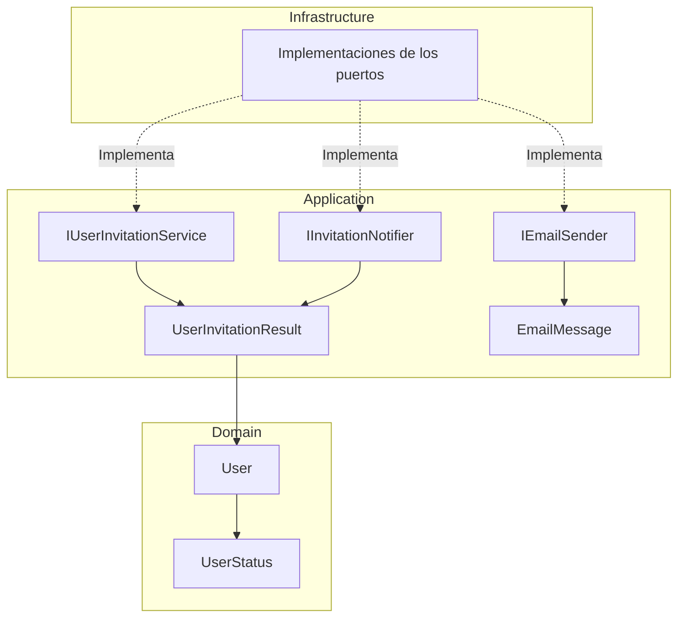

**Interpretación:**

- **Domain:** define el usuario y sus estados funcionales.
- **Application:** establece los contratos para registrar, activar y notificar usuarios.
- **Infrastructure:** implementará los contratos utilizando servicios de identidad, persistencia y correo.

#### Las implementaciones de Infrastructure se muestran como componentes previstos; no forman parte de los cambios de este paso.

---

### 2. Implementar adaptador Identity para cuentas pendientes, tokens y activación.

#### Componentes implementados

| Componente                      | Acción | Tipo           | Capa           | Responsabilidad                                                                              |
| ------------------------------- | ------ | -------------- | -------------- | -------------------------------------------------------------------------------------------- |
| `InvalidActivationTokenError`   | Create | `record`       | Application    | Representa un error de token de activación inválido o expirado.                              |
| `IdentityUserInvitationService` | Create | `class`        | Infrastructure | Implementa el registro, activación y reenvío de invitaciones mediante ASP.NET Core Identity. |
| `ApplicationIdentityUser`       | Update | `class`        | Infrastructure | Incorpora `Status` para almacenar el estado funcional de la cuenta.                          |
| `IdentityCredentialService`     | Update | `class`        | Infrastructure | Impide autenticar usuarios que no tengan estado `Active`.                                    |
| `IdentityUserRepository`        | Update | `class`        | Infrastructure | Incluye el estado del usuario al convertirlo al modelo de Domain.                            |
| `IdentitySeeder`                | Update | `class`        | Infrastructure | Crea usuarios iniciales con estado `Active`.                                                 |
| `DependencyInjection`           | Update | `static class` | Infrastructure | Registra el adaptador de invitaciones y configura su proveedor de tokens.                    |

#### Métodos y funciones principales

| Clase                           | Método                       | Responsabilidad                                                                                         |
| ------------------------------- | ---------------------------- | ------------------------------------------------------------------------------------------------------- |
| `IdentityUserInvitationService` | `RegisterPendingAsync()`     | Crea un usuario sin contraseña, con estado `PendingActivation`, asigna el rol `User` y genera su token. |
| `IdentityUserInvitationService` | `ActivateAsync()`            | Valida el token, establece la contraseña, confirma el correo y cambia el estado a `Active`.             |
| `IdentityUserInvitationService` | `ResendAsync()`              | Invalida tokens anteriores mediante el cambio del `SecurityStamp` y genera una nueva invitación.        |
| `IdentityUserInvitationService` | `ToInvitation()`             | Convierte un usuario técnico y su token en `UserInvitationResult`.                                      |
| `IdentityUserInvitationService` | `ToDomainUserAsync()`        | Convierte el usuario de Identity a `User`, incluyendo sus roles efectivos.                              |
| `IdentityUserInvitationService` | `EnsureSuccess()`            | Comprueba el resultado de Identity y lanza una excepción si la operación falla.                         |
| `IdentityCredentialService`     | `VerifyPasswordAsync()`      | Comprueba el estado `Active` antes de validar las credenciales.                                         |
| `IdentityUserRepository`        | `FindByEmailAsync()`         | Obtiene el usuario y transforma sus datos al modelo de Domain.                                          |
| `IdentitySeeder`                | `SeedAsync()`                | Inicializa los roles y el administrador activo.                                                         |
| `IdentitySeeder`                | `EnsureBootstrapUserAsync()` | Crea el usuario regular inicial con estado `Active`, cuando está configurado.                           |
| `DependencyInjection`           | `AddInfrastructure()`        | Registra `IUserInvitationService` y configura el proveedor de tokens de invitación.                     |

#### Configuración de tokens

La clase `IdentityUserInvitationService` define dos constantes para identificar los tokens de activación.

| Constante           | Valor            | Descripción                                                                                  |
| ------------------- | ---------------- | -------------------------------------------------------------------------------------------- |
| `TokenProviderName` | `UserInvitation` | Nombre del proveedor dedicado a generar y validar tokens de invitación.                      |
| `TokenPurpose`      | `UserActivation` | Propósito criptográfico que diferencia los tokens de activación de otros tokens de Identity. |

El proveedor se registra en `DependencyInjection` mediante `AddTokenProvider<DataProtectorTokenProvider<ApplicationIdentityUser>>()`.

#### Componentes de .NET y proveedores externos

| Componente                              | Origen                    | Función                                                                                                |
| --------------------------------------- | ------------------------- | ------------------------------------------------------------------------------------------------------ |
| `UserManager<TUser>`                    | ASP.NET Core Identity     | Administra usuarios, contraseñas, roles y tokens.                                                      |
| `SignInManager<TUser>`                  | ASP.NET Core Identity     | Valida contraseñas y aplica las reglas de bloqueo.                                                     |
| `IdentityResult`                        | ASP.NET Core Identity     | Informa si una operación de identidad tuvo éxito o presentó errores.                                   |
| `DataProtectorTokenProvider<TUser>`     | ASP.NET Core Identity     | Genera y valida tokens protegidos criptográficamente.                                                  |
| `GenerateUserTokenAsync()`              | `UserManager<TUser>`      | Genera un token utilizando un proveedor y propósito específicos.                                       |
| `VerifyUserTokenAsync()`                | `UserManager<TUser>`      | Verifica la validez de un token de usuario.                                                            |
| `UpdateSecurityStampAsync()`            | `UserManager<TUser>`      | Actualiza el identificador de seguridad para invalidar tokens anteriores asociados a su estado previo. |
| `AddPasswordAsync()`                    | `UserManager<TUser>`      | Establece la contraseña inicial del usuario.                                                           |
| `IDbContextTransaction`                 | Entity Framework Core     | Representa una transacción de base de datos.                                                           |
| `BeginTransactionAsync()`               | Entity Framework Core     | Inicia una transacción para agrupar operaciones de persistencia.                                       |
| `CommitAsync()` / `RollbackAsync()`     | Entity Framework Core     | Confirman o revierten los cambios de una transacción.                                                  |
| `AddScoped<TService,TImplementation>()` | .NET Dependency Injection | Registra una implementación con ciclo de vida Scoped.                                                  |

#### Flujo de registro y activación

| Operación         | Proceso                                                                                                            |
| ----------------- | ------------------------------------------------------------------------------------------------------------------ |
| **Registro**      | Verifica que el correo no exista, crea una cuenta pendiente, asigna el rol `User` y genera un token de activación. |
| **Activación**    | Comprueba que la cuenta esté pendiente, valida el token, establece la contraseña y cambia el estado a `Active`.    |
| **Reenvío**       | Verifica que la cuenta siga pendiente, actualiza el `SecurityStamp` y genera un nuevo token.                       |
| **Autenticación** | Permite comprobar la contraseña únicamente cuando el usuario tiene estado `Active`.                                |

#### Diagrama de arquitectura

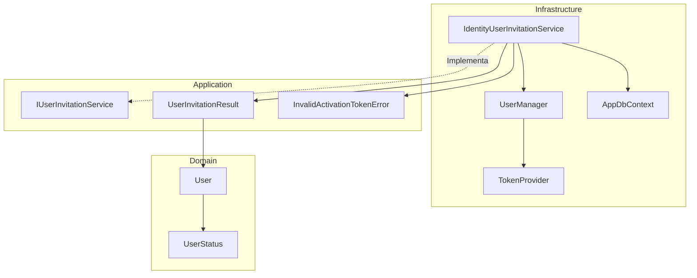

**Interpretación:**

- **Domain:** representa al usuario y su estado funcional.
- **Application:** define el contrato de invitaciones y los resultados o errores esperados.
- **Infrastructure:** implementa las operaciones utilizando ASP.NET Core Identity y Entity Framework Core.
- **Seguridad:** los tokens se generan mediante un proveedor dedicado y las operaciones de persistencia se agrupan mediante transacciones.

#### **Resultado:** se implementa el adaptador de Identity que permite crear usuarios pendientes, generar y validar tokens, activar cuentas y reenviar invitaciones, manteniendo la lógica de Application independiente de ASP.NET Core Identity.

---

### 3. Implementar opciones y validación de invitaciones, URL y key ring

#### Componentes implementados

| Componente                           | Acción   | Tipo           | Capa           | Responsabilidad                                                                                         |
| ------------------------------------ | -------- | -------------- | -------------- | ------------------------------------------------------------------------------------------------------- |
| `UserInvitationOptions`              | Create   | `class`        | Infrastructure | Define la vigencia del token y la URL de activación.                                                    |
| `UserInvitationTokenProvider`        | Create   | `class`        | Infrastructure | Extiende el proveedor de tokens de Identity para utilizar una configuración específica de invitaciones. |
| `UserInvitationTokenProviderOptions` | Create   | `class`        | Infrastructure | Define el nombre del protector criptográfico dedicado a invitaciones.                                   |
| `DependencyInjection`                | Update\* | `static class` | Infrastructure | Contiene el registro de servicios de Identity y del proveedor de tokens.                                |

_Nota:_ el código de `DependencyInjection` proporcionado mantiene el registro de `DataProtectorTokenProvider<ApplicationIdentityUser>`. Todavía no muestra la integración de `UserInvitationTokenProvider`, la configuración de su vigencia ni la persistencia del key ring.

#### Propiedades y configuración

**UserInvitationOptions**

| Propiedad            | Tipo           | Valor predeterminado | Responsabilidad                                           |
| -------------------- | -------------- | -------------------- | --------------------------------------------------------- |
| `SectionName`        | `const string` | `UserInvitation`     | Identifica la sección de configuración.                   |
| `TokenLifetimeHours` | `double`       | `24`                 | Define la duración prevista del token en horas.           |
| `ActivationBaseUrl`  | `string`       | `string.Empty`       | URL de la aplicación cliente que procesará la activación. |

**UserInvitationTokenProviderOptions**

| Propiedad | Tipo     | Valor                                      | Responsabilidad                                               |
| --------- | -------- | ------------------------------------------ | ------------------------------------------------------------- |
| `Name`    | `string` | `UserInvitationDataProtectorTokenProvider` | Identifica el protector utilizado por el proveedor de tokens. |

El nombre del protector permite separar criptográficamente los tokens de invitación de otros tokens que utilicen nombres diferentes.

#### Métodos y funciones principales

| Clase                                | Método                                 | Responsabilidad                                                                             |
| ------------------------------------ | -------------------------------------- | ------------------------------------------------------------------------------------------- |
| `UserInvitationOptions`              | `IsValid()`                            | Comprueba que la vigencia sea positiva y finita, y que la URL sea absoluta y utilice HTTPS. |
| `UserInvitationTokenProvider`        | `UserInvitationTokenProvider()`        | Inicializa el proveedor de tokens mediante Data Protection, opciones y logger.              |
| `UserInvitationTokenProviderOptions` | `UserInvitationTokenProviderOptions()` | Establece el nombre del protector criptográfico.                                            |
| `DependencyInjection`                | `AddInfrastructure()`                  | Configura Identity y registra los servicios de infraestructura.                             |

#### Validaciones de seguridad

| Validación                           | Componente    | Descripción                                                          |
| ------------------------------------ | ------------- | -------------------------------------------------------------------- |
| `double.IsFinite()`                  | .NET          | Impide utilizar valores infinitos o `NaN` como vigencia.             |
| `TokenLifetimeHours > 0`             | Código propio | Exige que la duración del token sea positiva.                        |
| `Uri.TryCreate()`                    | .NET          | Comprueba que la URL de activación tenga un formato absoluto válido. |
| `Uri.UriSchemeHttps`                 | .NET          | Exige el protocolo HTTPS para la URL de activación.                  |
| `StringComparison.OrdinalIgnoreCase` | .NET          | Compara el esquema HTTPS sin distinguir mayúsculas y minúsculas.     |

**Importante:** `IsValid()` contiene las reglas de validación, pero en el código proporcionado todavía no se observa su ejecución automática durante el arranque.

#### Componentes de .NET utilizados

| Componente                           | Origen                       | Función                                                        |
| ------------------------------------ | ---------------------------- | -------------------------------------------------------------- |
| `DataProtectorTokenProvider<TUser>`  | ASP.NET Core Identity        | Genera y valida tokens mediante Data Protection.               |
| `DataProtectionTokenProviderOptions` | ASP.NET Core Identity        | Configura el nombre del protector y la vigencia de los tokens. |
| `IDataProtectionProvider`            | ASP.NET Core Data Protection | Proporciona los mecanismos de protección criptográfica.        |
| `IOptions<T>`                        | .NET Options                 | Proporciona acceso a opciones de configuración tipadas.        |
| `ILogger<T>`                         | .NET Logging                 | Permite registrar información técnica del proveedor.           |
| `Uri`                                | .NET                         | Representa y valida direcciones URL.                           |
| `AddTokenProvider<T>()`              | ASP.NET Core Identity        | Registra un proveedor de tokens con un nombre específico.      |

#### Diagrama de arquitectura

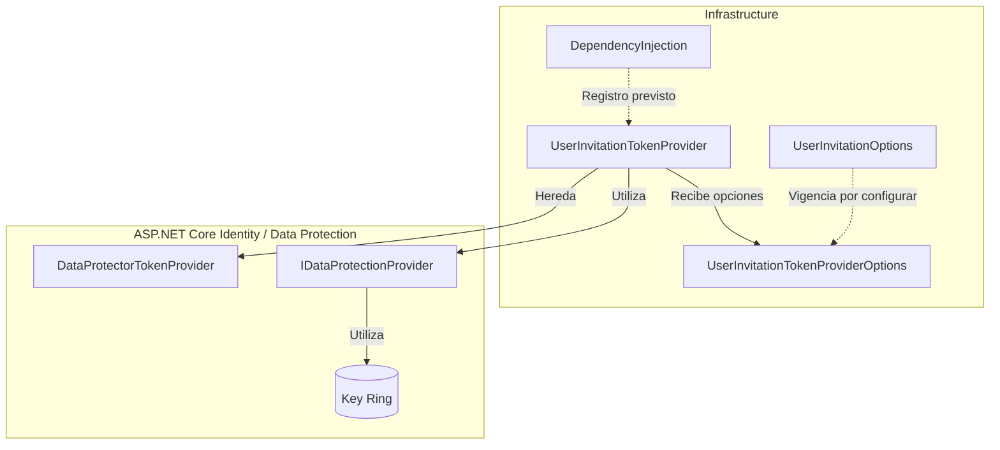

**Interpretación:**

- **Infrastructure:** define las opciones de invitación y especializa el proveedor de tokens.
- **ASP.NET Core Identity:** proporciona la generación y validación de tokens.
- **Data Protection:** utiliza claves criptográficas administradas mediante un key ring.
- **Configuración pendiente:** conectar `TokenLifetimeHours` con `TokenLifespan`, registrar el proveedor personalizado y configurar la persistencia del key ring.

**Resultado:** se crean los componentes para configurar y validar las invitaciones y especializar su proveedor criptográfico. La integración completa de la vigencia y el almacenamiento persistente de claves no se evidencia todavía en el código proporcionado.

---

### 4. Definir configuración neutral SMTP y plantillas

#### Componentes implementados

| Componente              | Acción | Tipo           | Capa           | Responsabilidad                                                                  |
| ----------------------- | ------ | -------------- | -------------- | -------------------------------------------------------------------------------- |
| `EmailSmtpOptions`      | Create | `class`        | Infrastructure | Define y valida la configuración de conexión SMTP.                               |
| `EmailTemplatesOptions` | Create | `class`        | Infrastructure | Configura el directorio donde se almacenarán las plantillas de correo.           |
| `SmtpSecurityMode`      | Create | `enum`         | Infrastructure | Define los modos de conexión SMTP cifrada.                                       |
| `DependencyInjection`   | Update | `static class` | Infrastructure | Registra y valida las opciones SMTP, plantillas, invitaciones y Data Protection. |

#### Propiedades y configuración

**EmailSmtpOptions**

Se vincula con la sección `Email:Smtp`.

| Propiedad        | Tipo               | Descripción                                 |
| ---------------- | ------------------ | ------------------------------------------- |
| `Host`           | `string`           | Servidor SMTP.                              |
| `Port`           | `int`              | Puerto de conexión SMTP.                    |
| `SecurityMode`   | `SmtpSecurityMode` | Modo de cifrado TLS.                        |
| `Username`       | `string`           | Usuario de autenticación SMTP.              |
| `Password`       | `string`           | Contraseña SMTP o contraseña de aplicación. |
| `FromAddress`    | `string`           | Dirección de correo del remitente.          |
| `FromName`       | `string`           | Nombre visible del remitente (opcional).    |
| `TimeoutSeconds` | `int`              | Tiempo máximo de espera en segundos.        |

**EmailTemplatesOptions**

Se vincula con la sección `Email:Templates`.

| Propiedad  | Tipo     | Descripción                                                    |
| ---------- | -------- | -------------------------------------------------------------- |
| `RootPath` | `string` | Directorio alternativo que contendrá las plantillas de correo. |

**SmtpSecurityMode**

| Valor          | Puerto | Descripción                                           |
| -------------- | ------ | ----------------------------------------------------- |
| `StartTls`     | `587`  | Inicia la conexión SMTP y posteriormente negocia TLS. |
| `TlsOnConnect` | `465`  | Establece TLS desde el inicio de la conexión.         |

La configuración solo acepta estos dos modos de conexión cifrada.

#### Métodos y funciones principales

| Clase                 | Método                | Responsabilidad                                                            |
| --------------------- | --------------------- | -------------------------------------------------------------------------- |
| `EmailSmtpOptions`    | `IsValid()`           | Valida host, puerto, cifrado, credenciales, remitente y tiempo de espera.  |
| `EmailSmtpOptions`    | `IsCompatiblePort()`  | Comprueba que el puerto corresponda al modo TLS configurado.               |
| `DependencyInjection` | `AddInfrastructure()` | Registra las opciones de configuración y los servicios de infraestructura. |

#### Validaciones SMTP

| Validación   | Regla                                                 |
| ------------ | ----------------------------------------------------- |
| Servidor     | `Host` no puede estar vacío.                          |
| Puerto       | Debe ser positivo y compatible con el modo TLS.       |
| Cifrado      | Solo se admiten `StartTls` y `TlsOnConnect`.          |
| Credenciales | `Username` y `Password` son obligatorios.             |
| Remitente    | `FromAddress` debe tener un formato de correo válido. |
| Timeout      | `TimeoutSeconds` debe ser mayor que cero.             |

La configuración SMTP se valida durante el arranque mediante `ValidateOnStart()`.

Las opciones de plantillas se registran mediante `Bind()`, sin validaciones adicionales en este paso.

#### Configuración adicional de Identity y Data Protection

La clase `DependencyInjection` incorpora también la configuración de seguridad definida en el paso anterior.

| Configuración                        | Responsabilidad                                                             |
| ------------------------------------ | --------------------------------------------------------------------------- |
| `UserInvitationOptions`              | Vincula y valida la vigencia del token y la URL HTTPS de activación.        |
| `UserInvitationTokenProviderOptions` | Configura `TokenLifespan` utilizando `TokenLifetimeHours`.                  |
| `UserInvitationTokenProvider`        | Registra el proveedor dedicado de tokens de invitación.                     |
| `DataProtection:KeyRingPath`         | Define una ubicación para persistir las claves criptográficas.              |
| `ProtectKeysWithDpapi()`             | Protege las claves almacenadas mediante DPAPI cuando se ejecuta en Windows. |

**Key Ring:** conjunto de claves criptográficas utilizadas por ASP.NET Core Data Protection para proteger y validar información, incluidos los tokens de invitación.

Cuando se configura `DataProtection:KeyRingPath`, las claves se almacenan en el directorio indicado. Si no se configura, Data Protection utiliza su comportamiento predeterminado.

#### Componentes de .NET utilizados

| Componente                    | Origen                       | Función                                                              |
| ----------------------------- | ---------------------------- | -------------------------------------------------------------------- |
| `EmailAddressAttribute`       | .NET DataAnnotations         | Valida el formato del correo remitente.                              |
| `IOptions<T>`                 | .NET Options                 | Proporciona acceso a configuraciones tipadas.                        |
| `AddOptions<T>()`             | .NET Options                 | Registra opciones de configuración.                                  |
| `Bind()`                      | .NET Configuration           | Vincula valores de configuración con las propiedades de una clase.   |
| `Validate()`                  | .NET Options                 | Define reglas de validación para las opciones.                       |
| `ValidateOnStart()`           | .NET Options                 | Ejecuta las validaciones durante el arranque.                        |
| `AddDataProtection()`         | ASP.NET Core                 | Registra los servicios de protección criptográfica.                  |
| `PersistKeysToFileSystem()`   | ASP.NET Core Data Protection | Configura el almacenamiento de claves en el sistema de archivos.     |
| `ProtectKeysWithDpapi()`      | ASP.NET Core Data Protection | Protege las claves mediante DPAPI de Windows.                        |
| `DirectoryInfo`               | .NET System.IO               | Representa y permite crear el directorio de claves.                  |
| `OperatingSystem.IsWindows()` | .NET                         | Identifica si la aplicación se ejecuta en Windows.                   |
| `TimeSpan.FromHours()`        | .NET                         | Convierte la vigencia configurada en horas a un intervalo de tiempo. |

#### Diagrama de arquitectura

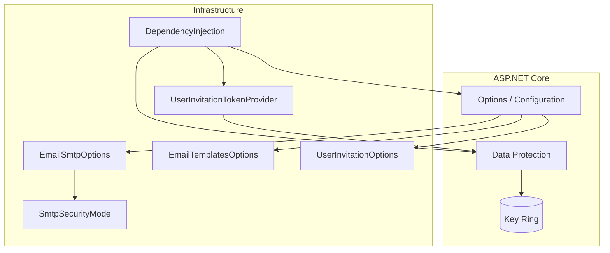

**Interpretación:**

- **Infrastructure:** centraliza las opciones SMTP, plantillas y configuración de invitaciones.
- **Options / Configuration:** permite obtener y validar configuraciones desde las secciones correspondientes.
- **Data Protection:** administra la protección criptográfica de los tokens mediante un key ring.
- **SMTP:** queda configurado y validado, pero todavía no se implementa el transporte efectivo de mensajes.
- **Plantillas:** se define su ubicación, pero todavía no se implementa su lectura ni procesamiento.

**Resultado:** se establecen las configuraciones necesarias para utilizar un proveedor SMTP con conexiones cifradas, definir la ubicación de las plantillas y completar la integración de vigencia de tokens y persistencia del key ring.

---

### 5. Crear manifest y plantillas HTML/TXT

#### Componentes implementados

| Componente                            | Acción | Tipo                | Capa           | Responsabilidad                                                              |
| ------------------------------------- | ------ | ------------------- | -------------- | ---------------------------------------------------------------------------- |
| `templates.json`                      | Create | JSON / Manifest     | Infrastructure | Define el catálogo de plantillas, sus archivos, asuntos y parámetros.        |
| `invitation.html`                     | Create | Plantilla HTML      | Infrastructure | Define el contenido HTML del correo de invitación.                           |
| `invitation.txt`                      | Create | Plantilla TXT       | Infrastructure | Define la versión de texto plano del correo de invitación.                   |
| `Fepp.ContaOps.Infrastructure.csproj` | Update | Archivo de proyecto | Infrastructure | Configura la copia de las plantillas al directorio de salida de compilación. |

#### Estructura de archivos

```text
Fepp.ContaOps.Infrastructure/
├── Fepp.ContaOps.Infrastructure.csproj
└── Email/
    └── Templates/
        ├── templates.json
        ├── invitation.html
        └── invitation.txt
```

#### Manifest de plantillas

El archivo `templates.json` define qué archivos y parámetros deben utilizarse para construir cada tipo de correo.

| Propiedad    | Valor                               | Descripción                                     |
| ------------ | ----------------------------------- | ----------------------------------------------- |
| `invitation` | Objeto JSON                         | Identificador de la plantilla de invitación.    |
| `htmlFile`   | `invitation.html`                   | Archivo que contiene la versión HTML.           |
| `textFile`   | `invitation.txt`                    | Archivo que contiene la versión de texto plano. |
| `subject`    | `Activa tu cuenta de FEPP ContaOps` | Asunto del correo electrónico.                  |
| `parameters` | `userId`, `activationLink`          | Variables requeridas para generar el mensaje.   |

#### Plantillas de correo

| Archivo           | Formato     | Responsabilidad                                                                          |
| ----------------- | ----------- | ---------------------------------------------------------------------------------------- |
| `invitation.html` | HTML        | Presenta el mensaje de invitación con un enlace de activación clicable.                  |
| `invitation.txt`  | Texto plano | Presenta el mismo mensaje sin formato HTML, mostrando directamente la URL de activación. |

Ambas plantillas incluyen los mismos datos:

- Notificación de creación de la cuenta.
- Instrucciones para establecer la primera contraseña.
- Enlace de activación.
- Identificador del usuario.
- Indicación de ignorar el mensaje si la invitación no era esperada.

#### Parámetros de las plantillas

| Parámetro        | Sintaxis             | Responsabilidad                                   |
| ---------------- | -------------------- | ------------------------------------------------- |
| `userId`         | `{{userId}}`         | Identificador del usuario invitado.               |
| `activationLink` | `{{activationLink}}` | URL que permite acceder al proceso de activación. |

Los parámetros funcionan como marcadores que deberán sustituirse por valores reales cuando se construya el correo.

#### Configuración del proyecto .NET

El archivo `Fepp.ContaOps.Infrastructure.csproj` incorpora las plantillas como contenido del proyecto.

| Componente                | Origen             | Función                                                     |
| ------------------------- | ------------------ | ----------------------------------------------------------- |
| `<Content Include="...">` | MSBuild / .NET SDK | Declara los archivos de plantillas como contenido.          |
| `<CopyToOutputDirectory>` | MSBuild / .NET SDK | Configura la copia de los archivos al directorio de salida. |
| `PreserveNewest`          | MSBuild / .NET SDK | Copia los archivos cuando es necesario actualizarlos.       |

Esta configuración permite distribuir el manifest y las plantillas junto con los archivos compilados de Infrastructure.

#### Diagrama de arquitectura

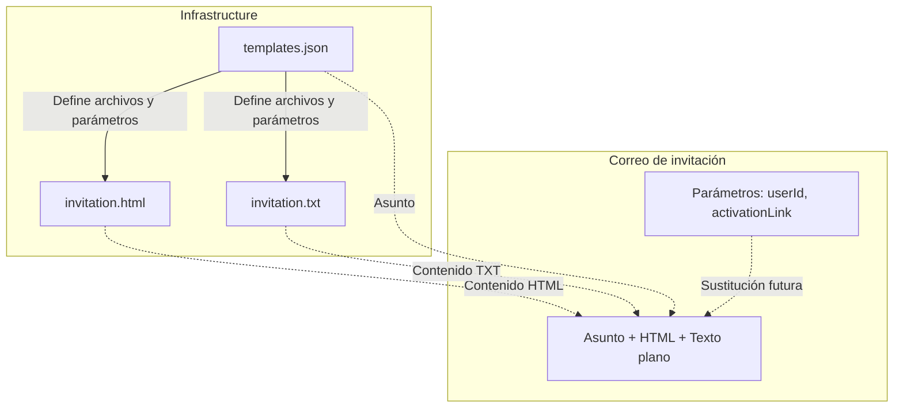

**Interpretación:**

- **Manifest:** identifica las plantillas, el asunto y los parámetros requeridos.
- **HTML/TXT:** contienen dos representaciones del mismo correo de invitación.
- **Parámetros:** permiten personalizar el mensaje con el usuario y su enlace de activación.
- **Infrastructure:** almacenará y procesará las plantillas mediante componentes que se implementen posteriormente.

**Resultado:** se crean las plantillas HTML/TXT y su manifest, separando el contenido del correo de la lógica de aplicación. Los archivos quedan preparados para su lectura, procesamiento y posterior envío mediante el servicio de notificaciones.

---

### 6. Implementar renderer y InvitationEmailNotifier

#### Componentes implementados

| Componente                   | Acción | Tipo           | Capa           | Responsabilidad                                                                        |
| ---------------------------- | ------ | -------------- | -------------- | -------------------------------------------------------------------------------------- |
| `InvitationTemplateCatalog`  | Create | `class`        | Infrastructure | Carga y valida el manifest y los archivos de plantillas.                               |
| `EmailTemplateDefinition`    | Create | `class`        | Infrastructure | Representa la configuración de una plantilla definida en `templates.json`.             |
| `InvitationTemplateRenderer` | Create | `class`        | Infrastructure | Sustituye los parámetros de las plantillas HTML/TXT por valores reales.                |
| `RenderedEmailTemplate`      | Create | `record`       | Infrastructure | Contiene el asunto y los cuerpos HTML/TXT procesados.                                  |
| `InvitationEmailNotifier`    | Create | `class`        | Infrastructure | Construye el enlace de activación, genera el mensaje y solicita su envío.              |
| `DependencyInjection`        | Update | `static class` | Infrastructure | Registra el catálogo, el renderer y el notificador mediante inyección de dependencias. |

#### Métodos y funciones principales

| Clase                        | Método                  | Responsabilidad                                                                    |
| ---------------------------- | ----------------------- | ---------------------------------------------------------------------------------- |
| `InvitationTemplateCatalog`  | `Get()`                 | Obtiene la definición de una plantilla por su identificador.                       |
| `InvitationTemplateCatalog`  | `Read()`                | Lee el archivo HTML o TXT correspondiente.                                         |
| `InvitationTemplateCatalog`  | `ResolveRootPath()`     | Determina el directorio donde se encuentran las plantillas.                        |
| `InvitationTemplateCatalog`  | `LoadDefinitions()`     | Carga y deserializa el manifest `templates.json`.                                  |
| `InvitationTemplateCatalog`  | `ValidateDefinition()`  | Verifica archivos, asunto y parámetros declarados.                                 |
| `InvitationTemplateCatalog`  | `GetSafePath()`         | Comprueba que las rutas referenciadas permanezcan dentro del directorio permitido. |
| `InvitationTemplateRenderer` | `Render()`              | Genera el asunto y los contenidos HTML/TXT con los parámetros proporcionados.      |
| `InvitationTemplateRenderer` | `ReplaceParameters()`   | Sustituye los marcadores `{{parametro}}` y codifica los valores HTML.              |
| `InvitationEmailNotifier`    | `NotifyAsync()`         | Construye el correo de invitación y delega su envío a `IEmailSender`.              |
| `InvitationEmailNotifier`    | `BuildActivationLink()` | Construye el enlace de activación incluyendo el identificador y el token.          |
| `DependencyInjection`        | `AddInfrastructure()`   | Registra los componentes necesarios para procesar y notificar invitaciones.        |

#### Modelos de datos

**EmailTemplateDefinition**

Representa una plantilla declarada en el manifest.

| Propiedad    | Tipo       | Descripción                             |
| ------------ | ---------- | --------------------------------------- |
| `HtmlFile`   | `string`   | Nombre del archivo HTML.                |
| `TextFile`   | `string`   | Nombre del archivo de texto plano.      |
| `Subject`    | `string`   | Asunto del correo.                      |
| `Parameters` | `string[]` | Parámetros requeridos por la plantilla. |

**RenderedEmailTemplate**

Contiene el resultado del procesamiento de una plantilla.

| Propiedad  | Tipo     | Descripción                                              |
| ---------- | -------- | -------------------------------------------------------- |
| `Subject`  | `string` | Asunto del correo.                                       |
| `HtmlBody` | `string` | Contenido HTML con los parámetros sustituidos.           |
| `TextBody` | `string` | Contenido de texto plano con los parámetros sustituidos. |

#### Funcionamiento de InvitationEmailNotifier

La clase `InvitationEmailNotifier` implementa la interfaz `IInvitationNotifier` definida en Application.

| Dependencia    | Tipo                         | Responsabilidad                                   |
| -------------- | ---------------------------- | ------------------------------------------------- |
| `_emailSender` | `IEmailSender`               | Transporte neutral encargado de enviar el correo. |
| `_renderer`    | `InvitationTemplateRenderer` | Procesa las plantillas de invitación.             |
| `_options`     | `UserInvitationOptions`      | Proporciona la URL base de activación.            |

**Proceso de `NotifyAsync()`:**

1. Recibe `UserInvitationResult` con el usuario y su token.
2. Construye el enlace de activación mediante `BuildActivationLink()`.
3. Solicita al renderer la plantilla `invitation`, proporcionando `userId` y `activationLink`.
4. Construye un `EmailMessage` con destinatario, asunto, HTML, TXT e identificador del intento.
5. Delega el envío mediante `IEmailSender.SendAsync()`.

**Enlace de activación**

`BuildActivationLink()` genera una URL con la siguiente estructura:

```text
https://cliente.example/activar#userId=IDENTIFICADOR&token=TOKEN
```

Los parámetros se incorporan en el fragmento (`#`) y se codifican mediante `Uri.EscapeDataString()`.

El fragmento no se envía al servidor como parte de una solicitud HTTP convencional, aunque permanece visible en el navegador y debe tratarse como información sensible.

#### Validación y procesamiento de plantillas

| Componente                   | Validación / Proceso      | Propósito                                                             |
| ---------------------------- | ------------------------- | --------------------------------------------------------------------- |
| `InvitationTemplateCatalog`  | Existencia del manifest   | Comprueba que `templates.json` exista.                                |
| `InvitationTemplateCatalog`  | Definiciones obligatorias | Verifica que exista al menos una plantilla.                           |
| `InvitationTemplateCatalog`  | Archivos HTML/TXT         | Comprueba que los archivos declarados existan.                        |
| `InvitationTemplateCatalog`  | Parámetros                | Verifica que los parámetros declarados aparezcan en ambas plantillas. |
| `InvitationTemplateCatalog`  | Rutas permitidas          | Evita referencias a archivos fuera del directorio de plantillas.      |
| `InvitationTemplateRenderer` | Parámetros requeridos     | Comprueba que se proporcionen todos los parámetros declarados.        |
| `InvitationTemplateRenderer` | Codificación HTML         | Codifica los valores antes de insertarlos en la plantilla HTML.       |

#### Componentes de .NET utilizados

| Componente                              | Origen                    | Función                                                             |
| --------------------------------------- | ------------------------- | ------------------------------------------------------------------- |
| `JsonSerializer.Deserialize<T>()`       | .NET — System.Text.Json   | Deserializa el manifest JSON a objetos C#.                          |
| `File.ReadAllText()`                    | .NET — System.IO          | Lee el contenido de las plantillas.                                 |
| `File.Exists()`                         | .NET — System.IO          | Comprueba la existencia de archivos.                                |
| `Path.Combine()`                        | .NET — System.IO          | Construye rutas de archivos.                                        |
| `Path.GetFullPath()`                    | .NET — System.IO          | Obtiene rutas absolutas para validarlas.                            |
| `WebUtility.HtmlEncode()`               | .NET — System.Net         | Codifica caracteres especiales para contenido HTML.                 |
| `Uri.EscapeDataString()`                | .NET — System             | Codifica parámetros para incorporarlos a una URL.                   |
| `Guid.NewGuid()`                        | .NET — System             | Genera un identificador único para el intento de envío.             |
| `IOptions<T>`                           | .NET Options              | Proporciona acceso a la configuración de invitaciones y plantillas. |
| `AddSingleton<T>()`                     | .NET Dependency Injection | Registra una única instancia del componente.                        |
| `AddScoped<TService,TImplementation>()` | .NET Dependency Injection | Registra una implementación por ámbito de dependencias.             |

#### Registro de dependencias

En `DependencyInjection.AddInfrastructure()` se incorporan los siguientes registros:

```csharp
services.AddSingleton<InvitationTemplateCatalog>();
services.AddSingleton<InvitationTemplateRenderer>();
services.AddScoped<IInvitationNotifier, InvitationEmailNotifier>();
```

| Componente                   | Ciclo de vida | Descripción                                                        |
| ---------------------------- | ------------- | ------------------------------------------------------------------ |
| `InvitationTemplateCatalog`  | Singleton     | Mantiene el catálogo de definiciones cargado durante la ejecución. |
| `InvitationTemplateRenderer` | Singleton     | Reutiliza el catálogo para procesar las plantillas.                |
| `InvitationEmailNotifier`    | Scoped        | Construye y solicita el envío de las notificaciones.               |

#### Diagrama de arquitectura

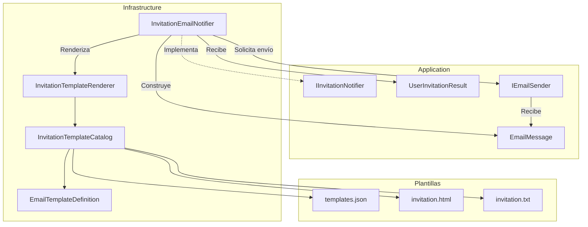

**Interpretación:**

- **Application:** define los contratos de notificación, envío de correo y los modelos neutrales.
- **Infrastructure:** implementa el notificador y el procesamiento de plantillas.
- **InvitationTemplateCatalog:** carga y valida los archivos definidos en el manifest.
- **InvitationTemplateRenderer:** sustituye los parámetros y genera los contenidos HTML/TXT.
- **InvitationEmailNotifier:** construye el mensaje final y delega su entrega a `IEmailSender`.

**Resultado:** se implementa el procesamiento de plantillas y la construcción de correos de invitación, incluyendo el enlace de activación y la codificación de parámetros. El envío efectivo queda delegado a una implementación de `IEmailSender`.

---

### 7. Implementar MailKitSmtpEmailSender

#### Componentes implementados

| Componente                            | Acción | Tipo                | Capa           | Responsabilidad                                                                |
| ------------------------------------- | ------ | ------------------- | -------------- | ------------------------------------------------------------------------------ |
| `MailKitSmtpEmailSender`              | Create | `class`             | Infrastructure | Implementa el envío de correos electrónicos mediante SMTP utilizando MailKit.  |
| `EmailDeliveryUnavailableException`   | Create | `class`             | Application    | Representa errores de entrega de correo sin exponer información del proveedor. |
| `Fepp.ContaOps.Infrastructure.csproj` | Update | Archivo de proyecto | Infrastructure | Incorpora la dependencia externa `MailKit` versión `4.18.1`.                   |

**Arquitectura:** `MailKitSmtpEmailSender` implementa `IEmailSender`, definido en Application, manteniendo el transporte SMTP independiente de la lógica de negocio.

#### Métodos y funciones principales

| Clase                               | Método                                | Responsabilidad                                                                          |
| ----------------------------------- | ------------------------------------- | ---------------------------------------------------------------------------------------- |
| `MailKitSmtpEmailSender`            | `MailKitSmtpEmailSender()`            | Recibe la configuración SMTP mediante `IOptions<EmailSmtpOptions>`.                      |
| `MailKitSmtpEmailSender`            | `SendAsync()`                         | Establece la conexión SMTP, autentica al usuario, envía el mensaje y cierra la conexión. |
| `MailKitSmtpEmailSender`            | `BuildMimeMessage()`                  | Convierte `EmailMessage` en un mensaje MIME con contenido HTML y texto plano.            |
| `MailKitSmtpEmailSender`            | `ToSecureSocketOptions()`             | Convierte `SmtpSecurityMode` al modo de seguridad utilizado por MailKit.                 |
| `MailKitSmtpEmailSender`            | `IsDeliveryFailure()`                 | Identifica excepciones de transporte que deben convertirse en un error neutral.          |
| `EmailDeliveryUnavailableException` | `EmailDeliveryUnavailableException()` | Construye una excepción con un mensaje seguro y un código de error estable.              |

#### Modelos y dependencias

**MailKitSmtpEmailSender**

| Dependencia    | Tipo               | Origen         | Responsabilidad                                              |
| -------------- | ------------------ | -------------- | ------------------------------------------------------------ |
| `_options`     | `EmailSmtpOptions` | Infrastructure | Contiene servidor, puerto, credenciales, TLS y timeout.      |
| `IEmailSender` | `interface`        | Application    | Contrato implementado por el adaptador SMTP.                 |
| `EmailMessage` | `record`           | Application    | Proporciona destinatario, asunto y contenido HTML/TXT.       |
| `SmtpClient`   | `class`            | MailKit        | Gestiona la comunicación con el servidor SMTP.               |
| `MimeMessage`  | `class`            | MimeKit        | Representa el mensaje de correo en formato MIME.             |
| `BodyBuilder`  | `class`            | MimeKit        | Construye el cuerpo del correo con sus variantes HTML y TXT. |

**EmailDeliveryUnavailableException**

| Elemento    | Tipo                             | Descripción                                                             |
| ----------- | -------------------------------- | ----------------------------------------------------------------------- |
| `ErrorCode` | `const string`                   | Código estable `email_delivery_unavailable`.                            |
| `Message`   | `string` heredado de `Exception` | Mensaje genérico que no revela datos del proveedor ni del destinatario. |

La excepción hereda de `System.Exception`, componente nativo de .NET.

#### Componentes de MailKit y .NET utilizados

| Componente / Método           | Origen                 | Función                                                       |
| ----------------------------- | ---------------------- | ------------------------------------------------------------- |
| `SmtpClient`                  | MailKit                | Cliente encargado de la comunicación SMTP.                    |
| `ConnectAsync()`              | MailKit / `SmtpClient` | Establece una conexión con el servidor SMTP utilizando TLS.   |
| `AuthenticateAsync()`         | MailKit / `SmtpClient` | Autentica las credenciales configuradas.                      |
| `SendAsync()`                 | MailKit / `SmtpClient` | Envía el mensaje MIME al servidor SMTP.                       |
| `DisconnectAsync()`           | MailKit / `SmtpClient` | Cierra correctamente la conexión SMTP.                        |
| `SecureSocketOptions`         | MailKit                | Define el modo de seguridad de la conexión.                   |
| `MimeMessage`                 | MimeKit                | Representa el mensaje MIME.                                   |
| `MailboxAddress`              | MimeKit                | Representa direcciones de correo y nombres de remitentes.     |
| `BodyBuilder.ToMessageBody()` | MimeKit                | Construye el cuerpo MIME con las variantes HTML y TXT.        |
| `CancellationTokenSource`     | .NET                   | Permite controlar la cancelación y el timeout del envío.      |
| `CreateLinkedTokenSource()`   | .NET                   | Combina la cancelación solicitada con el timeout configurado. |
| `TimeSpan.FromSeconds()`      | .NET                   | Convierte los segundos configurados a un intervalo de tiempo. |
| `IOptions<T>`                 | .NET Options           | Proporciona acceso a la configuración SMTP.                   |

#### Seguridad y manejo de errores

| Mecanismo              | Implementación                                  | Propósito                                                                    |
| ---------------------- | ----------------------------------------------- | ---------------------------------------------------------------------------- |
| Conexión cifrada       | `SecureSocketOptions.StartTls` / `SslOnConnect` | Utiliza TLS para proteger la comunicación SMTP.                              |
| Timeout                | `CancellationTokenSource`                       | Limita el tiempo total de las operaciones de envío.                          |
| Cancelación            | `CreateLinkedTokenSource()`                     | Combina el timeout con la cancelación solicitada por la aplicación.          |
| Errores neutrales      | `EmailDeliveryUnavailableException`             | Evita propagar detalles técnicos de los errores de transporte identificados. |
| Autenticación          | `AuthenticateAsync()`                           | Utiliza las credenciales configuradas para acceder al servidor SMTP.         |
| Liberación de recursos | `using`                                         | Libera el cliente SMTP y los recursos de cancelación.                        |

**Tratamiento de excepciones:**

`IsDeliveryFailure()` identifica los siguientes errores:

| Excepción                 | Origen  | Descripción                                               |
| ------------------------- | ------- | --------------------------------------------------------- |
| `AuthenticationException` | .NET    | Error de autenticación.                                   |
| `IOException`             | .NET    | Error de entrada/salida.                                  |
| `SocketException`         | .NET    | Error de comunicación de red.                             |
| `SmtpCommandException`    | MailKit | El servidor rechaza un comando SMTP.                      |
| `SmtpProtocolException`   | MailKit | Error durante la comunicación mediante el protocolo SMTP. |
| `SslHandshakeException`   | MailKit | Error al establecer una conexión TLS segura.              |
| `TimeoutException`        | .NET    | Se supera un límite de tiempo.                            |
| `FormatException`         | .NET    | Error de formato de datos.                                |
| `ParseException`          | MimeKit | Error al interpretar datos del mensaje.                   |

Los errores identificados se convierten en `EmailDeliveryUnavailableException`.

La cancelación solicitada expresamente por el consumidor se mantiene como `OperationCanceledException`.

#### Flujo de envío SMTP

| Paso | Operación             | Descripción                                                                 |
| ---- | --------------------- | --------------------------------------------------------------------------- |
| 1    | `SendAsync()`         | Recibe el mensaje neutral `EmailMessage`.                                   |
| 2    | `BuildMimeMessage()`  | Construye el mensaje MIME con asunto, destinatario, HTML y TXT.             |
| 3    | `ConnectAsync()`      | Establece la conexión SMTP cifrada.                                         |
| 4    | `AuthenticateAsync()` | Autentica las credenciales del remitente.                                   |
| 5    | `SendAsync()`         | Entrega el mensaje al servidor SMTP.                                        |
| 6    | `DisconnectAsync()`   | Cierra la conexión.                                                         |
| 7    | Manejo de excepciones | Convierte los errores de transporte identificados en una excepción neutral. |

**Importante:** la ejecución satisfactoria de `SendAsync()` confirma la aceptación del mensaje por el transporte SMTP, no necesariamente su entrega final en la bandeja del destinatario.

#### Diagrama de arquitectura

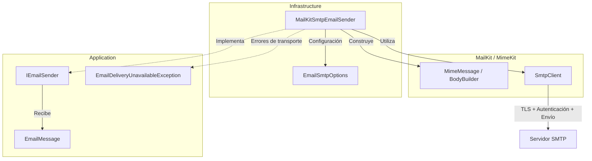

**Interpretación:**

- **Application:** define el contrato neutral de correo y la excepción utilizada para informar fallos de entrega.
- **Infrastructure:** implementa el adaptador SMTP y utiliza su configuración.
- **MimeKit:** construye el mensaje con contenido HTML y texto plano.
- **MailKit:** establece la conexión segura, autentica y envía el correo al servidor SMTP.
- **Manejo de errores:** transforma los fallos de transporte identificados en una excepción propia de Application.

**Resultado:** se implementa el adaptador SMTP mediante MailKit, incorporando envío de mensajes HTML/TXT, conexiones TLS, autenticación, timeout y manejo neutral de errores.

**Observación:** en el código proporcionado todavía no se muestra el registro de `MailKitSmtpEmailSender` como implementación de `IEmailSender` en `DependencyInjection`.

---

### 8. Registrar servicios en el composition root

#### Componentes implementados

| Componente                 | Acción | Tipo                        | Capa               | Responsabilidad                                                                             |
| -------------------------- | ------ | --------------------------- | ------------------ | ------------------------------------------------------------------------------------------- |
| `DependencyInjection`      | Update | `static class`              | Infrastructure     | Registra el adaptador SMTP y mantiene la configuración de los servicios de infraestructura. |
| `Program`                  | Update | Clase parcial / Entry Point | Presentation (API) | Compone las capas y valida el catálogo de plantillas durante el arranque.                   |
| `Fepp.ContaOps.Api.csproj` | Update | Archivo de proyecto         | Presentation (API) | Incluye las plantillas de correo en el directorio de salida de la API.                      |

**Composition Root:** punto central donde se registran y conectan las dependencias de la aplicación. En este proyecto, `Program.cs` actúa como punto de entrada y utiliza las clases `DependencyInjection` de cada capa para configurar los servicios.

#### Métodos y funciones principales

| Clase / Componente    | Método                                            | Responsabilidad                                                          |
| --------------------- | ------------------------------------------------- | ------------------------------------------------------------------------ |
| `Program.cs`          | `WebApplication.CreateBuilder()`                  | Inicializa el constructor de la aplicación ASP.NET Core.                 |
| `Program.cs`          | `AddApplication()`                                | Registra los servicios de Application.                                   |
| `Program.cs`          | `AddInfrastructure()`                             | Registra los adaptadores y configuraciones de Infrastructure.            |
| `Program.cs`          | `AddApi()`                                        | Registra los servicios de Presentation.                                  |
| `Program.cs`          | `Build()`                                         | Construye la aplicación y su contenedor de dependencias.                 |
| `Program.cs`          | `CreateScope()`                                   | Crea un ámbito para ejecutar la inicialización de Identity.              |
| `Program.cs`          | `GetRequiredService<IdentitySeeder>()`            | Obtiene el servicio encargado de inicializar usuarios y roles.           |
| `Program.cs`          | `GetRequiredService<InvitationTemplateCatalog>()` | Fuerza la carga y validación del catálogo antes de aceptar solicitudes.  |
| `Program.cs`          | `Run()`                                           | Inicia la aplicación web.                                                |
| `DependencyInjection` | `AddInfrastructure()`                             | Registra los servicios de correo, invitaciones, Identity y persistencia. |

#### Registro de dependencias

En `DependencyInjection.AddInfrastructure()` se completa el registro del transporte SMTP:

```csharp
services.AddSingleton<IEmailSender, MailKitSmtpEmailSender>();
```

Los servicios relacionados con las invitaciones quedan configurados de la siguiente manera:

| Contrato / Componente        | Implementación                  | Ciclo de vida | Responsabilidad                                             |
| ---------------------------- | ------------------------------- | ------------- | ----------------------------------------------------------- |
| `IUserInvitationService`     | `IdentityUserInvitationService` | Scoped        | Gestiona el registro, activación y reenvío de invitaciones. |
| `IInvitationNotifier`        | `InvitationEmailNotifier`       | Scoped        | Construye y solicita el envío de invitaciones.              |
| `IEmailSender`               | `MailKitSmtpEmailSender`        | Singleton     | Realiza el envío mediante SMTP utilizando MailKit.          |
| `InvitationTemplateCatalog`  | Implementación concreta         | Singleton     | Carga y valida las definiciones de plantillas.              |
| `InvitationTemplateRenderer` | Implementación concreta         | Singleton     | Procesa las plantillas HTML/TXT.                            |
| `IdentitySeeder`             | Implementación concreta         | Scoped        | Inicializa los roles y usuarios predeterminados.            |

**Scoped:** se crea una instancia por ámbito de dependencias, normalmente por solicitud HTTP.

**Singleton:** se utiliza una única instancia del servicio durante la vida de la aplicación.

#### Validación durante el arranque

`Program.cs` incorpora la resolución explícita del catálogo:

```csharp
_ = app.Services.GetRequiredService<InvitationTemplateCatalog>();
```

| Operación                     | Componente                | Responsabilidad                                                                |
| ----------------------------- | ------------------------- | ------------------------------------------------------------------------------ |
| `GetRequiredService<T>()`     | .NET Dependency Injection | Obtiene una instancia registrada y lanza una excepción si no puede resolverla. |
| `InvitationTemplateCatalog()` | Infrastructure            | Carga el manifest y valida sus definiciones, archivos y parámetros.            |
| `ValidateOnStart()`           | .NET Options              | Valida las opciones configuradas durante el arranque.                          |

Esta inicialización permite detectar errores en las plantillas antes de que la API comience a recibir solicitudes.

#### Configuración del proyecto API

`Fepp.ContaOps.Api.csproj` incorpora los archivos de plantillas procedentes de Infrastructure.

| Archivo           | Origen                           | Destino lógico                    |
| ----------------- | -------------------------------- | --------------------------------- |
| `templates.json`  | `Infrastructure/Email/Templates` | `Email/Templates/templates.json`  |
| `invitation.html` | `Infrastructure/Email/Templates` | `Email/Templates/invitation.html` |
| `invitation.txt`  | `Infrastructure/Email/Templates` | `Email/Templates/invitation.txt`  |

Se utilizan las siguientes propiedades de MSBuild:

| Elemento                  | Origen             | Función                                                     |
| ------------------------- | ------------------ | ----------------------------------------------------------- |
| `<Content Include="...">` | .NET SDK / MSBuild | Incorpora archivos externos al proyecto API.                |
| `Link`                    | MSBuild            | Establece la ruta lógica del archivo dentro del proyecto.   |
| `<CopyToOutputDirectory>` | MSBuild            | Configura la copia al directorio de salida.                 |
| `PreserveNewest`          | MSBuild            | Copia los archivos cuando el destino necesita actualizarse. |

Esto permite que `InvitationTemplateCatalog` encuentre las plantillas cuando la aplicación se ejecuta desde el proyecto API.

#### Componentes de .NET utilizados

| Componente                                 | Origen                    | Función                                                  |
| ------------------------------------------ | ------------------------- | -------------------------------------------------------- |
| `WebApplication`                           | ASP.NET Core              | Construye y ejecuta la aplicación web.                   |
| `IServiceCollection`                       | .NET Dependency Injection | Contenedor de registros de servicios.                    |
| `AddSingleton<TService,TImplementation>()` | .NET Dependency Injection | Registra un servicio con una única instancia compartida. |
| `AddScoped<TService,TImplementation>()`    | .NET Dependency Injection | Registra un servicio por ámbito de dependencias.         |
| `IServiceScope`                            | .NET Dependency Injection | Representa un ámbito para resolver servicios Scoped.     |
| `CreateScope()`                            | .NET Dependency Injection | Crea un nuevo ámbito de dependencias.                    |
| `GetRequiredService<T>()`                  | .NET Dependency Injection | Resuelve un servicio registrado.                         |
| `Build()`                                  | ASP.NET Core              | Construye la aplicación y el proveedor de servicios.     |
| `Run()`                                    | ASP.NET Core              | Inicia la ejecución del servidor web.                    |

#### Diagrama de arquitectura

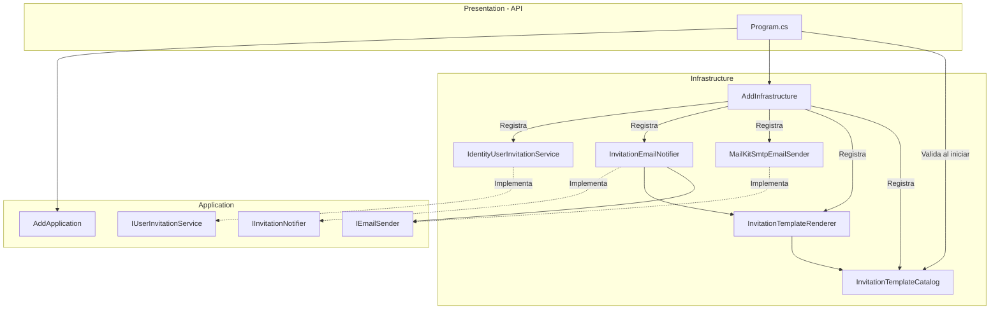

**Interpretación:**

- **Presentation:** `Program.cs` coordina el registro de las capas y el arranque de la aplicación.
- **Application:** define las interfaces utilizadas por los servicios de invitaciones y correo.
- **Infrastructure:** proporciona las implementaciones concretas de Identity, notificaciones, plantillas y SMTP.
- **Dependency Injection:** conecta las interfaces con sus implementaciones sin acoplar Application a los proveedores externos.
- **Validación inicial:** el catálogo de plantillas se carga antes de aceptar solicitudes HTTP.

**Resultado:** se completa la integración de los servicios de invitaciones y correo en el contenedor de dependencias, se habilita el transporte SMTP mediante MailKit y se asegura la disponibilidad y validación inicial de las plantillas.

---

### 9. Probar transporte SMTP y errores de entrega

#### Componentes implementados

| Componente                    | Acción | Tipo            | Capa              | Responsabilidad                                                                                           |
| ----------------------------- | ------ | --------------- | ----------------- | --------------------------------------------------------------------------------------------------------- |
| `MailKitSmtpEmailSenderTests` | Create | `class`         | Tests (UnitTests) | Verifica la configuración SMTP y el tratamiento de errores de transporte sin utilizar proveedores reales. |
| `InProcessSmtpFailureServer`  | Create | `class` anidada | Tests (UnitTests) | Simula un servidor SMTP local que provoca un fallo de conexión controlado.                                |

**Objetivo:** comprobar que la configuración SMTP exige conexiones cifradas y que los errores de transporte se convierten en `EmailDeliveryUnavailableException`.

#### Pruebas implementadas

| Prueba                                                      | Tipo     | Responsabilidad                                                                                |
| ----------------------------------------------------------- | -------- | ---------------------------------------------------------------------------------------------- |
| `SmtpOptions_RejectsUnencryptedOrIncompatibleConnections()` | `[Fact]` | Comprueba que `EmailSmtpOptions` rechace combinaciones inválidas de puerto y modo TLS.         |
| `InProcessSmtpFailure_IsTranslatedToUnavailableError()`     | `[Fact]` | Comprueba que un fallo de comunicación SMTP se traduzca a `EmailDeliveryUnavailableException`. |

**Validación de configuración SMTP**

| Puerto | Modo de seguridad | Resultado esperado |
| ------ | ----------------- | ------------------ |
| `25`   | `StartTls`        | Inválido           |
| `465`  | `StartTls`        | Inválido           |
| `465`  | `TlsOnConnect`    | Válido             |

Estas pruebas utilizan `EmailSmtpOptions.IsValid()` para verificar las restricciones configuradas.

#### Métodos y funciones principales

| Clase                         | Método                                                      | Responsabilidad                                                         |
| ----------------------------- | ----------------------------------------------------------- | ----------------------------------------------------------------------- |
| `MailKitSmtpEmailSenderTests` | `SmtpOptions_RejectsUnencryptedOrIncompatibleConnections()` | Verifica las reglas de seguridad SMTP.                                  |
| `MailKitSmtpEmailSenderTests` | `InProcessSmtpFailure_IsTranslatedToUnavailableError()`     | Ejecuta el adaptador SMTP contra un servidor local que simula un fallo. |
| `InProcessSmtpFailureServer`  | `InProcessSmtpFailureServer()`                              | Inicializa un servidor TCP local utilizando un puerto efímero.          |
| `InProcessSmtpFailureServer`  | `Port`                                                      | Obtiene el puerto asignado al servidor de prueba.                       |
| `InProcessSmtpFailureServer`  | `AcceptAndCloseAsync()`                                     | Acepta una conexión, envía un saludo SMTP y cierra la comunicación.     |
| `InProcessSmtpFailureServer`  | `DisposeAsync()`                                            | Detiene el servidor local y libera sus recursos.                        |

#### Funcionamiento del servidor SMTP simulado

`InProcessSmtpFailureServer` es una clase privada anidada dentro de `MailKitSmtpEmailSenderTests`.

Implementa `IAsyncDisposable` para permitir la liberación de recursos mediante `await using`.

| Componente      | Tipo          | Responsabilidad                          |
| --------------- | ------------- | ---------------------------------------- |
| `_listener`     | `TcpListener` | Escucha conexiones TCP locales.          |
| `Port`          | `int`         | Expone el puerto asignado dinámicamente. |
| `TcpClient`     | .NET          | Representa la conexión aceptada.         |
| `NetworkStream` | .NET          | Permite escribir el saludo SMTP.         |

**Secuencia de la prueba:**

1. Se inicia un servidor TCP en `127.0.0.1` con un puerto disponible.
2. Se configura `MailKitSmtpEmailSender` para conectarse a ese servidor.
3. Se construye un `EmailMessage` de prueba.
4. El servidor acepta la conexión y envía el saludo SMTP `220`.
5. El servidor cierra la conexión sin completar el protocolo SMTP.
6. MailKit detecta el fallo de comunicación.
7. El adaptador convierte el error en `EmailDeliveryUnavailableException`.
8. xUnit comprueba que se produzca la excepción esperada.

#### Componentes de .NET y bibliotecas externas

| Componente                         | Origen                    | Función                                                                                |
| ---------------------------------- | ------------------------- | -------------------------------------------------------------------------------------- |
| `[Fact]`                           | xUnit                     | Identifica un método como prueba ejecutable.                                           |
| `Assert.True()` / `Assert.False()` | xUnit                     | Verifican condiciones booleanas.                                                       |
| `Assert.ThrowsAsync<T>()`          | xUnit                     | Comprueba que una operación asíncrona lance una excepción específica.                  |
| `TcpListener`                      | .NET — System.Net.Sockets | Implementa un servidor TCP local.                                                      |
| `TcpClient`                        | .NET — System.Net.Sockets | Representa una conexión TCP.                                                           |
| `NetworkStream`                    | .NET — System.Net.Sockets | Permite leer y escribir datos mediante una conexión TCP.                               |
| `IPAddress.Loopback`               | .NET — System.Net         | Representa la dirección local `127.0.0.1`.                                             |
| `IPEndPoint`                       | .NET — System.Net         | Permite obtener el puerto asignado al servidor.                                        |
| `IAsyncDisposable`                 | .NET                      | Define la liberación asíncrona de recursos.                                            |
| `Options.Create<T>()`              | .NET Options              | Construye un objeto `IOptions<T>` para proporcionar configuración durante las pruebas. |
| `Task` / `ValueTask`               | .NET                      | Representan operaciones asíncronas.                                                    |
| `MailKitSmtpEmailSender`           | Infrastructure / MailKit  | Adaptador real de correo que se somete a prueba.                                       |

#### Diagrama de arquitectura

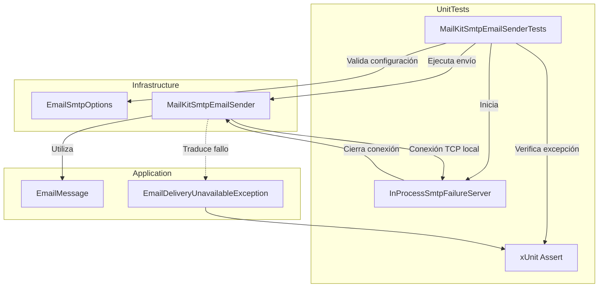

**Interpretación:**

- **Tests:** ejecuta las pruebas y simula un servidor SMTP local.
- **Infrastructure:** utiliza el adaptador real `MailKitSmtpEmailSender` para comprobar su comportamiento.
- **Application:** proporciona el mensaje neutral y la excepción esperada.
- **xUnit:** verifica las reglas de configuración y el tratamiento de errores.

#### Consideraciones técnicas

| Aspecto               | Descripción                                                                                |
| --------------------- | ------------------------------------------------------------------------------------------ |
| Independencia externa | Las pruebas no requieren Gmail ni otro proveedor SMTP real.                                |
| Servidor local        | Utiliza `IPAddress.Loopback` para evitar conexiones a servicios externos.                  |
| Puerto efímero        | El sistema operativo asigna un puerto disponible mediante `TcpListener(..., 0)`.           |
| Seguridad             | Comprueba que se rechacen configuraciones SMTP incompatibles con los modos TLS permitidos. |
| Manejo de errores     | Verifica que los fallos de transporte identificados se traduzcan a una excepción neutral.  |
| Alcance               | No comprueba un envío exitoso, la autenticación SMTP ni la entrega final de correos.       |

**Observación:** la segunda prueba utiliza directamente un puerto efímero que puede ser distinto de `587` o `465`. Por ello, comprueba el comportamiento del adaptador frente a un fallo de transporte, pero no valida la configuración mediante `EmailSmtpOptions.IsValid()`.

**Resultado:** se incorporan pruebas automatizadas para las restricciones de seguridad SMTP y la traducción de fallos de comunicación a `EmailDeliveryUnavailableException`, sin depender de proveedores externos.

---

### 10. Preparar contratos para SPEC 04

#### Componentes implementados

| Componente                      | Acción | Tipo        | Capa           | Responsabilidad                                                                                                     |
| ------------------------------- | ------ | ----------- | -------------- | ------------------------------------------------------------------------------------------------------------------- |
| `IUserInvitationService`        | Update | `interface` | Application    | Modifica el contrato de activación para identificar al usuario mediante `UserId` en lugar de su correo electrónico. |
| `IdentityUserInvitationService` | Update | `class`     | Infrastructure | Adapta la activación de cuentas al nuevo contrato y valida el identificador recibido.                               |

**Arquitectura:** se ajusta el contrato de Application y su implementación en Infrastructure para preparar el proceso de activación que utilizará SPEC 04.

#### Métodos y funciones principales

| Clase / Interfaz                | Método                   | Acción      | Responsabilidad                                                                               |
| ------------------------------- | ------------------------ | ----------- | --------------------------------------------------------------------------------------------- |
| `IUserInvitationService`        | `ActivateAsync()`        | Update      | Sustituye el parámetro `email` por `UserId userId`.                                           |
| `IdentityUserInvitationService` | `ActivateAsync()`        | Update      | Busca la cuenta mediante su identificador, valida el token y establece la primera contraseña. |
| `IdentityUserInvitationService` | `RegisterPendingAsync()` | Sin cambios | Registra una cuenta pendiente y genera su invitación.                                         |
| `IdentityUserInvitationService` | `ResendAsync()`          | Sin cambios | Genera una nueva invitación para una cuenta pendiente.                                        |

#### Modificación del contrato de activación

**Contrato anterior:**

```csharp
Task<Result<User>> ActivateAsync(
    string email,
    string token,
    string newPassword,
    CancellationToken cancellationToken = default);
```

**Contrato actualizado:**

```csharp
Task<Result<User>> ActivateAsync(
    UserId userId,
    string token,
    string newPassword,
    CancellationToken cancellationToken = default);
```

| Elemento      | Antes                | Ahora           | Propósito                                                   |
| ------------- | -------------------- | --------------- | ----------------------------------------------------------- |
| Identificador | `string email`       | `UserId userId` | Identificar la cuenta mediante su identificador de dominio. |
| Token         | `string token`       | Sin cambios     | Validar la invitación de activación.                        |
| Contraseña    | `string newPassword` | Sin cambios     | Establecer la primera contraseña.                           |
| Resultado     | `Result<User>`       | Sin cambios     | Devolver el usuario activado o un error esperado.           |

Este cambio permite utilizar directamente el `userId` incluido en el enlace de activación generado durante la invitación.

#### Validaciones de activación

La implementación `IdentityUserInvitationService.ActivateAsync()` incorpora la validación del identificador antes de consultar Identity.

| Validación             | Método / Componente                  | Responsabilidad                                                    |
| ---------------------- | ------------------------------------ | ------------------------------------------------------------------ |
| Identificador válido   | `UserId.IsValid()`                   | Comprueba que el identificador recibido sea válido.                |
| Usuario existente      | `UserManager.FindByIdAsync()`        | Busca la cuenta mediante su identificador.                         |
| Estado pendiente       | `UserStatus.PendingActivation`       | Impide activar cuentas que no estén pendientes.                    |
| Token válido           | `UserManager.VerifyUserTokenAsync()` | Comprueba el token mediante el proveedor dedicado.                 |
| Contraseña inicial     | `UserManager.AddPasswordAsync()`     | Establece la contraseña de la cuenta.                              |
| Confirmación de correo | `EmailConfirmed = true`              | Marca el correo como confirmado.                                   |
| Activación             | `Status = UserStatus.Active`         | Cambia el estado funcional de la cuenta.                           |
| Invalidación del token | `UpdateSecurityStampAsync()`         | Actualiza el estado de seguridad para invalidar tokens anteriores. |

Cuando el identificador, el usuario, su estado o el token no son válidos, se devuelve `InvalidActivationTokenError.Instance`.

#### Componentes de .NET utilizados

| Componente                          | Origen                | Función                                              |
| ----------------------------------- | --------------------- | ---------------------------------------------------- |
| `UserManager<TUser>`                | ASP.NET Core Identity | Administra usuarios, contraseñas y tokens.           |
| `FindByIdAsync()`                   | ASP.NET Core Identity | Busca un usuario mediante su identificador.          |
| `VerifyUserTokenAsync()`            | ASP.NET Core Identity | Comprueba la validez del token de activación.        |
| `AddPasswordAsync()`                | ASP.NET Core Identity | Establece la contraseña inicial.                     |
| `UpdateSecurityStampAsync()`        | ASP.NET Core Identity | Actualiza el identificador de seguridad del usuario. |
| `BeginTransactionAsync()`           | Entity Framework Core | Inicia una transacción de base de datos.             |
| `CommitAsync()` / `RollbackAsync()` | Entity Framework Core | Confirman o revierten la transacción.                |
| `CancellationToken`                 | .NET                  | Permite solicitar la cancelación de operaciones.     |

**Componentes propios:** `UserId`, `UserStatus`, `Result<User>` e `InvalidActivationTokenError`.

#### Diagrama de arquitectura

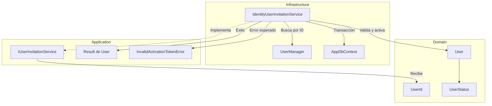

**Interpretación:**

- **Domain:** proporciona `UserId` para identificar la cuenta y `UserStatus` para representar su estado.
- **Application:** define el contrato de activación utilizando tipos del dominio.
- **Infrastructure:** implementa la búsqueda por identificador y la validación mediante ASP.NET Core Identity.
- **Seguridad:** las condiciones inválidas de identificación, estado o token se representan mediante un error neutral.

#### Preparación para SPEC 04

| Aspecto                                   | Estado                    |
| ----------------------------------------- | ------------------------- |
| Activación mediante `UserId`              | Implementado              |
| Validación del identificador              | Implementado              |
| Verificación del token                    | Implementado              |
| Establecimiento de contraseña             | Implementado              |
| Cambio de estado a `Active`               | Implementado              |
| Contrato actualizado en Application       | Implementado              |
| Implementación adaptada en Infrastructure | Implementado              |
| Endpoints HTTP de activación              | No incluidos en este paso |

**Resultado:** se actualiza el contrato de activación para trabajar con `UserId` en lugar del correo electrónico y se adapta su implementación en Identity. Esto permite que SPEC 04 utilice el identificador y el token incluidos en el enlace de invitación para completar la activación de cuentas.

---

### 11. Actualizar .env.example, README.md y AGENTS.md

#### Componentes implementados

| Componente     | Acción   | Tipo                     | Capa          | Responsabilidad                                                                  |
| -------------- | -------- | ------------------------ | ------------- | -------------------------------------------------------------------------------- |
| `.env.example` | Update   | Archivo de configuración | Configuración | Documenta las variables de entorno necesarias para ejecutar la aplicación.       |
| `README.md`    | Update\* | Documentación Markdown   | Documentación | Proporciona instrucciones de configuración y ejecución del proyecto.             |
| `AGENTS.md`    | Update\* | Documentación Markdown   | Documentación | Define las instrucciones y convenciones del proyecto para agentes de desarrollo. |

_El contenido proporcionado corresponde únicamente a `.env.example`. No se incluyen los cambios específicos realizados en `README.md` y `AGENTS.md`._

#### Variables de entorno

**Base de datos y autenticación**

| Variable                          | Responsabilidad                                       |
| --------------------------------- | ----------------------------------------------------- |
| `POSTGRES_PASSWORD`               | Contraseña de PostgreSQL utilizada por el contenedor. |
| `PGADMIN_DEFAULT_EMAIL`           | Correo de acceso a pgAdmin.                           |
| `PGADMIN_DEFAULT_PASSWORD`        | Contraseña de acceso a pgAdmin.                       |
| `ConnectionStrings__Default`      | Cadena de conexión de la API a PostgreSQL.            |
| `Jwt__Issuer`                     | Identificador del emisor de tokens JWT.               |
| `Jwt__Audience`                   | Audiencia autorizada para los tokens JWT.             |
| `Jwt__SigningKey`                 | Clave secreta para firmar tokens JWT.                 |
| `Jwt__AccessTokenLifetimeMinutes` | Vigencia del token de acceso en minutos.              |
| `BootstrapAdmin__Email`           | Correo del administrador inicial.                     |
| `BootstrapAdmin__Password`        | Contraseña del administrador inicial.                 |

**Invitaciones y activación**

| Variable                             | Valor de ejemplo                 | Responsabilidad                                                   |
| ------------------------------------ | -------------------------------- | ----------------------------------------------------------------- |
| `UserInvitation__TokenLifetimeHours` | `24`                             | Establece la vigencia del token de activación en horas.           |
| `UserInvitation__ActivationBaseUrl`  | `https://cliente.local/activate` | Define la URL HTTPS del cliente donde se procesará la activación. |

**Configuración SMTP**

| Variable                      | Valor de ejemplo     | Responsabilidad                             |
| ----------------------------- | -------------------- | ------------------------------------------- |
| `Email__Smtp__Host`           | `smtp.gmail.com`     | Servidor SMTP.                              |
| `Email__Smtp__Port`           | `587`                | Puerto de conexión.                         |
| `Email__Smtp__SecurityMode`   | `StartTls`           | Modo de cifrado de la conexión.             |
| `Email__Smtp__Username`       | `sender@example.com` | Usuario de autenticación SMTP.              |
| `Email__Smtp__Password`       | Valor de reemplazo   | Contraseña SMTP o contraseña de aplicación. |
| `Email__Smtp__FromAddress`    | `sender@example.com` | Dirección del remitente.                    |
| `Email__Smtp__FromName`       | `FEPP ContaOps`      | Nombre visible del remitente.               |
| `Email__Smtp__TimeoutSeconds` | `30`                 | Tiempo máximo de espera en segundos.        |

**Plantillas y Data Protection**

| Variable                      | Valor | Responsabilidad                                                                         |
| ----------------------------- | ----- | --------------------------------------------------------------------------------------- |
| `Email__Templates__RootPath`  | Vacío | Utiliza el catálogo de plantillas distribuido con la aplicación.                        |
| `DataProtection__KeyRingPath` | Vacío | Utiliza la configuración predeterminada de almacenamiento de claves de Data Protection. |

En despliegues con Docker se debe configurar `DataProtection__KeyRingPath` con una ubicación persistente para conservar las claves criptográficas entre reinicios o recreaciones de contenedores.

#### Componentes de .NET relacionados

| Componente                | Origen                       | Función                                                        |
| ------------------------- | ---------------------------- | -------------------------------------------------------------- |
| `IConfiguration`          | .NET Configuration           | Proporciona acceso a las variables de configuración.           |
| `ConfigurationBinder`     | .NET Configuration           | Vincula las variables de configuración con clases de opciones. |
| `IOptions<T>`             | .NET Options                 | Proporciona acceso a las opciones configuradas.                |
| `EmailSmtpOptions`        | Infrastructure               | Representa y valida la configuración SMTP.                     |
| `UserInvitationOptions`   | Infrastructure               | Representa y valida la configuración de invitaciones.          |
| `EmailTemplatesOptions`   | Infrastructure               | Define la ubicación del catálogo de plantillas.                |
| `IDataProtectionProvider` | ASP.NET Core Data Protection | Proporciona servicios de protección criptográfica.             |

**Convención de .NET:** el separador `__` en las variables de entorno representa `:` en las claves jerárquicas de configuración.

Ejemplo:

```text
Email__Smtp__Host
        ↓
Email:Smtp:Host
        ↓
EmailSmtpOptions.Host
```

#### Diagrama de arquitectura

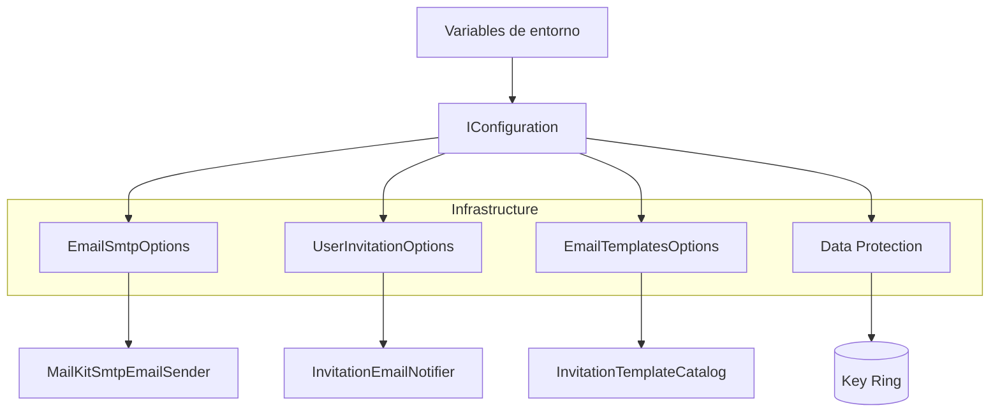

**Interpretación:**

- **Variables de entorno:** proporcionan los valores necesarios para configurar la aplicación.
- **IConfiguration:** permite acceder a la configuración desde .NET.
- **Infrastructure:** transforma los valores de configuración en opciones utilizadas por los servicios.
- **Data Protection:** administra las claves criptográficas necesarias para proteger los tokens de invitación.

#### Consideraciones de seguridad

| Aspecto           | Recomendación                                                               |
| ----------------- | --------------------------------------------------------------------------- |
| Contraseñas       | Utilizar valores seguros y diferentes para cada servicio.                   |
| JWT               | Configurar una clave secreta aleatoria de al menos 32 bytes.                |
| SMTP              | Utilizar conexiones TLS y credenciales específicas del proveedor.           |
| `.env.example`    | Mantener únicamente valores de ejemplo, nunca credenciales reales.          |
| `.env`            | Excluir el archivo de Git mediante `.gitignore`.                            |
| Key Ring          | Utilizar almacenamiento persistente en Docker y otros despliegues durables. |
| URL de activación | Utilizar HTTPS, como exige `UserInvitationOptions.IsValid()`.               |

**Resultado:** se documentan las variables necesarias para configurar PostgreSQL, JWT, invitaciones, SMTP, plantillas y Data Protection, facilitando la instalación y ejecución del proyecto en diferentes entornos.

---

### 13. Ajustes por pruebas manuales

#### Componentes implementados

| Componente                            | Acción | Tipo                | Capa           | Responsabilidad                                                                                        |
| ------------------------------------- | ------ | ------------------- | -------------- | ------------------------------------------------------------------------------------------------------ |
| `Fepp.ContaOps.Infrastructure.csproj` | Update | Archivo de proyecto | Infrastructure | Incorpora una referencia explícita a `System.Security.Cryptography.Pkcs` versión `10.0.13`.            |
| `IdentitySeeder`                      | Update | `class`             | Infrastructure | Actualiza el esquema de bases de datos existentes para incorporar el estado funcional de los usuarios. |

#### Métodos y funciones principales

| Clase            | Método                          | Acción | Responsabilidad                                                             |
| ---------------- | ------------------------------- | ------ | --------------------------------------------------------------------------- |
| `IdentitySeeder` | `SeedAsync()`                   | Update | Ejecuta la actualización del esquema antes de inicializar roles y usuarios. |
| `IdentitySeeder` | `EnsureUserStatusColumnAsync()` | Create | Incorpora la columna `Status` en `AspNetUsers` cuando todavía no existe.    |

#### Actualización del esquema de PostgreSQL

Se incorpora el método privado `EnsureUserStatusColumnAsync()` en la clase `IdentitySeeder`.

```csharp
private async Task EnsureUserStatusColumnAsync(
    CancellationToken cancellationToken)
{
    await _dbContext.Database.ExecuteSqlRawAsync(
        "ALTER TABLE \"AspNetUsers\" ADD COLUMN IF NOT EXISTS \"Status\" integer NOT NULL DEFAULT 1;",
        cancellationToken);
}
```

**Modificación de la tabla `AspNetUsers`:**

| Elemento             | Valor           | Descripción                                     |
| -------------------- | --------------- | ----------------------------------------------- |
| Tabla                | `AspNetUsers`   | Almacena los usuarios de ASP.NET Core Identity. |
| Columna              | `Status`        | Estado funcional de la cuenta.                  |
| Tipo                 | `integer`       | Almacena el valor numérico de `UserStatus`.     |
| Restricción          | `NOT NULL`      | Impide almacenar estados nulos.                 |
| Valor predeterminado | `1`             | Representa `UserStatus.Active`.                 |
| Condición            | `IF NOT EXISTS` | Evita intentar crear una columna que ya existe. |

**Correspondencia con `UserStatus`:**

| Valor | Estado              | Descripción                      |
| ----- | ------------------- | -------------------------------- |
| `0`   | `PendingActivation` | Usuario pendiente de activación. |
| `1`   | `Active`            | Usuario activo.                  |

La actualización se ejecuta desde `SeedAsync()`:

```csharp
await _dbContext.Database.EnsureCreatedAsync(cancellationToken);
await EnsureUserStatusColumnAsync(cancellationToken);
```

Esto permite incorporar la columna en bases de datos existentes creadas antes de introducir `UserStatus`.

**Importante:** este ajuste es específico de PostgreSQL y no sustituye un sistema formal de migraciones de Entity Framework Core.

#### Actualización de dependencias

Se incorpora una referencia explícita en `Fepp.ContaOps.Infrastructure.csproj`:

```xml
<PackageReference Include="System.Security.Cryptography.Pkcs"
                  Version="10.0.13" />
```

| Dependencia                         | Versión                           | Origen            | Responsabilidad                                                        |
| ----------------------------------- | --------------------------------- | ----------------- | ---------------------------------------------------------------------- |
| `System.Security.Cryptography.Pkcs` | `10.0.13`                         | Microsoft / NuGet | Proporciona funcionalidades criptográficas basadas en estándares PKCS. |
| `MimeKit`                           | Dependencia transitiva de MailKit | Externo           | Proporciona el procesamiento de mensajes MIME.                         |
| `MailKit`                           | `4.18.1`                          | Externo           | Implementa el transporte SMTP.                                         |

La referencia explícita se incorpora para sustituir la versión transitiva `10.0.0` de `System.Security.Cryptography.Pkcs`, identificada como vulnerable en el comentario del proyecto.

#### Componentes de .NET utilizados

| Componente                 | Origen                | Función                                                          |
| -------------------------- | --------------------- | ---------------------------------------------------------------- |
| `EnsureCreatedAsync()`     | Entity Framework Core | Crea el esquema de base de datos cuando todavía no existe.       |
| `ExecuteSqlRawAsync()`     | Entity Framework Core | Ejecuta una instrucción SQL directamente sobre la base de datos. |
| `CancellationToken`        | .NET                  | Permite solicitar la cancelación de operaciones asíncronas.      |
| `PackageReference`         | .NET SDK / NuGet      | Declara dependencias y versiones de paquetes.                    |
| `ALTER TABLE`              | PostgreSQL            | Modifica la estructura de una tabla existente.                   |
| `ADD COLUMN IF NOT EXISTS` | PostgreSQL            | Agrega una columna únicamente cuando no existe.                  |

#### Diagrama de arquitectura

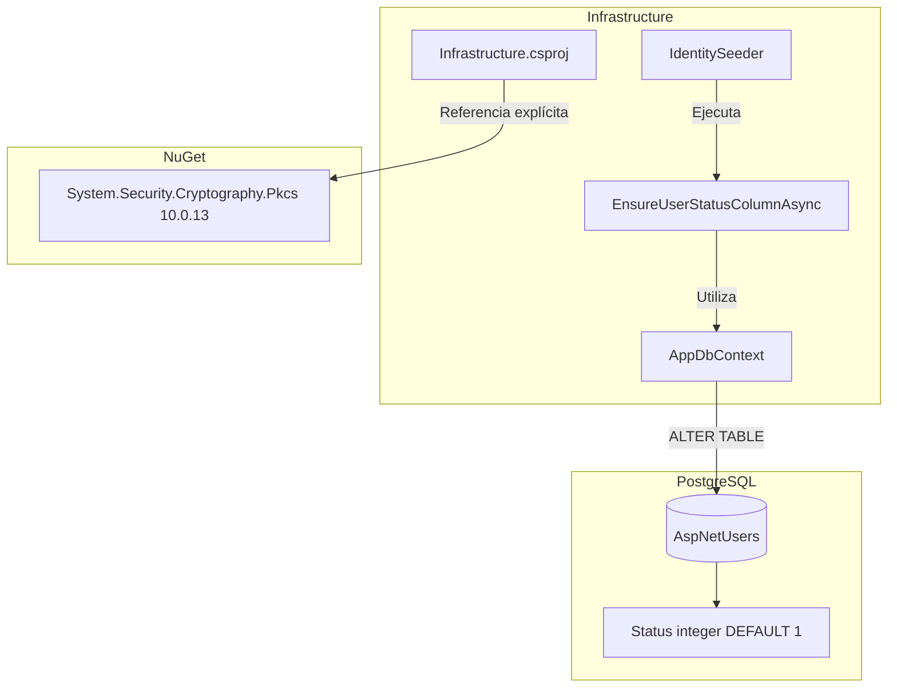

**Interpretación:**

- **Infrastructure:** incorpora la actualización del esquema dentro de `IdentitySeeder`.
- **Entity Framework Core:** ejecuta la instrucción SQL mediante `AppDbContext`.
- **PostgreSQL:** agrega la columna `Status` sin intentar duplicarla.
- **NuGet:** incorpora una versión explícita del paquete criptográfico para sustituir la dependencia transitiva anterior.

#### Consideraciones técnicas

| Aspecto             | Descripción                                                                                                |
| ------------------- | ---------------------------------------------------------------------------------------------------------- |
| Compatibilidad      | Permite incorporar `Status` a bases de datos existentes.                                                   |
| Idempotencia        | La instrucción SQL puede ejecutarse varias veces sin duplicar la columna.                                  |
| Usuarios existentes | Reciben `Status = 1`, equivalente a `Active`, cuando se agrega la columna.                                 |
| Persistencia        | El estado funcional queda almacenado en `AspNetUsers`.                                                     |
| Seguridad           | Se incorpora una versión explícita de la dependencia criptográfica.                                        |
| Limitación          | La actualización SQL no contempla cambios adicionales en el esquema ni reemplaza las migraciones formales. |

**Resultado:** se incorporan ajustes derivados de pruebas manuales para mantener la compatibilidad con bases de datos existentes y actualizar una dependencia criptográfica utilizada indirectamente por el sistema de correo.

---

### 14. Validación, ejecución local y Git

**Prerrequisitos:** Docker disponible; crear un archivo `.env` local a partir de `.env.example` y sustituir todos los valores de ejemplo por credenciales y secretos propios. **No subir `.env` a Git.**

**Levantar PostgreSQL y pgAdmin:**

```powershell
docker compose up -d
```

**Compilación y pruebas:**

```powershell
dotnet restore FEPP-ContaOps.slnx
dotnet build FEPP-ContaOps.slnx
dotnet test FEPP-ContaOps.slnx
```

**Iniciar API:**

```powershell
.\run-local.ps1
```

---

### 15. Validación del spec (flujo de trabajo existente):

```powershell
/spec-acceptance-validator @specs/03-registro-invitacion-activacion.md
```

Revisar el spec: [`03-registro-invitacion-activacion.md`](../03-registro-invitacion-activacion.md).

### 15. Validación del spec (flujo de trabajo existente)

#### Componentes implementados

| Componente                            | Acción      | Tipo                | Capa                     | Responsabilidad                                                                      |
| ------------------------------------- | ----------- | ------------------- | ------------------------ | ------------------------------------------------------------------------------------ |
| `AuthIntegrationTests`                | Update      | `class`             | Tests (IntegrationTests) | Adapta las pruebas de autenticación a la nueva configuración de invitaciones y SMTP. |
| `ExceptionPipelineTests`              | Update      | `class`             | Tests (IntegrationTests) | Adapta las pruebas del manejo global de excepciones a la nueva configuración.        |
| `TestApiFactory`                      | Update      | `class` anidada     | Tests (IntegrationTests) | Proporciona la configuración necesaria para iniciar la API durante las pruebas.      |
| `IdentitySeeder`                      | Sin cambios | `class`             | Infrastructure           | Mantiene la inicialización de usuarios, roles y esquema de Identity.                 |
| `Fepp.ContaOps.Infrastructure.csproj` | Sin cambios | Archivo de proyecto | Infrastructure           | Conserva las dependencias y plantillas incorporadas anteriormente.                   |

**Objetivo:** mantener funcionando las pruebas de integración existentes después de incorporar las nuevas configuraciones obligatorias de invitaciones y correo electrónico.

#### Pruebas de integración

| Clase                    | Prueba                                                            | Responsabilidad                                                                               |
| ------------------------ | ----------------------------------------------------------------- | --------------------------------------------------------------------------------------------- |
| `AuthIntegrationTests`   | `LoginWithBootstrapAdmin_ReturnsBearerToken()`                    | Verifica que el administrador inicial pueda autenticarse y obtener un JWT válido.             |
| `AuthIntegrationTests`   | `LoginWithInvalidCredentials_ReturnsUnauthorizedProblemDetails()` | Comprueba que las credenciales incorrectas devuelvan HTTP 401 y un error seguro.              |
| `ExceptionPipelineTests` | `UnexpectedException_ReturnsSafeProblemDetails()`                 | Comprueba que las excepciones inesperadas devuelvan HTTP 500 sin exponer información interna. |

Estas pruebas utilizan PostgreSQL temporal mediante Testcontainers y ejecutan la API utilizando `WebApplicationFactory<Program>`.

#### Métodos y funciones principales

| Clase                                   | Método               | Responsabilidad                                                                  |
| --------------------------------------- | -------------------- | -------------------------------------------------------------------------------- |
| `AuthIntegrationTests`                  | `InitializeAsync()`  | Inicia el contenedor PostgreSQL antes de ejecutar las pruebas.                   |
| `AuthIntegrationTests`                  | `DisposeAsync()`     | Libera el contenedor PostgreSQL al finalizar.                                    |
| `AuthIntegrationTests.TestApiFactory`   | `ConfigureWebHost()` | Configura la conexión, JWT, administrador inicial, invitaciones y SMTP.          |
| `ExceptionPipelineTests`                | `InitializeAsync()`  | Inicia PostgreSQL para las pruebas del pipeline HTTP.                            |
| `ExceptionPipelineTests`                | `DisposeAsync()`     | Libera el contenedor utilizado durante las pruebas.                              |
| `ExceptionPipelineTests.TestApiFactory` | `ConfigureWebHost()` | Configura el host e incorpora el controller utilizado para provocar excepciones. |
| `IdentitySeeder`                        | `SeedAsync()`        | Inicializa el esquema, roles y usuarios durante el arranque de la API.           |

#### Configuración incorporada a las pruebas

Ambas clases `TestApiFactory` incorporan las siguientes configuraciones:

| Configuración                       | Valor                          | Responsabilidad                                      |
| ----------------------------------- | ------------------------------ | ---------------------------------------------------- |
| `UserInvitation:TokenLifetimeHours` | `24`                           | Define la vigencia de los tokens de invitación.      |
| `UserInvitation:ActivationBaseUrl`  | `https://client.test/activate` | Proporciona una URL HTTPS válida para la activación. |
| `Email:Smtp:Host`                   | `localhost`                    | Configura un servidor SMTP local de prueba.          |
| `Email:Smtp:Port`                   | `587`                          | Puerto compatible con STARTTLS.                      |
| `Email:Smtp:SecurityMode`           | `StartTls`                     | Define el modo de conexión cifrada.                  |
| `Email:Smtp:Username`               | `test@example.com`             | Usuario SMTP ficticio.                               |
| `Email:Smtp:Password`               | `test-provider-secret`         | Contraseña SMTP ficticia.                            |
| `Email:Smtp:FromAddress`            | `test@example.com`             | Remitente utilizado durante las pruebas.             |
| `Email:Smtp:TimeoutSeconds`         | `5`                            | Tiempo máximo de espera del transporte.              |

**Importante:** estos valores permiten superar las validaciones de configuración durante el arranque. Las pruebas presentadas no realizan envíos SMTP.

#### Componentes de .NET y bibliotecas externas

| Componente                       | Origen                  | Función                                                                |
| -------------------------------- | ----------------------- | ---------------------------------------------------------------------- |
| `[Fact]`                         | xUnit                   | Identifica métodos de prueba.                                          |
| `Assert`                         | xUnit                   | Comprueba los resultados esperados.                                    |
| `IAsyncLifetime`                 | xUnit                   | Define la inicialización y liberación asíncrona de recursos de prueba. |
| `PostgreSqlContainer`            | Testcontainers          | Representa un contenedor PostgreSQL para pruebas.                      |
| `PostgreSqlBuilder`              | Testcontainers          | Configura y construye el contenedor PostgreSQL.                        |
| `WebApplicationFactory<Program>` | ASP.NET Core Testing    | Inicia la aplicación en un entorno de pruebas de integración.          |
| `ConfigureWebHost()`             | ASP.NET Core Testing    | Personaliza la configuración del host de pruebas.                      |
| `UseSetting()`                   | ASP.NET Core            | Define valores de configuración para el host.                          |
| `CreateClient()`                 | ASP.NET Core Testing    | Crea un cliente HTTP para ejecutar solicitudes contra la API.          |
| `PostAsJsonAsync()`              | .NET Http.Json          | Envía solicitudes HTTP POST con contenido JSON.                        |
| `JsonDocument`                   | .NET System.Text.Json   | Permite analizar respuestas JSON.                                      |
| `JwtSecurityTokenHandler`        | Microsoft IdentityModel | Lee y analiza tokens JWT.                                              |
| `AddApplicationPart()`           | ASP.NET Core MVC        | Incorpora controllers adicionales al entorno de pruebas.               |

#### Diagrama de arquitectura

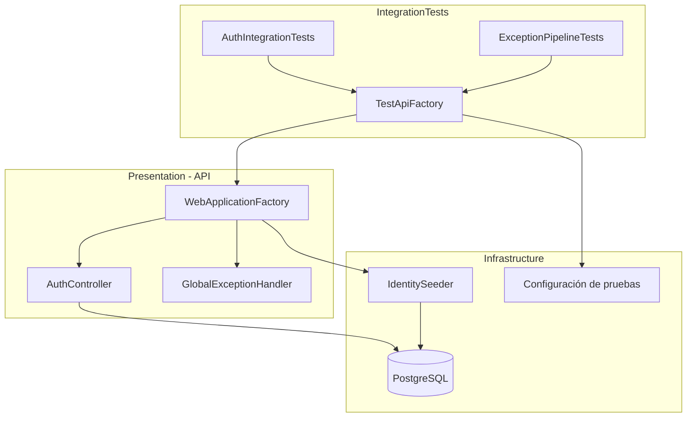

**Interpretación:**

- **Tests:** ejecuta las pruebas de autenticación y manejo de excepciones.
- **TestApiFactory:** configura e inicia una instancia de la API utilizando valores específicos de prueba.
- **Presentation:** procesa solicitudes HTTP y transforma los errores en respuestas seguras.
- **Infrastructure:** inicializa Identity y utiliza PostgreSQL temporal.
- **Configuración:** incorpora los parámetros obligatorios de invitaciones y SMTP sin utilizar proveedores externos reales de correo.

#### Validaciones del flujo existente

| Funcionalidad              | Validación                            | Resultado esperado                                       |
| -------------------------- | ------------------------------------- | -------------------------------------------------------- |
| Inicio de la API           | Configuración de invitaciones y SMTP  | El host puede inicializarse con valores válidos.         |
| Inicialización de Identity | `IdentitySeeder.SeedAsync()`          | Se crean los roles y el administrador cuando no existen. |
| Login correcto             | Credenciales del administrador        | HTTP 200 y token JWT Bearer.                             |
| Login incorrecto           | Contraseña inválida                   | HTTP 401 y código `invalid_credentials`.                 |
| Excepción inesperada       | Error provocado durante una solicitud | HTTP 500 y código `unexpected_error`.                    |
| Seguridad de respuestas    | Manejo global de excepciones          | No se exponen detalles internos ni stack traces.         |
| Persistencia               | PostgreSQL efímero                    | Las pruebas utilizan una base de datos temporal.         |

**Resultado:** se adaptan las pruebas de integración existentes para incorporar las configuraciones obligatorias de invitaciones y SMTP, manteniendo la cobertura del login JWT y del manejo global de excepciones.

#### **Alcance:** el código contiene las pruebas y sus resultados esperados, pero no incluye registros de ejecución que permitan confirmar que todas finalizaron correctamente.

---

### 16. Diagrama Final: Arquitectura del spec 03-registro-invitacion-activacion

#### Arquitectura general

El siguiente diagrama integra los componentes implementados para gestionar el registro de usuarios pendientes, la generación y validación de tokens, la activación de cuentas y el envío de invitaciones por correo electrónico.

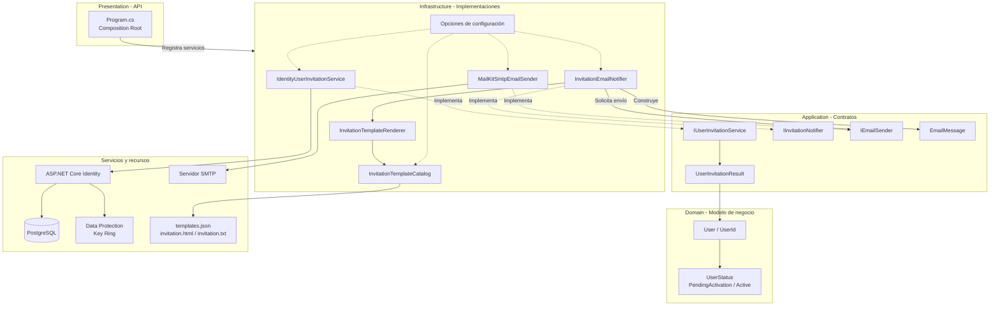

#### Responsabilidad por capa

| Capa                          | Componentes principales                                                              | Responsabilidad                                                                        |
| ----------------------------- | ------------------------------------------------------------------------------------ | -------------------------------------------------------------------------------------- |
| **Domain**                    | `User`, `UserId`, `UserStatus`                                                       | Representa usuarios, identificadores y estados de las cuentas.                         |
| **Application**               | `IUserInvitationService`, `IInvitationNotifier`, `IEmailSender`                      | Define contratos independientes de tecnologías externas.                               |
| **Infrastructure - Identity** | `IdentityUserInvitationService`, `UserInvitationTokenProvider`                       | Gestiona cuentas pendientes, tokens, activación y persistencia.                        |
| **Infrastructure - Email**    | `InvitationEmailNotifier`, `InvitationTemplateRenderer`, `InvitationTemplateCatalog` | Construye invitaciones y procesa plantillas HTML/TXT.                                  |
| **Infrastructure - SMTP**     | `MailKitSmtpEmailSender`                                                             | Envía correos mediante MailKit utilizando conexiones TLS.                              |
| **Presentation**              | `Program.cs`, `DependencyInjection`                                                  | Configura y conecta los servicios mediante inyección de dependencias.                  |
| **Tests**                     | UnitTests, IntegrationTests                                                          | Valida configuración SMTP, errores de transporte y compatibilidad del flujo existente. |

#### Flujo funcional de registro, invitación y activación

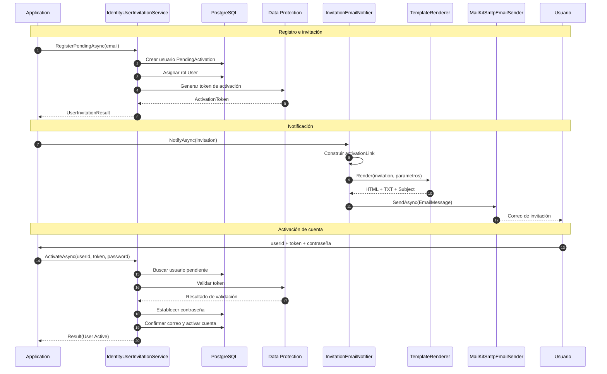

**Nota:** el diagrama de secuencia representa el flujo funcional que permiten los contratos y adaptadores implementados. La coordinación mediante casos de uso y endpoints HTTP de registro y activación corresponde a SPEC 04; no se documenta aquí como una implementación ya existente.

#### Resumen del funcionamiento

| Proceso                     | Componente responsable                  | Resultado                                                             |
| --------------------------- | --------------------------------------- | --------------------------------------------------------------------- |
| Registro pendiente          | `IdentityUserInvitationService`         | Usuario con estado `PendingActivation`.                               |
| Generación del token        | ASP.NET Core Identity + Data Protection | Token de activación con vigencia configurable.                        |
| Construcción del enlace     | `InvitationEmailNotifier`               | URL HTTPS con `userId` y token.                                       |
| Procesamiento de plantillas | `InvitationTemplateRenderer`            | Contenido HTML/TXT personalizado.                                     |
| Envío del correo            | `MailKitSmtpEmailSender`                | Mensaje enviado al servidor SMTP.                                     |
| Reenvío de invitación       | `IdentityUserInvitationService`         | Nuevo token; invalidación de los anteriores mediante `SecurityStamp`. |
| Validación del token        | ASP.NET Core Identity                   | Verificación de autenticidad, propósito y vigencia.                   |
| Activación                  | `IdentityUserInvitationService`         | Contraseña inicial, correo confirmado y estado `Active`.              |
| Autenticación               | `IdentityCredentialService`             | Solo permite validar credenciales de usuarios activos.                |
| Persistencia                | Entity Framework Core + PostgreSQL      | Almacenamiento de usuarios, roles y estados.                          |

#### **Resultado final:** el spec `03-registro-invitacion-activacion` establece la infraestructura necesaria para gestionar cuentas pendientes, tokens de activación, notificaciones mediante plantillas y transporte SMTP seguro, manteniendo la separación de responsabilidades de Clean Architecture y DDD.

---

### 17. Comandos Git / PR\*\* (una vez validada la implementación y revisados los cambios)

```powershell
git add .
git commit -m "FEPP-ContaOps - spec-03-registro-invitacion-activacion -  Implementado"
git push -u origin spec-03-registro-invitacion-activacion

# Después de aprobar y fusionar el Pull Request:
git switch main
git pull
git branch -d spec-03-registro-invitacion-activacion
```
