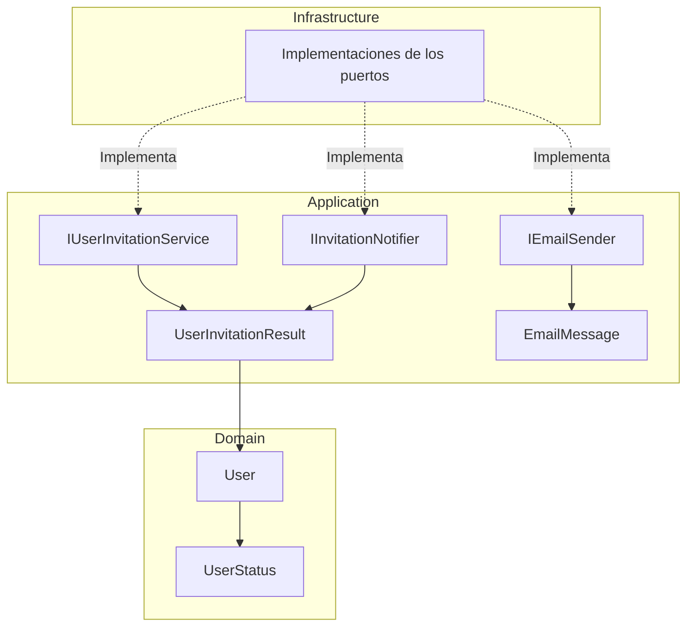
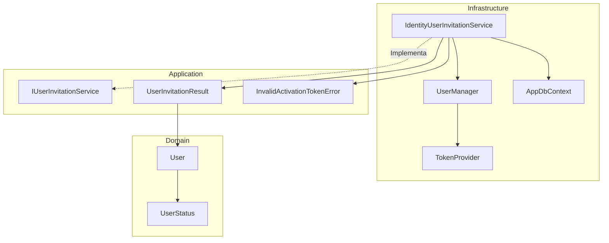

# Implementar: 03-registro-invitacion-activacion

## PASOS

### 1. Definir UserStatus, resultado de invitación y puertos neutrales

#### Componentes implementados

| Componente               | Acción | Tipo        | Capa        | Responsabilidad                                                           |
| ------------------------ | ------ | ----------- | ----------- | ------------------------------------------------------------------------- |
| `UserStatus`             | Create | `enum`      | Domain      | Define los estados `PendingActivation` y `Active`.                        |
| `User`                   | Update | `class`     | Domain      | Incorpora la propiedad `Status` para identificar el estado de la cuenta.  |
| `UserInvitationResult`   | Create | `record`    | Application | Contiene el usuario y su token de activación.                             |
| `IUserInvitationService` | Create | `interface` | Application | Define las operaciones de registro, activación y reenvío de invitaciones. |
| `IInvitationNotifier`    | Create | `interface` | Application | Define el contrato para notificar invitaciones.                           |
| `IEmailSender`           | Create | `interface` | Application | Define el contrato para enviar correos electrónicos.                      |
| `EmailMessage`           | Create | `record`    | Application | Representa un mensaje de correo independiente del proveedor.              |

**Arquitectura:** los contratos se definen en Application y sus implementaciones técnicas podrán desarrollarse en Infrastructure, siguiendo Clean Architecture.

#### Estados del usuario

| Estado              | Descripción                                                                    |
| ------------------- | ------------------------------------------------------------------------------ |
| `PendingActivation` | Cuenta pendiente de activación.                                                |
| `Active`            | Cuenta activada, habilitada para autenticarse si cumple las demás condiciones. |

#### Métodos y funciones principales

| Clase / Interfaz         | Método                   | Responsabilidad                                              |
| ------------------------ | ------------------------ | ------------------------------------------------------------ |
| `User`                   | `User()`                 | Construye el usuario y valida identificador, correo y roles. |
| `IUserInvitationService` | `RegisterPendingAsync()` | Registra una cuenta pendiente y genera una invitación.       |
| `IUserInvitationService` | `ActivateAsync()`        | Activa una cuenta estableciendo su contraseña inicial.       |
| `IUserInvitationService` | `ResendAsync()`          | Genera una nueva invitación.                                 |
| `IInvitationNotifier`    | `NotifyAsync()`          | Solicita la notificación de una invitación.                  |
| `IEmailSender`           | `SendAsync()`            | Solicita el envío de un correo electrónico.                  |

#### Modelos de datos

| Modelo                 | Propiedad         | Tipo     | Descripción                         |
| ---------------------- | ----------------- | -------- | ----------------------------------- |
| `UserInvitationResult` | `User`            | `User`   | Usuario asociado a la invitación.   |
| `UserInvitationResult` | `ActivationToken` | `string` | Token interno de activación.        |
| `EmailMessage`         | `To`              | `string` | Destinatario.                       |
| `EmailMessage`         | `Subject`         | `string` | Asunto.                             |
| `EmailMessage`         | `HtmlBody`        | `string` | Contenido HTML.                     |
| `EmailMessage`         | `TextBody`        | `string` | Contenido en texto plano.           |
| `EmailMessage`         | `AttemptId`       | `string` | Identificador del intento de envío. |

#### Componentes de .NET utilizados

| Componente                             | Origen | Función                                            |
| -------------------------------------- | ------ | -------------------------------------------------- |
| `Task<T>`                              | .NET   | Representa operaciones asíncronas.                 |
| `CancellationToken`                    | .NET   | Permite solicitar la cancelación de operaciones.   |
| `IReadOnlyCollection<T>`               | .NET   | Expone colecciones sin métodos de modificación.    |
| `IEnumerable<T>`                       | .NET   | Representa una secuencia de elementos.             |
| `ArgumentNullException.ThrowIfNull()`  | .NET   | Valida referencias nulas.                          |
| `Where()` / `Distinct()` / `ToArray()` | LINQ   | Filtran y procesan colecciones.                    |
| `StringComparer.OrdinalIgnoreCase`     | .NET   | Compara cadenas ignorando mayúsculas y minúsculas. |

`Result<T>` y `UserId` son componentes propios del proyecto.

#### Diagrama de arquitectura



**Interpretación:**

- **Domain:** define el usuario y sus estados funcionales.
- **Application:** establece los contratos para registrar, activar y notificar usuarios.
- **Infrastructure:** implementará los contratos utilizando servicios de identidad, persistencia y correo.

#### Las implementaciones de Infrastructure se muestran como componentes previstos; no forman parte de los cambios de este paso.

---

### 2. Implementar adaptador Identity para cuentas pendientes, tokens y activación.

#### Componentes implementados

| Componente                      | Acción | Tipo           | Capa           | Responsabilidad                                                                              |
| ------------------------------- | ------ | -------------- | -------------- | -------------------------------------------------------------------------------------------- |
| `InvalidActivationTokenError`   | Create | `record`       | Application    | Representa un error de token de activación inválido o expirado.                              |
| `IdentityUserInvitationService` | Create | `class`        | Infrastructure | Implementa el registro, activación y reenvío de invitaciones mediante ASP.NET Core Identity. |
| `ApplicationIdentityUser`       | Update | `class`        | Infrastructure | Incorpora `Status` para almacenar el estado funcional de la cuenta.                          |
| `IdentityCredentialService`     | Update | `class`        | Infrastructure | Impide autenticar usuarios que no tengan estado `Active`.                                    |
| `IdentityUserRepository`        | Update | `class`        | Infrastructure | Incluye el estado del usuario al convertirlo al modelo de Domain.                            |
| `IdentitySeeder`                | Update | `class`        | Infrastructure | Crea usuarios iniciales con estado `Active`.                                                 |
| `DependencyInjection`           | Update | `static class` | Infrastructure | Registra el adaptador de invitaciones y configura su proveedor de tokens.                    |

#### Métodos y funciones principales

| Clase                           | Método                       | Responsabilidad                                                                                         |
| ------------------------------- | ---------------------------- | ------------------------------------------------------------------------------------------------------- |
| `IdentityUserInvitationService` | `RegisterPendingAsync()`     | Crea un usuario sin contraseña, con estado `PendingActivation`, asigna el rol `User` y genera su token. |
| `IdentityUserInvitationService` | `ActivateAsync()`            | Valida el token, establece la contraseña, confirma el correo y cambia el estado a `Active`.             |
| `IdentityUserInvitationService` | `ResendAsync()`              | Invalida tokens anteriores mediante el cambio del `SecurityStamp` y genera una nueva invitación.        |
| `IdentityUserInvitationService` | `ToInvitation()`             | Convierte un usuario técnico y su token en `UserInvitationResult`.                                      |
| `IdentityUserInvitationService` | `ToDomainUserAsync()`        | Convierte el usuario de Identity a `User`, incluyendo sus roles efectivos.                              |
| `IdentityUserInvitationService` | `EnsureSuccess()`            | Comprueba el resultado de Identity y lanza una excepción si la operación falla.                         |
| `IdentityCredentialService`     | `VerifyPasswordAsync()`      | Comprueba el estado `Active` antes de validar las credenciales.                                         |
| `IdentityUserRepository`        | `FindByEmailAsync()`         | Obtiene el usuario y transforma sus datos al modelo de Domain.                                          |
| `IdentitySeeder`                | `SeedAsync()`                | Inicializa los roles y el administrador activo.                                                         |
| `IdentitySeeder`                | `EnsureBootstrapUserAsync()` | Crea el usuario regular inicial con estado `Active`, cuando está configurado.                           |
| `DependencyInjection`           | `AddInfrastructure()`        | Registra `IUserInvitationService` y configura el proveedor de tokens de invitación.                     |

#### Configuración de tokens

La clase `IdentityUserInvitationService` define dos constantes para identificar los tokens de activación.

| Constante           | Valor            | Descripción                                                                                  |
| ------------------- | ---------------- | -------------------------------------------------------------------------------------------- |
| `TokenProviderName` | `UserInvitation` | Nombre del proveedor dedicado a generar y validar tokens de invitación.                      |
| `TokenPurpose`      | `UserActivation` | Propósito criptográfico que diferencia los tokens de activación de otros tokens de Identity. |

El proveedor se registra en `DependencyInjection` mediante `AddTokenProvider<DataProtectorTokenProvider<ApplicationIdentityUser>>()`.

#### Componentes de .NET y proveedores externos

| Componente                              | Origen                    | Función                                                                                                |
| --------------------------------------- | ------------------------- | ------------------------------------------------------------------------------------------------------ |
| `UserManager<TUser>`                    | ASP.NET Core Identity     | Administra usuarios, contraseñas, roles y tokens.                                                      |
| `SignInManager<TUser>`                  | ASP.NET Core Identity     | Valida contraseñas y aplica las reglas de bloqueo.                                                     |
| `IdentityResult`                        | ASP.NET Core Identity     | Informa si una operación de identidad tuvo éxito o presentó errores.                                   |
| `DataProtectorTokenProvider<TUser>`     | ASP.NET Core Identity     | Genera y valida tokens protegidos criptográficamente.                                                  |
| `GenerateUserTokenAsync()`              | `UserManager<TUser>`      | Genera un token utilizando un proveedor y propósito específicos.                                       |
| `VerifyUserTokenAsync()`                | `UserManager<TUser>`      | Verifica la validez de un token de usuario.                                                            |
| `UpdateSecurityStampAsync()`            | `UserManager<TUser>`      | Actualiza el identificador de seguridad para invalidar tokens anteriores asociados a su estado previo. |
| `AddPasswordAsync()`                    | `UserManager<TUser>`      | Establece la contraseña inicial del usuario.                                                           |
| `IDbContextTransaction`                 | Entity Framework Core     | Representa una transacción de base de datos.                                                           |
| `BeginTransactionAsync()`               | Entity Framework Core     | Inicia una transacción para agrupar operaciones de persistencia.                                       |
| `CommitAsync()` / `RollbackAsync()`     | Entity Framework Core     | Confirman o revierten los cambios de una transacción.                                                  |
| `AddScoped<TService,TImplementation>()` | .NET Dependency Injection | Registra una implementación con ciclo de vida Scoped.                                                  |

#### Flujo de registro y activación

| Operación         | Proceso                                                                                                            |
| ----------------- | ------------------------------------------------------------------------------------------------------------------ |
| **Registro**      | Verifica que el correo no exista, crea una cuenta pendiente, asigna el rol `User` y genera un token de activación. |
| **Activación**    | Comprueba que la cuenta esté pendiente, valida el token, establece la contraseña y cambia el estado a `Active`.    |
| **Reenvío**       | Verifica que la cuenta siga pendiente, actualiza el `SecurityStamp` y genera un nuevo token.                       |
| **Autenticación** | Permite comprobar la contraseña únicamente cuando el usuario tiene estado `Active`.                                |

#### Diagrama de arquitectura



**Interpretación:**

- **Domain:** representa al usuario y su estado funcional.
- **Application:** define el contrato de invitaciones y los resultados o errores esperados.
- **Infrastructure:** implementa las operaciones utilizando ASP.NET Core Identity y Entity Framework Core.
- **Seguridad:** los tokens se generan mediante un proveedor dedicado y las operaciones de persistencia se agrupan mediante transacciones.

#### **Resultado:** se implementa el adaptador de Identity que permite crear usuarios pendientes, generar y validar tokens, activar cuentas y reenviar invitaciones, manteniendo la lógica de Application independiente de ASP.NET Core Identity.

---

### 3. Implementar opciones y validación de invitaciones, URL y key ring.

---

### 4. Definir configuración neutral SMTP y plantillas.

---

### 5. Crear manifest y plantillas HTML/TXT.

---

### 6. Implementar renderer y InvitationEmailNotifier.

---

### 7. Implementar MailKitSmtpEmailSender.

---

### 8. Registrar servicios en el composition root.

---

### 9. Probar transporte SMTP y errores de entrega.

---

### 10. Preparar contratos para SPEC 04.

---

### 11. Actualizar .env.example, README.md y AGENTS.md.

---

#### 6. Validación, ejecución local y Git

**Prerrequisitos:** Docker disponible; crear un archivo `.env` local a partir de `.env.example` y sustituir todos los valores de ejemplo por credenciales y secretos propios. **No subir `.env` a Git.**

**Levantar PostgreSQL y pgAdmin:**

```powershell
docker compose up -d
```

**Compilación y pruebas:**

```powershell
dotnet restore FEPP-ContaOps.slnx
dotnet build FEPP-ContaOps.slnx
dotnet test FEPP-ContaOps.slnx
```

**Iniciar API:**

```powershell
.\run-local.ps1
```

**Validación del spec (flujo de trabajo existente):**

```powershell
/spec-acceptance-validator @specs/03-registro-invitacion-activacion.md
```

Revisar el spec: [`03-registro-invitacion-activacion.md`](../03-registro-invitacion-activacion.md).

**Comandos Git / PR** (una vez validada la implementación y revisados los cambios):

```powershell
git add .
git commit -m "FEPP-ContaOps - spec-03-registro-invitacion-activacion -  Implementado"
git push -u origin spec-03-registro-invitacion-activacion

# Después de aprobar y fusionar el Pull Request:
git switch main
git pull
git branch -d spec-03-registro-invitacion-activacion
```
