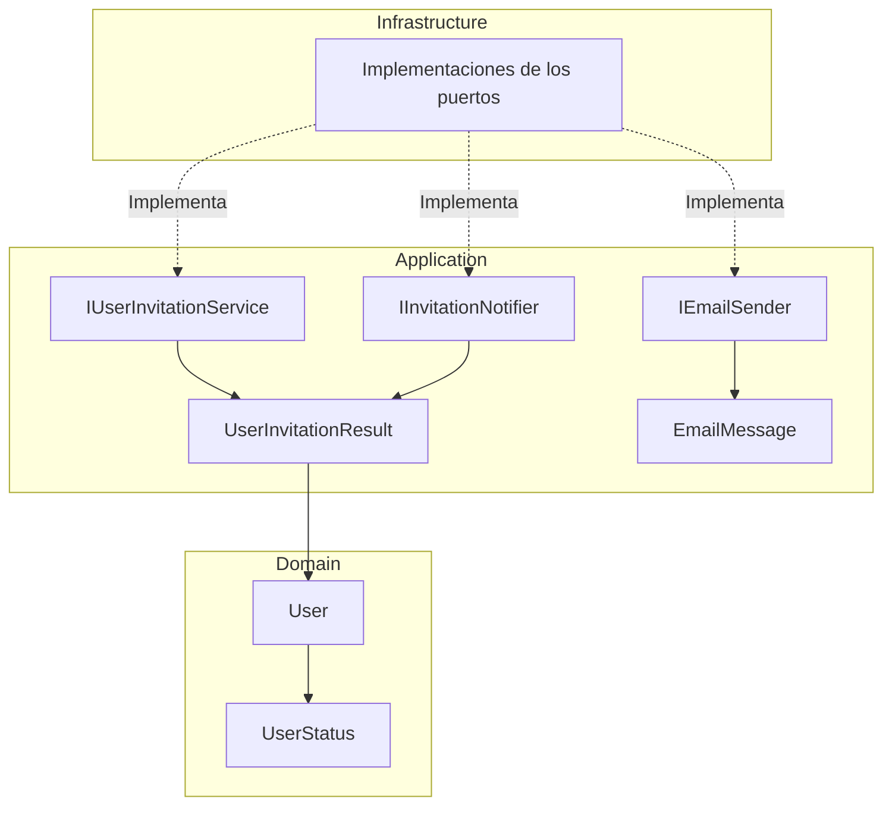
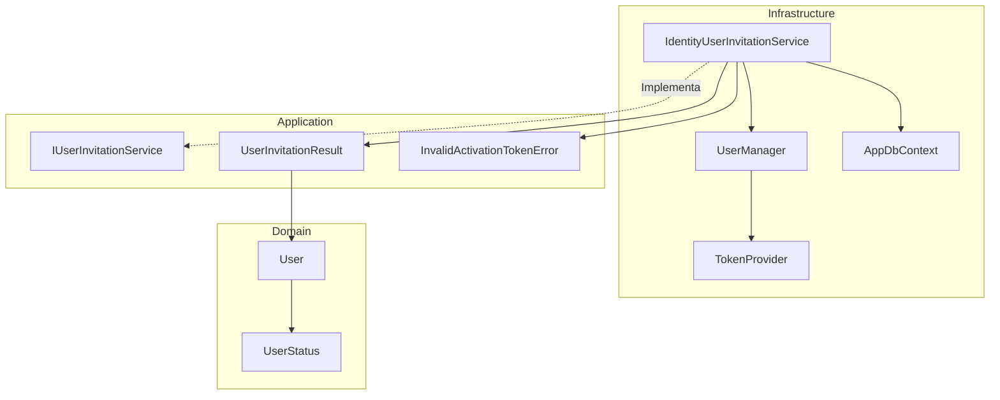
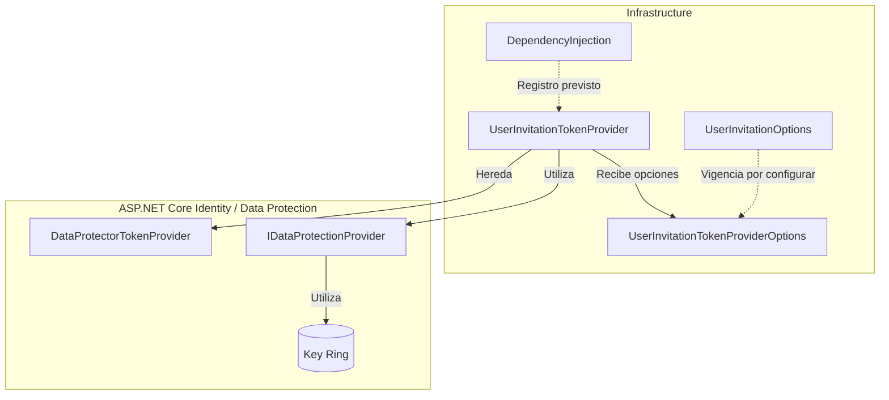
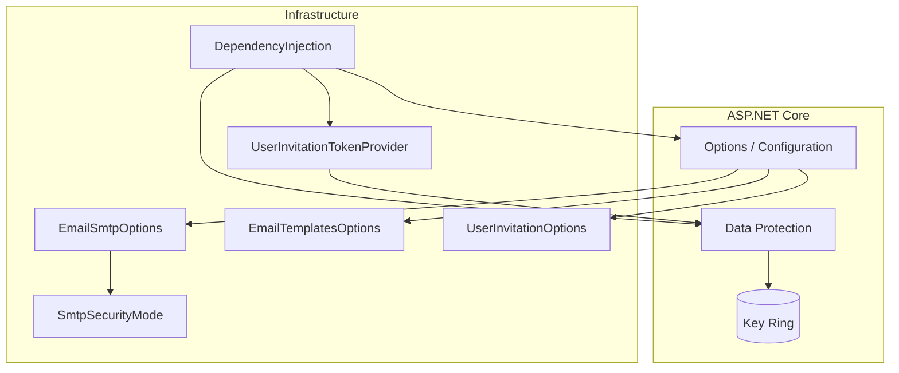
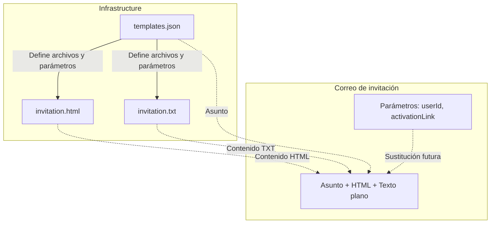
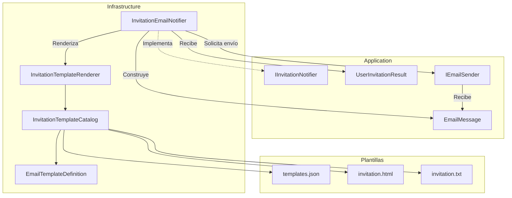

# Implementar: 03-registro-invitacion-activacion

## PASOS

### 1. Definir UserStatus, resultado de invitación y puertos neutrales

#### Componentes implementados

| Componente               | Acción | Tipo        | Capa        | Responsabilidad                                                           |
| ------------------------ | ------ | ----------- | ----------- | ------------------------------------------------------------------------- |
| `UserStatus`             | Create | `enum`      | Domain      | Define los estados `PendingActivation` y `Active`.                        |
| `User`                   | Update | `class`     | Domain      | Incorpora la propiedad `Status` para identificar el estado de la cuenta.  |
| `UserInvitationResult`   | Create | `record`    | Application | Contiene el usuario y su token de activación.                             |
| `IUserInvitationService` | Create | `interface` | Application | Define las operaciones de registro, activación y reenvío de invitaciones. |
| `IInvitationNotifier`    | Create | `interface` | Application | Define el contrato para notificar invitaciones.                           |
| `IEmailSender`           | Create | `interface` | Application | Define el contrato para enviar correos electrónicos.                      |
| `EmailMessage`           | Create | `record`    | Application | Representa un mensaje de correo independiente del proveedor.              |

**Arquitectura:** los contratos se definen en Application y sus implementaciones técnicas podrán desarrollarse en Infrastructure, siguiendo Clean Architecture.

#### Estados del usuario

| Estado              | Descripción                                                                    |
| ------------------- | ------------------------------------------------------------------------------ |
| `PendingActivation` | Cuenta pendiente de activación.                                                |
| `Active`            | Cuenta activada, habilitada para autenticarse si cumple las demás condiciones. |

#### Métodos y funciones principales

| Clase / Interfaz         | Método                   | Responsabilidad                                              |
| ------------------------ | ------------------------ | ------------------------------------------------------------ |
| `User`                   | `User()`                 | Construye el usuario y valida identificador, correo y roles. |
| `IUserInvitationService` | `RegisterPendingAsync()` | Registra una cuenta pendiente y genera una invitación.       |
| `IUserInvitationService` | `ActivateAsync()`        | Activa una cuenta estableciendo su contraseña inicial.       |
| `IUserInvitationService` | `ResendAsync()`          | Genera una nueva invitación.                                 |
| `IInvitationNotifier`    | `NotifyAsync()`          | Solicita la notificación de una invitación.                  |
| `IEmailSender`           | `SendAsync()`            | Solicita el envío de un correo electrónico.                  |

#### Modelos de datos

| Modelo                 | Propiedad         | Tipo     | Descripción                         |
| ---------------------- | ----------------- | -------- | ----------------------------------- |
| `UserInvitationResult` | `User`            | `User`   | Usuario asociado a la invitación.   |
| `UserInvitationResult` | `ActivationToken` | `string` | Token interno de activación.        |
| `EmailMessage`         | `To`              | `string` | Destinatario.                       |
| `EmailMessage`         | `Subject`         | `string` | Asunto.                             |
| `EmailMessage`         | `HtmlBody`        | `string` | Contenido HTML.                     |
| `EmailMessage`         | `TextBody`        | `string` | Contenido en texto plano.           |
| `EmailMessage`         | `AttemptId`       | `string` | Identificador del intento de envío. |

#### Componentes de .NET utilizados

| Componente                             | Origen | Función                                            |
| -------------------------------------- | ------ | -------------------------------------------------- |
| `Task<T>`                              | .NET   | Representa operaciones asíncronas.                 |
| `CancellationToken`                    | .NET   | Permite solicitar la cancelación de operaciones.   |
| `IReadOnlyCollection<T>`               | .NET   | Expone colecciones sin métodos de modificación.    |
| `IEnumerable<T>`                       | .NET   | Representa una secuencia de elementos.             |
| `ArgumentNullException.ThrowIfNull()`  | .NET   | Valida referencias nulas.                          |
| `Where()` / `Distinct()` / `ToArray()` | LINQ   | Filtran y procesan colecciones.                    |
| `StringComparer.OrdinalIgnoreCase`     | .NET   | Compara cadenas ignorando mayúsculas y minúsculas. |

`Result<T>` y `UserId` son componentes propios del proyecto.

#### Diagrama de arquitectura



**Interpretación:**

- **Domain:** define el usuario y sus estados funcionales.
- **Application:** establece los contratos para registrar, activar y notificar usuarios.
- **Infrastructure:** implementará los contratos utilizando servicios de identidad, persistencia y correo.

#### Las implementaciones de Infrastructure se muestran como componentes previstos; no forman parte de los cambios de este paso.

---

### 2. Implementar adaptador Identity para cuentas pendientes, tokens y activación.

#### Componentes implementados

| Componente                      | Acción | Tipo           | Capa           | Responsabilidad                                                                              |
| ------------------------------- | ------ | -------------- | -------------- | -------------------------------------------------------------------------------------------- |
| `InvalidActivationTokenError`   | Create | `record`       | Application    | Representa un error de token de activación inválido o expirado.                              |
| `IdentityUserInvitationService` | Create | `class`        | Infrastructure | Implementa el registro, activación y reenvío de invitaciones mediante ASP.NET Core Identity. |
| `ApplicationIdentityUser`       | Update | `class`        | Infrastructure | Incorpora `Status` para almacenar el estado funcional de la cuenta.                          |
| `IdentityCredentialService`     | Update | `class`        | Infrastructure | Impide autenticar usuarios que no tengan estado `Active`.                                    |
| `IdentityUserRepository`        | Update | `class`        | Infrastructure | Incluye el estado del usuario al convertirlo al modelo de Domain.                            |
| `IdentitySeeder`                | Update | `class`        | Infrastructure | Crea usuarios iniciales con estado `Active`.                                                 |
| `DependencyInjection`           | Update | `static class` | Infrastructure | Registra el adaptador de invitaciones y configura su proveedor de tokens.                    |

#### Métodos y funciones principales

| Clase                           | Método                       | Responsabilidad                                                                                         |
| ------------------------------- | ---------------------------- | ------------------------------------------------------------------------------------------------------- |
| `IdentityUserInvitationService` | `RegisterPendingAsync()`     | Crea un usuario sin contraseña, con estado `PendingActivation`, asigna el rol `User` y genera su token. |
| `IdentityUserInvitationService` | `ActivateAsync()`            | Valida el token, establece la contraseña, confirma el correo y cambia el estado a `Active`.             |
| `IdentityUserInvitationService` | `ResendAsync()`              | Invalida tokens anteriores mediante el cambio del `SecurityStamp` y genera una nueva invitación.        |
| `IdentityUserInvitationService` | `ToInvitation()`             | Convierte un usuario técnico y su token en `UserInvitationResult`.                                      |
| `IdentityUserInvitationService` | `ToDomainUserAsync()`        | Convierte el usuario de Identity a `User`, incluyendo sus roles efectivos.                              |
| `IdentityUserInvitationService` | `EnsureSuccess()`            | Comprueba el resultado de Identity y lanza una excepción si la operación falla.                         |
| `IdentityCredentialService`     | `VerifyPasswordAsync()`      | Comprueba el estado `Active` antes de validar las credenciales.                                         |
| `IdentityUserRepository`        | `FindByEmailAsync()`         | Obtiene el usuario y transforma sus datos al modelo de Domain.                                          |
| `IdentitySeeder`                | `SeedAsync()`                | Inicializa los roles y el administrador activo.                                                         |
| `IdentitySeeder`                | `EnsureBootstrapUserAsync()` | Crea el usuario regular inicial con estado `Active`, cuando está configurado.                           |
| `DependencyInjection`           | `AddInfrastructure()`        | Registra `IUserInvitationService` y configura el proveedor de tokens de invitación.                     |

#### Configuración de tokens

La clase `IdentityUserInvitationService` define dos constantes para identificar los tokens de activación.

| Constante           | Valor            | Descripción                                                                                  |
| ------------------- | ---------------- | -------------------------------------------------------------------------------------------- |
| `TokenProviderName` | `UserInvitation` | Nombre del proveedor dedicado a generar y validar tokens de invitación.                      |
| `TokenPurpose`      | `UserActivation` | Propósito criptográfico que diferencia los tokens de activación de otros tokens de Identity. |

El proveedor se registra en `DependencyInjection` mediante `AddTokenProvider<DataProtectorTokenProvider<ApplicationIdentityUser>>()`.

#### Componentes de .NET y proveedores externos

| Componente                              | Origen                    | Función                                                                                                |
| --------------------------------------- | ------------------------- | ------------------------------------------------------------------------------------------------------ |
| `UserManager<TUser>`                    | ASP.NET Core Identity     | Administra usuarios, contraseñas, roles y tokens.                                                      |
| `SignInManager<TUser>`                  | ASP.NET Core Identity     | Valida contraseñas y aplica las reglas de bloqueo.                                                     |
| `IdentityResult`                        | ASP.NET Core Identity     | Informa si una operación de identidad tuvo éxito o presentó errores.                                   |
| `DataProtectorTokenProvider<TUser>`     | ASP.NET Core Identity     | Genera y valida tokens protegidos criptográficamente.                                                  |
| `GenerateUserTokenAsync()`              | `UserManager<TUser>`      | Genera un token utilizando un proveedor y propósito específicos.                                       |
| `VerifyUserTokenAsync()`                | `UserManager<TUser>`      | Verifica la validez de un token de usuario.                                                            |
| `UpdateSecurityStampAsync()`            | `UserManager<TUser>`      | Actualiza el identificador de seguridad para invalidar tokens anteriores asociados a su estado previo. |
| `AddPasswordAsync()`                    | `UserManager<TUser>`      | Establece la contraseña inicial del usuario.                                                           |
| `IDbContextTransaction`                 | Entity Framework Core     | Representa una transacción de base de datos.                                                           |
| `BeginTransactionAsync()`               | Entity Framework Core     | Inicia una transacción para agrupar operaciones de persistencia.                                       |
| `CommitAsync()` / `RollbackAsync()`     | Entity Framework Core     | Confirman o revierten los cambios de una transacción.                                                  |
| `AddScoped<TService,TImplementation>()` | .NET Dependency Injection | Registra una implementación con ciclo de vida Scoped.                                                  |

#### Flujo de registro y activación

| Operación         | Proceso                                                                                                            |
| ----------------- | ------------------------------------------------------------------------------------------------------------------ |
| **Registro**      | Verifica que el correo no exista, crea una cuenta pendiente, asigna el rol `User` y genera un token de activación. |
| **Activación**    | Comprueba que la cuenta esté pendiente, valida el token, establece la contraseña y cambia el estado a `Active`.    |
| **Reenvío**       | Verifica que la cuenta siga pendiente, actualiza el `SecurityStamp` y genera un nuevo token.                       |
| **Autenticación** | Permite comprobar la contraseña únicamente cuando el usuario tiene estado `Active`.                                |

#### Diagrama de arquitectura



**Interpretación:**

- **Domain:** representa al usuario y su estado funcional.
- **Application:** define el contrato de invitaciones y los resultados o errores esperados.
- **Infrastructure:** implementa las operaciones utilizando ASP.NET Core Identity y Entity Framework Core.
- **Seguridad:** los tokens se generan mediante un proveedor dedicado y las operaciones de persistencia se agrupan mediante transacciones.

#### **Resultado:** se implementa el adaptador de Identity que permite crear usuarios pendientes, generar y validar tokens, activar cuentas y reenviar invitaciones, manteniendo la lógica de Application independiente de ASP.NET Core Identity.

---

### 3. Implementar opciones y validación de invitaciones, URL y key ring

#### Componentes implementados

| Componente                           | Acción   | Tipo           | Capa           | Responsabilidad                                                                                         |
| ------------------------------------ | -------- | -------------- | -------------- | ------------------------------------------------------------------------------------------------------- |
| `UserInvitationOptions`              | Create   | `class`        | Infrastructure | Define la vigencia del token y la URL de activación.                                                    |
| `UserInvitationTokenProvider`        | Create   | `class`        | Infrastructure | Extiende el proveedor de tokens de Identity para utilizar una configuración específica de invitaciones. |
| `UserInvitationTokenProviderOptions` | Create   | `class`        | Infrastructure | Define el nombre del protector criptográfico dedicado a invitaciones.                                   |
| `DependencyInjection`                | Update\* | `static class` | Infrastructure | Contiene el registro de servicios de Identity y del proveedor de tokens.                                |

_Nota:_ el código de `DependencyInjection` proporcionado mantiene el registro de `DataProtectorTokenProvider<ApplicationIdentityUser>`. Todavía no muestra la integración de `UserInvitationTokenProvider`, la configuración de su vigencia ni la persistencia del key ring.

#### Propiedades y configuración

**UserInvitationOptions**

| Propiedad            | Tipo           | Valor predeterminado | Responsabilidad                                           |
| -------------------- | -------------- | -------------------- | --------------------------------------------------------- |
| `SectionName`        | `const string` | `UserInvitation`     | Identifica la sección de configuración.                   |
| `TokenLifetimeHours` | `double`       | `24`                 | Define la duración prevista del token en horas.           |
| `ActivationBaseUrl`  | `string`       | `string.Empty`       | URL de la aplicación cliente que procesará la activación. |

**UserInvitationTokenProviderOptions**

| Propiedad | Tipo     | Valor                                      | Responsabilidad                                               |
| --------- | -------- | ------------------------------------------ | ------------------------------------------------------------- |
| `Name`    | `string` | `UserInvitationDataProtectorTokenProvider` | Identifica el protector utilizado por el proveedor de tokens. |

El nombre del protector permite separar criptográficamente los tokens de invitación de otros tokens que utilicen nombres diferentes.

#### Métodos y funciones principales

| Clase                                | Método                                 | Responsabilidad                                                                             |
| ------------------------------------ | -------------------------------------- | ------------------------------------------------------------------------------------------- |
| `UserInvitationOptions`              | `IsValid()`                            | Comprueba que la vigencia sea positiva y finita, y que la URL sea absoluta y utilice HTTPS. |
| `UserInvitationTokenProvider`        | `UserInvitationTokenProvider()`        | Inicializa el proveedor de tokens mediante Data Protection, opciones y logger.              |
| `UserInvitationTokenProviderOptions` | `UserInvitationTokenProviderOptions()` | Establece el nombre del protector criptográfico.                                            |
| `DependencyInjection`                | `AddInfrastructure()`                  | Configura Identity y registra los servicios de infraestructura.                             |

#### Validaciones de seguridad

| Validación                           | Componente    | Descripción                                                          |
| ------------------------------------ | ------------- | -------------------------------------------------------------------- |
| `double.IsFinite()`                  | .NET          | Impide utilizar valores infinitos o `NaN` como vigencia.             |
| `TokenLifetimeHours > 0`             | Código propio | Exige que la duración del token sea positiva.                        |
| `Uri.TryCreate()`                    | .NET          | Comprueba que la URL de activación tenga un formato absoluto válido. |
| `Uri.UriSchemeHttps`                 | .NET          | Exige el protocolo HTTPS para la URL de activación.                  |
| `StringComparison.OrdinalIgnoreCase` | .NET          | Compara el esquema HTTPS sin distinguir mayúsculas y minúsculas.     |

**Importante:** `IsValid()` contiene las reglas de validación, pero en el código proporcionado todavía no se observa su ejecución automática durante el arranque.

#### Componentes de .NET utilizados

| Componente                           | Origen                       | Función                                                        |
| ------------------------------------ | ---------------------------- | -------------------------------------------------------------- |
| `DataProtectorTokenProvider<TUser>`  | ASP.NET Core Identity        | Genera y valida tokens mediante Data Protection.               |
| `DataProtectionTokenProviderOptions` | ASP.NET Core Identity        | Configura el nombre del protector y la vigencia de los tokens. |
| `IDataProtectionProvider`            | ASP.NET Core Data Protection | Proporciona los mecanismos de protección criptográfica.        |
| `IOptions<T>`                        | .NET Options                 | Proporciona acceso a opciones de configuración tipadas.        |
| `ILogger<T>`                         | .NET Logging                 | Permite registrar información técnica del proveedor.           |
| `Uri`                                | .NET                         | Representa y valida direcciones URL.                           |
| `AddTokenProvider<T>()`              | ASP.NET Core Identity        | Registra un proveedor de tokens con un nombre específico.      |

#### Diagrama de arquitectura



**Interpretación:**

- **Infrastructure:** define las opciones de invitación y especializa el proveedor de tokens.
- **ASP.NET Core Identity:** proporciona la generación y validación de tokens.
- **Data Protection:** utiliza claves criptográficas administradas mediante un key ring.
- **Configuración pendiente:** conectar `TokenLifetimeHours` con `TokenLifespan`, registrar el proveedor personalizado y configurar la persistencia del key ring.

**Resultado:** se crean los componentes para configurar y validar las invitaciones y especializar su proveedor criptográfico. La integración completa de la vigencia y el almacenamiento persistente de claves no se evidencia todavía en el código proporcionado.

---

### 4. Definir configuración neutral SMTP y plantillas

#### Componentes implementados

| Componente              | Acción | Tipo           | Capa           | Responsabilidad                                                                  |
| ----------------------- | ------ | -------------- | -------------- | -------------------------------------------------------------------------------- |
| `EmailSmtpOptions`      | Create | `class`        | Infrastructure | Define y valida la configuración de conexión SMTP.                               |
| `EmailTemplatesOptions` | Create | `class`        | Infrastructure | Configura el directorio donde se almacenarán las plantillas de correo.           |
| `SmtpSecurityMode`      | Create | `enum`         | Infrastructure | Define los modos de conexión SMTP cifrada.                                       |
| `DependencyInjection`   | Update | `static class` | Infrastructure | Registra y valida las opciones SMTP, plantillas, invitaciones y Data Protection. |

#### Propiedades y configuración

**EmailSmtpOptions**

Se vincula con la sección `Email:Smtp`.

| Propiedad        | Tipo               | Descripción                                 |
| ---------------- | ------------------ | ------------------------------------------- |
| `Host`           | `string`           | Servidor SMTP.                              |
| `Port`           | `int`              | Puerto de conexión SMTP.                    |
| `SecurityMode`   | `SmtpSecurityMode` | Modo de cifrado TLS.                        |
| `Username`       | `string`           | Usuario de autenticación SMTP.              |
| `Password`       | `string`           | Contraseña SMTP o contraseña de aplicación. |
| `FromAddress`    | `string`           | Dirección de correo del remitente.          |
| `FromName`       | `string`           | Nombre visible del remitente (opcional).    |
| `TimeoutSeconds` | `int`              | Tiempo máximo de espera en segundos.        |

**EmailTemplatesOptions**

Se vincula con la sección `Email:Templates`.

| Propiedad  | Tipo     | Descripción                                                    |
| ---------- | -------- | -------------------------------------------------------------- |
| `RootPath` | `string` | Directorio alternativo que contendrá las plantillas de correo. |

**SmtpSecurityMode**

| Valor          | Puerto | Descripción                                           |
| -------------- | ------ | ----------------------------------------------------- |
| `StartTls`     | `587`  | Inicia la conexión SMTP y posteriormente negocia TLS. |
| `TlsOnConnect` | `465`  | Establece TLS desde el inicio de la conexión.         |

La configuración solo acepta estos dos modos de conexión cifrada.

#### Métodos y funciones principales

| Clase                 | Método                | Responsabilidad                                                            |
| --------------------- | --------------------- | -------------------------------------------------------------------------- |
| `EmailSmtpOptions`    | `IsValid()`           | Valida host, puerto, cifrado, credenciales, remitente y tiempo de espera.  |
| `EmailSmtpOptions`    | `IsCompatiblePort()`  | Comprueba que el puerto corresponda al modo TLS configurado.               |
| `DependencyInjection` | `AddInfrastructure()` | Registra las opciones de configuración y los servicios de infraestructura. |

#### Validaciones SMTP

| Validación   | Regla                                                 |
| ------------ | ----------------------------------------------------- |
| Servidor     | `Host` no puede estar vacío.                          |
| Puerto       | Debe ser positivo y compatible con el modo TLS.       |
| Cifrado      | Solo se admiten `StartTls` y `TlsOnConnect`.          |
| Credenciales | `Username` y `Password` son obligatorios.             |
| Remitente    | `FromAddress` debe tener un formato de correo válido. |
| Timeout      | `TimeoutSeconds` debe ser mayor que cero.             |

La configuración SMTP se valida durante el arranque mediante `ValidateOnStart()`.

Las opciones de plantillas se registran mediante `Bind()`, sin validaciones adicionales en este paso.

#### Configuración adicional de Identity y Data Protection

La clase `DependencyInjection` incorpora también la configuración de seguridad definida en el paso anterior.

| Configuración                        | Responsabilidad                                                             |
| ------------------------------------ | --------------------------------------------------------------------------- |
| `UserInvitationOptions`              | Vincula y valida la vigencia del token y la URL HTTPS de activación.        |
| `UserInvitationTokenProviderOptions` | Configura `TokenLifespan` utilizando `TokenLifetimeHours`.                  |
| `UserInvitationTokenProvider`        | Registra el proveedor dedicado de tokens de invitación.                     |
| `DataProtection:KeyRingPath`         | Define una ubicación para persistir las claves criptográficas.              |
| `ProtectKeysWithDpapi()`             | Protege las claves almacenadas mediante DPAPI cuando se ejecuta en Windows. |

**Key Ring:** conjunto de claves criptográficas utilizadas por ASP.NET Core Data Protection para proteger y validar información, incluidos los tokens de invitación.

Cuando se configura `DataProtection:KeyRingPath`, las claves se almacenan en el directorio indicado. Si no se configura, Data Protection utiliza su comportamiento predeterminado.

#### Componentes de .NET utilizados

| Componente                    | Origen                       | Función                                                              |
| ----------------------------- | ---------------------------- | -------------------------------------------------------------------- |
| `EmailAddressAttribute`       | .NET DataAnnotations         | Valida el formato del correo remitente.                              |
| `IOptions<T>`                 | .NET Options                 | Proporciona acceso a configuraciones tipadas.                        |
| `AddOptions<T>()`             | .NET Options                 | Registra opciones de configuración.                                  |
| `Bind()`                      | .NET Configuration           | Vincula valores de configuración con las propiedades de una clase.   |
| `Validate()`                  | .NET Options                 | Define reglas de validación para las opciones.                       |
| `ValidateOnStart()`           | .NET Options                 | Ejecuta las validaciones durante el arranque.                        |
| `AddDataProtection()`         | ASP.NET Core                 | Registra los servicios de protección criptográfica.                  |
| `PersistKeysToFileSystem()`   | ASP.NET Core Data Protection | Configura el almacenamiento de claves en el sistema de archivos.     |
| `ProtectKeysWithDpapi()`      | ASP.NET Core Data Protection | Protege las claves mediante DPAPI de Windows.                        |
| `DirectoryInfo`               | .NET System.IO               | Representa y permite crear el directorio de claves.                  |
| `OperatingSystem.IsWindows()` | .NET                         | Identifica si la aplicación se ejecuta en Windows.                   |
| `TimeSpan.FromHours()`        | .NET                         | Convierte la vigencia configurada en horas a un intervalo de tiempo. |

#### Diagrama de arquitectura



**Interpretación:**

- **Infrastructure:** centraliza las opciones SMTP, plantillas y configuración de invitaciones.
- **Options / Configuration:** permite obtener y validar configuraciones desde las secciones correspondientes.
- **Data Protection:** administra la protección criptográfica de los tokens mediante un key ring.
- **SMTP:** queda configurado y validado, pero todavía no se implementa el transporte efectivo de mensajes.
- **Plantillas:** se define su ubicación, pero todavía no se implementa su lectura ni procesamiento.

**Resultado:** se establecen las configuraciones necesarias para utilizar un proveedor SMTP con conexiones cifradas, definir la ubicación de las plantillas y completar la integración de vigencia de tokens y persistencia del key ring.

---

### 5. Crear manifest y plantillas HTML/TXT

#### Componentes implementados

| Componente                            | Acción | Tipo                | Capa           | Responsabilidad                                                              |
| ------------------------------------- | ------ | ------------------- | -------------- | ---------------------------------------------------------------------------- |
| `templates.json`                      | Create | JSON / Manifest     | Infrastructure | Define el catálogo de plantillas, sus archivos, asuntos y parámetros.        |
| `invitation.html`                     | Create | Plantilla HTML      | Infrastructure | Define el contenido HTML del correo de invitación.                           |
| `invitation.txt`                      | Create | Plantilla TXT       | Infrastructure | Define la versión de texto plano del correo de invitación.                   |
| `Fepp.ContaOps.Infrastructure.csproj` | Update | Archivo de proyecto | Infrastructure | Configura la copia de las plantillas al directorio de salida de compilación. |

#### Estructura de archivos

```text
Fepp.ContaOps.Infrastructure/
├── Fepp.ContaOps.Infrastructure.csproj
└── Email/
    └── Templates/
        ├── templates.json
        ├── invitation.html
        └── invitation.txt
```

#### Manifest de plantillas

El archivo `templates.json` define qué archivos y parámetros deben utilizarse para construir cada tipo de correo.

| Propiedad    | Valor                               | Descripción                                     |
| ------------ | ----------------------------------- | ----------------------------------------------- |
| `invitation` | Objeto JSON                         | Identificador de la plantilla de invitación.    |
| `htmlFile`   | `invitation.html`                   | Archivo que contiene la versión HTML.           |
| `textFile`   | `invitation.txt`                    | Archivo que contiene la versión de texto plano. |
| `subject`    | `Activa tu cuenta de FEPP ContaOps` | Asunto del correo electrónico.                  |
| `parameters` | `userId`, `activationLink`          | Variables requeridas para generar el mensaje.   |

#### Plantillas de correo

| Archivo           | Formato     | Responsabilidad                                                                          |
| ----------------- | ----------- | ---------------------------------------------------------------------------------------- |
| `invitation.html` | HTML        | Presenta el mensaje de invitación con un enlace de activación clicable.                  |
| `invitation.txt`  | Texto plano | Presenta el mismo mensaje sin formato HTML, mostrando directamente la URL de activación. |

Ambas plantillas incluyen los mismos datos:

- Notificación de creación de la cuenta.
- Instrucciones para establecer la primera contraseña.
- Enlace de activación.
- Identificador del usuario.
- Indicación de ignorar el mensaje si la invitación no era esperada.

#### Parámetros de las plantillas

| Parámetro        | Sintaxis             | Responsabilidad                                   |
| ---------------- | -------------------- | ------------------------------------------------- |
| `userId`         | `{{userId}}`         | Identificador del usuario invitado.               |
| `activationLink` | `{{activationLink}}` | URL que permite acceder al proceso de activación. |

Los parámetros funcionan como marcadores que deberán sustituirse por valores reales cuando se construya el correo.

#### Configuración del proyecto .NET

El archivo `Fepp.ContaOps.Infrastructure.csproj` incorpora las plantillas como contenido del proyecto.

| Componente                | Origen             | Función                                                     |
| ------------------------- | ------------------ | ----------------------------------------------------------- |
| `<Content Include="...">` | MSBuild / .NET SDK | Declara los archivos de plantillas como contenido.          |
| `<CopyToOutputDirectory>` | MSBuild / .NET SDK | Configura la copia de los archivos al directorio de salida. |
| `PreserveNewest`          | MSBuild / .NET SDK | Copia los archivos cuando es necesario actualizarlos.       |

Esta configuración permite distribuir el manifest y las plantillas junto con los archivos compilados de Infrastructure.

#### Diagrama de arquitectura



**Interpretación:**

- **Manifest:** identifica las plantillas, el asunto y los parámetros requeridos.
- **HTML/TXT:** contienen dos representaciones del mismo correo de invitación.
- **Parámetros:** permiten personalizar el mensaje con el usuario y su enlace de activación.
- **Infrastructure:** almacenará y procesará las plantillas mediante componentes que se implementen posteriormente.

**Resultado:** se crean las plantillas HTML/TXT y su manifest, separando el contenido del correo de la lógica de aplicación. Los archivos quedan preparados para su lectura, procesamiento y posterior envío mediante el servicio de notificaciones.

---

### 6. Implementar renderer y InvitationEmailNotifier

#### Componentes implementados

| Componente                   | Acción | Tipo           | Capa           | Responsabilidad                                                                        |
| ---------------------------- | ------ | -------------- | -------------- | -------------------------------------------------------------------------------------- |
| `InvitationTemplateCatalog`  | Create | `class`        | Infrastructure | Carga y valida el manifest y los archivos de plantillas.                               |
| `EmailTemplateDefinition`    | Create | `class`        | Infrastructure | Representa la configuración de una plantilla definida en `templates.json`.             |
| `InvitationTemplateRenderer` | Create | `class`        | Infrastructure | Sustituye los parámetros de las plantillas HTML/TXT por valores reales.                |
| `RenderedEmailTemplate`      | Create | `record`       | Infrastructure | Contiene el asunto y los cuerpos HTML/TXT procesados.                                  |
| `InvitationEmailNotifier`    | Create | `class`        | Infrastructure | Construye el enlace de activación, genera el mensaje y solicita su envío.              |
| `DependencyInjection`        | Update | `static class` | Infrastructure | Registra el catálogo, el renderer y el notificador mediante inyección de dependencias. |

#### Métodos y funciones principales

| Clase                        | Método                  | Responsabilidad                                                                    |
| ---------------------------- | ----------------------- | ---------------------------------------------------------------------------------- |
| `InvitationTemplateCatalog`  | `Get()`                 | Obtiene la definición de una plantilla por su identificador.                       |
| `InvitationTemplateCatalog`  | `Read()`                | Lee el archivo HTML o TXT correspondiente.                                         |
| `InvitationTemplateCatalog`  | `ResolveRootPath()`     | Determina el directorio donde se encuentran las plantillas.                        |
| `InvitationTemplateCatalog`  | `LoadDefinitions()`     | Carga y deserializa el manifest `templates.json`.                                  |
| `InvitationTemplateCatalog`  | `ValidateDefinition()`  | Verifica archivos, asunto y parámetros declarados.                                 |
| `InvitationTemplateCatalog`  | `GetSafePath()`         | Comprueba que las rutas referenciadas permanezcan dentro del directorio permitido. |
| `InvitationTemplateRenderer` | `Render()`              | Genera el asunto y los contenidos HTML/TXT con los parámetros proporcionados.      |
| `InvitationTemplateRenderer` | `ReplaceParameters()`   | Sustituye los marcadores `{{parametro}}` y codifica los valores HTML.              |
| `InvitationEmailNotifier`    | `NotifyAsync()`         | Construye el correo de invitación y delega su envío a `IEmailSender`.              |
| `InvitationEmailNotifier`    | `BuildActivationLink()` | Construye el enlace de activación incluyendo el identificador y el token.          |
| `DependencyInjection`        | `AddInfrastructure()`   | Registra los componentes necesarios para procesar y notificar invitaciones.        |

#### Modelos de datos

**EmailTemplateDefinition**

Representa una plantilla declarada en el manifest.

| Propiedad    | Tipo       | Descripción                             |
| ------------ | ---------- | --------------------------------------- |
| `HtmlFile`   | `string`   | Nombre del archivo HTML.                |
| `TextFile`   | `string`   | Nombre del archivo de texto plano.      |
| `Subject`    | `string`   | Asunto del correo.                      |
| `Parameters` | `string[]` | Parámetros requeridos por la plantilla. |

**RenderedEmailTemplate**

Contiene el resultado del procesamiento de una plantilla.

| Propiedad  | Tipo     | Descripción                                              |
| ---------- | -------- | -------------------------------------------------------- |
| `Subject`  | `string` | Asunto del correo.                                       |
| `HtmlBody` | `string` | Contenido HTML con los parámetros sustituidos.           |
| `TextBody` | `string` | Contenido de texto plano con los parámetros sustituidos. |

#### Funcionamiento de InvitationEmailNotifier

La clase `InvitationEmailNotifier` implementa la interfaz `IInvitationNotifier` definida en Application.

| Dependencia    | Tipo                         | Responsabilidad                                   |
| -------------- | ---------------------------- | ------------------------------------------------- |
| `_emailSender` | `IEmailSender`               | Transporte neutral encargado de enviar el correo. |
| `_renderer`    | `InvitationTemplateRenderer` | Procesa las plantillas de invitación.             |
| `_options`     | `UserInvitationOptions`      | Proporciona la URL base de activación.            |

**Proceso de `NotifyAsync()`:**

1. Recibe `UserInvitationResult` con el usuario y su token.
2. Construye el enlace de activación mediante `BuildActivationLink()`.
3. Solicita al renderer la plantilla `invitation`, proporcionando `userId` y `activationLink`.
4. Construye un `EmailMessage` con destinatario, asunto, HTML, TXT e identificador del intento.
5. Delega el envío mediante `IEmailSender.SendAsync()`.

**Enlace de activación**

`BuildActivationLink()` genera una URL con la siguiente estructura:

```text
https://cliente.example/activar#userId=IDENTIFICADOR&token=TOKEN
```

Los parámetros se incorporan en el fragmento (`#`) y se codifican mediante `Uri.EscapeDataString()`.

El fragmento no se envía al servidor como parte de una solicitud HTTP convencional, aunque permanece visible en el navegador y debe tratarse como información sensible.

#### Validación y procesamiento de plantillas

| Componente                   | Validación / Proceso      | Propósito                                                             |
| ---------------------------- | ------------------------- | --------------------------------------------------------------------- |
| `InvitationTemplateCatalog`  | Existencia del manifest   | Comprueba que `templates.json` exista.                                |
| `InvitationTemplateCatalog`  | Definiciones obligatorias | Verifica que exista al menos una plantilla.                           |
| `InvitationTemplateCatalog`  | Archivos HTML/TXT         | Comprueba que los archivos declarados existan.                        |
| `InvitationTemplateCatalog`  | Parámetros                | Verifica que los parámetros declarados aparezcan en ambas plantillas. |
| `InvitationTemplateCatalog`  | Rutas permitidas          | Evita referencias a archivos fuera del directorio de plantillas.      |
| `InvitationTemplateRenderer` | Parámetros requeridos     | Comprueba que se proporcionen todos los parámetros declarados.        |
| `InvitationTemplateRenderer` | Codificación HTML         | Codifica los valores antes de insertarlos en la plantilla HTML.       |

#### Componentes de .NET utilizados

| Componente                              | Origen                    | Función                                                             |
| --------------------------------------- | ------------------------- | ------------------------------------------------------------------- |
| `JsonSerializer.Deserialize<T>()`       | .NET — System.Text.Json   | Deserializa el manifest JSON a objetos C#.                          |
| `File.ReadAllText()`                    | .NET — System.IO          | Lee el contenido de las plantillas.                                 |
| `File.Exists()`                         | .NET — System.IO          | Comprueba la existencia de archivos.                                |
| `Path.Combine()`                        | .NET — System.IO          | Construye rutas de archivos.                                        |
| `Path.GetFullPath()`                    | .NET — System.IO          | Obtiene rutas absolutas para validarlas.                            |
| `WebUtility.HtmlEncode()`               | .NET — System.Net         | Codifica caracteres especiales para contenido HTML.                 |
| `Uri.EscapeDataString()`                | .NET — System             | Codifica parámetros para incorporarlos a una URL.                   |
| `Guid.NewGuid()`                        | .NET — System             | Genera un identificador único para el intento de envío.             |
| `IOptions<T>`                           | .NET Options              | Proporciona acceso a la configuración de invitaciones y plantillas. |
| `AddSingleton<T>()`                     | .NET Dependency Injection | Registra una única instancia del componente.                        |
| `AddScoped<TService,TImplementation>()` | .NET Dependency Injection | Registra una implementación por ámbito de dependencias.             |

#### Registro de dependencias

En `DependencyInjection.AddInfrastructure()` se incorporan los siguientes registros:

```csharp
services.AddSingleton<InvitationTemplateCatalog>();
services.AddSingleton<InvitationTemplateRenderer>();
services.AddScoped<IInvitationNotifier, InvitationEmailNotifier>();
```

| Componente                   | Ciclo de vida | Descripción                                                        |
| ---------------------------- | ------------- | ------------------------------------------------------------------ |
| `InvitationTemplateCatalog`  | Singleton     | Mantiene el catálogo de definiciones cargado durante la ejecución. |
| `InvitationTemplateRenderer` | Singleton     | Reutiliza el catálogo para procesar las plantillas.                |
| `InvitationEmailNotifier`    | Scoped        | Construye y solicita el envío de las notificaciones.               |

#### Diagrama de arquitectura



**Interpretación:**

- **Application:** define los contratos de notificación, envío de correo y los modelos neutrales.
- **Infrastructure:** implementa el notificador y el procesamiento de plantillas.
- **InvitationTemplateCatalog:** carga y valida los archivos definidos en el manifest.
- **InvitationTemplateRenderer:** sustituye los parámetros y genera los contenidos HTML/TXT.
- **InvitationEmailNotifier:** construye el mensaje final y delega su entrega a `IEmailSender`.

**Resultado:** se implementa el procesamiento de plantillas y la construcción de correos de invitación, incluyendo el enlace de activación y la codificación de parámetros. El envío efectivo queda delegado a una implementación de `IEmailSender`.

---

### 7. Implementar MailKitSmtpEmailSender.

---

### 8. Registrar servicios en el composition root.

---

### 9. Probar transporte SMTP y errores de entrega.

---

### 10. Preparar contratos para SPEC 04.

---

### 11. Actualizar .env.example, README.md y AGENTS.md.

---

### 12. Validación, ejecución local y Git

**Prerrequisitos:** Docker disponible; crear un archivo `.env` local a partir de `.env.example` y sustituir todos los valores de ejemplo por credenciales y secretos propios. **No subir `.env` a Git.**

**Levantar PostgreSQL y pgAdmin:**

```powershell
docker compose up -d
```

**Compilación y pruebas:**

```powershell
dotnet restore FEPP-ContaOps.slnx
dotnet build FEPP-ContaOps.slnx
dotnet test FEPP-ContaOps.slnx
```

**Iniciar API:**

```powershell
.\run-local.ps1
```

**Validación del spec (flujo de trabajo existente):**

```powershell
/spec-acceptance-validator @specs/03-registro-invitacion-activacion.md
```

Revisar el spec: [`03-registro-invitacion-activacion.md`](../03-registro-invitacion-activacion.md).

**Comandos Git / PR** (una vez validada la implementación y revisados los cambios):

```powershell
git add .
git commit -m "FEPP-ContaOps - spec-03-registro-invitacion-activacion -  Implementado"
git push -u origin spec-03-registro-invitacion-activacion

# Después de aprobar y fusionar el Pull Request:
git switch main
git pull
git branch -d spec-03-registro-invitacion-activacion
```
