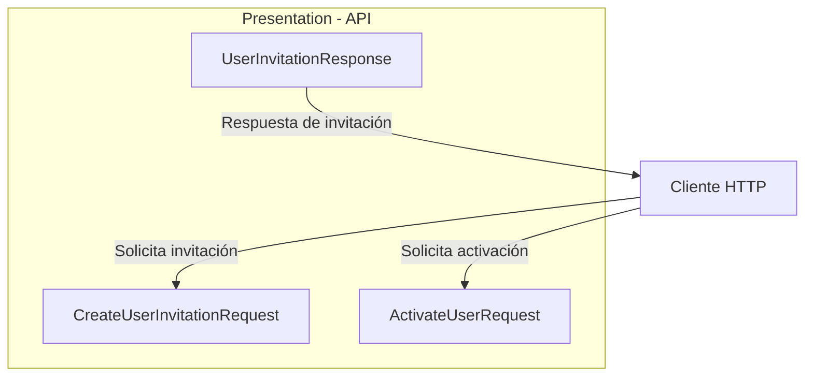

# Implementar: 04-api-invitaciones-y-validacion-identidad

## PASOS

### 1. Definir DTOs y responses HTTP.

#### Componentes implementados

| Componente                    | Acción | Tipo   | Capa         | Responsabilidad                                                              |
| ----------------------------- | ------ | ------ | ------------ | ---------------------------------------------------------------------------- |
| `ActivateUserRequest`         | Create | record | Presentation | Recibe los datos necesarios para activar una cuenta mediante una invitación. |
| `CreateUserInvitationRequest` | Create | record | Presentation | Recibe el correo electrónico del usuario que será invitado.                  |
| `UserInvitationResponse`      | Create | record | Presentation | Define la información pública de la cuenta creada mediante invitación.       |

Los tres componentes pertenecen a **Presentation** (`Fepp.ContaOps.Api`) y representan contratos de entrada y salida de la API HTTP.

#### Modelos de datos

**1. `ActivateUserRequest`**

Namespace: `Fepp.ContaOps.Api.Contracts.Requests`

| Propiedad     | Tipo     | Descripción                                         |
| ------------- | -------- | --------------------------------------------------- |
| `UserId`      | `string` | Identificador del usuario asociado a la invitación. |
| `Token`       | `string` | Token opaco utilizado para validar la activación.   |
| `NewPassword` | `string` | Contraseña inicial que establecerá el usuario.      |

**2. `CreateUserInvitationRequest`**

Namespace: `Fepp.ContaOps.Api.Contracts.Requests`

| Propiedad | Tipo     | Descripción                                           |
| --------- | -------- | ----------------------------------------------------- |
| `Email`   | `string` | Correo electrónico de la cuenta que se desea invitar. |

**3. `UserInvitationResponse`**

Namespace: `Fepp.ContaOps.Api.Contracts.Responses`

| Propiedad | Tipo     | Descripción                       |
| --------- | -------- | --------------------------------- |
| `Id`      | `string` | Identificador del usuario creado. |
| `Email`   | `string` | Correo electrónico de la cuenta.  |
| `Role`    | `string` | Rol inicial asignado al usuario.  |

**Consideraciones:**

- Los DTOs de entrada utilizan propiedades `init`, que permiten asignar valores durante la inicialización.
- `UserInvitationResponse` utiliza un `record` posicional con constructor primario.
- Los contratos no contienen lógica de negocio ni acceso a infraestructura.
- No se implementan validaciones en estos archivos; únicamente se define la estructura de los datos.
- La respuesta no expone contraseñas ni tokens de activación.

#### Componentes de .NET y C#

| Componente                       | Origen | Función                                                                |
| -------------------------------- | ------ | ---------------------------------------------------------------------- |
| `record`                         | C#     | Define tipos de datos con igualdad basada en valores.                  |
| `sealed`                         | C#     | Impide que otros tipos hereden del record.                             |
| `init`                           | C#     | Permite asignar propiedades durante la inicialización del objeto.      |
| `string.Empty`                   | .NET   | Establece un valor inicial de cadena vacía.                            |
| Constructor primario de `record` | C#     | Declara y permite inicializar las propiedades posicionales del modelo. |

No se incorporan bibliotecas externas en este paso.

#### Flujo funcional o relaciones

| Operación               | Contrato HTTP                 | Información                                          |
| ----------------------- | ----------------------------- | ---------------------------------------------------- |
| Crear invitación        | `CreateUserInvitationRequest` | Correo electrónico del usuario que será invitado.    |
| Responder a la creación | `UserInvitationResponse`      | Identificador, correo electrónico y rol inicial.     |
| Activar cuenta          | `ActivateUserRequest`         | Identificador del usuario, token y nueva contraseña. |

Los contratos establecen las estructuras de datos que utilizarán los endpoints HTTP. Su integración con controladores y casos de uso corresponde a otros componentes de la aplicación.

#### Diagrama de arquitectura



**Interpretación:**

- El cliente proporciona `CreateUserInvitationRequest` para solicitar una invitación.
- `UserInvitationResponse` define los datos que la API devolverá al crear una cuenta mediante invitación.
- `ActivateUserRequest` contiene los datos necesarios para solicitar la activación de la cuenta.
- El diagrama representa los contratos HTTP, no endpoints ni flujos de procesamiento implementados en este paso.

#### Resultado

Se definieron tres contratos HTTP para los procesos de invitación y activación de usuarios.

#### Estos DTOs establecen los límites de entrada y salida de **Presentation**, separando la representación HTTP de los modelos y casos de uso de **Application**, conforme a Clean Architecture.

---

### 2. Crear casos de uso de Application.

---

### 3. Implementar validación uniforme.

---

### 4. Crear controllers.

---

### 5. Aplicar política AdminOnly.

---

### 6. Completar mapeo de errores HTTP.

---

### 7. Traducir errores de contraseña de Identity.

---

### 8. Configurar políticas de contraseña y bloqueo.

---

### 9. Eliminar BootstrapUser.

---

### 10. Endurecer el seed.

---

### 11. Verificar login uniforme.

---

### 12. Agregar pruebas unitarias.

---

### 13. Agregar pruebas de integración.

---

### 14. Actualizar Swagger y documentación.

---

### 15. Actualizar .env.example.

---

### 16. Actualizar README.md.

---

### 17. Actualizar AGENTS.md.

---

### 18. Consolidar configuración.

---

### 19. Ejecutar restore, build y pruebas.

---

### 20. Ajustes por pruebas manuales

---

### 21. Validación, ejecución local y Git

**Prerrequisitos:** Docker disponible; crear un archivo `.env` local a partir de `.env.example` y sustituir todos los valores de ejemplo por credenciales y secretos propios. **No subir `.env` a Git.**

**Levantar PostgreSQL y pgAdmin:**

```powershell
docker compose up -d
```

**Compilación y pruebas:**

```powershell
dotnet restore FEPP-ContaOps.slnx
dotnet build FEPP-ContaOps.slnx
dotnet test FEPP-ContaOps.slnx
```

**Iniciar API:**

```powershell
.\run-local.ps1
```

---

### 22. Validación del spec (flujo de trabajo existente):

```powershell
/spec-acceptance-validator @specs/03-registro-invitacion-activacion.md
```

Revisar el spec: [`04-api-invitaciones-y-validacion-identidad.md`](../04-api-invitaciones-y-validacion-identidad.md).

---

### 23. Diagrama Final: Arquitectura del spec 03-registro-invitacion-activacion

---

### 24. Comandos Git / PR\*\* (una vez validada la implementación y revisados los cambios)

```powershell
git add .
git commit -m "FEPP-ContaOps - spec-04-api-invitaciones-y-validacion-identidad -  Implementado"
git push -u origin spec-04-api-invitaciones-y-validacion-identidad

# Después de aprobar y fusionar el Pull Request:
git switch main
git pull
git branch -d spec-04-api-invitaciones-y-validacion-identidad
```
