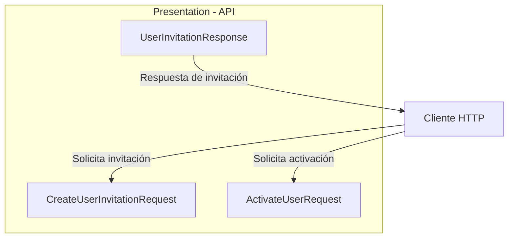
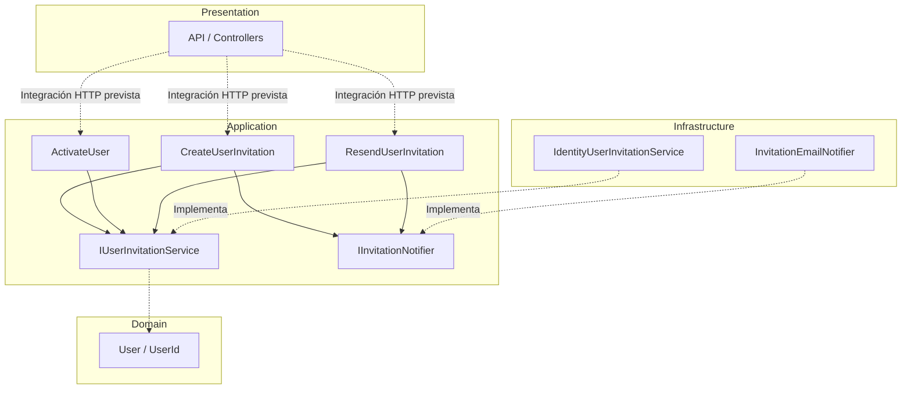
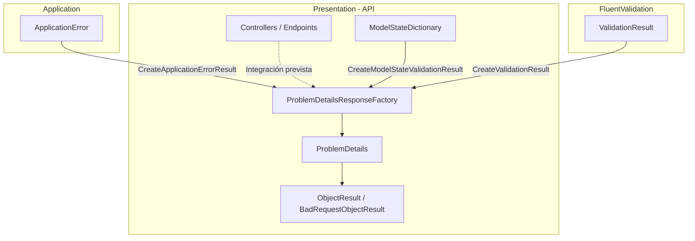
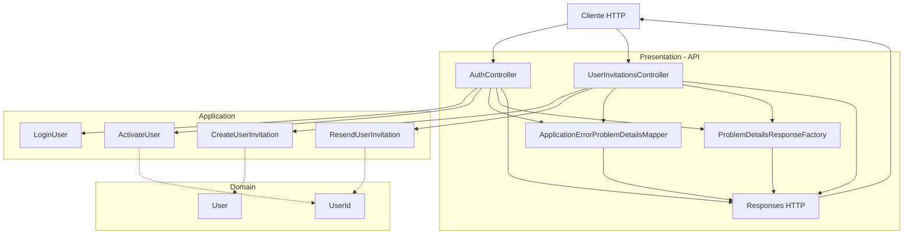
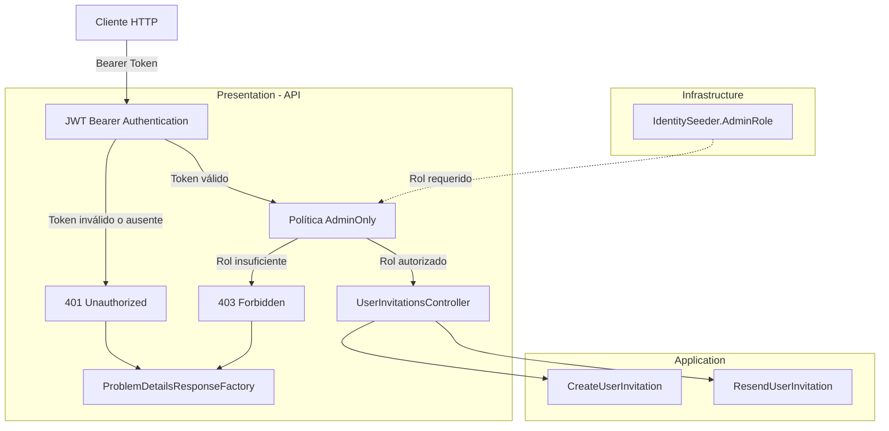
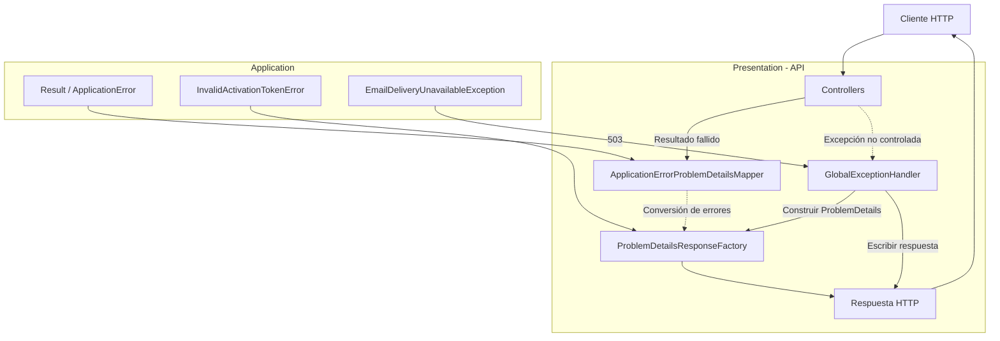

# Implementar: 04-api-invitaciones-y-validacion-identidad

## PASOS

### 1. Definir DTOs y responses HTTP.

#### Componentes implementados

| Componente                    | Acción | Tipo   | Capa         | Responsabilidad                                                              |
| ----------------------------- | ------ | ------ | ------------ | ---------------------------------------------------------------------------- |
| `ActivateUserRequest`         | Create | record | Presentation | Recibe los datos necesarios para activar una cuenta mediante una invitación. |
| `CreateUserInvitationRequest` | Create | record | Presentation | Recibe el correo electrónico del usuario que será invitado.                  |
| `UserInvitationResponse`      | Create | record | Presentation | Define la información pública de la cuenta creada mediante invitación.       |

Los tres componentes pertenecen a **Presentation** (`Fepp.ContaOps.Api`) y representan contratos de entrada y salida de la API HTTP.

#### Modelos de datos

**1. `ActivateUserRequest`**

Namespace: `Fepp.ContaOps.Api.Contracts.Requests`

| Propiedad     | Tipo     | Descripción                                         |
| ------------- | -------- | --------------------------------------------------- |
| `UserId`      | `string` | Identificador del usuario asociado a la invitación. |
| `Token`       | `string` | Token opaco utilizado para validar la activación.   |
| `NewPassword` | `string` | Contraseña inicial que establecerá el usuario.      |

**2. `CreateUserInvitationRequest`**

Namespace: `Fepp.ContaOps.Api.Contracts.Requests`

| Propiedad | Tipo     | Descripción                                           |
| --------- | -------- | ----------------------------------------------------- |
| `Email`   | `string` | Correo electrónico de la cuenta que se desea invitar. |

**3. `UserInvitationResponse`**

Namespace: `Fepp.ContaOps.Api.Contracts.Responses`

| Propiedad | Tipo     | Descripción                       |
| --------- | -------- | --------------------------------- |
| `Id`      | `string` | Identificador del usuario creado. |
| `Email`   | `string` | Correo electrónico de la cuenta.  |
| `Role`    | `string` | Rol inicial asignado al usuario.  |

**Consideraciones:**

- Los DTOs de entrada utilizan propiedades `init`, que permiten asignar valores durante la inicialización.
- `UserInvitationResponse` utiliza un `record` posicional con constructor primario.
- Los contratos no contienen lógica de negocio ni acceso a infraestructura.
- No se implementan validaciones en estos archivos; únicamente se define la estructura de los datos.
- La respuesta no expone contraseñas ni tokens de activación.

#### Componentes de .NET y C#

| Componente                       | Origen | Función                                                                |
| -------------------------------- | ------ | ---------------------------------------------------------------------- |
| `record`                         | C#     | Define tipos de datos con igualdad basada en valores.                  |
| `sealed`                         | C#     | Impide que otros tipos hereden del record.                             |
| `init`                           | C#     | Permite asignar propiedades durante la inicialización del objeto.      |
| `string.Empty`                   | .NET   | Establece un valor inicial de cadena vacía.                            |
| Constructor primario de `record` | C#     | Declara y permite inicializar las propiedades posicionales del modelo. |

No se incorporan bibliotecas externas en este paso.

#### Flujo funcional o relaciones

| Operación               | Contrato HTTP                 | Información                                          |
| ----------------------- | ----------------------------- | ---------------------------------------------------- |
| Crear invitación        | `CreateUserInvitationRequest` | Correo electrónico del usuario que será invitado.    |
| Responder a la creación | `UserInvitationResponse`      | Identificador, correo electrónico y rol inicial.     |
| Activar cuenta          | `ActivateUserRequest`         | Identificador del usuario, token y nueva contraseña. |

Los contratos establecen las estructuras de datos que utilizarán los endpoints HTTP. Su integración con controladores y casos de uso corresponde a otros componentes de la aplicación.

#### Diagrama de arquitectura



**Interpretación:**

- El cliente proporciona `CreateUserInvitationRequest` para solicitar una invitación.
- `UserInvitationResponse` define los datos que la API devolverá al crear una cuenta mediante invitación.
- `ActivateUserRequest` contiene los datos necesarios para solicitar la activación de la cuenta.
- El diagrama representa los contratos HTTP, no endpoints ni flujos de procesamiento implementados en este paso.

#### Resultado

Se definieron tres contratos HTTP para los procesos de invitación y activación de usuarios.

#### Estos DTOs establecen los límites de entrada y salida de **Presentation**, separando la representación HTTP de los modelos y casos de uso de **Application**, conforme a Clean Architecture.

---

### 2. Crear casos de uso de Application.

#### Componentes implementados

| Componente                  | Acción         | Tipo           | Capa        | Responsabilidad                                                           |
| --------------------------- | -------------- | -------------- | ----------- | ------------------------------------------------------------------------- |
| `DependencyInjection`       | Update         | class (static) | Application | Registra los casos de uso en el contenedor de dependencias.               |
| `ActivateUser`              | No verificable | class          | Application | Coordina la activación de una cuenta mediante un token de invitación.     |
| `ActivateUserInput`         | No verificable | record         | Application | Define los datos necesarios para activar una cuenta.                      |
| `CreateUserInvitation`      | No verificable | class          | Application | Coordina el registro de una cuenta pendiente y el envío de su invitación. |
| `CreateUserInvitationInput` | No verificable | record         | Application | Define el correo electrónico del usuario que será invitado.               |
| `ResendUserInvitation`      | No verificable | class          | Application | Coordina la generación y notificación de una nueva invitación.            |
| `ResendUserInvitationInput` | No verificable | record         | Application | Define el identificador del usuario que solicita una nueva invitación.    |

**Nota:** Se verifica el registro de los tres casos de uso en `DependencyInjection`. Los fragmentos no permiten determinar si las demás clases fueron creadas o modificadas respecto al SPEC 03.

#### Métodos y funciones principales

| Clase                  | Método             | Responsabilidad                                                                         |
| ---------------------- | ------------------ | --------------------------------------------------------------------------------------- |
| `DependencyInjection`  | `AddApplication()` | Registra los casos de uso con ciclo de vida `Scoped`.                                   |
| `ActivateUser`         | `ExecuteAsync()`   | Solicita la activación de una cuenta mediante `IUserInvitationService.ActivateAsync()`. |
| `CreateUserInvitation` | `ExecuteAsync()`   | Registra una cuenta pendiente y solicita el envío de su invitación.                     |
| `ResendUserInvitation` | `ExecuteAsync()`   | Solicita una nueva invitación y coordina su notificación.                               |

**Comportamiento de los casos de uso:**

| Caso de uso            | Dependencias                                    | Operaciones                                                                  |
| ---------------------- | ----------------------------------------------- | ---------------------------------------------------------------------------- |
| `ActivateUser`         | `IUserInvitationService`                        | Ejecuta `ActivateAsync()` y devuelve el resultado.                           |
| `CreateUserInvitation` | `IUserInvitationService`, `IInvitationNotifier` | Ejecuta `RegisterPendingAsync()` y, si tiene éxito, llama a `NotifyAsync()`. |
| `ResendUserInvitation` | `IUserInvitationService`, `IInvitationNotifier` | Ejecuta `ResendAsync()` y, si tiene éxito, llama a `NotifyAsync()`.          |

Los casos de uso dependen de interfaces de **Application**, evitando referencias directas a las implementaciones de Infrastructure.

#### Modelos de datos

| Modelo                      | Propiedad     | Tipo     | Descripción                                     |
| --------------------------- | ------------- | -------- | ----------------------------------------------- |
| `ActivateUserInput`         | `UserId`      | `UserId` | Identificador de dominio del usuario.           |
|                             | `Token`       | `string` | Token opaco de activación.                      |
|                             | `NewPassword` | `string` | Contraseña inicial de la cuenta.                |
| `CreateUserInvitationInput` | `Email`       | `string` | Correo electrónico del usuario invitado.        |
| `ResendUserInvitationInput` | `UserId`      | `UserId` | Identificador de dominio del usuario pendiente. |

**Modelos reutilizados:**

| Modelo                 | Capa        | Responsabilidad                                        |
| ---------------------- | ----------- | ------------------------------------------------------ |
| `UserId`               | Domain      | Representa el identificador del usuario.               |
| `User`                 | Domain      | Representa la entidad de usuario.                      |
| `UserInvitationResult` | Application | Contiene el resultado interno de una invitación.       |
| `Result<T>`            | Application | Representa el éxito o error esperado de una operación. |

Los modelos `Input` pertenecen a Application y son independientes de los DTOs HTTP definidos en el paso 1.

#### Componentes de .NET y proveedores externos

| Componente / Método  | Origen                                   | Función                                                                           |
| -------------------- | ---------------------------------------- | --------------------------------------------------------------------------------- |
| `IServiceCollection` | Microsoft.Extensions.DependencyInjection | Representa la colección de servicios configurados para inyección de dependencias. |
| `AddScoped<T>()`     | Microsoft.Extensions.DependencyInjection | Registra un servicio con ciclo de vida por ámbito (_scope_).                      |
| `Task<T>`            | .NET                                     | Representa una operación asincrónica que devuelve un resultado.                   |
| `CancellationToken`  | .NET                                     | Permite propagar solicitudes de cancelación.                                      |
| `async` / `await`    | C#                                       | Permite ejecutar operaciones asincrónicas sin bloquear el hilo durante la espera. |
| `record`             | C#                                       | Define modelos de datos con igualdad basada en valores.                           |

No se incorporan nuevas dependencias externas en el código proporcionado.

#### Flujo funcional o relaciones

**1. Crear invitación**

| Orden | Operación                                                       | Componente responsable                          |
| ----- | --------------------------------------------------------------- | ----------------------------------------------- |
| 1     | Recibir `CreateUserInvitationInput`.                            | `CreateUserInvitation`                          |
| 2     | Registrar una cuenta pendiente.                                 | `IUserInvitationService.RegisterPendingAsync()` |
| 3     | Verificar `Result.IsSuccess`.                                   | `CreateUserInvitation`                          |
| 4     | Solicitar el envío de la invitación si el resultado es exitoso. | `IInvitationNotifier.NotifyAsync()`             |
| 5     | Devolver `Result<UserInvitationResult>`.                        | `CreateUserInvitation`                          |

**2. Activar usuario**

| Orden | Operación                                          | Componente responsable                   |
| ----- | -------------------------------------------------- | ---------------------------------------- |
| 1     | Recibir `ActivateUserInput`.                       | `ActivateUser`                           |
| 2     | Delegar la activación al servicio de invitaciones. | `IUserInvitationService.ActivateAsync()` |
| 3     | Devolver `Result<User>`.                           | `ActivateUser`                           |

**3. Reenviar invitación**

| Orden | Operación                                             | Componente responsable                 |
| ----- | ----------------------------------------------------- | -------------------------------------- |
| 1     | Recibir `ResendUserInvitationInput`.                  | `ResendUserInvitation`                 |
| 2     | Solicitar una nueva invitación.                       | `IUserInvitationService.ResendAsync()` |
| 3     | Verificar `Result.IsSuccess`.                         | `ResendUserInvitation`                 |
| 4     | Solicitar la notificación si el resultado es exitoso. | `IInvitationNotifier.NotifyAsync()`    |
| 5     | Devolver `Result<UserInvitationResult>`.              | `ResendUserInvitation`                 |

**Manejo de resultados:**

- Cuando el servicio devuelve un resultado fallido, se propaga sin enviar notificaciones.
- Cuando la operación tiene éxito, los casos de uso de creación y reenvío solicitan la notificación.
- Las excepciones de `NotifyAsync()` no se capturan en estos casos de uso; se propagan al consumidor.
- El código mostrado no implementa directamente validaciones de tokens, contraseñas ni persistencia. Estas operaciones se delegan a los servicios correspondientes.

#### Diagrama de arquitectura



**Interpretación:**

- **Presentation:** utilizará los casos de uso para procesar solicitudes HTTP. Esta integración no se muestra implementada en los archivos del paso.
- **Application:** coordina los procesos de invitación, activación y reenvío mediante interfaces.
- **Domain:** proporciona los modelos de usuario utilizados por los contratos de Application.
- **Infrastructure:** contiene los adaptadores implementados previamente en SPEC 03.
- **Inyección de dependencias:** `AddApplication()` registra los casos de uso mediante `AddScoped<T>()`. Los adaptadores de Infrastructure se resuelven a través de sus respectivas interfaces.

#### Resultado

Se dispone de tres casos de uso de Application para coordinar la creación, activación y reenvío de invitaciones.

Los casos de uso utilizan los contratos establecidos en SPEC 03 y se encuentran registrados mediante inyección de dependencias.

Esta estructura permite integrar los endpoints de Presentation sin acoplarlos directamente a ASP.NET Core Identity, al transporte de correo o a los mecanismos de persistencia.

---

### 3. Implementar validación uniforme.

#### Componentes implementados

| Componente                      | Acción         | Tipo           | Capa         | Responsabilidad                                                                                                  |
| ------------------------------- | -------------- | -------------- | ------------ | ---------------------------------------------------------------------------------------------------------------- |
| `ProblemDetailsResponseFactory` | No verificable | class (static) | Presentation | Centraliza la construcción de respuestas HTTP de error mediante un contrato uniforme basado en `ProblemDetails`. |

**Ubicación:** `Fepp.ContaOps.Api.Validation`

La clase permite representar de manera consistente los errores provenientes de Application, FluentValidation y el proceso de model binding de ASP.NET Core.

El código proporcionado no permite verificar si el componente fue creado o modificado.

#### Métodos y funciones principales

| Clase                           | Método                                                 | Responsabilidad                                                                                      |
| ------------------------------- | ------------------------------------------------------ | ---------------------------------------------------------------------------------------------------- |
| `ProblemDetailsResponseFactory` | `CreateApplicationErrorResult()`                       | Convierte errores tipados de Application en respuestas HTTP con el código de estado correspondiente. |
| `ProblemDetailsResponseFactory` | `CreateValidationResult(ValidationResult)`             | Agrupa los errores de FluentValidation por propiedad y elimina mensajes duplicados.                  |
| `ProblemDetailsResponseFactory` | `CreateModelStateValidationResult()`                   | Convierte errores de model binding y deserialización JSON en respuestas HTTP uniformes.              |
| `ProblemDetailsResponseFactory` | `CreateValidationResult(Dictionary<string, string[]>)` | Construye una respuesta HTTP 400 con los errores agrupados por campo.                                |
| `ProblemDetailsResponseFactory` | `Create()`                                             | Genera la estructura común de `ProblemDetails`, incluyendo código de error y trazabilidad.           |

**Visibilidad de los métodos:**

- `CreateApplicationErrorResult()`: público.
- `CreateValidationResult(ValidationResult)`: público.
- `CreateModelStateValidationResult()`: público.
- `CreateValidationResult(Dictionary<string, string[]>)`: privado.
- `Create()`: público.

#### Modelos de datos

**1. `ProblemDetails`**

Modelo proporcionado por ASP.NET Core para representar errores HTTP mediante una estructura estandarizada.

| Propiedad               | Tipo                           | Descripción                                      |
| ----------------------- | ------------------------------ | ------------------------------------------------ |
| `Type`                  | `string`                       | Referencia asociada al código de estado HTTP.    |
| `Title`                 | `string`                       | Descripción breve del tipo de error.             |
| `Status`                | `int`                          | Código HTTP de la respuesta.                     |
| `Detail`                | `string`                       | Descripción del error.                           |
| `Instance`              | `string`                       | Ruta HTTP donde ocurrió el error.                |
| `Extensions["code"]`    | `string`                       | Código identificador del error.                  |
| `Extensions["traceId"]` | `string`                       | Identificador de trazabilidad de la solicitud.   |
| `Extensions["errors"]`  | `Dictionary<string, string[]>` | Errores agrupados por campo, cuando corresponde. |

**2. Errores de Application**

| Error                   | Estado HTTP                 | Código       |
| ----------------------- | --------------------------- | ------------ |
| `ValidationError`       | `400 Bad Request`           | `error.Code` |
| `AuthenticationError`   | `401 Unauthorized`          | `error.Code` |
| `ResourceNotFoundError` | `404 Not Found`             | `error.Code` |
| `ConflictError`         | `409 Conflict`              | `error.Code` |
| Otros errores           | `500 Internal Server Error` | `error.Code` |

Los errores tipados pertenecen a Application y son transformados en respuestas HTTP por Presentation.

**3. Errores de validación**

| Origen               | Estado HTTP       | Código             |
| -------------------- | ----------------- | ------------------ |
| FluentValidation     | `400 Bad Request` | `validation_error` |
| Model binding / JSON | `400 Bad Request` | `validation_error` |

Ambos mecanismos utilizan la misma estructura de respuesta.

#### Componentes de .NET y proveedores externos

| Componente / Método      | Origen           | Función                                                                           |
| ------------------------ | ---------------- | --------------------------------------------------------------------------------- |
| `ProblemDetails`         | ASP.NET Core MVC | Representa errores HTTP mediante un contrato estandarizado.                       |
| `ObjectResult`           | ASP.NET Core MVC | Devuelve un objeto serializado con un estado HTTP configurable.                   |
| `BadRequestObjectResult` | ASP.NET Core MVC | Devuelve una respuesta HTTP 400 con contenido.                                    |
| `HttpContext`            | ASP.NET Core     | Proporciona información de la solicitud HTTP actual.                              |
| `StatusCodes`            | ASP.NET Core     | Define constantes para códigos de estado HTTP.                                    |
| `ModelStateDictionary`   | ASP.NET Core MVC | Contiene errores del proceso de model binding.                                    |
| `ValidationResult`       | FluentValidation | Contiene los errores producidos durante la validación.                            |
| `GroupBy()`              | LINQ / .NET      | Agrupa errores según el nombre de la propiedad.                                   |
| `ToDictionary()`         | LINQ / .NET      | Convierte los errores agrupados en un diccionario.                                |
| `Distinct()`             | LINQ / .NET      | Elimina mensajes de error duplicados.                                             |
| `StringComparer.Ordinal` | .NET             | Compara cadenas mediante reglas ordinales, distinguiendo mayúsculas y minúsculas. |

#### Flujo funcional o relaciones

**1. Errores provenientes de Application**

| Orden | Operación                                                                | Componente responsable           |
| ----- | ------------------------------------------------------------------------ | -------------------------------- |
| 1     | Recibir un `ApplicationError`.                                           | `CreateApplicationErrorResult()` |
| 2     | Determinar el código HTTP según el tipo de error.                        | `CreateApplicationErrorResult()` |
| 3     | Seleccionar el título y detalle de la respuesta.                         | `CreateApplicationErrorResult()` |
| 4     | Construir el objeto `ProblemDetails`.                                    | `Create()`                       |
| 5     | Incorporar los errores por campo cuando corresponda a `ValidationError`. | `CreateApplicationErrorResult()` |
| 6     | Devolver un `ObjectResult` con contenido `application/problem+json`.     | `CreateApplicationErrorResult()` |

**2. Errores de FluentValidation**

| Orden | Operación                               | Componente responsable                    |
| ----- | --------------------------------------- | ----------------------------------------- |
| 1     | Recibir un `ValidationResult`.          | `CreateValidationResult()`                |
| 2     | Agrupar los errores por `PropertyName`. | `GroupBy()`                               |
| 3     | Eliminar mensajes duplicados.           | `Distinct()`                              |
| 4     | Construir la respuesta HTTP 400.        | `CreateValidationResult(Dictionary<...>)` |
| 5     | Devolver `application/problem+json`.    | `BadRequestObjectResult`                  |

**3. Errores de ModelState**

| Orden | Operación                                                | Componente responsable                    |
| ----- | -------------------------------------------------------- | ----------------------------------------- |
| 1     | Recibir un `ModelStateDictionary`.                       | `CreateModelStateValidationResult()`      |
| 2     | Extraer los errores asociados a cada campo.              | `CreateModelStateValidationResult()`      |
| 3     | Reemplazar mensajes vacíos por una descripción genérica. | `CreateModelStateValidationResult()`      |
| 4     | Eliminar mensajes duplicados.                            | `Distinct()`                              |
| 5     | Construir la respuesta HTTP 400 uniforme.                | `CreateValidationResult(Dictionary<...>)` |

#### Contrato HTTP de errores

**Ejemplo de respuesta de validación:**

```json
{
  "type": "https://httpstatuses.com/400",
  "title": "Request validation failed.",
  "status": 400,
  "detail": "One or more request fields are invalid.",
  "instance": "/api/users/invitations",
  "code": "validation_error",
  "traceId": "0HN123456789",
  "errors": {
    "Email": ["The email address is invalid."]
  }
}
```

El ejemplo representa la estructura generada por la factoría. La ruta, el identificador de trazabilidad y el mensaje de validación son ilustrativos.

**Características del contrato:**

- Utiliza el tipo de contenido `application/problem+json`.
- Mantiene una estructura común para diferentes categorías de errores.
- Incluye un código de error identificable por los consumidores de la API.
- Incorpora `traceId` para facilitar la correlación de solicitudes.
- Permite representar varios errores asociados a una misma propiedad.
- Evita mensajes duplicados en las respuestas de validación.

#### Diagrama de arquitectura



**Interpretación:**

- **Application:** proporciona errores tipados independientes de HTTP.
- **FluentValidation:** proporciona los resultados de validación de los datos.
- **ASP.NET Core:** proporciona los errores detectados durante el model binding.
- **Presentation:** transforma estas fuentes de error en respuestas HTTP uniformes mediante `ProblemDetailsResponseFactory`.

La integración de la factoría con los controladores o filtros HTTP no aparece implementada en el código proporcionado.

#### Resultado

Se dispone de una factoría centralizada para construir respuestas HTTP de error mediante `ProblemDetails`.

El componente unifica la representación de errores de Application, FluentValidation y ASP.NET Core, estableciendo un contrato consistente para los consumidores de la API.

Esta implementación mantiene la separación entre los errores de negocio definidos en Application y su representación HTTP, responsabilidad exclusiva de Presentation.

---

### 4. Crear controllers.

#### Componentes implementados

| Componente                  | Acción         | Tipo  | Capa         | Responsabilidad                                                      |
| --------------------------- | -------------- | ----- | ------------ | -------------------------------------------------------------------- |
| `AuthController`            | No verificable | class | Presentation | Expone los endpoints HTTP de autenticación y activación de usuarios. |
| `UserInvitationsController` | No verificable | class | Presentation | Expone los endpoints HTTP para crear y reenviar invitaciones.        |

**Ubicación:** `Fepp.ContaOps.Api.Controllers`

Los controladores pertenecen a **Presentation** y actúan como punto de entrada de las solicitudes HTTP.

Sus responsabilidades principales son:

- Recibir solicitudes mediante los DTOs definidos en el paso 1.
- Transformar los datos HTTP en modelos de entrada de Application.
- Ejecutar los casos de uso correspondientes.
- Convertir los resultados en respuestas HTTP.
- Delegar la transformación de errores a `ApplicationErrorProblemDetailsMapper`.

Los archivos no permiten determinar si los controladores fueron creados o modificados.

#### Métodos y funciones principales

| Clase                       | Método               | Responsabilidad                                                                                             |
| --------------------------- | -------------------- | ----------------------------------------------------------------------------------------------------------- |
| `AuthController`            | `Login()`            | Ejecuta el caso de uso `LoginUser` y devuelve un token de acceso.                                           |
| `AuthController`            | `Activate()`         | Valida el formato del identificador y ejecuta `ActivateUser`.                                               |
| `UserInvitationsController` | `CreateInvitation()` | Ejecuta `CreateUserInvitation` y devuelve la representación pública del usuario creado.                     |
| `UserInvitationsController` | `ResendInvitation()` | Valida el identificador y ejecuta `ResendUserInvitation`.                                                   |
| `UserInvitationsController` | `ToResponse()`       | Convierte una entidad `User` en `UserInvitationResponse`, sin exponer información interna de la invitación. |

**Dependencias inyectadas:**

| Controller                  | Dependencia                            | Capa         | Uso                                                     |
| --------------------------- | -------------------------------------- | ------------ | ------------------------------------------------------- |
| `AuthController`            | `LoginUser`                            | Application  | Autenticación de usuarios.                              |
| `AuthController`            | `ActivateUser`                         | Application  | Activación de cuentas pendientes.                       |
| `AuthController`            | `ApplicationErrorProblemDetailsMapper` | Presentation | Traducción de errores de Application a respuestas HTTP. |
| `UserInvitationsController` | `CreateUserInvitation`                 | Application  | Creación de invitaciones.                               |
| `UserInvitationsController` | `ResendUserInvitation`                 | Application  | Reenvío de invitaciones.                                |
| `UserInvitationsController` | `ApplicationErrorProblemDetailsMapper` | Presentation | Traducción de errores de Application a respuestas HTTP. |

Los controladores utilizan **inyección de dependencias por constructor** y delegan la ejecución de los procesos a los casos de uso de Application.

#### Endpoints HTTP implementados

| Controller                  | Método | Ruta                          | Caso de uso            | Respuesta exitosa |
| --------------------------- | ------ | ----------------------------- | ---------------------- | ----------------- |
| `AuthController`            | POST   | `/api/auth/login`             | `LoginUser`            | `200 OK`          |
| `AuthController`            | POST   | `/api/auth/activate`          | `ActivateUser`         | `204 No Content`  |
| `UserInvitationsController` | POST   | `/api/users/invitations`      | `CreateUserInvitation` | `201 Created`     |
| `UserInvitationsController` | POST   | `/api/users/{id}/invitations` | `ResendUserInvitation` | `204 No Content`  |

**Características de los endpoints:**

| Endpoint           | Característica                                      |
| ------------------ | --------------------------------------------------- |
| `Login`            | Permite acceso anónimo mediante `[AllowAnonymous]`. |
| `Activate`         | Permite acceso anónimo mediante `[AllowAnonymous]`. |
| `CreateInvitation` | No declara atributos específicos de autorización.   |
| `ResendInvitation` | No declara atributos específicos de autorización.   |

**Consideración de seguridad:**

Aunque `UserInvitationsController` representa operaciones administrativas, el código proporcionado no incluye atributos `[Authorize]` ni restricciones por rol.

Por tanto, no puede verificarse si estos endpoints están protegidos mediante políticas globales, convenciones u otros mecanismos de autorización.

#### Modelos de datos

**1. Contratos HTTP y modelos de Application**

| Operación           | Request HTTP                  | Input de Application        | Response HTTP            |
| ------------------- | ----------------------------- | --------------------------- | ------------------------ |
| Login               | `LoginRequest`                | `LoginUserInput`            | `LoginResponse`          |
| Activación          | `ActivateUserRequest`         | `ActivateUserInput`         | Sin contenido            |
| Crear invitación    | `CreateUserInvitationRequest` | `CreateUserInvitationInput` | `UserInvitationResponse` |
| Reenviar invitación | Parámetro de ruta `id`        | `ResendUserInvitationInput` | Sin contenido            |

**2. Modelos utilizados**

| Modelo                        | Capa         | Responsabilidad                                                  |
| ----------------------------- | ------------ | ---------------------------------------------------------------- |
| `LoginRequest`                | Presentation | Recibe las credenciales de autenticación.                        |
| `LoginResponse`               | Presentation | Devuelve el token de acceso, tipo Bearer y tiempo de expiración. |
| `ActivateUserRequest`         | Presentation | Recibe el identificador, token y contraseña inicial.             |
| `CreateUserInvitationRequest` | Presentation | Recibe el correo electrónico del usuario invitado.               |
| `UserInvitationResponse`      | Presentation | Expone identificador, correo electrónico y rol inicial.          |
| `LoginUserInput`              | Application  | Transporta las credenciales al caso de uso de autenticación.     |
| `ActivateUserInput`           | Application  | Transporta los datos de activación.                              |
| `CreateUserInvitationInput`   | Application  | Transporta el correo electrónico al caso de uso.                 |
| `ResendUserInvitationInput`   | Application  | Transporta el identificador del usuario pendiente.               |
| `TokenResult`                 | Application  | Contiene el resultado interno de autenticación.                  |
| `UserInvitationResult`        | Application  | Contiene el resultado interno de una invitación.                 |
| `User`                        | Domain       | Representa la entidad de usuario.                                |
| `UserId`                      | Domain       | Representa el identificador del usuario.                         |

**Transformaciones relevantes:**

| Origen                        | Destino                     | Transformación                                                                 |
| ----------------------------- | --------------------------- | ------------------------------------------------------------------------------ |
| `LoginRequest`                | `LoginUserInput`            | Transfiere correo electrónico y contraseña.                                    |
| `TokenResult`                 | `LoginResponse`             | Expone token, tipo `Bearer` y tiempo de expiración.                            |
| `ActivateUserRequest`         | `ActivateUserInput`         | Convierte `UserId` a identificador de dominio y transfiere token y contraseña. |
| `CreateUserInvitationRequest` | `CreateUserInvitationInput` | Transfiere el correo electrónico.                                              |
| `User`                        | `UserInvitationResponse`    | Extrae identificador, correo electrónico y primer rol.                         |
| `id` de la ruta               | `ResendUserInvitationInput` | Convierte el identificador recibido en un `UserId` de dominio.                 |

El método `ToResponse()` selecciona el primer elemento de `user.Roles` mediante `FirstOrDefault()` y devuelve una cadena vacía cuando no existen roles.

#### Componentes de .NET y proveedores externos

| Componente / Método          | Origen                     | Función                                                                       |
| ---------------------------- | -------------------------- | ----------------------------------------------------------------------------- |
| `ControllerBase`             | ASP.NET Core MVC           | Clase base para controladores de API.                                         |
| `[ApiController]`            | ASP.NET Core MVC           | Habilita convenciones de API, incluyendo validación automática de ModelState. |
| `[Route]`                    | ASP.NET Core MVC           | Define la ruta base del controlador.                                          |
| `[HttpPost]`                 | ASP.NET Core MVC           | Asocia una acción con solicitudes HTTP POST.                                  |
| `[AllowAnonymous]`           | ASP.NET Core Authorization | Permite ejecutar una acción sin autenticación.                                |
| `[ProducesResponseType]`     | ASP.NET Core MVC           | Declara los tipos y códigos de respuesta para la metadata de la API.          |
| `IActionResult`              | ASP.NET Core MVC           | Representa el resultado de una acción HTTP.                                   |
| `Ok()`                       | ASP.NET Core MVC           | Genera una respuesta `200 OK`.                                                |
| `Created()`                  | ASP.NET Core MVC           | Genera una respuesta `201 Created` con una ubicación del recurso.             |
| `NoContent()`                | ASP.NET Core MVC           | Genera una respuesta `204 No Content`.                                        |
| `ModelState.AddModelError()` | ASP.NET Core MVC           | Incorpora un error de validación asociado a un campo.                         |
| `Guid.TryParse()`            | .NET                       | Comprueba si una cadena representa un identificador GUID válido.              |
| `FirstOrDefault()`           | LINQ / .NET                | Obtiene el primer elemento de una colección o su valor predeterminado.        |
| `CancellationToken`          | .NET                       | Propaga solicitudes de cancelación a los casos de uso.                        |

#### Flujo funcional o relaciones

**1. Inicio de sesión**

| Orden | Operación                                    | Componente responsable                       |
| ----- | -------------------------------------------- | -------------------------------------------- |
| 1     | Recibir `LoginRequest`.                      | `AuthController.Login()`                     |
| 2     | Construir `LoginUserInput`.                  | `AuthController`                             |
| 3     | Ejecutar autenticación.                      | `LoginUser.ExecuteAsync()`                   |
| 4     | Traducir el error cuando la operación falla. | `ApplicationErrorProblemDetailsMapper.Map()` |
| 5     | Convertir `TokenResult` en `LoginResponse`.  | `AuthController`                             |
| 6     | Devolver `200 OK`.                           | `Ok()`                                       |

**2. Activación de cuenta**

| Orden | Operación                                                   | Componente responsable                       |
| ----- | ----------------------------------------------------------- | -------------------------------------------- |
| 1     | Recibir `ActivateUserRequest`.                              | `AuthController.Activate()`                  |
| 2     | Validar que `UserId` tenga formato GUID.                    | `Guid.TryParse()`                            |
| 3     | Devolver `400 Bad Request` si el identificador es inválido. | `ProblemDetailsResponseFactory`              |
| 4     | Construir `ActivateUserInput` con `UserId` de dominio.      | `AuthController`                             |
| 5     | Ejecutar activación.                                        | `ActivateUser.ExecuteAsync()`                |
| 6     | Traducir el error si la activación falla.                   | `ApplicationErrorProblemDetailsMapper.Map()` |
| 7     | Devolver `204 No Content` si tiene éxito.                   | `NoContent()`                                |

**3. Creación de invitación**

| Orden | Operación                                               | Componente responsable                         |
| ----- | ------------------------------------------------------- | ---------------------------------------------- |
| 1     | Recibir `CreateUserInvitationRequest`.                  | `UserInvitationsController.CreateInvitation()` |
| 2     | Construir `CreateUserInvitationInput`.                  | `UserInvitationsController`                    |
| 3     | Ejecutar creación y notificación de la invitación.      | `CreateUserInvitation.ExecuteAsync()`          |
| 4     | Traducir el error si la operación falla.                | `ApplicationErrorProblemDetailsMapper.Map()`   |
| 5     | Convertir `User` en `UserInvitationResponse`.           | `ToResponse()`                                 |
| 6     | Devolver `201 Created` con ubicación `/api/users/{id}`. | `Created()`                                    |

**4. Reenvío de invitación**

| Orden | Operación                                                       | Componente responsable                         |
| ----- | --------------------------------------------------------------- | ---------------------------------------------- |
| 1     | Recibir el identificador desde la ruta.                         | `UserInvitationsController.ResendInvitation()` |
| 2     | Validar que el identificador tenga formato GUID.                | `Guid.TryParse()`                              |
| 3     | Devolver `400 Bad Request` cuando el identificador es inválido. | `ProblemDetailsResponseFactory`                |
| 4     | Construir `ResendUserInvitationInput`.                          | `UserInvitationsController`                    |
| 5     | Ejecutar el reenvío.                                            | `ResendUserInvitation.ExecuteAsync()`          |
| 6     | Traducir el error cuando la operación falla.                    | `ApplicationErrorProblemDetailsMapper.Map()`   |
| 7     | Devolver `204 No Content` si tiene éxito.                       | `NoContent()`                                  |

#### Manejo de errores HTTP

Los controladores utilizan dos mecanismos complementarios:

| Mecanismo                     | Componente                             | Responsabilidad                                                                    |
| ----------------------------- | -------------------------------------- | ---------------------------------------------------------------------------------- |
| Validación de identificadores | `ProblemDetailsResponseFactory`        | Genera respuestas HTTP 400 cuando el identificador recibido no tiene formato GUID. |
| Errores de Application        | `ApplicationErrorProblemDetailsMapper` | Convierte errores tipados de los casos de uso en respuestas HTTP.                  |

**Respuestas declaradas mediante atributos:**

| Endpoint           | Códigos HTTP            |
| ------------------ | ----------------------- |
| `Login`            | 200, 400, 401           |
| `Activate`         | 204, 400                |
| `CreateInvitation` | 201, 400, 409, 503      |
| `ResendInvitation` | 204, 400, 404, 409, 503 |

Los códigos representan las respuestas declaradas mediante `[ProducesResponseType]`. La generación efectiva de errores depende de los resultados de Application y del comportamiento de `ApplicationErrorProblemDetailsMapper`.

La implementación de este mapper no se incluye entre los archivos proporcionados, por lo que no es posible verificar todas sus reglas de traducción.

#### Diagrama de arquitectura



**Interpretación:**

- **Presentation:** recibe solicitudes HTTP, transforma los DTOs y construye las respuestas.
- **Application:** ejecuta los casos de uso de autenticación, activación, creación y reenvío de invitaciones.
- **Domain:** proporciona las entidades e identificadores utilizados por los casos de uso.
- **Validación:** los controladores comprueban el formato GUID y utilizan los componentes de validación y traducción de errores de Presentation.
- **Separación arquitectónica:** los controladores no implementan directamente reglas de negocio, persistencia ni envío de correos.

#### Resultado

Se implementaron los endpoints HTTP para autenticación, activación, creación y reenvío de invitaciones.

Los controladores integran los contratos HTTP definidos en el paso 1 con los casos de uso de Application documentados en el paso 2 y utilizan los mecanismos de manejo de errores de Presentation.

Esta implementación establece la comunicación entre los clientes HTTP y los procesos del ciclo de invitaciones, manteniendo separadas las responsabilidades de Presentation, Application y Domain.

---

### 5. Aplicar política AdminOnly.

#### Componentes implementados

| Componente                  | Acción      | Tipo           | Capa           | Responsabilidad                                                                                                                  |
| --------------------------- | ----------- | -------------- | -------------- | -------------------------------------------------------------------------------------------------------------------------------- |
| `UserInvitationsController` | Update      | class          | Presentation   | Aplica la política `AdminOnly` a los endpoints de creación y reenvío de invitaciones.                                            |
| `DependencyInjection`       | Update      | class (static) | Presentation   | Configura la autenticación JWT, registra la política de autorización `AdminOnly` y personaliza las respuestas HTTP de seguridad. |
| `IdentitySeeder`            | Reutilizado | class          | Infrastructure | Proporciona la constante `AdminRole`, utilizada para identificar el rol administrativo requerido.                                |

**Ubicaciones:**

- `Fepp.ContaOps.Api.Controllers.UserInvitationsController`
- `Fepp.ContaOps.Api.DependencyInjection`
- `Fepp.ContaOps.Infrastructure.Identity.IdentitySeeder`

La implementación separa la **definición de la política** de su **aplicación a los endpoints HTTP**.

#### Definición y aplicación de AdminOnly

**1. Definición de la política**

La política `AdminOnly` se registra en el método `AddApi()` de la clase `DependencyInjection`, perteneciente a Presentation.

```csharp
services.AddAuthorization(options =>
{
    options.AddPolicy("AdminOnly", policy =>
        policy.RequireRole(IdentitySeeder.AdminRole));
});
```

| Elemento                      | Responsabilidad                                                          |
| ----------------------------- | ------------------------------------------------------------------------ |
| `AddAuthorization()`          | Registra y configura los servicios de autorización de ASP.NET Core.      |
| `AddPolicy("AdminOnly", ...)` | Define una política de autorización denominada `AdminOnly`.              |
| `RequireRole()`               | Exige que el usuario autenticado pertenezca al rol especificado.         |
| `IdentitySeeder.AdminRole`    | Proporciona el nombre del rol administrativo definido en Infrastructure. |

La política utiliza autorización basada en roles (**Role-Based Access Control, RBAC**).

**2. Aplicación de la política**

En `UserInvitationsController` se incorpora:

```csharp
[ApiController]
[Route("api/users")]
[Authorize(Policy = "AdminOnly")]
public sealed class UserInvitationsController : ControllerBase
```

El atributo `[Authorize]` aplica la política a todas las acciones del controlador.

**Endpoints protegidos:**

| Método | Endpoint                      | Operación           | Política    |
| ------ | ----------------------------- | ------------------- | ----------- |
| POST   | `/api/users/invitations`      | Crear invitación    | `AdminOnly` |
| POST   | `/api/users/{id}/invitations` | Reenviar invitación | `AdminOnly` |

Los endpoints de autenticación y activación de `AuthController` mantienen sus atributos `[AllowAnonymous]` y no están sujetos a esta política.

#### Métodos y funciones principales

| Clase                       | Método                            | Responsabilidad                                                                               |
| --------------------------- | --------------------------------- | --------------------------------------------------------------------------------------------- |
| `DependencyInjection`       | `AddApi()`                        | Registra los servicios HTTP, configura la autenticación JWT y define la política `AdminOnly`. |
| `DependencyInjection`       | `WriteAuthenticationErrorAsync()` | Genera respuestas uniformes `ProblemDetails` para errores HTTP 401 y 403.                     |
| `UserInvitationsController` | `CreateInvitation()`              | Ejecuta la creación de invitaciones cuando la solicitud está autorizada.                      |
| `UserInvitationsController` | `ResendInvitation()`              | Ejecuta el reenvío de invitaciones cuando la solicitud está autorizada.                       |

#### Configuración de autenticación JWT

La autenticación se configura dentro de `DependencyInjection.AddApi()` mediante:

```csharp
services.AddAuthentication(JwtBearerDefaults.AuthenticationScheme)
    .AddJwtBearer(options =>
    {
        options.TokenValidationParameters = new TokenValidationParameters
        {
            ValidateIssuer = true,
            ValidIssuer = jwtOptions.Issuer,

            ValidateAudience = true,
            ValidAudience = jwtOptions.Audience,

            ValidateIssuerSigningKey = true,
            IssuerSigningKey = new SymmetricSecurityKey(
                Encoding.UTF8.GetBytes(jwtOptions.SigningKey)),

            ValidateLifetime = true,
            ClockSkew = TimeSpan.Zero,

            NameClaimType = JwtRegisteredClaimNames.Email,
            RoleClaimType = ClaimTypes.Role
        };
    });
```

**Parámetros relevantes:**

| Parámetro                  | Configuración                   | Responsabilidad                                                           |
| -------------------------- | ------------------------------- | ------------------------------------------------------------------------- |
| `ValidateIssuer`           | `true`                          | Comprueba que el token provenga del emisor configurado.                   |
| `ValidateAudience`         | `true`                          | Comprueba que el token esté destinado a la API.                           |
| `ValidateIssuerSigningKey` | `true`                          | Habilita la validación de la clave utilizada para verificar la firma.     |
| `IssuerSigningKey`         | `SymmetricSecurityKey`          | Establece la clave simétrica de validación.                               |
| `ValidateLifetime`         | `true`                          | Comprueba la vigencia del token.                                          |
| `ClockSkew`                | `TimeSpan.Zero`                 | Elimina la tolerancia adicional de tiempo durante la validación.          |
| `NameClaimType`            | `JwtRegisteredClaimNames.Email` | Identifica el claim utilizado como nombre del usuario.                    |
| `RoleClaimType`            | `ClaimTypes.Role`               | Identifica el tipo de claim utilizado para evaluar los roles del usuario. |

**Relación entre JWT y AdminOnly:**

La política `AdminOnly` utiliza los roles presentes en la identidad autenticada.

ASP.NET Core interpreta los claims de rol según `RoleClaimType` y los compara con el valor definido en `IdentitySeeder.AdminRole`.

Por tanto, para superar la autorización, el usuario debe estar autenticado y tener asignado el rol administrativo requerido.

El código proporcionado no incluye la generación del JWT, por lo que no permite verificar cómo se incorporan originalmente los claims de rol al token.

#### Manejo de errores de autenticación y autorización

La configuración de JWT incorpora dos eventos:

| Evento        | Estado HTTP        | Código de error           | Responsabilidad                                                              |
| ------------- | ------------------ | ------------------------- | ---------------------------------------------------------------------------- |
| `OnChallenge` | `401 Unauthorized` | `authentication_required` | Genera una respuesta cuando se requiere autenticación y no se ha satisfecho. |
| `OnForbidden` | `403 Forbidden`    | `forbidden`               | Genera una respuesta cuando el usuario no tiene permisos suficientes.        |

Ambos eventos utilizan `WriteAuthenticationErrorAsync()`.

**Implementación:**

```csharp
private static Task WriteAuthenticationErrorAsync(
    HttpContext httpContext,
    int statusCode,
    string detail,
    string code)
{
    httpContext.Response.StatusCode = statusCode;
    httpContext.Response.ContentType = "application/problem+json";

    string responseBody = JsonSerializer.Serialize(
        ProblemDetailsResponseFactory.Create(
            httpContext,
            statusCode,
            statusCode == StatusCodes.Status401Unauthorized
                ? "Authentication failed."
                : "Access forbidden.",
            detail,
            code));

    return httpContext.Response.WriteAsync(responseBody);
}
```

El método reutiliza `ProblemDetailsResponseFactory`, implementado en el paso 3, para mantener un formato consistente de errores HTTP.

**Comportamiento:**

| Condición                                     | Resultado                                      |
| --------------------------------------------- | ---------------------------------------------- |
| Solicitud sin autenticación válida            | `401 Unauthorized`                             |
| Usuario autenticado sin el rol requerido      | `403 Forbidden`                                |
| Usuario autenticado con el rol administrativo | Se permite ejecutar la acción del controlador. |

**Ejemplo de respuesta HTTP 403:**

```json
{
  "type": "https://httpstatuses.com/403",
  "title": "Access forbidden.",
  "status": 403,
  "detail": "You do not have permission to access this resource.",
  "instance": "/api/users/invitations",
  "code": "forbidden",
  "traceId": "0HN123456789"
}
```

La ruta y el identificador de trazabilidad son ilustrativos.

#### Componentes de .NET y proveedores externos

| Componente / Método          | Origen                         | Función                                                       |
| ---------------------------- | ------------------------------ | ------------------------------------------------------------- |
| `[Authorize]`                | ASP.NET Core Authorization     | Exige el cumplimiento de una política de autorización.        |
| `AddAuthorization()`         | ASP.NET Core Authorization     | Registra y configura los servicios de autorización.           |
| `AddPolicy()`                | ASP.NET Core Authorization     | Define una política de autorización por nombre.               |
| `RequireRole()`              | ASP.NET Core Authorization     | Establece como requisito la pertenencia a un rol.             |
| `AddAuthentication()`        | ASP.NET Core Authentication    | Configura el esquema de autenticación predeterminado.         |
| `AddJwtBearer()`             | ASP.NET Core JWT Bearer        | Configura la autenticación mediante tokens JWT.               |
| `TokenValidationParameters`  | Microsoft.IdentityModel.Tokens | Define las reglas de validación del token.                    |
| `SymmetricSecurityKey`       | Microsoft.IdentityModel.Tokens | Representa una clave criptográfica simétrica.                 |
| `ClaimTypes.Role`            | .NET                           | Identifica el tipo de claim utilizado para representar roles. |
| `JwtBearerEvents`            | ASP.NET Core JWT Bearer        | Permite personalizar eventos de autenticación y autorización. |
| `JsonSerializer.Serialize()` | System.Text.Json               | Serializa la respuesta `ProblemDetails` a JSON.               |

#### Flujo funcional o relaciones

| Orden | Operación                                                            | Componente responsable      |
| ----- | -------------------------------------------------------------------- | --------------------------- |
| 1     | El cliente envía una solicitud HTTP con un token JWT Bearer.         | Cliente HTTP                |
| 2     | ASP.NET Core valida firma, emisor, audiencia y vigencia del token.   | JWT Bearer Authentication   |
| 3     | Se construye la identidad autenticada con sus claims.                | ASP.NET Core Authentication |
| 4     | Se identifica la política `AdminOnly` aplicada al controlador.       | ASP.NET Core Authorization  |
| 5     | Se comprueba que el usuario tenga el rol `IdentitySeeder.AdminRole`. | `RequireRole()`             |
| 6     | Si falta autenticación válida, se devuelve HTTP 401.                 | `OnChallenge`               |
| 7     | Si el usuario no cumple la política, se devuelve HTTP 403.           | `OnForbidden`               |
| 8     | Si cumple los requisitos, se ejecuta la acción solicitada.           | `UserInvitationsController` |
| 9     | El controlador delega la operación al caso de uso correspondiente.   | Application                 |

#### Diagrama de arquitectura



**Interpretación:**

- **Presentation:** configura la autenticación JWT, define `AdminOnly` y protege los endpoints administrativos.
- **Infrastructure:** proporciona el identificador del rol administrativo mediante `IdentitySeeder.AdminRole`.
- **Application:** ejecuta los casos de uso de invitaciones una vez superada la autorización.
- **ProblemDetailsResponseFactory:** proporciona el contrato uniforme utilizado para las respuestas de autenticación y autorización.

La autorización se ejecuta en el adaptador HTTP, evitando incorporar dependencias de ASP.NET Core en los casos de uso de Application.

#### Resultado

Se implementó la política de autorización `AdminOnly` mediante `DependencyInjection.AddApi()` y se aplicó a `UserInvitationsController`.

La política exige que el usuario autenticado pertenezca al rol administrativo definido por `IdentitySeeder.AdminRole`.

Adicionalmente, se configuró la validación de tokens JWT y la generación de respuestas uniformes `401 Unauthorized` y `403 Forbidden`.

Con estos cambios, la creación y el reenvío de invitaciones quedan protegidos mediante autorización basada en roles, manteniendo la separación de responsabilidades establecida por Clean Architecture.

---

### 6. Completar mapeo de errores HTTP.

#### Componentes implementados

| Componente                      | Acción         | Tipo           | Capa         | Responsabilidad                                                                                                                 |
| ------------------------------- | -------------- | -------------- | ------------ | ------------------------------------------------------------------------------------------------------------------------------- |
| `GlobalExceptionHandler`        | No verificable | class          | Presentation | Captura excepciones no controladas y genera respuestas HTTP uniformes y seguras.                                                |
| `ProblemDetailsResponseFactory` | Update         | class (static) | Presentation | Incorpora el tratamiento de `InvalidActivationTokenError` y mantiene la conversión de errores de Application a respuestas HTTP. |

**Ubicaciones:**

- `Fepp.ContaOps.Api.Exceptions.GlobalExceptionHandler`
- `Fepp.ContaOps.Api.Validation.ProblemDetailsResponseFactory`

La implementación distingue dos categorías de errores:

- **Errores esperados:** representados mediante `ApplicationError` y transformados por `ProblemDetailsResponseFactory`.
- **Excepciones:** procesadas mediante `GlobalExceptionHandler`, que registra información de diagnóstico y devuelve respuestas HTTP seguras.

El código permite verificar la actualización de `ProblemDetailsResponseFactory` respecto al paso 3, pero no determina si `GlobalExceptionHandler` fue creado o modificado.

#### Métodos y funciones principales

| Clase                           | Método                                                 | Responsabilidad                                                                                                 |
| ------------------------------- | ------------------------------------------------------ | --------------------------------------------------------------------------------------------------------------- |
| `GlobalExceptionHandler`        | `TryHandleAsync()`                                     | Captura excepciones, identifica su categoría, registra el incidente y genera la respuesta HTTP correspondiente. |
| `GlobalExceptionHandler`        | `WriteProblemDetailsAsync()`                           | Serializa y escribe una respuesta `ProblemDetails` sin exponer información interna de la excepción.             |
| `ProblemDetailsResponseFactory` | `CreateApplicationErrorResult()`                       | Convierte errores tipados de Application en respuestas HTTP, incluyendo errores de tokens de activación.        |
| `ProblemDetailsResponseFactory` | `CreateValidationResult(ValidationResult)`             | Agrupa errores de FluentValidation por propiedad.                                                               |
| `ProblemDetailsResponseFactory` | `CreateModelStateValidationResult()`                   | Convierte errores de model binding en respuestas HTTP 400.                                                      |
| `ProblemDetailsResponseFactory` | `CreateValidationResult(Dictionary<string, string[]>)` | Construye respuestas uniformes para errores de validación.                                                      |
| `ProblemDetailsResponseFactory` | `Create()`                                             | Genera la estructura común de `ProblemDetails`, incluyendo código de error y trazabilidad.                      |

#### Mapeo de errores HTTP

**1. Errores esperados de Application**

La factoría utiliza una expresión `switch` para determinar el código HTTP a partir del tipo de error.

| Error de Application          | Estado HTTP                 | Detalle de respuesta                                       |
| ----------------------------- | --------------------------- | ---------------------------------------------------------- |
| `ValidationError`             | `400 Bad Request`           | `One or more validation errors occurred.`                  |
| `InvalidActivationTokenError` | `400 Bad Request`           | Mensaje definido en `InvalidActivationTokenError.Message`. |
| `AuthenticationError`         | `401 Unauthorized`          | `The supplied credentials are invalid.`                    |
| `ResourceNotFoundError`       | `404 Not Found`             | Mensaje definido en `ResourceNotFoundError.Message`.       |
| `ConflictError`               | `409 Conflict`              | Mensaje definido en `ConflictError.Message`.               |
| Otros errores                 | `500 Internal Server Error` | `The request could not be completed.`                      |

**Cambio principal:**

Se incorpora el tratamiento explícito de `InvalidActivationTokenError`:

```csharp
int status = error switch
{
    ValidationError => StatusCodes.Status400BadRequest,
    InvalidActivationTokenError => StatusCodes.Status400BadRequest,
    AuthenticationError => StatusCodes.Status401Unauthorized,
    ResourceNotFoundError => StatusCodes.Status404NotFound,
    ConflictError => StatusCodes.Status409Conflict,
    _ => StatusCodes.Status500InternalServerError
};
```

Este cambio permite representar un token de activación inválido mediante un error HTTP 400, sin clasificarlo como un error interno del servidor.

El código de error enviado al cliente se obtiene de `ApplicationError.Code`.

**2. Excepciones procesadas globalmente**

`GlobalExceptionHandler` implementa un mapeo independiente para excepciones.

| Excepción                                            | Estado HTTP                 | Código de error                               | Descripción                                                        |
| ---------------------------------------------------- | --------------------------- | --------------------------------------------- | ------------------------------------------------------------------ |
| `EmailDeliveryUnavailableException`                  | `503 Service Unavailable`   | `EmailDeliveryUnavailableException.ErrorCode` | El servicio no pudo entregar la invitación por correo electrónico. |
| `OperationCanceledException` con solicitud cancelada | `499`                       | `request_cancelled`                           | El cliente canceló la solicitud HTTP.                              |
| Otras excepciones                                    | `500 Internal Server Error` | `unexpected_error`                            | Ocurrió un error inesperado durante el procesamiento.              |

**Consideraciones:**

- `503` permite identificar específicamente problemas de disponibilidad del servicio de correo.
- `500` representa excepciones que no tienen un tratamiento específico.
- `499` identifica una solicitud cancelada por el cliente; es un código no estándar de HTTP.
- Las excepciones se registran mediante `ILogger<GlobalExceptionHandler>`.
- Los detalles internos de las excepciones no se incluyen en las respuestas HTTP.

#### Manejo de excepciones no controladas

**1. Excepciones del servicio de correo**

Cuando se captura una `EmailDeliveryUnavailableException`, se devuelve:

| Propiedad | Valor                                         |
| --------- | --------------------------------------------- |
| `Status`  | `503`                                         |
| `Title`   | `Email delivery is unavailable.`              |
| `Detail`  | `The invitation could not be delivered.`      |
| `Code`    | `EmailDeliveryUnavailableException.ErrorCode` |

Esto permite diferenciar los errores de entrega de invitaciones de otros errores inesperados.

**2. Excepciones inesperadas**

Para cualquier excepción sin tratamiento específico:

| Propiedad | Valor                                 |
| --------- | ------------------------------------- |
| `Status`  | `500`                                 |
| `Title`   | `An unexpected error occurred.`       |
| `Detail`  | `The request could not be completed.` |
| `Code`    | `unexpected_error`                    |

El handler registra la excepción completa, pero devuelve únicamente información genérica al consumidor de la API.

**3. Cancelación de solicitudes**

Cuando ocurre una `OperationCanceledException` y `HttpContext.RequestAborted.IsCancellationRequested` es verdadero:

1. Se registra un mensaje informativo mediante `LogInformation()`.
2. Se establece el código HTTP `499`.
3. Se devuelve `true`, indicando que la excepción fue gestionada.

**Observación técnica:**

La condición interna que intenta escribir `ProblemDetails` cuando `RequestAborted.IsCancellationRequested` es falso no se cumple dentro de esta rama, porque previamente se exigió que fuera verdadero.

Por tanto, en el código proporcionado, las solicitudes canceladas por el cliente establecen el estado `499`, pero no llegan a escribir el cuerpo JSON `ProblemDetails`.

#### Contrato HTTP de errores

Los errores utilizan el modelo `ProblemDetails`, generado mediante `ProblemDetailsResponseFactory.Create()`.

| Propiedad  | Tipo                           | Responsabilidad                                                            |
| ---------- | ------------------------------ | -------------------------------------------------------------------------- |
| `type`     | `string`                       | Referencia asociada al estado HTTP.                                        |
| `title`    | `string`                       | Descripción breve del error.                                               |
| `status`   | `int`                          | Código HTTP correspondiente.                                               |
| `detail`   | `string`                       | Descripción segura del error.                                              |
| `instance` | `string`                       | Ruta de la solicitud que produjo el error.                                 |
| `code`     | `string`                       | Código estable que permite identificar el error.                           |
| `traceId`  | `string`                       | Identificador utilizado para correlacionar la solicitud con los registros. |
| `errors`   | `Dictionary<string, string[]>` | Errores agrupados por campo, cuando corresponde.                           |

**Ejemplo: error de entrega de invitación**

```json
{
  "type": "https://httpstatuses.com/503",
  "title": "Email delivery is unavailable.",
  "status": 503,
  "detail": "The invitation could not be delivered.",
  "instance": "/api/users/invitations",
  "code": "<EmailDeliveryUnavailableException.ErrorCode>",
  "traceId": "0HN123456789"
}
```

El ejemplo es ilustrativo. El valor concreto de `EmailDeliveryUnavailableException.ErrorCode` no aparece definido en los archivos proporcionados.

#### Componentes de .NET y proveedores externos

| Componente / Método          | Origen                       | Función                                                                      |
| ---------------------------- | ---------------------------- | ---------------------------------------------------------------------------- |
| `IExceptionHandler`          | ASP.NET Core Diagnostics     | Define un contrato para gestionar excepciones durante el procesamiento HTTP. |
| `TryHandleAsync()`           | ASP.NET Core Diagnostics     | Permite procesar una excepción y determinar si fue gestionada.               |
| `ILogger<T>`                 | Microsoft.Extensions.Logging | Proporciona registro estructurado de eventos y errores.                      |
| `LogInformation()`           | Microsoft.Extensions.Logging | Registra eventos informativos, como solicitudes canceladas.                  |
| `LogError()`                 | Microsoft.Extensions.Logging | Registra excepciones junto con información de diagnóstico.                   |
| `HttpContext`                | ASP.NET Core                 | Proporciona acceso a la solicitud y respuesta HTTP.                          |
| `RequestAborted`             | ASP.NET Core                 | Expone el token de cancelación asociado a la solicitud HTTP.                 |
| `ProblemDetails`             | ASP.NET Core MVC             | Representa errores HTTP mediante una estructura estandarizada.               |
| `JsonSerializer.Serialize()` | System.Text.Json             | Convierte objetos .NET en contenido JSON.                                    |
| `HttpResponse.WriteAsync()`  | ASP.NET Core                 | Escribe el contenido de la respuesta HTTP.                                   |
| `OperationCanceledException` | .NET                         | Representa la cancelación de una operación.                                  |
| `CancellationToken`          | .NET                         | Permite propagar solicitudes de cancelación.                                 |
| `ValueTask<T>`               | .NET                         | Representa una operación asincrónica que devuelve un valor.                  |

#### Flujo funcional o relaciones

**1. Errores esperados de Application**

| Orden | Operación                                                    | Componente responsable                   |
| ----- | ------------------------------------------------------------ | ---------------------------------------- |
| 1     | Un caso de uso devuelve un `Result<T>` fallido.              | Application                              |
| 2     | El controlador identifica que la operación no fue exitosa.   | Controller                               |
| 3     | El controlador delega la conversión del error.               | `ApplicationErrorProblemDetailsMapper`   |
| 4     | Se determina el estado HTTP según el tipo de error.          | `ProblemDetailsResponseFactory`          |
| 5     | Se construye la respuesta `ProblemDetails`.                  | `ProblemDetailsResponseFactory.Create()` |
| 6     | Se devuelve una respuesta HTTP con el error correspondiente. | Presentation                             |

La implementación de `ApplicationErrorProblemDetailsMapper` no está incluida en este paso, por lo que su delegación interna a la factoría no puede verificarse directamente.

**2. Excepciones no controladas**

| Orden | Operación                                                                                | Componente responsable                    |
| ----- | ---------------------------------------------------------------------------------------- | ----------------------------------------- |
| 1     | Se produce una excepción durante el procesamiento de una solicitud.                      | Componente que ejecuta la operación       |
| 2     | El mecanismo global de excepciones invoca el handler, si está registrado.                | ASP.NET Core                              |
| 3     | Se identifica si corresponde a una cancelación del cliente.                              | `GlobalExceptionHandler.TryHandleAsync()` |
| 4     | Se registra la excepción o la cancelación.                                               | `ILogger<GlobalExceptionHandler>`         |
| 5     | Se determina el estado HTTP y el código de error.                                        | `GlobalExceptionHandler`                  |
| 6     | Se construye una respuesta `ProblemDetails`, excepto en la rama de cancelación descrita. | `ProblemDetailsResponseFactory.Create()`  |
| 7     | Se serializa y escribe la respuesta HTTP.                                                | `WriteProblemDetailsAsync()`              |

#### Diagrama de arquitectura



**Interpretación:**

- **Application:** define los errores esperados que representan resultados fallidos de los casos de uso.
- **Presentation:** transforma los errores de Application en respuestas HTTP mediante sus componentes de mapeo.
- **GlobalExceptionHandler:** procesa excepciones no controladas y registra información de diagnóstico.
- **ProblemDetailsResponseFactory:** centraliza la construcción del contrato de errores HTTP.
- **Cliente HTTP:** recibe respuestas con estados y códigos de error que permiten identificar el resultado de la operación.

`EmailDeliveryUnavailableException` se utiliza como excepción del flujo de entrega de invitaciones. Su namespace y definición no están incluidos en los fragmentos proporcionados.

#### Resultado

Se amplió el mapeo de errores HTTP incorporando el tratamiento específico de tokens de activación inválidos y excepciones de entrega de correo electrónico.

La implementación permite representar errores esperados de Application mediante estados HTTP específicos y gestionar excepciones no controladas utilizando respuestas `ProblemDetails`.

Además, incorpora registro estructurado de excepciones y trazabilidad mediante `traceId`, manteniendo los detalles internos de los errores fuera de las respuestas públicas de la API.

La conexión efectiva del handler global al pipeline HTTP deberá verificarse en la configuración de servicios y middleware, ya que no aparece en los archivos de este paso.

---

### 7. Traducir errores de contraseña de Identity.

---

### 8. Configurar políticas de contraseña y bloqueo.

---

### 9. Eliminar BootstrapUser.

---

### 10. Endurecer el seed.

---

### 11. Verificar login uniforme.

---

### 12. Agregar pruebas unitarias.

---

### 13. Agregar pruebas de integración.

---

### 14. Actualizar Swagger y documentación.

---

### 15. Actualizar .env.example.

---

### 16. Actualizar README.md.

---

### 17. Actualizar AGENTS.md.

---

### 18. Consolidar configuración.

---

### 19. Ejecutar restore, build y pruebas.

---

### 20. Ajustes por pruebas manuales

---

### 21. Validación, ejecución local y Git

**Prerrequisitos:** Docker disponible; crear un archivo `.env` local a partir de `.env.example` y sustituir todos los valores de ejemplo por credenciales y secretos propios. **No subir `.env` a Git.**

**Levantar PostgreSQL y pgAdmin:**

```powershell
docker compose up -d
```

**Compilación y pruebas:**

```powershell
dotnet restore FEPP-ContaOps.slnx
dotnet build FEPP-ContaOps.slnx
dotnet test FEPP-ContaOps.slnx
```

**Iniciar API:**

```powershell
.\run-local.ps1
```

---

### 22. Validación del spec (flujo de trabajo existente):

```powershell
/spec-acceptance-validator @specs/03-registro-invitacion-activacion.md
```

Revisar el spec: [`04-api-invitaciones-y-validacion-identidad.md`](../04-api-invitaciones-y-validacion-identidad.md).

---

### 23. Diagrama Final: Arquitectura del spec 03-registro-invitacion-activacion

---

### 24. Comandos Git / PR\*\* (una vez validada la implementación y revisados los cambios)

```powershell
git add .
git commit -m "FEPP-ContaOps - spec-04-api-invitaciones-y-validacion-identidad -  Implementado"
git push -u origin spec-04-api-invitaciones-y-validacion-identidad

# Después de aprobar y fusionar el Pull Request:
git switch main
git pull
git branch -d spec-04-api-invitaciones-y-validacion-identidad
```
