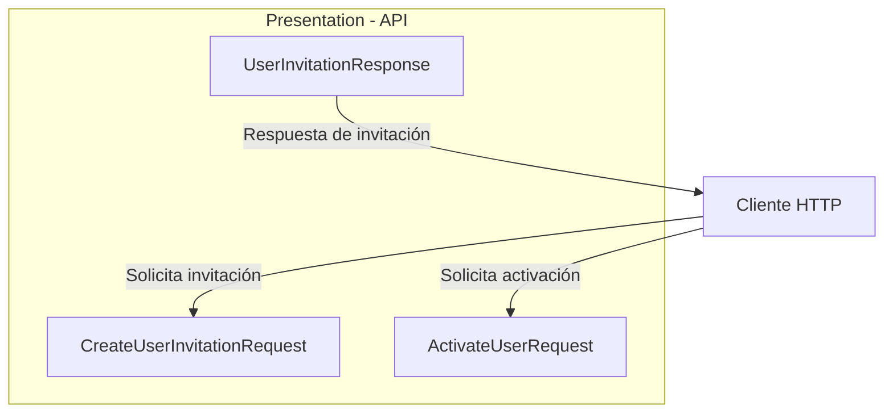
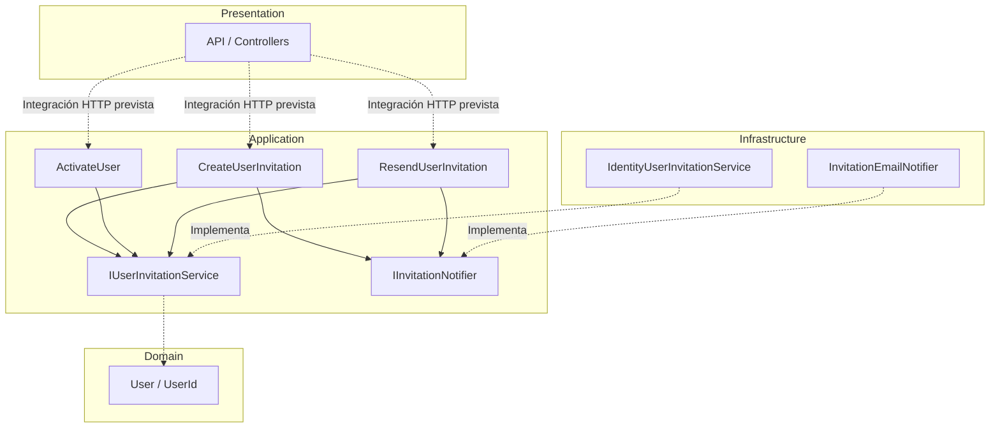
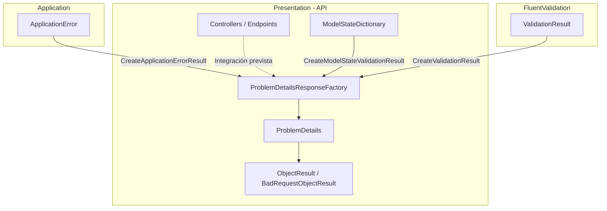

# Implementar: 04-api-invitaciones-y-validacion-identidad

## PASOS

### 1. Definir DTOs y responses HTTP.

#### Componentes implementados

| Componente                    | Acción | Tipo   | Capa         | Responsabilidad                                                              |
| ----------------------------- | ------ | ------ | ------------ | ---------------------------------------------------------------------------- |
| `ActivateUserRequest`         | Create | record | Presentation | Recibe los datos necesarios para activar una cuenta mediante una invitación. |
| `CreateUserInvitationRequest` | Create | record | Presentation | Recibe el correo electrónico del usuario que será invitado.                  |
| `UserInvitationResponse`      | Create | record | Presentation | Define la información pública de la cuenta creada mediante invitación.       |

Los tres componentes pertenecen a **Presentation** (`Fepp.ContaOps.Api`) y representan contratos de entrada y salida de la API HTTP.

#### Modelos de datos

**1. `ActivateUserRequest`**

Namespace: `Fepp.ContaOps.Api.Contracts.Requests`

| Propiedad     | Tipo     | Descripción                                         |
| ------------- | -------- | --------------------------------------------------- |
| `UserId`      | `string` | Identificador del usuario asociado a la invitación. |
| `Token`       | `string` | Token opaco utilizado para validar la activación.   |
| `NewPassword` | `string` | Contraseña inicial que establecerá el usuario.      |

**2. `CreateUserInvitationRequest`**

Namespace: `Fepp.ContaOps.Api.Contracts.Requests`

| Propiedad | Tipo     | Descripción                                           |
| --------- | -------- | ----------------------------------------------------- |
| `Email`   | `string` | Correo electrónico de la cuenta que se desea invitar. |

**3. `UserInvitationResponse`**

Namespace: `Fepp.ContaOps.Api.Contracts.Responses`

| Propiedad | Tipo     | Descripción                       |
| --------- | -------- | --------------------------------- |
| `Id`      | `string` | Identificador del usuario creado. |
| `Email`   | `string` | Correo electrónico de la cuenta.  |
| `Role`    | `string` | Rol inicial asignado al usuario.  |

**Consideraciones:**

- Los DTOs de entrada utilizan propiedades `init`, que permiten asignar valores durante la inicialización.
- `UserInvitationResponse` utiliza un `record` posicional con constructor primario.
- Los contratos no contienen lógica de negocio ni acceso a infraestructura.
- No se implementan validaciones en estos archivos; únicamente se define la estructura de los datos.
- La respuesta no expone contraseñas ni tokens de activación.

#### Componentes de .NET y C#

| Componente                       | Origen | Función                                                                |
| -------------------------------- | ------ | ---------------------------------------------------------------------- |
| `record`                         | C#     | Define tipos de datos con igualdad basada en valores.                  |
| `sealed`                         | C#     | Impide que otros tipos hereden del record.                             |
| `init`                           | C#     | Permite asignar propiedades durante la inicialización del objeto.      |
| `string.Empty`                   | .NET   | Establece un valor inicial de cadena vacía.                            |
| Constructor primario de `record` | C#     | Declara y permite inicializar las propiedades posicionales del modelo. |

No se incorporan bibliotecas externas en este paso.

#### Flujo funcional o relaciones

| Operación               | Contrato HTTP                 | Información                                          |
| ----------------------- | ----------------------------- | ---------------------------------------------------- |
| Crear invitación        | `CreateUserInvitationRequest` | Correo electrónico del usuario que será invitado.    |
| Responder a la creación | `UserInvitationResponse`      | Identificador, correo electrónico y rol inicial.     |
| Activar cuenta          | `ActivateUserRequest`         | Identificador del usuario, token y nueva contraseña. |

Los contratos establecen las estructuras de datos que utilizarán los endpoints HTTP. Su integración con controladores y casos de uso corresponde a otros componentes de la aplicación.

#### Diagrama de arquitectura



**Interpretación:**

- El cliente proporciona `CreateUserInvitationRequest` para solicitar una invitación.
- `UserInvitationResponse` define los datos que la API devolverá al crear una cuenta mediante invitación.
- `ActivateUserRequest` contiene los datos necesarios para solicitar la activación de la cuenta.
- El diagrama representa los contratos HTTP, no endpoints ni flujos de procesamiento implementados en este paso.

#### Resultado

Se definieron tres contratos HTTP para los procesos de invitación y activación de usuarios.

#### Estos DTOs establecen los límites de entrada y salida de **Presentation**, separando la representación HTTP de los modelos y casos de uso de **Application**, conforme a Clean Architecture.

---

### 2. Crear casos de uso de Application.

#### Componentes implementados

| Componente                  | Acción         | Tipo           | Capa        | Responsabilidad                                                           |
| --------------------------- | -------------- | -------------- | ----------- | ------------------------------------------------------------------------- |
| `DependencyInjection`       | Update         | class (static) | Application | Registra los casos de uso en el contenedor de dependencias.               |
| `ActivateUser`              | No verificable | class          | Application | Coordina la activación de una cuenta mediante un token de invitación.     |
| `ActivateUserInput`         | No verificable | record         | Application | Define los datos necesarios para activar una cuenta.                      |
| `CreateUserInvitation`      | No verificable | class          | Application | Coordina el registro de una cuenta pendiente y el envío de su invitación. |
| `CreateUserInvitationInput` | No verificable | record         | Application | Define el correo electrónico del usuario que será invitado.               |
| `ResendUserInvitation`      | No verificable | class          | Application | Coordina la generación y notificación de una nueva invitación.            |
| `ResendUserInvitationInput` | No verificable | record         | Application | Define el identificador del usuario que solicita una nueva invitación.    |

**Nota:** Se verifica el registro de los tres casos de uso en `DependencyInjection`. Los fragmentos no permiten determinar si las demás clases fueron creadas o modificadas respecto al SPEC 03.

#### Métodos y funciones principales

| Clase                  | Método             | Responsabilidad                                                                         |
| ---------------------- | ------------------ | --------------------------------------------------------------------------------------- |
| `DependencyInjection`  | `AddApplication()` | Registra los casos de uso con ciclo de vida `Scoped`.                                   |
| `ActivateUser`         | `ExecuteAsync()`   | Solicita la activación de una cuenta mediante `IUserInvitationService.ActivateAsync()`. |
| `CreateUserInvitation` | `ExecuteAsync()`   | Registra una cuenta pendiente y solicita el envío de su invitación.                     |
| `ResendUserInvitation` | `ExecuteAsync()`   | Solicita una nueva invitación y coordina su notificación.                               |

**Comportamiento de los casos de uso:**

| Caso de uso            | Dependencias                                    | Operaciones                                                                  |
| ---------------------- | ----------------------------------------------- | ---------------------------------------------------------------------------- |
| `ActivateUser`         | `IUserInvitationService`                        | Ejecuta `ActivateAsync()` y devuelve el resultado.                           |
| `CreateUserInvitation` | `IUserInvitationService`, `IInvitationNotifier` | Ejecuta `RegisterPendingAsync()` y, si tiene éxito, llama a `NotifyAsync()`. |
| `ResendUserInvitation` | `IUserInvitationService`, `IInvitationNotifier` | Ejecuta `ResendAsync()` y, si tiene éxito, llama a `NotifyAsync()`.          |

Los casos de uso dependen de interfaces de **Application**, evitando referencias directas a las implementaciones de Infrastructure.

#### Modelos de datos

| Modelo                      | Propiedad     | Tipo     | Descripción                                     |
| --------------------------- | ------------- | -------- | ----------------------------------------------- |
| `ActivateUserInput`         | `UserId`      | `UserId` | Identificador de dominio del usuario.           |
|                             | `Token`       | `string` | Token opaco de activación.                      |
|                             | `NewPassword` | `string` | Contraseña inicial de la cuenta.                |
| `CreateUserInvitationInput` | `Email`       | `string` | Correo electrónico del usuario invitado.        |
| `ResendUserInvitationInput` | `UserId`      | `UserId` | Identificador de dominio del usuario pendiente. |

**Modelos reutilizados:**

| Modelo                 | Capa        | Responsabilidad                                        |
| ---------------------- | ----------- | ------------------------------------------------------ |
| `UserId`               | Domain      | Representa el identificador del usuario.               |
| `User`                 | Domain      | Representa la entidad de usuario.                      |
| `UserInvitationResult` | Application | Contiene el resultado interno de una invitación.       |
| `Result<T>`            | Application | Representa el éxito o error esperado de una operación. |

Los modelos `Input` pertenecen a Application y son independientes de los DTOs HTTP definidos en el paso 1.

#### Componentes de .NET y proveedores externos

| Componente / Método  | Origen                                   | Función                                                                           |
| -------------------- | ---------------------------------------- | --------------------------------------------------------------------------------- |
| `IServiceCollection` | Microsoft.Extensions.DependencyInjection | Representa la colección de servicios configurados para inyección de dependencias. |
| `AddScoped<T>()`     | Microsoft.Extensions.DependencyInjection | Registra un servicio con ciclo de vida por ámbito (_scope_).                      |
| `Task<T>`            | .NET                                     | Representa una operación asincrónica que devuelve un resultado.                   |
| `CancellationToken`  | .NET                                     | Permite propagar solicitudes de cancelación.                                      |
| `async` / `await`    | C#                                       | Permite ejecutar operaciones asincrónicas sin bloquear el hilo durante la espera. |
| `record`             | C#                                       | Define modelos de datos con igualdad basada en valores.                           |

No se incorporan nuevas dependencias externas en el código proporcionado.

#### Flujo funcional o relaciones

**1. Crear invitación**

| Orden | Operación                                                       | Componente responsable                          |
| ----- | --------------------------------------------------------------- | ----------------------------------------------- |
| 1     | Recibir `CreateUserInvitationInput`.                            | `CreateUserInvitation`                          |
| 2     | Registrar una cuenta pendiente.                                 | `IUserInvitationService.RegisterPendingAsync()` |
| 3     | Verificar `Result.IsSuccess`.                                   | `CreateUserInvitation`                          |
| 4     | Solicitar el envío de la invitación si el resultado es exitoso. | `IInvitationNotifier.NotifyAsync()`             |
| 5     | Devolver `Result<UserInvitationResult>`.                        | `CreateUserInvitation`                          |

**2. Activar usuario**

| Orden | Operación                                          | Componente responsable                   |
| ----- | -------------------------------------------------- | ---------------------------------------- |
| 1     | Recibir `ActivateUserInput`.                       | `ActivateUser`                           |
| 2     | Delegar la activación al servicio de invitaciones. | `IUserInvitationService.ActivateAsync()` |
| 3     | Devolver `Result<User>`.                           | `ActivateUser`                           |

**3. Reenviar invitación**

| Orden | Operación                                             | Componente responsable                 |
| ----- | ----------------------------------------------------- | -------------------------------------- |
| 1     | Recibir `ResendUserInvitationInput`.                  | `ResendUserInvitation`                 |
| 2     | Solicitar una nueva invitación.                       | `IUserInvitationService.ResendAsync()` |
| 3     | Verificar `Result.IsSuccess`.                         | `ResendUserInvitation`                 |
| 4     | Solicitar la notificación si el resultado es exitoso. | `IInvitationNotifier.NotifyAsync()`    |
| 5     | Devolver `Result<UserInvitationResult>`.              | `ResendUserInvitation`                 |

**Manejo de resultados:**

- Cuando el servicio devuelve un resultado fallido, se propaga sin enviar notificaciones.
- Cuando la operación tiene éxito, los casos de uso de creación y reenvío solicitan la notificación.
- Las excepciones de `NotifyAsync()` no se capturan en estos casos de uso; se propagan al consumidor.
- El código mostrado no implementa directamente validaciones de tokens, contraseñas ni persistencia. Estas operaciones se delegan a los servicios correspondientes.

#### Diagrama de arquitectura



**Interpretación:**

- **Presentation:** utilizará los casos de uso para procesar solicitudes HTTP. Esta integración no se muestra implementada en los archivos del paso.
- **Application:** coordina los procesos de invitación, activación y reenvío mediante interfaces.
- **Domain:** proporciona los modelos de usuario utilizados por los contratos de Application.
- **Infrastructure:** contiene los adaptadores implementados previamente en SPEC 03.
- **Inyección de dependencias:** `AddApplication()` registra los casos de uso mediante `AddScoped<T>()`. Los adaptadores de Infrastructure se resuelven a través de sus respectivas interfaces.

#### Resultado

Se dispone de tres casos de uso de Application para coordinar la creación, activación y reenvío de invitaciones.

Los casos de uso utilizan los contratos establecidos en SPEC 03 y se encuentran registrados mediante inyección de dependencias.

Esta estructura permite integrar los endpoints de Presentation sin acoplarlos directamente a ASP.NET Core Identity, al transporte de correo o a los mecanismos de persistencia.

---

### 3. Implementar validación uniforme.

#### Componentes implementados

| Componente                      | Acción         | Tipo           | Capa         | Responsabilidad                                                                                                  |
| ------------------------------- | -------------- | -------------- | ------------ | ---------------------------------------------------------------------------------------------------------------- |
| `ProblemDetailsResponseFactory` | No verificable | class (static) | Presentation | Centraliza la construcción de respuestas HTTP de error mediante un contrato uniforme basado en `ProblemDetails`. |

**Ubicación:** `Fepp.ContaOps.Api.Validation`

La clase permite representar de manera consistente los errores provenientes de Application, FluentValidation y el proceso de model binding de ASP.NET Core.

El código proporcionado no permite verificar si el componente fue creado o modificado.

#### Métodos y funciones principales

| Clase                           | Método                                                 | Responsabilidad                                                                                      |
| ------------------------------- | ------------------------------------------------------ | ---------------------------------------------------------------------------------------------------- |
| `ProblemDetailsResponseFactory` | `CreateApplicationErrorResult()`                       | Convierte errores tipados de Application en respuestas HTTP con el código de estado correspondiente. |
| `ProblemDetailsResponseFactory` | `CreateValidationResult(ValidationResult)`             | Agrupa los errores de FluentValidation por propiedad y elimina mensajes duplicados.                  |
| `ProblemDetailsResponseFactory` | `CreateModelStateValidationResult()`                   | Convierte errores de model binding y deserialización JSON en respuestas HTTP uniformes.              |
| `ProblemDetailsResponseFactory` | `CreateValidationResult(Dictionary<string, string[]>)` | Construye una respuesta HTTP 400 con los errores agrupados por campo.                                |
| `ProblemDetailsResponseFactory` | `Create()`                                             | Genera la estructura común de `ProblemDetails`, incluyendo código de error y trazabilidad.           |

**Visibilidad de los métodos:**

- `CreateApplicationErrorResult()`: público.
- `CreateValidationResult(ValidationResult)`: público.
- `CreateModelStateValidationResult()`: público.
- `CreateValidationResult(Dictionary<string, string[]>)`: privado.
- `Create()`: público.

#### Modelos de datos

**1. `ProblemDetails`**

Modelo proporcionado por ASP.NET Core para representar errores HTTP mediante una estructura estandarizada.

| Propiedad               | Tipo                           | Descripción                                      |
| ----------------------- | ------------------------------ | ------------------------------------------------ |
| `Type`                  | `string`                       | Referencia asociada al código de estado HTTP.    |
| `Title`                 | `string`                       | Descripción breve del tipo de error.             |
| `Status`                | `int`                          | Código HTTP de la respuesta.                     |
| `Detail`                | `string`                       | Descripción del error.                           |
| `Instance`              | `string`                       | Ruta HTTP donde ocurrió el error.                |
| `Extensions["code"]`    | `string`                       | Código identificador del error.                  |
| `Extensions["traceId"]` | `string`                       | Identificador de trazabilidad de la solicitud.   |
| `Extensions["errors"]`  | `Dictionary<string, string[]>` | Errores agrupados por campo, cuando corresponde. |

**2. Errores de Application**

| Error                   | Estado HTTP                 | Código       |
| ----------------------- | --------------------------- | ------------ |
| `ValidationError`       | `400 Bad Request`           | `error.Code` |
| `AuthenticationError`   | `401 Unauthorized`          | `error.Code` |
| `ResourceNotFoundError` | `404 Not Found`             | `error.Code` |
| `ConflictError`         | `409 Conflict`              | `error.Code` |
| Otros errores           | `500 Internal Server Error` | `error.Code` |

Los errores tipados pertenecen a Application y son transformados en respuestas HTTP por Presentation.

**3. Errores de validación**

| Origen               | Estado HTTP       | Código             |
| -------------------- | ----------------- | ------------------ |
| FluentValidation     | `400 Bad Request` | `validation_error` |
| Model binding / JSON | `400 Bad Request` | `validation_error` |

Ambos mecanismos utilizan la misma estructura de respuesta.

#### Componentes de .NET y proveedores externos

| Componente / Método      | Origen           | Función                                                                           |
| ------------------------ | ---------------- | --------------------------------------------------------------------------------- |
| `ProblemDetails`         | ASP.NET Core MVC | Representa errores HTTP mediante un contrato estandarizado.                       |
| `ObjectResult`           | ASP.NET Core MVC | Devuelve un objeto serializado con un estado HTTP configurable.                   |
| `BadRequestObjectResult` | ASP.NET Core MVC | Devuelve una respuesta HTTP 400 con contenido.                                    |
| `HttpContext`            | ASP.NET Core     | Proporciona información de la solicitud HTTP actual.                              |
| `StatusCodes`            | ASP.NET Core     | Define constantes para códigos de estado HTTP.                                    |
| `ModelStateDictionary`   | ASP.NET Core MVC | Contiene errores del proceso de model binding.                                    |
| `ValidationResult`       | FluentValidation | Contiene los errores producidos durante la validación.                            |
| `GroupBy()`              | LINQ / .NET      | Agrupa errores según el nombre de la propiedad.                                   |
| `ToDictionary()`         | LINQ / .NET      | Convierte los errores agrupados en un diccionario.                                |
| `Distinct()`             | LINQ / .NET      | Elimina mensajes de error duplicados.                                             |
| `StringComparer.Ordinal` | .NET             | Compara cadenas mediante reglas ordinales, distinguiendo mayúsculas y minúsculas. |

#### Flujo funcional o relaciones

**1. Errores provenientes de Application**

| Orden | Operación                                                                | Componente responsable           |
| ----- | ------------------------------------------------------------------------ | -------------------------------- |
| 1     | Recibir un `ApplicationError`.                                           | `CreateApplicationErrorResult()` |
| 2     | Determinar el código HTTP según el tipo de error.                        | `CreateApplicationErrorResult()` |
| 3     | Seleccionar el título y detalle de la respuesta.                         | `CreateApplicationErrorResult()` |
| 4     | Construir el objeto `ProblemDetails`.                                    | `Create()`                       |
| 5     | Incorporar los errores por campo cuando corresponda a `ValidationError`. | `CreateApplicationErrorResult()` |
| 6     | Devolver un `ObjectResult` con contenido `application/problem+json`.     | `CreateApplicationErrorResult()` |

**2. Errores de FluentValidation**

| Orden | Operación                               | Componente responsable                    |
| ----- | --------------------------------------- | ----------------------------------------- |
| 1     | Recibir un `ValidationResult`.          | `CreateValidationResult()`                |
| 2     | Agrupar los errores por `PropertyName`. | `GroupBy()`                               |
| 3     | Eliminar mensajes duplicados.           | `Distinct()`                              |
| 4     | Construir la respuesta HTTP 400.        | `CreateValidationResult(Dictionary<...>)` |
| 5     | Devolver `application/problem+json`.    | `BadRequestObjectResult`                  |

**3. Errores de ModelState**

| Orden | Operación                                                | Componente responsable                    |
| ----- | -------------------------------------------------------- | ----------------------------------------- |
| 1     | Recibir un `ModelStateDictionary`.                       | `CreateModelStateValidationResult()`      |
| 2     | Extraer los errores asociados a cada campo.              | `CreateModelStateValidationResult()`      |
| 3     | Reemplazar mensajes vacíos por una descripción genérica. | `CreateModelStateValidationResult()`      |
| 4     | Eliminar mensajes duplicados.                            | `Distinct()`                              |
| 5     | Construir la respuesta HTTP 400 uniforme.                | `CreateValidationResult(Dictionary<...>)` |

#### Contrato HTTP de errores

**Ejemplo de respuesta de validación:**

```json
{
  "type": "https://httpstatuses.com/400",
  "title": "Request validation failed.",
  "status": 400,
  "detail": "One or more request fields are invalid.",
  "instance": "/api/users/invitations",
  "code": "validation_error",
  "traceId": "0HN123456789",
  "errors": {
    "Email": ["The email address is invalid."]
  }
}
```

El ejemplo representa la estructura generada por la factoría. La ruta, el identificador de trazabilidad y el mensaje de validación son ilustrativos.

**Características del contrato:**

- Utiliza el tipo de contenido `application/problem+json`.
- Mantiene una estructura común para diferentes categorías de errores.
- Incluye un código de error identificable por los consumidores de la API.
- Incorpora `traceId` para facilitar la correlación de solicitudes.
- Permite representar varios errores asociados a una misma propiedad.
- Evita mensajes duplicados en las respuestas de validación.

#### Diagrama de arquitectura



**Interpretación:**

- **Application:** proporciona errores tipados independientes de HTTP.
- **FluentValidation:** proporciona los resultados de validación de los datos.
- **ASP.NET Core:** proporciona los errores detectados durante el model binding.
- **Presentation:** transforma estas fuentes de error en respuestas HTTP uniformes mediante `ProblemDetailsResponseFactory`.

La integración de la factoría con los controladores o filtros HTTP no aparece implementada en el código proporcionado.

#### Resultado

Se dispone de una factoría centralizada para construir respuestas HTTP de error mediante `ProblemDetails`.

El componente unifica la representación de errores de Application, FluentValidation y ASP.NET Core, estableciendo un contrato consistente para los consumidores de la API.

Esta implementación mantiene la separación entre los errores de negocio definidos en Application y su representación HTTP, responsabilidad exclusiva de Presentation.

---

### 4. Crear controllers.

---

### 5. Aplicar política AdminOnly.

---

### 6. Completar mapeo de errores HTTP.

---

### 7. Traducir errores de contraseña de Identity.

---

### 8. Configurar políticas de contraseña y bloqueo.

---

### 9. Eliminar BootstrapUser.

---

### 10. Endurecer el seed.

---

### 11. Verificar login uniforme.

---

### 12. Agregar pruebas unitarias.

---

### 13. Agregar pruebas de integración.

---

### 14. Actualizar Swagger y documentación.

---

### 15. Actualizar .env.example.

---

### 16. Actualizar README.md.

---

### 17. Actualizar AGENTS.md.

---

### 18. Consolidar configuración.

---

### 19. Ejecutar restore, build y pruebas.

---

### 20. Ajustes por pruebas manuales

---

### 21. Validación, ejecución local y Git

**Prerrequisitos:** Docker disponible; crear un archivo `.env` local a partir de `.env.example` y sustituir todos los valores de ejemplo por credenciales y secretos propios. **No subir `.env` a Git.**

**Levantar PostgreSQL y pgAdmin:**

```powershell
docker compose up -d
```

**Compilación y pruebas:**

```powershell
dotnet restore FEPP-ContaOps.slnx
dotnet build FEPP-ContaOps.slnx
dotnet test FEPP-ContaOps.slnx
```

**Iniciar API:**

```powershell
.\run-local.ps1
```

---

### 22. Validación del spec (flujo de trabajo existente):

```powershell
/spec-acceptance-validator @specs/03-registro-invitacion-activacion.md
```

Revisar el spec: [`04-api-invitaciones-y-validacion-identidad.md`](../04-api-invitaciones-y-validacion-identidad.md).

---

### 23. Diagrama Final: Arquitectura del spec 03-registro-invitacion-activacion

---

### 24. Comandos Git / PR\*\* (una vez validada la implementación y revisados los cambios)

```powershell
git add .
git commit -m "FEPP-ContaOps - spec-04-api-invitaciones-y-validacion-identidad -  Implementado"
git push -u origin spec-04-api-invitaciones-y-validacion-identidad

# Después de aprobar y fusionar el Pull Request:
git switch main
git pull
git branch -d spec-04-api-invitaciones-y-validacion-identidad
```
