# Implementar: 04-api-invitaciones-y-validacion-identidad

## PASOS

### 1. Definir DTOs y responses HTTP.

#### Componentes implementados

| Componente                    | Acción | Tipo   | Capa         | Responsabilidad                                                              |
| ----------------------------- | ------ | ------ | ------------ | ---------------------------------------------------------------------------- |
| `ActivateUserRequest`         | Create | record | Presentation | Recibe los datos necesarios para activar una cuenta mediante una invitación. |
| `CreateUserInvitationRequest` | Create | record | Presentation | Recibe el correo electrónico del usuario que será invitado.                  |
| `UserInvitationResponse`      | Create | record | Presentation | Define la información pública de la cuenta creada mediante invitación.       |

Los tres componentes pertenecen a **Presentation** (`Fepp.ContaOps.Api`) y representan contratos de entrada y salida de la API HTTP.

#### Modelos de datos

**1. `ActivateUserRequest`**

Namespace: `Fepp.ContaOps.Api.Contracts.Requests`

| Propiedad     | Tipo     | Descripción                                         |
| ------------- | -------- | --------------------------------------------------- |
| `UserId`      | `string` | Identificador del usuario asociado a la invitación. |
| `Token`       | `string` | Token opaco utilizado para validar la activación.   |
| `NewPassword` | `string` | Contraseña inicial que establecerá el usuario.      |

**2. `CreateUserInvitationRequest`**

Namespace: `Fepp.ContaOps.Api.Contracts.Requests`

| Propiedad | Tipo     | Descripción                                           |
| --------- | -------- | ----------------------------------------------------- |
| `Email`   | `string` | Correo electrónico de la cuenta que se desea invitar. |

**3. `UserInvitationResponse`**

Namespace: `Fepp.ContaOps.Api.Contracts.Responses`

| Propiedad | Tipo     | Descripción                       |
| --------- | -------- | --------------------------------- |
| `Id`      | `string` | Identificador del usuario creado. |
| `Email`   | `string` | Correo electrónico de la cuenta.  |
| `Role`    | `string` | Rol inicial asignado al usuario.  |

**Consideraciones:**

- Los DTOs de entrada utilizan propiedades `init`, que permiten asignar valores durante la inicialización.
- `UserInvitationResponse` utiliza un `record` posicional con constructor primario.
- Los contratos no contienen lógica de negocio ni acceso a infraestructura.
- No se implementan validaciones en estos archivos; únicamente se define la estructura de los datos.
- La respuesta no expone contraseñas ni tokens de activación.

#### Componentes de .NET y C#

| Componente                       | Origen | Función                                                                |
| -------------------------------- | ------ | ---------------------------------------------------------------------- |
| `record`                         | C#     | Define tipos de datos con igualdad basada en valores.                  |
| `sealed`                         | C#     | Impide que otros tipos hereden del record.                             |
| `init`                           | C#     | Permite asignar propiedades durante la inicialización del objeto.      |
| `string.Empty`                   | .NET   | Establece un valor inicial de cadena vacía.                            |
| Constructor primario de `record` | C#     | Declara y permite inicializar las propiedades posicionales del modelo. |

No se incorporan bibliotecas externas en este paso.

#### Flujo funcional o relaciones

| Operación               | Contrato HTTP                 | Información                                          |
| ----------------------- | ----------------------------- | ---------------------------------------------------- |
| Crear invitación        | `CreateUserInvitationRequest` | Correo electrónico del usuario que será invitado.    |
| Responder a la creación | `UserInvitationResponse`      | Identificador, correo electrónico y rol inicial.     |
| Activar cuenta          | `ActivateUserRequest`         | Identificador del usuario, token y nueva contraseña. |

Los contratos establecen las estructuras de datos que utilizarán los endpoints HTTP. Su integración con controladores y casos de uso corresponde a otros componentes de la aplicación.

#### Diagrama de arquitectura

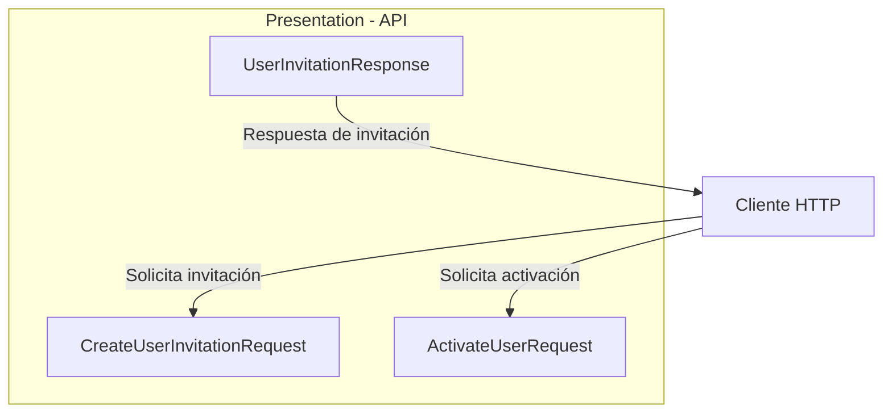

**Interpretación:**

- El cliente proporciona `CreateUserInvitationRequest` para solicitar una invitación.
- `UserInvitationResponse` define los datos que la API devolverá al crear una cuenta mediante invitación.
- `ActivateUserRequest` contiene los datos necesarios para solicitar la activación de la cuenta.
- El diagrama representa los contratos HTTP, no endpoints ni flujos de procesamiento implementados en este paso.

#### Resultado

Se definieron tres contratos HTTP para los procesos de invitación y activación de usuarios.

#### Estos DTOs establecen los límites de entrada y salida de **Presentation**, separando la representación HTTP de los modelos y casos de uso de **Application**, conforme a Clean Architecture.

---

### 2. Crear casos de uso de Application.

#### Componentes implementados

| Componente                  | Acción         | Tipo           | Capa        | Responsabilidad                                                           |
| --------------------------- | -------------- | -------------- | ----------- | ------------------------------------------------------------------------- |
| `DependencyInjection`       | Update         | class (static) | Application | Registra los casos de uso en el contenedor de dependencias.               |
| `ActivateUser`              | No verificable | class          | Application | Coordina la activación de una cuenta mediante un token de invitación.     |
| `ActivateUserInput`         | No verificable | record         | Application | Define los datos necesarios para activar una cuenta.                      |
| `CreateUserInvitation`      | No verificable | class          | Application | Coordina el registro de una cuenta pendiente y el envío de su invitación. |
| `CreateUserInvitationInput` | No verificable | record         | Application | Define el correo electrónico del usuario que será invitado.               |
| `ResendUserInvitation`      | No verificable | class          | Application | Coordina la generación y notificación de una nueva invitación.            |
| `ResendUserInvitationInput` | No verificable | record         | Application | Define el identificador del usuario que solicita una nueva invitación.    |

**Nota:** Se verifica el registro de los tres casos de uso en `DependencyInjection`. Los fragmentos no permiten determinar si las demás clases fueron creadas o modificadas respecto al SPEC 03.

#### Métodos y funciones principales

| Clase                  | Método             | Responsabilidad                                                                         |
| ---------------------- | ------------------ | --------------------------------------------------------------------------------------- |
| `DependencyInjection`  | `AddApplication()` | Registra los casos de uso con ciclo de vida `Scoped`.                                   |
| `ActivateUser`         | `ExecuteAsync()`   | Solicita la activación de una cuenta mediante `IUserInvitationService.ActivateAsync()`. |
| `CreateUserInvitation` | `ExecuteAsync()`   | Registra una cuenta pendiente y solicita el envío de su invitación.                     |
| `ResendUserInvitation` | `ExecuteAsync()`   | Solicita una nueva invitación y coordina su notificación.                               |

**Comportamiento de los casos de uso:**

| Caso de uso            | Dependencias                                    | Operaciones                                                                  |
| ---------------------- | ----------------------------------------------- | ---------------------------------------------------------------------------- |
| `ActivateUser`         | `IUserInvitationService`                        | Ejecuta `ActivateAsync()` y devuelve el resultado.                           |
| `CreateUserInvitation` | `IUserInvitationService`, `IInvitationNotifier` | Ejecuta `RegisterPendingAsync()` y, si tiene éxito, llama a `NotifyAsync()`. |
| `ResendUserInvitation` | `IUserInvitationService`, `IInvitationNotifier` | Ejecuta `ResendAsync()` y, si tiene éxito, llama a `NotifyAsync()`.          |

Los casos de uso dependen de interfaces de **Application**, evitando referencias directas a las implementaciones de Infrastructure.

#### Modelos de datos

| Modelo                      | Propiedad     | Tipo     | Descripción                                     |
| --------------------------- | ------------- | -------- | ----------------------------------------------- |
| `ActivateUserInput`         | `UserId`      | `UserId` | Identificador de dominio del usuario.           |
|                             | `Token`       | `string` | Token opaco de activación.                      |
|                             | `NewPassword` | `string` | Contraseña inicial de la cuenta.                |
| `CreateUserInvitationInput` | `Email`       | `string` | Correo electrónico del usuario invitado.        |
| `ResendUserInvitationInput` | `UserId`      | `UserId` | Identificador de dominio del usuario pendiente. |

**Modelos reutilizados:**

| Modelo                 | Capa        | Responsabilidad                                        |
| ---------------------- | ----------- | ------------------------------------------------------ |
| `UserId`               | Domain      | Representa el identificador del usuario.               |
| `User`                 | Domain      | Representa la entidad de usuario.                      |
| `UserInvitationResult` | Application | Contiene el resultado interno de una invitación.       |
| `Result<T>`            | Application | Representa el éxito o error esperado de una operación. |

Los modelos `Input` pertenecen a Application y son independientes de los DTOs HTTP definidos en el paso 1.

#### Componentes de .NET y proveedores externos

| Componente / Método  | Origen                                   | Función                                                                           |
| -------------------- | ---------------------------------------- | --------------------------------------------------------------------------------- |
| `IServiceCollection` | Microsoft.Extensions.DependencyInjection | Representa la colección de servicios configurados para inyección de dependencias. |
| `AddScoped<T>()`     | Microsoft.Extensions.DependencyInjection | Registra un servicio con ciclo de vida por ámbito (_scope_).                      |
| `Task<T>`            | .NET                                     | Representa una operación asincrónica que devuelve un resultado.                   |
| `CancellationToken`  | .NET                                     | Permite propagar solicitudes de cancelación.                                      |
| `async` / `await`    | C#                                       | Permite ejecutar operaciones asincrónicas sin bloquear el hilo durante la espera. |
| `record`             | C#                                       | Define modelos de datos con igualdad basada en valores.                           |

No se incorporan nuevas dependencias externas en el código proporcionado.

#### Flujo funcional o relaciones

**1. Crear invitación**

| Orden | Operación                                                       | Componente responsable                          |
| ----- | --------------------------------------------------------------- | ----------------------------------------------- |
| 1     | Recibir `CreateUserInvitationInput`.                            | `CreateUserInvitation`                          |
| 2     | Registrar una cuenta pendiente.                                 | `IUserInvitationService.RegisterPendingAsync()` |
| 3     | Verificar `Result.IsSuccess`.                                   | `CreateUserInvitation`                          |
| 4     | Solicitar el envío de la invitación si el resultado es exitoso. | `IInvitationNotifier.NotifyAsync()`             |
| 5     | Devolver `Result<UserInvitationResult>`.                        | `CreateUserInvitation`                          |

**2. Activar usuario**

| Orden | Operación                                          | Componente responsable                   |
| ----- | -------------------------------------------------- | ---------------------------------------- |
| 1     | Recibir `ActivateUserInput`.                       | `ActivateUser`                           |
| 2     | Delegar la activación al servicio de invitaciones. | `IUserInvitationService.ActivateAsync()` |
| 3     | Devolver `Result<User>`.                           | `ActivateUser`                           |

**3. Reenviar invitación**

| Orden | Operación                                             | Componente responsable                 |
| ----- | ----------------------------------------------------- | -------------------------------------- |
| 1     | Recibir `ResendUserInvitationInput`.                  | `ResendUserInvitation`                 |
| 2     | Solicitar una nueva invitación.                       | `IUserInvitationService.ResendAsync()` |
| 3     | Verificar `Result.IsSuccess`.                         | `ResendUserInvitation`                 |
| 4     | Solicitar la notificación si el resultado es exitoso. | `IInvitationNotifier.NotifyAsync()`    |
| 5     | Devolver `Result<UserInvitationResult>`.              | `ResendUserInvitation`                 |

**Manejo de resultados:**

- Cuando el servicio devuelve un resultado fallido, se propaga sin enviar notificaciones.
- Cuando la operación tiene éxito, los casos de uso de creación y reenvío solicitan la notificación.
- Las excepciones de `NotifyAsync()` no se capturan en estos casos de uso; se propagan al consumidor.
- El código mostrado no implementa directamente validaciones de tokens, contraseñas ni persistencia. Estas operaciones se delegan a los servicios correspondientes.

#### Diagrama de arquitectura

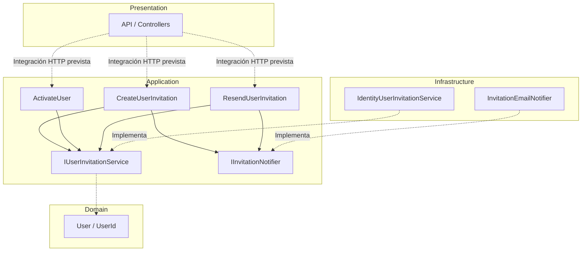

**Interpretación:**

- **Presentation:** utilizará los casos de uso para procesar solicitudes HTTP. Esta integración no se muestra implementada en los archivos del paso.
- **Application:** coordina los procesos de invitación, activación y reenvío mediante interfaces.
- **Domain:** proporciona los modelos de usuario utilizados por los contratos de Application.
- **Infrastructure:** contiene los adaptadores implementados previamente en SPEC 03.
- **Inyección de dependencias:** `AddApplication()` registra los casos de uso mediante `AddScoped<T>()`. Los adaptadores de Infrastructure se resuelven a través de sus respectivas interfaces.

#### Resultado

Se dispone de tres casos de uso de Application para coordinar la creación, activación y reenvío de invitaciones.

Los casos de uso utilizan los contratos establecidos en SPEC 03 y se encuentran registrados mediante inyección de dependencias.

Esta estructura permite integrar los endpoints de Presentation sin acoplarlos directamente a ASP.NET Core Identity, al transporte de correo o a los mecanismos de persistencia.

---

### 3. Implementar validación uniforme.

#### Componentes implementados

| Componente                      | Acción         | Tipo           | Capa         | Responsabilidad                                                                                                  |
| ------------------------------- | -------------- | -------------- | ------------ | ---------------------------------------------------------------------------------------------------------------- |
| `ProblemDetailsResponseFactory` | No verificable | class (static) | Presentation | Centraliza la construcción de respuestas HTTP de error mediante un contrato uniforme basado en `ProblemDetails`. |

**Ubicación:** `Fepp.ContaOps.Api.Validation`

La clase permite representar de manera consistente los errores provenientes de Application, FluentValidation y el proceso de model binding de ASP.NET Core.

El código proporcionado no permite verificar si el componente fue creado o modificado.

#### Métodos y funciones principales

| Clase                           | Método                                                 | Responsabilidad                                                                                      |
| ------------------------------- | ------------------------------------------------------ | ---------------------------------------------------------------------------------------------------- |
| `ProblemDetailsResponseFactory` | `CreateApplicationErrorResult()`                       | Convierte errores tipados de Application en respuestas HTTP con el código de estado correspondiente. |
| `ProblemDetailsResponseFactory` | `CreateValidationResult(ValidationResult)`             | Agrupa los errores de FluentValidation por propiedad y elimina mensajes duplicados.                  |
| `ProblemDetailsResponseFactory` | `CreateModelStateValidationResult()`                   | Convierte errores de model binding y deserialización JSON en respuestas HTTP uniformes.              |
| `ProblemDetailsResponseFactory` | `CreateValidationResult(Dictionary<string, string[]>)` | Construye una respuesta HTTP 400 con los errores agrupados por campo.                                |
| `ProblemDetailsResponseFactory` | `Create()`                                             | Genera la estructura común de `ProblemDetails`, incluyendo código de error y trazabilidad.           |

**Visibilidad de los métodos:**

- `CreateApplicationErrorResult()`: público.
- `CreateValidationResult(ValidationResult)`: público.
- `CreateModelStateValidationResult()`: público.
- `CreateValidationResult(Dictionary<string, string[]>)`: privado.
- `Create()`: público.

#### Modelos de datos

**1. `ProblemDetails`**

Modelo proporcionado por ASP.NET Core para representar errores HTTP mediante una estructura estandarizada.

| Propiedad               | Tipo                           | Descripción                                      |
| ----------------------- | ------------------------------ | ------------------------------------------------ |
| `Type`                  | `string`                       | Referencia asociada al código de estado HTTP.    |
| `Title`                 | `string`                       | Descripción breve del tipo de error.             |
| `Status`                | `int`                          | Código HTTP de la respuesta.                     |
| `Detail`                | `string`                       | Descripción del error.                           |
| `Instance`              | `string`                       | Ruta HTTP donde ocurrió el error.                |
| `Extensions["code"]`    | `string`                       | Código identificador del error.                  |
| `Extensions["traceId"]` | `string`                       | Identificador de trazabilidad de la solicitud.   |
| `Extensions["errors"]`  | `Dictionary<string, string[]>` | Errores agrupados por campo, cuando corresponde. |

**2. Errores de Application**

| Error                   | Estado HTTP                 | Código       |
| ----------------------- | --------------------------- | ------------ |
| `ValidationError`       | `400 Bad Request`           | `error.Code` |
| `AuthenticationError`   | `401 Unauthorized`          | `error.Code` |
| `ResourceNotFoundError` | `404 Not Found`             | `error.Code` |
| `ConflictError`         | `409 Conflict`              | `error.Code` |
| Otros errores           | `500 Internal Server Error` | `error.Code` |

Los errores tipados pertenecen a Application y son transformados en respuestas HTTP por Presentation.

**3. Errores de validación**

| Origen               | Estado HTTP       | Código             |
| -------------------- | ----------------- | ------------------ |
| FluentValidation     | `400 Bad Request` | `validation_error` |
| Model binding / JSON | `400 Bad Request` | `validation_error` |

Ambos mecanismos utilizan la misma estructura de respuesta.

#### Componentes de .NET y proveedores externos

| Componente / Método      | Origen           | Función                                                                           |
| ------------------------ | ---------------- | --------------------------------------------------------------------------------- |
| `ProblemDetails`         | ASP.NET Core MVC | Representa errores HTTP mediante un contrato estandarizado.                       |
| `ObjectResult`           | ASP.NET Core MVC | Devuelve un objeto serializado con un estado HTTP configurable.                   |
| `BadRequestObjectResult` | ASP.NET Core MVC | Devuelve una respuesta HTTP 400 con contenido.                                    |
| `HttpContext`            | ASP.NET Core     | Proporciona información de la solicitud HTTP actual.                              |
| `StatusCodes`            | ASP.NET Core     | Define constantes para códigos de estado HTTP.                                    |
| `ModelStateDictionary`   | ASP.NET Core MVC | Contiene errores del proceso de model binding.                                    |
| `ValidationResult`       | FluentValidation | Contiene los errores producidos durante la validación.                            |
| `GroupBy()`              | LINQ / .NET      | Agrupa errores según el nombre de la propiedad.                                   |
| `ToDictionary()`         | LINQ / .NET      | Convierte los errores agrupados en un diccionario.                                |
| `Distinct()`             | LINQ / .NET      | Elimina mensajes de error duplicados.                                             |
| `StringComparer.Ordinal` | .NET             | Compara cadenas mediante reglas ordinales, distinguiendo mayúsculas y minúsculas. |

#### Flujo funcional o relaciones

**1. Errores provenientes de Application**

| Orden | Operación                                                                | Componente responsable           |
| ----- | ------------------------------------------------------------------------ | -------------------------------- |
| 1     | Recibir un `ApplicationError`.                                           | `CreateApplicationErrorResult()` |
| 2     | Determinar el código HTTP según el tipo de error.                        | `CreateApplicationErrorResult()` |
| 3     | Seleccionar el título y detalle de la respuesta.                         | `CreateApplicationErrorResult()` |
| 4     | Construir el objeto `ProblemDetails`.                                    | `Create()`                       |
| 5     | Incorporar los errores por campo cuando corresponda a `ValidationError`. | `CreateApplicationErrorResult()` |
| 6     | Devolver un `ObjectResult` con contenido `application/problem+json`.     | `CreateApplicationErrorResult()` |

**2. Errores de FluentValidation**

| Orden | Operación                               | Componente responsable                    |
| ----- | --------------------------------------- | ----------------------------------------- |
| 1     | Recibir un `ValidationResult`.          | `CreateValidationResult()`                |
| 2     | Agrupar los errores por `PropertyName`. | `GroupBy()`                               |
| 3     | Eliminar mensajes duplicados.           | `Distinct()`                              |
| 4     | Construir la respuesta HTTP 400.        | `CreateValidationResult(Dictionary<...>)` |
| 5     | Devolver `application/problem+json`.    | `BadRequestObjectResult`                  |

**3. Errores de ModelState**

| Orden | Operación                                                | Componente responsable                    |
| ----- | -------------------------------------------------------- | ----------------------------------------- |
| 1     | Recibir un `ModelStateDictionary`.                       | `CreateModelStateValidationResult()`      |
| 2     | Extraer los errores asociados a cada campo.              | `CreateModelStateValidationResult()`      |
| 3     | Reemplazar mensajes vacíos por una descripción genérica. | `CreateModelStateValidationResult()`      |
| 4     | Eliminar mensajes duplicados.                            | `Distinct()`                              |
| 5     | Construir la respuesta HTTP 400 uniforme.                | `CreateValidationResult(Dictionary<...>)` |

#### Contrato HTTP de errores

**Ejemplo de respuesta de validación:**

```json
{
  "type": "https://httpstatuses.com/400",
  "title": "Request validation failed.",
  "status": 400,
  "detail": "One or more request fields are invalid.",
  "instance": "/api/users/invitations",
  "code": "validation_error",
  "traceId": "0HN123456789",
  "errors": {
    "Email": ["The email address is invalid."]
  }
}
```

El ejemplo representa la estructura generada por la factoría. La ruta, el identificador de trazabilidad y el mensaje de validación son ilustrativos.

**Características del contrato:**

- Utiliza el tipo de contenido `application/problem+json`.
- Mantiene una estructura común para diferentes categorías de errores.
- Incluye un código de error identificable por los consumidores de la API.
- Incorpora `traceId` para facilitar la correlación de solicitudes.
- Permite representar varios errores asociados a una misma propiedad.
- Evita mensajes duplicados en las respuestas de validación.

#### Diagrama de arquitectura

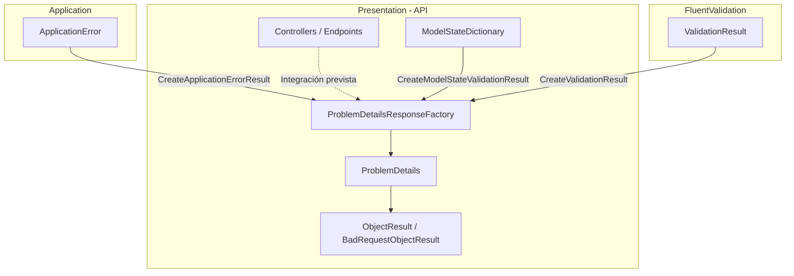

**Interpretación:**

- **Application:** proporciona errores tipados independientes de HTTP.
- **FluentValidation:** proporciona los resultados de validación de los datos.
- **ASP.NET Core:** proporciona los errores detectados durante el model binding.
- **Presentation:** transforma estas fuentes de error en respuestas HTTP uniformes mediante `ProblemDetailsResponseFactory`.

La integración de la factoría con los controladores o filtros HTTP no aparece implementada en el código proporcionado.

#### Resultado

Se dispone de una factoría centralizada para construir respuestas HTTP de error mediante `ProblemDetails`.

El componente unifica la representación de errores de Application, FluentValidation y ASP.NET Core, estableciendo un contrato consistente para los consumidores de la API.

Esta implementación mantiene la separación entre los errores de negocio definidos en Application y su representación HTTP, responsabilidad exclusiva de Presentation.

---

### 4. Crear controllers.

#### Componentes implementados

| Componente                  | Acción         | Tipo  | Capa         | Responsabilidad                                                      |
| --------------------------- | -------------- | ----- | ------------ | -------------------------------------------------------------------- |
| `AuthController`            | No verificable | class | Presentation | Expone los endpoints HTTP de autenticación y activación de usuarios. |
| `UserInvitationsController` | No verificable | class | Presentation | Expone los endpoints HTTP para crear y reenviar invitaciones.        |

**Ubicación:** `Fepp.ContaOps.Api.Controllers`

Los controladores pertenecen a **Presentation** y actúan como punto de entrada de las solicitudes HTTP.

Sus responsabilidades principales son:

- Recibir solicitudes mediante los DTOs definidos en el paso 1.
- Transformar los datos HTTP en modelos de entrada de Application.
- Ejecutar los casos de uso correspondientes.
- Convertir los resultados en respuestas HTTP.
- Delegar la transformación de errores a `ApplicationErrorProblemDetailsMapper`.

Los archivos no permiten determinar si los controladores fueron creados o modificados.

#### Métodos y funciones principales

| Clase                       | Método               | Responsabilidad                                                                                             |
| --------------------------- | -------------------- | ----------------------------------------------------------------------------------------------------------- |
| `AuthController`            | `Login()`            | Ejecuta el caso de uso `LoginUser` y devuelve un token de acceso.                                           |
| `AuthController`            | `Activate()`         | Valida el formato del identificador y ejecuta `ActivateUser`.                                               |
| `UserInvitationsController` | `CreateInvitation()` | Ejecuta `CreateUserInvitation` y devuelve la representación pública del usuario creado.                     |
| `UserInvitationsController` | `ResendInvitation()` | Valida el identificador y ejecuta `ResendUserInvitation`.                                                   |
| `UserInvitationsController` | `ToResponse()`       | Convierte una entidad `User` en `UserInvitationResponse`, sin exponer información interna de la invitación. |

**Dependencias inyectadas:**

| Controller                  | Dependencia                            | Capa         | Uso                                                     |
| --------------------------- | -------------------------------------- | ------------ | ------------------------------------------------------- |
| `AuthController`            | `LoginUser`                            | Application  | Autenticación de usuarios.                              |
| `AuthController`            | `ActivateUser`                         | Application  | Activación de cuentas pendientes.                       |
| `AuthController`            | `ApplicationErrorProblemDetailsMapper` | Presentation | Traducción de errores de Application a respuestas HTTP. |
| `UserInvitationsController` | `CreateUserInvitation`                 | Application  | Creación de invitaciones.                               |
| `UserInvitationsController` | `ResendUserInvitation`                 | Application  | Reenvío de invitaciones.                                |
| `UserInvitationsController` | `ApplicationErrorProblemDetailsMapper` | Presentation | Traducción de errores de Application a respuestas HTTP. |

Los controladores utilizan **inyección de dependencias por constructor** y delegan la ejecución de los procesos a los casos de uso de Application.

#### Endpoints HTTP implementados

| Controller                  | Método | Ruta                          | Caso de uso            | Respuesta exitosa |
| --------------------------- | ------ | ----------------------------- | ---------------------- | ----------------- |
| `AuthController`            | POST   | `/api/auth/login`             | `LoginUser`            | `200 OK`          |
| `AuthController`            | POST   | `/api/auth/activate`          | `ActivateUser`         | `204 No Content`  |
| `UserInvitationsController` | POST   | `/api/users/invitations`      | `CreateUserInvitation` | `201 Created`     |
| `UserInvitationsController` | POST   | `/api/users/{id}/invitations` | `ResendUserInvitation` | `204 No Content`  |

**Características de los endpoints:**

| Endpoint           | Característica                                      |
| ------------------ | --------------------------------------------------- |
| `Login`            | Permite acceso anónimo mediante `[AllowAnonymous]`. |
| `Activate`         | Permite acceso anónimo mediante `[AllowAnonymous]`. |
| `CreateInvitation` | No declara atributos específicos de autorización.   |
| `ResendInvitation` | No declara atributos específicos de autorización.   |

**Consideración de seguridad:**

Aunque `UserInvitationsController` representa operaciones administrativas, el código proporcionado no incluye atributos `[Authorize]` ni restricciones por rol.

Por tanto, no puede verificarse si estos endpoints están protegidos mediante políticas globales, convenciones u otros mecanismos de autorización.

#### Modelos de datos

**1. Contratos HTTP y modelos de Application**

| Operación           | Request HTTP                  | Input de Application        | Response HTTP            |
| ------------------- | ----------------------------- | --------------------------- | ------------------------ |
| Login               | `LoginRequest`                | `LoginUserInput`            | `LoginResponse`          |
| Activación          | `ActivateUserRequest`         | `ActivateUserInput`         | Sin contenido            |
| Crear invitación    | `CreateUserInvitationRequest` | `CreateUserInvitationInput` | `UserInvitationResponse` |
| Reenviar invitación | Parámetro de ruta `id`        | `ResendUserInvitationInput` | Sin contenido            |

**2. Modelos utilizados**

| Modelo                        | Capa         | Responsabilidad                                                  |
| ----------------------------- | ------------ | ---------------------------------------------------------------- |
| `LoginRequest`                | Presentation | Recibe las credenciales de autenticación.                        |
| `LoginResponse`               | Presentation | Devuelve el token de acceso, tipo Bearer y tiempo de expiración. |
| `ActivateUserRequest`         | Presentation | Recibe el identificador, token y contraseña inicial.             |
| `CreateUserInvitationRequest` | Presentation | Recibe el correo electrónico del usuario invitado.               |
| `UserInvitationResponse`      | Presentation | Expone identificador, correo electrónico y rol inicial.          |
| `LoginUserInput`              | Application  | Transporta las credenciales al caso de uso de autenticación.     |
| `ActivateUserInput`           | Application  | Transporta los datos de activación.                              |
| `CreateUserInvitationInput`   | Application  | Transporta el correo electrónico al caso de uso.                 |
| `ResendUserInvitationInput`   | Application  | Transporta el identificador del usuario pendiente.               |
| `TokenResult`                 | Application  | Contiene el resultado interno de autenticación.                  |
| `UserInvitationResult`        | Application  | Contiene el resultado interno de una invitación.                 |
| `User`                        | Domain       | Representa la entidad de usuario.                                |
| `UserId`                      | Domain       | Representa el identificador del usuario.                         |

**Transformaciones relevantes:**

| Origen                        | Destino                     | Transformación                                                                 |
| ----------------------------- | --------------------------- | ------------------------------------------------------------------------------ |
| `LoginRequest`                | `LoginUserInput`            | Transfiere correo electrónico y contraseña.                                    |
| `TokenResult`                 | `LoginResponse`             | Expone token, tipo `Bearer` y tiempo de expiración.                            |
| `ActivateUserRequest`         | `ActivateUserInput`         | Convierte `UserId` a identificador de dominio y transfiere token y contraseña. |
| `CreateUserInvitationRequest` | `CreateUserInvitationInput` | Transfiere el correo electrónico.                                              |
| `User`                        | `UserInvitationResponse`    | Extrae identificador, correo electrónico y primer rol.                         |
| `id` de la ruta               | `ResendUserInvitationInput` | Convierte el identificador recibido en un `UserId` de dominio.                 |

El método `ToResponse()` selecciona el primer elemento de `user.Roles` mediante `FirstOrDefault()` y devuelve una cadena vacía cuando no existen roles.

#### Componentes de .NET y proveedores externos

| Componente / Método          | Origen                     | Función                                                                       |
| ---------------------------- | -------------------------- | ----------------------------------------------------------------------------- |
| `ControllerBase`             | ASP.NET Core MVC           | Clase base para controladores de API.                                         |
| `[ApiController]`            | ASP.NET Core MVC           | Habilita convenciones de API, incluyendo validación automática de ModelState. |
| `[Route]`                    | ASP.NET Core MVC           | Define la ruta base del controlador.                                          |
| `[HttpPost]`                 | ASP.NET Core MVC           | Asocia una acción con solicitudes HTTP POST.                                  |
| `[AllowAnonymous]`           | ASP.NET Core Authorization | Permite ejecutar una acción sin autenticación.                                |
| `[ProducesResponseType]`     | ASP.NET Core MVC           | Declara los tipos y códigos de respuesta para la metadata de la API.          |
| `IActionResult`              | ASP.NET Core MVC           | Representa el resultado de una acción HTTP.                                   |
| `Ok()`                       | ASP.NET Core MVC           | Genera una respuesta `200 OK`.                                                |
| `Created()`                  | ASP.NET Core MVC           | Genera una respuesta `201 Created` con una ubicación del recurso.             |
| `NoContent()`                | ASP.NET Core MVC           | Genera una respuesta `204 No Content`.                                        |
| `ModelState.AddModelError()` | ASP.NET Core MVC           | Incorpora un error de validación asociado a un campo.                         |
| `Guid.TryParse()`            | .NET                       | Comprueba si una cadena representa un identificador GUID válido.              |
| `FirstOrDefault()`           | LINQ / .NET                | Obtiene el primer elemento de una colección o su valor predeterminado.        |
| `CancellationToken`          | .NET                       | Propaga solicitudes de cancelación a los casos de uso.                        |

#### Flujo funcional o relaciones

**1. Inicio de sesión**

| Orden | Operación                                    | Componente responsable                       |
| ----- | -------------------------------------------- | -------------------------------------------- |
| 1     | Recibir `LoginRequest`.                      | `AuthController.Login()`                     |
| 2     | Construir `LoginUserInput`.                  | `AuthController`                             |
| 3     | Ejecutar autenticación.                      | `LoginUser.ExecuteAsync()`                   |
| 4     | Traducir el error cuando la operación falla. | `ApplicationErrorProblemDetailsMapper.Map()` |
| 5     | Convertir `TokenResult` en `LoginResponse`.  | `AuthController`                             |
| 6     | Devolver `200 OK`.                           | `Ok()`                                       |

**2. Activación de cuenta**

| Orden | Operación                                                   | Componente responsable                       |
| ----- | ----------------------------------------------------------- | -------------------------------------------- |
| 1     | Recibir `ActivateUserRequest`.                              | `AuthController.Activate()`                  |
| 2     | Validar que `UserId` tenga formato GUID.                    | `Guid.TryParse()`                            |
| 3     | Devolver `400 Bad Request` si el identificador es inválido. | `ProblemDetailsResponseFactory`              |
| 4     | Construir `ActivateUserInput` con `UserId` de dominio.      | `AuthController`                             |
| 5     | Ejecutar activación.                                        | `ActivateUser.ExecuteAsync()`                |
| 6     | Traducir el error si la activación falla.                   | `ApplicationErrorProblemDetailsMapper.Map()` |
| 7     | Devolver `204 No Content` si tiene éxito.                   | `NoContent()`                                |

**3. Creación de invitación**

| Orden | Operación                                               | Componente responsable                         |
| ----- | ------------------------------------------------------- | ---------------------------------------------- |
| 1     | Recibir `CreateUserInvitationRequest`.                  | `UserInvitationsController.CreateInvitation()` |
| 2     | Construir `CreateUserInvitationInput`.                  | `UserInvitationsController`                    |
| 3     | Ejecutar creación y notificación de la invitación.      | `CreateUserInvitation.ExecuteAsync()`          |
| 4     | Traducir el error si la operación falla.                | `ApplicationErrorProblemDetailsMapper.Map()`   |
| 5     | Convertir `User` en `UserInvitationResponse`.           | `ToResponse()`                                 |
| 6     | Devolver `201 Created` con ubicación `/api/users/{id}`. | `Created()`                                    |

**4. Reenvío de invitación**

| Orden | Operación                                                       | Componente responsable                         |
| ----- | --------------------------------------------------------------- | ---------------------------------------------- |
| 1     | Recibir el identificador desde la ruta.                         | `UserInvitationsController.ResendInvitation()` |
| 2     | Validar que el identificador tenga formato GUID.                | `Guid.TryParse()`                              |
| 3     | Devolver `400 Bad Request` cuando el identificador es inválido. | `ProblemDetailsResponseFactory`                |
| 4     | Construir `ResendUserInvitationInput`.                          | `UserInvitationsController`                    |
| 5     | Ejecutar el reenvío.                                            | `ResendUserInvitation.ExecuteAsync()`          |
| 6     | Traducir el error cuando la operación falla.                    | `ApplicationErrorProblemDetailsMapper.Map()`   |
| 7     | Devolver `204 No Content` si tiene éxito.                       | `NoContent()`                                  |

#### Manejo de errores HTTP

Los controladores utilizan dos mecanismos complementarios:

| Mecanismo                     | Componente                             | Responsabilidad                                                                    |
| ----------------------------- | -------------------------------------- | ---------------------------------------------------------------------------------- |
| Validación de identificadores | `ProblemDetailsResponseFactory`        | Genera respuestas HTTP 400 cuando el identificador recibido no tiene formato GUID. |
| Errores de Application        | `ApplicationErrorProblemDetailsMapper` | Convierte errores tipados de los casos de uso en respuestas HTTP.                  |

**Respuestas declaradas mediante atributos:**

| Endpoint           | Códigos HTTP            |
| ------------------ | ----------------------- |
| `Login`            | 200, 400, 401           |
| `Activate`         | 204, 400                |
| `CreateInvitation` | 201, 400, 409, 503      |
| `ResendInvitation` | 204, 400, 404, 409, 503 |

Los códigos representan las respuestas declaradas mediante `[ProducesResponseType]`. La generación efectiva de errores depende de los resultados de Application y del comportamiento de `ApplicationErrorProblemDetailsMapper`.

La implementación de este mapper no se incluye entre los archivos proporcionados, por lo que no es posible verificar todas sus reglas de traducción.

#### Diagrama de arquitectura

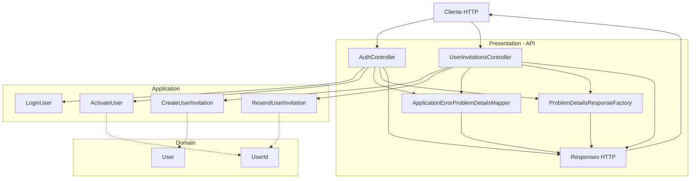

**Interpretación:**

- **Presentation:** recibe solicitudes HTTP, transforma los DTOs y construye las respuestas.
- **Application:** ejecuta los casos de uso de autenticación, activación, creación y reenvío de invitaciones.
- **Domain:** proporciona las entidades e identificadores utilizados por los casos de uso.
- **Validación:** los controladores comprueban el formato GUID y utilizan los componentes de validación y traducción de errores de Presentation.
- **Separación arquitectónica:** los controladores no implementan directamente reglas de negocio, persistencia ni envío de correos.

#### Resultado

Se implementaron los endpoints HTTP para autenticación, activación, creación y reenvío de invitaciones.

Los controladores integran los contratos HTTP definidos en el paso 1 con los casos de uso de Application documentados en el paso 2 y utilizan los mecanismos de manejo de errores de Presentation.

Esta implementación establece la comunicación entre los clientes HTTP y los procesos del ciclo de invitaciones, manteniendo separadas las responsabilidades de Presentation, Application y Domain.

---

### 5. Aplicar política AdminOnly.

#### Componentes implementados

| Componente                  | Acción      | Tipo           | Capa           | Responsabilidad                                                                                                                  |
| --------------------------- | ----------- | -------------- | -------------- | -------------------------------------------------------------------------------------------------------------------------------- |
| `UserInvitationsController` | Update      | class          | Presentation   | Aplica la política `AdminOnly` a los endpoints de creación y reenvío de invitaciones.                                            |
| `DependencyInjection`       | Update      | class (static) | Presentation   | Configura la autenticación JWT, registra la política de autorización `AdminOnly` y personaliza las respuestas HTTP de seguridad. |
| `IdentitySeeder`            | Reutilizado | class          | Infrastructure | Proporciona la constante `AdminRole`, utilizada para identificar el rol administrativo requerido.                                |

**Ubicaciones:**

- `Fepp.ContaOps.Api.Controllers.UserInvitationsController`
- `Fepp.ContaOps.Api.DependencyInjection`
- `Fepp.ContaOps.Infrastructure.Identity.IdentitySeeder`

La implementación separa la **definición de la política** de su **aplicación a los endpoints HTTP**.

#### Definición y aplicación de AdminOnly

**1. Definición de la política**

La política `AdminOnly` se registra en el método `AddApi()` de la clase `DependencyInjection`, perteneciente a Presentation.

```csharp
services.AddAuthorization(options =>
{
    options.AddPolicy("AdminOnly", policy =>
        policy.RequireRole(IdentitySeeder.AdminRole));
});
```

| Elemento                      | Responsabilidad                                                          |
| ----------------------------- | ------------------------------------------------------------------------ |
| `AddAuthorization()`          | Registra y configura los servicios de autorización de ASP.NET Core.      |
| `AddPolicy("AdminOnly", ...)` | Define una política de autorización denominada `AdminOnly`.              |
| `RequireRole()`               | Exige que el usuario autenticado pertenezca al rol especificado.         |
| `IdentitySeeder.AdminRole`    | Proporciona el nombre del rol administrativo definido en Infrastructure. |

La política utiliza autorización basada en roles (**Role-Based Access Control, RBAC**).

**2. Aplicación de la política**

En `UserInvitationsController` se incorpora:

```csharp
[ApiController]
[Route("api/users")]
[Authorize(Policy = "AdminOnly")]
public sealed class UserInvitationsController : ControllerBase
```

El atributo `[Authorize]` aplica la política a todas las acciones del controlador.

**Endpoints protegidos:**

| Método | Endpoint                      | Operación           | Política    |
| ------ | ----------------------------- | ------------------- | ----------- |
| POST   | `/api/users/invitations`      | Crear invitación    | `AdminOnly` |
| POST   | `/api/users/{id}/invitations` | Reenviar invitación | `AdminOnly` |

Los endpoints de autenticación y activación de `AuthController` mantienen sus atributos `[AllowAnonymous]` y no están sujetos a esta política.

#### Métodos y funciones principales

| Clase                       | Método                            | Responsabilidad                                                                               |
| --------------------------- | --------------------------------- | --------------------------------------------------------------------------------------------- |
| `DependencyInjection`       | `AddApi()`                        | Registra los servicios HTTP, configura la autenticación JWT y define la política `AdminOnly`. |
| `DependencyInjection`       | `WriteAuthenticationErrorAsync()` | Genera respuestas uniformes `ProblemDetails` para errores HTTP 401 y 403.                     |
| `UserInvitationsController` | `CreateInvitation()`              | Ejecuta la creación de invitaciones cuando la solicitud está autorizada.                      |
| `UserInvitationsController` | `ResendInvitation()`              | Ejecuta el reenvío de invitaciones cuando la solicitud está autorizada.                       |

#### Configuración de autenticación JWT

La autenticación se configura dentro de `DependencyInjection.AddApi()` mediante:

```csharp
services.AddAuthentication(JwtBearerDefaults.AuthenticationScheme)
    .AddJwtBearer(options =>
    {
        options.TokenValidationParameters = new TokenValidationParameters
        {
            ValidateIssuer = true,
            ValidIssuer = jwtOptions.Issuer,

            ValidateAudience = true,
            ValidAudience = jwtOptions.Audience,

            ValidateIssuerSigningKey = true,
            IssuerSigningKey = new SymmetricSecurityKey(
                Encoding.UTF8.GetBytes(jwtOptions.SigningKey)),

            ValidateLifetime = true,
            ClockSkew = TimeSpan.Zero,

            NameClaimType = JwtRegisteredClaimNames.Email,
            RoleClaimType = ClaimTypes.Role
        };
    });
```

**Parámetros relevantes:**

| Parámetro                  | Configuración                   | Responsabilidad                                                           |
| -------------------------- | ------------------------------- | ------------------------------------------------------------------------- |
| `ValidateIssuer`           | `true`                          | Comprueba que el token provenga del emisor configurado.                   |
| `ValidateAudience`         | `true`                          | Comprueba que el token esté destinado a la API.                           |
| `ValidateIssuerSigningKey` | `true`                          | Habilita la validación de la clave utilizada para verificar la firma.     |
| `IssuerSigningKey`         | `SymmetricSecurityKey`          | Establece la clave simétrica de validación.                               |
| `ValidateLifetime`         | `true`                          | Comprueba la vigencia del token.                                          |
| `ClockSkew`                | `TimeSpan.Zero`                 | Elimina la tolerancia adicional de tiempo durante la validación.          |
| `NameClaimType`            | `JwtRegisteredClaimNames.Email` | Identifica el claim utilizado como nombre del usuario.                    |
| `RoleClaimType`            | `ClaimTypes.Role`               | Identifica el tipo de claim utilizado para evaluar los roles del usuario. |

**Relación entre JWT y AdminOnly:**

La política `AdminOnly` utiliza los roles presentes en la identidad autenticada.

ASP.NET Core interpreta los claims de rol según `RoleClaimType` y los compara con el valor definido en `IdentitySeeder.AdminRole`.

Por tanto, para superar la autorización, el usuario debe estar autenticado y tener asignado el rol administrativo requerido.

El código proporcionado no incluye la generación del JWT, por lo que no permite verificar cómo se incorporan originalmente los claims de rol al token.

#### Manejo de errores de autenticación y autorización

La configuración de JWT incorpora dos eventos:

| Evento        | Estado HTTP        | Código de error           | Responsabilidad                                                              |
| ------------- | ------------------ | ------------------------- | ---------------------------------------------------------------------------- |
| `OnChallenge` | `401 Unauthorized` | `authentication_required` | Genera una respuesta cuando se requiere autenticación y no se ha satisfecho. |
| `OnForbidden` | `403 Forbidden`    | `forbidden`               | Genera una respuesta cuando el usuario no tiene permisos suficientes.        |

Ambos eventos utilizan `WriteAuthenticationErrorAsync()`.

**Implementación:**

```csharp
private static Task WriteAuthenticationErrorAsync(
    HttpContext httpContext,
    int statusCode,
    string detail,
    string code)
{
    httpContext.Response.StatusCode = statusCode;
    httpContext.Response.ContentType = "application/problem+json";

    string responseBody = JsonSerializer.Serialize(
        ProblemDetailsResponseFactory.Create(
            httpContext,
            statusCode,
            statusCode == StatusCodes.Status401Unauthorized
                ? "Authentication failed."
                : "Access forbidden.",
            detail,
            code));

    return httpContext.Response.WriteAsync(responseBody);
}
```

El método reutiliza `ProblemDetailsResponseFactory`, implementado en el paso 3, para mantener un formato consistente de errores HTTP.

**Comportamiento:**

| Condición                                     | Resultado                                      |
| --------------------------------------------- | ---------------------------------------------- |
| Solicitud sin autenticación válida            | `401 Unauthorized`                             |
| Usuario autenticado sin el rol requerido      | `403 Forbidden`                                |
| Usuario autenticado con el rol administrativo | Se permite ejecutar la acción del controlador. |

**Ejemplo de respuesta HTTP 403:**

```json
{
  "type": "https://httpstatuses.com/403",
  "title": "Access forbidden.",
  "status": 403,
  "detail": "You do not have permission to access this resource.",
  "instance": "/api/users/invitations",
  "code": "forbidden",
  "traceId": "0HN123456789"
}
```

La ruta y el identificador de trazabilidad son ilustrativos.

#### Componentes de .NET y proveedores externos

| Componente / Método          | Origen                         | Función                                                       |
| ---------------------------- | ------------------------------ | ------------------------------------------------------------- |
| `[Authorize]`                | ASP.NET Core Authorization     | Exige el cumplimiento de una política de autorización.        |
| `AddAuthorization()`         | ASP.NET Core Authorization     | Registra y configura los servicios de autorización.           |
| `AddPolicy()`                | ASP.NET Core Authorization     | Define una política de autorización por nombre.               |
| `RequireRole()`              | ASP.NET Core Authorization     | Establece como requisito la pertenencia a un rol.             |
| `AddAuthentication()`        | ASP.NET Core Authentication    | Configura el esquema de autenticación predeterminado.         |
| `AddJwtBearer()`             | ASP.NET Core JWT Bearer        | Configura la autenticación mediante tokens JWT.               |
| `TokenValidationParameters`  | Microsoft.IdentityModel.Tokens | Define las reglas de validación del token.                    |
| `SymmetricSecurityKey`       | Microsoft.IdentityModel.Tokens | Representa una clave criptográfica simétrica.                 |
| `ClaimTypes.Role`            | .NET                           | Identifica el tipo de claim utilizado para representar roles. |
| `JwtBearerEvents`            | ASP.NET Core JWT Bearer        | Permite personalizar eventos de autenticación y autorización. |
| `JsonSerializer.Serialize()` | System.Text.Json               | Serializa la respuesta `ProblemDetails` a JSON.               |

#### Flujo funcional o relaciones

| Orden | Operación                                                            | Componente responsable      |
| ----- | -------------------------------------------------------------------- | --------------------------- |
| 1     | El cliente envía una solicitud HTTP con un token JWT Bearer.         | Cliente HTTP                |
| 2     | ASP.NET Core valida firma, emisor, audiencia y vigencia del token.   | JWT Bearer Authentication   |
| 3     | Se construye la identidad autenticada con sus claims.                | ASP.NET Core Authentication |
| 4     | Se identifica la política `AdminOnly` aplicada al controlador.       | ASP.NET Core Authorization  |
| 5     | Se comprueba que el usuario tenga el rol `IdentitySeeder.AdminRole`. | `RequireRole()`             |
| 6     | Si falta autenticación válida, se devuelve HTTP 401.                 | `OnChallenge`               |
| 7     | Si el usuario no cumple la política, se devuelve HTTP 403.           | `OnForbidden`               |
| 8     | Si cumple los requisitos, se ejecuta la acción solicitada.           | `UserInvitationsController` |
| 9     | El controlador delega la operación al caso de uso correspondiente.   | Application                 |

#### Diagrama de arquitectura

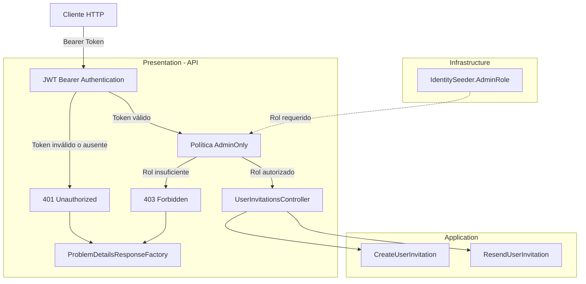

**Interpretación:**

- **Presentation:** configura la autenticación JWT, define `AdminOnly` y protege los endpoints administrativos.
- **Infrastructure:** proporciona el identificador del rol administrativo mediante `IdentitySeeder.AdminRole`.
- **Application:** ejecuta los casos de uso de invitaciones una vez superada la autorización.
- **ProblemDetailsResponseFactory:** proporciona el contrato uniforme utilizado para las respuestas de autenticación y autorización.

La autorización se ejecuta en el adaptador HTTP, evitando incorporar dependencias de ASP.NET Core en los casos de uso de Application.

#### Resultado

Se implementó la política de autorización `AdminOnly` mediante `DependencyInjection.AddApi()` y se aplicó a `UserInvitationsController`.

La política exige que el usuario autenticado pertenezca al rol administrativo definido por `IdentitySeeder.AdminRole`.

Adicionalmente, se configuró la validación de tokens JWT y la generación de respuestas uniformes `401 Unauthorized` y `403 Forbidden`.

Con estos cambios, la creación y el reenvío de invitaciones quedan protegidos mediante autorización basada en roles, manteniendo la separación de responsabilidades establecida por Clean Architecture.

---

### 6. Completar mapeo de errores HTTP.

#### Componentes implementados

| Componente                      | Acción         | Tipo           | Capa         | Responsabilidad                                                                                                                 |
| ------------------------------- | -------------- | -------------- | ------------ | ------------------------------------------------------------------------------------------------------------------------------- |
| `GlobalExceptionHandler`        | No verificable | class          | Presentation | Captura excepciones no controladas y genera respuestas HTTP uniformes y seguras.                                                |
| `ProblemDetailsResponseFactory` | Update         | class (static) | Presentation | Incorpora el tratamiento de `InvalidActivationTokenError` y mantiene la conversión de errores de Application a respuestas HTTP. |

**Ubicaciones:**

- `Fepp.ContaOps.Api.Exceptions.GlobalExceptionHandler`
- `Fepp.ContaOps.Api.Validation.ProblemDetailsResponseFactory`

La implementación distingue dos categorías de errores:

- **Errores esperados:** representados mediante `ApplicationError` y transformados por `ProblemDetailsResponseFactory`.
- **Excepciones:** procesadas mediante `GlobalExceptionHandler`, que registra información de diagnóstico y devuelve respuestas HTTP seguras.

El código permite verificar la actualización de `ProblemDetailsResponseFactory` respecto al paso 3, pero no determina si `GlobalExceptionHandler` fue creado o modificado.

#### Métodos y funciones principales

| Clase                           | Método                                                 | Responsabilidad                                                                                                 |
| ------------------------------- | ------------------------------------------------------ | --------------------------------------------------------------------------------------------------------------- |
| `GlobalExceptionHandler`        | `TryHandleAsync()`                                     | Captura excepciones, identifica su categoría, registra el incidente y genera la respuesta HTTP correspondiente. |
| `GlobalExceptionHandler`        | `WriteProblemDetailsAsync()`                           | Serializa y escribe una respuesta `ProblemDetails` sin exponer información interna de la excepción.             |
| `ProblemDetailsResponseFactory` | `CreateApplicationErrorResult()`                       | Convierte errores tipados de Application en respuestas HTTP, incluyendo errores de tokens de activación.        |
| `ProblemDetailsResponseFactory` | `CreateValidationResult(ValidationResult)`             | Agrupa errores de FluentValidation por propiedad.                                                               |
| `ProblemDetailsResponseFactory` | `CreateModelStateValidationResult()`                   | Convierte errores de model binding en respuestas HTTP 400.                                                      |
| `ProblemDetailsResponseFactory` | `CreateValidationResult(Dictionary<string, string[]>)` | Construye respuestas uniformes para errores de validación.                                                      |
| `ProblemDetailsResponseFactory` | `Create()`                                             | Genera la estructura común de `ProblemDetails`, incluyendo código de error y trazabilidad.                      |

#### Mapeo de errores HTTP

**1. Errores esperados de Application**

La factoría utiliza una expresión `switch` para determinar el código HTTP a partir del tipo de error.

| Error de Application          | Estado HTTP                 | Detalle de respuesta                                       |
| ----------------------------- | --------------------------- | ---------------------------------------------------------- |
| `ValidationError`             | `400 Bad Request`           | `One or more validation errors occurred.`                  |
| `InvalidActivationTokenError` | `400 Bad Request`           | Mensaje definido en `InvalidActivationTokenError.Message`. |
| `AuthenticationError`         | `401 Unauthorized`          | `The supplied credentials are invalid.`                    |
| `ResourceNotFoundError`       | `404 Not Found`             | Mensaje definido en `ResourceNotFoundError.Message`.       |
| `ConflictError`               | `409 Conflict`              | Mensaje definido en `ConflictError.Message`.               |
| Otros errores                 | `500 Internal Server Error` | `The request could not be completed.`                      |

**Cambio principal:**

Se incorpora el tratamiento explícito de `InvalidActivationTokenError`:

```csharp
int status = error switch
{
    ValidationError => StatusCodes.Status400BadRequest,
    InvalidActivationTokenError => StatusCodes.Status400BadRequest,
    AuthenticationError => StatusCodes.Status401Unauthorized,
    ResourceNotFoundError => StatusCodes.Status404NotFound,
    ConflictError => StatusCodes.Status409Conflict,
    _ => StatusCodes.Status500InternalServerError
};
```

Este cambio permite representar un token de activación inválido mediante un error HTTP 400, sin clasificarlo como un error interno del servidor.

El código de error enviado al cliente se obtiene de `ApplicationError.Code`.

**2. Excepciones procesadas globalmente**

`GlobalExceptionHandler` implementa un mapeo independiente para excepciones.

| Excepción                                            | Estado HTTP                 | Código de error                               | Descripción                                                        |
| ---------------------------------------------------- | --------------------------- | --------------------------------------------- | ------------------------------------------------------------------ |
| `EmailDeliveryUnavailableException`                  | `503 Service Unavailable`   | `EmailDeliveryUnavailableException.ErrorCode` | El servicio no pudo entregar la invitación por correo electrónico. |
| `OperationCanceledException` con solicitud cancelada | `499`                       | `request_cancelled`                           | El cliente canceló la solicitud HTTP.                              |
| Otras excepciones                                    | `500 Internal Server Error` | `unexpected_error`                            | Ocurrió un error inesperado durante el procesamiento.              |

**Consideraciones:**

- `503` permite identificar específicamente problemas de disponibilidad del servicio de correo.
- `500` representa excepciones que no tienen un tratamiento específico.
- `499` identifica una solicitud cancelada por el cliente; es un código no estándar de HTTP.
- Las excepciones se registran mediante `ILogger<GlobalExceptionHandler>`.
- Los detalles internos de las excepciones no se incluyen en las respuestas HTTP.

#### Manejo de excepciones no controladas

**1. Excepciones del servicio de correo**

Cuando se captura una `EmailDeliveryUnavailableException`, se devuelve:

| Propiedad | Valor                                         |
| --------- | --------------------------------------------- |
| `Status`  | `503`                                         |
| `Title`   | `Email delivery is unavailable.`              |
| `Detail`  | `The invitation could not be delivered.`      |
| `Code`    | `EmailDeliveryUnavailableException.ErrorCode` |

Esto permite diferenciar los errores de entrega de invitaciones de otros errores inesperados.

**2. Excepciones inesperadas**

Para cualquier excepción sin tratamiento específico:

| Propiedad | Valor                                 |
| --------- | ------------------------------------- |
| `Status`  | `500`                                 |
| `Title`   | `An unexpected error occurred.`       |
| `Detail`  | `The request could not be completed.` |
| `Code`    | `unexpected_error`                    |

El handler registra la excepción completa, pero devuelve únicamente información genérica al consumidor de la API.

**3. Cancelación de solicitudes**

Cuando ocurre una `OperationCanceledException` y `HttpContext.RequestAborted.IsCancellationRequested` es verdadero:

1. Se registra un mensaje informativo mediante `LogInformation()`.
2. Se establece el código HTTP `499`.
3. Se devuelve `true`, indicando que la excepción fue gestionada.

**Observación técnica:**

La condición interna que intenta escribir `ProblemDetails` cuando `RequestAborted.IsCancellationRequested` es falso no se cumple dentro de esta rama, porque previamente se exigió que fuera verdadero.

Por tanto, en el código proporcionado, las solicitudes canceladas por el cliente establecen el estado `499`, pero no llegan a escribir el cuerpo JSON `ProblemDetails`.

#### Contrato HTTP de errores

Los errores utilizan el modelo `ProblemDetails`, generado mediante `ProblemDetailsResponseFactory.Create()`.

| Propiedad  | Tipo                           | Responsabilidad                                                            |
| ---------- | ------------------------------ | -------------------------------------------------------------------------- |
| `type`     | `string`                       | Referencia asociada al estado HTTP.                                        |
| `title`    | `string`                       | Descripción breve del error.                                               |
| `status`   | `int`                          | Código HTTP correspondiente.                                               |
| `detail`   | `string`                       | Descripción segura del error.                                              |
| `instance` | `string`                       | Ruta de la solicitud que produjo el error.                                 |
| `code`     | `string`                       | Código estable que permite identificar el error.                           |
| `traceId`  | `string`                       | Identificador utilizado para correlacionar la solicitud con los registros. |
| `errors`   | `Dictionary<string, string[]>` | Errores agrupados por campo, cuando corresponde.                           |

**Ejemplo: error de entrega de invitación**

```json
{
  "type": "https://httpstatuses.com/503",
  "title": "Email delivery is unavailable.",
  "status": 503,
  "detail": "The invitation could not be delivered.",
  "instance": "/api/users/invitations",
  "code": "<EmailDeliveryUnavailableException.ErrorCode>",
  "traceId": "0HN123456789"
}
```

El ejemplo es ilustrativo. El valor concreto de `EmailDeliveryUnavailableException.ErrorCode` no aparece definido en los archivos proporcionados.

#### Componentes de .NET y proveedores externos

| Componente / Método          | Origen                       | Función                                                                      |
| ---------------------------- | ---------------------------- | ---------------------------------------------------------------------------- |
| `IExceptionHandler`          | ASP.NET Core Diagnostics     | Define un contrato para gestionar excepciones durante el procesamiento HTTP. |
| `TryHandleAsync()`           | ASP.NET Core Diagnostics     | Permite procesar una excepción y determinar si fue gestionada.               |
| `ILogger<T>`                 | Microsoft.Extensions.Logging | Proporciona registro estructurado de eventos y errores.                      |
| `LogInformation()`           | Microsoft.Extensions.Logging | Registra eventos informativos, como solicitudes canceladas.                  |
| `LogError()`                 | Microsoft.Extensions.Logging | Registra excepciones junto con información de diagnóstico.                   |
| `HttpContext`                | ASP.NET Core                 | Proporciona acceso a la solicitud y respuesta HTTP.                          |
| `RequestAborted`             | ASP.NET Core                 | Expone el token de cancelación asociado a la solicitud HTTP.                 |
| `ProblemDetails`             | ASP.NET Core MVC             | Representa errores HTTP mediante una estructura estandarizada.               |
| `JsonSerializer.Serialize()` | System.Text.Json             | Convierte objetos .NET en contenido JSON.                                    |
| `HttpResponse.WriteAsync()`  | ASP.NET Core                 | Escribe el contenido de la respuesta HTTP.                                   |
| `OperationCanceledException` | .NET                         | Representa la cancelación de una operación.                                  |
| `CancellationToken`          | .NET                         | Permite propagar solicitudes de cancelación.                                 |
| `ValueTask<T>`               | .NET                         | Representa una operación asincrónica que devuelve un valor.                  |

#### Flujo funcional o relaciones

**1. Errores esperados de Application**

| Orden | Operación                                                    | Componente responsable                   |
| ----- | ------------------------------------------------------------ | ---------------------------------------- |
| 1     | Un caso de uso devuelve un `Result<T>` fallido.              | Application                              |
| 2     | El controlador identifica que la operación no fue exitosa.   | Controller                               |
| 3     | El controlador delega la conversión del error.               | `ApplicationErrorProblemDetailsMapper`   |
| 4     | Se determina el estado HTTP según el tipo de error.          | `ProblemDetailsResponseFactory`          |
| 5     | Se construye la respuesta `ProblemDetails`.                  | `ProblemDetailsResponseFactory.Create()` |
| 6     | Se devuelve una respuesta HTTP con el error correspondiente. | Presentation                             |

La implementación de `ApplicationErrorProblemDetailsMapper` no está incluida en este paso, por lo que su delegación interna a la factoría no puede verificarse directamente.

**2. Excepciones no controladas**

| Orden | Operación                                                                                | Componente responsable                    |
| ----- | ---------------------------------------------------------------------------------------- | ----------------------------------------- |
| 1     | Se produce una excepción durante el procesamiento de una solicitud.                      | Componente que ejecuta la operación       |
| 2     | El mecanismo global de excepciones invoca el handler, si está registrado.                | ASP.NET Core                              |
| 3     | Se identifica si corresponde a una cancelación del cliente.                              | `GlobalExceptionHandler.TryHandleAsync()` |
| 4     | Se registra la excepción o la cancelación.                                               | `ILogger<GlobalExceptionHandler>`         |
| 5     | Se determina el estado HTTP y el código de error.                                        | `GlobalExceptionHandler`                  |
| 6     | Se construye una respuesta `ProblemDetails`, excepto en la rama de cancelación descrita. | `ProblemDetailsResponseFactory.Create()`  |
| 7     | Se serializa y escribe la respuesta HTTP.                                                | `WriteProblemDetailsAsync()`              |

#### Diagrama de arquitectura

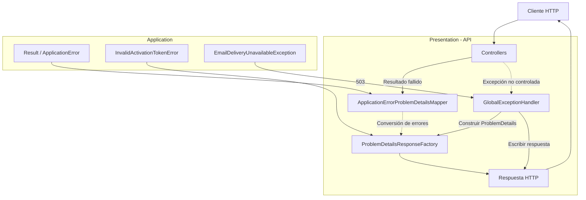

**Interpretación:**

- **Application:** define los errores esperados que representan resultados fallidos de los casos de uso.
- **Presentation:** transforma los errores de Application en respuestas HTTP mediante sus componentes de mapeo.
- **GlobalExceptionHandler:** procesa excepciones no controladas y registra información de diagnóstico.
- **ProblemDetailsResponseFactory:** centraliza la construcción del contrato de errores HTTP.
- **Cliente HTTP:** recibe respuestas con estados y códigos de error que permiten identificar el resultado de la operación.

`EmailDeliveryUnavailableException` se utiliza como excepción del flujo de entrega de invitaciones. Su namespace y definición no están incluidos en los fragmentos proporcionados.

#### Resultado

Se amplió el mapeo de errores HTTP incorporando el tratamiento específico de tokens de activación inválidos y excepciones de entrega de correo electrónico.

La implementación permite representar errores esperados de Application mediante estados HTTP específicos y gestionar excepciones no controladas utilizando respuestas `ProblemDetails`.

Además, incorpora registro estructurado de excepciones y trazabilidad mediante `traceId`, manteniendo los detalles internos de los errores fuera de las respuestas públicas de la API.

La conexión efectiva del handler global al pipeline HTTP deberá verificarse en la configuración de servicios y middleware, ya que no aparece en los archivos de este paso.

---

### 7. Traducir errores de contraseña de Identity.

#### Componentes implementados

| Componente                      | Acción | Tipo           | Capa           | Responsabilidad                                                                                                                                                   |
| ------------------------------- | ------ | -------------- | -------------- | ----------------------------------------------------------------------------------------------------------------------------------------------------------------- |
| `IdentityUserInvitationService` | Update | class          | Infrastructure | Traduce los errores de validación de contraseñas de ASP.NET Core Identity a errores tipados de Application.                                                       |
| `ToPasswordValidationError()`   | Create | Método privado | Infrastructure | Convierte los códigos de error de Identity en mensajes de validación seguros y asociados al campo `newPassword`.                                                  |
| `ActivateAsync()`               | Update | Método público | Infrastructure | Incorpora el tratamiento de errores de contraseña durante la activación, devolviendo `ValidationError` cuando la contraseña no cumple las políticas configuradas. |

**Ubicación:** `Fepp.ContaOps.Infrastructure.Identity.IdentityUserInvitationService`

La implementación permite utilizar las reglas de contraseñas configuradas en ASP.NET Core Identity sin exponer directamente sus errores técnicos al consumidor de la API.

#### Métodos y funciones principales

| Clase                           | Método                        | Responsabilidad                                                                                                                     |
| ------------------------------- | ----------------------------- | ----------------------------------------------------------------------------------------------------------------------------------- |
| `IdentityUserInvitationService` | `ActivateAsync()`             | Valida la invitación, intenta establecer la contraseña inicial y devuelve un error de validación si Identity rechaza la contraseña. |
| `IdentityUserInvitationService` | `ToPasswordValidationError()` | Traduce los códigos de error de Identity en mensajes seguros y agrupados por campo.                                                 |
| `IdentityUserInvitationService` | `EnsureSuccess()`             | Convierte otros resultados fallidos de Identity en excepciones de infraestructura.                                                  |

#### Traducción de errores de contraseña

**1. Validación mediante ASP.NET Core Identity**

Durante la activación, el método `ActivateAsync()` utiliza:

```csharp
IdentityResult passwordResult = await _userManager.AddPasswordAsync(
    identityUser,
    newPassword);

if (!passwordResult.Succeeded)
{
    await transaction.RollbackAsync(cancellationToken);
    return Result<User>.Failure(ToPasswordValidationError(passwordResult));
}
```

| Operación             | Componente                       | Responsabilidad                                                                      |
| --------------------- | -------------------------------- | ------------------------------------------------------------------------------------ |
| Establecer contraseña | `UserManager.AddPasswordAsync()` | Intenta asignar la contraseña inicial aplicando las reglas configuradas en Identity. |
| Verificar resultado   | `IdentityResult.Succeeded`       | Indica si la operación fue exitosa.                                                  |
| Revertir transacción  | `RollbackAsync()`                | Revierte la transacción cuando Identity rechaza la contraseña.                       |
| Traducir errores      | `ToPasswordValidationError()`    | Convierte los errores técnicos en mensajes seguros.                                  |
| Devolver resultado    | `Result<User>.Failure()`         | Devuelve el error tipado sin lanzar una excepción de validación.                     |

**2. Mapeo de códigos de Identity**

El método `ToPasswordValidationError()` traduce los códigos de ASP.NET Core Identity a mensajes controlados por la aplicación.

| Código de Identity                | Mensaje devuelto                                          | Regla                                               |
| --------------------------------- | --------------------------------------------------------- | --------------------------------------------------- |
| `PasswordTooShort`                | `The password does not meet the minimum length.`          | Longitud mínima.                                    |
| `PasswordRequiresUniqueChars`     | `The password does not contain enough unique characters.` | Cantidad mínima de caracteres diferentes.           |
| `PasswordRequiresNonAlphanumeric` | `The password must contain a symbol.`                     | Presencia de caracteres especiales.                 |
| `PasswordRequiresDigit`           | `The password must contain a digit.`                      | Presencia de números.                               |
| `PasswordRequiresLower`           | `The password must contain a lowercase letter.`           | Presencia de letras minúsculas.                     |
| `PasswordRequiresUpper`           | `The password must contain an uppercase letter.`          | Presencia de letras mayúsculas.                     |
| Otros códigos                     | `The password does not meet the configured policy.`       | Incumplimiento de otra regla o error no reconocido. |

**Implementación:**

```csharp
private static ValidationError ToPasswordValidationError(IdentityResult result)
{
    Dictionary<string, string[]> errors = new(StringComparer.Ordinal)
    {
        ["newPassword"] = result.Errors
            .Select(error => error.Code switch
            {
                "PasswordTooShort" =>
                    "The password does not meet the minimum length.",

                "PasswordRequiresUniqueChars" =>
                    "The password does not contain enough unique characters.",

                "PasswordRequiresNonAlphanumeric" =>
                    "The password must contain a symbol.",

                "PasswordRequiresDigit" =>
                    "The password must contain a digit.",

                "PasswordRequiresLower" =>
                    "The password must contain a lowercase letter.",

                "PasswordRequiresUpper" =>
                    "The password must contain an uppercase letter.",

                _ => "The password does not meet the configured policy."
            })
            .Distinct(StringComparer.Ordinal)
            .ToArray()
    };

    return new ValidationError(errors);
}
```

**Características:**

- Todos los mensajes se asocian al campo `newPassword`.
- Los códigos internos de Identity no se devuelven directamente al cliente.
- Los mensajes duplicados se eliminan mediante `Distinct()`.
- Los errores no reconocidos utilizan un mensaje genérico.
- Se devuelve un `ValidationError` definido en Application.
- Las reglas efectivas de contraseña continúan siendo responsabilidad de ASP.NET Core Identity.

#### Modelos de datos

| Modelo            | Capa / Origen         | Responsabilidad                                                           |
| ----------------- | --------------------- | ------------------------------------------------------------------------- |
| `IdentityResult`  | ASP.NET Core Identity | Representa el resultado de una operación de Identity.                     |
| `IdentityError`   | ASP.NET Core Identity | Contiene el código y la descripción de un error de Identity.              |
| `ValidationError` | Application           | Representa errores de validación agrupados por campo.                     |
| `Result<User>`    | Application           | Representa el resultado exitoso o fallido de la activación.               |
| `User`            | Domain                | Representa la cuenta activada cuando la operación finaliza correctamente. |

**Estructura de los errores traducidos:**

| Campo         | Tipo       | Contenido                                                         |
| ------------- | ---------- | ----------------------------------------------------------------- |
| `newPassword` | `string[]` | Mensajes correspondientes a las reglas de contraseña incumplidas. |

La estructura permite representar varias reglas incumplidas en una única respuesta de validación.

#### Componentes de .NET y proveedores externos

| Componente / Método        | Origen                | Función                                                                        |
| -------------------------- | --------------------- | ------------------------------------------------------------------------------ |
| `UserManager<TUser>`       | ASP.NET Core Identity | Administra las operaciones relacionadas con usuarios y contraseñas.            |
| `AddPasswordAsync()`       | ASP.NET Core Identity | Establece la contraseña de un usuario y ejecuta las validaciones configuradas. |
| `IdentityResult`           | ASP.NET Core Identity | Indica si una operación de Identity fue exitosa y proporciona sus errores.     |
| `IdentityError.Code`       | ASP.NET Core Identity | Identifica mediante un código el motivo del error.                             |
| `RollbackAsync()`          | Entity Framework Core | Revierte los cambios asociados a una transacción.                              |
| `Dictionary<TKey, TValue>` | .NET                  | Almacena mensajes de validación asociados a campos.                            |
| `Select()`                 | LINQ / .NET           | Transforma los códigos de Identity en mensajes de validación.                  |
| `Distinct()`               | LINQ / .NET           | Elimina mensajes duplicados.                                                   |
| `ToArray()`                | LINQ / .NET           | Convierte los mensajes en un arreglo.                                          |
| `StringComparer.Ordinal`   | .NET                  | Compara cadenas utilizando reglas ordinales.                                   |

#### Flujo funcional o relaciones

**1. Activación con contraseña válida**

| Orden | Operación                                                             | Componente responsable               |
| ----- | --------------------------------------------------------------------- | ------------------------------------ |
| 1     | Recibir identificador, token y contraseña inicial.                    | `ActivateAsync()`                    |
| 2     | Validar el identificador y comprobar el estado pendiente del usuario. | `IdentityUserInvitationService`      |
| 3     | Verificar el token de activación.                                     | `UserManager.VerifyUserTokenAsync()` |
| 4     | Iniciar una transacción.                                              | `BeginTransactionAsync()`            |
| 5     | Establecer la contraseña inicial.                                     | `UserManager.AddPasswordAsync()`     |
| 6     | Confirmar el correo electrónico y cambiar el estado a `Active`.       | `IdentityUserInvitationService`      |
| 7     | Actualizar el Security Stamp del usuario.                             | `UpdateSecurityStampAsync()`         |
| 8     | Confirmar la transacción.                                             | `CommitAsync()`                      |
| 9     | Devolver el usuario activado.                                         | `Result<User>.Success()`             |

**2. Activación con contraseña inválida**

| Orden | Operación                                                                                           | Componente responsable           |
| ----- | --------------------------------------------------------------------------------------------------- | -------------------------------- |
| 1     | Intentar establecer la contraseña.                                                                  | `UserManager.AddPasswordAsync()` |
| 2     | Obtener un `IdentityResult` fallido.                                                                | ASP.NET Core Identity            |
| 3     | Revertir la transacción.                                                                            | `RollbackAsync()`                |
| 4     | Traducir los códigos de error.                                                                      | `ToPasswordValidationError()`    |
| 5     | Agrupar los mensajes bajo `newPassword`.                                                            | `ValidationError`                |
| 6     | Devolver `Result<User>.Failure()`.                                                                  | `ActivateAsync()`                |
| 7     | Traducir el error a HTTP 400 mediante el mecanismo de Presentation documentado en pasos anteriores. | `ProblemDetailsResponseFactory`  |

**Consideración sobre el estado de la cuenta:**

Cuando la contraseña no supera las validaciones, el método retorna antes de ejecutar:

- `identityUser.EmailConfirmed = true`
- `identityUser.Status = UserStatus.Active`
- `UpdateSecurityStampAsync()`
- `CommitAsync()`

Por tanto, el flujo no completa la activación cuando la contraseña es rechazada.

#### Contrato HTTP de validación

La traducción devuelve un `ValidationError` que puede representarse mediante el contrato `ProblemDetails` definido en los pasos anteriores.

**Ejemplo de respuesta HTTP 400:**

```json
{
  "type": "https://httpstatuses.com/400",
  "title": "Request validation failed.",
  "status": 400,
  "detail": "One or more validation errors occurred.",
  "instance": "/api/auth/activate",
  "code": "validation_error",
  "traceId": "0HN123456789",
  "errors": {
    "newPassword": [
      "The password does not meet the minimum length.",
      "The password must contain a digit.",
      "The password must contain an uppercase letter."
    ]
  }
}
```

El ejemplo representa una respuesta posible cuando Identity detecta varias reglas incumplidas.

La ruta, el identificador de trazabilidad y las reglas incumplidas son ilustrativos.

#### Diagrama de arquitectura

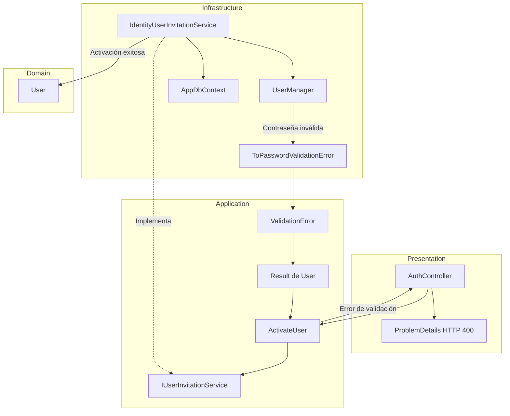

**Interpretación:**

- **Presentation:** recibe la solicitud de activación y convierte los errores esperados en respuestas HTTP.
- **Application:** coordina la activación y define el contrato `ValidationError`, sin depender directamente de ASP.NET Core Identity.
- **Infrastructure:** utiliza `UserManager` para validar la contraseña y traduce sus errores mediante `ToPasswordValidationError()`.
- **Domain:** proporciona la entidad `User`, devuelta cuando la activación finaliza correctamente.

La traducción permite aislar los códigos técnicos de Identity dentro de Infrastructure y mantener un contrato de errores independiente en Application.

#### Resultado

Se incorporó la traducción de errores de contraseña de ASP.NET Core Identity al contrato `ValidationError` de Application.

Cuando una contraseña incumple las reglas configuradas, `IdentityUserInvitationService` revierte la transacción y devuelve mensajes seguros agrupados bajo el campo `newPassword`.

Esta implementación permite comunicar al cliente las reglas de contraseña incumplidas mediante respuestas HTTP 400, sin exponer directamente los códigos internos de Identity ni completar la activación de una cuenta con una contraseña inválida.

---

### 8. Configurar políticas de contraseña y bloqueo.

#### Componentes implementados

| Componente                | Acción         | Tipo           | Capa           | Responsabilidad                                                                                                   |
| ------------------------- | -------------- | -------------- | -------------- | ----------------------------------------------------------------------------------------------------------------- |
| `DependencyInjection`     | Update         | class (static) | Infrastructure | Registra y aplica las políticas configurables de contraseñas y bloqueo de cuentas mediante ASP.NET Core Identity. |
| `IdentityPasswordOptions` | No verificable | class          | Infrastructure | Define los parámetros configurables de seguridad de contraseñas y valida sus valores.                             |
| `IdentityLockoutOptions`  | No verificable | class          | Infrastructure | Define los parámetros configurables de bloqueo de cuentas por intentos fallidos de acceso.                        |

**Ubicaciones:**

- `Fepp.ContaOps.Infrastructure.DependencyInjection`
- `Fepp.ContaOps.Infrastructure.Identity.IdentityPasswordOptions`
- `Fepp.ContaOps.Infrastructure.Identity.IdentityLockoutOptions`

La configuración de seguridad se mantiene en **Infrastructure**, donde se integra directamente con ASP.NET Core Identity.

Se verifica la actualización de `DependencyInjection` respecto a la configuración anterior. Los fragmentos no permiten determinar si las dos clases de opciones fueron creadas o modificadas.

#### Métodos y funciones principales

| Clase                     | Método                | Responsabilidad                                                                                      |
| ------------------------- | --------------------- | ---------------------------------------------------------------------------------------------------- |
| `DependencyInjection`     | `AddInfrastructure()` | Registra, valida y aplica las opciones de contraseña y bloqueo a ASP.NET Core Identity.              |
| `IdentityPasswordOptions` | `IsValid()`           | Comprueba que los parámetros numéricos de la política de contraseñas sean válidos.                   |
| `IdentityLockoutOptions`  | `IsValid()`           | Comprueba que el número máximo de intentos fallidos y la duración del bloqueo sean mayores que cero. |

#### Modelos de configuración

**1. `IdentityPasswordOptions`**

Namespace: `Fepp.ContaOps.Infrastructure.Identity`

Se utiliza para configurar los requisitos que deben cumplir las contraseñas administradas por Identity.

**Sección de configuración:** `Identity:Password`

| Propiedad                | Tipo   | Valor predeterminado | Responsabilidad                                        |
| ------------------------ | ------ | -------------------- | ------------------------------------------------------ |
| `RequiredLength`         | `int`  | `12`                 | Establece la longitud mínima de las contraseñas.       |
| `RequireUppercase`       | `bool` | `true`               | Exige al menos una letra mayúscula.                    |
| `RequireLowercase`       | `bool` | `true`               | Exige al menos una letra minúscula.                    |
| `RequireDigit`           | `bool` | `true`               | Exige al menos un número.                              |
| `RequireNonAlphanumeric` | `bool` | `true`               | Exige al menos un carácter no alfanumérico.            |
| `RequiredUniqueChars`    | `int`  | `6`                  | Establece la cantidad mínima de caracteres diferentes. |

**Validación de configuración:**

```csharp
public bool IsValid()
{
    return RequiredLength > 0
        && RequiredUniqueChars >= 0
        && RequiredUniqueChars <= RequiredLength;
}
```

Las condiciones garantizan que:

- La longitud mínima sea mayor que cero.
- La cantidad de caracteres únicos no sea negativa.
- La cantidad de caracteres únicos no supere la longitud mínima configurada.

La validación comprueba la coherencia de la configuración, no una contraseña concreta.

La validación efectiva de cada contraseña corresponde a ASP.NET Core Identity.

**2. `IdentityLockoutOptions`**

Namespace: `Fepp.ContaOps.Infrastructure.Identity`

Se utiliza para configurar el bloqueo temporal de cuentas por intentos fallidos de autenticación.

**Sección de configuración:** `Identity:Lockout`

| Propiedad                       | Tipo   | Valor predeterminado | Responsabilidad                                                    |
| ------------------------------- | ------ | -------------------- | ------------------------------------------------------------------ |
| `AllowedForNewUsers`            | `bool` | `true`               | Habilita el bloqueo para las cuentas nuevas.                       |
| `MaxFailedAccessAttempts`       | `int`  | `5`                  | Establece el número máximo de intentos fallidos antes del bloqueo. |
| `DefaultLockoutTimeSpanMinutes` | `int`  | `15`                 | Establece la duración del bloqueo temporal en minutos.             |

**Validación de configuración:**

```csharp
public bool IsValid()
{
    return MaxFailedAccessAttempts > 0
        && DefaultLockoutTimeSpanMinutes > 0;
}
```

El método comprueba que el número de intentos fallidos permitidos y la duración del bloqueo sean mayores que cero.

**Importante:** la configuración habilita los parámetros de bloqueo de Identity, pero no demuestra por sí sola que el inicio de sesión incremente los contadores de intentos fallidos. Ese comportamiento depende de la implementación de autenticación utilizada.

#### Registro de opciones en Infrastructure

Las opciones se registran mediante el patrón **Options** de .NET.

**1. Política de contraseñas**

```csharp
services.AddOptions<IdentityPasswordOptions>()
    .Bind(configuration.GetSection(IdentityPasswordOptions.SectionName))
    .Validate(
        options => options.IsValid(),
        "Identity:Password contains invalid password policy values.")
    .ValidateOnStart();
```

**2. Política de bloqueo**

```csharp
services.AddOptions<IdentityLockoutOptions>()
    .Bind(configuration.GetSection(IdentityLockoutOptions.SectionName))
    .Validate(
        options => options.IsValid(),
        "Identity:Lockout contains invalid lockout policy values.")
    .ValidateOnStart();
```

| Operación           | Componente         | Responsabilidad                                                       |
| ------------------- | ------------------ | --------------------------------------------------------------------- |
| `AddOptions<T>()`   | .NET Options       | Registra la configuración tipada.                                     |
| `GetSection()`      | .NET Configuration | Obtiene la sección correspondiente de configuración.                  |
| `Bind()`            | .NET Configuration | Asigna los valores configurados a las propiedades del modelo.         |
| `Validate()`        | .NET Options       | Comprueba las reglas definidas en `IsValid()`.                        |
| `ValidateOnStart()` | .NET Options       | Solicita validar la configuración durante el inicio de la aplicación. |

**Comportamiento:**

- Las políticas pueden configurarse mediante las fuentes de configuración soportadas por .NET.
- Si no se proporcionan valores específicos, se utilizan los valores predeterminados definidos en las clases.
- Si los parámetros registrados no superan la validación, se produce un error de configuración durante el inicio de la aplicación.

#### Aplicación de las políticas en ASP.NET Core Identity

El método `AddInfrastructure()` obtiene los valores configurados y los aplica mediante `AddIdentity()`.

**1. Obtener las opciones**

```csharp
IdentityPasswordOptions passwordOptions = configuration
    .GetSection(IdentityPasswordOptions.SectionName)
    .Get<IdentityPasswordOptions>()
    ?? new IdentityPasswordOptions();

IdentityLockoutOptions lockoutOptions = configuration
    .GetSection(IdentityLockoutOptions.SectionName)
    .Get<IdentityLockoutOptions>()
    ?? new IdentityLockoutOptions();
```

Si una sección no puede convertirse en una instancia de configuración, se utiliza una instancia con los valores predeterminados.

**2. Aplicar las opciones**

```csharp
services.AddIdentity<ApplicationIdentityUser, IdentityRole>(options =>
{
    options.Password.RequiredLength = passwordOptions.RequiredLength;
    options.Password.RequireUppercase = passwordOptions.RequireUppercase;
    options.Password.RequireLowercase = passwordOptions.RequireLowercase;
    options.Password.RequireDigit = passwordOptions.RequireDigit;
    options.Password.RequireNonAlphanumeric = passwordOptions.RequireNonAlphanumeric;
    options.Password.RequiredUniqueChars = passwordOptions.RequiredUniqueChars;

    options.Lockout.DefaultLockoutTimeSpan = TimeSpan.FromMinutes(
        lockoutOptions.DefaultLockoutTimeSpanMinutes);
    options.Lockout.MaxFailedAccessAttempts = lockoutOptions.MaxFailedAccessAttempts;
    options.Lockout.AllowedForNewUsers = lockoutOptions.AllowedForNewUsers;

    options.User.RequireUniqueEmail = true;
});
```

**Relación entre configuración e Identity:**

| Configuración propia                                   | Propiedad de Identity                     |
| ------------------------------------------------------ | ----------------------------------------- |
| `IdentityPasswordOptions.RequiredLength`               | `options.Password.RequiredLength`         |
| `IdentityPasswordOptions.RequireUppercase`             | `options.Password.RequireUppercase`       |
| `IdentityPasswordOptions.RequireLowercase`             | `options.Password.RequireLowercase`       |
| `IdentityPasswordOptions.RequireDigit`                 | `options.Password.RequireDigit`           |
| `IdentityPasswordOptions.RequireNonAlphanumeric`       | `options.Password.RequireNonAlphanumeric` |
| `IdentityPasswordOptions.RequiredUniqueChars`          | `options.Password.RequiredUniqueChars`    |
| `IdentityLockoutOptions.DefaultLockoutTimeSpanMinutes` | `options.Lockout.DefaultLockoutTimeSpan`  |
| `IdentityLockoutOptions.MaxFailedAccessAttempts`       | `options.Lockout.MaxFailedAccessAttempts` |
| `IdentityLockoutOptions.AllowedForNewUsers`            | `options.Lockout.AllowedForNewUsers`      |

Adicionalmente, se mantiene:

```csharp
options.User.RequireUniqueEmail = true;
```

Esta configuración exige correos electrónicos únicos para los usuarios administrados por Identity.

#### Relación con el paso 7: validación de contraseñas

La configuración implementada complementa el método `ToPasswordValidationError()` de `IdentityUserInvitationService`.

| Componente                       | Capa                  | Responsabilidad                                               |
| -------------------------------- | --------------------- | ------------------------------------------------------------- |
| `IdentityPasswordOptions`        | Infrastructure        | Define las reglas de contraseña configurables.                |
| `DependencyInjection`            | Infrastructure        | Aplica las reglas mediante `AddIdentity()`.                   |
| `UserManager.AddPasswordAsync()` | ASP.NET Core Identity | Comprueba la contraseña inicial durante la activación.        |
| `ToPasswordValidationError()`    | Infrastructure        | Traduce los errores de Identity a mensajes seguros.           |
| `ValidationError`                | Application           | Representa las reglas incumplidas mediante errores agrupados. |
| `ProblemDetailsResponseFactory`  | Presentation          | Convierte el error de validación en una respuesta HTTP 400.   |

**Ejemplo de política predeterminada:**

Una contraseña utilizada para activar una cuenta debe cumplir los requisitos configurados:

| Regla                 | Requisito                    |
| --------------------- | ---------------------------- |
| Longitud mínima       | 12 caracteres                |
| Mayúsculas            | Al menos una                 |
| Minúsculas            | Al menos una                 |
| Números               | Al menos uno                 |
| Caracteres especiales | Al menos uno no alfanumérico |
| Caracteres diferentes | Al menos 6                   |

Si una contraseña incumple una o varias reglas, Identity devuelve los errores correspondientes y `ToPasswordValidationError()` los convierte al contrato de errores de Application.

#### Componentes de .NET y proveedores externos

| Componente / Método           | Origen                             | Función                                                                   |
| ----------------------------- | ---------------------------------- | ------------------------------------------------------------------------- |
| `AddOptions<T>()`             | Microsoft.Extensions.Options       | Registra clases de configuración tipadas.                                 |
| `Bind()`                      | Microsoft.Extensions.Configuration | Vincula los valores de configuración con las propiedades del modelo.      |
| `Validate()`                  | Microsoft.Extensions.Options       | Define reglas de validación para las opciones.                            |
| `ValidateOnStart()`           | Microsoft.Extensions.Options       | Ejecuta la validación durante el inicio de la aplicación.                 |
| `AddIdentity<TUser, TRole>()` | ASP.NET Core Identity              | Registra y configura los servicios de administración de usuarios y roles. |
| `IdentityOptions.Password`    | ASP.NET Core Identity              | Configura los requisitos de contraseña.                                   |
| `IdentityOptions.Lockout`     | ASP.NET Core Identity              | Configura los parámetros de bloqueo de cuentas.                           |
| `PasswordOptions`             | ASP.NET Core Identity              | Contiene los requisitos de validación de contraseñas.                     |
| `LockoutOptions`              | ASP.NET Core Identity              | Contiene las opciones del mecanismo de bloqueo.                           |
| `TimeSpan.FromMinutes()`      | .NET                               | Convierte la duración configurada en minutos a un intervalo de tiempo.    |
| `UserManager<TUser>`          | ASP.NET Core Identity              | Administra usuarios y aplica las validaciones correspondientes.           |

#### Flujo funcional o relaciones

**1. Configuración durante el inicio de la aplicación**

| Orden | Operación                                            | Componente responsable            |
| ----- | ---------------------------------------------------- | --------------------------------- |
| 1     | Obtener la sección `Identity:Password`.              | `IConfiguration`                  |
| 2     | Obtener la sección `Identity:Lockout`.               | `IConfiguration`                  |
| 3     | Vincular los valores a los modelos de configuración. | `Bind()`                          |
| 4     | Validar los parámetros configurados.                 | `IsValid()` / `ValidateOnStart()` |
| 5     | Obtener las opciones para configurar Identity.       | `Get<T>()`                        |
| 6     | Registrar ASP.NET Core Identity.                     | `AddIdentity()`                   |
| 7     | Aplicar las políticas de contraseña y bloqueo.       | `IdentityOptions`                 |

**2. Validación de contraseña durante la activación**

| Orden | Operación                                              | Componente responsable           |
| ----- | ------------------------------------------------------ | -------------------------------- |
| 1     | El usuario solicita activar su cuenta.                 | `AuthController`                 |
| 2     | Se ejecuta el caso de uso de activación.               | `ActivateUser`                   |
| 3     | Se solicita establecer la contraseña inicial.          | `IdentityUserInvitationService`  |
| 4     | Identity evalúa las reglas de contraseña configuradas. | `UserManager.AddPasswordAsync()` |
| 5     | Si la contraseña es inválida, se traducen los errores. | `ToPasswordValidationError()`    |
| 6     | Se devuelve un resultado fallido de Application.       | `Result<User>.Failure()`         |
| 7     | Presentation genera la respuesta HTTP 400.             | `ProblemDetailsResponseFactory`  |

**3. Política de bloqueo**

| Condición         | Comportamiento configurado                                                         |
| ----------------- | ---------------------------------------------------------------------------------- |
| Cuenta nueva      | Puede participar en el mecanismo de bloqueo porque `AllowedForNewUsers` es `true`. |
| Intentos fallidos | El umbral configurado es de 5 intentos.                                            |
| Bloqueo temporal  | La duración configurada es de 15 minutos.                                          |

El código proporcionado confirma la configuración de los parámetros de bloqueo, pero no demuestra su aplicación efectiva durante el inicio de sesión.

Para que el bloqueo se active, el flujo de autenticación debe utilizar las operaciones de Identity que registran intentos fallidos y aplican las restricciones correspondientes.

#### Diagrama de arquitectura

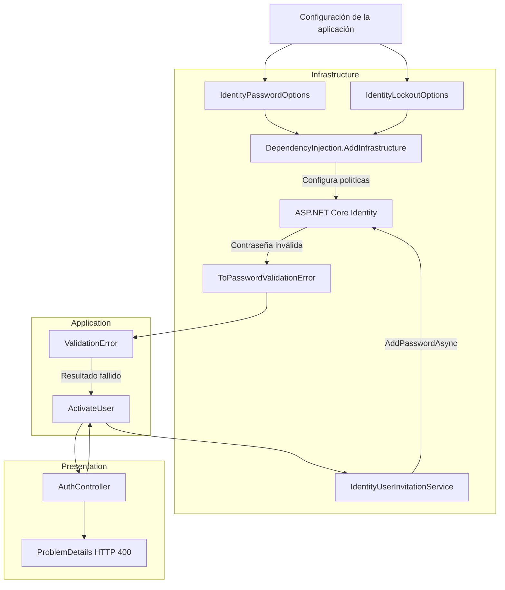

**Interpretación:**

- **Infrastructure:** define las opciones de seguridad y las aplica directamente sobre ASP.NET Core Identity.
- **ASP.NET Core Identity:** proporciona las reglas de validación de contraseñas y el mecanismo de bloqueo de cuentas.
- **Application:** coordina la activación y recibe errores tipados sin depender de las clases técnicas de Identity.
- **Presentation:** recibe la solicitud HTTP y transforma los errores de validación en respuestas uniformes.

La configuración de seguridad permanece desacoplada de los controladores y casos de uso.

#### Resultado

Se configuraron políticas de contraseñas y bloqueo de cuentas mediante clases de opciones tipadas y configurables.

Las reglas predeterminadas exigen contraseñas de al menos 12 caracteres, con mayúsculas, minúsculas, números, caracteres especiales y un mínimo de 6 caracteres diferentes.

También se configuró el bloqueo de cuentas nuevas, con un umbral de 5 intentos fallidos y una duración de 15 minutos.

Las opciones se validan durante el inicio de la aplicación y se aplican a ASP.NET Core Identity desde Infrastructure.

Esta implementación complementa la traducción de errores de contraseña del paso 7 y centraliza la configuración de seguridad sin incorporar reglas técnicas de Identity en Application o Domain.

---

### 9. Eliminar BootstrapUser.

#### Componentes implementados

| Componente             | Acción | Tipo           | Capa           | Responsabilidad                                                                                                                                                  |
| ---------------------- | ------ | -------------- | -------------- | ---------------------------------------------------------------------------------------------------------------------------------------------------------------- |
| `DependencyInjection`  | Update | class (static) | Infrastructure | Elimina el registro y la validación de la configuración `BootstrapUserOptions`, manteniendo la configuración del administrador inicial.                          |
| `IdentitySeeder`       | Update | class          | Infrastructure | Limita la inicialización de Identity a la creación de roles y del administrador inicial.                                                                         |
| `BootstrapUserOptions` | Delete | class          | Infrastructure | Configuración utilizada anteriormente para crear automáticamente un usuario regular. Su eliminación física no puede verificarse con los archivos proporcionados. |

**Ubicaciones:**

- `Fepp.ContaOps.Infrastructure.DependencyInjection`
- `Fepp.ContaOps.Infrastructure.Identity.IdentitySeeder`

El cambio elimina la dependencia funcional del usuario regular de inicialización (_BootstrapUser_) y conserva el mecanismo de creación del administrador inicial (_BootstrapAdmin_).

#### Métodos y funciones principales

| Clase                 | Método                          | Responsabilidad                                                                                                                  |
| --------------------- | ------------------------------- | -------------------------------------------------------------------------------------------------------------------------------- |
| `DependencyInjection` | `AddInfrastructure()`           | Registra los servicios de Infrastructure y mantiene únicamente `BootstrapAdminOptions` como configuración de usuarios iniciales. |
| `IdentitySeeder`      | `SeedAsync()`                   | Inicializa el esquema, garantiza la existencia de los roles `Admin` y `User`, y crea o configura el administrador inicial.       |
| `IdentitySeeder`      | `EnsureUserStatusColumnAsync()` | Garantiza que exista la columna `Status` en la tabla `AspNetUsers`.                                                              |
| `IdentitySeeder`      | `EnsureRoleAsync()`             | Crea un rol de Identity únicamente cuando todavía no existe.                                                                     |
| `IdentitySeeder`      | `EnsureSuccess()`               | Convierte resultados fallidos de Identity en excepciones de inicialización.                                                      |

#### Cambios en la configuración de dependencias

**1. Eliminación de BootstrapUser**

En `DependencyInjection.AddInfrastructure()` ya no se registra la configuración `BootstrapUserOptions`.

Se conserva únicamente:

```csharp
services.AddOptions<BootstrapAdminOptions>()
    .Bind(configuration.GetSection(BootstrapAdminOptions.SectionName))
    .Validate(
        options => options.IsValid(),
        "BootstrapAdmin:Email and BootstrapAdmin:Password must be configured with valid values.")
    .ValidateOnStart();

services.AddScoped<IdentitySeeder>();
```

| Configuración           | Estado                  | Responsabilidad                                               |
| ----------------------- | ----------------------- | ------------------------------------------------------------- |
| `BootstrapAdminOptions` | Se mantiene             | Proporciona las credenciales del administrador inicial.       |
| `BootstrapUserOptions`  | Se elimina del registro | Deja de participar en la configuración de usuarios iniciales. |
| `IdentitySeeder`        | Se mantiene             | Inicializa los roles y el administrador.                      |

**Consideraciones:**

- La aplicación continúa validando `BootstrapAdminOptions` durante el inicio.
- Ya no se vincula ni valida la sección `BootstrapUserOptions`.
- El registro de `IdentitySeeder` permanece con ciclo de vida `Scoped`.
- La creación de usuarios regulares queda disponible mediante el proceso de invitaciones implementado anteriormente.

#### Inicialización de usuarios y roles

El método `IdentitySeeder.SeedAsync()` mantiene las siguientes operaciones:

| Orden | Operación                                               | Componente responsable                       |
| ----- | ------------------------------------------------------- | -------------------------------------------- |
| 1     | Garantizar la existencia del esquema de base de datos.  | `AppDbContext.Database.EnsureCreatedAsync()` |
| 2     | Garantizar la existencia de la columna `Status`.        | `EnsureUserStatusColumnAsync()`              |
| 3     | Verificar o crear el rol `Admin`.                       | `EnsureRoleAsync(AdminRole)`                 |
| 4     | Verificar o crear el rol `User`.                        | `EnsureRoleAsync(UserRole)`                  |
| 5     | Buscar el administrador mediante su correo electrónico. | `UserManager.FindByEmailAsync()`             |
| 6     | Crear el administrador cuando todavía no existe.        | `UserManager.CreateAsync()`                  |
| 7     | Verificar si el administrador pertenece al rol `Admin`. | `UserManager.IsInRoleAsync()`                |
| 8     | Asignar el rol `Admin` cuando sea necesario.            | `UserManager.AddToRoleAsync()`               |

**Código principal:**

```csharp
public async Task SeedAsync(CancellationToken cancellationToken = default)
{
    await _dbContext.Database.EnsureCreatedAsync(cancellationToken);
    await EnsureUserStatusColumnAsync(cancellationToken);

    await EnsureRoleAsync(AdminRole);
    await EnsureRoleAsync(UserRole);

    ApplicationIdentityUser? admin =
        await _userManager.FindByEmailAsync(_options.Email);

    if (admin is null)
    {
        admin = new ApplicationIdentityUser
        {
            UserName = _options.Email,
            Email = _options.Email,
            EmailConfirmed = true,
            Status = UserStatus.Active
        };

        IdentityResult creationResult =
            await _userManager.CreateAsync(admin, _options.Password);

        EnsureSuccess(
            creationResult,
            "The bootstrap administrator could not be created.");
    }

    if (!await _userManager.IsInRoleAsync(admin, AdminRole))
    {
        IdentityResult roleResult =
            await _userManager.AddToRoleAsync(admin, AdminRole);

        EnsureSuccess(
            roleResult,
            "The bootstrap administrator role could not be assigned.");
    }
}
```

**Comportamiento:**

- El administrador inicial se crea únicamente cuando no existe una cuenta con el correo electrónico configurado.
- El administrador se crea con `EmailConfirmed = true` y `UserStatus.Active`.
- Si el usuario ya existe, se verifica que tenga asignado el rol `Admin`.
- Los roles `Admin` y `User` se crean únicamente cuando no existen.
- Ya no se crea automáticamente un usuario regular durante la inicialización.

La inicialización mantiene un comportamiento idempotente respecto a la creación de roles y del administrador, evitando su creación duplicada.

#### Modelos y componentes relacionados

| Componente                | Capa                                   | Responsabilidad                                                          |
| ------------------------- | -------------------------------------- | ------------------------------------------------------------------------ |
| `BootstrapAdminOptions`   | Infrastructure                         | Contiene la configuración necesaria para crear el administrador inicial. |
| `ApplicationIdentityUser` | Infrastructure                         | Representa el usuario administrado por ASP.NET Core Identity.            |
| `IdentityRole`            | Infrastructure / ASP.NET Core Identity | Representa los roles de autorización.                                    |
| `UserStatus`              | Domain                                 | Define el estado funcional del usuario.                                  |
| `AppDbContext`            | Infrastructure                         | Proporciona acceso a la persistencia de Identity.                        |
| `IdentitySeeder`          | Infrastructure                         | Ejecuta la inicialización de roles y administrador.                      |

**Roles definidos:**

| Constante                  | Valor   | Responsabilidad                                                         |
| -------------------------- | ------- | ----------------------------------------------------------------------- |
| `IdentitySeeder.AdminRole` | `Admin` | Identifica el rol administrativo utilizado por la política `AdminOnly`. |
| `IdentitySeeder.UserRole`  | `User`  | Identifica el rol utilizado para usuarios regulares.                    |

La eliminación de `BootstrapUser` no elimina el rol `User`.

Este rol continúa siendo necesario para las cuentas creadas mediante el proceso de invitación.

#### Relación con el proceso de invitaciones

| Proceso                           | Componente responsable          | Resultado                                                             |
| --------------------------------- | ------------------------------- | --------------------------------------------------------------------- |
| Inicialización del administrador  | `IdentitySeeder`                | Crea la cuenta administrativa inicial cuando no existe.               |
| Inicialización de roles           | `IdentitySeeder`                | Garantiza la existencia de `Admin` y `User`.                          |
| Creación de usuarios regulares    | `CreateUserInvitation`          | Coordina el registro de una cuenta pendiente y su invitación.         |
| Persistencia de cuentas invitadas | `IdentityUserInvitationService` | Registra la cuenta con estado `PendingActivation` y rol `User`.       |
| Activación de cuentas             | `ActivateUser`                  | Coordina el establecimiento de la contraseña inicial y la activación. |

**Diferencia entre mecanismos:**

| Característica         | BootstrapAdmin                               | Invitación de usuarios                         |
| ---------------------- | -------------------------------------------- | ---------------------------------------------- |
| Propósito              | Crear el administrador inicial.              | Registrar usuarios regulares.                  |
| Componente principal   | `IdentitySeeder`                             | `CreateUserInvitation`                         |
| Ejecución              | Inicialización de Identity.                  | Solicitud HTTP administrativa.                 |
| Rol asignado           | `Admin`                                      | `User`                                         |
| Estado inicial         | `Active`                                     | `PendingActivation`                            |
| Contraseña inicial     | Configuración `BootstrapAdminOptions`.       | Definida por el usuario durante la activación. |
| Confirmación de correo | Automática mediante `EmailConfirmed = true`. | Se confirma durante la activación.             |

La eliminación de `BootstrapUser` evita mantener dos mecanismos independientes para la creación de usuarios regulares.

#### Componentes de .NET y proveedores externos

| Componente / Método    | Origen                             | Función                                                                            |
| ---------------------- | ---------------------------------- | ---------------------------------------------------------------------------------- |
| `AddOptions<T>()`      | Microsoft.Extensions.Options       | Registra configuraciones tipadas.                                                  |
| `Bind()`               | Microsoft.Extensions.Configuration | Vincula valores de configuración con un objeto de opciones.                        |
| `ValidateOnStart()`    | Microsoft.Extensions.Options       | Ejecuta la validación de opciones durante el inicio.                               |
| `EnsureCreatedAsync()` | Entity Framework Core              | Garantiza la creación de la base de datos y su esquema inicial cuando corresponde. |
| `ExecuteSqlRawAsync()` | Entity Framework Core              | Ejecuta una instrucción SQL directamente.                                          |
| `UserManager<TUser>`   | ASP.NET Core Identity              | Administra usuarios y sus roles.                                                   |
| `RoleManager<TRole>`   | ASP.NET Core Identity              | Administra los roles de Identity.                                                  |
| `FindByEmailAsync()`   | ASP.NET Core Identity              | Busca un usuario mediante su correo electrónico.                                   |
| `CreateAsync()`        | ASP.NET Core Identity              | Crea un usuario con la contraseña proporcionada.                                   |
| `IsInRoleAsync()`      | ASP.NET Core Identity              | Comprueba si un usuario pertenece a un rol.                                        |
| `AddToRoleAsync()`     | ASP.NET Core Identity              | Asigna un rol a un usuario.                                                        |
| `RoleExistsAsync()`    | ASP.NET Core Identity              | Comprueba si existe un rol.                                                        |

#### Flujo funcional o relaciones

| Orden | Operación                                                            | Componente responsable                 |
| ----- | -------------------------------------------------------------------- | -------------------------------------- |
| 1     | Se ejecuta la inicialización de Identity.                            | `IdentitySeeder.SeedAsync()`           |
| 2     | Se garantiza la existencia del esquema y la columna `Status`.        | `AppDbContext`                         |
| 3     | Se garantiza la existencia de los roles `Admin` y `User`.            | `RoleManager<IdentityRole>`            |
| 4     | Se busca el administrador inicial.                                   | `UserManager<ApplicationIdentityUser>` |
| 5     | Se crea el administrador cuando no existe.                           | `IdentitySeeder`                       |
| 6     | Se garantiza su pertenencia al rol `Admin`.                          | `IdentitySeeder`                       |
| 7     | Finaliza la inicialización sin crear usuarios regulares adicionales. | `IdentitySeeder`                       |

#### Diagrama de arquitectura

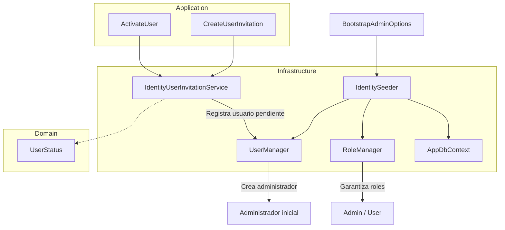

**Interpretación:**

- **Infrastructure:** mantiene la inicialización del administrador y los roles mediante `IdentitySeeder`.
- **Application:** coordina la creación y activación de usuarios regulares mediante los casos de uso de invitaciones.
- **Domain:** proporciona los estados funcionales utilizados por las cuentas.
- **ASP.NET Core Identity:** continúa administrando usuarios y roles, independientemente del mecanismo utilizado para registrar cada cuenta.

El diagrama diferencia la creación automática del administrador de la creación de usuarios regulares mediante invitaciones.

#### Resultado

Se eliminó el registro de `BootstrapUserOptions` y la creación automática de usuarios regulares desde el proceso de inicialización de Identity.

`IdentitySeeder` conserva exclusivamente la responsabilidad de garantizar los roles `Admin` y `User`, así como la existencia del administrador inicial.

Con este cambio, los usuarios regulares pasan a gestionarse mediante el flujo de invitación y activación implementado en los pasos anteriores, evitando mecanismos duplicados de registro y manteniendo centralizada la administración inicial de seguridad.

---

### 10. Endurecer el seed.

#### Componentes implementados

| Componente                         | Acción | Tipo           | Capa           | Responsabilidad                                                                                                                 |
| ---------------------------------- | ------ | -------------- | -------------- | ------------------------------------------------------------------------------------------------------------------------------- |
| `IdentitySeeder`                   | Update | class          | Infrastructure | Refuerza la inicialización del administrador validando su contraseña contra las políticas efectivas de ASP.NET Core Identity.   |
| `ValidateBootstrapPasswordAsync()` | Create | Método privado | Infrastructure | Ejecuta todos los validadores de contraseña registrados en Identity y detiene la inicialización cuando detecta incumplimientos. |
| `SeedAsync()`                      | Update | Método público | Infrastructure | Incorpora la validación obligatoria de la contraseña del administrador antes de crear la cuenta o verificar su rol.             |

**Ubicación:** `Fepp.ContaOps.Infrastructure.Identity.IdentitySeeder`

El cambio incorpora una validación preventiva de la contraseña configurada en `BootstrapAdminOptions`.

**Objetivo:** impedir que la inicialización finalice correctamente cuando la contraseña del administrador no cumple las políticas de seguridad configuradas, incluso si la cuenta administrativa ya existe.

#### Métodos y funciones principales

| Clase            | Método                             | Responsabilidad                                                                                                                    |
| ---------------- | ---------------------------------- | ---------------------------------------------------------------------------------------------------------------------------------- |
| `IdentitySeeder` | `SeedAsync()`                      | Inicializa el esquema, crea los roles necesarios, valida la contraseña administrativa y garantiza la existencia del administrador. |
| `IdentitySeeder` | `ValidateBootstrapPasswordAsync()` | Ejecuta los validadores de contraseña registrados en `UserManager` y recopila los códigos de error encontrados.                    |
| `IdentitySeeder` | `EnsureUserStatusColumnAsync()`    | Garantiza la existencia de la columna `Status` en `AspNetUsers`.                                                                   |
| `IdentitySeeder` | `EnsureRoleAsync()`                | Crea un rol cuando todavía no existe.                                                                                              |
| `IdentitySeeder` | `EnsureSuccess()`                  | Convierte resultados fallidos de Identity en excepciones con información técnica controlada.                                       |

#### Validación de la contraseña administrativa

**1. Incorporación de la validación en `SeedAsync()`**

Después de inicializar el esquema y los roles, se obtiene el administrador existente o se construye una instancia temporal para validar la contraseña.

```csharp
ApplicationIdentityUser? admin =
    await _userManager.FindByEmailAsync(_options.Email);

ApplicationIdentityUser passwordValidationUser =
    admin ?? new ApplicationIdentityUser
    {
        UserName = _options.Email,
        Email = _options.Email
    };

await ValidateBootstrapPasswordAsync(
    passwordValidationUser,
    cancellationToken);
```

| Condición                              | Comportamiento                                                                                                        |
| -------------------------------------- | --------------------------------------------------------------------------------------------------------------------- |
| El administrador no existe             | Se construye una instancia temporal de `ApplicationIdentityUser` para validar la contraseña antes de crear la cuenta. |
| El administrador existe                | Se utiliza la cuenta existente como contexto de validación.                                                           |
| La contraseña cumple las políticas     | Continúa el proceso de inicialización.                                                                                |
| La contraseña incumple alguna política | Se lanza `InvalidOperationException` y se interrumpe la ejecución de `SeedAsync()`.                                   |

**Consideración importante:**

La validación se ejecuta independientemente de que el administrador ya exista.

Esto permite detectar contraseñas de configuración que dejaron de cumplir los requisitos después de modificar las políticas de seguridad.

Sin embargo, cuando el administrador ya existe, se valida la contraseña definida en `BootstrapAdminOptions`, no la contraseña almacenada previamente en Identity.

Por tanto, esta operación no modifica ni verifica directamente la contraseña actual del administrador existente.

#### Ejecución de los validadores de Identity

El nuevo método `ValidateBootstrapPasswordAsync()` utiliza los validadores registrados en `UserManager.PasswordValidators`.

```csharp
private async Task ValidateBootstrapPasswordAsync(
    ApplicationIdentityUser admin,
    CancellationToken cancellationToken)
{
    cancellationToken.ThrowIfCancellationRequested();

    List<IdentityError> errors = [];

    foreach (
        IPasswordValidator<ApplicationIdentityUser> validator
        in _userManager.PasswordValidators)
    {
        IdentityResult result = await validator.ValidateAsync(
            _userManager,
            admin,
            _options.Password);

        if (!result.Succeeded)
        {
            errors.AddRange(result.Errors);
        }
    }

    if (errors.Count == 0)
    {
        return;
    }

    string errorCodes = string.Join(
        ", ",
        errors
            .Select(error => error.Code)
            .Distinct(StringComparer.Ordinal));

    throw new InvalidOperationException(
        "The bootstrap administrator password does not comply " +
        "with the configured policy. Identity errors: " +
        errorCodes);
}
```

**Operaciones principales:**

| Orden | Operación                                                       | Componente responsable                             |
| ----- | --------------------------------------------------------------- | -------------------------------------------------- |
| 1     | Comprobar si se solicitó cancelar la inicialización.            | `CancellationToken.ThrowIfCancellationRequested()` |
| 2     | Obtener los validadores de contraseña registrados.              | `UserManager.PasswordValidators`                   |
| 3     | Ejecutar cada validador contra la contraseña configurada.       | `IPasswordValidator.ValidateAsync()`               |
| 4     | Recopilar los errores producidos.                               | `IdentityResult.Errors`                            |
| 5     | Verificar si existen errores.                                   | `ValidateBootstrapPasswordAsync()`                 |
| 6     | Extraer los códigos de error y eliminar duplicados.             | `Select()` / `Distinct()`                          |
| 7     | Lanzar una excepción si la contraseña incumple alguna política. | `InvalidOperationException`                        |

**Características:**

- Utiliza los validadores efectivos registrados en ASP.NET Core Identity.
- Permite ejecutar validadores adicionales si se incorporan a la configuración de Identity.
- Recopila errores de todos los validadores, en lugar de detenerse después del primero.
- Elimina códigos duplicados.
- No incluye la contraseña en el mensaje de excepción.
- Interrumpe la inicialización cuando se detecta una configuración de contraseña incompatible con las políticas.

#### Relación con las políticas de contraseña del paso 8

La validación utiliza las políticas configuradas previamente mediante `IdentityPasswordOptions`.

| Configuración            | Valor predeterminado | Validación                                |
| ------------------------ | -------------------- | ----------------------------------------- |
| `RequiredLength`         | `12`                 | Longitud mínima de contraseña.            |
| `RequireUppercase`       | `true`               | Presencia de mayúsculas.                  |
| `RequireLowercase`       | `true`               | Presencia de minúsculas.                  |
| `RequireDigit`           | `true`               | Presencia de números.                     |
| `RequireNonAlphanumeric` | `true`               | Presencia de caracteres no alfanuméricos. |
| `RequiredUniqueChars`    | `6`                  | Cantidad mínima de caracteres diferentes. |

**Diferencia entre las validaciones:**

| Componente                          | Responsabilidad                                                                        |
| ----------------------------------- | -------------------------------------------------------------------------------------- |
| `IdentityPasswordOptions.IsValid()` | Comprueba que los valores numéricos de configuración sean coherentes.                  |
| `ValidateBootstrapPasswordAsync()`  | Comprueba que la contraseña administrativa cumpla las reglas configuradas en Identity. |
| `UserManager.CreateAsync()`         | Crea el administrador y ejecuta las validaciones correspondientes durante su creación. |

La nueva validación complementa la configuración del paso 8 y permite detectar incumplimientos antes de intentar crear el administrador.

#### Manejo de errores

Cuando uno o varios validadores rechazan la contraseña, el método lanza una excepción.

**Ejemplo de mensaje:**

```text
The bootstrap administrator password does not comply with
the configured policy. Identity errors:
PasswordTooShort, PasswordRequiresUpper
```

| Elemento                    | Responsabilidad                                                              |
| --------------------------- | ---------------------------------------------------------------------------- |
| `InvalidOperationException` | Indica que la inicialización no puede continuar con la configuración actual. |
| `IdentityError.Code`        | Identifica la regla de contraseña incumplida.                                |
| `Distinct()`                | Evita repetir el mismo código de error.                                      |
| Mensaje de excepción        | Proporciona información técnica para diagnosticar la configuración.          |

A diferencia del proceso de activación de usuarios, donde los errores se traducen a `ValidationError`, los errores del seed generan una excepción.

Esta diferencia responde al contexto de ejecución:

| Proceso                          | Tipo de error                                             | Resultado                                                 |
| -------------------------------- | --------------------------------------------------------- | --------------------------------------------------------- |
| Activación de usuario            | Contraseña proporcionada mediante una solicitud HTTP.     | `ValidationError` y respuesta HTTP 400.                   |
| Inicialización del administrador | Contraseña obtenida de la configuración de la aplicación. | `InvalidOperationException` que interrumpe `SeedAsync()`. |

No se exponen los valores de la contraseña en los mensajes de excepción.

#### Componentes de .NET y proveedores externos

| Componente / Método                                | Origen                       | Función                                                                   |
| -------------------------------------------------- | ---------------------------- | ------------------------------------------------------------------------- |
| `UserManager<TUser>`                               | ASP.NET Core Identity        | Administra usuarios y proporciona acceso a los validadores de contraseña. |
| `PasswordValidators`                               | ASP.NET Core Identity        | Contiene los validadores registrados para las contraseñas.                |
| `IPasswordValidator<TUser>`                        | ASP.NET Core Identity        | Define el contrato para validar una contraseña.                           |
| `ValidateAsync()`                                  | ASP.NET Core Identity        | Ejecuta las reglas de validación de contraseña.                           |
| `IdentityResult`                                   | ASP.NET Core Identity        | Representa el resultado de la validación.                                 |
| `IdentityError`                                    | ASP.NET Core Identity        | Contiene los códigos y descripciones de los errores.                      |
| `IOptions<T>`                                      | Microsoft.Extensions.Options | Proporciona la configuración del administrador inicial.                   |
| `CancellationToken.ThrowIfCancellationRequested()` | .NET                         | Interrumpe la operación cuando se solicita cancelación.                   |
| `List<T>`                                          | .NET                         | Almacena los errores recopilados.                                         |
| `AddRange()`                                       | .NET                         | Incorpora los errores de cada validador a la colección.                   |
| `Select()`                                         | LINQ / .NET                  | Extrae los códigos de error.                                              |
| `Distinct()`                                       | LINQ / .NET                  | Elimina códigos duplicados.                                               |
| `string.Join()`                                    | .NET                         | Construye un mensaje a partir de los códigos de error.                    |
| `InvalidOperationException`                        | .NET                         | Representa una operación que no puede continuar en el estado actual.      |

#### Flujo funcional o relaciones

| Orden | Operación                                                          | Componente responsable             |
| ----- | ------------------------------------------------------------------ | ---------------------------------- |
| 1     | Garantizar la creación del esquema necesario.                      | `AppDbContext`                     |
| 2     | Garantizar la existencia de la columna `Status`.                   | `EnsureUserStatusColumnAsync()`    |
| 3     | Garantizar los roles `Admin` y `User`.                             | `EnsureRoleAsync()`                |
| 4     | Buscar el administrador configurado.                               | `UserManager.FindByEmailAsync()`   |
| 5     | Obtener la instancia que se utilizará para validar la contraseña.  | `IdentitySeeder`                   |
| 6     | Ejecutar todos los validadores de contraseña registrados.          | `ValidateBootstrapPasswordAsync()` |
| 7     | Interrumpir el seed si existen errores de contraseña.              | `InvalidOperationException`        |
| 8     | Crear el administrador cuando no existe y la contraseña es válida. | `UserManager.CreateAsync()`        |
| 9     | Garantizar que el administrador pertenezca al rol `Admin`.         | `UserManager.AddToRoleAsync()`     |
| 10    | Finalizar la inicialización.                                       | `SeedAsync()`                      |

**Consideración sobre la idempotencia:**

El proceso conserva la comprobación de existencia del administrador y sus roles antes de crearlos o asignarlos.

La validación de contraseña se ejecuta en cada invocación de `SeedAsync()`, pero no modifica la contraseña del administrador existente.

Además, como la validación se realiza después de asegurar el esquema y los roles, un error de contraseña puede ocurrir cuando esas operaciones ya se han ejecutado.

#### Diagrama de arquitectura

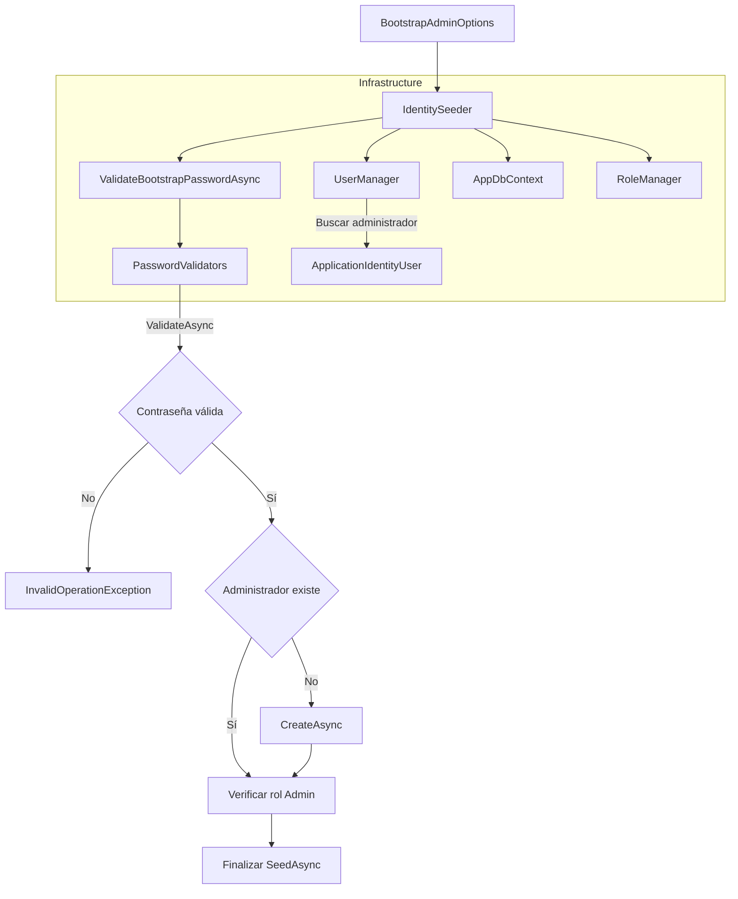

**Interpretación:**

- **Infrastructure:** centraliza la inicialización del administrador y la validación de su contraseña.
- **ASP.NET Core Identity:** proporciona los validadores efectivos y las operaciones necesarias para administrar la cuenta.
- **BootstrapAdminOptions:** suministra la contraseña que será validada.
- **IdentitySeeder:** coordina la validación antes de crear el administrador o verificar su rol.

La implementación no introduce dependencias adicionales en Application ni en Domain.

#### Resultado

Se reforzó `IdentitySeeder` incorporando una validación obligatoria de la contraseña configurada para el administrador inicial.

El nuevo método `ValidateBootstrapPasswordAsync()` ejecuta todos los validadores de ASP.NET Core Identity y recopila los códigos de las reglas incumplidas.

Cuando la contraseña no satisface las políticas configuradas, el seed se interrumpe mediante una excepción, evitando continuar con una configuración de seguridad inválida.

La validación se ejecuta tanto para administradores nuevos como existentes, sin modificar automáticamente la contraseña de las cuentas ya creadas.

Este cambio complementa las políticas de contraseña definidas en el paso 8 y fortalece el proceso de inicialización de identidad de FEPP ContaOps.

---

### 11. Verificar login uniforme.

#### Componentes implementados

| Componente                  | Acción         | Tipo  | Capa           | Responsabilidad                                                                                                                                   |
| --------------------------- | -------------- | ----- | -------------- | ------------------------------------------------------------------------------------------------------------------------------------------------- |
| `LoginRequestValidator`     | No verificable | class | Presentation   | Valida los campos del request HTTP de autenticación mediante FluentValidation.                                                                    |
| `IdentityCredentialService` | Update         | class | Infrastructure | Verifica las credenciales mediante ASP.NET Core Identity, comprueba el estado del usuario y aplica el mecanismo de bloqueo por intentos fallidos. |

**Ubicaciones:**

- `Fepp.ContaOps.Api.Validation.LoginRequestValidator`
- `Fepp.ContaOps.Infrastructure.Identity.IdentityCredentialService`

El código permite verificar la implementación actual, pero no determina si `LoginRequestValidator` fue creado o modificado. En `IdentityCredentialService` se identifica la integración del mecanismo de bloqueo configurado en el paso 8.

Este paso integra dos mecanismos complementarios:

- **Validación HTTP:** comprueba la estructura y los valores del request antes de procesar la autenticación.
- **Verificación de credenciales:** utiliza ASP.NET Core Identity para comprobar la contraseña y aplicar las restricciones de acceso de la cuenta.

#### Métodos y funciones principales

| Clase                       | Método                                | Responsabilidad                                                                                               |
| --------------------------- | ------------------------------------- | ------------------------------------------------------------------------------------------------------------- |
| `LoginRequestValidator`     | Constructor `LoginRequestValidator()` | Define las reglas de validación para el correo electrónico y la contraseña.                                   |
| `IdentityCredentialService` | `VerifyPasswordAsync()`               | Comprueba que el usuario esté activo, tenga una contraseña configurada y supere la autenticación de Identity. |

**Dependencias de `IdentityCredentialService`:**

| Dependencia                              | Origen                | Responsabilidad                                                           |
| ---------------------------------------- | --------------------- | ------------------------------------------------------------------------- |
| `IUserCredentialService`                 | Application           | Define el contrato de verificación de credenciales.                       |
| `UserManager<ApplicationIdentityUser>`   | ASP.NET Core Identity | Permite localizar la cuenta técnica del usuario.                          |
| `SignInManager<ApplicationIdentityUser>` | ASP.NET Core Identity | Comprueba contraseñas y aplica las reglas de bloqueo de inicio de sesión. |
| `User`                                   | Domain                | Proporciona el identificador y estado funcional del usuario.              |

`IdentityCredentialService` implementa el contrato `IUserCredentialService`, manteniendo la dependencia de Application hacia una abstracción independiente de ASP.NET Core Identity.

#### Validación HTTP de credenciales

**1. `LoginRequestValidator`**

El validador hereda de `AbstractValidator<LoginRequest>` y define reglas mediante FluentValidation.

```csharp
public sealed class LoginRequestValidator : AbstractValidator<LoginRequest>
{
    public LoginRequestValidator()
    {
        RuleFor(request => request.Email)
            .NotEmpty()
            .EmailAddress()
            .MaximumLength(256);

        RuleFor(request => request.Password)
            .NotEmpty()
            .MaximumLength(256);
    }
}
```

**Reglas implementadas:**

| Campo      | Regla                | Responsabilidad                              |
| ---------- | -------------------- | -------------------------------------------- |
| `Email`    | `NotEmpty()`         | Exige un correo electrónico no vacío.        |
| `Email`    | `EmailAddress()`     | Comprueba el formato del correo electrónico. |
| `Email`    | `MaximumLength(256)` | Limita su longitud a 256 caracteres.         |
| `Password` | `NotEmpty()`         | Exige una contraseña no vacía.               |
| `Password` | `MaximumLength(256)` | Limita su longitud a 256 caracteres.         |

**Consideraciones:**

- Las reglas pertenecen a Presentation porque validan los datos recibidos mediante HTTP.
- No se aplican las reglas de complejidad de contraseñas durante el login.
- La complejidad de la contraseña se comprueba al establecerla, como se documentó en los pasos 7 y 8.
- La validación HTTP no comprueba si las credenciales son correctas.
- El registro automático del validador se encuentra contemplado en `DependencyInjection.AddApi()` mediante `AddValidatorsFromAssembly()`.

**Relación con la validación uniforme:**

Cuando el validador detecta errores, el mecanismo de validación de Presentation puede utilizar `ProblemDetailsResponseFactory` para construir una respuesta HTTP 400.

La implementación específica de `ValidationFilter` no se incluye en este paso, por lo que no puede verificarse directamente su comportamiento.

#### Verificación de credenciales

**1. `IdentityCredentialService`**

El servicio implementa `IUserCredentialService` y delega la comprobación de contraseñas a ASP.NET Core Identity.

```csharp
public async Task<bool> VerifyPasswordAsync(
    User user,
    string password,
    CancellationToken cancellationToken = default)
{
    if (user.Status != UserStatus.Active)
    {
        return false;
    }

    ApplicationIdentityUser? identityUser =
        await _userManager.FindByIdAsync(user.Id.Value);

    if (identityUser is null || string.IsNullOrEmpty(identityUser.PasswordHash))
    {
        return false;
    }

    SignInResult result =
        await _signInManager.CheckPasswordSignInAsync(
            identityUser,
            password,
            lockoutOnFailure: true);

    return result.Succeeded;
}
```

**Validaciones realizadas:**

| Orden | Validación                                                                 | Resultado cuando falla |
| ----- | -------------------------------------------------------------------------- | ---------------------- |
| 1     | El usuario debe tener estado `Active`.                                     | `false`                |
| 2     | El usuario técnico debe existir en Identity.                               | `false`                |
| 3     | El usuario debe tener una contraseña configurada.                          | `false`                |
| 4     | La cuenta debe superar las comprobaciones de inicio de sesión de Identity. | `false`                |
| 5     | La contraseña proporcionada debe ser correcta.                             | `false`                |

Cuando todas las condiciones se cumplen, el método devuelve `true`.

**Características:**

- Los usuarios con estado `PendingActivation` no pueden autenticarse.
- Las cuentas sin contraseña configurada no pueden autenticarse.
- La comprobación utiliza `SignInManager` en lugar de comparar directamente los hashes de contraseña.
- El método no devuelve información que permita identificar cuál de las validaciones falló.
- Los resultados negativos de Identity se representan mediante `false`, independientemente de su causa.

#### Aplicación del bloqueo de cuentas

**Cambio principal:**

La comprobación de contraseña utiliza:

```csharp
SignInResult result =
    await _signInManager.CheckPasswordSignInAsync(
        identityUser,
        password,
        lockoutOnFailure: true);
```

El parámetro `lockoutOnFailure: true` permite que ASP.NET Core Identity registre intentos fallidos de contraseña y aplique las restricciones de bloqueo configuradas.

**Relación con el paso 8:**

| Configuración                   | Valor predeterminado | Comportamiento                              |
| ------------------------------- | -------------------- | ------------------------------------------- |
| `AllowedForNewUsers`            | `true`               | Permite bloquear cuentas nuevas.            |
| `MaxFailedAccessAttempts`       | `5`                  | Establece el umbral de intentos fallidos.   |
| `DefaultLockoutTimeSpanMinutes` | `15`                 | Establece la duración del bloqueo temporal. |

**Resultados de Identity:**

| Resultado           | Significado                                     | Valor devuelto por `VerifyPasswordAsync()` |
| ------------------- | ----------------------------------------------- | ------------------------------------------ |
| `Succeeded`         | Autenticación correcta.                         | `true`                                     |
| `Failed`            | Credenciales incorrectas.                       | `false`                                    |
| `IsLockedOut`       | Cuenta bloqueada temporalmente.                 | `false`                                    |
| `IsNotAllowed`      | Inicio de sesión no permitido por Identity.     | `false`                                    |
| `RequiresTwoFactor` | Se requiere un segundo factor de autenticación. | `false`                                    |

El servicio únicamente utiliza `result.Succeeded`, por lo que no diferencia públicamente los motivos del fallo.

**Importante:**

El bloqueo se aplica a las verificaciones que alcanzan `CheckPasswordSignInAsync()`.

Las solicitudes rechazadas previamente por estado inactivo, inexistencia del usuario técnico o ausencia de contraseña no llegan a esta operación.

#### Relación con el contrato de autenticación

El flujo de autenticación utiliza los componentes documentados en los pasos anteriores.

| Componente                  | Capa           | Responsabilidad                                                        |
| --------------------------- | -------------- | ---------------------------------------------------------------------- |
| `LoginRequest`              | Presentation   | Recibe el correo electrónico y la contraseña.                          |
| `LoginRequestValidator`     | Presentation   | Valida la estructura y los valores del request.                        |
| `AuthController`            | Presentation   | Ejecuta el caso de uso de autenticación y construye la respuesta HTTP. |
| `LoginUser`                 | Application    | Coordina el proceso de autenticación.                                  |
| `IUserCredentialService`    | Application    | Define el contrato para comprobar credenciales.                        |
| `IdentityCredentialService` | Infrastructure | Implementa la verificación mediante ASP.NET Core Identity.             |
| `User`                      | Domain         | Proporciona el estado funcional del usuario.                           |
| `LoginResponse`             | Presentation   | Representa la respuesta HTTP con el token de acceso.                   |

**Separación de responsabilidades:**

| Responsabilidad                       | Componente                                         |
| ------------------------------------- | -------------------------------------------------- |
| Validar el formato del correo.        | `LoginRequestValidator`                            |
| Comprobar campos obligatorios.        | `LoginRequestValidator`                            |
| Coordinar la autenticación.           | `LoginUser`                                        |
| Verificar el estado funcional.        | `IdentityCredentialService`                        |
| Comprobar contraseña y bloqueo.       | `SignInManager`                                    |
| Emitir un token JWT.                  | Mecanismo de emisión utilizado por `LoginUser`.    |
| Construir la respuesta HTTP.          | `AuthController`                                   |
| Convertir errores a `ProblemDetails`. | Componentes de validación y mapeo de Presentation. |

La implementación de `LoginUser` no se incluye en este paso. Su integración con `IUserCredentialService` y el mecanismo de emisión de JWT corresponde a la arquitectura existente.

#### Componentes de .NET y proveedores externos

| Componente / Método          | Origen                | Función                                                       |
| ---------------------------- | --------------------- | ------------------------------------------------------------- |
| `AbstractValidator<T>`       | FluentValidation      | Clase base para definir validadores tipados.                  |
| `RuleFor()`                  | FluentValidation      | Selecciona una propiedad para establecer reglas.              |
| `NotEmpty()`                 | FluentValidation      | Comprueba que el valor no esté vacío.                         |
| `EmailAddress()`             | FluentValidation      | Comprueba el formato de un correo electrónico.                |
| `MaximumLength()`            | FluentValidation      | Establece la longitud máxima permitida.                       |
| `UserManager<TUser>`         | ASP.NET Core Identity | Administra las cuentas técnicas de usuario.                   |
| `FindByIdAsync()`            | ASP.NET Core Identity | Busca un usuario mediante su identificador.                   |
| `SignInManager<TUser>`       | ASP.NET Core Identity | Gestiona las comprobaciones necesarias para iniciar sesión.   |
| `CheckPasswordSignInAsync()` | ASP.NET Core Identity | Comprueba la contraseña y puede registrar intentos fallidos.  |
| `SignInResult`               | ASP.NET Core Identity | Representa el resultado de una comprobación de autenticación. |
| `String.IsNullOrEmpty()`     | .NET                  | Comprueba si una cadena es nula o vacía.                      |
| `CancellationToken`          | .NET                  | Representa solicitudes de cancelación de operaciones.         |

#### Flujo funcional o relaciones

**1. Login con credenciales válidas**

| Orden | Operación                                                       | Componente responsable      |
| ----- | --------------------------------------------------------------- | --------------------------- |
| 1     | El cliente envía correo electrónico y contraseña.               | Cliente HTTP                |
| 2     | Se validan los campos del request.                              | `LoginRequestValidator`     |
| 3     | Se ejecuta el caso de uso de autenticación.                     | `LoginUser`                 |
| 4     | Se solicita la comprobación de credenciales.                    | `IUserCredentialService`    |
| 5     | Se verifica que el usuario tenga estado `Active`.               | `IdentityCredentialService` |
| 6     | Se busca la cuenta técnica y se comprueba que tenga contraseña. | `UserManager`               |
| 7     | Se verifica la contraseña y el estado de bloqueo.               | `SignInManager`             |
| 8     | Se devuelve `true` cuando Identity confirma la autenticación.   | `IdentityCredentialService` |
| 9     | El caso de uso continúa con el proceso de autenticación.        | `LoginUser`                 |

**2. Login con credenciales inválidas**

| Orden | Operación                                                             | Componente responsable      |
| ----- | --------------------------------------------------------------------- | --------------------------- |
| 1     | Se recibe una solicitud con credenciales.                             | `AuthController`            |
| 2     | Se validan los campos obligatorios y sus formatos.                    | `LoginRequestValidator`     |
| 3     | Si falla la validación HTTP, se genera una respuesta de validación.   | Presentation                |
| 4     | Si los datos son válidos, se ejecuta la comprobación de credenciales. | `IdentityCredentialService` |
| 5     | Identity registra el intento fallido cuando corresponde.              | `SignInManager`             |
| 6     | Si la autenticación falla, se devuelve `false`.                       | `IdentityCredentialService` |
| 7     | Application procesa el resultado de la verificación.                  | `LoginUser`                 |

**Resultado HTTP esperado:**

| Condición                        | Respuesta                                                          |
| -------------------------------- | ------------------------------------------------------------------ |
| Request con campos inválidos.    | `400 Bad Request`, mediante el mecanismo de validación HTTP.       |
| Credenciales incorrectas.        | `401 Unauthorized`, si `LoginUser` devuelve `AuthenticationError`. |
| Usuario pendiente de activación. | Verificación de credenciales fallida (`false`).                    |
| Cuenta bloqueada por Identity.   | Verificación de credenciales fallida (`false`).                    |
| Autenticación exitosa.           | `200 OK`, con `LoginResponse`.                                     |

La correspondencia completa entre `false` y `AuthenticationError` depende de la implementación de `LoginUser`, no incluida entre los archivos de este paso.

#### Diagrama de arquitectura

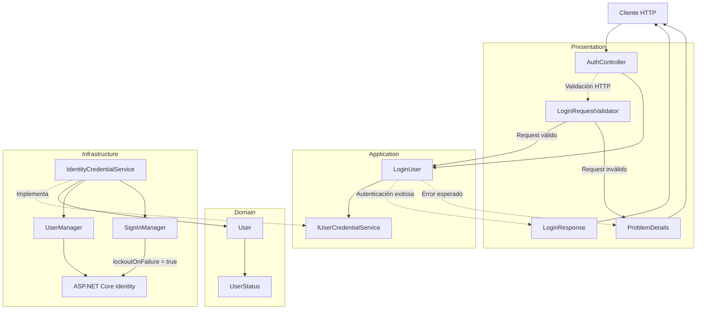

**Interpretación:**

- **Presentation:** valida el request de autenticación y representa los resultados mediante respuestas HTTP.
- **Application:** coordina el login mediante contratos independientes de infraestructura.
- **Domain:** proporciona el estado funcional utilizado para determinar si una cuenta puede autenticarse.
- **Infrastructure:** verifica las credenciales y aplica el mecanismo de bloqueo mediante ASP.NET Core Identity.

La implementación mantiene la separación entre validación HTTP, coordinación del caso de uso y verificación técnica de credenciales.

#### Resultado

Se dispone de una validación HTTP uniforme para las solicitudes de inicio de sesión mediante `LoginRequestValidator`.

Además, `IdentityCredentialService` verifica que las cuentas estén activas, tengan una contraseña configurada y superen las comprobaciones de ASP.NET Core Identity.

La utilización de `CheckPasswordSignInAsync()` con `lockoutOnFailure: true` integra el proceso de autenticación con las políticas de bloqueo configuradas en el paso 8.

El servicio devuelve un resultado booleano sin exponer detalles específicos del fallo, manteniendo la verificación de contraseñas y las restricciones de acceso dentro de Infrastructure.

---

### 12. Agregar pruebas unitarias.

#### Componentes implementados

| Componente                           | Acción | Tipo  | Capa  | Responsabilidad                                                                                      |
| ------------------------------------ | ------ | ----- | ----- | ---------------------------------------------------------------------------------------------------- |
| `AdminOnlyPolicyTests`               | Create | class | Tests | Verifica que la política `AdminOnly` exija el rol administrativo.                                    |
| `IdentityOptionsTests`               | Create | class | Tests | Comprueba los valores predeterminados y las restricciones de configuración de contraseñas y bloqueo. |
| `InvitationUseCaseTests`             | Create | class | Tests | Verifica la coordinación de los casos de uso de creación, activación y reenvío de invitaciones.      |
| `InvitationValidationTests`          | Create | class | Tests | Comprueba las validaciones HTTP de los requests de invitación y activación.                          |
| `LoginUserTests`                     | Create | class | Tests | Verifica los resultados del inicio de sesión utilizando dependencias simuladas.                      |
| `ProblemDetailsResponseFactoryTests` | Create | class | Tests | Comprueba el mapeo uniforme de errores HTTP y el manejo de excepciones.                              |
| `FakeInvitationService`              | Create | class | Tests | Simula `IUserInvitationService` y registra los datos recibidos durante las pruebas.                  |
| `FakeInvitationNotifier`             | Create | class | Tests | Simula el envío de invitaciones y permite provocar errores de entrega.                               |
| `FakeUserRepository`                 | Create | class | Tests | Simula la búsqueda de usuarios por correo electrónico.                                               |
| `FakeCredentialService`              | Create | class | Tests | Simula el resultado de la verificación de credenciales.                                              |
| `FakeTokenIssuer`                    | Create | class | Tests | Simula la emisión de tokens de autenticación.                                                        |

**Ubicación:** `Fepp.ContaOps.UnitTests`

Las pruebas utilizan **xUnit** y verifican el comportamiento de Application, las reglas de configuración de Identity y los contratos HTTP sin requerir una base de datos PostgreSQL ni un servidor SMTP real.

Las clases `Fake` son implementaciones privadas utilizadas exclusivamente dentro de las pruebas.

#### Métodos y funciones principales

**1. Pruebas de autorización y configuración**

| Clase                  | Método                                                     | Responsabilidad                                                                                  |
| ---------------------- | ---------------------------------------------------------- | ------------------------------------------------------------------------------------------------ |
| `AdminOnlyPolicyTests` | `AdminOnlyPolicy_RequiresAdminRole()`                      | Comprueba que la política `AdminOnly` esté registrada y contenga el requisito del rol `Admin`.   |
| `IdentityOptionsTests` | `PasswordOptions_DefaultsAreSecure()`                      | Verifica los valores predeterminados de la política de contraseñas.                              |
| `IdentityOptionsTests` | `PasswordOptions_InvalidUniqueCharacterLimit_IsRejected()` | Comprueba que se rechace una cantidad mínima de caracteres únicos superior a la longitud mínima. |
| `IdentityOptionsTests` | `LockoutOptions_DefaultsAreSecure()`                       | Verifica los valores predeterminados de bloqueo de cuentas.                                      |
| `IdentityOptionsTests` | `LockoutOptions_NonPositiveValues_AreRejected()`           | Comprueba que se rechacen límites de bloqueo iguales a cero.                                     |

**2. Pruebas de casos de uso**

| Clase                    | Método                                                         | Responsabilidad                                                                             |
| ------------------------ | -------------------------------------------------------------- | ------------------------------------------------------------------------------------------- |
| `InvitationUseCaseTests` | `CreateInvitation_NotifiesAfterRegistration()`                 | Verifica que una invitación se notifique después de registrarse correctamente.              |
| `InvitationUseCaseTests` | `CreateInvitation_WhenNotifierFails_PropagatesDeliveryError()` | Comprueba que los errores de entrega de correo se propaguen al consumidor del caso de uso.  |
| `InvitationUseCaseTests` | `ActivateUser_DelegatesToInvitationService()`                  | Verifica que el caso de uso transmita el token y la contraseña al servicio de invitaciones. |
| `InvitationUseCaseTests` | `ResendInvitation_NotifiesNewInvitation()`                     | Comprueba que el reenvío solicite la notificación de la nueva invitación.                   |

**3. Pruebas de validación HTTP**

| Clase                       | Método                                                   | Responsabilidad                                                                             |
| --------------------------- | -------------------------------------------------------- | ------------------------------------------------------------------------------------------- |
| `InvitationValidationTests` | `CreateInvitation_ValidEmail_IsAccepted()`               | Comprueba que un correo electrónico válido sea aceptado.                                    |
| `InvitationValidationTests` | `CreateInvitation_EmailOverLimit_IsRejected()`           | Verifica que se rechacen correos que superan la longitud permitida.                         |
| `InvitationValidationTests` | `ActivateUser_ValidTransport_IsAccepted()`               | Comprueba que los datos de activación válidos cumplan las restricciones de transporte.      |
| `InvitationValidationTests` | `ActivateUser_DoesNotDuplicateIdentityComplexityRules()` | Verifica que la API no aplique las reglas de complejidad de contraseña propias de Identity. |
| `InvitationValidationTests` | `ActivateUser_InvalidIdentifierAndToken_AreRejected()`   | Comprueba el rechazo de identificadores inválidos y tokens vacíos.                          |

**4. Pruebas de autenticación**

| Clase            | Método                                                     | Responsabilidad                                                                                              |
| ---------------- | ---------------------------------------------------------- | ------------------------------------------------------------------------------------------------------------ |
| `LoginUserTests` | `ValidCredentials_ReturnsToken()`                          | Comprueba que unas credenciales válidas permitan obtener un token.                                           |
| `LoginUserTests` | `UnknownUser_ReturnsInvalidCredentials()`                  | Verifica que un usuario inexistente genere el error `invalid_credentials`.                                   |
| `LoginUserTests` | `InvalidPassword_ReturnsInvalidCredentials()`              | Comprueba que una contraseña incorrecta genere `invalid_credentials`.                                        |
| `LoginUserTests` | `NonAuthenticableAccountStates_ReturnInvalidCredentials()` | Verifica que una comprobación de credenciales fallida produzca un error uniforme para los estados evaluados. |

**5. Pruebas de errores HTTP**

| Clase                                | Método                                                             | Responsabilidad                                                                                        |
| ------------------------------------ | ------------------------------------------------------------------ | ------------------------------------------------------------------------------------------------------ |
| `ProblemDetailsResponseFactoryTests` | `CreateValidationResult_ReturnsUniformProblemDetails()`            | Comprueba que los errores de validación incluyan código, campos y `traceId`.                           |
| `ProblemDetailsResponseFactoryTests` | `CreateApplicationErrorResult_NotFound_Returns404()`               | Verifica que un recurso inexistente se traduzca a HTTP 404 sin exponer su identificador en el detalle. |
| `ProblemDetailsResponseFactoryTests` | `CreateApplicationErrorResult_InvalidActivationToken_Returns400()` | Comprueba que un token de activación inválido genere HTTP 400.                                         |
| `ProblemDetailsResponseFactoryTests` | `EmailDeliveryUnavailable_Returns503ProblemDetails()`              | Verifica que los errores de entrega de correo generen HTTP 503.                                        |
| `ProblemDetailsResponseFactoryTests` | `CancelledRequest_Returns499()`                                    | Comprueba que una cancelación del cliente no se convierta en HTTP 500.                                 |

#### Pruebas de autorización

**Componente:** `AdminOnlyPolicyTests`

La prueba utiliza una configuración JWT en memoria y registra los servicios de Presentation mediante `AddApi()`.

```csharp
IAuthorizationPolicyProvider policyProvider = provider
    .GetRequiredService<IAuthorizationPolicyProvider>();

AuthorizationPolicy? policy =
    await policyProvider.GetPolicyAsync("AdminOnly");

Assert.NotNull(policy);

RolesAuthorizationRequirement requirement =
    Assert.IsType<RolesAuthorizationRequirement>(
        Assert.Single(policy!.Requirements));

Assert.Contains("Admin", requirement.AllowedRoles);
```

| Verificación                                | Resultado esperado               |
| ------------------------------------------- | -------------------------------- |
| Existe la política `AdminOnly`.             | La política no es nula.          |
| La política contiene un requisito de roles. | `RolesAuthorizationRequirement`. |
| El requisito incluye el rol `Admin`.        | `AllowedRoles` contiene `Admin`. |

**Relación con el paso 5:**

La prueba verifica la definición de la política registrada en `DependencyInjection.AddApi()`.

No comprueba la ejecución de una solicitud HTTP real ni la validación de un token JWT.

#### Pruebas de configuración de Identity

**Componente:** `IdentityOptionsTests`

Se verifican los valores predeterminados y las restricciones de los modelos configurables implementados en el paso 8.

**1. Política de contraseñas**

| Propiedad                | Valor esperado |
| ------------------------ | -------------- |
| `RequiredLength`         | `12`           |
| `RequireUppercase`       | `true`         |
| `RequireLowercase`       | `true`         |
| `RequireDigit`           | `true`         |
| `RequireNonAlphanumeric` | `true`         |
| `RequiredUniqueChars`    | `6`            |
| `IsValid()`              | `true`         |

Adicionalmente, se comprueba que una configuración con `RequiredLength = 5` y `RequiredUniqueChars = 6` sea rechazada.

**2. Política de bloqueo**

| Propiedad                       | Valor esperado |
| ------------------------------- | -------------- |
| `AllowedForNewUsers`            | `true`         |
| `MaxFailedAccessAttempts`       | `5`            |
| `DefaultLockoutTimeSpanMinutes` | `15`           |
| `IsValid()`                     | `true`         |

También se comprueba que los parámetros de intentos fallidos y duración de bloqueo iguales a cero sean rechazados.

Estas pruebas verifican las clases de configuración, no la ejecución real del bloqueo de cuentas por ASP.NET Core Identity.

#### Pruebas de casos de uso

**Componente:** `InvitationUseCaseTests`

Los casos de uso se prueban utilizando implementaciones simuladas de los contratos de Application.

| Caso de uso            | Dependencias simuladas                            | Comportamiento verificado                                                 |
| ---------------------- | ------------------------------------------------- | ------------------------------------------------------------------------- |
| `CreateUserInvitation` | `FakeInvitationService`, `FakeInvitationNotifier` | Registra la invitación y solicita su notificación.                        |
| `CreateUserInvitation` | `FakeInvitationService`, `FakeInvitationNotifier` | Propaga `EmailDeliveryUnavailableException` cuando falla la notificación. |
| `ActivateUser`         | `FakeInvitationService`                           | Transmite el token y la contraseña al servicio de invitaciones.           |
| `ResendUserInvitation` | `FakeInvitationService`, `FakeInvitationNotifier` | Solicita la notificación de la invitación generada.                       |

**Implementaciones simuladas:**

| Componente               | Interfaz implementada    | Responsabilidad                                                                |
| ------------------------ | ------------------------ | ------------------------------------------------------------------------------ |
| `FakeInvitationService`  | `IUserInvitationService` | Devuelve resultados configurados y registra determinados parámetros recibidos. |
| `FakeInvitationNotifier` | `IInvitationNotifier`    | Registra la invitación notificada y permite simular una excepción de entrega.  |

**Ejemplo: propagación de errores de correo**

```csharp
FakeInvitationService service = new(
    Result<UserInvitationResult>.Success(CreateInvitation()));

FakeInvitationNotifier notifier = new(
    new EmailDeliveryUnavailableException());

CreateUserInvitation useCase = new(service, notifier);

await Assert.ThrowsAsync<EmailDeliveryUnavailableException>(
    () => useCase.ExecuteAsync(
        new CreateUserInvitationInput("user@example.com")));
```

Esta prueba confirma que el caso de uso no oculta los errores operativos producidos durante la entrega de invitaciones.

La excepción puede ser procesada posteriormente por `GlobalExceptionHandler`, documentado en el paso 6.

#### Pruebas de validación HTTP

**Componente:** `InvitationValidationTests`

Se prueban directamente los validadores de los contratos HTTP.

| Validador                              | Escenario                                                     | Resultado esperado |
| -------------------------------------- | ------------------------------------------------------------- | ------------------ |
| `CreateUserInvitationRequestValidator` | Correo electrónico válido.                                    | Aceptado.          |
| `CreateUserInvitationRequestValidator` | Correo electrónico que supera el límite.                      | Rechazado.         |
| `ActivateUserRequestValidator`         | Identificador GUID, token y contraseña no vacíos.             | Aceptado.          |
| `ActivateUserRequestValidator`         | Contraseña simple que cumple las restricciones de transporte. | Aceptado.          |
| `ActivateUserRequestValidator`         | Identificador inválido y token vacío.                         | Rechazado.         |

**Separación de responsabilidades:**

Las pruebas confirman que los validadores HTTP no duplican las políticas de complejidad de contraseña de ASP.NET Core Identity.

| Capa           | Responsabilidad                                               |
| -------------- | ------------------------------------------------------------- |
| Presentation   | Validar la estructura y los límites de los datos recibidos.   |
| Infrastructure | Aplicar las políticas de contraseña configuradas en Identity. |

**Ejemplo:**

```csharp
ActivateUserRequestValidator validator = new();

var result = await validator.ValidateAsync(
    new ActivateUserRequest
    {
        UserId = "00000000-0000-0000-0000-000000000001",
        Token = "opaque-token",
        NewPassword = "simple"
    });

Assert.True(result.IsValid);
```

La prueba demuestra que una contraseña simple puede superar la validación HTTP.

Esto no significa que Identity acepte esa contraseña durante la activación.

Las implementaciones de los validadores no se incluyen en los archivos proporcionados, por lo que sus reglas completas no pueden verificarse directamente.

#### Pruebas de autenticación

**Componente:** `LoginUserTests`

El caso de uso `LoginUser` se prueba sin utilizar ASP.NET Core Identity ni PostgreSQL.

**Dependencias simuladas:**

| Componente              | Interfaz implementada    | Responsabilidad                                             |
| ----------------------- | ------------------------ | ----------------------------------------------------------- |
| `FakeUserRepository`    | `IUserRepository`        | Devuelve un usuario configurado o `null`.                   |
| `FakeCredentialService` | `IUserCredentialService` | Devuelve un resultado booleano de verificación.             |
| `FakeTokenIssuer`       | `ITokenIssuer`           | Devuelve un token de prueba con una expiración configurada. |

**Escenarios implementados:**

| Escenario                                                            | Resultado esperado           |
| -------------------------------------------------------------------- | ---------------------------- |
| Usuario existente con credenciales válidas.                          | Resultado exitoso con token. |
| Usuario inexistente.                                                 | Error `invalid_credentials`. |
| Contraseña incorrecta.                                               | Error `invalid_credentials`. |
| Usuario `PendingActivation` cuya verificación de credenciales falla. | Error `invalid_credentials`. |
| Usuario `Active` cuya verificación de credenciales falla.            | Error `invalid_credentials`. |

**Ejemplo de autenticación exitosa:**

```csharp
User user = new(
    new UserId("user-1"),
    "user@example.com",
    ["User"]);

LoginUser login = new(
    new FakeUserRepository(user),
    new FakeCredentialService(true),
    new FakeTokenIssuer());

var result = await login.ExecuteAsync(
    new LoginUserInput(
        "user@example.com",
        "Password123!"));

Assert.True(result.IsSuccess);
Assert.Equal("token", result.Value!.AccessToken);
Assert.Equal(900, result.Value.ExpiresIn);
```

**Consideración sobre estados de usuario:**

La prueba `NonAuthenticableAccountStates_ReturnInvalidCredentials()` utiliza `FakeCredentialService(false)` tanto para `PendingActivation` como para `Active`.

Por tanto, verifica que una comprobación de credenciales fallida devuelve `invalid_credentials` en ambos escenarios.

No demuestra por sí sola que `LoginUser` rechace una cuenta pendiente cuando el servicio de credenciales devuelve `true`.

La restricción efectiva del estado `PendingActivation` en `IdentityCredentialService` se documentó en el paso 11.

#### Pruebas de errores HTTP

**Componente:** `ProblemDetailsResponseFactoryTests`

Se verifican los contratos de respuesta de errores y el tratamiento de excepciones.

| Escenario                           | Estado HTTP esperado | Código de error                                   |
| ----------------------------------- | -------------------- | ------------------------------------------------- |
| Error de validación.                | `400`                | `validation_error`                                |
| Recurso inexistente.                | `404`                | `resource_not_found`                              |
| Token de activación inválido.       | `400`                | `invalid_activation_token`                        |
| Error de entrega de correo.         | `503`                | Definido por `EmailDeliveryUnavailableException`. |
| Solicitud cancelada por el cliente. | `499`                | No se verifica el cuerpo de la respuesta.         |

**Validaciones adicionales:**

- Los errores de validación incluyen `traceId`.
- Los errores de validación incorporan la extensión `errors`.
- Los errores de recurso inexistente no incluyen el identificador solicitado en `ProblemDetails.Detail`.
- Los errores de correo utilizan el tipo de contenido `application/problem+json`.
- Las cancelaciones del cliente no se convierten en errores HTTP 500.

**Ejemplo: token de activación inválido**

```csharp
ObjectResult result =
    ProblemDetailsResponseFactory.CreateApplicationErrorResult(
        CreateHttpContext(),
        InvalidActivationTokenError.Instance);

ProblemDetails problemDetails =
    Assert.IsType<ProblemDetails>(result.Value);

Assert.Equal(
    StatusCodes.Status400BadRequest,
    result.StatusCode);

Assert.Equal(
    "invalid_activation_token",
    problemDetails.Extensions["code"]);
```

Esta prueba verifica el mapeo incorporado en el paso 6.

#### Componentes de .NET y proveedores externos

| Componente / Método                | Origen                                   | Función                                                                |
| ---------------------------------- | ---------------------------------------- | ---------------------------------------------------------------------- |
| `[Fact]`                           | xUnit                                    | Identifica una prueba individual.                                      |
| `[Theory]`                         | xUnit                                    | Define una prueba parametrizada.                                       |
| `[InlineData]`                     | xUnit                                    | Proporciona valores para ejecutar una prueba parametrizada.            |
| `Assert.Equal()`                   | xUnit                                    | Comprueba la igualdad entre valores.                                   |
| `Assert.True()` / `Assert.False()` | xUnit                                    | Comprueba resultados booleanos.                                        |
| `Assert.ThrowsAsync<T>()`          | xUnit                                    | Verifica que una operación asincrónica lance una excepción específica. |
| `Assert.IsType<T>()`               | xUnit                                    | Comprueba el tipo exacto de un objeto.                                 |
| `Assert.Contains()`                | xUnit                                    | Verifica la presencia de un elemento o valor.                          |
| `ConfigurationBuilder`             | Microsoft.Extensions.Configuration       | Construye configuraciones para las pruebas.                            |
| `AddInMemoryCollection()`          | Microsoft.Extensions.Configuration       | Proporciona valores de configuración sin utilizar archivos externos.   |
| `ServiceCollection`                | Microsoft.Extensions.DependencyInjection | Permite registrar servicios para las pruebas.                          |
| `BuildServiceProvider()`           | Microsoft.Extensions.DependencyInjection | Construye el proveedor de servicios.                                   |
| `IAuthorizationPolicyProvider`     | ASP.NET Core Authorization               | Permite recuperar políticas de autorización registradas.               |
| `RolesAuthorizationRequirement`    | ASP.NET Core Authorization               | Representa un requisito de autorización basado en roles.               |
| `DefaultHttpContext`               | ASP.NET Core                             | Proporciona un contexto HTTP para pruebas.                             |
| `NullLogger<T>`                    | Microsoft.Extensions.Logging             | Proporciona un logger que descarta los mensajes registrados.           |
| `Task.FromResult()`                | .NET                                     | Devuelve una tarea completada con un resultado.                        |
| `Task.FromException()`             | .NET                                     | Devuelve una tarea fallida con una excepción específica.               |

#### Cobertura funcional de las pruebas

| Funcionalidad                       | Clase de pruebas                     | Verificación                                             |
| ----------------------------------- | ------------------------------------ | -------------------------------------------------------- |
| Política administrativa `AdminOnly` | `AdminOnlyPolicyTests`               | Definición de la política y rol requerido.               |
| Política de contraseñas             | `IdentityOptionsTests`               | Valores predeterminados y validaciones de configuración. |
| Bloqueo de cuentas                  | `IdentityOptionsTests`               | Valores predeterminados y restricciones numéricas.       |
| Crear invitación                    | `InvitationUseCaseTests`             | Coordinación del registro y notificación.                |
| Propagar errores de correo          | `InvitationUseCaseTests`             | Propagación de `EmailDeliveryUnavailableException`.      |
| Activar usuario                     | `InvitationUseCaseTests`             | Delegación de token y contraseña.                        |
| Reenviar invitación                 | `InvitationUseCaseTests`             | Solicitud de notificación.                               |
| Validar invitación                  | `InvitationValidationTests`          | Formato y longitud del correo.                           |
| Validar activación                  | `InvitationValidationTests`          | Identificador, token y límites HTTP.                     |
| Login exitoso                       | `LoginUserTests`                     | Resultado con token de acceso.                           |
| Login fallido                       | `LoginUserTests`                     | Error uniforme `invalid_credentials`.                    |
| Errores de validación               | `ProblemDetailsResponseFactoryTests` | Contrato HTTP 400.                                       |
| Recurso inexistente                 | `ProblemDetailsResponseFactoryTests` | Contrato HTTP 404.                                       |
| Token inválido                      | `ProblemDetailsResponseFactoryTests` | Contrato HTTP 400.                                       |
| Error de correo                     | `ProblemDetailsResponseFactoryTests` | Contrato HTTP 503.                                       |
| Cancelación del cliente             | `ProblemDetailsResponseFactoryTests` | Estado HTTP 499.                                         |

**Alcance:**

Las pruebas son principalmente unitarias y utilizan dependencias simuladas.

No comprueban directamente:

- La persistencia real en PostgreSQL.
- El envío de correos mediante SMTP.
- La ejecución completa de endpoints HTTP.
- La validación criptográfica de tokens de invitación.
- El bloqueo efectivo después de varios intentos fallidos de autenticación.
- La creación y activación completas de cuentas utilizando una base de datos real.

Estos comportamientos requieren pruebas de integración.

#### Diagrama de arquitectura

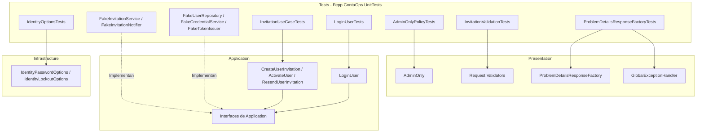

**Interpretación:**

- **Tests:** contiene pruebas organizadas por funcionalidad y componentes simulados.
- **Presentation:** se verifican las políticas de autorización, validadores y contratos de errores HTTP.
- **Application:** se comprueba la coordinación de los casos de uso mediante interfaces.
- **Infrastructure:** se verifican los modelos de configuración de seguridad sin ejecutar sus adaptadores contra servicios reales.
- **Dependencias simuladas:** permiten comprobar los casos de uso de forma aislada, sin requerir Identity, PostgreSQL ni SMTP.

#### Resultado

Se incorporaron seis clases de pruebas unitarias que cubren autorización administrativa, políticas de seguridad, casos de uso de invitaciones, validaciones HTTP, autenticación y manejo uniforme de errores.

Las pruebas utilizan implementaciones simuladas de los contratos de Application para verificar el comportamiento de los casos de uso sin depender de servicios externos.

También comprueban el mapeo de errores HTTP 400, 404, 503 y 499, así como los requisitos de la política `AdminOnly`.

Con esta implementación se establece una base de pruebas automatizadas para detectar regresiones funcionales en el ciclo de invitaciones y autenticación de FEPP ContaOps.

**Nota:** Los archivos proporcionados contienen las pruebas implementadas, pero no los resultados de su ejecución. Por tanto, no puede afirmarse que todas hayan finalizado correctamente sin consultar la salida de `dotnet test`.

---

### 13. Agregar pruebas de integración.

#### Componentes implementados

| Componente                   | Acción | Tipo  | Capa  | Responsabilidad                                                                                                            |
| ---------------------------- | ------ | ----- | ----- | -------------------------------------------------------------------------------------------------------------------------- |
| `InvitationIntegrationTests` | Create | class | Tests | Verifica los flujos HTTP de invitaciones, activación y autenticación utilizando PostgreSQL real en un contenedor temporal. |
| `TestApiFactory`             | Create | class | Tests | Configura una instancia de la API para las pruebas, con configuración específica y un notificador de correo simulado.      |
| `FakeInvitationNotifier`     | Create | class | Tests | Sustituye el envío real de correos y conserva las invitaciones generadas para verificar los flujos de activación.          |

**Ubicación:** `Fepp.ContaOps.IntegrationTests`

Las pruebas utilizan **xUnit, ASP.NET Core WebApplicationFactory y Testcontainers** para comprobar el comportamiento de la API mediante solicitudes HTTP reales contra un servidor de pruebas.

A diferencia de las pruebas unitarias del paso 12, estas pruebas integran los componentes de Presentation, Application, Infrastructure y la persistencia PostgreSQL.

El servicio de notificación de correo se sustituye por una implementación en memoria para evitar dependencias de un servidor SMTP externo.

#### Métodos y funciones principales

**1. Pruebas de integración**

| Clase                        | Método                                                   | Responsabilidad                                                                                 |
| ---------------------------- | -------------------------------------------------------- | ----------------------------------------------------------------------------------------------- |
| `InvitationIntegrationTests` | `InitializeAsync()`                                      | Inicia el contenedor PostgreSQL antes de ejecutar las pruebas.                                  |
| `InvitationIntegrationTests` | `DisposeAsync()`                                         | Libera los recursos del contenedor PostgreSQL al finalizar.                                     |
| `InvitationIntegrationTests` | `AdminCreatesInvitation_ActivationAllowsLogin()`         | Verifica el flujo completo de creación, activación y autenticación de una cuenta invitada.      |
| `InvitationIntegrationTests` | `InvitationEndpoints_RequireAdminRole()`                 | Comprueba que los endpoints administrativos exijan autenticación y el rol `Admin`.              |
| `InvitationIntegrationTests` | `DuplicateEmail_ReturnsConflict()`                       | Verifica que registrar dos veces el mismo correo produzca HTTP 409.                             |
| `InvitationIntegrationTests` | `ResendInvitation_InvalidatesPreviousToken()`            | Comprueba que reenviar una invitación invalide el token anterior.                               |
| `InvitationIntegrationTests` | `NotificationFailure_Returns503AndKeepsPendingAccount()` | Verifica que un fallo de notificación produzca HTTP 503 y que la cuenta permanezca sin activar. |

**2. Métodos auxiliares**

| Clase                        | Método               | Responsabilidad                                                                                    |
| ---------------------------- | -------------------- | -------------------------------------------------------------------------------------------------- |
| `InvitationIntegrationTests` | `CreateFactory()`    | Crea una instancia de `TestApiFactory` utilizando la conexión PostgreSQL del contenedor.           |
| `InvitationIntegrationTests` | `LoginAsync()`       | Ejecuta el endpoint de autenticación y obtiene el token JWT de la respuesta.                       |
| `InvitationIntegrationTests` | `SendAsAdminAsync()` | Envía solicitudes HTTP incorporando un token Bearer en el encabezado `Authorization`.              |
| `InvitationIntegrationTests` | `ReadCodeAsync()`    | Extrae el código de error del cuerpo JSON de una respuesta HTTP.                                   |
| `InvitationIntegrationTests` | `UniqueEmail()`      | Genera correos electrónicos únicos para evitar conflictos entre escenarios de prueba.              |
| `TestApiFactory`             | `ConfigureWebHost()` | Configura la conexión PostgreSQL, JWT, administrador inicial, invitaciones y notificador simulado. |
| `FakeInvitationNotifier`     | `NotifyAsync()`      | Registra la invitación recibida y permite simular errores de entrega.                              |

#### Infraestructura de pruebas

**1. PostgreSQL mediante Testcontainers**

La clase `InvitationIntegrationTests` implementa `IAsyncLifetime` para administrar el ciclo de vida del contenedor.

```csharp
private readonly PostgreSqlContainer _database =
    new PostgreSqlBuilder("postgres:16-alpine").Build();

public Task InitializeAsync()
{
    return _database.StartAsync();
}

public Task DisposeAsync()
{
    return _database.DisposeAsync().AsTask();
}
```

| Componente              | Responsabilidad                                                       |
| ----------------------- | --------------------------------------------------------------------- |
| `PostgreSqlBuilder`     | Configura el contenedor PostgreSQL utilizado durante las pruebas.     |
| `PostgreSqlContainer`   | Representa la instancia temporal de PostgreSQL.                       |
| `InitializeAsync()`     | Inicia PostgreSQL antes de ejecutar las pruebas del objeto de prueba. |
| `DisposeAsync()`        | Elimina el contenedor y libera sus recursos.                          |
| `GetConnectionString()` | Obtiene la cadena de conexión de la instancia PostgreSQL creada.      |

**Configuración:**

| Parámetro              | Valor                |
| ---------------------- | -------------------- |
| Motor de base de datos | PostgreSQL           |
| Imagen Docker          | `postgres:16-alpine` |
| Administración         | Testcontainers       |
| Persistencia           | PostgreSQL temporal  |
| Ciclo de vida          | `IAsyncLifetime`     |

Las pruebas utilizan una instancia real de PostgreSQL administrada por Docker.

Esto permite verificar operaciones de Identity y persistencia sin utilizar la base de datos de desarrollo o producción.

**2. API mediante WebApplicationFactory**

La clase `TestApiFactory` hereda de `WebApplicationFactory<Program>`.

```csharp
private sealed class TestApiFactory : WebApplicationFactory<Program>
{
    private readonly string _connectionString;

    public TestApiFactory(string connectionString)
    {
        _connectionString = connectionString;
    }

    protected override void ConfigureWebHost(IWebHostBuilder builder)
    {
        builder.UseSetting(
            "ConnectionStrings:Default",
            _connectionString);

        // Configuración específica de pruebas.

        builder.ConfigureServices(services =>
        {
            services.RemoveAll<IInvitationNotifier>();

            services.AddSingleton<FakeInvitationNotifier>();

            services.AddSingleton<IInvitationNotifier>(provider =>
                provider.GetRequiredService<FakeInvitationNotifier>());
        });
    }
}
```

**Responsabilidades:**

| Configuración               | Función                                                                           |
| --------------------------- | --------------------------------------------------------------------------------- |
| `ConnectionStrings:Default` | Conecta la API con el PostgreSQL temporal.                                        |
| `Jwt`                       | Configura la generación y validación de tokens durante las pruebas.               |
| `BootstrapAdmin`            | Define el administrador inicial utilizado para operaciones protegidas.            |
| `UserInvitation`            | Configura la vigencia del token y la URL de activación.                           |
| `Email:Smtp`                | Proporciona valores de configuración válidos sin realizar conexiones SMTP reales. |
| `IInvitationNotifier`       | Sustituye el adaptador de correo por una implementación en memoria.               |

La fábrica permite ejecutar solicitudes HTTP contra una instancia de la aplicación sin desplegar un servidor externo.

#### Simulación del envío de invitaciones

**Componente:** `FakeInvitationNotifier`

```csharp
public sealed class FakeInvitationNotifier : IInvitationNotifier
{
    public UserInvitationResult? LastInvitation { get; private set; }

    public bool ThrowOnNotify { get; set; }

    public Task NotifyAsync(
        UserInvitationResult invitation,
        CancellationToken cancellationToken = default)
    {
        LastInvitation = invitation;

        if (ThrowOnNotify)
        {
            throw new EmailDeliveryUnavailableException();
        }

        return Task.CompletedTask;
    }
}
```

| Propiedad / Método | Responsabilidad                                                             |
| ------------------ | --------------------------------------------------------------------------- |
| `LastInvitation`   | Conserva la última invitación recibida, incluyendo su token de activación.  |
| `ThrowOnNotify`    | Permite configurar un fallo simulado durante la notificación.               |
| `NotifyAsync()`    | Registra la invitación o lanza una excepción de entrega cuando corresponde. |

**Características:**

- Implementa el contrato `IInvitationNotifier` de Application.
- No establece conexiones SMTP.
- Permite recuperar el token generado para ejecutar las pruebas de activación.
- Facilita la simulación de errores operativos.
- Se registra como `Singleton` dentro de la fábrica de pruebas.

El token permanece accesible únicamente dentro de la infraestructura de pruebas.

#### Escenarios de integración

**1. Crear invitación, activar cuenta e iniciar sesión**

Método: `AdminCreatesInvitation_ActivationAllowsLogin()`

| Orden | Operación                                                        | Endpoint                      | Resultado esperado           |
| ----- | ---------------------------------------------------------------- | ----------------------------- | ---------------------------- |
| 1     | Autenticar al administrador.                                     | `POST /api/auth/login`        | `200 OK`                     |
| 2     | Crear una invitación utilizando el token administrativo.         | `POST /api/users/invitations` | `201 Created`                |
| 3     | Verificar que el response incluya el rol `User`.                 | Respuesta de invitación       | Rol correcto                 |
| 4     | Comprobar que no se exponga el token ni el enlace de activación. | Respuesta de invitación       | Información sensible ausente |
| 5     | Intentar iniciar sesión con la cuenta pendiente.                 | `POST /api/auth/login`        | `401 Unauthorized`           |
| 6     | Activar la cuenta mediante su token.                             | `POST /api/auth/activate`     | `204 No Content`             |
| 7     | Iniciar sesión con la cuenta activada.                           | `POST /api/auth/login`        | `200 OK`                     |

**Validaciones principales:**

- El administrador puede crear invitaciones.
- La cuenta se registra inicialmente con el rol `User`.
- La respuesta pública no contiene el token de activación.
- Una cuenta pendiente no puede autenticarse.
- La activación permite establecer la contraseña inicial.
- Una cuenta activada puede iniciar sesión.

Este escenario verifica la integración funcional de los componentes implementados desde SPEC 03.

**2. Autorización administrativa**

Método: `InvitationEndpoints_RequireAdminRole()`

| Escenario                                              | Resultado esperado | Código                    |
| ------------------------------------------------------ | ------------------ | ------------------------- |
| Crear invitación sin token JWT.                        | `401 Unauthorized` | `authentication_required` |
| Crear invitación utilizando una cuenta con rol `User`. | `403 Forbidden`    | `forbidden`               |

**Flujo:**

1. Se intenta crear una invitación sin autenticación.
2. Se comprueba que la API devuelva HTTP 401.
3. Se autentica al administrador.
4. Se crea y activa una cuenta regular.
5. Se obtiene un JWT del usuario regular.
6. Se intenta crear una invitación utilizando ese token.
7. Se comprueba que la API devuelva HTTP 403.

La prueba verifica la aplicación efectiva de la política `AdminOnly` documentada en el paso 5.

**3. Correo electrónico duplicado**

Método: `DuplicateEmail_ReturnsConflict()`

| Orden | Operación                                           | Resultado esperado  |
| ----- | --------------------------------------------------- | ------------------- |
| 1     | Crear una invitación para un correo nuevo.          | `201 Created`       |
| 2     | Intentar crear otra invitación con el mismo correo. | `409 Conflict`      |
| 3     | Consultar el código del error.                      | `resource_conflict` |

La prueba comprueba que el registro de invitaciones rechace cuentas con correos electrónicos previamente registrados.

**4. Invalidación del token anterior**

Método: `ResendInvitation_InvalidatesPreviousToken()`

| Orden | Operación                                                 | Resultado esperado          |
| ----- | --------------------------------------------------------- | --------------------------- |
| 1     | Crear una invitación para un usuario.                     | Invitación inicial generada |
| 2     | Recuperar el primer token desde `FakeInvitationNotifier`. | Token inicial disponible    |
| 3     | Solicitar el reenvío de la invitación.                    | `204 No Content`            |
| 4     | Recuperar la nueva invitación.                            | Nuevo token disponible      |
| 5     | Intentar activar la cuenta con el token anterior.         | `400 Bad Request`           |
| 6     | Verificar el código del error.                            | `invalid_activation_token`  |
| 7     | Activar la cuenta con el nuevo token.                     | `204 No Content`            |

**Relación con SPEC 03:**

Este escenario comprueba el comportamiento del mecanismo de invalidación basado en la actualización del Security Stamp de Identity.

La prueba utiliza el servicio real de invitaciones y el proveedor de tokens configurado en Infrastructure.

**5. Error de entrega de correo**

Método: `NotificationFailure_Returns503AndKeepsPendingAccount()`

| Orden | Operación                                                 | Resultado esperado                |
| ----- | --------------------------------------------------------- | --------------------------------- |
| 1     | Autenticar al administrador.                              | `200 OK`                          |
| 2     | Configurar `FakeInvitationNotifier.ThrowOnNotify = true`. | Notificador preparado para fallar |
| 3     | Solicitar la creación de una invitación.                  | `503 Service Unavailable`         |
| 4     | Verificar el código del error.                            | `email_delivery_unavailable`      |
| 5     | Intentar iniciar sesión con la cuenta invitada.           | `401 Unauthorized`                |

**Consideración:**

El flujo confirma que un fallo de notificación no permite autenticar a la cuenta creada.

La implementación registra la cuenta pendiente antes de intentar notificarla, por lo que el error de entrega no implica automáticamente revertir su creación.

La prueba comprueba el rechazo del login, pero no consulta directamente el estado almacenado en PostgreSQL.

#### Componentes de .NET y proveedores externos

| Componente / Método         | Origen                                              | Función                                                                       |
| --------------------------- | --------------------------------------------------- | ----------------------------------------------------------------------------- |
| `[Fact]`                    | xUnit                                               | Identifica una prueba individual.                                             |
| `IAsyncLifetime`            | xUnit                                               | Administra la inicialización y liberación asincrónica de recursos de prueba.  |
| `WebApplicationFactory<T>`  | Microsoft.AspNetCore.Mvc.Testing                    | Permite ejecutar una aplicación ASP.NET Core dentro de un entorno de pruebas. |
| `ConfigureWebHost()`        | ASP.NET Core Testing                                | Personaliza la configuración de la aplicación durante las pruebas.            |
| `HttpClient`                | .NET                                                | Ejecuta solicitudes HTTP contra la aplicación de pruebas.                     |
| `HttpRequestMessage`        | .NET                                                | Representa una solicitud HTTP configurable.                                   |
| `HttpResponseMessage`       | .NET                                                | Representa una respuesta HTTP.                                                |
| `PostAsJsonAsync()`         | System.Net.Http.Json                                | Envía solicitudes HTTP POST con contenido JSON.                               |
| `JsonContent.Create()`      | System.Net.Http.Json                                | Construye contenido HTTP serializado como JSON.                               |
| `AuthenticationHeaderValue` | .NET                                                | Configura el encabezado HTTP de autenticación.                                |
| `JsonDocument`              | System.Text.Json                                    | Permite consultar propiedades de documentos JSON.                             |
| `PostgreSqlBuilder`         | Testcontainers.PostgreSql                           | Configura un contenedor PostgreSQL para pruebas.                              |
| `PostgreSqlContainer`       | Testcontainers.PostgreSql                           | Administra el ciclo de vida del contenedor PostgreSQL.                        |
| `RemoveAll<T>()`            | Microsoft.Extensions.DependencyInjection.Extensions | Elimina registros de servicios existentes.                                    |
| `AddSingleton<T>()`         | Microsoft.Extensions.DependencyInjection            | Registra una instancia o servicio con ciclo de vida Singleton.                |
| `Guid.NewGuid()`            | .NET                                                | Genera identificadores únicos para los datos de prueba.                       |

#### Flujo funcional o relaciones

| Operación                      | Componente responsable                 | Resultado                                   |
| ------------------------------ | -------------------------------------- | ------------------------------------------- |
| Iniciar PostgreSQL.            | `PostgreSqlContainer`                  | Base de datos temporal disponible.          |
| Configurar la aplicación.      | `TestApiFactory`                       | API preparada con los parámetros de prueba. |
| Sustituir el notificador SMTP. | `ConfigureWebHost()`                   | `FakeInvitationNotifier` registrado.        |
| Crear cliente HTTP.            | `WebApplicationFactory.CreateClient()` | Cliente conectado al servidor de pruebas.   |
| Autenticar administrador.      | `AuthController`                       | JWT administrativo.                         |
| Crear invitación.              | `UserInvitationsController`            | Cuenta pendiente y token generado.          |
| Activar usuario.               | `AuthController`                       | Cuenta activada.                            |
| Autenticar usuario regular.    | `AuthController`                       | Token de acceso.                            |
| Verificar errores HTTP.        | xUnit                                  | Comparación de estados y códigos de error.  |
| Liberar PostgreSQL.            | `DisposeAsync()`                       | Recursos del contenedor liberados.          |

#### Diagrama de arquitectura

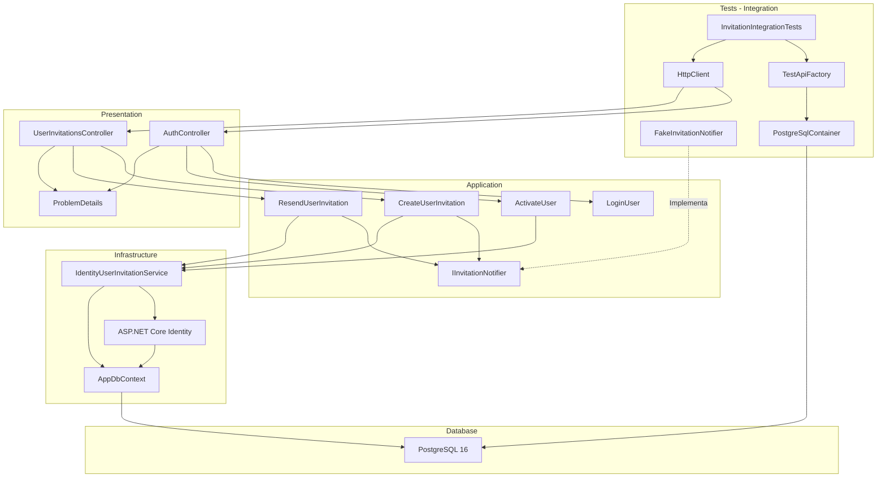

**Interpretación:**

- **Tests:** inicia PostgreSQL, configura la API y ejecuta solicitudes HTTP.
- **Presentation:** procesa autenticación, invitaciones, activación y errores HTTP.
- **Application:** coordina los casos de uso y utiliza contratos independientes de infraestructura.
- **Infrastructure:** ejecuta las operaciones reales de Identity y persistencia.
- **Database:** almacena los usuarios, roles y datos necesarios para el proceso de invitación.
- **FakeInvitationNotifier:** sustituye exclusivamente el transporte de notificaciones, manteniendo el resto del flujo integrado.

#### Resultado

Se incorporó una clase de pruebas de integración con cinco escenarios que verifican el ciclo de invitaciones y autenticación mediante una instancia real de PostgreSQL administrada por Testcontainers.

Las pruebas comprueban la creación y activación de usuarios, la autorización administrativa, los conflictos por correos duplicados, la invalidación de tokens anteriores y el tratamiento de errores de entrega de correo.

La combinación de `WebApplicationFactory`, PostgreSQL y un notificador simulado permite verificar la interacción entre Presentation, Application e Infrastructure sin depender de servicios SMTP externos.

**Nota:** Los archivos proporcionados contienen la implementación de las pruebas, pero no los resultados de su ejecución. Para confirmar que todos los escenarios se completan correctamente es necesario consultar la salida de `dotnet test`.

---

### 14. Actualizar Swagger y documentación.

#### Componentes implementados

| Componente                  | Acción | Tipo           | Capa         | Responsabilidad                                                                                                                  |
| --------------------------- | ------ | -------------- | ------------ | -------------------------------------------------------------------------------------------------------------------------------- |
| `DependencyInjection`       | Update | class (static) | Presentation | Centraliza el registro de servicios HTTP y la configuración de documentación OpenAPI/Swagger.                                    |
| `AddSwaggerDocumentation()` | Update | Método público | Presentation | Actualiza la descripción de la API para incluir autenticación JWT, invitaciones administrativas y respuestas de error uniformes. |

**Ubicación:** `Fepp.ContaOps.Api.DependencyInjection`

El cambio principal consiste en actualizar la descripción del documento OpenAPI `v1`, incorporando las funcionalidades desarrolladas durante SPEC 04.

Se mantienen las configuraciones existentes de autenticación JWT, validación HTTP y autorización `AdminOnly`.

#### Métodos y funciones principales

| Clase                 | Método                            | Responsabilidad                                                                                                                       |
| --------------------- | --------------------------------- | ------------------------------------------------------------------------------------------------------------------------------------- |
| `DependencyInjection` | `AddSwaggerDocumentation()`       | Registra Swagger, configura la información general de la API, incorpora comentarios XML y declara el esquema de autenticación Bearer. |
| `DependencyInjection` | `AddApi()`                        | Registra controladores, validadores, filtros HTTP, autenticación JWT y autorización.                                                  |
| `DependencyInjection` | `WriteAuthenticationErrorAsync()` | Genera respuestas uniformes `ProblemDetails` para errores de autenticación y autorización.                                            |

La actualización documentada se concentra en `AddSwaggerDocumentation()`. Los demás métodos conservan las configuraciones establecidas en pasos anteriores.

#### Configuración de Swagger y OpenAPI

**1. Información general de la API**

Se actualiza la descripción del documento OpenAPI:

```csharp
options.SwaggerDoc("v1", new OpenApiInfo
{
    Title = "FEPP-ContaOps API",
    Version = "v1",
    Description = "API para los procesos operativos contables de FEPP. "
        + "Incluye autenticación JWT y el ciclo administrativo de invitaciones. "
        + "Las respuestas de error usan application/problem+json con code y traceId."
});
```

| Propiedad     | Valor                           | Responsabilidad                                                         |
| ------------- | ------------------------------- | ----------------------------------------------------------------------- |
| `Title`       | `FEPP-ContaOps API`             | Identifica la API en la documentación.                                  |
| `Version`     | `v1`                            | Establece la versión del documento OpenAPI.                             |
| `Description` | Descripción funcional de la API | Informa sobre autenticación JWT, invitaciones y errores HTTP uniformes. |

**Información incorporada:**

| Funcionalidad         | Descripción                                                              |
| --------------------- | ------------------------------------------------------------------------ |
| Autenticación JWT     | Identifica el mecanismo de autenticación utilizado por la API.           |
| Ciclo de invitaciones | Describe la disponibilidad de operaciones administrativas de invitación. |
| Errores HTTP          | Indica el uso del formato `application/problem+json`.                    |
| Código de error       | Documenta la extensión `code` del contrato `ProblemDetails`.             |
| Trazabilidad          | Documenta la extensión `traceId` utilizada para identificar solicitudes. |

La modificación amplía la descripción general del documento OpenAPI, sin cambiar el comportamiento de los endpoints.

#### Documentación mediante comentarios XML

La configuración mantiene la incorporación de comentarios XML del ensamblado de la API.

```csharp
string documentationFile = Path.Combine(
    AppContext.BaseDirectory,
    $"{Assembly.GetExecutingAssembly().GetName().Name}.xml");

if (File.Exists(documentationFile))
{
    options.IncludeXmlComments(documentationFile);
}
```

| Operación                            | Componente responsable            | Resultado                                               |
| ------------------------------------ | --------------------------------- | ------------------------------------------------------- |
| Obtener el directorio de ejecución.  | `AppContext.BaseDirectory`        | Ruta base de la aplicación.                             |
| Identificar el ensamblado actual.    | `Assembly.GetExecutingAssembly()` | Nombre del ensamblado.                                  |
| Construir la ruta del archivo XML.   | `Path.Combine()`                  | Ruta del archivo de documentación.                      |
| Comprobar la existencia del archivo. | `File.Exists()`                   | Determina si el archivo está disponible.                |
| Incorporar comentarios XML.          | `IncludeXmlComments()`            | Añade la documentación disponible al documento OpenAPI. |

**Consideraciones:**

- Se utilizan los comentarios XML definidos en controladores y otros componentes del ensamblado.
- La incorporación del archivo es condicional.
- Si el archivo XML no existe, Swagger continúa configurándose sin esos comentarios.
- El código no demuestra que la generación del archivo XML esté habilitada en el proyecto `.csproj`.

Esta configuración permite aprovechar los comentarios `<summary>`, `<param>` y `<returns>` utilizados en los controladores.

#### Documentación de autenticación JWT

Se mantiene la definición del esquema de seguridad denominado `Bearer`.

```csharp
options.AddSecurityDefinition("Bearer", new OpenApiSecurityScheme
{
    Name = "Authorization",
    Type = SecuritySchemeType.Http,
    Scheme = "bearer",
    BearerFormat = "JWT",
    In = ParameterLocation.Header,
    Description = "Introduzca el token JWT como: Bearer {token}."
});
```

| Propiedad          | Valor            | Responsabilidad                                                    |
| ------------------ | ---------------- | ------------------------------------------------------------------ |
| Nombre del esquema | `Bearer`         | Identifica el mecanismo de seguridad en OpenAPI.                   |
| `Name`             | `Authorization`  | Identifica el encabezado HTTP utilizado.                           |
| `Type`             | `Http`           | Declara autenticación basada en un esquema HTTP.                   |
| `Scheme`           | `bearer`         | Identifica el esquema Bearer.                                      |
| `BearerFormat`     | `JWT`            | Describe el formato esperado del token.                            |
| `In`               | `Header`         | Indica que la credencial se transmite mediante un encabezado HTTP. |
| `Description`      | `Bearer {token}` | Explica cómo proporcionar el token.                                |

**Formato del encabezado HTTP:**

```http
Authorization: Bearer {token}
```

Esta definición permite que los consumidores de la documentación identifiquen el mecanismo de autenticación utilizado por los endpoints protegidos.

#### Requisitos de seguridad en OpenAPI

La configuración mantiene un requisito de seguridad asociado al esquema `Bearer`.

```csharp
options.AddSecurityRequirement(document => new OpenApiSecurityRequirement
{
    [new OpenApiSecuritySchemeReference("Bearer", document)] = []
});
```

| Componente                       | Responsabilidad                                                              |
| -------------------------------- | ---------------------------------------------------------------------------- |
| `AddSecurityRequirement()`       | Incorpora un requisito de seguridad al documento OpenAPI.                    |
| `OpenApiSecurityRequirement`     | Representa el requisito de autenticación.                                    |
| `OpenApiSecuritySchemeReference` | Referencia el esquema `Bearer` definido previamente.                         |
| `[]`                             | Define una colección vacía de scopes, apropiada para el esquema HTTP Bearer. |

**Consideración:**

El requisito se registra a nivel del documento OpenAPI.

La configuración mostrada no diferencia los endpoints anónimos de los protegidos mediante la política `AdminOnly`.

Por tanto, aunque los endpoints `Login` y `Activate` permiten acceso anónimo en tiempo de ejecución, la documentación puede presentar el esquema Bearer como requisito general.

La autorización efectiva continúa dependiendo de los atributos y políticas configurados en ASP.NET Core.

#### Relación con los endpoints de SPEC 04

La documentación Swagger utiliza los controladores implementados anteriormente para describir las operaciones HTTP.

| Método | Endpoint                      | Operación                           | Seguridad          |
| ------ | ----------------------------- | ----------------------------------- | ------------------ |
| POST   | `/api/auth/login`             | Autenticar usuario.                 | `[AllowAnonymous]` |
| POST   | `/api/auth/activate`          | Activar cuenta mediante invitación. | `[AllowAnonymous]` |
| POST   | `/api/users/invitations`      | Crear invitación.                   | `AdminOnly`        |
| POST   | `/api/users/{id}/invitations` | Reenviar invitación.                | `AdminOnly`        |

**Información procedente de los controladores:**

| Elemento                      | Origen                                       |
| ----------------------------- | -------------------------------------------- |
| Rutas HTTP                    | `[Route]` y `[HttpPost]`                     |
| Contratos de entrada          | Parámetros de las acciones y DTOs            |
| Contratos de salida           | DTOs y atributos `[ProducesResponseType]`    |
| Códigos HTTP declarados       | `[ProducesResponseType]`                     |
| Descripciones de operaciones  | Comentarios XML, cuando estén disponibles    |
| Restricciones de autorización | Atributos `[Authorize]` y `[AllowAnonymous]` |

La configuración de Swagger complementa los contratos y atributos declarados en Presentation.

No se agregan nuevos endpoints ni se modifican sus respuestas en este paso.

#### Documentación de errores HTTP

La descripción general del documento OpenAPI incorpora el formato uniforme utilizado por la API:

`application/problem+json`

**Estructura de referencia:**

| Propiedad  | Tipo                           | Responsabilidad                                                        |
| ---------- | ------------------------------ | ---------------------------------------------------------------------- |
| `type`     | `string`                       | Identifica el tipo de problema mediante una referencia.                |
| `title`    | `string`                       | Describe brevemente el error.                                          |
| `status`   | `int`                          | Representa el código HTTP.                                             |
| `detail`   | `string`                       | Proporciona una explicación segura del error.                          |
| `instance` | `string`                       | Identifica la ruta de la solicitud.                                    |
| `code`     | `string`                       | Proporciona un código estable para el consumidor.                      |
| `traceId`  | `string`                       | Permite correlacionar la respuesta con los registros de la aplicación. |
| `errors`   | `Dictionary<string, string[]>` | Contiene errores agrupados por campo cuando corresponde.               |

Este contrato fue implementado mediante `ProblemDetailsResponseFactory` y `GlobalExceptionHandler` en pasos anteriores.

**Alcance de la actualización:**

La descripción de Swagger menciona el tipo de contenido y las extensiones `code` y `traceId`.

No se observa en este archivo una definición explícita de un esquema OpenAPI personalizado para representar todas las extensiones de `ProblemDetails`.

#### Componentes de .NET y proveedores externos

| Componente / Método               | Origen                 | Función                                                           |
| --------------------------------- | ---------------------- | ----------------------------------------------------------------- |
| `AddSwaggerGen()`                 | Swashbuckle.AspNetCore | Registra y configura la generación de documentos Swagger/OpenAPI. |
| `SwaggerDoc()`                    | Swashbuckle.AspNetCore | Define un documento OpenAPI con nombre y metadatos.               |
| `OpenApiInfo`                     | Microsoft.OpenApi      | Representa la información general del documento OpenAPI.          |
| `IncludeXmlComments()`            | Swashbuckle.AspNetCore | Incorpora comentarios XML a la documentación generada.            |
| `AddSecurityDefinition()`         | Swashbuckle.AspNetCore | Declara un esquema de seguridad en OpenAPI.                       |
| `OpenApiSecurityScheme`           | Microsoft.OpenApi      | Describe un mecanismo de autenticación.                           |
| `OpenApiSecurityRequirement`      | Microsoft.OpenApi      | Define requisitos de seguridad asociados al documento.            |
| `OpenApiSecuritySchemeReference`  | Microsoft.OpenApi      | Referencia un esquema de seguridad registrado.                    |
| `Path.Combine()`                  | .NET                   | Construye rutas de archivos.                                      |
| `AppContext.BaseDirectory`        | .NET                   | Obtiene el directorio base de ejecución.                          |
| `Assembly.GetExecutingAssembly()` | .NET Reflection        | Obtiene información del ensamblado actual.                        |
| `File.Exists()`                   | .NET                   | Comprueba si existe un archivo.                                   |

#### Flujo funcional o relaciones

| Orden | Operación                                                                 | Componente responsable      |
| ----- | ------------------------------------------------------------------------- | --------------------------- |
| 1     | Registrar los servicios de generación Swagger.                            | `AddSwaggerDocumentation()` |
| 2     | Definir el documento OpenAPI `v1`.                                        | `SwaggerDoc()`              |
| 3     | Incorporar la descripción de autenticación, invitaciones y errores.       | `OpenApiInfo`               |
| 4     | Localizar el archivo de comentarios XML.                                  | `Assembly` / `Path`         |
| 5     | Incorporar los comentarios cuando el archivo existe.                      | `IncludeXmlComments()`      |
| 6     | Registrar el esquema de autenticación Bearer.                             | `AddSecurityDefinition()`   |
| 7     | Asociar el requisito de seguridad al documento.                           | `AddSecurityRequirement()`  |
| 8     | Utilizar la metadata de los controladores para describir las operaciones. | Generador Swagger/OpenAPI   |

#### Diagrama de arquitectura

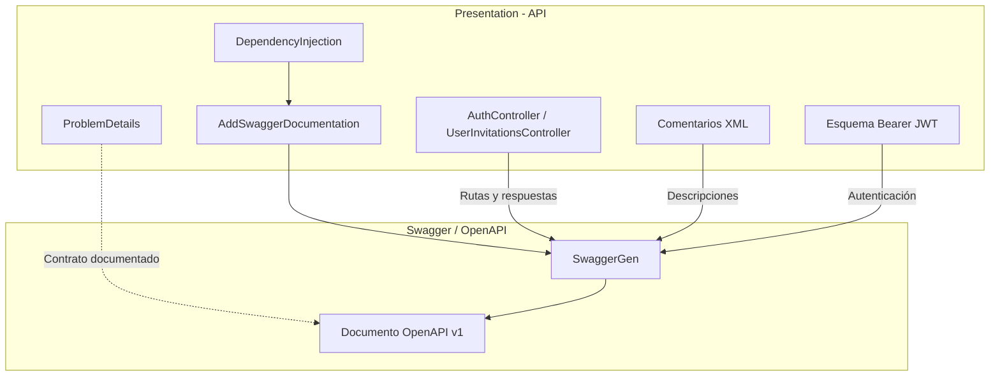

**Interpretación:**

- **Presentation:** proporciona los controladores, contratos HTTP y configuración de Swagger.
- **SwaggerGen:** utiliza la metadata de ASP.NET Core y los comentarios XML disponibles para generar la documentación.
- **OpenAPI:** describe las operaciones HTTP y el esquema de autenticación Bearer.
- **ProblemDetails:** representa el contrato uniforme de errores cuya utilización se informa en la descripción general.

La actualización pertenece exclusivamente a Presentation y no modifica las responsabilidades de Application, Domain o Infrastructure.

#### Resultado

Se actualizó la descripción del documento OpenAPI `v1` de FEPP ContaOps para incorporar las funcionalidades de autenticación JWT y administración de invitaciones implementadas en SPEC 04.

La documentación identifica el formato uniforme de errores `application/problem+json` y las extensiones `code` y `traceId`.

Se conservan la incorporación condicional de comentarios XML, la definición del esquema de autenticación Bearer y su requisito de seguridad en OpenAPI.

Con estos cambios, la documentación Swagger proporciona información más completa sobre las operaciones de autenticación, invitaciones y manejo de errores, facilitando su consulta e integración por parte de los consumidores de la API.

---

### 15. Actualizar .env.example.

#### Componentes implementados

| Componente     | Acción | Tipo    | Capa                           | Responsabilidad                                                                                                                              |
| -------------- | ------ | ------- | ------------------------------ | -------------------------------------------------------------------------------------------------------------------------------------------- |
| `.env.example` | Update | archivo | Infrastructure / Configuración | Documenta las variables de entorno necesarias para configurar PostgreSQL, JWT, Identity, invitaciones, correo electrónico y Data Protection. |

**Ubicación:** `.env.example` (raíz del proyecto).

La actualización incorpora las variables de configuración utilizadas por las funcionalidades desarrolladas durante SPEC 04 y mantiene las configuraciones existentes de SPEC 03.

El archivo proporciona una plantilla de configuración sin incluir credenciales reales.

#### Variables de configuración

**1. PostgreSQL y pgAdmin**

| Variable                     | Valor de ejemplo                         | Responsabilidad                                                    |
| ---------------------------- | ---------------------------------------- | ------------------------------------------------------------------ |
| `POSTGRES_PASSWORD`          | `replace-with-a-local-database-password` | Contraseña del usuario de PostgreSQL configurado en el contenedor. |
| `PGADMIN_DEFAULT_EMAIL`      | `admin@example.local`                    | Correo electrónico para acceder a pgAdmin.                         |
| `PGADMIN_DEFAULT_PASSWORD`   | `replace-with-a-local-pgadmin-password`  | Contraseña de acceso a pgAdmin.                                    |
| `ConnectionStrings__Default` | Cadena de conexión PostgreSQL            | Configura la conexión de la API a la base de datos.                |

**Consideraciones:**

- La cadena de conexión utiliza `Host=localhost` para ejecutar la API directamente desde el host.
- La contraseña incluida en `ConnectionStrings__Default` debe coincidir con la configurada para PostgreSQL.
- Se utilizan valores de ejemplo que deben sustituirse en cada entorno.

**2. Autenticación JWT**

| Variable                          | Valor predeterminado de ejemplo                  | Responsabilidad                                       |
| --------------------------------- | ------------------------------------------------ | ----------------------------------------------------- |
| `Jwt__Issuer`                     | `FEPP-ContaOps`                                  | Identifica el emisor de los tokens JWT.               |
| `Jwt__Audience`                   | `FEPP-ContaOps.Api`                              | Identifica la audiencia autorizada.                   |
| `Jwt__SigningKey`                 | `replace-with-a-random-key-of-at-least-32-bytes` | Define la clave utilizada para firmar los tokens.     |
| `Jwt__AccessTokenLifetimeMinutes` | `60`                                             | Establece la duración del token de acceso en minutos. |

**Relación con la implementación:**

Las variables se vinculan al modelo `JwtOptions`, registrado en `DependencyInjection.AddInfrastructure()`.

La configuración se utiliza para emitir y validar tokens JWT.

La clave de firma debe contener al menos **32 bytes UTF-8** y mantenerse secreta.

**3. Administrador inicial**

| Variable                   | Valor de ejemplo                 | Responsabilidad                                                                       |
| -------------------------- | -------------------------------- | ------------------------------------------------------------------------------------- |
| `BootstrapAdmin__Email`    | `admin@example.local`            | Correo electrónico del administrador inicial.                                         |
| `BootstrapAdmin__Password` | `replace-with-an-admin-password` | Contraseña utilizada para crear y validar la configuración del administrador inicial. |

**Relación con los pasos 9 y 10:**

- `IdentitySeeder` utiliza `BootstrapAdminOptions` para inicializar el administrador.
- `ValidateBootstrapPasswordAsync()` verifica que la contraseña configurada cumpla las políticas de ASP.NET Core Identity.
- Se elimina la configuración de `BootstrapUser`, manteniendo exclusivamente el administrador inicial.

**Importante:** el valor `replace-with-an-admin-password` es un marcador de ejemplo y no debe utilizarse como contraseña real.

#### Políticas de seguridad de Identity

**1. Política de contraseñas**

Se incorporan las variables correspondientes a `IdentityPasswordOptions`.

| Variable                                     | Valor  | Responsabilidad                            |
| -------------------------------------------- | ------ | ------------------------------------------ |
| `Identity__Password__RequiredLength`         | `12`   | Longitud mínima de contraseña.             |
| `Identity__Password__RequireUppercase`       | `true` | Exige letras mayúsculas.                   |
| `Identity__Password__RequireLowercase`       | `true` | Exige letras minúsculas.                   |
| `Identity__Password__RequireDigit`           | `true` | Exige números.                             |
| `Identity__Password__RequireNonAlphanumeric` | `true` | Exige caracteres no alfanuméricos.         |
| `Identity__Password__RequiredUniqueChars`    | `6`    | Exige al menos seis caracteres diferentes. |

Estas variables corresponden a la sección de configuración:

`Identity:Password`

**2. Política de bloqueo**

Se incorporan las variables correspondientes a `IdentityLockoutOptions`.

| Variable                                           | Valor  | Responsabilidad                                |
| -------------------------------------------------- | ------ | ---------------------------------------------- |
| `Identity__Lockout__AllowedForNewUsers`            | `true` | Permite el bloqueo temporal de cuentas nuevas. |
| `Identity__Lockout__MaxFailedAccessAttempts`       | `5`    | Establece el umbral de intentos fallidos.      |
| `Identity__Lockout__DefaultLockoutTimeSpanMinutes` | `15`   | Establece la duración del bloqueo en minutos.  |

Estas variables corresponden a la sección:

`Identity:Lockout`

**Relación con el paso 8:**

Ambas configuraciones se vinculan mediante el patrón Options de .NET y se aplican a ASP.NET Core Identity desde `DependencyInjection.AddInfrastructure()`.

La implementación utiliza `ValidateOnStart()` para comprobar que los parámetros configurados cumplan las restricciones definidas en sus respectivos modelos.

#### Invitaciones y activación

Se mantienen las variables utilizadas por el ciclo de invitaciones implementado en SPEC 03.

| Variable                             | Valor de ejemplo                 | Responsabilidad                                                      |
| ------------------------------------ | -------------------------------- | -------------------------------------------------------------------- |
| `UserInvitation__TokenLifetimeHours` | `24`                             | Define la vigencia del token de activación en horas.                 |
| `UserInvitation__ActivationBaseUrl`  | `https://cliente.local/activate` | Define la URL base utilizada para construir el enlace de activación. |

**Relación con la arquitectura:**

| Componente                           | Responsabilidad                                                              |
| ------------------------------------ | ---------------------------------------------------------------------------- |
| `UserInvitationOptions`              | Representa la configuración de invitaciones.                                 |
| `UserInvitationTokenProviderOptions` | Recibe la duración configurada del token.                                    |
| `UserInvitationTokenProvider`        | Proporciona el mecanismo de generación y validación de tokens de invitación. |
| `InvitationEmailNotifier`            | Utiliza la información de invitación para solicitar su notificación.         |

**Consideraciones:**

- La URL de activación debe utilizar HTTPS.
- La vigencia del token debe ser mayor que cero.
- Los parámetros se validan durante el inicio de la aplicación.

#### Configuración de correo electrónico

Se mantiene la configuración SMTP utilizada para enviar las invitaciones.

| Variable                      | Valor de ejemplo                 | Responsabilidad                                      |
| ----------------------------- | -------------------------------- | ---------------------------------------------------- |
| `Email__Smtp__Host`           | `smtp.gmail.com`                 | Servidor SMTP.                                       |
| `Email__Smtp__Port`           | `587`                            | Puerto de conexión SMTP.                             |
| `Email__Smtp__SecurityMode`   | `StartTls`                       | Mecanismo de seguridad de la conexión.               |
| `Email__Smtp__Username`       | `sender@example.com`             | Usuario de autenticación SMTP.                       |
| `Email__Smtp__Password`       | `replace-with-a-provider-secret` | Credencial de autenticación del proveedor.           |
| `Email__Smtp__FromAddress`    | `sender@example.com`             | Dirección utilizada como remitente.                  |
| `Email__Smtp__FromName`       | `FEPP ContaOps`                  | Nombre público del remitente.                        |
| `Email__Smtp__TimeoutSeconds` | `30`                             | Tiempo máximo configurado para las operaciones SMTP. |

**Configuración de plantillas:**

| Variable                     | Valor        | Responsabilidad                                                                |
| ---------------------------- | ------------ | ------------------------------------------------------------------------------ |
| `Email__Templates__RootPath` | Cadena vacía | Permite especificar una ubicación personalizada para las plantillas de correo. |

Cuando no se especifica una ruta personalizada, la configuración contempla utilizar el catálogo de plantillas distribuido con la aplicación.

**Consideraciones:**

- Los valores SMTP corresponden a una configuración de ejemplo orientada a Gmail.
- Para Gmail mediante SMTP se contempla el uso de TLS y contraseña de aplicación.
- Las credenciales deben sustituirse por valores válidos del proveedor utilizado.
- Los secretos no deben almacenarse en archivos versionados del repositorio.

#### Configuración de Data Protection

Se mantiene la variable utilizada para configurar la persistencia de claves criptográficas.

| Variable                      | Valor de ejemplo | Responsabilidad                                                                                |
| ----------------------------- | ---------------- | ---------------------------------------------------------------------------------------------- |
| `DataProtection__KeyRingPath` | Cadena vacía     | Define la ubicación donde se almacenará el conjunto de claves de ASP.NET Core Data Protection. |

**Relación con Infrastructure:**

El registro de Data Protection utiliza:

```csharp
string? keyRingPath = configuration["DataProtection:KeyRingPath"];

IDataProtectionBuilder dataProtectionBuilder =
    services.AddDataProtection();

if (!string.IsNullOrWhiteSpace(keyRingPath))
{
    DirectoryInfo keyRingDirectory = new(keyRingPath);
    keyRingDirectory.Create();

    dataProtectionBuilder.PersistKeysToFileSystem(keyRingDirectory);

    if (OperatingSystem.IsWindows())
    {
        dataProtectionBuilder.ProtectKeysWithDpapi();
    }
}
```

**Comportamiento:**

| Condición                                        | Resultado                                                                         |
| ------------------------------------------------ | --------------------------------------------------------------------------------- |
| Ruta no configurada                              | Se utiliza el comportamiento predeterminado de Data Protection.                   |
| Ruta configurada                                 | Se almacenan las claves en el directorio especificado.                            |
| Ejecución en Windows con ruta configurada        | Se configura protección de claves mediante DPAPI.                                 |
| Ejecución en otros sistemas con ruta configurada | Se configura persistencia en archivos sin protección DPAPI en el código mostrado. |

**Consideración de seguridad:**

En contenedores Docker y despliegues persistentes, el directorio de claves debe conservarse entre reinicios para evitar problemas con los tokens protegidos mediante Data Protection.

El código mostrado no configura explícitamente cifrado de claves en reposo para entornos distintos de Windows.

#### Relación con el sistema de configuración de .NET

Las variables utilizan doble guion bajo (`__`) para representar secciones jerárquicas de configuración.

| Variable de entorno                          | Clave de configuración .NET                | Modelo                                          |
| -------------------------------------------- | ------------------------------------------ | ----------------------------------------------- |
| `Jwt__Issuer`                                | `Jwt:Issuer`                               | `JwtOptions`                                    |
| `BootstrapAdmin__Email`                      | `BootstrapAdmin:Email`                     | `BootstrapAdminOptions`                         |
| `Identity__Password__RequiredLength`         | `Identity:Password:RequiredLength`         | `IdentityPasswordOptions`                       |
| `Identity__Lockout__MaxFailedAccessAttempts` | `Identity:Lockout:MaxFailedAccessAttempts` | `IdentityLockoutOptions`                        |
| `UserInvitation__TokenLifetimeHours`         | `UserInvitation:TokenLifetimeHours`        | `UserInvitationOptions`                         |
| `Email__Smtp__Host`                          | `Email:Smtp:Host`                          | `EmailSmtpOptions`                              |
| `Email__Templates__RootPath`                 | `Email:Templates:RootPath`                 | `EmailTemplatesOptions`                         |
| `DataProtection__KeyRingPath`                | `DataProtection:KeyRingPath`               | Configuración directa mediante `IConfiguration` |

**Ejemplo:**

```env
Identity__Password__RequiredLength='12'
```

Corresponde a:

```text
Identity:Password:RequiredLength
```

El mecanismo de configuración de .NET permite obtener este valor mediante `IConfiguration` y vincularlo a una propiedad de `IdentityPasswordOptions`.

#### Componentes de .NET y proveedores externos

| Componente / Método         | Origen                                    | Función                                                             |
| --------------------------- | ----------------------------------------- | ------------------------------------------------------------------- |
| `IConfiguration`            | Microsoft.Extensions.Configuration        | Proporciona acceso a los valores de configuración de la aplicación. |
| `GetSection()`              | Microsoft.Extensions.Configuration        | Obtiene una sección jerárquica de configuración.                    |
| `Get<T>()`                  | Microsoft.Extensions.Configuration.Binder | Convierte una sección de configuración en un objeto tipado.         |
| `Bind()`                    | Microsoft.Extensions.Configuration.Binder | Vincula valores configurados con las propiedades de un modelo.      |
| `AddOptions<T>()`           | Microsoft.Extensions.Options              | Registra modelos tipados de configuración.                          |
| `Validate()`                | Microsoft.Extensions.Options              | Comprueba las reglas definidas para una configuración.              |
| `ValidateOnStart()`         | Microsoft.Extensions.Options              | Ejecuta la validación de opciones al iniciar la aplicación.         |
| `AddIdentity()`             | ASP.NET Core Identity                     | Aplica las políticas de contraseñas y bloqueo.                      |
| `AddDataProtection()`       | ASP.NET Core Data Protection              | Registra los servicios de protección criptográfica.                 |
| `PersistKeysToFileSystem()` | ASP.NET Core Data Protection              | Configura la persistencia de claves en archivos.                    |
| `ProtectKeysWithDpapi()`    | ASP.NET Core Data Protection              | Configura la protección de claves mediante DPAPI en Windows.        |

#### Flujo funcional o relaciones

| Orden | Operación                                                                        | Componente responsable                    |
| ----- | -------------------------------------------------------------------------------- | ----------------------------------------- |
| 1     | Definir las variables de configuración del entorno.                              | `.env.example` como plantilla             |
| 2     | Proporcionar los valores mediante variables de entorno o mecanismos compatibles. | Configuración del proceso anfitrión       |
| 3     | Obtener los valores configurados.                                                | `IConfiguration`                          |
| 4     | Vincular los valores a modelos tipados.                                          | `Bind()` / `Get<T>()`                     |
| 5     | Validar las opciones registradas.                                                | `Validate()` / `ValidateOnStart()`        |
| 6     | Configurar ASP.NET Core Identity.                                                | `DependencyInjection.AddInfrastructure()` |
| 7     | Configurar JWT y los servicios de invitaciones.                                  | Infrastructure / Presentation             |
| 8     | Configurar el transporte SMTP y Data Protection.                                 | Infrastructure                            |
| 9     | Inicializar el administrador utilizando la configuración proporcionada.          | `IdentitySeeder`                          |

**Importante:** `.env.example` es una plantilla. El código proporcionado no demuestra que ASP.NET Core cargue automáticamente este archivo.

Los valores deben incorporarse al entorno de ejecución mediante Docker Compose, variables de entorno u otro mecanismo de configuración.

#### Diagrama de arquitectura

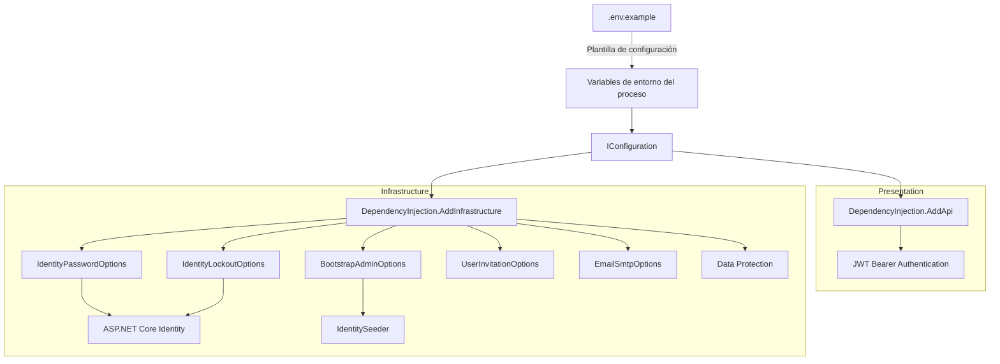

**Interpretación:**

- **`.env.example`:** documenta los parámetros necesarios para configurar la aplicación.
- **IConfiguration:** proporciona acceso a los valores definidos en el entorno.
- **Presentation:** utiliza la configuración JWT para autenticar y autorizar solicitudes HTTP.
- **Infrastructure:** configura Identity, invitaciones, SMTP y Data Protection.
- **IdentitySeeder:** utiliza la configuración administrativa para inicializar la cuenta `Admin`.

El archivo de ejemplo no implementa lógica de negocio ni introduce dependencias entre capas.

#### Resultado

Se actualizó `.env.example` para documentar las variables de configuración utilizadas por FEPP ContaOps, incorporando las políticas de contraseña y bloqueo de ASP.NET Core Identity.

También se consolidaron los parámetros de PostgreSQL, pgAdmin, JWT, administrador inicial, invitaciones, SMTP y Data Protection.

Se eliminaron las referencias de configuración a `BootstrapUser`, conforme al cambio implementado en el paso 9.

El archivo proporciona una plantilla centralizada para configurar diferentes entornos de ejecución sin incluir credenciales reales, facilitando la instalación, el mantenimiento y la configuración segura de la aplicación.

---

### 16. Consolidar configuración.

#### Componentes implementados

| Componente            | Acción | Tipo           | Capa           | Responsabilidad                                                                                                                   |
| --------------------- | ------ | -------------- | -------------- | --------------------------------------------------------------------------------------------------------------------------------- |
| `DependencyInjection` | Update | class (static) | Infrastructure | Centraliza el registro de adaptadores y la configuración de los servicios de infraestructura.                                     |
| `AddInfrastructure()` | Update | Método público | Infrastructure | Configura ASP.NET Core Identity mediante opciones tipadas, eliminando la lectura manual de las políticas de contraseña y bloqueo. |

**Ubicación:** `Fepp.ContaOps.Infrastructure.DependencyInjection`

El cambio principal consiste en consolidar la configuración de ASP.NET Core Identity mediante el **patrón Options de .NET**, reutilizando `IdentityPasswordOptions` e `IdentityLockoutOptions`.

Anteriormente, los valores se obtenían directamente desde `IConfiguration` y se aplicaban dentro de `AddIdentity()`.

Ahora se utiliza `IOptions<T>` para configurar `IdentityOptions`, manteniendo las políticas desacopladas de su origen de configuración.

#### Métodos y funciones principales

| Clase                 | Método                | Responsabilidad                                                                                                 |
| --------------------- | --------------------- | --------------------------------------------------------------------------------------------------------------- |
| `DependencyInjection` | `AddInfrastructure()` | Registra los servicios de Infrastructure, configura Identity y vincula sus políticas mediante opciones tipadas. |

**Componentes configurados:**

| Componente                           | Responsabilidad                                                 |
| ------------------------------------ | --------------------------------------------------------------- |
| `IdentityPasswordOptions`            | Define y valida las políticas de contraseña.                    |
| `IdentityLockoutOptions`             | Define y valida las políticas de bloqueo.                       |
| `IdentityOptions`                    | Recibe las políticas y las proporciona a ASP.NET Core Identity. |
| `UserInvitationOptions`              | Configura la vigencia de los tokens y la URL de activación.     |
| `UserInvitationTokenProviderOptions` | Configura la duración efectiva de los tokens de invitación.     |
| `EmailSmtpOptions`                   | Configura el transporte SMTP.                                   |
| `EmailTemplatesOptions`              | Configura la ubicación de las plantillas de correo.             |
| `JwtOptions`                         | Configura la generación de tokens JWT.                          |
| `BootstrapAdminOptions`              | Configura el administrador inicial.                             |

#### Cambios en la configuración de Identity

**1. Configuración anterior**

En el paso 8, las políticas se obtenían directamente desde `IConfiguration`:

```csharp
IdentityPasswordOptions passwordOptions = configuration
    .GetSection(IdentityPasswordOptions.SectionName)
    .Get<IdentityPasswordOptions>()
    ?? new IdentityPasswordOptions();

IdentityLockoutOptions lockoutOptions = configuration
    .GetSection(IdentityLockoutOptions.SectionName)
    .Get<IdentityLockoutOptions>()
    ?? new IdentityLockoutOptions();
```

Posteriormente, se asignaban sus propiedades dentro de `AddIdentity()`.

**2. Configuración actual**

Se simplifica el registro inicial de Identity:

```csharp
services.AddIdentity<ApplicationIdentityUser, IdentityRole>(options =>
    {
        options.User.RequireUniqueEmail = true;
    })
    .AddEntityFrameworkStores<AppDbContext>()
    .AddTokenProvider<UserInvitationTokenProvider>(
        IdentityUserInvitationService.TokenProviderName)
    .AddDefaultTokenProviders();
```

Las políticas se configuran mediante un registro independiente:

```csharp
services.AddOptions<IdentityOptions>()
    .Configure<IOptions<IdentityPasswordOptions>, IOptions<IdentityLockoutOptions>>(
        (identityOptions, passwordOptions, lockoutOptions) =>
        {
            identityOptions.Password.RequiredLength =
                passwordOptions.Value.RequiredLength;

            identityOptions.Password.RequireUppercase =
                passwordOptions.Value.RequireUppercase;

            identityOptions.Password.RequireLowercase =
                passwordOptions.Value.RequireLowercase;

            identityOptions.Password.RequireDigit =
                passwordOptions.Value.RequireDigit;

            identityOptions.Password.RequireNonAlphanumeric =
                passwordOptions.Value.RequireNonAlphanumeric;

            identityOptions.Password.RequiredUniqueChars =
                passwordOptions.Value.RequiredUniqueChars;

            identityOptions.Lockout.DefaultLockoutTimeSpan =
                TimeSpan.FromMinutes(
                    lockoutOptions.Value.DefaultLockoutTimeSpanMinutes);

            identityOptions.Lockout.MaxFailedAccessAttempts =
                lockoutOptions.Value.MaxFailedAccessAttempts;

            identityOptions.Lockout.AllowedForNewUsers =
                lockoutOptions.Value.AllowedForNewUsers;
        });
```

**Diferencias principales:**

| Característica           | Configuración anterior         | Configuración actual                |
| ------------------------ | ------------------------------ | ----------------------------------- |
| Lectura de configuración | `IConfiguration.Get<T>()`      | `IOptions<T>`                       |
| Aplicación de políticas  | Dentro de `AddIdentity()`      | Mediante `Configure<...>()`         |
| Opciones de contraseña   | Instancia obtenida manualmente | `IOptions<IdentityPasswordOptions>` |
| Opciones de bloqueo      | Instancia obtenida manualmente | `IOptions<IdentityLockoutOptions>`  |
| Destino de las políticas | `IdentityOptions`              | `IdentityOptions`                   |
| Validación               | `ValidateOnStart()`            | `ValidateOnStart()`                 |
| Reglas de seguridad      | Sin cambios                    | Sin cambios                         |

**Ventaja arquitectónica:**

La configuración de Identity queda integrada en el sistema de opciones de .NET, evitando lecturas manuales duplicadas desde `IConfiguration`.

#### Registro y validación de opciones

Los modelos de configuración continúan registrándose mediante el patrón Options.

| Modelo                    | Sección             | Validación                                                             |
| ------------------------- | ------------------- | ---------------------------------------------------------------------- |
| `UserInvitationOptions`   | `UserInvitation`    | Vigencia válida del token y URL HTTPS.                                 |
| `IdentityPasswordOptions` | `Identity:Password` | Longitud mínima y cantidad de caracteres únicos coherentes.            |
| `IdentityLockoutOptions`  | `Identity:Lockout`  | Intentos fallidos y duración de bloqueo mayores que cero.              |
| `EmailSmtpOptions`        | `Email:Smtp`        | Configuración SMTP válida.                                             |
| `EmailTemplatesOptions`   | `Email:Templates`   | Vinculación de configuración, sin validación explícita en este método. |
| `JwtOptions`              | `Jwt`               | Emisor, audiencia, clave de firma y duración válidos.                  |
| `BootstrapAdminOptions`   | `BootstrapAdmin`    | Credenciales administrativas válidas según `IsValid()`.                |

**Operaciones utilizadas:**

| Método                                    | Responsabilidad                                                            |
| ----------------------------------------- | -------------------------------------------------------------------------- |
| `AddOptions<T>()`                         | Registra un modelo de configuración tipado.                                |
| `Bind()`                                  | Vincula una sección de configuración con el modelo.                        |
| `Validate()`                              | Define las condiciones que deben cumplir los valores.                      |
| `ValidateOnStart()`                       | Solicita validar las opciones durante el inicio de la aplicación.          |
| `Configure<TDependency1, TDependency2>()` | Configura opciones utilizando otras opciones registradas en el contenedor. |

La configuración continúa utilizando los valores predeterminados definidos en los modelos cuando no se proporcionan valores específicos para sus propiedades.

#### Relación entre IdentityOptions y las políticas

`IdentityOptions` es el objeto de configuración utilizado por ASP.NET Core Identity para administrar diferentes aspectos de seguridad.

| Propiedad de `IdentityOptions`    | Origen                    | Responsabilidad                               |
| --------------------------------- | ------------------------- | --------------------------------------------- |
| `Password.RequiredLength`         | `IdentityPasswordOptions` | Longitud mínima de contraseña.                |
| `Password.RequireUppercase`       | `IdentityPasswordOptions` | Requisito de mayúsculas.                      |
| `Password.RequireLowercase`       | `IdentityPasswordOptions` | Requisito de minúsculas.                      |
| `Password.RequireDigit`           | `IdentityPasswordOptions` | Requisito de números.                         |
| `Password.RequireNonAlphanumeric` | `IdentityPasswordOptions` | Requisito de caracteres especiales.           |
| `Password.RequiredUniqueChars`    | `IdentityPasswordOptions` | Cantidad mínima de caracteres diferentes.     |
| `Lockout.DefaultLockoutTimeSpan`  | `IdentityLockoutOptions`  | Duración del bloqueo temporal.                |
| `Lockout.MaxFailedAccessAttempts` | `IdentityLockoutOptions`  | Umbral de intentos fallidos.                  |
| `Lockout.AllowedForNewUsers`      | `IdentityLockoutOptions`  | Habilitación del bloqueo para cuentas nuevas. |
| `User.RequireUniqueEmail`         | `AddIdentity()`           | Exige correos electrónicos únicos.            |

**Consideración:**

Las políticas mantienen los valores predeterminados establecidos en el paso 8:

| Política                  | Valor         |
| ------------------------- | ------------- |
| Longitud mínima           | 12 caracteres |
| Mayúsculas                | Obligatorio   |
| Minúsculas                | Obligatorio   |
| Números                   | Obligatorio   |
| Caracteres especiales     | Obligatorio   |
| Caracteres únicos         | Mínimo 6      |
| Intentos fallidos         | 5             |
| Duración del bloqueo      | 15 minutos    |
| Bloqueo de cuentas nuevas | Habilitado    |

No se incorporan nuevas reglas de seguridad. El cambio modifica únicamente la forma en que se configuran y aplican.

#### Relación con otros componentes de Infrastructure

El método `AddInfrastructure()` mantiene el registro de los adaptadores utilizados por Application.

| Interfaz / Servicio          | Implementación                  | Ciclo de vida |
| ---------------------------- | ------------------------------- | ------------- |
| `IUserRepository`            | `IdentityUserRepository`        | Scoped        |
| `IUserCredentialService`     | `IdentityCredentialService`     | Scoped        |
| `IUserInvitationService`     | `IdentityUserInvitationService` | Scoped        |
| `IInvitationNotifier`        | `InvitationEmailNotifier`       | Scoped        |
| `IEmailSender`               | `MailKitSmtpEmailSender`        | Singleton     |
| `ITokenIssuer`               | `JwtTokenIssuer`                | Singleton     |
| `InvitationTemplateCatalog`  | Implementación concreta         | Singleton     |
| `InvitationTemplateRenderer` | Implementación concreta         | Singleton     |
| `IdentitySeeder`             | Implementación concreta         | Scoped        |

**Otros servicios configurados:**

| Servicio                      | Responsabilidad                                                  |
| ----------------------------- | ---------------------------------------------------------------- |
| `AppDbContext`                | Persistencia mediante Entity Framework Core y PostgreSQL.        |
| `ASP.NET Core Identity`       | Administración de usuarios, contraseñas, roles y bloqueos.       |
| `Data Protection`             | Protección criptográfica utilizada por los tokens de invitación. |
| `UserInvitationTokenProvider` | Generación y validación de tokens de invitación.                 |
| `JwtTokenIssuer`              | Emisión de tokens JWT.                                           |

Estos registros se mantienen respecto a los pasos anteriores.

#### Componentes de .NET y proveedores externos

| Componente / Método                       | Origen                                   | Función                                                            |
| ----------------------------------------- | ---------------------------------------- | ------------------------------------------------------------------ |
| `IServiceCollection`                      | Microsoft.Extensions.DependencyInjection | Representa el contenedor de registros de servicios.                |
| `IConfiguration`                          | Microsoft.Extensions.Configuration       | Proporciona acceso a los valores de configuración.                 |
| `IOptions<T>`                             | Microsoft.Extensions.Options             | Proporciona acceso a opciones tipadas.                             |
| `AddOptions<T>()`                         | Microsoft.Extensions.Options             | Registra y configura modelos de opciones.                          |
| `Configure<TDependency1, TDependency2>()` | Microsoft.Extensions.Options             | Permite configurar opciones mediante dos dependencias registradas. |
| `Bind()`                                  | Microsoft.Extensions.Configuration       | Vincula las propiedades con valores de configuración.              |
| `ValidateOnStart()`                       | Microsoft.Extensions.Options             | Ejecuta la validación de opciones al iniciar la aplicación.        |
| `IdentityOptions`                         | ASP.NET Core Identity                    | Centraliza las políticas de administración de usuarios.            |
| `AddIdentity<TUser, TRole>()`             | ASP.NET Core Identity                    | Registra los servicios de administración de usuarios y roles.      |
| `AddEntityFrameworkStores<TContext>()`    | ASP.NET Core Identity                    | Integra Identity con Entity Framework Core.                        |
| `AddTokenProvider<T>()`                   | ASP.NET Core Identity                    | Registra un proveedor de tokens personalizado.                     |
| `AddDefaultTokenProviders()`              | ASP.NET Core Identity                    | Registra los proveedores predeterminados de tokens.                |
| `TimeSpan.FromMinutes()`                  | .NET                                     | Convierte minutos en un intervalo de tiempo.                       |

#### Flujo funcional o relaciones

| Orden | Operación                                                                | Componente responsable                                                             |
| ----- | ------------------------------------------------------------------------ | ---------------------------------------------------------------------------------- |
| 1     | Obtener los valores de configuración.                                    | `IConfiguration`                                                                   |
| 2     | Registrar las opciones de contraseña y bloqueo.                          | `AddOptions<T>()`                                                                  |
| 3     | Vincular los valores de configuración.                                   | `Bind()`                                                                           |
| 4     | Registrar las validaciones de configuración.                             | `Validate()`                                                                       |
| 5     | Configurar su validación al iniciar la aplicación.                       | `ValidateOnStart()`                                                                |
| 6     | Registrar ASP.NET Core Identity.                                         | `AddIdentity()`                                                                    |
| 7     | Registrar la configuración complementaria de `IdentityOptions`.          | `Configure<IOptions<IdentityPasswordOptions>, IOptions<IdentityLockoutOptions>>()` |
| 8     | Resolver las opciones tipadas cuando se construye `IdentityOptions`.     | Sistema Options de .NET                                                            |
| 9     | Aplicar los valores de contraseña y bloqueo.                             | `IdentityOptions`                                                                  |
| 10    | Utilizar las políticas configuradas durante las operaciones de Identity. | ASP.NET Core Identity                                                              |

**Consideración sobre el orden de configuración:**

El registro de `IdentityOptions` se realiza después de `AddIdentity()`.

Esto es válido porque la configuración de opciones se registra en el contenedor y se aplica cuando se resuelve el objeto correspondiente.

No es necesario obtener manualmente los valores de las políticas antes de registrar Identity.

#### Diagrama de arquitectura

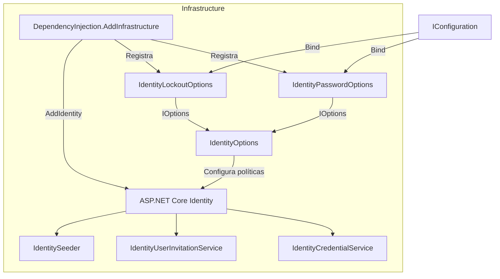

**Interpretación:**

- **IConfiguration:** proporciona los valores definidos mediante las fuentes de configuración de .NET.
- **IdentityPasswordOptions:** representa las políticas configurables de contraseñas.
- **IdentityLockoutOptions:** representa los parámetros configurables de bloqueo.
- **IdentityOptions:** integra ambas configuraciones en el modelo utilizado por ASP.NET Core Identity.
- **Infrastructure:** mantiene el registro de adaptadores y la configuración técnica de Identity.

La consolidación conserva las dependencias dentro de Infrastructure, sin introducir cambios en Application, Domain o Presentation.

#### Resultado

Se consolidó la configuración de ASP.NET Core Identity mediante el patrón Options de .NET.

Las políticas de contraseña y bloqueo ahora se aplican a `IdentityOptions` utilizando `IOptions<IdentityPasswordOptions>` e `IOptions<IdentityLockoutOptions>`, eliminando la lectura manual duplicada desde `IConfiguration`.

Se mantienen las reglas de seguridad, validaciones de configuración y registros de servicios definidos en pasos anteriores.

#### Este cambio simplifica `DependencyInjection.AddInfrastructure()`, centraliza la configuración tipada y facilita el mantenimiento de las políticas de Identity sin modificar el comportamiento funcional de los casos de uso.

---

### 17. Ejecutar restore, build y pruebas.

#### Componentes implementados

| Componente                   | Acción                   | Tipo           | Capa         | Responsabilidad                                                                                                    |
| ---------------------------- | ------------------------ | -------------- | ------------ | ------------------------------------------------------------------------------------------------------------------ |
| `DependencyInjection`        | Sin cambios verificables | class (static) | Presentation | Mantiene el registro de controladores, validadores, autenticación JWT, autorización y documentación Swagger.       |
| `InvitationIntegrationTests` | Update                   | class          | Tests        | Ajusta las pruebas de integración para ejecutar solicitudes HTTPS y utilizar una configuración de pruebas aislada. |
| `CreateHttpsClient()`        | Create                   | Método privado | Tests        | Construye un cliente HTTP con dirección base HTTPS y redirecciones automáticas deshabilitadas.                     |
| `SendAsAdminAsync()`         | Update                   | Método privado | Tests        | Construye explícitamente el encabezado `Authorization` con el token Bearer.                                        |
| `TestApiFactory`             | Update                   | class          | Tests        | Aísla la configuración de la aplicación y sustituye servicios para ejecutar pruebas de integración controladas.    |
| `TestAuthenticationHandler`  | Create                   | class          | Tests        | Implementa un esquema de autenticación exclusivo para las pruebas de integración.                                  |
| `FakeInvitationNotifier`     | Sin cambios verificables | class          | Tests        | Simula la entrega de invitaciones y permite provocar errores de notificación.                                      |

**Ubicaciones:**

- `Fepp.ContaOps.Api.DependencyInjection`
- `Fepp.ContaOps.IntegrationTests.InvitationIntegrationTests`

El cambio principal se concentra en la infraestructura de pruebas de integración.

El código compartido no contiene resultados de ejecución de `dotnet restore`, `dotnet build` ni `dotnet test`. Por tanto, se documentan las modificaciones verificables, sin atribuirles resultados de ejecución.

#### Métodos y funciones principales

| Clase                        | Método                      | Responsabilidad                                                                                 |
| ---------------------------- | --------------------------- | ----------------------------------------------------------------------------------------------- |
| `InvitationIntegrationTests` | `CreateHttpsClient()`       | Crea un cliente de pruebas utilizando HTTPS y deshabilita las redirecciones automáticas.        |
| `InvitationIntegrationTests` | `SendAsAdminAsync()`        | Envía solicitudes HTTP con el encabezado Bearer construido explícitamente.                      |
| `TestApiFactory`             | `ConfigureWebHost()`        | Configura el entorno de integración y sustituye dependencias de la aplicación.                  |
| `TestAuthenticationHandler`  | `HandleAuthenticateAsync()` | Lee los claims de un JWT y construye una identidad autenticada para las pruebas.                |
| `TestAuthenticationHandler`  | `HandleChallengeAsync()`    | Genera una respuesta HTTP 401 uniforme cuando no existe una identidad autenticada.              |
| `TestAuthenticationHandler`  | `HandleForbiddenAsync()`    | Genera una respuesta HTTP 403 uniforme cuando la identidad no cumple los permisos requeridos.   |
| `TestAuthenticationHandler`  | `WriteProblemAsync()`       | Construye la respuesta JSON utilizada para representar errores de autenticación y autorización. |

#### Cambios en las pruebas de integración

**1. Configuración del cliente HTTPS**

Se incorpora el método `CreateHttpsClient()`:

```csharp
private static HttpClient CreateHttpsClient(TestApiFactory factory)
{
    return factory.CreateClient(new WebApplicationFactoryClientOptions
    {
        BaseAddress = new Uri("https://localhost"),
        AllowAutoRedirect = false
    });
}
```

| Configuración       | Valor               | Responsabilidad                                                            |
| ------------------- | ------------------- | -------------------------------------------------------------------------- |
| `BaseAddress`       | `https://localhost` | Utiliza HTTPS como esquema de las solicitudes de prueba.                   |
| `AllowAutoRedirect` | `false`             | Impide que el cliente siga automáticamente respuestas de redirección HTTP. |

**Objetivo:**

Ejecutar las solicitudes directamente sobre HTTPS y evitar que las redirecciones automáticas interfieran con la comprobación de códigos HTTP.

La utilización de una dirección HTTPS en `WebApplicationFactory` no demuestra por sí sola que se esté realizando una conexión TLS real.

**2. Construcción del encabezado Authorization**

Se modifica `SendAsAdminAsync()`:

```csharp
request.Headers.Remove("Authorization");
request.Headers.TryAddWithoutValidation(
    "Authorization",
    $"Bearer {token}");

return await client.SendAsync(request);
```

| Operación                   | Responsabilidad                                                                                       |
| --------------------------- | ----------------------------------------------------------------------------------------------------- |
| `Remove("Authorization")`   | Elimina cualquier encabezado Authorization previamente establecido en la solicitud.                   |
| `TryAddWithoutValidation()` | Agrega el encabezado Bearer sin ejecutar la validación habitual del valor por parte de `HttpHeaders`. |
| `SendAsync()`               | Envía la solicitud al servidor de pruebas.                                                            |

El método permite utilizar el token obtenido mediante el endpoint de login en las operaciones administrativas.

#### Aislamiento de la configuración de pruebas

**Componente:** `TestApiFactory`

Se modifica la configuración del host mediante `ConfigureAppConfiguration()`.

```csharp
builder.ConfigureAppConfiguration((_, configuration) =>
{
    configuration.Sources.Clear();

    configuration.AddInMemoryCollection(
        new Dictionary<string, string?>
        {
            ["ConnectionStrings:Default"] = _connectionString,
            ["Jwt:Issuer"] = "FEPP-ContaOps.Tests",
            ["Jwt:Audience"] = "FEPP-ContaOps.Tests",
            ["Jwt:SigningKey"] = "test-signing-key-with-at-least-32-bytes",
            ["Jwt:AccessTokenLifetimeMinutes"] = "15",
            ["BootstrapAdmin:Email"] = "admin@example.com",
            ["BootstrapAdmin:Password"] = "AdminPassword123!",
            ["UserInvitation:TokenLifetimeHours"] = "24",
            ["UserInvitation:ActivationBaseUrl"] = "https://client.test/activate"
        });
});
```

**Cambios principales:**

| Operación                       | Responsabilidad                                                               |
| ------------------------------- | ----------------------------------------------------------------------------- |
| `ConfigureAppConfiguration()`   | Personaliza la configuración del host de integración.                         |
| `configuration.Sources.Clear()` | Elimina las fuentes de configuración de aplicación existentes en ese momento. |
| `AddInMemoryCollection()`       | Incorpora valores controlados específicamente para las pruebas.               |

**Configuraciones aisladas:**

| Sección             | Responsabilidad                                                  |
| ------------------- | ---------------------------------------------------------------- |
| `ConnectionStrings` | Utiliza PostgreSQL administrado mediante Testcontainers.         |
| `Jwt`               | Define los parámetros de emisión de tokens de prueba.            |
| `BootstrapAdmin`    | Configura el administrador inicial utilizado por los escenarios. |
| `UserInvitation`    | Configura los tokens y enlaces de activación.                    |
| `Email:Smtp`        | Proporciona valores válidos sin utilizar un servidor SMTP real.  |

**Consideración:**

El aislamiento evita depender de los valores habituales de configuración de la aplicación.

La implementación sustituye las fuentes existentes durante la ejecución de `ConfigureAppConfiguration()`, aunque no demuestra que otras etapas del host no puedan incorporar fuentes adicionales posteriormente.

#### Configuración de servicios para integración

`TestApiFactory` sustituye determinadas dependencias de la aplicación.

```csharp
builder.ConfigureServices(services =>
{
    services.RemoveAll<DbContextOptions<AppDbContext>>();

    services.AddDbContext<AppDbContext>(options =>
        options.UseNpgsql(_connectionString));

    services.AddAuthentication(TestAuthenticationHandler.SchemeName)
        .AddScheme<AuthenticationSchemeOptions, TestAuthenticationHandler>(
            TestAuthenticationHandler.SchemeName,
            _ => { });

    services.PostConfigure<AuthenticationOptions>(options =>
    {
        options.DefaultAuthenticateScheme =
            TestAuthenticationHandler.SchemeName;

        options.DefaultChallengeScheme =
            TestAuthenticationHandler.SchemeName;

        options.DefaultForbidScheme =
            TestAuthenticationHandler.SchemeName;
    });

    services.RemoveAll<IInvitationNotifier>();

    services.AddSingleton<FakeInvitationNotifier>();

    services.AddSingleton<IInvitationNotifier>(provider =>
        provider.GetRequiredService<FakeInvitationNotifier>());
});
```

| Servicio                 | Configuración            | Responsabilidad                                                      |
| ------------------------ | ------------------------ | -------------------------------------------------------------------- |
| `AppDbContext`           | PostgreSQL temporal      | Ejecuta operaciones reales de persistencia.                          |
| `AuthenticationOptions`  | `IntegrationTestBearer`  | Establece el esquema de autenticación utilizado durante las pruebas. |
| `IInvitationNotifier`    | `FakeInvitationNotifier` | Sustituye el transporte real de correo.                              |
| `FakeInvitationNotifier` | Singleton                | Conserva la última invitación generada y permite simular errores.    |

El cambio mantiene la persistencia real mediante PostgreSQL, pero utiliza autenticación y notificación controladas para las pruebas.

#### Implementación de TestAuthenticationHandler

**Componente:** `TestAuthenticationHandler`

Hereda de:

```csharp
AuthenticationHandler<AuthenticationSchemeOptions>
```

Define el esquema:

```csharp
public const string SchemeName = "IntegrationTestBearer";
```

Su responsabilidad es construir identidades autenticadas durante las pruebas de integración.

**1. Autenticación**

El método `HandleAuthenticateAsync()` obtiene el encabezado `Authorization` y lee el token JWT.

```csharp
string? authorization = Request.Headers.Authorization.ToString();

if (!authorization.StartsWith(
    "Bearer ",
    StringComparison.OrdinalIgnoreCase))
{
    return Task.FromResult(AuthenticateResult.NoResult());
}

string token = authorization["Bearer ".Length..].Trim();

JwtSecurityToken jwt =
    new JwtSecurityTokenHandler().ReadJwtToken(token);

ClaimsIdentity identity = new(
    jwt.Claims,
    SchemeName,
    JwtRegisteredClaimNames.Email,
    ClaimTypes.Role);

ClaimsPrincipal principal = new(identity);

AuthenticationTicket ticket = new(principal, SchemeName);

return Task.FromResult(AuthenticateResult.Success(ticket));
```

**Operaciones:**

| Orden | Operación                                | Resultado                                               |
| ----- | ---------------------------------------- | ------------------------------------------------------- |
| 1     | Leer el encabezado `Authorization`.      | Obtiene el token enviado por el cliente.                |
| 2     | Comprobar el prefijo `Bearer`.           | Rechaza la autenticación cuando no está presente.       |
| 3     | Extraer el token.                        | Obtiene el valor JWT.                                   |
| 4     | Leer los claims.                         | Obtiene la información contenida en el token.           |
| 5     | Construir `ClaimsIdentity`.              | Crea una identidad con los tipos de claim configurados. |
| 6     | Construir `ClaimsPrincipal`.             | Representa al usuario autenticado.                      |
| 7     | Crear `AuthenticationTicket`.            | Asocia la identidad al esquema de pruebas.              |
| 8     | Devolver `AuthenticateResult.Success()`. | Confirma la autenticación en el host de integración.    |

**Consideración de seguridad:**

`ReadJwtToken()` interpreta el contenido del token, pero no valida criptográficamente su firma, emisor, audiencia ni expiración.

Por tanto, `TestAuthenticationHandler` proporciona autenticación simulada para el entorno de integración.

Estas pruebas no deben interpretarse como una verificación de la seguridad criptográfica del middleware JWT Bearer utilizado en producción.

**2. Respuestas de autorización**

El handler implementa:

| Método                   | Código HTTP        | Código de error           |
| ------------------------ | ------------------ | ------------------------- |
| `HandleChallengeAsync()` | `401 Unauthorized` | `authentication_required` |
| `HandleForbiddenAsync()` | `403 Forbidden`    | `forbidden`               |

Ambos métodos delegan en `WriteProblemAsync()`.

**3. Contrato de errores**

`WriteProblemAsync()` genera una respuesta JSON con las siguientes propiedades:

| Propiedad | Descripción                                            |
| --------- | ------------------------------------------------------ |
| `type`    | Referencia asociada al código HTTP.                    |
| `title`   | Descripción del error de autenticación o autorización. |
| `status`  | Código HTTP correspondiente.                           |
| `code`    | Identificador estable del error.                       |
| `traceId` | Identificador de trazabilidad de la solicitud.         |

El contenido utiliza:

```text
application/problem+json
```

**Importante:**

Este contrato es una implementación mínima para el host de pruebas.

No utiliza directamente `ProblemDetailsResponseFactory` y no incluye todas las propiedades que dicha factoría puede generar, como `detail` e `instance`.

#### Escenarios de integración conservados

La clase `InvitationIntegrationTests` mantiene cinco escenarios funcionales.

| Prueba                                                   | Responsabilidad                                                                             | Resultado esperado                                   |
| -------------------------------------------------------- | ------------------------------------------------------------------------------------------- | ---------------------------------------------------- |
| `AdminCreatesInvitation_ActivationAllowsLogin()`         | Verifica la creación, activación y autenticación de una cuenta invitada.                    | HTTP 201, 204 y 200 según la operación.              |
| `InvitationEndpoints_RequireAdminRole()`                 | Comprueba los requisitos de autenticación y rol administrativo.                             | HTTP 401 y 403.                                      |
| `DuplicateEmail_ReturnsConflict()`                       | Verifica el rechazo de correos previamente registrados.                                     | HTTP 409.                                            |
| `ResendInvitation_InvalidatesPreviousToken()`            | Comprueba que una nueva invitación invalide el token anterior.                              | HTTP 400 para el token anterior y 204 para el nuevo. |
| `NotificationFailure_Returns503AndKeepsPendingAccount()` | Verifica el tratamiento de errores de correo y el rechazo del login de la cuenta pendiente. | HTTP 503 y 401.                                      |

Los escenarios utilizan:

- PostgreSQL real mediante Testcontainers.
- Los controladores HTTP de la aplicación.
- Los casos de uso de Application.
- ASP.NET Core Identity para las operaciones de usuarios e invitaciones.
- Un esquema de autenticación específico para pruebas.
- Un notificador simulado.

#### Componentes de .NET y proveedores externos

| Componente / Método                  | Origen                                   | Función                                                                             |
| ------------------------------------ | ---------------------------------------- | ----------------------------------------------------------------------------------- |
| `WebApplicationFactory<T>`           | Microsoft.AspNetCore.Mvc.Testing         | Ejecuta la aplicación dentro del entorno de pruebas.                                |
| `WebApplicationFactoryClientOptions` | ASP.NET Core Testing                     | Configura el cliente HTTP utilizado en integración.                                 |
| `ConfigureAppConfiguration()`        | ASP.NET Core Hosting                     | Personaliza las fuentes de configuración.                                           |
| `AddInMemoryCollection()`            | Microsoft.Extensions.Configuration       | Incorpora configuraciones en memoria.                                               |
| `RemoveAll<T>()`                     | Microsoft.Extensions.DependencyInjection | Elimina registros de servicios existentes.                                          |
| `PostConfigure<T>()`                 | Microsoft.Extensions.Options             | Aplica una configuración adicional después de los registros ordinarios de opciones. |
| `AuthenticationHandler<TOptions>`    | ASP.NET Core Authentication              | Clase base para implementar esquemas de autenticación.                              |
| `AuthenticationSchemeOptions`        | ASP.NET Core Authentication              | Representa las opciones de un esquema.                                              |
| `AuthenticateResult`                 | ASP.NET Core Authentication              | Representa el resultado de autenticación.                                           |
| `AuthenticationTicket`               | ASP.NET Core Authentication              | Asocia una identidad con un esquema de autenticación.                               |
| `JwtSecurityTokenHandler`            | System.IdentityModel.Tokens.Jwt          | Permite leer y procesar tokens JWT.                                                 |
| `ReadJwtToken()`                     | System.IdentityModel.Tokens.Jwt          | Lee el contenido de un JWT sin validar su firma.                                    |
| `ClaimsIdentity`                     | .NET                                     | Representa una identidad mediante claims.                                           |
| `ClaimsPrincipal`                    | .NET                                     | Representa al usuario autenticado.                                                  |
| `PostgreSqlContainer`                | Testcontainers.PostgreSql                | Administra una instancia temporal de PostgreSQL.                                    |
| `IInvitationNotifier`                | Application                              | Define el contrato de notificación de invitaciones.                                 |

#### Flujo funcional o relaciones

| Orden | Operación                                                     | Componente responsable                         |
| ----- | ------------------------------------------------------------- | ---------------------------------------------- |
| 1     | Iniciar PostgreSQL temporal.                                  | `InvitationIntegrationTests.InitializeAsync()` |
| 2     | Crear una instancia configurada de la API.                    | `TestApiFactory`                               |
| 3     | Sustituir las fuentes de configuración.                       | `ConfigureAppConfiguration()`                  |
| 4     | Registrar PostgreSQL, autenticación y notificador de pruebas. | `ConfigureServices()`                          |
| 5     | Crear el cliente HTTP utilizando HTTPS.                       | `CreateHttpsClient()`                          |
| 6     | Ejecutar el login para obtener un JWT.                        | `AuthController.Login()`                       |
| 7     | Incorporar el token Bearer a la solicitud.                    | `SendAsAdminAsync()`                           |
| 8     | Leer los claims y construir la identidad de prueba.           | `TestAuthenticationHandler`                    |
| 9     | Evaluar la política de autorización correspondiente.          | ASP.NET Core Authorization                     |
| 10    | Ejecutar los endpoints y casos de uso.                        | Presentation / Application                     |
| 11    | Ejecutar operaciones reales de Identity y PostgreSQL.         | Infrastructure                                 |
| 12    | Verificar códigos y respuestas HTTP.                          | xUnit                                          |
| 13    | Liberar los recursos temporales.                              | `DisposeAsync()`                               |

#### Diagrama de arquitectura

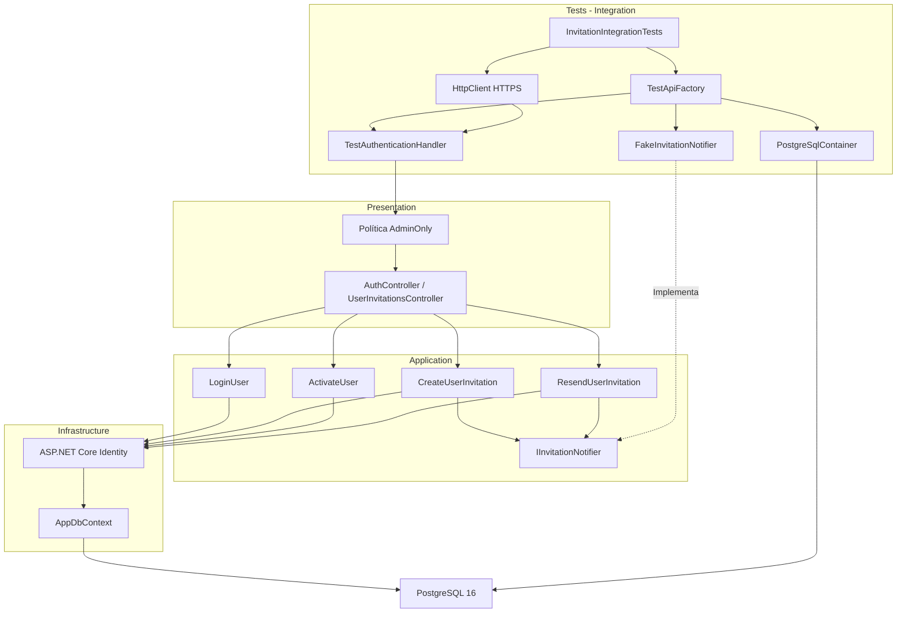

**Interpretación:**

- **Tests:** controla el entorno, las credenciales de prueba y los servicios simulados.
- **Presentation:** ejecuta los endpoints y mantiene la evaluación de políticas de autorización.
- **Application:** coordina los casos de uso de autenticación e invitaciones.
- **Infrastructure:** utiliza ASP.NET Core Identity y PostgreSQL para las operaciones reales de usuarios.
- **TestAuthenticationHandler:** sustituye la autenticación JWT Bearer de producción por un mecanismo determinista basado en la lectura de claims.
- **FakeInvitationNotifier:** evita conexiones SMTP y permite controlar errores de notificación.

#### Resultado

Se ajustó la infraestructura de pruebas de integración para utilizar un cliente HTTPS, configuración aislada y un esquema de autenticación específico denominado `IntegrationTestBearer`.

También se mantuvo la ejecución de operaciones reales sobre PostgreSQL y ASP.NET Core Identity, sustituyendo únicamente la autenticación HTTP y el transporte de notificaciones por implementaciones controladas.

Estos cambios facilitan la ejecución reproducible de los escenarios de integración y reducen las dependencias respecto a la configuración local de desarrollo.

**Estado de verificación:** los archivos proporcionados muestran modificaciones de código, pero no incluyen la salida de `dotnet restore`, `dotnet build` ni `dotnet test`. Por tanto, no es posible confirmar desde esta evidencia que la restauración, compilación y pruebas hayan finalizado correctamente.

---

### 18. Ajustes por pruebas manuales

---

### 19. Validación, ejecución local y Git

**Prerrequisitos:** Docker disponible; crear un archivo `.env` local a partir de `.env.example` y sustituir todos los valores de ejemplo por credenciales y secretos propios. **No subir `.env` a Git.**

**Levantar PostgreSQL y pgAdmin:**

```powershell
docker compose up -d
```

**Compilación y pruebas:**

```powershell
dotnet restore FEPP-ContaOps.slnx
dotnet build FEPP-ContaOps.slnx
dotnet test FEPP-ContaOps.slnx
```

**Iniciar API:**

```powershell
.\run-local.ps1
```

---

### 20. Validación del spec (flujo de trabajo existente):

```powershell
/spec-acceptance-validator @specs/03-registro-invitacion-activacion.md
```

Revisar el spec: [`04-api-invitaciones-y-validacion-identidad.md`](../04-api-invitaciones-y-validacion-identidad.md).

---

### 21. Diagrama Final: Arquitectura del spec 03-registro-invitacion-activacion

---

### 22. Comandos Git / PR\*\* (una vez validada la implementación y revisados los cambios)

```powershell
git add .
git commit -m "FEPP-ContaOps - spec-04-api-invitaciones-y-validacion-identidad -  Implementado"
git push -u origin spec-04-api-invitaciones-y-validacion-identidad

# Después de aprobar y fusionar el Pull Request:
git switch main
git pull
git branch -d spec-04-api-invitaciones-y-validacion-identidad
```
