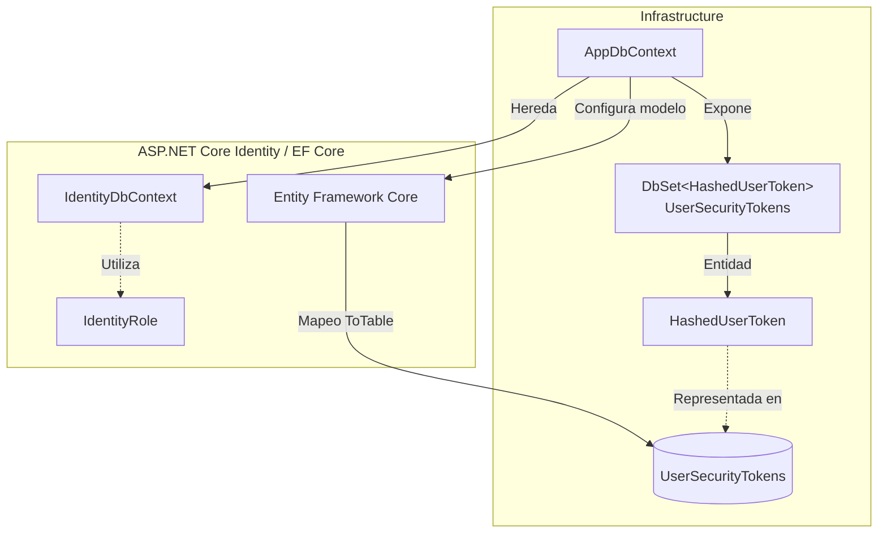
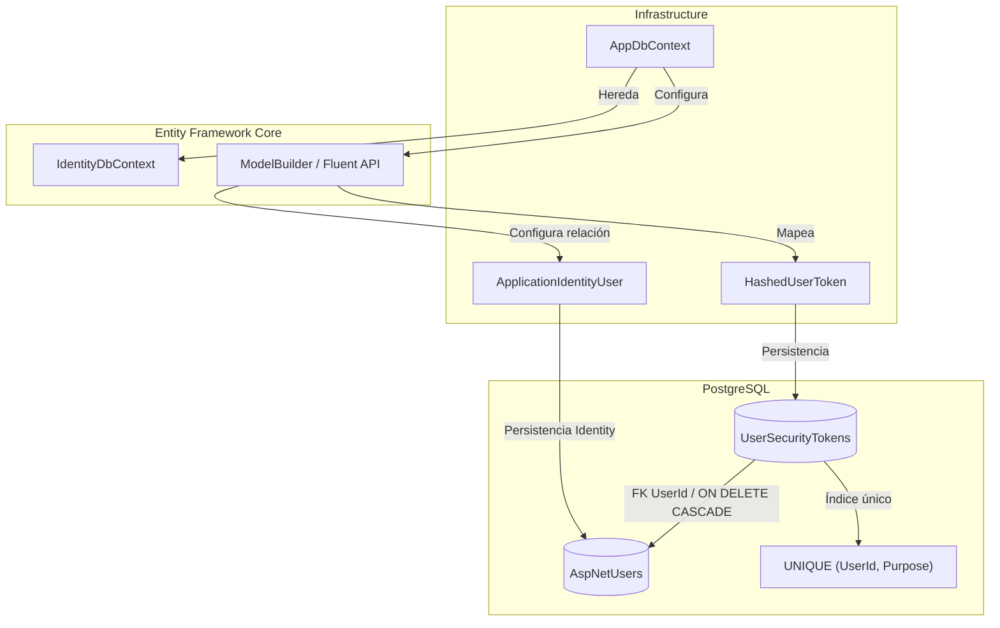
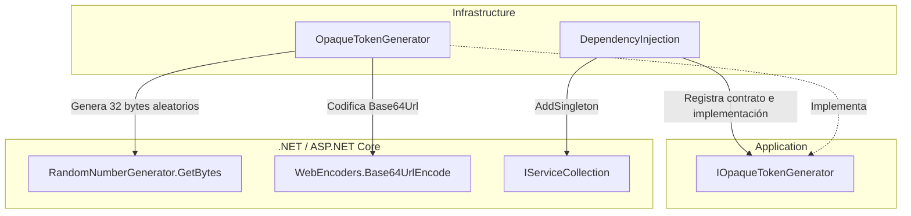

# Implementar: 05-persistencia-y-criptografia-tokens-opacos

## PASOS

### 1 a 3. Reiniciar los volúmenes locales de Docker y arrancar database y pgadmin. Comprobar el estado de los contenedores. Registrar/verificar el servidor en pgAdmin.

Abrir http://localhost:5050/ e registra el servidor:

1. Iniciar sesión con las credenciales de pgAdmin configuradas en .env.

- PGADMIN_DEFAULT_EMAIL
- PGADMIN_DEFAULT_PASSWORD

2. Clic derecho en Servers → Register → Server.
3. General → Name: FEPP-ContaOps Local
4. Connection:

- Host name/address: database
- Port: 5432
- Maintenance database: fepp_contaops_dev
- Username: app
- Password: el valor de POSTGRES_PASSWORD
- Marca Save password

5. Pulsar Save.

---

### 4. Crear HashedUserToken y configurar UserSecurityTokens.

#### 1. Componentes implementados

| Componente           | Acción | Tipo                    | Capa           | Responsabilidad                                                                                                                             |
| -------------------- | ------ | ----------------------- | -------------- | ------------------------------------------------------------------------------------------------------------------------------------------- |
| `HashedUserToken`    | Create | Entidad de persistencia | Infrastructure | Representar tokens opacos almacenados mediante su hash SHA-256, asociados a un usuario, propósito, sello de seguridad y período de validez. |
| `AppDbContext`       | Update | DbContext               | Infrastructure | Incorporar la entidad `HashedUserToken` al modelo de persistencia de EF Core.                                                               |
| `UserSecurityTokens` | Create | DbSet                   | Infrastructure | Proporcionar acceso a las operaciones de persistencia y consulta de tokens.                                                                 |
| `OnModelCreating`    | Update | Configuración EF Core   | Infrastructure | Mapear `HashedUserToken` a la tabla `UserSecurityTokens`.                                                                                   |

#### 2. Métodos principales

| Clase          | Método                     | Responsabilidad                                                                   |
| -------------- | -------------------------- | --------------------------------------------------------------------------------- |
| `AppDbContext` | `AppDbContext(options)`    | Inicializar el contexto mediante `DbContextOptions<AppDbContext>`.                |
| `AppDbContext` | `OnModelCreating(builder)` | Conservar la configuración de Identity y registrar el mapeo de `HashedUserToken`. |

**Propiedades relevantes de `HashedUserToken`:**

| Propiedad       | Tipo             | Responsabilidad                                                |
| --------------- | ---------------- | -------------------------------------------------------------- |
| `TokenId`       | `Guid`           | Identificador del registro.                                    |
| `UserId`        | `string`         | Identificador del usuario propietario.                         |
| `Purpose`       | `string`         | Propósito funcional del token.                                 |
| `TokenHash`     | `byte[]`         | Almacenar el hash SHA-256 del token opaco.                     |
| `SecurityStamp` | `string`         | Registrar el sello de seguridad del usuario al crear el token. |
| `CreatedAtUtc`  | `DateTimeOffset` | Fecha UTC de creación.                                         |
| `ExpiresAtUtc`  | `DateTimeOffset` | Fecha UTC de expiración.                                       |

#### 3. Componentes de .NET y bibliotecas externas

| Componente / Método                     | Origen                          | Función                                                          | Uso en el proyecto                                                                                         |
| --------------------------------------- | ------------------------------- | ---------------------------------------------------------------- | ---------------------------------------------------------------------------------------------------------- |
| `IdentityDbContext<TUser, TRole, TKey>` | ASP.NET Core Identity + EF Core | Contexto de persistencia especializado en Identity.              | Clase base de `AppDbContext`, configurada con `ApplicationIdentityUser`, `IdentityRole` y claves `string`. |
| `IdentityRole`                          | ASP.NET Core Identity           | Representar roles de usuarios.                                   | Tipo de rol utilizado por el contexto Identity.                                                            |
| `DbContextOptions<T>`                   | Entity Framework Core           | Proporcionar opciones de configuración del contexto.             | Inicialización de `AppDbContext`.                                                                          |
| `DbSet<T>`                              | Entity Framework Core           | Representar un conjunto de entidades persistentes.               | Exponer `UserSecurityTokens`.                                                                              |
| `ModelBuilder`                          | Entity Framework Core           | Configurar el modelo de entidades.                               | Registrar el mapeo de `HashedUserToken`.                                                                   |
| `Entity<T>().ToTable()`                 | Entity Framework Core           | Asociar una entidad con una tabla.                               | Mapear `HashedUserToken` a `UserSecurityTokens`.                                                           |
| `Guid`                                  | .NET / C#                       | Representar identificadores únicos.                              | Tipo de `TokenId`.                                                                                         |
| `DateTimeOffset`                        | .NET / C#                       | Representar fechas y horas con desplazamiento UTC.               | Campos de creación y expiración del token.                                                                 |
| `HashedUserToken`                       | Código propio                   | Representar la información persistente de un token de seguridad. | Modelo de tokens opacos almacenados mediante hash.                                                         |

#### 4. Flujo funcional

| Operación                     | Componente                        | Descripción                                                                                              |
| ----------------------------- | --------------------------------- | -------------------------------------------------------------------------------------------------------- |
| Definición del token          | `HashedUserToken`                 | Establece los campos necesarios para almacenar un token mediante su hash, usuario, propósito y vigencia. |
| Registro de entidad           | `AppDbContext.UserSecurityTokens` | Incorpora los tokens de seguridad al contexto de EF Core.                                                |
| Configuración de persistencia | `OnModelCreating`                 | Asocia la entidad con la tabla `UserSecurityTokens`.                                                     |
| Persistencia                  | Entity Framework Core             | Permite consultar y persistir registros mediante el contexto.                                            |

**Alcance:** el código define la estructura persistente, pero no implementa la generación, cálculo SHA-256, validación, revocación ni eliminación de tokens expirados. Tampoco muestra una migración aplicada.

#### 5. Diagrama de arquitectura



#### 6. Resultado

Se incorpora `HashedUserToken` como entidad de persistencia para tokens opacos almacenados mediante hash SHA-256. `AppDbContext` expone `UserSecurityTokens` y configura su mapeo en EF Core, manteniendo la integración con ASP.NET Core Identity.

---

### 5. Configurar relación, índice único, tipos PostgreSQL y cascada

#### 1. Componentes implementados

| Componente                | Acción      | Tipo                             | Capa           | Responsabilidad                                                                   |
| ------------------------- | ----------- | -------------------------------- | -------------- | --------------------------------------------------------------------------------- |
| `AppDbContext`            | Update      | DbContext                        | Infrastructure | Configurar las restricciones, relaciones y tipos PostgreSQL de `HashedUserToken`. |
| `HashedUserToken`         | Update      | Configuración de entidad EF Core | Infrastructure | Definir clave primaria, propiedades obligatorias y tipos de columnas.             |
| `UserSecurityTokens`      | Update      | Tabla PostgreSQL                 | Infrastructure | Almacenar tokens con integridad referencial y restricciones de unicidad.          |
| `ApplicationIdentityUser` | Sin cambios | Entidad Identity                 | Infrastructure | Representar al usuario propietario de los tokens.                                 |

#### 2. Métodos principales

| Clase                                | Método                | Responsabilidad                                                           |
| ------------------------------------ | --------------------- | ------------------------------------------------------------------------- |
| `AppDbContext`                       | `OnModelCreating()`   | Configurar el modelo de persistencia de `HashedUserToken`.                |
| `EntityTypeBuilder<HashedUserToken>` | `HasKey()`            | Establecer `TokenId` como clave primaria.                                 |
| `EntityTypeBuilder<HashedUserToken>` | `Property()`          | Configurar las propiedades persistentes.                                  |
| `PropertyBuilder`                    | `HasColumnType()`     | Especificar los tipos de datos PostgreSQL.                                |
| `PropertyBuilder`                    | `HasMaxLength(32)`    | Establecer una longitud máxima de 32 bytes para `TokenHash` en el modelo. |
| `PropertyBuilder`                    | `IsRequired()`        | Configurar columnas obligatorias (`NOT NULL`).                            |
| `EntityTypeBuilder<HashedUserToken>` | `HasOne().WithMany()` | Definir la relación entre tokens y usuarios.                              |
| `ReferenceCollectionBuilder`         | `HasForeignKey()`     | Establecer `UserId` como clave foránea.                                   |
| `ReferenceCollectionBuilder`         | `OnDelete()`          | Configurar eliminación en cascada.                                        |
| `IndexBuilder`                       | `IsUnique()`          | Establecer unicidad para la combinación `UserId` y `Purpose`.             |

#### 3. Componentes de .NET y bibliotecas externas

| Componente / Método       | Origen                          | Función                                                      | Uso en el proyecto                                          |
| ------------------------- | ------------------------------- | ------------------------------------------------------------ | ----------------------------------------------------------- |
| `IdentityDbContext`       | ASP.NET Core Identity + EF Core | Proporcionar persistencia para usuarios y roles de Identity. | Clase base de `AppDbContext`.                               |
| `ModelBuilder`            | Entity Framework Core           | Configurar entidades y relaciones del modelo.                | Definir las restricciones de `HashedUserToken`.             |
| `EntityTypeBuilder<T>`    | Entity Framework Core           | Configurar entidades mediante Fluent API.                    | Definir clave primaria, propiedades, relaciones e índices.  |
| `HasColumnType()`         | Entity Framework Core           | Especificar el tipo de columna de la base de datos.          | Utilizar tipos nativos de PostgreSQL.                       |
| `HasOne().WithMany()`     | Entity Framework Core           | Configurar una relación muchos a uno.                        | Asociar múltiples tokens con un usuario Identity.           |
| `DeleteBehavior.Cascade`  | Entity Framework Core           | Configurar eliminación en cascada.                           | Eliminar los tokens asociados cuando se elimina su usuario. |
| `HasIndex().IsUnique()`   | Entity Framework Core           | Configurar índices únicos.                                   | Impedir múltiples tokens con el mismo `UserId` y `Purpose`. |
| `ApplicationIdentityUser` | Código propio                   | Representar usuarios de ASP.NET Core Identity.               | Entidad principal de la relación con `HashedUserToken`.     |

#### 4. Flujo funcional

**Configuración PostgreSQL**

| Propiedad       | Tipo PostgreSQL            | Restricción                                     |
| --------------- | -------------------------- | ----------------------------------------------- |
| `TokenId`       | `uuid`                     | Primary Key                                     |
| `UserId`        | `character varying(450)`   | NOT NULL, Foreign Key                           |
| `Purpose`       | `text`                     | NOT NULL                                        |
| `TokenHash`     | `bytea`                    | NOT NULL, longitud máxima configurada: 32 bytes |
| `SecurityStamp` | `text`                     | NOT NULL                                        |
| `CreatedAtUtc`  | `timestamp with time zone` | NOT NULL                                        |
| `ExpiresAtUtc`  | `timestamp with time zone` | NOT NULL                                        |

**Relaciones y restricciones**

| Operación              | Configuración                                  | Comportamiento                                                              |
| ---------------------- | ---------------------------------------------- | --------------------------------------------------------------------------- |
| Relación usuario-token | `HasOne<ApplicationIdentityUser>().WithMany()` | Un usuario puede tener múltiples tokens; cada token pertenece a un usuario. |
| Clave foránea          | `HasForeignKey(token => token.UserId)`         | Vincula los tokens con los usuarios de Identity.                            |
| Eliminación            | `OnDelete(DeleteBehavior.Cascade)`             | Eliminar un usuario provoca la eliminación de sus tokens asociados.         |
| Índice único           | `HasIndex(UserId, Purpose).IsUnique()`         | Permite como máximo un token por usuario y propósito.                       |
| Clave primaria         | `HasKey(token => token.TokenId)`               | Identifica de manera única cada registro.                                   |

**Nota:** `HasMaxLength(32)` configura una restricción de longitud en el modelo EF Core, pero no garantiza por sí sola que PostgreSQL limite los valores `bytea` a 32 bytes. La configuración no muestra una restricción `CHECK` adicional.

#### 5. Diagrama de arquitectura



#### 6. Resultado

Se configura la persistencia de `HashedUserToken` con tipos PostgreSQL, clave primaria, relación con Identity y eliminación en cascada. El índice compuesto único `(UserId, Purpose)` garantiza un máximo de un token por usuario y propósito.

---

### 6. Implementar generación segura y Base64Url

#### 1. Componentes implementados

| Componente              | Acción | Tipo                 | Capa           | Responsabilidad                                                                                |
| ----------------------- | ------ | -------------------- | -------------- | ---------------------------------------------------------------------------------------------- |
| `IOpaqueTokenGenerator` | Create | Interfaz (puerto)    | Application    | Definir el contrato para generar tokens opacos de alta entropía.                               |
| `OpaqueTokenGenerator`  | Create | Servicio (adaptador) | Infrastructure | Generar 32 bytes aleatorios criptográficamente seguros y codificarlos en Base64Url.            |
| `DependencyInjection`   | Update | Configuración DI     | Infrastructure | Registrar `IOpaqueTokenGenerator` con su implementación `OpaqueTokenGenerator` como Singleton. |

#### 2. Métodos principales

| Clase                   | Método                | Responsabilidad                                                                          |
| ----------------------- | --------------------- | ---------------------------------------------------------------------------------------- |
| `IOpaqueTokenGenerator` | `Generate()`          | Declarar la operación de generación de tokens opacos.                                    |
| `OpaqueTokenGenerator`  | `Generate()`          | Generar 32 bytes aleatorios mediante `RandomNumberGenerator` y convertirlos a Base64Url. |
| `DependencyInjection`   | `AddInfrastructure()` | Registrar el generador en el contenedor de inyección de dependencias.                    |

**Características del token generado:**

| Propiedad           | Valor         | Descripción                                                           |
| ------------------- | ------------- | --------------------------------------------------------------------- |
| Longitud aleatoria  | 32 bytes      | Definida mediante `TokenByteLength`.                                  |
| Entropía            | 256 bits      | Entropía máxima de 32 bytes generados uniformemente.                  |
| Generación          | CSPRNG        | Utiliza un generador de números aleatorios criptográficamente seguro. |
| Codificación        | Base64Url     | Representación compatible con URLs.                                   |
| Padding             | Sin padding   | No incluye caracteres `=` finales.                                    |
| Longitud codificada | 43 caracteres | Representación Base64Url de 32 bytes sin padding.                     |

#### 3. Componentes de .NET y bibliotecas externas

| Componente / Método                         | Origen                                             | Función                                                   | Uso en el proyecto                                           |
| ------------------------------------------- | -------------------------------------------------- | --------------------------------------------------------- | ------------------------------------------------------------ |
| `RandomNumberGenerator.GetBytes()`          | .NET / `System.Security.Cryptography`              | Generar bytes aleatorios criptográficamente seguros.      | Producir los 32 bytes del token opaco.                       |
| `WebEncoders.Base64UrlEncode()`             | ASP.NET Core / `Microsoft.AspNetCore.WebUtilities` | Codificar bytes en Base64Url sin padding.                 | Convertir el token binario a una cadena compatible con URLs. |
| `IServiceCollection`                        | .NET / Microsoft.Extensions.DependencyInjection    | Definir el contenedor de servicios.                       | Registrar la implementación del generador.                   |
| `AddSingleton<TService, TImplementation>()` | .NET / Microsoft.Extensions.DependencyInjection    | Registrar una implementación con ciclo de vida Singleton. | Asociar `IOpaqueTokenGenerator` con `OpaqueTokenGenerator`.  |

#### 4. Flujo funcional

| Paso | Componente                            | Operación                                                  |
| ---- | ------------------------------------- | ---------------------------------------------------------- |
| 1    | Consumidor de `IOpaqueTokenGenerator` | Solicita un token mediante `Generate()`.                   |
| 2    | `OpaqueTokenGenerator`                | Ejecuta `RandomNumberGenerator.GetBytes(32)`.              |
| 3    | `WebEncoders`                         | Codifica los bytes mediante `Base64UrlEncode()`.           |
| 4    | `OpaqueTokenGenerator`                | Retorna una cadena Base64Url de 43 caracteres sin padding. |

**Registro de dependencias:**

| Contrato                | Implementación         | Ciclo de vida |
| ----------------------- | ---------------------- | ------------- |
| `IOpaqueTokenGenerator` | `OpaqueTokenGenerator` | Singleton     |

**Alcance:** este paso implementa únicamente la generación del token público. No incluye cálculo de hash SHA-256, persistencia ni validación del token. Aunque `DependencyInjection` mantiene configuraciones existentes de Identity y Data Protection, estas no intervienen en `OpaqueTokenGenerator`.

#### 5. Diagrama de arquitectura



#### 6. Resultado

Se implementa un generador de tokens opacos de 256 bits mediante APIs criptográficas de .NET y codificación Base64Url. El servicio queda disponible mediante `IOpaqueTokenGenerator`, registrado como Singleton en Infrastructure.

---

### 7. Implementar hash SHA-256, comparación constante y validaciones.

---

### 8. Implementar almacenamiento, reemplazo y eliminación de vencidos.

---

### 9. Agregar pruebas unitarias.

---

### 10. Ejecutar build, pruebas, API y verificación del esquema.

---

### 11. Ajustes por pruebas manuales

**Levantar PostgreSQL y pgAdmin:**

```powershell
docker compose up -d
```

**Compilación y pruebas:**

```powershell
dotnet restore FEPP-ContaOps.slnx
dotnet build FEPP-ContaOps.slnx
dotnet test FEPP-ContaOps.slnx
```

---

### 12. Validación, ejecución local y Git

**Prerrequisitos:** Docker disponible; crear un archivo `.env` local a partir de `.env.example` y sustituir todos los valores de ejemplo por credenciales y secretos propios. **No subir `.env` a Git.**

**Iniciar API:**

```powershell
.\run-local.ps1
```

---

### 13. Validación del spec (flujo de trabajo existente):

```powershell
/spec-acceptance-validator @specs/05-persistencia-y-criptografia-tokens-opacos.md
```

Revisar el spec: [`05-persistencia-y-criptografia-tokens-opacos.md`](../05-persistencia-y-criptografia-tokens-opacos.md).

---

### 14. Diagrama Final: Arquitectura del spec-05-persistencia-y-criptografia-tokens-opacos

---

### 15. Comandos Git / PR\*\* (una vez validada la implementación y revisados los cambios)

```powershell
git add .
git commit -m "FEPP-ContaOps - spec-05-persistencia-y-criptografia-tokens-opacos -  Implementado"
git push -u origin spec-05-persistencia-y-criptografia-tokens-opacos

# Después de aprobar y fusionar el Pull Request:
git switch main
git pull
git branch -d spec-05-persistencia-y-criptografia-tokens-opacos
```
