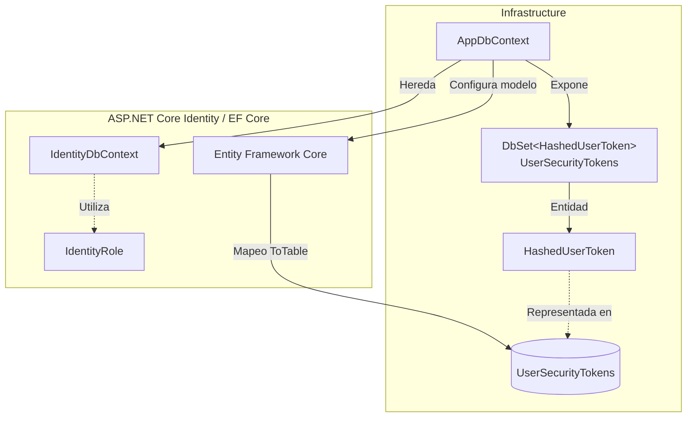

# Implementar: 05-persistencia-y-criptografia-tokens-opacos

## PASOS

### 1 a 3. Reiniciar los volúmenes locales de Docker y arrancar database y pgadmin. Comprobar el estado de los contenedores. Registrar/verificar el servidor en pgAdmin.

Abrir http://localhost:5050/ e registra el servidor:

1. Iniciar sesión con las credenciales de pgAdmin configuradas en .env.

- PGADMIN_DEFAULT_EMAIL
- PGADMIN_DEFAULT_PASSWORD

2. Clic derecho en Servers → Register → Server.
3. General → Name: FEPP-ContaOps Local
4. Connection:

- Host name/address: database
- Port: 5432
- Maintenance database: fepp_contaops_dev
- Username: app
- Password: el valor de POSTGRES_PASSWORD
- Marca Save password

5. Pulsar Save.

---

### 4. Crear HashedUserToken y configurar UserSecurityTokens.

#### 1. Componentes implementados

| Componente           | Acción | Tipo                    | Capa           | Responsabilidad                                                                                                                             |
| -------------------- | ------ | ----------------------- | -------------- | ------------------------------------------------------------------------------------------------------------------------------------------- |
| `HashedUserToken`    | Create | Entidad de persistencia | Infrastructure | Representar tokens opacos almacenados mediante su hash SHA-256, asociados a un usuario, propósito, sello de seguridad y período de validez. |
| `AppDbContext`       | Update | DbContext               | Infrastructure | Incorporar la entidad `HashedUserToken` al modelo de persistencia de EF Core.                                                               |
| `UserSecurityTokens` | Create | DbSet                   | Infrastructure | Proporcionar acceso a las operaciones de persistencia y consulta de tokens.                                                                 |
| `OnModelCreating`    | Update | Configuración EF Core   | Infrastructure | Mapear `HashedUserToken` a la tabla `UserSecurityTokens`.                                                                                   |

#### 2. Métodos principales

| Clase          | Método                     | Responsabilidad                                                                   |
| -------------- | -------------------------- | --------------------------------------------------------------------------------- |
| `AppDbContext` | `AppDbContext(options)`    | Inicializar el contexto mediante `DbContextOptions<AppDbContext>`.                |
| `AppDbContext` | `OnModelCreating(builder)` | Conservar la configuración de Identity y registrar el mapeo de `HashedUserToken`. |

**Propiedades relevantes de `HashedUserToken`:**

| Propiedad       | Tipo             | Responsabilidad                                                |
| --------------- | ---------------- | -------------------------------------------------------------- |
| `TokenId`       | `Guid`           | Identificador del registro.                                    |
| `UserId`        | `string`         | Identificador del usuario propietario.                         |
| `Purpose`       | `string`         | Propósito funcional del token.                                 |
| `TokenHash`     | `byte[]`         | Almacenar el hash SHA-256 del token opaco.                     |
| `SecurityStamp` | `string`         | Registrar el sello de seguridad del usuario al crear el token. |
| `CreatedAtUtc`  | `DateTimeOffset` | Fecha UTC de creación.                                         |
| `ExpiresAtUtc`  | `DateTimeOffset` | Fecha UTC de expiración.                                       |

#### 3. Componentes de .NET y bibliotecas externas

| Componente / Método                     | Origen                          | Función                                                          | Uso en el proyecto                                                                                         |
| --------------------------------------- | ------------------------------- | ---------------------------------------------------------------- | ---------------------------------------------------------------------------------------------------------- |
| `IdentityDbContext<TUser, TRole, TKey>` | ASP.NET Core Identity + EF Core | Contexto de persistencia especializado en Identity.              | Clase base de `AppDbContext`, configurada con `ApplicationIdentityUser`, `IdentityRole` y claves `string`. |
| `IdentityRole`                          | ASP.NET Core Identity           | Representar roles de usuarios.                                   | Tipo de rol utilizado por el contexto Identity.                                                            |
| `DbContextOptions<T>`                   | Entity Framework Core           | Proporcionar opciones de configuración del contexto.             | Inicialización de `AppDbContext`.                                                                          |
| `DbSet<T>`                              | Entity Framework Core           | Representar un conjunto de entidades persistentes.               | Exponer `UserSecurityTokens`.                                                                              |
| `ModelBuilder`                          | Entity Framework Core           | Configurar el modelo de entidades.                               | Registrar el mapeo de `HashedUserToken`.                                                                   |
| `Entity<T>().ToTable()`                 | Entity Framework Core           | Asociar una entidad con una tabla.                               | Mapear `HashedUserToken` a `UserSecurityTokens`.                                                           |
| `Guid`                                  | .NET / C#                       | Representar identificadores únicos.                              | Tipo de `TokenId`.                                                                                         |
| `DateTimeOffset`                        | .NET / C#                       | Representar fechas y horas con desplazamiento UTC.               | Campos de creación y expiración del token.                                                                 |
| `HashedUserToken`                       | Código propio                   | Representar la información persistente de un token de seguridad. | Modelo de tokens opacos almacenados mediante hash.                                                         |

#### 4. Flujo funcional

| Operación                     | Componente                        | Descripción                                                                                              |
| ----------------------------- | --------------------------------- | -------------------------------------------------------------------------------------------------------- |
| Definición del token          | `HashedUserToken`                 | Establece los campos necesarios para almacenar un token mediante su hash, usuario, propósito y vigencia. |
| Registro de entidad           | `AppDbContext.UserSecurityTokens` | Incorpora los tokens de seguridad al contexto de EF Core.                                                |
| Configuración de persistencia | `OnModelCreating`                 | Asocia la entidad con la tabla `UserSecurityTokens`.                                                     |
| Persistencia                  | Entity Framework Core             | Permite consultar y persistir registros mediante el contexto.                                            |

**Alcance:** el código define la estructura persistente, pero no implementa la generación, cálculo SHA-256, validación, revocación ni eliminación de tokens expirados. Tampoco muestra una migración aplicada.

#### 5. Diagrama de arquitectura



#### 6. Resultado

Se incorpora `HashedUserToken` como entidad de persistencia para tokens opacos almacenados mediante hash SHA-256. `AppDbContext` expone `UserSecurityTokens` y configura su mapeo en EF Core, manteniendo la integración con ASP.NET Core Identity.

---

### 5. Configurar relación, índice único, tipos PostgreSQL y cascada.

---

### 6. Implementar generación segura y Base64Url.

---

### 7. Implementar hash SHA-256, comparación constante y validaciones.

---

### 8. Implementar almacenamiento, reemplazo y eliminación de vencidos.

---

### 9. Agregar pruebas unitarias.

---

### 10. Ejecutar build, pruebas, API y verificación del esquema.

---

### 11. Ajustes por pruebas manuales

**Levantar PostgreSQL y pgAdmin:**

```powershell
docker compose up -d
```

**Compilación y pruebas:**

```powershell
dotnet restore FEPP-ContaOps.slnx
dotnet build FEPP-ContaOps.slnx
dotnet test FEPP-ContaOps.slnx
```

---

### 12. Validación, ejecución local y Git

**Prerrequisitos:** Docker disponible; crear un archivo `.env` local a partir de `.env.example` y sustituir todos los valores de ejemplo por credenciales y secretos propios. **No subir `.env` a Git.**

**Iniciar API:**

```powershell
.\run-local.ps1
```

---

### 13. Validación del spec (flujo de trabajo existente):

```powershell
/spec-acceptance-validator @specs/05-persistencia-y-criptografia-tokens-opacos.md
```

Revisar el spec: [`05-persistencia-y-criptografia-tokens-opacos.md`](../05-persistencia-y-criptografia-tokens-opacos.md).

---

### 14. Diagrama Final: Arquitectura del spec-05-persistencia-y-criptografia-tokens-opacos

---

### 15. Comandos Git / PR\*\* (una vez validada la implementación y revisados los cambios)

```powershell
git add .
git commit -m "FEPP-ContaOps - spec-05-persistencia-y-criptografia-tokens-opacos -  Implementado"
git push -u origin spec-05-persistencia-y-criptografia-tokens-opacos

# Después de aprobar y fusionar el Pull Request:
git switch main
git pull
git branch -d spec-05-persistencia-y-criptografia-tokens-opacos
```
