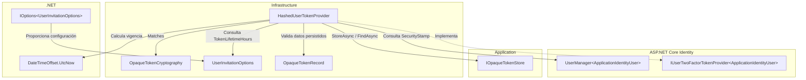

# Implementar: 06-integracion-tokens-opacos-invitaciones

## PASOS

### 1. Verificar PostgreSQL y pgAdmin con docker compose ps, sin eliminar volúmenes.

---

### 2. Implementar HashedUserTokenProvider.

Implementación de un proveedor personalizado de tokens para ASP.NET Core Identity que genera y valida tokens opacos mediante almacenamiento persistente de hashes, sin utilizar el mecanismo de Data Protection.

#### 1. Componentes implementados

| Componente                                             | Acción    | Tipo                           | Capa                     | Responsabilidad                                                                                 |
| ------------------------------------------------------ | --------- | ------------------------------ | ------------------------ | ----------------------------------------------------------------------------------------------- |
| `HashedUserTokenProvider`                              | Create    | Clase (`sealed`)               | Infrastructure/Identity  | Implementa la generación y validación de tokens de Identity mediante tokens opacos persistidos. |
| `IUserTwoFactorTokenProvider<ApplicationIdentityUser>` | Implement | Interfaz ASP.NET Core Identity | Infrastructure/Identity  | Contrato que permite integrar el proveedor personalizado con Identity.                          |
| `IOpaqueTokenStore`                                    | Consume   | Interfaz                       | Application/Abstractions | Abstrae el almacenamiento y recuperación de tokens opacos.                                      |
| `OpaqueTokenCryptography`                              | Consume   | Servicio criptográfico         | Infrastructure/Security  | Verifica la correspondencia entre el token recibido y su hash almacenado.                       |
| `UserInvitationOptions`                                | Consume   | Configuración                  | Infrastructure           | Define la duración de los tokens mediante `TokenLifetimeHours`.                                 |
| `ApplicationIdentityUser`                              | Consume   | Entidad Identity               | Infrastructure/Identity  | Representa al usuario asociado al token.                                                        |
| `OpaqueTokenRecord`                                    | Consume   | Modelo de persistencia         | Infrastructure           | Contiene el hash, propósito, SecurityStamp y vencimiento del token.                             |

#### 2. Métodos principales

| Clase                     | Método                             | Responsabilidad                                                                                           |
| ------------------------- | ---------------------------------- | --------------------------------------------------------------------------------------------------------- |
| `HashedUserTokenProvider` | `CanGenerateTwoFactorTokenAsync()` | Indica que el proveedor puede generar tokens para el usuario. Retorna `true` tras validar los argumentos. |
| `HashedUserTokenProvider` | `GenerateAsync()`                  | Obtiene el SecurityStamp, calcula la vigencia y solicita la generación y persistencia del token.          |
| `HashedUserTokenProvider` | `ValidateAsync()`                  | Recupera el token persistido y verifica hash, propósito, SecurityStamp y vigencia.                        |
| `IOpaqueTokenStore`       | `StoreAsync()`                     | Contrato utilizado para almacenar el token y devolver su valor.                                           |
| `IOpaqueTokenStore`       | `FindAsync()`                      | Contrato utilizado para recuperar un token mediante usuario y propósito.                                  |
| `OpaqueTokenCryptography` | `Matches()`                        | Comprueba si el token recibido corresponde al hash almacenado.                                            |

#### 3. Componentes de .NET y bibliotecas externas

| Componente / Método                      | Origen                              | Función                                                         | Uso en el proyecto                                               |
| ---------------------------------------- | ----------------------------------- | --------------------------------------------------------------- | ---------------------------------------------------------------- |
| `IUserTwoFactorTokenProvider<TUser>`     | ASP.NET Core Identity               | Contrato para implementar proveedores personalizados de tokens. | Integra `HashedUserTokenProvider` con Identity.                  |
| `UserManager<TUser>`                     | ASP.NET Core Identity               | Administra operaciones relacionadas con usuarios.               | Permite consultar el SecurityStamp del usuario.                  |
| `GetSecurityStampAsync()`                | ASP.NET Core Identity               | Obtiene el sello de seguridad actual del usuario.               | Vincula la validez del token al estado de seguridad del usuario. |
| `IOptions<T>`                            | .NET / Microsoft.Extensions.Options | Proporciona acceso a opciones configuradas.                     | Obtiene `UserInvitationOptions`.                                 |
| `DateTimeOffset.UtcNow`                  | .NET                                | Obtiene la fecha y hora UTC actual.                             | Establece creación, vencimiento y validación temporal.           |
| `ArgumentNullException.ThrowIfNull()`    | .NET                                | Verifica argumentos nulos.                                      | Valida las dependencias y parámetros obligatorios.               |
| `ArgumentException.ThrowIfNullOrEmpty()` | .NET                                | Verifica cadenas nulas o vacías.                                | Valida el propósito del token.                                   |
| `StringComparison.Ordinal`               | .NET                                | Realiza comparaciones de cadenas ordinales.                     | Compara propósito y SecurityStamp.                               |
| `Task` / `async` / `await`               | .NET / C#                           | Soporta operaciones asíncronas.                                 | Ejecuta operaciones de Identity y persistencia.                  |

#### 4. Flujo funcional

| Operación                | Secuencia                                                                                               | Resultado                                                                         |
| ------------------------ | ------------------------------------------------------------------------------------------------------- | --------------------------------------------------------------------------------- |
| Generación               | `GenerateAsync()` → `GetSecurityStampAsync()` → Calcular vencimiento → `IOpaqueTokenStore.StoreAsync()` | Devuelve el token generado por el almacén.                                        |
| Recuperación             | `ValidateAsync()` → `IOpaqueTokenStore.FindAsync(user.Id, purpose)`                                     | Recupera el registro persistido o rechaza la validación.                          |
| Validación criptográfica | `OpaqueTokenCryptography.Matches()`                                                                     | Comprueba la correspondencia del token con su hash.                               |
| Validación de contexto   | Comparar `Purpose` y `SecurityStamp`                                                                    | Verifica que el token corresponda al propósito y estado de seguridad del usuario. |
| Validación temporal      | `UtcNow < ExpiresAtUtc`                                                                                 | Rechaza tokens vencidos.                                                          |

**Condiciones de validación:**

Un token es válido únicamente cuando se cumplen todas las condiciones:

- Existe un registro persistido para el usuario y propósito.
- El token recibido corresponde al hash almacenado.
- El propósito coincide exactamente.
- El SecurityStamp actual no está vacío y coincide con el almacenado.
- La fecha actual UTC es anterior al vencimiento.

El código no implementa consumo único ni eliminación del token después de validarlo.

#### 5. Diagrama de arquitectura



#### 6. Resultado

Se implementó `HashedUserTokenProvider` como proveedor personalizado de ASP.NET Core Identity, utilizando tokens opacos y validación criptográfica mediante hashes persistidos.

La validez del token depende de su propósito, SecurityStamp y fecha de expiración, sin utilizar Data Protection dentro de este componente.

---

### 3. Registrar únicamente el proveedor dedicado en Identity.

---

### 4. Adaptar la creación de invitaciones para usar el nuevo token.

---

### 5. Adaptar el reenvío, rotando SecurityStamp y reemplazando el token anterior.

---

### 6. Adaptar la activación para validar y consumir el token atómicamente.

---

### 7. Invalidar tokens antiguos de Data Protection.

---

### 8. Agregar pruebas de tokens válidos, inválidos, vencidos, usados, de otro usuario y de reenvío.

---

### 9. Agregar prueba de dos activaciones concurrentes, asegurando que solo una tenga éxito.

---

### 10. Ejecutar build, pruebas unitarias, integración con Testcontainers y revisar que ningún token aparezca en respuestas o logs.

---

### 11. Ajustes por pruebas manuales

**Levantar PostgreSQL y pgAdmin:**

```powershell
docker compose up -d
```

**Compilación y pruebas:**

```powershell
dotnet restore FEPP-ContaOps.slnx
dotnet build FEPP-ContaOps.slnx
dotnet test FEPP-ContaOps.slnx
```

---

### 12. Validación, ejecución local y Git

**Prerrequisitos:** Docker disponible; crear un archivo `.env` local a partir de `.env.example` y sustituir todos los valores de ejemplo por credenciales y secretos propios. **No subir `.env` a Git.**

**Iniciar API:**

```powershell
.\run-local.ps1
```

---

### 13. Validación del spec (flujo de trabajo existente):

```powershell
/spec-acceptance-validator @specs/06-integracion-tokens-opacos-invitaciones.md
```

Revisar el spec: [`06-integracion-tokens-opacos-invitaciones.md`](../06-integracion-tokens-opacos-invitaciones.md).

---

### 14. Diagrama Final: Arquitectura del spec-06-integracion-tokens-opacos-invitaciones

---

### 15. Comandos Git / PR\*\* (una vez validada la implementación y revisados los cambios)

```powershell
git add .
git commit -m "FEPP-ContaOps - spec-06-integracion-tokens-opacos-invitaciones -  Implementado"
git push -u origin spec-06-integracion-tokens-opacos-invitaciones

# Después de aprobar y fusionar el Pull Request:
git switch main
git pull
git branch -d spec-06-integracion-tokens-opacos-invitaciones
```
