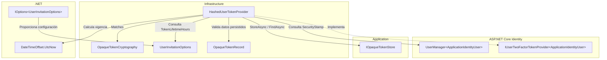
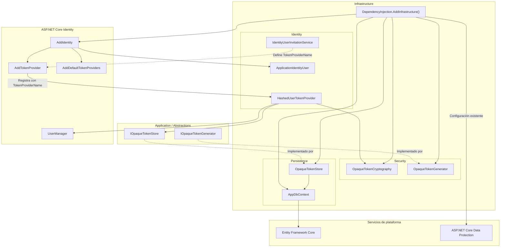
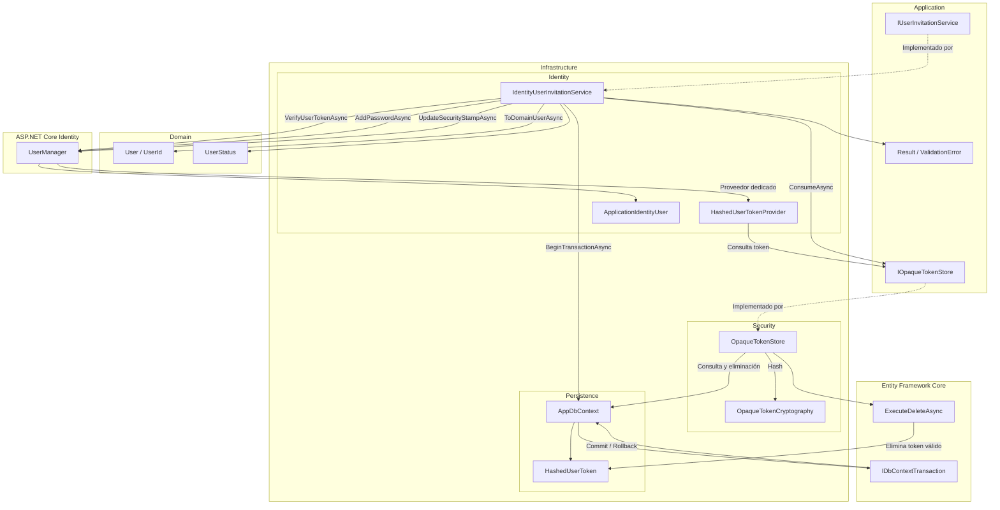
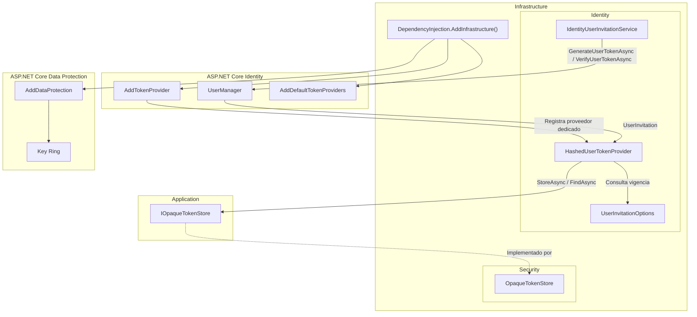

# Implementar: 06-integracion-tokens-opacos-invitaciones

## PASOS

### 1. Verificar PostgreSQL y pgAdmin con docker compose ps, sin eliminar volúmenes.

---

### 2. Implementar HashedUserTokenProvider.

Implementación de un proveedor personalizado de tokens para ASP.NET Core Identity que genera y valida tokens opacos mediante almacenamiento persistente de hashes, sin utilizar el mecanismo de Data Protection.

#### 1. Componentes implementados

| Componente                                             | Acción    | Tipo                           | Capa                     | Responsabilidad                                                                                 |
| ------------------------------------------------------ | --------- | ------------------------------ | ------------------------ | ----------------------------------------------------------------------------------------------- |
| `HashedUserTokenProvider`                              | Create    | Clase (`sealed`)               | Infrastructure/Identity  | Implementa la generación y validación de tokens de Identity mediante tokens opacos persistidos. |
| `IUserTwoFactorTokenProvider<ApplicationIdentityUser>` | Implement | Interfaz ASP.NET Core Identity | Infrastructure/Identity  | Contrato que permite integrar el proveedor personalizado con Identity.                          |
| `IOpaqueTokenStore`                                    | Consume   | Interfaz                       | Application/Abstractions | Abstrae el almacenamiento y recuperación de tokens opacos.                                      |
| `OpaqueTokenCryptography`                              | Consume   | Servicio criptográfico         | Infrastructure/Security  | Verifica la correspondencia entre el token recibido y su hash almacenado.                       |
| `UserInvitationOptions`                                | Consume   | Configuración                  | Infrastructure           | Define la duración de los tokens mediante `TokenLifetimeHours`.                                 |
| `ApplicationIdentityUser`                              | Consume   | Entidad Identity               | Infrastructure/Identity  | Representa al usuario asociado al token.                                                        |
| `OpaqueTokenRecord`                                    | Consume   | Modelo de persistencia         | Infrastructure           | Contiene el hash, propósito, SecurityStamp y vencimiento del token.                             |

#### 2. Métodos principales

| Clase                     | Método                             | Responsabilidad                                                                                           |
| ------------------------- | ---------------------------------- | --------------------------------------------------------------------------------------------------------- |
| `HashedUserTokenProvider` | `CanGenerateTwoFactorTokenAsync()` | Indica que el proveedor puede generar tokens para el usuario. Retorna `true` tras validar los argumentos. |
| `HashedUserTokenProvider` | `GenerateAsync()`                  | Obtiene el SecurityStamp, calcula la vigencia y solicita la generación y persistencia del token.          |
| `HashedUserTokenProvider` | `ValidateAsync()`                  | Recupera el token persistido y verifica hash, propósito, SecurityStamp y vigencia.                        |
| `IOpaqueTokenStore`       | `StoreAsync()`                     | Contrato utilizado para almacenar el token y devolver su valor.                                           |
| `IOpaqueTokenStore`       | `FindAsync()`                      | Contrato utilizado para recuperar un token mediante usuario y propósito.                                  |
| `OpaqueTokenCryptography` | `Matches()`                        | Comprueba si el token recibido corresponde al hash almacenado.                                            |

#### 3. Componentes de .NET y bibliotecas externas

| Componente / Método                      | Origen                              | Función                                                         | Uso en el proyecto                                               |
| ---------------------------------------- | ----------------------------------- | --------------------------------------------------------------- | ---------------------------------------------------------------- |
| `IUserTwoFactorTokenProvider<TUser>`     | ASP.NET Core Identity               | Contrato para implementar proveedores personalizados de tokens. | Integra `HashedUserTokenProvider` con Identity.                  |
| `UserManager<TUser>`                     | ASP.NET Core Identity               | Administra operaciones relacionadas con usuarios.               | Permite consultar el SecurityStamp del usuario.                  |
| `GetSecurityStampAsync()`                | ASP.NET Core Identity               | Obtiene el sello de seguridad actual del usuario.               | Vincula la validez del token al estado de seguridad del usuario. |
| `IOptions<T>`                            | .NET / Microsoft.Extensions.Options | Proporciona acceso a opciones configuradas.                     | Obtiene `UserInvitationOptions`.                                 |
| `DateTimeOffset.UtcNow`                  | .NET                                | Obtiene la fecha y hora UTC actual.                             | Establece creación, vencimiento y validación temporal.           |
| `ArgumentNullException.ThrowIfNull()`    | .NET                                | Verifica argumentos nulos.                                      | Valida las dependencias y parámetros obligatorios.               |
| `ArgumentException.ThrowIfNullOrEmpty()` | .NET                                | Verifica cadenas nulas o vacías.                                | Valida el propósito del token.                                   |
| `StringComparison.Ordinal`               | .NET                                | Realiza comparaciones de cadenas ordinales.                     | Compara propósito y SecurityStamp.                               |
| `Task` / `async` / `await`               | .NET / C#                           | Soporta operaciones asíncronas.                                 | Ejecuta operaciones de Identity y persistencia.                  |

#### 4. Flujo funcional

| Operación                | Secuencia                                                                                               | Resultado                                                                         |
| ------------------------ | ------------------------------------------------------------------------------------------------------- | --------------------------------------------------------------------------------- |
| Generación               | `GenerateAsync()` → `GetSecurityStampAsync()` → Calcular vencimiento → `IOpaqueTokenStore.StoreAsync()` | Devuelve el token generado por el almacén.                                        |
| Recuperación             | `ValidateAsync()` → `IOpaqueTokenStore.FindAsync(user.Id, purpose)`                                     | Recupera el registro persistido o rechaza la validación.                          |
| Validación criptográfica | `OpaqueTokenCryptography.Matches()`                                                                     | Comprueba la correspondencia del token con su hash.                               |
| Validación de contexto   | Comparar `Purpose` y `SecurityStamp`                                                                    | Verifica que el token corresponda al propósito y estado de seguridad del usuario. |
| Validación temporal      | `UtcNow < ExpiresAtUtc`                                                                                 | Rechaza tokens vencidos.                                                          |

**Condiciones de validación:**

Un token es válido únicamente cuando se cumplen todas las condiciones:

- Existe un registro persistido para el usuario y propósito.
- El token recibido corresponde al hash almacenado.
- El propósito coincide exactamente.
- El SecurityStamp actual no está vacío y coincide con el almacenado.
- La fecha actual UTC es anterior al vencimiento.

El código no implementa consumo único ni eliminación del token después de validarlo.

#### 5. Diagrama de arquitectura



#### 6. Resultado

Se implementó `HashedUserTokenProvider` como proveedor personalizado de ASP.NET Core Identity, utilizando tokens opacos y validación criptográfica mediante hashes persistidos.

La validez del token depende de su propósito, SecurityStamp y fecha de expiración, sin utilizar Data Protection dentro de este componente.

---

### 3. Registrar únicamente el proveedor dedicado en Identity.

Modificación de `DependencyInjection` para registrar `HashedUserTokenProvider` como proveedor personalizado de tokens de invitación en ASP.NET Core Identity.

#### 1. Componentes implementados

| Componente                                        | Acción   | Tipo                        | Capa                         | Responsabilidad                                                                                     |
| ------------------------------------------------- | -------- | --------------------------- | ---------------------------- | --------------------------------------------------------------------------------------------------- |
| `DependencyInjection`                             | Update   | Clase estática              | Infrastructure               | Centraliza el registro de servicios y adaptadores mediante inyección de dependencias.               |
| `AddInfrastructure()`                             | Update   | Método de extensión         | Infrastructure               | Configura Identity, persistencia, servicios criptográficos y demás dependencias de infraestructura. |
| `HashedUserTokenProvider`                         | Register | Proveedor personalizado     | Infrastructure/Identity      | Genera y valida tokens opacos de invitación mediante `IOpaqueTokenStore`.                           |
| `IdentityUserInvitationService.TokenProviderName` | Consume  | Constante de identificación | Infrastructure/Identity      | Identifica el proveedor personalizado utilizado para invitaciones.                                  |
| `OpaqueTokenCryptography`                         | Register | Servicio criptográfico      | Infrastructure/Security      | Verifica tokens opacos mediante sus hashes.                                                         |
| `IOpaqueTokenStore` → `OpaqueTokenStore`          | Register | Interfaz / implementación   | Application / Infrastructure | Abstrae e implementa la persistencia de tokens opacos.                                              |
| `IOpaqueTokenGenerator` → `OpaqueTokenGenerator`  | Register | Interfaz / implementación   | Application / Infrastructure | Proporciona generación de tokens opacos.                                                            |

#### 2. Métodos principales

| Clase                 | Método                                                        | Responsabilidad                                                                 |
| --------------------- | ------------------------------------------------------------- | ------------------------------------------------------------------------------- |
| `DependencyInjection` | `AddInfrastructure()`                                         | Registra las dependencias de infraestructura y configura ASP.NET Core Identity. |
| `IdentityBuilder`     | `AddTokenProvider<HashedUserTokenProvider>()`                 | Asocia el proveedor personalizado con el nombre definido para las invitaciones. |
| `IdentityBuilder`     | `AddDefaultTokenProviders()`                                  | Registra los proveedores predeterminados adicionales de Identity.               |
| `IServiceCollection`  | `AddSingleton<OpaqueTokenCryptography>()`                     | Registra el servicio criptográfico con ciclo de vida Singleton.                 |
| `IServiceCollection`  | `AddScoped<IOpaqueTokenStore, OpaqueTokenStore>()`            | Registra el almacén de tokens con ciclo de vida Scoped.                         |
| `IServiceCollection`  | `AddSingleton<IOpaqueTokenGenerator, OpaqueTokenGenerator>()` | Registra el generador de tokens con ciclo de vida Singleton.                    |

#### 3. Componentes de .NET y bibliotecas externas

| Componente / Método                         | Origen                          | Función                                                   | Uso en el proyecto                                                              |
| ------------------------------------------- | ------------------------------- | --------------------------------------------------------- | ------------------------------------------------------------------------------- |
| `IServiceCollection`                        | .NET / DependencyInjection      | Contenedor de registros de servicios.                     | Registra las dependencias de infraestructura.                                   |
| `AddIdentity<TUser, TRole>()`               | ASP.NET Core Identity           | Configura la gestión de usuarios y roles.                 | Registra `ApplicationIdentityUser` e `IdentityRole`.                            |
| `AddEntityFrameworkStores<TContext>()`      | ASP.NET Core Identity / EF Core | Integra la persistencia de Identity mediante EF Core.     | Utiliza `AppDbContext`.                                                         |
| `AddTokenProvider<TProvider>()`             | ASP.NET Core Identity           | Registra un proveedor de tokens con un nombre específico. | Registra `HashedUserTokenProvider` para invitaciones.                           |
| `AddDefaultTokenProviders()`                | ASP.NET Core Identity           | Incorpora proveedores predeterminados de tokens.          | Mantiene disponibles los proveedores estándar de Identity.                      |
| `AddScoped<TService, TImplementation>()`    | .NET / DependencyInjection      | Registra servicios con alcance Scoped.                    | Registra `OpaqueTokenStore` y otros adaptadores.                                |
| `AddSingleton<TService, TImplementation>()` | .NET / DependencyInjection      | Registra servicios con instancia compartida.              | Registra los servicios criptográficos y generadores.                            |
| `AddDataProtection()`                       | ASP.NET Core Data Protection    | Configura los servicios de protección de datos.           | Mantiene la configuración del sistema de claves de Data Protection.             |
| `PersistKeysToFileSystem()`                 | ASP.NET Core Data Protection    | Persiste claves criptográficas en el sistema de archivos. | Configura la ubicación del Key Ring cuando existe `DataProtection:KeyRingPath`. |
| `ProtectKeysWithDpapi()`                    | ASP.NET Core Data Protection    | Protege claves mediante Windows DPAPI.                    | Se aplica cuando existe una ruta configurada y el sistema operativo es Windows. |

#### 4. Flujo funcional

| Operación                       | Implementación                                                                               | Resultado                                                              |
| ------------------------------- | -------------------------------------------------------------------------------------------- | ---------------------------------------------------------------------- |
| Registro de Identity            | `AddIdentity<ApplicationIdentityUser, IdentityRole>()`                                       | Configura usuarios y roles.                                            |
| Persistencia de Identity        | `AddEntityFrameworkStores<AppDbContext>()`                                                   | Integra Identity con Entity Framework Core.                            |
| Registro del proveedor dedicado | `AddTokenProvider<HashedUserTokenProvider>(IdentityUserInvitationService.TokenProviderName)` | Asocia el proveedor de tokens opacos al identificador de invitaciones. |
| Proveedores adicionales         | `AddDefaultTokenProviders()`                                                                 | Conserva los proveedores predeterminados de Identity.                  |
| Persistencia de tokens          | `AddScoped<IOpaqueTokenStore, OpaqueTokenStore>()`                                           | Permite resolver el almacén de tokens desde el contenedor.             |
| Validación criptográfica        | `AddSingleton<OpaqueTokenCryptography>()`                                                    | Permite resolver el servicio encargado de verificar hashes.            |
| Generación criptográfica        | `AddSingleton<IOpaqueTokenGenerator, OpaqueTokenGenerator>()`                                | Permite resolver el generador de tokens opacos.                        |

**Consideraciones de implementación:**

- `HashedUserTokenProvider` queda registrado exclusivamente bajo el nombre `IdentityUserInvitationService.TokenProviderName` dentro de la configuración personalizada mostrada.
- `AddDefaultTokenProviders()` permanece configurado, por lo que no se eliminan los proveedores predeterminados de Identity.
- La configuración de Data Protection y su Key Ring continúa presente en `AddInfrastructure()`.
- `UserInvitationTokenProviderOptions` continúa configurándose, aunque el `HashedUserTokenProvider` del paso 2 obtiene su vigencia directamente desde `UserInvitationOptions`.
- El registro no demuestra que los demás flujos de Identity utilicen el proveedor personalizado; esto depende del nombre de proveedor seleccionado en cada operación.

#### 5. Diagrama de arquitectura



#### 6. Resultado

Se registró `HashedUserTokenProvider` como proveedor dedicado de tokens de invitación, junto con sus dependencias criptográficas y de persistencia.

Los proveedores predeterminados de Identity y la configuración de Data Protection permanecen activos; este paso no elimina el Key Ring del proyecto.

---

### 4. Adaptar la creación de invitaciones para usar el nuevo token.

---

### 5. Adaptar el reenvío, rotando SecurityStamp y reemplazando el token anterior.

---

### 6. Adaptar la activación para validar y consumir el token atómicamente.

Actualización del flujo de activación de usuarios para consumir tokens opacos mediante una eliminación condicional en base de datos, integrada en una transacción que incluye la asignación de contraseña y activación de la cuenta.

#### 1. Componentes implementados

| Componente                      | Acción  | Tipo                                                   | Capa                       | Responsabilidad                                                                               |
| ------------------------------- | ------- | ------------------------------------------------------ | -------------------------- | --------------------------------------------------------------------------------------------- |
| `IOpaqueTokenStore`             | Update  | Interfaz                                               | Application/Abstractions   | Incorpora el contrato `ConsumeAsync()` para consumir tokens válidos una sola vez.             |
| `OpaqueTokenStore`              | Update  | Servicio de persistencia                               | Infrastructure/Security    | Implementa el consumo mediante eliminación condicional de registros con EF Core.              |
| `IdentityUserInvitationService` | Update  | Servicio de aplicación implementado en infraestructura | Infrastructure/Identity    | Coordina la validación, consumo del token y activación del usuario dentro de una transacción. |
| `AppDbContext`                  | Consume | DbContext                                              | Infrastructure/Persistence | Gestiona las operaciones de persistencia y transacciones.                                     |
| `HashedUserToken`               | Consume | Entidad de persistencia                                | Infrastructure/Persistence | Representa el token almacenado con hash, propósito, SecurityStamp y vencimiento.              |
| `OpaqueTokenCryptography`       | Consume | Servicio criptográfico                                 | Infrastructure/Security    | Calcula el hash del token recibido para su comparación en persistencia.                       |
| `ApplicationIdentityUser`       | Consume | Entidad Identity                                       | Infrastructure/Identity    | Almacena el estado de activación, confirmación de correo y credenciales del usuario.          |

#### 2. Métodos principales

| Clase                           | Método                        | Responsabilidad                                                                                             |
| ------------------------------- | ----------------------------- | ----------------------------------------------------------------------------------------------------------- |
| `IOpaqueTokenStore`             | `ConsumeAsync()`              | Define el contrato para consumir un token verificando usuario, propósito, hash, SecurityStamp y vigencia.   |
| `OpaqueTokenStore`              | `ConsumeAsync()`              | Ejecuta una eliminación condicional y retorna `true` únicamente cuando se elimina una fila.                 |
| `OpaqueTokenCryptography`       | `Hash()`                      | Calcula el hash del token recibido para compararlo con el persistido.                                       |
| `IdentityUserInvitationService` | `ActivateAsync()`             | Coordina la validación, consumo del token, asignación de contraseña y activación transaccional del usuario. |
| `IdentityUserInvitationService` | `RegisterPendingAsync()`      | Registra un usuario pendiente y genera su token de invitación dentro de una transacción.                    |
| `IdentityUserInvitationService` | `ResendAsync()`               | Actualiza el SecurityStamp y genera un nuevo token de invitación.                                           |
| `IdentityUserInvitationService` | `ToPasswordValidationError()` | Convierte errores de política de contraseña de Identity en un `ValidationError`.                            |
| `IdentityUserInvitationService` | `ToDomainUserAsync()`         | Convierte el usuario de Identity al modelo de dominio, incluyendo sus roles.                                |

#### 3. Componentes de .NET y bibliotecas externas

| Componente / Método          | Origen                | Función                                                                | Uso en el proyecto                                                         |
| ---------------------------- | --------------------- | ---------------------------------------------------------------------- | -------------------------------------------------------------------------- |
| `UserManager<TUser>`         | ASP.NET Core Identity | Administra usuarios, credenciales y tokens.                            | Coordina la validación del token y actualización del usuario.              |
| `VerifyUserTokenAsync()`     | ASP.NET Core Identity | Valida tokens mediante el proveedor registrado.                        | Comprueba el token antes de intentar consumirlo.                           |
| `GetSecurityStampAsync()`    | ASP.NET Core Identity | Obtiene el sello de seguridad del usuario.                             | Vincula el consumo del token al estado de seguridad vigente.               |
| `AddPasswordAsync()`         | ASP.NET Core Identity | Asigna una contraseña y aplica la política configurada.                | Establece la contraseña durante la activación.                             |
| `UpdateSecurityStampAsync()` | ASP.NET Core Identity | Actualiza el sello de seguridad del usuario.                           | Invalida tokens asociados al SecurityStamp anterior.                       |
| `BeginTransactionAsync()`    | Entity Framework Core | Inicia una transacción de base de datos.                               | Agrupa consumo del token y modificaciones de la cuenta.                    |
| `ExecuteDeleteAsync()`       | Entity Framework Core | Ejecuta una eliminación directa en base de datos sin cargar entidades. | Consume el token mediante una operación condicional.                       |
| `Where()`                    | LINQ / .NET           | Define condiciones de filtrado.                                        | Selecciona exclusivamente el token que cumple los criterios de validación. |
| `CommitAsync()`              | Entity Framework Core | Confirma una transacción.                                              | Persiste el consumo del token y la activación.                             |
| `RollbackAsync()`            | Entity Framework Core | Revierte una transacción.                                              | Recupera el estado anterior cuando falla la activación.                    |
| `CancellationToken`          | .NET                  | Permite cancelar operaciones asíncronas.                               | Propaga la cancelación a operaciones transaccionales y de persistencia.    |
| `DateTimeOffset.UtcNow`      | .NET                  | Obtiene el instante UTC actual.                                        | Evalúa la expiración del token.                                            |

#### 4. Flujo funcional

**Activación de usuario**

| Paso | Operación                                                          | Resultado                                                                                   |
| ---- | ------------------------------------------------------------------ | ------------------------------------------------------------------------------------------- |
| 1    | Validar `UserId` y consultar el usuario mediante `FindByIdAsync()` | Rechaza identificadores inválidos, usuarios inexistentes o cuentas que no estén pendientes. |
| 2    | Iniciar transacción mediante `BeginTransactionAsync()`             | Agrupa las operaciones de activación.                                                       |
| 3    | Ejecutar `VerifyUserTokenAsync()`                                  | Valida el token mediante `HashedUserTokenProvider`.                                         |
| 4    | Obtener `SecurityStamp` mediante `GetSecurityStampAsync()`         | Recupera el estado de seguridad vigente.                                                    |
| 5    | Ejecutar `IOpaqueTokenStore.ConsumeAsync()`                        | Elimina el token únicamente si cumple todas las condiciones.                                |
| 6    | Ejecutar `AddPasswordAsync()`                                      | Asigna la contraseña aplicando las políticas de Identity.                                   |
| 7    | Actualizar `EmailConfirmed = true` y `Status = Active`             | Establece el nuevo estado del usuario.                                                      |
| 8    | Ejecutar `UpdateSecurityStampAsync()`                              | Actualiza el estado de seguridad y persiste los cambios del usuario.                        |
| 9    | Ejecutar `CommitAsync()`                                           | Confirma la activación y el consumo del token.                                              |
| 10   | Ejecutar `ToDomainUserAsync()`                                     | Devuelve el usuario activo como entidad de dominio.                                         |

**Consumo atómico del token**

`OpaqueTokenStore.ConsumeAsync()` ejecuta una única operación `DELETE` con las siguientes condiciones:

| Condición                | Campo              | Validación                                         |
| ------------------------ | ------------------ | -------------------------------------------------- |
| Propietario              | `UserId`           | Coincide con el usuario solicitado.                |
| Propósito                | `Purpose`          | Coincide con `UserActivation`.                     |
| Integridad criptográfica | `TokenHash`        | Coincide con el hash calculado del token recibido. |
| Estado de seguridad      | `SecurityStamp`    | Coincide con el sello vigente del usuario.         |
| Vigencia                 | `ExpiresAtUtc`     | Es posterior al instante UTC recibido.             |
| Consumo exitoso          | `deletedRows == 1` | Se eliminó exactamente un registro.                |

**Manejo transaccional**

| Situación                    | Comportamiento                                                 |
| ---------------------------- | -------------------------------------------------------------- |
| Token inválido o inexistente | `RollbackAsync()` y `InvalidActivationTokenError`.             |
| Token previamente consumido  | La eliminación no afecta filas y se rechaza la activación.     |
| Token expirado               | No cumple la condición de vigencia y no se elimina.            |
| Contraseña inválida          | `RollbackAsync()` y `ValidationError`.                         |
| Fallo durante la operación   | `RollbackAsync()` y propagación de la excepción.               |
| Activación exitosa           | `CommitAsync()` confirma el consumo y los cambios del usuario. |

La eliminación condicional del token se ejecuta atómicamente en la base de datos. La transacción permite revertir su consumo si falla una operación posterior de activación.

La atomicidad del flujo completo depende de que las operaciones de Identity y `OpaqueTokenStore` participen en la misma transacción de `AppDbContext`, tal como establece la implementación mostrada.

#### 5. Diagrama de arquitectura



#### 6. Resultado

La activación consume el token opaco mediante una eliminación condicional atómica, impidiendo reutilizar un token consumido exitosamente.

El consumo, la asignación de contraseña y la actualización del usuario se integran en una transacción que confirma los cambios únicamente cuando la activación se completa correctamente.

---

### 7. Invalidar tokens antiguos de Data Protection.

Eliminación de la configuración de vigencia del proveedor anterior de tokens de invitación basado en Data Protection. El flujo de invitaciones continúa utilizando `HashedUserTokenProvider`, que genera y valida tokens opacos mediante hashes persistidos.

#### 1. Componentes implementados

| Componente                           | Acción                 | Tipo                            | Capa                    | Responsabilidad                                                               |
| ------------------------------------ | ---------------------- | ------------------------------- | ----------------------- | ----------------------------------------------------------------------------- |
| `DependencyInjection`                | Update                 | Clase estática                  | Infrastructure          | Centraliza la configuración de dependencias.                                  |
| `AddInfrastructure()`                | Update                 | Método de extensión             | Infrastructure          | Elimina la configuración de vigencia del proveedor anterior.                  |
| `UserInvitationTokenProviderOptions` | Delete (configuración) | Opciones de proveedor de tokens | Infrastructure/Identity | Deja de configurarse mediante `AddOptions()`.                                 |
| `HashedUserTokenProvider`            | Sin cambios            | Proveedor personalizado         | Infrastructure/Identity | Continúa como proveedor dedicado para tokens opacos de invitación.            |
| `UserInvitationOptions`              | Sin cambios            | Clase de configuración          | Infrastructure          | Mantiene `TokenLifetimeHours` como parámetro de vigencia de las invitaciones. |

#### 2. Métodos principales

| Clase                 | Método                                        | Responsabilidad                                                    |
| --------------------- | --------------------------------------------- | ------------------------------------------------------------------ |
| `DependencyInjection` | `AddInfrastructure()`                         | Elimina el registro de opciones del proveedor anterior.            |
| `IdentityBuilder`     | `AddTokenProvider<HashedUserTokenProvider>()` | Mantiene registrado el proveedor dedicado de invitaciones.         |
| `IdentityBuilder`     | `AddDefaultTokenProviders()`                  | Conserva los proveedores predeterminados de ASP.NET Core Identity. |

#### 3. Componentes de .NET y bibliotecas externas

| Componente / Método          | Origen                              | Función                                        | Uso en el proyecto                                                   |
| ---------------------------- | ----------------------------------- | ---------------------------------------------- | -------------------------------------------------------------------- |
| `AddOptions<T>()`            | .NET / Microsoft.Extensions.Options | Registra opciones configurables.               | Se elimina su utilización para `UserInvitationTokenProviderOptions`. |
| `IOptions<T>`                | .NET / Microsoft.Extensions.Options | Proporciona acceso a configuraciones tipadas.  | Continúa utilizándose para configurar otras opciones del proyecto.   |
| `AddTokenProvider<T>()`      | ASP.NET Core Identity               | Registra proveedores personalizados de tokens. | Mantiene `HashedUserTokenProvider` asociado a `TokenProviderName`.   |
| `AddDefaultTokenProviders()` | ASP.NET Core Identity               | Registra proveedores estándar de Identity.     | Permanece configurado.                                               |
| `AddDataProtection()`        | ASP.NET Core Data Protection        | Registra servicios de protección de datos.     | Permanece configurado junto con el Key Ring.                         |

#### 4. Flujo funcional

| Operación                  | Comportamiento                                                                                                       |
| -------------------------- | -------------------------------------------------------------------------------------------------------------------- |
| Configuración anterior     | `UserInvitationTokenProviderOptions.TokenLifespan` se establecía desde `UserInvitationOptions.TokenLifetimeHours`.   |
| Configuración eliminada    | Se retira el bloque `AddOptions<UserInvitationTokenProviderOptions>()`.                                              |
| Generación de invitaciones | `IdentityUserInvitationService` continúa utilizando `HashedUserTokenProvider`.                                       |
| Vigencia de nuevos tokens  | `HashedUserTokenProvider` calcula la expiración mediante `UserInvitationOptions.TokenLifetimeHours`.                 |
| Validación de invitaciones | Se verifica el token opaco contra su hash persistido.                                                                |
| Tokens antiguos            | Los tokens anteriores basados en Data Protection no son compatibles con la validación del proveedor dedicado actual. |

**Consideraciones:**

- La eliminación afecta únicamente a la configuración de `UserInvitationTokenProviderOptions`.
- Los tokens antiguos no se eliminan físicamente mediante este cambio.
- Su rechazo depende de que las operaciones de invitación utilicen exclusivamente `HashedUserTokenProvider`.
- Data Protection y su Key Ring permanecen configurados porque `AddDataProtection()` no fue eliminado.

#### 5. Diagrama de arquitectura



**Configuración eliminada:** `UserInvitationTokenProviderOptions.TokenLifespan`.

**Configuración vigente:** `UserInvitationOptions.TokenLifetimeHours`, utilizada directamente por `HashedUserTokenProvider`.

#### 6. Resultado

Se eliminó la configuración de vigencia del proveedor anterior basado en Data Protection, consolidando `HashedUserTokenProvider` como mecanismo de tokens de invitación.

Los tokens antiguos no son compatibles con este proveedor; Data Protection y su Key Ring permanecen configurados para los servicios que puedan utilizarlos.

---

### 8. Agregar pruebas de tokens válidos, inválidos, vencidos, usados, de otro usuario y de reenvío.

---

### 9. Agregar prueba de dos activaciones concurrentes, asegurando que solo una tenga éxito.

---

### 10. Ejecutar build, pruebas unitarias, integración con Testcontainers y revisar que ningún token aparezca en respuestas o logs.

---

### 11. Ajustes por pruebas manuales

**Levantar PostgreSQL y pgAdmin:**

```powershell
docker compose up -d
```

**Compilación y pruebas:**

```powershell
dotnet restore FEPP-ContaOps.slnx
dotnet build FEPP-ContaOps.slnx
dotnet test FEPP-ContaOps.slnx
```

---

### 12. Validación, ejecución local y Git

**Prerrequisitos:** Docker disponible; crear un archivo `.env` local a partir de `.env.example` y sustituir todos los valores de ejemplo por credenciales y secretos propios. **No subir `.env` a Git.**

**Iniciar API:**

```powershell
.\run-local.ps1
```

---

### 13. Validación del spec (flujo de trabajo existente):

```powershell
/spec-acceptance-validator @specs/06-integracion-tokens-opacos-invitaciones.md
```

Revisar el spec: [`06-integracion-tokens-opacos-invitaciones.md`](../06-integracion-tokens-opacos-invitaciones.md).

---

### 14. Diagrama Final: Arquitectura del spec-06-integracion-tokens-opacos-invitaciones

---

### 15. Comandos Git / PR\*\* (una vez validada la implementación y revisados los cambios)

```powershell
git add .
git commit -m "FEPP-ContaOps - spec-06-integracion-tokens-opacos-invitaciones -  Implementado"
git push -u origin spec-06-integracion-tokens-opacos-invitaciones

# Después de aprobar y fusionar el Pull Request:
git switch main
git pull
git branch -d spec-06-integracion-tokens-opacos-invitaciones
```
