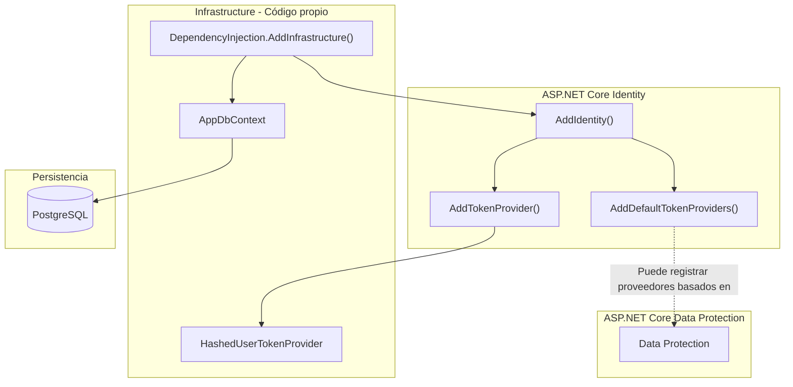
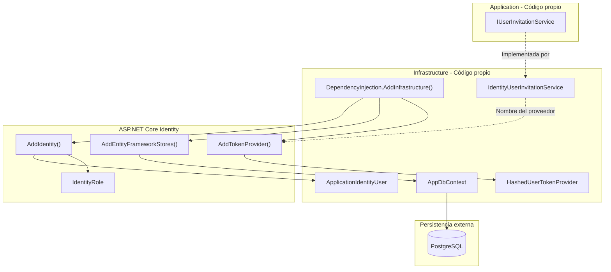

# Implementar: 07-eliminacion-data-protection-key-ring

## PASOS

### 1. Ejecutar docker compose ps y confirmar que no se eliminarán volúmenes ni se reconfigurará pgAdmin.

---

### 2. Buscar referencias de código, configuración, documentación y Docker.

---

### 3. Eliminar clases/opciones específicas de Data Protection sin consumidores.

---

### 4. Eliminar registros de Data Protection, persistencia, DPAPI y using asociados.

#### 1. Componentes implementados

| Componente                            | Acción | Tipo                     | Capa           | Responsabilidad                                                                                               |
| ------------------------------------- | ------ | ------------------------ | -------------- | ------------------------------------------------------------------------------------------------------------- |
| `DependencyInjection`                 | Update | Clase estática           | Infrastructure | Elimina la configuración explícita de Data Protection y conserva el registro de servicios de infraestructura. |
| `AddInfrastructure()`                 | Update | Método de extensión      | Infrastructure | Elimina el registro, persistencia y protección de claves de Data Protection.                                  |
| `IDataProtectionBuilder`              | Delete | Interfaz de ASP.NET Core | Infrastructure | Se elimina su utilización para configurar Data Protection.                                                    |
| `DataProtection:KeyRingPath`          | Delete | Lectura de configuración | Infrastructure | Elimina la lectura de la ruta de almacenamiento de claves criptográficas.                                     |
| `Microsoft.AspNetCore.DataProtection` | Delete | Using                    | Infrastructure | Elimina la importación explícita de Data Protection.                                                          |
| `System.IO`                           | Delete | Using                    | Infrastructure | Elimina la importación utilizada para gestionar el directorio de claves.                                      |

#### 2. Métodos principales

| Clase                 | Método                | Responsabilidad                                                                         |
| --------------------- | --------------------- | --------------------------------------------------------------------------------------- |
| `DependencyInjection` | `AddInfrastructure()` | Registra los servicios de Infrastructure sin configurar explícitamente Data Protection. |

**Operaciones eliminadas:**

| Método / Propiedad            | Función anterior                                                            |
| ----------------------------- | --------------------------------------------------------------------------- |
| `AddDataProtection()`         | Registraba explícitamente los servicios de Data Protection.                 |
| `SetApplicationName()`        | Establecía el identificador de aplicación utilizado para aislar las claves. |
| `PersistKeysToFileSystem()`   | Configuraba la persistencia del Key Ring en el sistema de archivos.         |
| `ProtectKeysWithDpapi()`      | Protegía las claves mediante DPAPI en Windows.                              |
| `DirectoryInfo.Create()`      | Creaba el directorio destinado al almacenamiento de claves.                 |
| `OperatingSystem.IsWindows()` | Comprobaba si el sistema operativo era Windows.                             |

#### 3. Componentes de .NET y bibliotecas externas

| Componente / Método           | Origen                                          | Función                                                   | Uso en el proyecto                           |
| ----------------------------- | ----------------------------------------------- | --------------------------------------------------------- | -------------------------------------------- |
| `IServiceCollection`          | .NET / Microsoft.Extensions.DependencyInjection | Contenedor de registro de servicios.                      | Mantiene los registros de Infrastructure.    |
| `IConfiguration`              | .NET / Microsoft.Extensions.Configuration       | Acceso a configuración.                                   | Obtiene las opciones y cadenas de conexión.  |
| `AddDataProtection()`         | ASP.NET Core Data Protection                    | Registra servicios criptográficos de protección de datos. | Eliminado del registro explícito.            |
| `IDataProtectionBuilder`      | ASP.NET Core Data Protection                    | Configura los servicios de protección de datos.           | Eliminado.                                   |
| `SetApplicationName()`        | ASP.NET Core Data Protection                    | Define el discriminador de aplicación.                    | Eliminado.                                   |
| `PersistKeysToFileSystem()`   | ASP.NET Core Data Protection                    | Persiste el Key Ring en archivos.                         | Eliminado.                                   |
| `ProtectKeysWithDpapi()`      | ASP.NET Core Data Protection                    | Protege claves mediante Windows DPAPI.                    | Eliminado.                                   |
| `DirectoryInfo`               | .NET / System.IO                                | Representa y administra directorios.                      | Eliminado de esta configuración.             |
| `OperatingSystem.IsWindows()` | .NET / System                                   | Identifica el sistema operativo.                          | Eliminado de esta configuración.             |
| `AddIdentity()`               | ASP.NET Core Identity                           | Registra servicios de identidad.                          | Se mantiene sin modificaciones en este paso. |
| `AddDefaultTokenProviders()`  | ASP.NET Core Identity                           | Registra proveedores de tokens predeterminados.           | Se mantiene en el código mostrado.           |
| `AddTokenProvider<T>()`       | ASP.NET Core Identity                           | Registra un proveedor de tokens personalizado.            | Mantiene `HashedUserTokenProvider`.          |

#### 4. Flujo funcional

| Operación                         | Antes                                      | Después      |
| --------------------------------- | ------------------------------------------ | ------------ |
| Registro de Data Protection       | `AddDataProtection()` explícito.           | Eliminado.   |
| Identificación de aplicación      | `SetApplicationName("FEPP-ContaOps")`.     | Eliminada.   |
| Configuración del Key Ring        | Lectura de `DataProtection:KeyRingPath`.   | Eliminada.   |
| Persistencia de claves            | `PersistKeysToFileSystem()`.               | Eliminada.   |
| Protección en Windows             | `ProtectKeysWithDpapi()`.                  | Eliminada.   |
| Registro de Identity              | `AddIdentity()` con proveedores de tokens. | Se mantiene. |
| Registro de tokens personalizados | `HashedUserTokenProvider`.                 | Se mantiene. |

**Alcance:** Se elimina la configuración explícita de Data Protection, pero no se demuestra su desactivación completa. `AddDefaultTokenProviders()` permanece registrado y puede incorporar proveedores que utilizan Data Protection.

#### 5. Diagrama de arquitectura



**Configuración explícita eliminada:** `AddDataProtection()`, `SetApplicationName()`, `PersistKeysToFileSystem()` y `ProtectKeysWithDpapi()`.

#### 6. Resultado

Se elimina de `DependencyInjection` la configuración explícita de Data Protection, la persistencia del Key Ring y su protección mediante DPAPI. Se conserva el registro de ASP.NET Core Identity y sus proveedores de tokens, por lo que la ausencia total de dependencias de Data Protection todavía no queda demostrada.

---

### 5. Registrar explícitamente solo los proveedores de Identity necesarios.

#### 1. Componentes implementados

| Componente                   | Acción      | Tipo                              | Capa           | Responsabilidad                                                                              |
| ---------------------------- | ----------- | --------------------------------- | -------------- | -------------------------------------------------------------------------------------------- |
| `DependencyInjection`        | Update      | Clase estática                    | Infrastructure | Configura ASP.NET Core Identity registrando únicamente el proveedor de tokens personalizado. |
| `AddInfrastructure()`        | Update      | Método de extensión               | Infrastructure | Elimina el registro de proveedores de tokens predeterminados de Identity.                    |
| `HashedUserTokenProvider`    | Sin cambios | Proveedor de tokens personalizado | Infrastructure | Proveedor registrado explícitamente para los tokens de invitación.                           |
| `AddDefaultTokenProviders()` | Delete      | Registro de servicios             | Infrastructure | Elimina el registro automático de proveedores predeterminados de Identity.                   |

#### 2. Métodos principales

| Clase                 | Método                | Responsabilidad                                                                                     |
| --------------------- | --------------------- | --------------------------------------------------------------------------------------------------- |
| `DependencyInjection` | `AddInfrastructure()` | Registra Identity, sus almacenes de EF Core y el proveedor personalizado `HashedUserTokenProvider`. |

**Cambio realizado:**

```csharp
services.AddIdentity<ApplicationIdentityUser, IdentityRole>(options =>
    {
        options.User.RequireUniqueEmail = true;
    })
    .AddEntityFrameworkStores<AppDbContext>()
    .AddTokenProvider<HashedUserTokenProvider>(
        IdentityUserInvitationService.TokenProviderName);
```

Se elimina `.AddDefaultTokenProviders()`, conservando únicamente el registro explícito del proveedor personalizado.

#### 3. Componentes de .NET y bibliotecas externas

| Componente / Método                               | Origen                                        | Función                                                                      | Uso en el proyecto                                                              |
| ------------------------------------------------- | --------------------------------------------- | ---------------------------------------------------------------------------- | ------------------------------------------------------------------------------- |
| `AddIdentity<TUser, TRole>()`                     | ASP.NET Core Identity                         | Registra los servicios de administración de usuarios y roles.                | Configura Identity con `ApplicationIdentityUser` e `IdentityRole`.              |
| `AddEntityFrameworkStores<TContext>()`            | ASP.NET Core Identity + Entity Framework Core | Integra los almacenes de Identity con EF Core.                               | Utiliza `AppDbContext` para la persistencia de identidad.                       |
| `AddTokenProvider<TProvider>()`                   | ASP.NET Core Identity                         | Registra un proveedor de tokens con un nombre específico.                    | Registra `HashedUserTokenProvider` para invitaciones.                           |
| `AddDefaultTokenProviders()`                      | ASP.NET Core Identity                         | Registra proveedores predeterminados para generación y validación de tokens. | Eliminado para evitar registrar proveedores que no se requieren explícitamente. |
| `HashedUserTokenProvider`                         | Código propio del proyecto                    | Proveedor personalizado de tokens de Identity.                               | Permanece registrado para el flujo de invitaciones.                             |
| `IdentityUserInvitationService.TokenProviderName` | Código propio del proyecto                    | Identifica el nombre del proveedor personalizado.                            | Se utiliza como clave de registro del proveedor.                                |
| `IdentityRole`                                    | ASP.NET Core Identity                         | Representa un rol de Identity.                                               | Tipo de rol utilizado en la configuración.                                      |

#### 4. Flujo funcional

| Operación                                          | Antes                                                     | Después                                    |
| -------------------------------------------------- | --------------------------------------------------------- | ------------------------------------------ |
| Registro de Identity                               | `AddIdentity()`                                           | Se mantiene.                               |
| Persistencia de usuarios y roles                   | `AddEntityFrameworkStores<AppDbContext>()`                | Se mantiene.                               |
| Proveedor personalizado                            | `HashedUserTokenProvider`                                 | Se mantiene.                               |
| Proveedores predeterminados                        | `AddDefaultTokenProviders()`                              | Eliminado.                                 |
| Registro de proveedores basados en Data Protection | Podían registrarse mediante `AddDefaultTokenProviders()`. | Se elimina esa vía de registro automático. |

**Alcance:** El cambio evita registrar automáticamente los proveedores predeterminados de Identity, incluidos los basados en Data Protection. No demuestra que otros componentes de la aplicación no registren o utilicen Data Protection.

#### 5. Diagrama de arquitectura



**Registro eliminado:** `AddDefaultTokenProviders()`.

#### 6. Resultado

Se elimina el registro automático de proveedores predeterminados de ASP.NET Core Identity, conservando `HashedUserTokenProvider` como único proveedor registrado explícitamente. Esto elimina una vía de incorporación de proveedores dependientes de Data Protection, sin modificar los servicios principales de Identity.

---

### 6. Eliminar DataProtection\_\_KeyRingPath de configuración/documentación, sin modificar secretos reales.

---

### 7. Ejecutar búsqueda negativa y justificar menciones históricas.

---

### 8. Ejecutar restore, build, pruebas y verificaciones manuales.

---

### 9. Ajustes por pruebas manuales

**Levantar PostgreSQL y pgAdmin:**

```powershell
docker compose up -d
```

**Compilación y pruebas:**

```powershell
dotnet restore FEPP-ContaOps.slnx
dotnet build FEPP-ContaOps.slnx
dotnet test FEPP-ContaOps.slnx
```

---

### 10. Validación, ejecución local y Git

**Prerrequisitos:** Docker disponible; crear un archivo `.env` local a partir de `.env.example` y sustituir todos los valores de ejemplo por credenciales y secretos propios. **No subir `.env` a Git.**

**Iniciar API:**

```powershell
.\run-local.ps1
```

---

### 11. Validación del spec (flujo de trabajo existente):

```powershell
/spec-acceptance-validator @specs/07-eliminacion-data-protection-key-ring.md
```

Revisar el spec: [`07-eliminacion-data-protection-key-ring.md`](../07-eliminacion-data-protection-key-ring.md).

---

### 12. Diagrama Final: Arquitectura del spec-07-eliminacion-data-protection-key-ring

---

### 13. Comandos Git / PR\*\* (una vez validada la implementación y revisados los cambios)

```powershell
git add .
git commit -m "FEPP-ContaOps - spec-07-eliminacion-data-protection-key-ring -  Implementado"
git push -u origin spec-07-eliminacion-data-protection-key-ring

# Después de aprobar y fusionar el Pull Request:
git switch main
git pull
git branch -d spec-07-eliminacion-data-protection-key-ring
```
