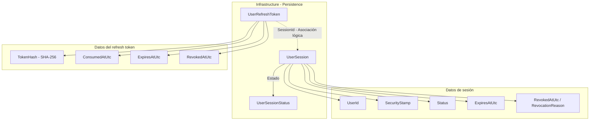

# Implementar: 08-persistencia-sesiones-refresh-tokens

## PASOS

### 1. Recrear PostgreSQL y pgAdmin desde cero.

---

### 2. Iniciar database y pgadmin, verificando su estado.

---

### 3. Registrar pgAdmin.

#### Recuperación manual de `ERR_EMPTY_RESPONSE`

En el primer arranque, pgAdmin puede tardar en completar la inicialización de
su base interna. Durante ese intervalo el navegador puede mostrar:
`localhost no ha enviado ningún dato (ERR_EMPTY_RESPONSE)`.

El usuario debe seguir este procedimiento:

1. No eliminar volúmenes ni ejecutar `docker compose down --volumes`, porque
   eso borra la configuración local de pgAdmin y obliga a empezar de nuevo.
2. Abrir PowerShell en la raíz del repositorio y comprobar el estado:

   ```powershell
   docker compose ps
   docker compose logs --tail=100 pgadmin
   ```

3. Esperar hasta que los logs indiquen que Gunicorn está escuchando en
   `http://[::]:80` y que el contenedor aparezca como `Up`.
4. Recargar `http://localhost:5050/` (o abrirlo de nuevo en una ventana
   privada). Si continúa sin responder después de finalizar la inicialización,
   reiniciar únicamente pgAdmin:

   ```powershell
   docker compose restart pgadmin
   ```

5. Esperar nuevamente a que termine la inicialización y volver a abrir la
   URL. Si el problema persiste, consultar los últimos logs:

   ```powershell
   docker compose logs --tail=200 pgadmin
   ```

Cuando la pantalla de login esté disponible, iniciar sesión con
`PGADMIN_DEFAULT_EMAIL` y `PGADMIN_DEFAULT_PASSWORD`; después registrar
`FEPP-ContaOps Local` con host `database`, puerto `5432`, base
`fepp_contaops_dev`, usuario `app` y la contraseña local de
`POSTGRES_PASSWORD`.

---

### 4. Crear entidades en Infrastructure.

#### 1. Componentes implementados

| Componente          | Acción | Tipo  | Capa                         | Responsabilidad                                                                             |
| ------------------- | ------ | ----- | ---------------------------- | ------------------------------------------------------------------------------------------- |
| `UserSession`       | Create | Clase | Infrastructure / Persistence | Representa una sesión de usuario con estado, vigencia y datos de revocación.                |
| `UserRefreshToken`  | Create | Clase | Infrastructure / Persistence | Representa un refresh token asociado a una sesión, almacenando su hash y fechas de control. |
| `UserSessionStatus` | Create | Enum  | Infrastructure / Persistence | Define los estados posibles de una sesión: `Active`, `Revoked` y `Expired`.                 |

#### 2. Métodos principales

Las clases implementadas no contienen métodos propios. Su comportamiento se representa mediante propiedades.

| Clase              | Propiedad                          | Responsabilidad                                                              |
| ------------------ | ---------------------------------- | ---------------------------------------------------------------------------- |
| `UserSession`      | `SessionId`                        | Identifica de manera única la sesión.                                        |
| `UserSession`      | `UserId`                           | Identifica al usuario propietario de la sesión.                              |
| `UserSession`      | `SecurityStamp`                    | Almacena el sello de seguridad del usuario al crear la sesión.               |
| `UserSession`      | `Status`                           | Representa el estado de la sesión mediante `UserSessionStatus`.              |
| `UserSession`      | `ExpiresAtUtc`                     | Establece la fecha de expiración de la sesión.                               |
| `UserSession`      | `RevokedAtUtc`, `RevocationReason` | Almacenan información de revocación.                                         |
| `UserRefreshToken` | `TokenId`                          | Identifica el registro del refresh token.                                    |
| `UserRefreshToken` | `SessionId`                        | Identifica la sesión a la que pertenece el token.                            |
| `UserRefreshToken` | `TokenHash`                        | Almacena el hash SHA-256 del token opaco, sin conservar el secreto original. |
| `UserRefreshToken` | `ExpiresAtUtc`                     | Define la expiración del refresh token.                                      |
| `UserRefreshToken` | `ConsumedAtUtc`                    | Registra cuándo fue utilizado el token.                                      |
| `UserRefreshToken` | `RevokedAtUtc`                     | Registra cuándo fue revocado el token.                                       |

Ambas clases incluyen `CreatedAtUtc` para registrar su fecha de creación.

#### 3. Componentes de .NET y bibliotecas externas

| Componente / Método | Origen        | Función                                           | Uso en el proyecto                                   |
| ------------------- | ------------- | ------------------------------------------------- | ---------------------------------------------------- |
| `Guid`              | .NET / System | Identificador de 128 bits.                        | Identifica sesiones y refresh tokens.                |
| `DateTimeOffset`    | .NET / System | Representa fechas y horas con desplazamiento UTC. | Registra creación, expiración, consumo y revocación. |
| `byte[]`            | .NET / C#     | Arreglo de bytes.                                 | Almacena el hash SHA-256 del refresh token.          |
| `enum`              | C#            | Define un conjunto de constantes.                 | Implementa `UserSessionStatus`.                      |
| `UserSession`       | Código propio | Modelo de persistencia.                           | Representa sesiones de usuarios.                     |
| `UserRefreshToken`  | Código propio | Modelo de persistencia.                           | Representa refresh tokens asociados a sesiones.      |
| `UserSessionStatus` | Código propio | Enumeración.                                      | Define los estados persistentes de una sesión.       |

**Nota:** Las clases no implementan directamente operaciones criptográficas ni acceso a bases de datos. Tampoco se incluye configuración de Entity Framework Core en este paso.

#### 4. Flujo funcional

| Operación                 | Componente          | Descripción                                                 |
| ------------------------- | ------------------- | ----------------------------------------------------------- |
| Identificación de sesión  | `UserSession`       | Utiliza `SessionId` como identificador.                     |
| Asociación usuario-sesión | `UserSession`       | Almacena `UserId` y `SecurityStamp`.                        |
| Control de estado         | `UserSessionStatus` | Representa sesiones activas, revocadas o expiradas.         |
| Asociación token-sesión   | `UserRefreshToken`  | Utiliza `SessionId` para referenciar la sesión propietaria. |
| Almacenamiento del token  | `UserRefreshToken`  | Conserva `TokenHash` en lugar del token original.           |
| Control de consumo        | `UserRefreshToken`  | Dispone de `ConsumedAtUtc` para registrar su utilización.   |
| Control de revocación     | Ambas clases        | Disponen de propiedades para registrar revocaciones.        |
| Control de expiración     | Ambas clases        | Almacenan sus respectivas fechas de expiración.             |

**Relación lógica:** Una sesión puede estar asociada a varios registros de refresh tokens mediante `SessionId`. La cardinalidad y las restricciones de integridad referencial todavía no están configuradas en el código proporcionado.

#### 5. Diagrama de arquitectura



#### 6. Resultado

Se crean los modelos de persistencia `UserSession` y `UserRefreshToken`, junto con la enumeración `UserSessionStatus`, para representar sesiones y refresh tokens sin almacenar el secreto original.

La configuración de persistencia, las relaciones de Entity Framework Core y las operaciones de gestión de sesiones no forman parte de este paso.

---

### 5. Configurar relaciones, índices, unicidad y cascada.

---

### 6. Implementar generación, hash y comparación.

---

### 7. Implementar sesión activa y refresh activo.

---

### 8. Implementar consumo, revocación y expiración.

---

### 9. Agregar pruebas unitarias.

---

### 10. Iniciar API, verificar tablas y ejecutar build/pruebas.

---

### ?. Ajustes por pruebas manuales

**Levantar PostgreSQL y pgAdmin:**

```powershell
docker compose up -d
```

**Compilación y pruebas:**

```powershell
dotnet restore FEPP-ContaOps.slnx
dotnet build FEPP-ContaOps.slnx
dotnet test FEPP-ContaOps.slnx
```

---

### ?. Validación, ejecución local y Git

**Prerrequisitos:** Docker disponible; crear un archivo `.env` local a partir de `.env.example` y sustituir todos los valores de ejemplo por credenciales y secretos propios. **No subir `.env` a Git.**

**Iniciar API:**

```powershell
.\run-local.ps1
```

---

### ?. Validación del spec (flujo de trabajo existente):

```powershell
/spec-acceptance-validator @specs/08-persistencia-sesiones-refresh-tokens.md
```

Revisar el spec: [`08-persistencia-sesiones-refresh-tokens.md`](../08-persistencia-sesiones-refresh-tokens.md).

---

### ?. Diagrama Final: Arquitectura del spec-08-persistencia-sesiones-refresh-tokens

---

### ?. Comandos Git / PR\*\* (una vez validada la implementación y revisados los cambios)

```powershell
git add .
git commit -m "FEPP-ContaOps - spec-08-persistencia-sesiones-refresh-tokens -  Implementado"
git push -u origin spec-08-persistencia-sesiones-refresh-tokens

# Después de aprobar y fusionar el Pull Request:
git switch main
git pull
git branch -d spec-08-persistencia-sesiones-refresh-tokens
```
