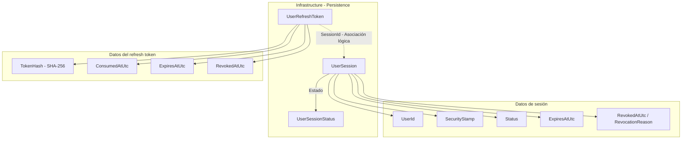
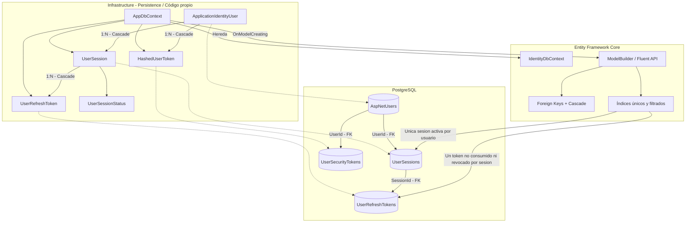
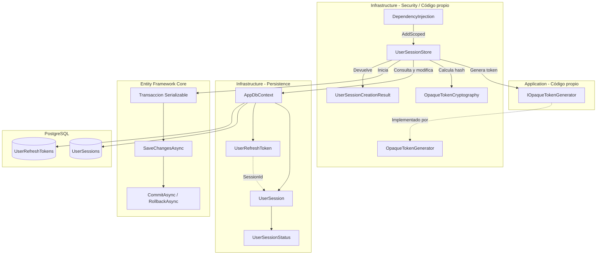
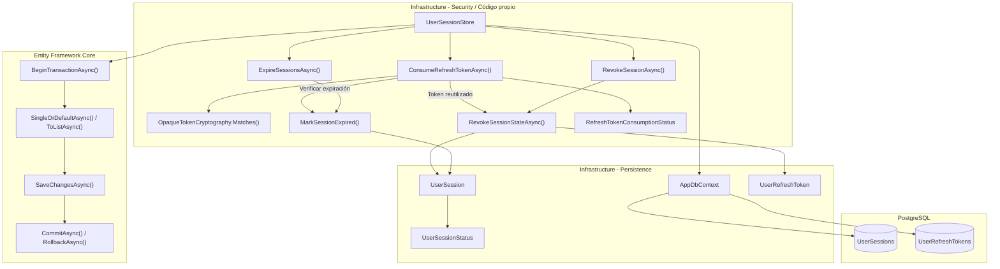
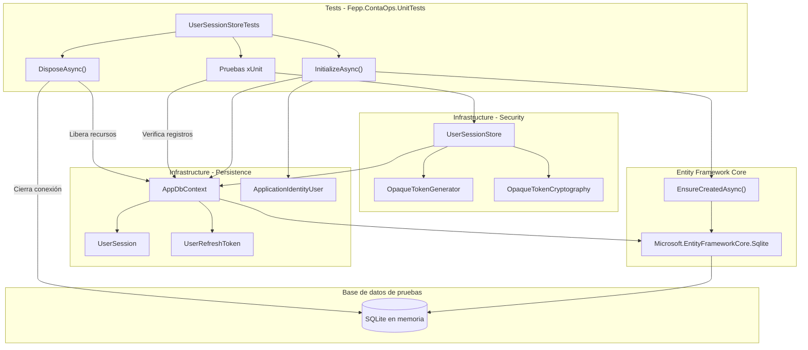

# Implementar: 08-persistencia-sesiones-refresh-tokens

## PASOS

### 1. Recrear PostgreSQL y pgAdmin desde cero.

---

### 2. Iniciar database y pgadmin, verificando su estado.

---

### 3. Registrar pgAdmin.

#### Recuperación manual de `ERR_EMPTY_RESPONSE`

En el primer arranque, pgAdmin puede tardar en completar la inicialización de
su base interna. Durante ese intervalo el navegador puede mostrar:
`localhost no ha enviado ningún dato (ERR_EMPTY_RESPONSE)`.

El usuario debe seguir este procedimiento:

1. No eliminar volúmenes ni ejecutar `docker compose down --volumes`, porque
   eso borra la configuración local de pgAdmin y obliga a empezar de nuevo.
2. Abrir PowerShell en la raíz del repositorio y comprobar el estado:

   ```powershell
   docker compose ps
   docker compose logs --tail=100 pgadmin
   ```

3. Esperar hasta que los logs indiquen que Gunicorn está escuchando en
   `http://[::]:80` y que el contenedor aparezca como `Up`.
4. Recargar `http://localhost:5050/` (o abrirlo de nuevo en una ventana
   privada). Si continúa sin responder después de finalizar la inicialización,
   reiniciar únicamente pgAdmin:

   ```powershell
   docker compose restart pgadmin
   ```

5. Esperar nuevamente a que termine la inicialización y volver a abrir la
   URL. Si el problema persiste, consultar los últimos logs:

   ```powershell
   docker compose logs --tail=200 pgadmin
   ```

Cuando la pantalla de login esté disponible, iniciar sesión con
`PGADMIN_DEFAULT_EMAIL` y `PGADMIN_DEFAULT_PASSWORD`; después registrar
`FEPP-ContaOps Local` con host `database`, puerto `5432`, base
`fepp_contaops_dev`, usuario `app` y la contraseña local de
`POSTGRES_PASSWORD`.

---

### 4. Crear entidades en Infrastructure.

#### 1. Componentes implementados

| Componente          | Acción | Tipo  | Capa                         | Responsabilidad                                                                             |
| ------------------- | ------ | ----- | ---------------------------- | ------------------------------------------------------------------------------------------- |
| `UserSession`       | Create | Clase | Infrastructure / Persistence | Representa una sesión de usuario con estado, vigencia y datos de revocación.                |
| `UserRefreshToken`  | Create | Clase | Infrastructure / Persistence | Representa un refresh token asociado a una sesión, almacenando su hash y fechas de control. |
| `UserSessionStatus` | Create | Enum  | Infrastructure / Persistence | Define los estados posibles de una sesión: `Active`, `Revoked` y `Expired`.                 |

#### 2. Métodos principales

Las clases implementadas no contienen métodos propios. Su comportamiento se representa mediante propiedades.

| Clase              | Propiedad                          | Responsabilidad                                                              |
| ------------------ | ---------------------------------- | ---------------------------------------------------------------------------- |
| `UserSession`      | `SessionId`                        | Identifica de manera única la sesión.                                        |
| `UserSession`      | `UserId`                           | Identifica al usuario propietario de la sesión.                              |
| `UserSession`      | `SecurityStamp`                    | Almacena el sello de seguridad del usuario al crear la sesión.               |
| `UserSession`      | `Status`                           | Representa el estado de la sesión mediante `UserSessionStatus`.              |
| `UserSession`      | `ExpiresAtUtc`                     | Establece la fecha de expiración de la sesión.                               |
| `UserSession`      | `RevokedAtUtc`, `RevocationReason` | Almacenan información de revocación.                                         |
| `UserRefreshToken` | `TokenId`                          | Identifica el registro del refresh token.                                    |
| `UserRefreshToken` | `SessionId`                        | Identifica la sesión a la que pertenece el token.                            |
| `UserRefreshToken` | `TokenHash`                        | Almacena el hash SHA-256 del token opaco, sin conservar el secreto original. |
| `UserRefreshToken` | `ExpiresAtUtc`                     | Define la expiración del refresh token.                                      |
| `UserRefreshToken` | `ConsumedAtUtc`                    | Registra cuándo fue utilizado el token.                                      |
| `UserRefreshToken` | `RevokedAtUtc`                     | Registra cuándo fue revocado el token.                                       |

Ambas clases incluyen `CreatedAtUtc` para registrar su fecha de creación.

#### 3. Componentes de .NET y bibliotecas externas

| Componente / Método | Origen        | Función                                           | Uso en el proyecto                                   |
| ------------------- | ------------- | ------------------------------------------------- | ---------------------------------------------------- |
| `Guid`              | .NET / System | Identificador de 128 bits.                        | Identifica sesiones y refresh tokens.                |
| `DateTimeOffset`    | .NET / System | Representa fechas y horas con desplazamiento UTC. | Registra creación, expiración, consumo y revocación. |
| `byte[]`            | .NET / C#     | Arreglo de bytes.                                 | Almacena el hash SHA-256 del refresh token.          |
| `enum`              | C#            | Define un conjunto de constantes.                 | Implementa `UserSessionStatus`.                      |
| `UserSession`       | Código propio | Modelo de persistencia.                           | Representa sesiones de usuarios.                     |
| `UserRefreshToken`  | Código propio | Modelo de persistencia.                           | Representa refresh tokens asociados a sesiones.      |
| `UserSessionStatus` | Código propio | Enumeración.                                      | Define los estados persistentes de una sesión.       |

**Nota:** Las clases no implementan directamente operaciones criptográficas ni acceso a bases de datos. Tampoco se incluye configuración de Entity Framework Core en este paso.

#### 4. Flujo funcional

| Operación                 | Componente          | Descripción                                                 |
| ------------------------- | ------------------- | ----------------------------------------------------------- |
| Identificación de sesión  | `UserSession`       | Utiliza `SessionId` como identificador.                     |
| Asociación usuario-sesión | `UserSession`       | Almacena `UserId` y `SecurityStamp`.                        |
| Control de estado         | `UserSessionStatus` | Representa sesiones activas, revocadas o expiradas.         |
| Asociación token-sesión   | `UserRefreshToken`  | Utiliza `SessionId` para referenciar la sesión propietaria. |
| Almacenamiento del token  | `UserRefreshToken`  | Conserva `TokenHash` en lugar del token original.           |
| Control de consumo        | `UserRefreshToken`  | Dispone de `ConsumedAtUtc` para registrar su utilización.   |
| Control de revocación     | Ambas clases        | Disponen de propiedades para registrar revocaciones.        |
| Control de expiración     | Ambas clases        | Almacenan sus respectivas fechas de expiración.             |

**Relación lógica:** Una sesión puede estar asociada a varios registros de refresh tokens mediante `SessionId`. La cardinalidad y las restricciones de integridad referencial todavía no están configuradas en el código proporcionado.

#### 5. Diagrama de arquitectura



#### 6. Resultado

Se crean los modelos de persistencia `UserSession` y `UserRefreshToken`, junto con la enumeración `UserSessionStatus`, para representar sesiones y refresh tokens sin almacenar el secreto original.

La configuración de persistencia, las relaciones de Entity Framework Core y las operaciones de gestión de sesiones no forman parte de este paso.

---

### 5. Configurar relaciones, índices, unicidad y cascada.

#### 1. Componentes implementados

| Componente          | Acción    | Tipo                      | Capa                         | Responsabilidad                                                                             |
| ------------------- | --------- | ------------------------- | ---------------------------- | ------------------------------------------------------------------------------------------- |
| `AppDbContext`      | Update    | Clase / DbContext         | Infrastructure / Persistence | Incorpora sesiones y refresh tokens al modelo de persistencia de EF Core.                   |
| `UserSessions`      | Create    | `DbSet<UserSession>`      | Infrastructure / Persistence | Expone las sesiones de usuario para operaciones de persistencia.                            |
| `UserRefreshTokens` | Create    | `DbSet<UserRefreshToken>` | Infrastructure / Persistence | Expone los refresh tokens almacenados mediante su hash.                                     |
| `OnModelCreating()` | Update    | Método sobrescrito        | Infrastructure / Persistence | Configura tablas, columnas, relaciones, índices y restricciones.                            |
| `UserSession`       | Configure | Entidad de persistencia   | Infrastructure / Persistence | Define su relación con usuarios y restringe a una sesión activa por usuario.                |
| `UserRefreshToken`  | Configure | Entidad de persistencia   | Infrastructure / Persistence | Define su relación con sesiones y restringe a un token no consumido ni revocado por sesión. |

**Configuración de tablas y restricciones:**

| Tabla                | Clave primaria | Clave foránea                | Restricción                                                               |
| -------------------- | -------------- | ---------------------------- | ------------------------------------------------------------------------- |
| `UserSessions`       | `SessionId`    | `UserId` → `AspNetUsers`     | Una sesión con `Status = 1` por usuario.                                  |
| `UserRefreshTokens`  | `TokenId`      | `SessionId` → `UserSessions` | Un token no consumido ni revocado por sesión.                             |
| `UserSecurityTokens` | `TokenId`      | `UserId` → `AspNetUsers`     | Un token por usuario y propósito. Se mantiene la configuración existente. |

#### 2. Métodos principales

| Clase                        | Método                                | Responsabilidad                                                |
| ---------------------------- | ------------------------------------- | -------------------------------------------------------------- |
| `AppDbContext`               | `OnModelCreating()`                   | Configura el modelo relacional mediante Fluent API.            |
| `ModelBuilder`               | `Entity<T>()`                         | Define la configuración de cada entidad.                       |
| `EntityTypeBuilder`          | `ToTable()`                           | Asigna el nombre de la tabla.                                  |
| `EntityTypeBuilder`          | `HasKey()`                            | Define la clave primaria.                                      |
| `EntityTypeBuilder`          | `Property()`                          | Configura tipos de columnas, obligatoriedad y longitud.        |
| `EntityTypeBuilder`          | `HasOne().WithMany().HasForeignKey()` | Configura relaciones uno a muchos mediante claves foráneas.    |
| `ReferenceCollectionBuilder` | `OnDelete()`                          | Define el comportamiento al eliminar una entidad relacionada.  |
| `EntityTypeBuilder`          | `HasIndex()`                          | Define índices sobre una o varias columnas.                    |
| `IndexBuilder`               | `IsUnique()`                          | Establece restricciones de unicidad.                           |
| `IndexBuilder`               | `HasFilter()`                         | Restringe un índice a los registros que cumplen una condición. |

#### 3. Componentes de .NET y bibliotecas externas

| Componente / Método                     | Origen                          | Función                                         | Uso en el proyecto                                                         |
| --------------------------------------- | ------------------------------- | ----------------------------------------------- | -------------------------------------------------------------------------- |
| `IdentityDbContext<TUser, TRole, TKey>` | ASP.NET Core Identity + EF Core | Contexto de persistencia de Identity.           | Clase base de `AppDbContext`.                                              |
| `DbSet<T>`                              | Entity Framework Core           | Representa un conjunto de entidades.            | Expone `UserSessions` y `UserRefreshTokens`.                               |
| `ModelBuilder`                          | Entity Framework Core           | Construye el modelo de entidades y relaciones.  | Configura las tablas de sesiones y tokens.                                 |
| `HasColumnType()`                       | Entity Framework Core           | Especifica el tipo de columna de base de datos. | Define tipos como `uuid`, `bytea`, `integer` y `timestamp with time zone`. |
| `HasIndex()`                            | Entity Framework Core           | Configura índices.                              | Define índices de búsqueda y unicidad.                                     |
| `HasFilter()`                           | Entity Framework Core           | Define índices filtrados mediante SQL.          | Restringe sesiones activas y tokens utilizables.                           |
| `IsUnique()`                            | Entity Framework Core           | Configura índices únicos.                       | Impide registros duplicados que cumplan los filtros.                       |
| `DeleteBehavior.Cascade`                | Entity Framework Core           | Configura eliminación en cascada.               | Elimina sesiones y tokens asociados al eliminar sus entidades principales. |
| `HasMaxLength()`                        | Entity Framework Core           | Configura la longitud máxima de una propiedad.  | Limita `TokenHash` a 32 bytes.                                             |
| `UserSession`, `UserRefreshToken`       | Código propio                   | Modelos de persistencia.                        | Representan sesiones y refresh tokens.                                     |
| `AppDbContext`                          | Código propio                   | Contexto EF Core de la aplicación.              | Centraliza la configuración del modelo persistente.                        |

#### 4. Flujo funcional

**Relaciones y eliminación en cascada:**

| Entidad principal         | Entidad dependiente | Cardinalidad | Eliminación         |
| ------------------------- | ------------------- | ------------ | ------------------- |
| `ApplicationIdentityUser` | `UserSession`       | 1:N          | Cascade             |
| `UserSession`             | `UserRefreshToken`  | 1:N          | Cascade             |
| `ApplicationIdentityUser` | `HashedUserToken`   | 1:N          | Cascade (existente) |

Eliminar un usuario provoca la eliminación de sus sesiones y, por cascada, de los refresh tokens asociados.

**Índices configurados:**

| Índice                               | Tabla               | Columnas           | Tipo           | Restricción / Finalidad                                    |
| ------------------------------------ | ------------------- | ------------------ | -------------- | ---------------------------------------------------------- |
| `IX_UserSessions_UserId_Status`      | `UserSessions`      | `UserId`, `Status` | No único       | Facilita consultas de sesiones por usuario y estado.       |
| `UX_UserSessions_ActiveUser`         | `UserSessions`      | `UserId`           | Único filtrado | `Status = 1`. Permite una única sesión activa por usuario. |
| `UX_UserRefreshTokens_UsableSession` | `UserRefreshTokens` | `SessionId`        | Único filtrado | `ConsumedAtUtc IS NULL AND RevokedAtUtc IS NULL`.          |
| `IX_UserRefreshTokens_ExpiresAtUtc`  | `UserRefreshTokens` | `ExpiresAtUtc`     | No único       | Facilita consultas por expiración.                         |

**Consideraciones de las restricciones:**

- `UX_UserSessions_ActiveUser` permite múltiples sesiones históricas revocadas o expiradas, pero solo una con estado `Active` por usuario.
- `UX_UserRefreshTokens_UsableSession` permite conservar tokens consumidos o revocados, pero solo uno que no tenga registradas esas condiciones por sesión.
- El índice de refresh tokens no evalúa `ExpiresAtUtc`; un token vencido continúa sujeto a la restricción mientras `ConsumedAtUtc` y `RevokedAtUtc` sean `NULL`.
- La configuración define restricciones a nivel de base de datos. No implementa por sí misma operaciones de creación, rotación o revocación.

#### 5. Diagrama de arquitectura



#### 6. Resultado

Se incorporan `UserSession` y `UserRefreshToken` al modelo de EF Core, configurando sus relaciones con Identity, eliminación en cascada e índices de unicidad filtrados.

La base de datos queda modelada para restringir a una sesión activa por usuario y un refresh token no consumido ni revocado por sesión. La aplicación efectiva de estos cambios requiere las migraciones correspondientes.

---

### 6. Implementar generación, hash y comparación.

---

### 7. Implementar sesión activa y refresh activo.

#### 1. Componentes implementados

| Componente                  | Acción | Tipo                             | Capa                         | Responsabilidad                                                                                      |
| --------------------------- | ------ | -------------------------------- | ---------------------------- | ---------------------------------------------------------------------------------------------------- |
| `UserSessionStore`          | Create | Clase / Servicio de persistencia | Infrastructure / Security    | Reemplaza la sesión activa de un usuario y genera su refresh token inicial mediante una transacción. |
| `UserSessionCreationResult` | Create | Record                           | Infrastructure / Security    | Devuelve el identificador de la nueva sesión y el refresh token original.                            |
| `DependencyInjection`       | Update | Clase estática                   | Infrastructure               | Registra `UserSessionStore` en el contenedor de dependencias.                                        |
| `UserSession`               | Uso    | Entidad de persistencia          | Infrastructure / Persistence | Representa la sesión creada o revocada.                                                              |
| `UserRefreshToken`          | Uso    | Entidad de persistencia          | Infrastructure / Persistence | Almacena el hash del refresh token y permite registrar su revocación.                                |
| `UserSessionStatus`         | Uso    | Enum                             | Infrastructure / Persistence | Identifica los estados `Active` y `Revoked` utilizados durante el reemplazo.                         |

**Registro de dependencias:**

```csharp
services.AddScoped<UserSessionStore>();
```

#### 2. Métodos principales

| Clase                     | Método                        | Responsabilidad                                                                                                                           |
| ------------------------- | ----------------------------- | ----------------------------------------------------------------------------------------------------------------------------------------- |
| `UserSessionStore`        | `ReplaceActiveSessionAsync()` | Revoca las sesiones activas anteriores y sus refresh tokens no consumidos ni revocados; crea una nueva sesión y su refresh token inicial. |
| `UserSessionStore`        | `ValidateRequiredValue()`     | Valida que `userId` y `securityStamp` no sean nulos ni vacíos.                                                                            |
| `UserSessionStore`        | `ValidateExpiration()`        | Comprueba que las fechas de expiración sean posteriores a la fecha de creación.                                                           |
| `IOpaqueTokenGenerator`   | `Generate()`                  | Genera el valor opaco del refresh token.                                                                                                  |
| `OpaqueTokenCryptography` | `Hash()`                      | Calcula el hash criptográfico del refresh token antes de persistirlo.                                                                     |

**Resultado de la operación:**

| Propiedad      | Tipo     | Responsabilidad                                                                                           |
| -------------- | -------- | --------------------------------------------------------------------------------------------------------- |
| `SessionId`    | `Guid`   | Identifica la nueva sesión.                                                                               |
| `RefreshToken` | `string` | Contiene el token original que se devuelve al llamador, sin almacenarlo directamente en la base de datos. |

#### 3. Componentes de .NET y bibliotecas externas

| Componente / Método                      | Origen                         | Función                                              | Uso en el proyecto                                                          |
| ---------------------------------------- | ------------------------------ | ---------------------------------------------------- | --------------------------------------------------------------------------- |
| `AddScoped<T>()`                         | .NET / Dependency Injection    | Registra un servicio con ciclo de vida por ámbito.   | Registra `UserSessionStore`.                                                |
| `BeginTransactionAsync()`                | Entity Framework Core          | Inicia una transacción de base de datos.             | Agrupa revocación y creación de sesiones y tokens.                          |
| `IsolationLevel.Serializable`            | .NET / System.Data             | Define el nivel de aislamiento serializable.         | Solicita el máximo aislamiento transaccional para el reemplazo de sesiones. |
| `IDbContextTransaction`                  | Entity Framework Core          | Representa una transacción administrada por EF Core. | Controla confirmación y reversión de los cambios.                           |
| `ToListAsync()`                          | Entity Framework Core          | Ejecuta consultas asíncronas.                        | Obtiene sesiones activas y refresh tokens anteriores.                       |
| `SaveChangesAsync()`                     | Entity Framework Core          | Persiste los cambios pendientes.                     | Guarda revocaciones y nuevos registros.                                     |
| `CommitAsync()`                          | Entity Framework Core          | Confirma una transacción.                            | Confirma el reemplazo de sesión.                                            |
| `RollbackAsync()`                        | Entity Framework Core          | Revierte una transacción.                            | Deshace los cambios ante una excepción.                                     |
| `Guid.NewGuid()`                         | .NET / System                  | Genera identificadores GUID.                         | Identifica la nueva sesión y el refresh token.                              |
| `ArgumentException.ThrowIfNullOrEmpty()` | .NET / System                  | Valida argumentos de texto.                          | Rechaza identificadores y sellos de seguridad vacíos.                       |
| `CancellationToken`                      | .NET / System.Threading        | Permite solicitar la cancelación de operaciones.     | Se propaga a operaciones asíncronas de EF Core.                             |
| `IOpaqueTokenGenerator`                  | Código propio / Application    | Contrato de generación de tokens opacos.             | Proporciona el refresh token inicial.                                       |
| `OpaqueTokenCryptography`                | Código propio / Infrastructure | Servicio de operaciones criptográficas sobre tokens. | Calcula el hash del refresh token.                                          |
| `AppDbContext`                           | Código propio / Infrastructure | Contexto de persistencia EF Core.                    | Consulta y modifica sesiones y refresh tokens.                              |

#### 4. Flujo funcional

**Operación: `ReplaceActiveSessionAsync()`**

| Paso | Operación                                                                                       | Componente                       |
| ---- | ----------------------------------------------------------------------------------------------- | -------------------------------- |
| 1    | Validar `userId`, `securityStamp` y fechas de expiración.                                       | `UserSessionStore`               |
| 2    | Iniciar transacción con aislamiento `Serializable`.                                             | EF Core                          |
| 3    | Consultar sesiones del usuario con estado `Active`.                                             | `AppDbContext.UserSessions`      |
| 4    | Buscar refresh tokens de esas sesiones que no estén consumidos ni revocados.                    | `AppDbContext.UserRefreshTokens` |
| 5    | Establecer `RevokedAtUtc` en los refresh tokens encontrados.                                    | `UserRefreshToken`               |
| 6    | Cambiar las sesiones anteriores a `Revoked`, registrando fecha y motivo `ReplacedByNewSession`. | `UserSession`                    |
| 7    | Generar un nuevo refresh token opaco.                                                           | `IOpaqueTokenGenerator`          |
| 8    | Crear una sesión con estado `Active` y el `SecurityStamp` recibido.                             | `UserSession`                    |
| 9    | Crear el refresh token asociado, almacenando únicamente su hash.                                | `UserRefreshToken`               |
| 10   | Persistir los cambios y confirmar la transacción.                                               | EF Core                          |
| 11   | Devolver `SessionId` y refresh token original.                                                  | `UserSessionCreationResult`      |

**Reglas implementadas:**

| Regla                           | Implementación                                                                                                                     |
| ------------------------------- | ---------------------------------------------------------------------------------------------------------------------------------- |
| Una sesión activa por usuario   | Revoca las sesiones activas existentes antes de crear la nueva. La unicidad se complementa con el índice configurado en el paso 5. |
| Revocación de tokens anteriores | Revoca los refresh tokens no consumidos ni revocados de las sesiones reemplazadas.                                                 |
| Protección del refresh token    | Persiste `TokenHash`; el valor original se devuelve únicamente al llamador.                                                        |
| Atomicidad                      | Las modificaciones se ejecutan dentro de una misma transacción.                                                                    |
| Manejo de errores               | Ejecuta `RollbackAsync()` y propaga la excepción.                                                                                  |
| Validación temporal             | Exige expiraciones posteriores a `createdAtUtc`.                                                                                   |

**Alcance:** No se implementan en este paso la rotación posterior de refresh tokens, la validación de sesiones durante solicitudes HTTP ni la emisión de JWT. La transacción serializable y los índices proporcionan mecanismos de consistencia, pero el código no implementa reintentos ante conflictos de concurrencia.

#### 5. Diagrama de arquitectura



#### 6. Resultado

Se implementa `UserSessionStore` para reemplazar transaccionalmente la sesión activa de un usuario, revocando sus sesiones y refresh tokens anteriores no utilizados.

La nueva sesión y el hash del refresh token se persisten en PostgreSQL; el token original se devuelve al llamador mediante `UserSessionCreationResult`.

---

### 8. Implementar consumo, revocación y expiración.

#### 1. Componentes implementados

| Componente                      | Acción | Tipo                             | Capa                         | Responsabilidad                                                                                          |
| ------------------------------- | ------ | -------------------------------- | ---------------------------- | -------------------------------------------------------------------------------------------------------- |
| `UserSessionStore`              | Update | Clase / Servicio de persistencia | Infrastructure / Security    | Incorpora operaciones transaccionales de consumo de refresh tokens, revocación y expiración de sesiones. |
| `RefreshTokenConsumptionStatus` | Create | Enum                             | Infrastructure / Security    | Define los resultados del consumo: `Consumed`, `Invalid`, `Reused` y `Expired`.                          |
| `UserSession`                   | Uso    | Entidad de persistencia          | Infrastructure / Persistence | Almacena los cambios de estado, fecha y motivo de revocación.                                            |
| `UserRefreshToken`              | Uso    | Entidad de persistencia          | Infrastructure / Persistence | Registra el consumo o revocación de refresh tokens.                                                      |
| `UserSessionStatus`             | Uso    | Enum                             | Infrastructure / Persistence | Representa los estados `Active`, `Revoked` y `Expired`.                                                  |

**Estados de consumo:**

| Estado     | Valor | Significado                                         |
| ---------- | ----- | --------------------------------------------------- |
| `Consumed` | 1     | Token consumido correctamente.                      |
| `Invalid`  | 2     | Sesión o token inexistente, o hash no coincidente.  |
| `Reused`   | 3     | Token previamente consumido o revocado.             |
| `Expired`  | 4     | Sesión no activa, sesión expirada o token expirado. |

#### 2. Métodos principales

| Clase                     | Método                       | Responsabilidad                                                                             |
| ------------------------- | ---------------------------- | ------------------------------------------------------------------------------------------- |
| `UserSessionStore`        | `ConsumeRefreshTokenAsync()` | Valida y consume un refresh token dentro de una transacción serializable.                   |
| `UserSessionStore`        | `RevokeSessionAsync()`       | Revoca una sesión y sus refresh tokens todavía utilizables.                                 |
| `UserSessionStore`        | `ExpireSessionsAsync()`      | Marca como expiradas las sesiones activas cuya fecha de expiración ha transcurrido.         |
| `UserSessionStore`        | `RevokeSessionStateAsync()`  | Actualiza el estado de revocación y revoca los tokens no consumidos ni revocados asociados. |
| `UserSessionStore`        | `MarkSessionExpired()`       | Cambia una sesión de `Active` a `Expired` cuando su fecha de expiración ha transcurrido.    |
| `UserSessionStore`        | `ValidateRequiredValue()`    | Rechaza argumentos de texto nulos o vacíos.                                                 |
| `OpaqueTokenCryptography` | `Matches()`                  | Comprueba la correspondencia entre el refresh token recibido y el hash almacenado.          |

**Métodos públicos incorporados:**

| Método                       | Parámetros principales                                     | Retorno                               |
| ---------------------------- | ---------------------------------------------------------- | ------------------------------------- |
| `ConsumeRefreshTokenAsync()` | `sessionId`, `refreshToken`, `nowUtc`, `cancellationToken` | `Task<RefreshTokenConsumptionStatus>` |
| `RevokeSessionAsync()`       | `sessionId`, `reason`, `revokedAtUtc`, `cancellationToken` | `Task`                                |
| `ExpireSessionsAsync()`      | `nowUtc`, `cancellationToken`                              | `Task<int>`                           |

#### 3. Componentes de .NET y bibliotecas externas

| Componente / Método             | Origen                         | Función                                                               | Uso en el proyecto                                                          |
| ------------------------------- | ------------------------------ | --------------------------------------------------------------------- | --------------------------------------------------------------------------- |
| `BeginTransactionAsync()`       | Entity Framework Core          | Inicia una transacción de base de datos.                              | Agrupa las operaciones de consumo, revocación y expiración.                 |
| `IsolationLevel.Serializable`   | .NET / System.Data             | Define el nivel de aislamiento serializable.                          | Se utiliza en consumo y revocación para controlar operaciones concurrentes. |
| `IDbContextTransaction`         | Entity Framework Core          | Representa una transacción administrada por EF Core.                  | Permite confirmar o revertir las operaciones.                               |
| `SingleOrDefaultAsync()`        | Entity Framework Core          | Obtiene un registro o `null`, exigiendo como máximo una coincidencia. | Consulta sesiones y refresh tokens.                                         |
| `ToListAsync()`                 | Entity Framework Core          | Ejecuta consultas asíncronas.                                         | Obtiene sesiones expiradas y tokens pendientes de revocación.               |
| `SaveChangesAsync()`            | Entity Framework Core          | Persiste modificaciones del contexto.                                 | Guarda consumos, revocaciones y cambios de estado.                          |
| `CommitAsync()`                 | Entity Framework Core          | Confirma una transacción.                                             | Confirma las operaciones realizadas.                                        |
| `RollbackAsync()`               | Entity Framework Core          | Revierte una transacción.                                             | Revierte modificaciones ante excepciones.                                   |
| `DateTimeOffset`                | .NET / System                  | Representa fechas y horas con desplazamiento UTC.                     | Evalúa expiraciones y registra consumos o revocaciones.                     |
| `CancellationToken`             | .NET / System.Threading        | Permite solicitar la cancelación de operaciones.                      | Se propaga a las consultas y transacciones.                                 |
| `OpaqueTokenCryptography`       | Código propio / Infrastructure | Servicio de operaciones criptográficas sobre tokens.                  | Verifica el refresh token mediante `Matches()`.                             |
| `RefreshTokenConsumptionStatus` | Código propio / Infrastructure | Enumeración de resultados.                                            | Comunica el resultado interno del consumo.                                  |

#### 4. Flujo funcional

**Consumo de refresh token: `ConsumeRefreshTokenAsync()`**

| Paso | Condición / Operación                                        | Resultado                                                    |
| ---- | ------------------------------------------------------------ | ------------------------------------------------------------ |
| 1    | Validar el valor recibido del refresh token.                 | Rechaza valores nulos o vacíos.                              |
| 2    | Iniciar transacción con aislamiento `Serializable`.          | Inicia operación transaccional.                              |
| 3    | Consultar sesión y token asociado mediante `SessionId`.      | Obtiene registros persistidos.                               |
| 4    | Sesión inexistente, token inexistente o hash no coincidente. | `Invalid`                                                    |
| 5    | Token previamente consumido o revocado.                      | Revoca la sesión y sus tokens utilizables; retorna `Reused`. |
| 6    | Sesión no activa o sesión/token expirado.                    | Ejecuta `MarkSessionExpired()` y retorna `Expired`.          |
| 7    | Token válido y vigente.                                      | Establece `ConsumedAtUtc = nowUtc`.                          |
| 8    | Persistir cambios y confirmar transacción.                   | `Consumed`                                                   |
| 9    | Excepción durante la operación.                              | Ejecuta rollback y propaga la excepción.                     |

**Revocación: `RevokeSessionAsync()`**

| Operación                | Comportamiento                                                                      |
| ------------------------ | ----------------------------------------------------------------------------------- |
| Validación               | Comprueba que `reason` no sea nulo ni vacío.                                        |
| Transacción              | Utiliza aislamiento `Serializable`.                                                 |
| Sesión inexistente       | Finaliza sin modificar registros.                                                   |
| Sesión existente         | Ejecuta `RevokeSessionStateAsync()`.                                                |
| Actualización del estado | Cambia a `Revoked` si todavía no estaba revocada.                                   |
| Registro de revocación   | Actualiza `RevokedAtUtc` y `RevocationReason` cuando corresponde cambiar el estado. |
| Revocación de tokens     | Establece `RevokedAtUtc` en los tokens no consumidos ni revocados.                  |
| Persistencia             | Guarda y confirma los cambios dentro de la transacción.                             |

**Expiración: `ExpireSessionsAsync()`**

| Operación     | Comportamiento                                                        |
| ------------- | --------------------------------------------------------------------- |
| Consulta      | Selecciona sesiones con `Status = Active` y `ExpiresAtUtc <= nowUtc`. |
| Actualización | Cambia el estado de las sesiones encontradas a `Expired`.             |
| Persistencia  | Guarda los cambios en una transacción.                                |
| Resultado     | Devuelve la cantidad de sesiones actualizadas.                        |

**Reglas relevantes:**

| Regla                      | Implementación                                                        |
| -------------------------- | --------------------------------------------------------------------- |
| Consumo único              | Registra `ConsumedAtUtc` para impedir consumos posteriores exitosos.  |
| Detección de reutilización | Identifica tokens consumidos o revocados y revoca la sesión asociada. |
| Verificación criptográfica | Compara el token recibido con `TokenHash` mediante `Matches()`.       |
| Revocación de sesión       | Revoca los tokens asociados que no estén consumidos ni revocados.     |
| Expiración de sesión       | Cambia `Active` a `Expired` cuando `ExpiresAtUtc <= nowUtc`.          |
| Atomicidad                 | Utiliza transacciones de EF Core para persistir cada operación.       |

**Alcance de la implementación:**

- `ConsumeRefreshTokenAsync()` consulta el token mediante `SessionId`, no mediante `TokenHash`. La configuración del paso 5 permite conservar varios tokens históricos por sesión; el código mostrado no filtra esos registros antes de utilizar `SingleOrDefaultAsync()`.
- `MarkSessionExpired()` únicamente modifica sesiones activas cuya expiración ha transcurrido. No cambia a `Expired` una sesión revocada ni una sesión vigente cuyo refresh token haya expirado.
- `ExpireSessionsAsync()` no modifica directamente los registros de refresh tokens.
- No se implementa en este paso la generación de un nuevo refresh token después del consumo.

#### 5. Diagrama de arquitectura



#### 6. Resultado

Se incorporan operaciones transaccionales para consumir refresh tokens, detectar reutilizaciones, revocar sesiones y registrar expiraciones.

`UserSessionStore` centraliza estas operaciones mediante EF Core y `OpaqueTokenCryptography`, manteniendo los estados de sesiones y tokens en PostgreSQL.

---

### 9. Agregar pruebas unitarias.

#### 1. Componentes implementados

| Componente                             | Acción | Tipo                     | Capa                         | Responsabilidad                                                                                    |
| -------------------------------------- | ------ | ------------------------ | ---------------------------- | -------------------------------------------------------------------------------------------------- |
| `Fepp.ContaOps.UnitTests.csproj`       | Update | Proyecto de pruebas      | Tests                        | Incorpora SQLite como proveedor de EF Core para ejecutar pruebas con una base de datos en memoria. |
| `UserSessionStoreTests`                | Create | Clase de pruebas         | Tests                        | Verifica la persistencia, unicidad, consumo y expiración de sesiones y refresh tokens.             |
| `Microsoft.EntityFrameworkCore.Sqlite` | Add    | Paquete NuGet            | Tests                        | Proporciona una base de datos relacional SQLite para las pruebas.                                  |
| `AppDbContext`                         | Uso    | Contexto EF Core         | Infrastructure / Persistence | Utiliza el modelo persistente real de la aplicación durante las pruebas.                           |
| `UserSessionStore`                     | Uso    | Servicio de persistencia | Infrastructure / Security    | Componente sometido a pruebas funcionales de persistencia.                                         |

**Pruebas implementadas:**

| Prueba                                                              | Comportamiento verificado                                                                       |
| ------------------------------------------------------------------- | ----------------------------------------------------------------------------------------------- |
| `ReplaceActiveSession_LeavesOneActiveSessionAndHashesRefreshTokens` | El reemplazo conserva una sola sesión activa, revoca la anterior y persiste hashes de 32 bytes. |
| `Database_RejectsTwoActiveSessionsForOneUser`                       | El índice único filtrado impide almacenar dos sesiones activas del mismo usuario.               |
| `ConsumeRefreshToken_RejectsReuseAndRevokesSession`                 | El primer consumo es válido y la reutilización revoca la sesión.                                |
| `ConsumeRefreshToken_WhenSessionExpired_MarksSessionExpired`        | Consumir un token asociado a una sesión vencida devuelve `Expired` y actualiza su estado.       |

#### 2. Métodos principales

| Clase                   | Método                                                                | Responsabilidad                                                                                      |
| ----------------------- | --------------------------------------------------------------------- | ---------------------------------------------------------------------------------------------------- |
| `UserSessionStoreTests` | `InitializeAsync()`                                                   | Crea SQLite en memoria, inicializa `AppDbContext`, genera el esquema e inserta un usuario de prueba. |
| `UserSessionStoreTests` | `DisposeAsync()`                                                      | Libera el contexto EF Core y la conexión SQLite.                                                     |
| `UserSessionStoreTests` | `ReplaceActiveSession_LeavesOneActiveSessionAndHashesRefreshTokens()` | Comprueba el reemplazo de sesiones y el almacenamiento del hash del refresh token.                   |
| `UserSessionStoreTests` | `Database_RejectsTwoActiveSessionsForOneUser()`                       | Verifica la restricción de unicidad de sesiones activas.                                             |
| `UserSessionStoreTests` | `ConsumeRefreshToken_RejectsReuseAndRevokesSession()`                 | Comprueba consumo único, detección de reutilización y revocación.                                    |
| `UserSessionStoreTests` | `ConsumeRefreshToken_WhenSessionExpired_MarksSessionExpired()`        | Verifica la expiración de una sesión durante el consumo.                                             |
| `UserSessionStoreTests` | `CreateStore()`                                                       | Construye `UserSessionStore` con las dependencias reales y el contexto de prueba.                    |
| `UserSessionStoreTests` | `UtcNow`                                                              | Proporciona una fecha UTC fija para ejecutar pruebas deterministas.                                  |

#### 3. Componentes de .NET y bibliotecas externas

| Componente / Método                    | Origen                                   | Función                                               | Uso en el proyecto                                                       |
| -------------------------------------- | ---------------------------------------- | ----------------------------------------------------- | ------------------------------------------------------------------------ |
| `net10.0`                              | .NET 10                                  | Framework de ejecución.                               | Plataforma del proyecto de pruebas.                                      |
| `xUnit`                                | Biblioteca externa                       | Framework de pruebas automatizadas.                   | Define y ejecuta los casos de prueba mediante `[Fact]`.                  |
| `IAsyncLifetime`                       | xUnit                                    | Gestiona inicialización y liberación asíncronas.      | Prepara y libera la base de datos utilizada por cada prueba.             |
| `Assert`                               | xUnit                                    | Proporciona verificaciones de resultados.             | Comprueba estados, registros, hashes y excepciones.                      |
| `Microsoft.EntityFrameworkCore.Sqlite` | Entity Framework Core                    | Proveedor relacional para SQLite.                     | Ejecuta las pruebas utilizando SQLite en memoria.                        |
| `SqliteConnection`                     | Microsoft.Data.Sqlite                    | Administra conexiones SQLite.                         | Mantiene abierta la conexión para conservar la base de datos en memoria. |
| `UseSqlite()`                          | Entity Framework Core SQLite             | Configura SQLite como proveedor de EF Core.           | Configura `AppDbContext` para las pruebas.                               |
| `EnsureCreatedAsync()`                 | Entity Framework Core                    | Crea el esquema de base de datos a partir del modelo. | Inicializa las tablas y restricciones sin ejecutar migraciones.          |
| `DbContextOptionsBuilder<T>`           | Entity Framework Core                    | Construye las opciones del contexto.                  | Configura `AppDbContext` con la conexión SQLite.                         |
| `DbUpdateException`                    | Entity Framework Core                    | Representa errores durante la persistencia.           | Verifica el rechazo de sesiones activas duplicadas.                      |
| `Microsoft.NET.Test.Sdk`               | Microsoft / Herramientas de pruebas .NET | Proporciona infraestructura para ejecutar pruebas.    | Permite ejecutar el proyecto mediante `dotnet test`.                     |
| `xunit.runner.visualstudio`            | Biblioteca externa                       | Adaptador de ejecución de pruebas xUnit.              | Permite descubrir y ejecutar pruebas mediante herramientas compatibles.  |
| `coverlet.collector`                   | Biblioteca externa                       | Recopila cobertura de código.                         | Disponible como dependencia del proyecto de pruebas.                     |
| `UserSessionStore`                     | Código propio / Infrastructure           | Gestiona sesiones y refresh tokens.                   | Componente bajo prueba.                                                  |
| `OpaqueTokenGenerator`                 | Código propio / Infrastructure           | Genera tokens opacos.                                 | Proporciona tokens reales durante las pruebas.                           |
| `OpaqueTokenCryptography`              | Código propio / Infrastructure           | Realiza operaciones criptográficas sobre tokens.      | Calcula y verifica hashes durante las pruebas.                           |

#### 4. Flujo funcional

**Preparación del entorno de pruebas:**

| Paso | Operación                                         | Componente                   |
| ---- | ------------------------------------------------- | ---------------------------- |
| 1    | Abrir conexión SQLite en memoria.                 | `SqliteConnection`           |
| 2    | Configurar EF Core mediante `UseSqlite()`.        | `DbContextOptionsBuilder`    |
| 3    | Crear `AppDbContext`.                             | Infrastructure / Persistence |
| 4    | Crear tablas, índices y restricciones del modelo. | `EnsureCreatedAsync()`       |
| 5    | Insertar usuario `user-1` con `SecurityStamp`.    | `ApplicationIdentityUser`    |
| 6    | Construir el servicio bajo prueba.                | `CreateStore()`              |
| 7    | Ejecutar las operaciones y verificar resultados.  | xUnit                        |
| 8    | Liberar contexto y conexión.                      | `DisposeAsync()`             |

**Cobertura funcional implementada:**

| Funcionalidad         | Verificación                                     | Resultado esperado           |
| --------------------- | ------------------------------------------------ | ---------------------------- |
| Reemplazo de sesión   | Crear dos sesiones consecutivas.                 | Una activa y otra revocada.  |
| Hash de refresh token | Consultar los tokens persistidos.                | Hashes de 32 bytes.          |
| Unicidad de sesión    | Insertar dos sesiones activas del mismo usuario. | `DbUpdateException`.         |
| Consumo inicial       | Consumir un refresh token válido.                | `Consumed`.                  |
| Reutilización         | Consumir nuevamente el mismo token.              | `Reused` y sesión revocada.  |
| Expiración            | Consumir un token de una sesión vencida.         | `Expired` y sesión expirada. |

**Alcance:** Las pruebas utilizan SQLite en memoria, no PostgreSQL. Verifican cuatro escenarios de persistencia y comportamiento, pero no incluyen pruebas de concurrencia, revocación explícita, expiración masiva ni compatibilidad con migraciones de PostgreSQL.

#### 5. Diagrama de arquitectura



#### 6. Resultado

Se incorporan cuatro pruebas automatizadas con xUnit y SQLite en memoria para verificar el reemplazo, unicidad, consumo y expiración de sesiones.

Las pruebas utilizan `AppDbContext` y los componentes criptográficos reales, sin depender de PostgreSQL ni de servicios externos.

---

### 10. Iniciar API, verificar tablas y ejecutar build/pruebas.

---

### ?. Ajustes por pruebas manuales

**Levantar PostgreSQL y pgAdmin:**

```powershell
docker compose up -d
```

**Compilación y pruebas:**

```powershell
dotnet restore FEPP-ContaOps.slnx
dotnet build FEPP-ContaOps.slnx
dotnet test FEPP-ContaOps.slnx
```

---

### ?. Validación, ejecución local y Git

**Prerrequisitos:** Docker disponible; crear un archivo `.env` local a partir de `.env.example` y sustituir todos los valores de ejemplo por credenciales y secretos propios. **No subir `.env` a Git.**

**Iniciar API:**

```powershell
.\run-local.ps1
```

---

### ?. Validación del spec (flujo de trabajo existente):

```powershell
/spec-acceptance-validator @specs/08-persistencia-sesiones-refresh-tokens.md
```

Revisar el spec: [`08-persistencia-sesiones-refresh-tokens.md`](../08-persistencia-sesiones-refresh-tokens.md).

---

### ?. Diagrama Final: Arquitectura del spec-08-persistencia-sesiones-refresh-tokens

---

### ?. Comandos Git / PR\*\* (una vez validada la implementación y revisados los cambios)

```powershell
git add .
git commit -m "FEPP-ContaOps - spec-08-persistencia-sesiones-refresh-tokens -  Implementado"
git push -u origin spec-08-persistencia-sesiones-refresh-tokens

# Después de aprobar y fusionar el Pull Request:
git switch main
git pull
git branch -d spec-08-persistencia-sesiones-refresh-tokens
```
