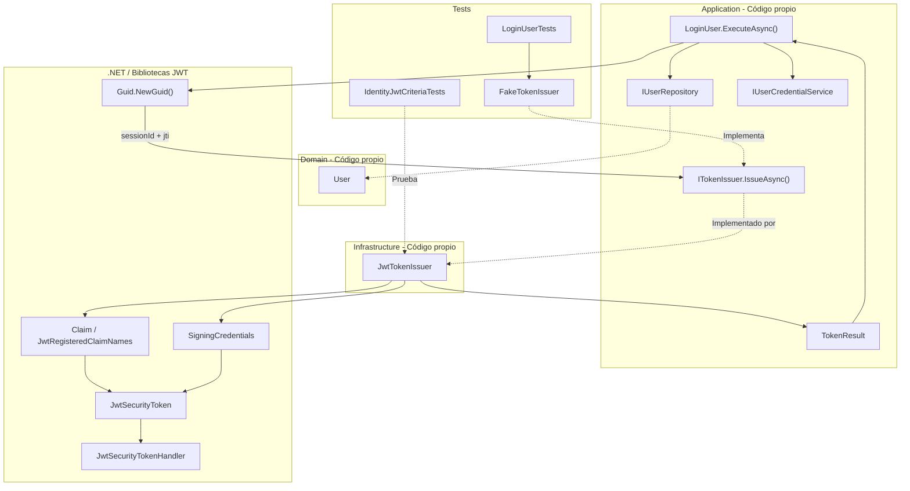
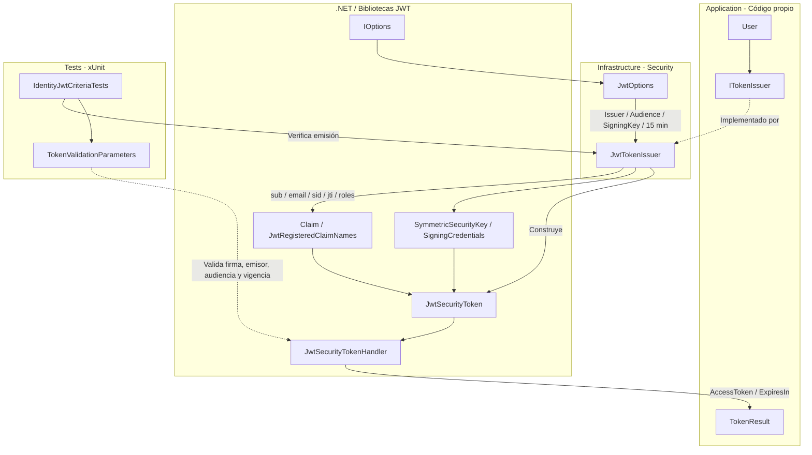
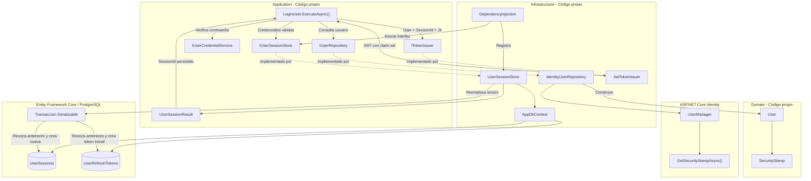
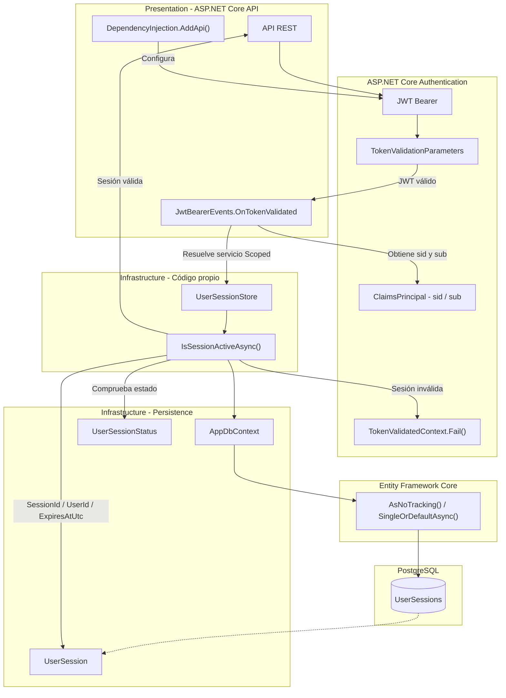
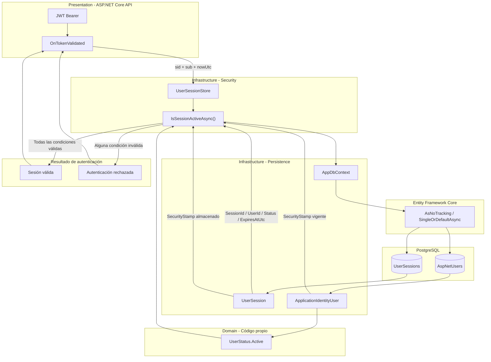
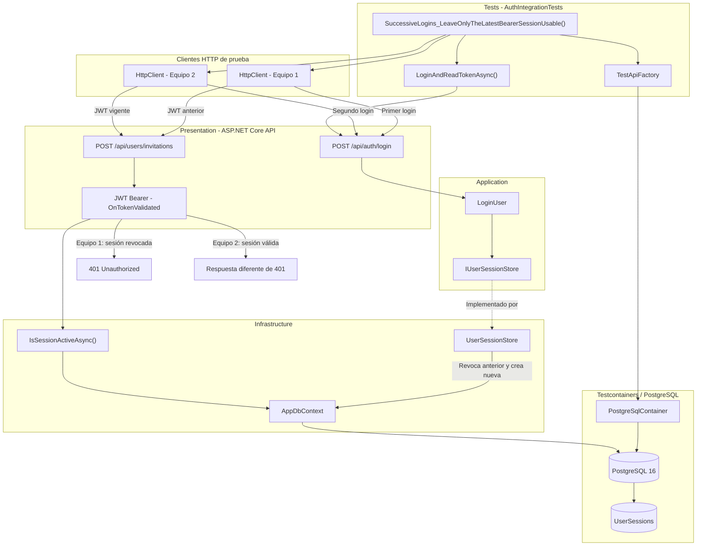
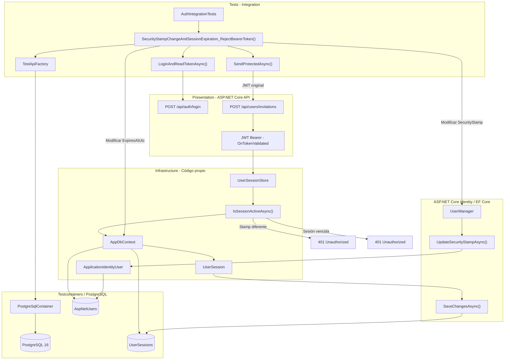
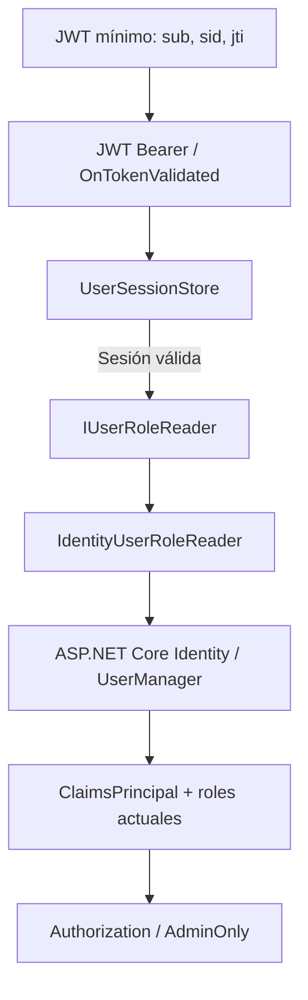
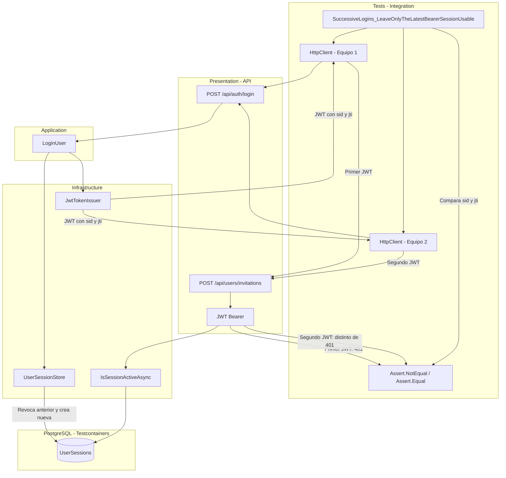

# Implementar: 09-sesion-unica-y-validacion-jwt

## PASOS

### 1. Verificar docker compose ps.

---

### 2. Extender el contrato de emisión con SessionId y Jti.

#### 1. Componentes implementados

| Componente                 | Acción | Tipo             | Capa                       | Responsabilidad                                                            |
| -------------------------- | ------ | ---------------- | -------------------------- | -------------------------------------------------------------------------- |
| `ITokenIssuer`             | Update | Interfaz         | Application / Abstractions | Extiende el contrato de emisión incorporando `sessionId` y `jti`.          |
| `LoginUser`                | Update | Caso de uso      | Application                | Genera identificadores de sesión y token para invocar el emisor.           |
| `JwtTokenIssuer`           | Update | Servicio         | Infrastructure / Security  | Adapta la firma de `IssueAsync()` para recibir los nuevos identificadores. |
| `IdentityJwtCriteriaTests` | Update | Clase de pruebas | Tests                      | Actualiza las invocaciones del emisor JWT.                                 |
| `LoginUserTests`           | Update | Clase de pruebas | Tests                      | Adapta `FakeTokenIssuer` al nuevo contrato.                                |

**Contrato actualizado:**

```csharp
Task<TokenResult> IssueAsync(
    User user,
    Guid sessionId,
    string jti,
    CancellationToken cancellationToken = default);
```

#### 2. Métodos principales

| Clase                      | Método                                                       | Responsabilidad                                                                                       |
| -------------------------- | ------------------------------------------------------------ | ----------------------------------------------------------------------------------------------------- |
| `ITokenIssuer`             | `IssueAsync()`                                               | Define la emisión de tokens asociados a un identificador de sesión y un identificador único de token. |
| `LoginUser`                | `ExecuteAsync()`                                             | Valida las credenciales y genera `sessionId` y `jti` antes de solicitar el token.                     |
| `JwtTokenIssuer`           | `IssueAsync()`                                               | Implementa el contrato actualizado y genera un JWT firmado.                                           |
| `IdentityJwtCriteriaTests` | `JwtIssuer_EmitsAdminTokenWithExpectedClaims()`              | Verifica los claims existentes y la configuración del JWT.                                            |
| `IdentityJwtCriteriaTests` | `JwtValidation_RejectsIncorrectSignatureIssuerAndAudience()` | Verifica el rechazo de JWT con firma, emisor o audiencia incorrectos.                                 |
| `FakeTokenIssuer`          | `IssueAsync()`                                               | Implementa el contrato actualizado para las pruebas de `LoginUser`.                                   |

**Parámetros incorporados:**

| Parámetro   | Tipo     | Propósito                              | Implementación actual                                                                            |
| ----------- | -------- | -------------------------------------- | ------------------------------------------------------------------------------------------------ |
| `sessionId` | `Guid`   | Identificar la sesión asociada al JWT. | `LoginUser` genera un GUID, pero `JwtTokenIssuer` todavía no lo incorpora al token.              |
| `jti`       | `string` | Identificar individualmente el JWT.    | `LoginUser` genera un identificador, pero `JwtTokenIssuer` genera otro GUID para el claim `jti`. |

#### 3. Componentes de .NET y bibliotecas externas

| Componente / Método       | Origen                                     | Función                                        | Uso en el proyecto                                 |
| ------------------------- | ------------------------------------------ | ---------------------------------------------- | -------------------------------------------------- |
| `Guid.NewGuid()`          | .NET / System                              | Genera identificadores GUID.                   | Crea `sessionId` y `jti` desde `LoginUser`.        |
| `Guid.ToString("N")`      | .NET / System                              | Representa un GUID sin separadores.            | Genera el identificador textual `jti`.             |
| `CancellationToken`       | .NET / System.Threading                    | Permite cancelar operaciones asíncronas.       | Se mantiene en el contrato de emisión.             |
| `JwtRegisteredClaimNames` | Biblioteca Microsoft.IdentityModel / JWT   | Proporciona nombres registrados de claims JWT. | Define `sub`, `email` y `jti`.                     |
| `Claim`                   | .NET / System.Security.Claims              | Representa información de identidad.           | Construye los claims del JWT.                      |
| `JwtSecurityToken`        | Biblioteca System.IdentityModel.Tokens.Jwt | Representa un JWT.                             | Construye el token con claims, vigencia y firma.   |
| `JwtSecurityTokenHandler` | Biblioteca System.IdentityModel.Tokens.Jwt | Procesa y serializa JWT.                       | Convierte el token firmado en una cadena.          |
| `SigningCredentials`      | Biblioteca Microsoft.IdentityModel.Tokens  | Define credenciales criptográficas de firma.   | Firma el JWT mediante HMAC-SHA256.                 |
| `ITokenIssuer`            | Código propio / Application                | Puerto de emisión de tokens.                   | Desacopla el caso de uso de la implementación JWT. |
| `JwtTokenIssuer`          | Código propio / Infrastructure             | Adaptador de emisión JWT.                      | Implementa `ITokenIssuer`.                         |
| `TokenResult`             | Código propio / Application                | Resultado de emisión.                          | Devuelve `AccessToken` y `ExpiresIn`.              |

#### 4. Flujo funcional

| Paso | Operación                                         | Componente                             |
| ---- | ------------------------------------------------- | -------------------------------------- |
| 1    | Buscar el usuario mediante su correo electrónico. | `LoginUser` → `IUserRepository`        |
| 2    | Verificar las credenciales del usuario.           | `LoginUser` → `IUserCredentialService` |
| 3    | Generar un GUID para identificar la sesión.       | `LoginUser`                            |
| 4    | Generar un GUID textual para identificar el JWT.  | `LoginUser`                            |
| 5    | Invocar `IssueAsync(user, sessionId, jti)`.       | `ITokenIssuer`                         |
| 6    | Construir y firmar el JWT.                        | `JwtTokenIssuer`                       |
| 7    | Devolver `AccessToken` y `ExpiresIn`.             | `TokenResult`                          |

**Estado de los identificadores:**

| Identificador | Comportamiento implementado      | Limitación                                                                                  |
| ------------- | -------------------------------- | ------------------------------------------------------------------------------------------- |
| `sessionId`   | Se genera y transmite al emisor. | No se incorpora a los claims ni se vincula con una sesión persistida en el código mostrado. |
| `jti`         | Se genera y transmite al emisor. | El JWT utiliza un GUID diferente, generado internamente por `JwtTokenIssuer`.               |

**Alcance:** El contrato y sus implementaciones aceptan los nuevos parámetros, pero todavía no se establece una vinculación efectiva entre el JWT y una sesión persistida.

#### 5. Diagrama de arquitectura



**Nota:** El diagrama representa la transmisión de `sessionId` y `jti` hasta el emisor, no su inclusión efectiva en el JWT.

#### 6. Resultado

Se extiende `ITokenIssuer` para recibir `sessionId` y `jti`, actualizando `LoginUser`, `JwtTokenIssuer` y sus pruebas.

La implementación todavía no incorpora `sessionId` al JWT ni utiliza el `jti` recibido; ambos comportamientos quedan pendientes en el código proporcionado.

---

### 3. Configurar claims, expiración de 15 minutos, issuer y audience.

#### 1. Componentes implementados

| Componente                 | Acción      | Tipo                   | Capa                       | Responsabilidad                                                                             |
| -------------------------- | ----------- | ---------------------- | -------------------------- | ------------------------------------------------------------------------------------------- |
| `JwtOptions`               | Update      | Clase de configuración | Infrastructure / Security  | Establece 15 minutos como duración predeterminada del access token.                         |
| `JwtTokenIssuer`           | Update      | Servicio / Adaptador   | Infrastructure / Security  | Incorpora los claims `sid` y `jti` recibidos mediante `ITokenIssuer`.                       |
| `IdentityJwtCriteriaTests` | Update      | Clase de pruebas       | Tests                      | Verifica los nuevos claims, la duración del JWT y las validaciones de seguridad existentes. |
| `ITokenIssuer`             | Sin cambios | Interfaz               | Application / Abstractions | Mantiene el contrato de emisión definido en el paso anterior.                               |
| `TokenResult`              | Sin cambios | Record                 | Application / Abstractions | Devuelve el JWT y su duración en segundos.                                                  |

#### 2. Métodos principales

| Clase                      | Método                                                       | Responsabilidad                                                                                 |
| -------------------------- | ------------------------------------------------------------ | ----------------------------------------------------------------------------------------------- |
| `JwtTokenIssuer`           | `IssueAsync()`                                               | Genera un JWT firmado con identidad, roles, sesión, identificador único y vigencia configurada. |
| `IdentityJwtCriteriaTests` | `JwtIssuer_EmitsAdminTokenWithExpectedClaims()`              | Comprueba issuer, audience, claims `email`, `sid`, `jti`, rol y duración de 900 segundos.       |
| `IdentityJwtCriteriaTests` | `JwtValidation_RejectsIncorrectSignatureIssuerAndAudience()` | Verifica el rechazo de JWT con firma, issuer o audience incorrectos.                            |
| `IdentityJwtCriteriaTests` | `JwtValidation_RejectsExpiredToken()`                        | Verifica el rechazo de tokens expirados.                                                        |
| `IdentityJwtCriteriaTests` | `CreateJwtOptions()`                                         | Proporciona configuración JWT de prueba con vigencia de 15 minutos.                             |
| `IdentityJwtCriteriaTests` | `CreateConfiguration()`                                      | Configura los parámetros JWT utilizados durante las pruebas.                                    |
| `IdentityJwtCriteriaTests` | `Validate()`                                                 | Valida firma, issuer, audience y expiración mediante `TokenValidationParameters`.               |

**Claims incorporados y conservados:**

| Claim   | Origen del valor       | Responsabilidad                                             |
| ------- | ---------------------- | ----------------------------------------------------------- |
| `sub`   | `user.Id.Value`        | Identifica al usuario autenticado.                          |
| `email` | `user.Email`           | Identifica el correo del usuario.                           |
| `sid`   | `sessionId.ToString()` | Identifica la sesión asociada al JWT.                       |
| `jti`   | Parámetro `jti`        | Identifica individualmente el JWT.                          |
| `role`  | `user.Roles`           | Incorpora los roles del usuario mediante `ClaimTypes.Role`. |
| `iss`   | `JwtOptions.Issuer`    | Identifica el emisor del JWT.                               |
| `aud`   | `JwtOptions.Audience`  | Identifica la audiencia permitida.                          |
| `nbf`   | `issuedAt`             | Establece el inicio de vigencia.                            |
| `exp`   | `expiresAt`            | Establece la expiración del JWT.                            |

#### 3. Componentes de .NET y bibliotecas externas

| Componente / Método                    | Origen                              | Función                                              | Uso en el proyecto                                            |
| -------------------------------------- | ----------------------------------- | ---------------------------------------------------- | ------------------------------------------------------------- |
| `IOptions<T>`                          | .NET / Microsoft.Extensions.Options | Proporciona configuración tipada.                    | Inyecta `JwtOptions` en `JwtTokenIssuer`.                     |
| `DateTime.UtcNow`                      | .NET / System                       | Obtiene la fecha y hora UTC.                         | Determina emisión y expiración del JWT.                       |
| `Claim`, `ClaimTypes.Role`             | .NET / System.Security.Claims       | Representan información de identidad y roles.        | Construyen los claims del usuario.                            |
| `JwtRegisteredClaimNames`              | System.IdentityModel.Tokens.Jwt     | Define nombres estándar de claims JWT.               | Proporciona `Sub`, `Email`, `Sid` y `Jti`.                    |
| `JwtSecurityToken`                     | System.IdentityModel.Tokens.Jwt     | Representa un JWT.                                   | Construye el token con claims, vigencia y firma.              |
| `JwtSecurityTokenHandler.WriteToken()` | System.IdentityModel.Tokens.Jwt     | Serializa el JWT.                                    | Genera el access token que recibe el cliente.                 |
| `SymmetricSecurityKey`                 | Microsoft.IdentityModel.Tokens      | Representa una clave criptográfica simétrica.        | Utiliza `JwtOptions.SigningKey`.                              |
| `SigningCredentials`                   | Microsoft.IdentityModel.Tokens      | Define las credenciales de firma.                    | Configura la firma del JWT.                                   |
| `SecurityAlgorithms.HmacSha256`        | Microsoft.IdentityModel.Tokens      | Identifica el algoritmo HMAC-SHA256.                 | Firma los tokens de acceso.                                   |
| `TokenValidationParameters`            | Microsoft.IdentityModel.Tokens      | Configura reglas de validación JWT.                  | Verifica firma, issuer, audience y expiración en las pruebas. |
| `ClockSkew`                            | Microsoft.IdentityModel.Tokens      | Define la tolerancia temporal durante la validación. | Se establece en cero en el método de prueba `Validate()`.     |
| `Assert`                               | xUnit                               | Verifica resultados de pruebas.                      | Comprueba claims, duración y excepciones de validación.       |
| `JwtOptions`                           | Código propio / Infrastructure      | Define la configuración de emisión JWT.              | Contiene issuer, audience, clave de firma y duración.         |
| `JwtTokenIssuer`                       | Código propio / Infrastructure      | Implementa el emisor JWT.                            | Genera tokens compatibles con `ITokenIssuer`.                 |

#### 4. Flujo funcional

**Emisión del JWT: `JwtTokenIssuer.IssueAsync()`**

| Paso | Operación                                                 | Componente                |
| ---- | --------------------------------------------------------- | ------------------------- |
| 1    | Recibir usuario, `sessionId` y `jti`.                     | `ITokenIssuer`            |
| 2    | Obtener la fecha UTC de emisión.                          | `DateTime.UtcNow`         |
| 3    | Calcular expiración sumando `AccessTokenLifetimeMinutes`. | `JwtOptions`              |
| 4    | Construir claims `sub`, `email`, `sid`, `jti` y roles.    | `Claim`                   |
| 5    | Obtener issuer, audience y clave de firma.                | `JwtOptions`              |
| 6    | Configurar firma HMAC-SHA256.                             | `SigningCredentials`      |
| 7    | Construir el JWT con claims y vigencia.                   | `JwtSecurityToken`        |
| 8    | Serializar el token.                                      | `JwtSecurityTokenHandler` |
| 9    | Devolver JWT y duración en segundos.                      | `TokenResult`             |

**Configuración y validaciones:**

| Propiedad / Regla            | Configuración                     | Resultado                                                      |
| ---------------------------- | --------------------------------- | -------------------------------------------------------------- |
| `AccessTokenLifetimeMinutes` | `15`                              | Duración predeterminada de 15 minutos.                         |
| `ExpiresIn`                  | `900`                             | Duración devuelta en segundos cuando se configuran 15 minutos. |
| `Issuer`                     | `JwtOptions.Issuer`               | Se incorpora al JWT.                                           |
| `Audience`                   | `JwtOptions.Audience`             | Se incorpora al JWT.                                           |
| `SigningKey`                 | `JwtOptions.SigningKey`           | Se utiliza para generar la firma.                              |
| `sid`                        | `sessionId.ToString()`            | Conserva el identificador recibido del llamador.               |
| `jti`                        | Parámetro `jti`                   | Conserva el identificador recibido del llamador.               |
| Firma incorrecta             | `ValidateIssuerSigningKey = true` | Token rechazado en las pruebas.                                |
| Issuer incorrecto            | `ValidateIssuer = true`           | Token rechazado en las pruebas.                                |
| Audience incorrecta          | `ValidateAudience = true`         | Token rechazado en las pruebas.                                |
| Token expirado               | `ValidateLifetime = true`         | Token rechazado en las pruebas.                                |

**Cambio respecto al paso 2:** `JwtTokenIssuer` ahora incorpora efectivamente `sessionId` y `jti` en los claims `sid` y `jti`, eliminando la generación interna de un identificador diferente para el JWT.

**Alcance:** Los 15 minutos constituyen el valor predeterminado de `JwtOptions` y el valor utilizado en las pruebas. La duración efectiva continúa dependiendo de la configuración cargada en ejecución. No se incorpora en este paso una validación de la sesión persistida durante la autenticación.

#### 5. Diagrama de arquitectura



#### 6. Resultado

Se actualiza la emisión JWT incorporando los claims `sid` y `jti` proporcionados por el llamador, manteniendo `sub`, `email`, roles, issuer, audience y firma HMAC-SHA256.

Se establece una duración predeterminada de 15 minutos y se actualizan las pruebas para verificar los claims, la vigencia y las reglas de validación.

---

### 4. Crear sesión y revocar la anterior tras validar login.

#### 1. Componentes implementados

| Componente               | Acción | Tipo                     | Capa                       | Responsabilidad                                                                                   |
| ------------------------ | ------ | ------------------------ | -------------------------- | ------------------------------------------------------------------------------------------------- |
| `IUserSessionStore`      | Create | Interfaz / Puerto        | Application / Abstractions | Define el contrato para crear una sesión autenticada y reemplazar la anterior.                    |
| `UserSessionResult`      | Create | Record                   | Application / Abstractions | Devuelve el identificador de la sesión persistida.                                                |
| `LoginUser`              | Update | Caso de uso              | Application                | Crea la sesión después de validar las credenciales y utiliza su identificador para emitir el JWT. |
| `User`                   | Update | Entidad                  | Domain / Users             | Incorpora `SecurityStamp` al modelo de usuario.                                                   |
| `IdentityUserRepository` | Update | Repositorio / Adaptador  | Infrastructure / Identity  | Obtiene el `SecurityStamp` desde ASP.NET Core Identity y lo incorpora al usuario de Domain.       |
| `UserSessionStore`       | Update | Servicio de persistencia | Infrastructure / Security  | Implementa `IUserSessionStore` reutilizando la operación transaccional de reemplazo de sesiones.  |
| `DependencyInjection`    | Update | Clase estática           | Infrastructure             | Registra `IUserSessionStore` utilizando la instancia de `UserSessionStore`.                       |
| `LoginUserTests`         | Update | Clase de pruebas         | Tests                      | Adapta las pruebas del login al nuevo contrato de sesiones.                                       |
| `FakeUserSessionStore`   | Create | Implementación de prueba | Tests                      | Simula la creación de una sesión sin utilizar persistencia real.                                  |

#### 2. Métodos principales

| Clase                                  | Método                                          | Responsabilidad                                                                                                        |
| -------------------------------------- | ----------------------------------------------- | ---------------------------------------------------------------------------------------------------------------------- |
| `LoginUser`                            | `ExecuteAsync()`                                | Valida credenciales, crea una sesión persistida y emite un JWT asociado a su `SessionId`.                              |
| `IUserSessionStore`                    | `ReplaceActiveSessionAsync()`                   | Define el reemplazo de la sesión activa de un usuario autenticado.                                                     |
| `UserSessionStore`                     | `IUserSessionStore.ReplaceActiveSessionAsync()` | Adapta el contrato de Application a la implementación existente de Infrastructure.                                     |
| `UserSessionStore`                     | `ReplaceActiveSessionAsync()`                   | Revoca sesiones activas anteriores y sus refresh tokens utilizables; crea una nueva sesión y su refresh token inicial. |
| `IdentityUserRepository`               | `FindByEmailAsync()`                            | Obtiene el usuario, sus roles y su `SecurityStamp` desde Identity.                                                     |
| `UserManager<ApplicationIdentityUser>` | `GetSecurityStampAsync()`                       | Obtiene el sello de seguridad vigente del usuario.                                                                     |
| `DependencyInjection`                  | `AddInfrastructure()`                           | Registra `IUserSessionStore` y su implementación.                                                                      |

**Adaptación del contrato:**

| Operación                                       | Entrada                                                     | Resultado                                            |
| ----------------------------------------------- | ----------------------------------------------------------- | ---------------------------------------------------- |
| `IUserSessionStore.ReplaceActiveSessionAsync()` | `User`, fecha de creación y expiración                      | `UserSessionResult(SessionId)`                       |
| `UserSessionStore.ReplaceActiveSessionAsync()`  | `UserId`, `SecurityStamp`, fechas de sesión y refresh token | `UserSessionCreationResult(SessionId, RefreshToken)` |

La implementación explícita de `IUserSessionStore` delega en el método existente de `UserSessionStore`, utilizando la misma fecha de expiración para la sesión y el refresh token.

#### 3. Componentes de .NET y bibliotecas externas

| Componente / Método           | Origen                         | Función                                              | Uso en el proyecto                                                                 |
| ----------------------------- | ------------------------------ | ---------------------------------------------------- | ---------------------------------------------------------------------------------- |
| `UserManager<TUser>`          | ASP.NET Core Identity          | Administra usuarios y sus propiedades de seguridad.  | Permite consultar el `SecurityStamp` del usuario.                                  |
| `GetSecurityStampAsync()`     | ASP.NET Core Identity          | Recupera el sello de seguridad vigente.              | Proporciona el valor que se almacena al crear la sesión.                           |
| `AddScoped<T>()`              | .NET / Dependency Injection    | Registra servicios con ciclo de vida Scoped.         | Mantiene el registro de `UserSessionStore`.                                        |
| `GetRequiredService<T>()`     | .NET / Dependency Injection    | Resuelve un servicio registrado.                     | Permite que `IUserSessionStore` utilice la instancia Scoped de `UserSessionStore`. |
| `DateTimeOffset.UtcNow`       | .NET / System                  | Obtiene la fecha y hora UTC.                         | Establece el instante de creación de la sesión.                                    |
| `DateTimeOffset.AddMinutes()` | .NET / System                  | Calcula una fecha posterior.                         | Establece una vigencia de 15 minutos para la sesión.                               |
| `Guid.NewGuid()`              | .NET / System                  | Genera identificadores GUID.                         | Genera el `jti` enviado al emisor JWT.                                             |
| `IUserSessionStore`           | Código propio / Application    | Contrato de persistencia de sesiones.                | Desacopla `LoginUser` de Infrastructure.                                           |
| `UserSessionStore`            | Código propio / Infrastructure | Gestiona sesiones y refresh tokens mediante EF Core. | Reemplaza la sesión activa después de validar credenciales.                        |
| `ITokenIssuer`                | Código propio / Application    | Contrato de emisión de tokens.                       | Emite el JWT asociado al identificador de sesión persistido.                       |

#### 4. Flujo funcional

**Inicio de sesión: `LoginUser.ExecuteAsync()`**

| Paso | Operación                                                                          | Componente                          |
| ---- | ---------------------------------------------------------------------------------- | ----------------------------------- |
| 1    | Buscar el usuario mediante su correo electrónico.                                  | `IUserRepository`                   |
| 2    | Obtener sus roles y `SecurityStamp`.                                               | `IdentityUserRepository` / Identity |
| 3    | Verificar la contraseña.                                                           | `IUserCredentialService`            |
| 4    | Rechazar credenciales inválidas sin crear una sesión.                              | `LoginUser`                         |
| 5    | Obtener la fecha UTC y calcular una expiración de 15 minutos.                      | `LoginUser`                         |
| 6    | Solicitar el reemplazo de la sesión activa.                                        | `IUserSessionStore`                 |
| 7    | Revocar las sesiones anteriores y sus refresh tokens utilizables.                  | `UserSessionStore`                  |
| 8    | Crear una sesión activa con el `SecurityStamp` vigente y un refresh token inicial. | `UserSessionStore`                  |
| 9    | Persistir los cambios mediante una transacción serializable.                       | EF Core / `AppDbContext`            |
| 10   | Devolver el `SessionId` persistido.                                                | `UserSessionResult`                 |
| 11   | Generar un `jti` y emitir el JWT utilizando el `SessionId` real.                   | `ITokenIssuer`                      |
| 12   | Devolver el access token y su duración.                                            | `TokenResult`                       |

**Reglas implementadas:**

| Regla                        | Implementación                                                                 |
| ---------------------------- | ------------------------------------------------------------------------------ |
| Credenciales válidas         | La creación de sesión ocurre únicamente después de verificar la contraseña.    |
| Sesión única                 | Se revocan las sesiones activas anteriores antes de crear una nueva.           |
| Revocación de refresh tokens | Se revocan los tokens no consumidos ni revocados de las sesiones reemplazadas. |
| Identificador persistido     | El JWT recibe el `SessionId` devuelto por `UserSessionStore`.                  |
| Sello de seguridad           | Se obtiene desde Identity y se almacena en la nueva sesión.                    |
| Vigencia de sesión           | Se establece en 15 minutos desde la ejecución del login.                       |
| Vigencia del refresh token   | El adaptador utiliza la misma fecha de expiración que la sesión.               |
| Persistencia transaccional   | El reemplazo de sesión utiliza una transacción serializable.                   |
| Credenciales inválidas       | Se devuelve `AuthenticationError` sin invocar el almacén de sesiones.          |

**Alcance de la implementación:**

- `UserSessionStore` genera un refresh token inicial, pero la implementación de `IUserSessionStore` devuelve únicamente `SessionId`. El login no entrega ese refresh token al cliente.
- La emisión del JWT ocurre después de confirmar la transacción de creación de sesión; ambas operaciones no forman parte de una misma transacción.
- La sesión persistida y el refresh token inicial tienen una vigencia de 15 minutos en este flujo.
- `LoginUserTests` incorpora `FakeUserSessionStore`, pero las pruebas mostradas no verifican explícitamente la revocación de sesiones anteriores ni la correspondencia entre el `SessionId` persistido y el claim `sid` del JWT.

#### 5. Diagrama de arquitectura



#### 6. Resultado

Se integra la persistencia de sesiones en `LoginUser` mediante `IUserSessionStore`, creando una nueva sesión y revocando las anteriores después de validar las credenciales.

El JWT utiliza el `SessionId` persistido y el usuario incorpora su `SecurityStamp` vigente; el refresh token inicial se almacena, pero no se devuelve al cliente en este flujo.

---

### 5. Validar sesión persistida en Bearer.

#### 1. Componentes implementados

| Componente               | Acción | Tipo                     | Capa                         | Responsabilidad                                                                      |
| ------------------------ | ------ | ------------------------ | ---------------------------- | ------------------------------------------------------------------------------------ |
| `UserSessionStore`       | Update | Servicio de persistencia | Infrastructure / Security    | Incorpora la validación de existencia, propiedad, estado y vigencia de una sesión.   |
| `IsSessionActiveAsync()` | Create | Método asíncrono         | Infrastructure / Security    | Comprueba que la sesión asociada a un JWT pertenezca al usuario y continúe activa.   |
| `DependencyInjection`    | Update | Clase estática           | Presentation / API           | Incorpora la validación de sesiones persistidas durante la autenticación JWT Bearer. |
| `AddApi()`               | Update | Método de extensión      | Presentation / API           | Configura `OnTokenValidated` para verificar la sesión después de validar el JWT.     |
| `UserSession`            | Uso    | Entidad de persistencia  | Infrastructure / Persistence | Proporciona `SessionId`, `UserId`, `Status` y `ExpiresAtUtc` para validar la sesión. |

#### 2. Métodos principales

| Clase                   | Método                   | Responsabilidad                                                                      |
| ----------------------- | ------------------------ | ------------------------------------------------------------------------------------ |
| `UserSessionStore`      | `IsSessionActiveAsync()` | Consulta la sesión y verifica su propietario, estado activo y fecha de expiración.   |
| `DependencyInjection`   | `AddApi()`               | Registra JWT Bearer y configura los eventos de autenticación.                        |
| `JwtBearerEvents`       | `OnTokenValidated`       | Comprueba los claims `sid` y `sub` y valida la sesión persistida.                    |
| `TokenValidatedContext` | `Fail()`                 | Rechaza la autenticación cuando los claims son inválidos o la sesión no está activa. |
| `JwtBearerEvents`       | `OnChallenge`            | Conserva la respuesta HTTP 401 mediante `ProblemDetails`.                            |
| `JwtBearerEvents`       | `OnForbidden`            | Conserva la respuesta HTTP 403 mediante `ProblemDetails`.                            |

**Condiciones de `IsSessionActiveAsync()`:**

| Validación  | Condición                                    |
| ----------- | -------------------------------------------- |
| Existencia  | La sesión debe existir en `UserSessions`.    |
| Propietario | `session.UserId == userId`                   |
| Estado      | `session.Status == UserSessionStatus.Active` |
| Vigencia    | `session.ExpiresAtUtc > nowUtc`              |

El método devuelve `true` únicamente cuando se cumplen todas las condiciones.

#### 3. Componentes de .NET y bibliotecas externas

| Componente / Método            | Origen                                | Función                                                             | Uso en el proyecto                                                   |
| ------------------------------ | ------------------------------------- | ------------------------------------------------------------------- | -------------------------------------------------------------------- |
| `AddAuthentication()`          | ASP.NET Core Authentication           | Registra y configura los esquemas de autenticación.                 | Establece JWT Bearer como esquema predeterminado.                    |
| `AddJwtBearer()`               | ASP.NET Core Authentication.JwtBearer | Configura la autenticación mediante JWT.                            | Define la validación criptográfica y los eventos Bearer.             |
| `TokenValidationParameters`    | Microsoft.IdentityModel.Tokens        | Configura las reglas de validación del JWT.                         | Verifica issuer, audience, firma y expiración.                       |
| `JwtBearerEvents`              | ASP.NET Core Authentication.JwtBearer | Permite intervenir en el procesamiento de autenticación.            | Ejecuta la validación de sesión mediante `OnTokenValidated`.         |
| `OnTokenValidated`             | ASP.NET Core Authentication.JwtBearer | Evento ejecutado después de validar el token.                       | Comprueba la sesión persistida asociada al JWT.                      |
| `FindFirstValue()`             | ASP.NET Core Authentication / Claims  | Obtiene el valor de un claim.                                       | Recupera `sid` y `sub` del usuario autenticado.                      |
| `ClaimTypes.Sid`               | .NET / System.Security.Claims         | Identificador de sesión en claims.                                  | Alternativa para recuperar `sid` cuando existe mapeo de claims.      |
| `ClaimTypes.NameIdentifier`    | .NET / System.Security.Claims         | Identificador del sujeto.                                           | Alternativa para recuperar `sub`.                                    |
| `Guid.TryParse()`              | .NET / System                         | Convierte texto a GUID sin lanzar excepciones por formato inválido. | Valida el identificador de sesión recibido.                          |
| `GetRequiredService<T>()`      | .NET / Dependency Injection           | Resuelve servicios registrados.                                     | Obtiene `UserSessionStore` desde el contenedor de la solicitud HTTP. |
| `HttpContext.RequestAborted`   | ASP.NET Core HTTP                     | Token de cancelación de la solicitud.                               | Permite cancelar la consulta de sesión.                              |
| `TokenValidatedContext.Fail()` | ASP.NET Core Authentication           | Marca la autenticación como fallida.                                | Rechaza JWT sin sesión válida.                                       |
| `AsNoTracking()`               | Entity Framework Core                 | Ejecuta consultas sin seguimiento de entidades.                     | Consulta el estado de la sesión sin preparar modificaciones.         |
| `SingleOrDefaultAsync()`       | Entity Framework Core                 | Obtiene un registro único o `null`.                                 | Busca la sesión por `SessionId`.                                     |
| `UserSessionStore`             | Código propio / Infrastructure        | Gestiona y consulta sesiones persistidas.                           | Valida la sesión asociada al JWT.                                    |
| `AppDbContext`                 | Código propio / Infrastructure        | Contexto de persistencia.                                           | Permite consultar `UserSessions`.                                    |

#### 4. Flujo funcional

**Autenticación JWT Bearer:**

| Paso | Operación                                                                  | Componente                               |
| ---- | -------------------------------------------------------------------------- | ---------------------------------------- |
| 1    | Recibir una solicitud con un JWT Bearer.                                   | ASP.NET Core Authentication              |
| 2    | Validar firma, issuer, audience y expiración.                              | JWT Bearer / `TokenValidationParameters` |
| 3    | Ejecutar `OnTokenValidated` cuando la validación del JWT es satisfactoria. | `JwtBearerEvents`                        |
| 4    | Obtener `sid` y `sub` de los claims del JWT.                               | `ClaimsPrincipal`                        |
| 5    | Validar el formato de `sid` y la presencia de `sub`.                       | `Guid.TryParse()`                        |
| 6    | Resolver `UserSessionStore` mediante inyección de dependencias.            | `RequestServices`                        |
| 7    | Consultar la sesión persistida mediante `SessionId`.                       | `IsSessionActiveAsync()`                 |
| 8    | Verificar propietario, estado y vigencia.                                  | `UserSessionStore`                       |
| 9    | Rechazar la autenticación si la sesión no cumple las condiciones.          | `context.Fail()`                         |
| 10   | Continuar con la autenticación satisfactoria si la sesión es válida.       | ASP.NET Core Authentication              |

**Resultados de validación:**

| Condición                                                    | Resultado                |
| ------------------------------------------------------------ | ------------------------ |
| JWT con firma inválida                                       | Autenticación rechazada. |
| JWT expirado                                                 | Autenticación rechazada. |
| Claim `sid` ausente o inválido                               | `context.Fail()`         |
| Claim `sub` ausente o vacío                                  | `context.Fail()`         |
| Sesión inexistente                                           | `context.Fail()`         |
| Sesión asociada a otro usuario                               | `context.Fail()`         |
| Sesión revocada                                              | `context.Fail()`         |
| Sesión expirada                                              | `context.Fail()`         |
| Sesión existente, activa, vigente y perteneciente al usuario | Autenticación aceptada.  |

**Comportamiento HTTP conservado:**

| Evento        | Código HTTP      | Código de error           |
| ------------- | ---------------- | ------------------------- |
| `OnChallenge` | 401 Unauthorized | `authentication_required` |
| `OnForbidden` | 403 Forbidden    | `forbidden`               |

Ambas respuestas conservan el formato `application/problem+json`.

**Alcance:** La validación consulta `UserSessions` en cada ejecución de `OnTokenValidated`. No actualiza el estado de sesiones vencidas, no comprueba el `SecurityStamp` actual del usuario y no valida el claim `jti` contra un registro persistido.

#### 5. Diagrama de arquitectura



#### 6. Resultado

Se incorpora la validación de sesiones persistidas al evento `OnTokenValidated` de ASP.NET Core JWT Bearer, verificando la existencia, propiedad, estado y vigencia de cada sesión.

Un JWT criptográficamente válido deja de ser suficiente para autenticarse: también debe corresponder a una sesión activa y vigente en PostgreSQL.

---

### 6. Rechazar sesiones inexistentes, revocadas, vencidas o con stamp diferente.

#### 1. Componentes implementados

| Componente                                               | Acción | Tipo                     | Capa                      | Responsabilidad                                                                                       |
| -------------------------------------------------------- | ------ | ------------------------ | ------------------------- | ----------------------------------------------------------------------------------------------------- |
| `UserSessionStore`                                       | Update | Servicio de persistencia | Infrastructure / Security | Amplía la validación de sesiones JWT incorporando el estado del usuario y su `SecurityStamp` vigente. |
| `IsSessionActiveAsync()`                                 | Update | Método asíncrono         | Infrastructure / Security | Comprueba la existencia, propiedad, estado, vigencia y sello de seguridad de la sesión.               |
| `ApplicationIdentityUser`                                | Uso    | Entidad de Identity      | Infrastructure / Identity | Proporciona el estado y `SecurityStamp` actuales del usuario.                                         |
| `UserSessionStoreTests`                                  | Update | Clase de pruebas         | Tests                     | Incorpora pruebas para sesiones inexistentes, revocadas, expiradas y con `SecurityStamp` diferente.   |
| `IsSessionActive_RejectsRevokedExpiredAndChangedStamp()` | Create | Prueba xUnit             | Tests                     | Verifica el rechazo de sesiones inválidas.                                                            |
| `CreateSession()`                                        | Create | Método auxiliar          | Tests                     | Construye sesiones de prueba con estado, sello de seguridad y expiración configurables.               |

#### 2. Métodos principales

| Clase                   | Método                                                   | Responsabilidad                                                                                               |
| ----------------------- | -------------------------------------------------------- | ------------------------------------------------------------------------------------------------------------- |
| `UserSessionStore`      | `IsSessionActiveAsync()`                                 | Consulta la sesión y su usuario propietario; valida las condiciones necesarias para aceptar la autenticación. |
| `UserSessionStoreTests` | `IsSessionActive_RejectsRevokedExpiredAndChangedStamp()` | Comprueba el rechazo de cuatro escenarios de sesión inválida.                                                 |
| `UserSessionStoreTests` | `CreateSession()`                                        | Genera entidades `UserSession` con valores controlados para las pruebas.                                      |
| `UserSessionStoreTests` | `CreateStore()`                                          | Construye `UserSessionStore` utilizando el contexto SQLite de prueba.                                         |

**Condiciones de `IsSessionActiveAsync()`:**

| Validación            | Condición                                     |
| --------------------- | --------------------------------------------- |
| Existencia de sesión  | `session is not null`                         |
| Propietario de sesión | `session.UserId == userId`                    |
| Estado de sesión      | `session.Status == UserSessionStatus.Active`  |
| Vigencia de sesión    | `session.ExpiresAtUtc > nowUtc`               |
| Existencia de usuario | `user is not null`                            |
| Estado del usuario    | `user.Status == UserStatus.Active`            |
| Sello de seguridad    | `session.SecurityStamp == user.SecurityStamp` |

El método devuelve `true` únicamente cuando se cumplen las siete condiciones.

#### 3. Componentes de .NET y bibliotecas externas

| Componente / Método       | Origen                                | Función                                               | Uso en el proyecto                                                  |
| ------------------------- | ------------------------------------- | ----------------------------------------------------- | ------------------------------------------------------------------- |
| `AsNoTracking()`          | Entity Framework Core                 | Ejecuta consultas sin seguimiento de cambios.         | Consulta sesiones y usuarios sin modificar sus entidades.           |
| `SingleOrDefaultAsync()`  | Entity Framework Core                 | Obtiene un registro único o `null`.                   | Busca la sesión por `SessionId` y el usuario por `UserId`.          |
| `DbSet<T>`                | Entity Framework Core                 | Representa un conjunto de entidades persistidas.      | Permite consultar `UserSessions` y `Users`.                         |
| `Assert.False()`          | xUnit                                 | Verifica que una condición sea falsa.                 | Comprueba el rechazo de sesiones inválidas.                         |
| `[Fact]`                  | xUnit                                 | Identifica una prueba automatizada.                   | Define la prueba de validación de sesiones.                         |
| `ApplicationIdentityUser` | Código propio / ASP.NET Core Identity | Representa el usuario persistido de Identity.         | Proporciona `Status` y `SecurityStamp` vigentes.                    |
| `UserStatus`              | Código propio / Domain                | Define los estados funcionales del usuario.           | Permite exigir que la cuenta esté activa.                           |
| `UserSessionStatus`       | Código propio / Infrastructure        | Define los estados persistentes de una sesión.        | Permite rechazar sesiones revocadas o expiradas.                    |
| `UserSessionStore`        | Código propio / Infrastructure        | Gestiona y valida sesiones persistidas.               | Centraliza la validación utilizada durante la autenticación Bearer. |
| `AppDbContext`            | Código propio / Infrastructure        | Contexto de persistencia de la aplicación e Identity. | Consulta sesiones y usuarios desde EF Core.                         |

#### 4. Flujo funcional

**Validación de sesión: `IsSessionActiveAsync()`**

| Paso | Operación                                                                               | Componente                  |
| ---- | --------------------------------------------------------------------------------------- | --------------------------- |
| 1    | Recibir `sessionId`, `userId` y fecha UTC de evaluación.                                | `UserSessionStore`          |
| 2    | Consultar la sesión por `SessionId`.                                                    | `AppDbContext.UserSessions` |
| 3    | Consultar el usuario propietario mediante `session.UserId`, si existe la sesión.        | `AppDbContext.Users`        |
| 4    | Verificar la correspondencia entre el usuario solicitado y el propietario de la sesión. | `UserSessionStore`          |
| 5    | Comprobar que la sesión esté activa y vigente.                                          | `UserSession`               |
| 6    | Comprobar que el usuario exista y tenga estado `Active`.                                | `ApplicationIdentityUser`   |
| 7    | Comparar el `SecurityStamp` almacenado en la sesión con el vigente del usuario.         | `UserSessionStore`          |
| 8    | Devolver `true` únicamente si todas las condiciones son válidas.                        | `IsSessionActiveAsync()`    |

**Escenarios de rechazo:**

| Escenario                | Condición                                     | Resultado |
| ------------------------ | --------------------------------------------- | --------- |
| Sesión inexistente       | No existe el `SessionId`.                     | `false`   |
| Sesión de otro usuario   | `session.UserId != userId`                    | `false`   |
| Sesión revocada          | `Status = Revoked`                            | `false`   |
| Sesión expirada          | `Status = Expired`                            | `false`   |
| Sesión vencida por fecha | `ExpiresAtUtc <= nowUtc`                      | `false`   |
| Usuario inexistente      | No existe el propietario en Identity.         | `false`   |
| Usuario inactivo         | `user.Status != Active`                       | `false`   |
| SecurityStamp diferente  | `session.SecurityStamp != user.SecurityStamp` | `false`   |
| Sesión válida            | Todas las condiciones se cumplen.             | `true`    |

**Pruebas incorporadas:**

| Prueba                                                   | Escenario verificado                         | Resultado esperado |
| -------------------------------------------------------- | -------------------------------------------- | ------------------ |
| `IsSessionActive_RejectsRevokedExpiredAndChangedStamp()` | `SessionId` inexistente.                     | `false`            |
| Misma prueba                                             | Sesión con estado `Revoked`.                 | `false`            |
| Misma prueba                                             | Sesión con estado `Expired`.                 | `false`            |
| Misma prueba                                             | Sesión activa con `SecurityStamp` diferente. | `false`            |

**Alcance:**

- La validación se integra con el evento `OnTokenValidated` configurado en el paso anterior, que rechaza la autenticación cuando `IsSessionActiveAsync()` devuelve `false`.
- El método realiza consultas de solo lectura y no modifica automáticamente el estado de las sesiones.
- La prueba incorporada verifica cuatro escenarios de rechazo. No incluye verificaciones explícitas de sesiones válidas, usuarios inactivos, usuarios inexistentes o propietarios diferentes.

#### 5. Diagrama de arquitectura



**Relación principal:** La autenticación Bearer ahora depende tanto de la sesión persistida como del estado y sello de seguridad vigentes del usuario en ASP.NET Core Identity.

#### 6. Resultado

Se amplía `IsSessionActiveAsync()` para rechazar sesiones inexistentes, revocadas, vencidas, asociadas a usuarios inactivos o con un `SecurityStamp` diferente al vigente.

Se incorpora una prueba xUnit con SQLite en memoria que verifica cuatro escenarios de rechazo, complementando la validación JWT Bearer implementada anteriormente.

---

### 7. Mapear rechazos a 401 authentication_required.

---

### 8. Probar login sucesivo desde dos equipos.

#### 1. Componentes implementados

| Componente                                                 | Acción | Tipo                             | Capa                      | Responsabilidad                                                                       |
| ---------------------------------------------------------- | ------ | -------------------------------- | ------------------------- | ------------------------------------------------------------------------------------- |
| `AuthIntegrationTests`                                     | Update | Clase de pruebas de integración  | Tests                     | Incorpora la validación HTTP de sesiones sucesivas desde dos clientes independientes. |
| `SuccessiveLogins_LeaveOnlyTheLatestBearerSessionUsable()` | Create | Prueba xUnit                     | Tests                     | Verifica que el segundo login invalida la sesión Bearer del primer cliente.           |
| `LoginAndReadTokenAsync()`                                 | Create | Método auxiliar                  | Tests                     | Autentica al administrador y obtiene el JWT de la respuesta HTTP.                     |
| `TestApiFactory`                                           | Uso    | Fábrica de aplicación de pruebas | Tests                     | Ejecuta la API con configuración controlada y PostgreSQL efímero.                     |
| `UserSessionStore`                                         | Uso    | Servicio de persistencia         | Infrastructure / Security | Reemplaza la sesión activa y revoca la anterior durante el login.                     |

#### 2. Métodos principales

| Clase                  | Método                                                     | Responsabilidad                                                                                 |
| ---------------------- | ---------------------------------------------------------- | ----------------------------------------------------------------------------------------------- |
| `AuthIntegrationTests` | `SuccessiveLogins_LeaveOnlyTheLatestBearerSessionUsable()` | Ejecuta dos logins consecutivos y comprueba la validez de sus JWT contra un endpoint protegido. |
| `AuthIntegrationTests` | `LoginAndReadTokenAsync()`                                 | Envía las credenciales a `/api/auth/login` y extrae `accessToken`.                              |
| `TestApiFactory`       | `ConfigureWebHost()`                                       | Configura PostgreSQL, JWT, administrador inicial, invitaciones y SMTP para las pruebas.         |
| `AuthIntegrationTests` | `InitializeAsync()`                                        | Inicia el contenedor PostgreSQL.                                                                |
| `AuthIntegrationTests` | `DisposeAsync()`                                           | Libera el contenedor PostgreSQL.                                                                |
| `UserSessionStore`     | `ReplaceActiveSessionAsync()`                              | Reemplaza la sesión activa durante la autenticación.                                            |
| `UserSessionStore`     | `IsSessionActiveAsync()`                                   | Verifica la vigencia de la sesión asociada al JWT durante la autenticación Bearer.              |

#### 3. Componentes de .NET y bibliotecas externas

| Componente / Método              | Origen                                          | Función                                            | Uso en el proyecto                                             |
| -------------------------------- | ----------------------------------------------- | -------------------------------------------------- | -------------------------------------------------------------- |
| `[Fact]`                         | xUnit                                           | Define una prueba automatizada.                    | Identifica la prueba de login sucesivo.                        |
| `IAsyncLifetime`                 | xUnit                                           | Gestiona inicialización y liberación asíncronas.   | Controla el ciclo de vida de PostgreSQL.                       |
| `WebApplicationFactory<Program>` | ASP.NET Core / Microsoft.AspNetCore.Mvc.Testing | Ejecuta la aplicación para pruebas de integración. | Proporciona una instancia de la API.                           |
| `CreateClient()`                 | ASP.NET Core / Microsoft.AspNetCore.Mvc.Testing | Crea clientes HTTP para la aplicación de pruebas.  | Representa dos equipos mediante clientes independientes.       |
| `HttpClient`                     | .NET / System.Net.Http                          | Ejecuta solicitudes HTTP.                          | Realiza login y solicitudes autenticadas.                      |
| `PostAsJsonAsync()`              | .NET / System.Net.Http.Json                     | Envía solicitudes HTTP POST con contenido JSON.    | Invoca login y creación de invitaciones.                       |
| `AuthenticationHeaderValue`      | .NET / System.Net.Http.Headers                  | Representa valores del encabezado Authorization.   | Envía los JWT mediante el esquema Bearer.                      |
| `HttpStatusCode`                 | .NET / System.Net                               | Representa códigos de estado HTTP.                 | Verifica respuestas 401 y respuestas distintas de 401.         |
| `JsonDocument`                   | .NET / System.Text.Json                         | Permite consultar contenido JSON.                  | Extrae `accessToken` de la respuesta.                          |
| `EnsureSuccessStatusCode()`      | .NET / System.Net.Http                          | Comprueba que la respuesta HTTP sea satisfactoria. | Valida el resultado del login antes de obtener el JWT.         |
| `PostgreSqlBuilder`              | Biblioteca externa / Testcontainers.PostgreSql  | Configura contenedores PostgreSQL para pruebas.    | Construye el contenedor `postgres:16-alpine`.                  |
| `PostgreSqlContainer`            | Biblioteca externa / Testcontainers.PostgreSql  | Administra un contenedor PostgreSQL.               | Proporciona la base de datos efímera.                          |
| `UserSessionStore`               | Código propio / Infrastructure                  | Gestiona sesiones persistidas.                     | Permite invalidar la sesión anterior durante el segundo login. |

#### 4. Flujo funcional

**Prueba: `SuccessiveLogins_LeaveOnlyTheLatestBearerSessionUsable()`**

| Paso | Operación                                                   | Componente                  |
| ---- | ----------------------------------------------------------- | --------------------------- |
| 1    | Iniciar PostgreSQL efímero.                                 | `PostgreSqlContainer`       |
| 2    | Crear la aplicación de pruebas utilizando PostgreSQL.       | `TestApiFactory`            |
| 3    | Crear dos clientes HTTP independientes.                     | `HttpClient`                |
| 4    | Autenticar al administrador desde el primer cliente.        | `LoginAndReadTokenAsync()`  |
| 5    | Crear la primera sesión y emitir su JWT.                    | API / `UserSessionStore`    |
| 6    | Autenticar al mismo administrador desde el segundo cliente. | `LoginAndReadTokenAsync()`  |
| 7    | Revocar la primera sesión y crear una nueva.                | `UserSessionStore`          |
| 8    | Configurar cada cliente con su JWT Bearer.                  | `AuthenticationHeaderValue` |
| 9    | Invocar `/api/users/invitations` desde ambos clientes.      | `PostAsJsonAsync()`         |
| 10   | Comprobar que el primer cliente recibe HTTP 401.            | xUnit                       |
| 11   | Comprobar que el segundo cliente no recibe HTTP 401.        | xUnit                       |

**Resultados esperados:**

| Cliente        | Sesión                         | Validación Bearer               | Resultado HTTP                  |
| -------------- | ------------------------------ | ------------------------------- | ------------------------------- |
| Primer equipo  | Revocada por el segundo login. | Rechazada.                      | `401 Unauthorized`              |
| Segundo equipo | Última sesión creada.          | No rechazada por autenticación. | Diferente de `401 Unauthorized` |

**Reglas verificadas:**

| Regla                         | Verificación                                                          |
| ----------------------------- | --------------------------------------------------------------------- |
| Una sesión activa por usuario | El segundo login invalida el JWT correspondiente a la primera sesión. |
| Revocación efectiva           | El primer cliente recibe HTTP 401 al acceder al endpoint protegido.   |
| Validez de la última sesión   | El segundo cliente obtiene una respuesta diferente de HTTP 401.       |
| Clientes independientes       | Cada equipo utiliza su propio `HttpClient` y JWT.                     |
| Persistencia real             | La prueba utiliza PostgreSQL mediante Testcontainers.                 |

**Alcance:**

- Los equipos se simulan mediante dos instancias independientes de `HttpClient`; no se utilizan dispositivos físicos.
- La prueba verifica la invalidación del JWT anterior, pero no consulta directamente los estados persistidos de `UserSessions`.
- La respuesta del segundo cliente solo se verifica como diferente de HTTP 401; no necesariamente corresponde a una operación exitosa.
- No se comprueba la entrega real del correo de invitación.
- El código implementa la prueba, pero no se proporciona el resultado de su ejecución.

#### 5. Diagrama de arquitectura



#### 6. Resultado

Se incorpora una prueba de integración que simula dos logins consecutivos del mismo usuario mediante clientes HTTP independientes y PostgreSQL efímero.

La prueba verifica que el JWT del primer equipo sea rechazado con HTTP 401 y que el segundo conserve una sesión Bearer utilizable.

---

### 9. Probar cambio de stamp y expiración con PostgreSQL real.

#### 1. Componentes implementados

| Componente                                                    | Acción | Tipo                            | Capa                         | Responsabilidad                                                                                 |
| ------------------------------------------------------------- | ------ | ------------------------------- | ---------------------------- | ----------------------------------------------------------------------------------------------- |
| `AuthIntegrationTests`                                        | Update | Clase de pruebas de integración | Tests                        | Incorpora escenarios de invalidación de JWT mediante cambios persistidos en PostgreSQL.         |
| `SecurityStampChangeAndSessionExpiration_RejectBearerToken()` | Create | Prueba xUnit                    | Tests                        | Verifica que un cambio de `SecurityStamp` o la expiración de la sesión provoquen HTTP 401.      |
| `SendProtectedAsync()`                                        | Create | Método auxiliar                 | Tests                        | Ejecuta una solicitud HTTP autenticada contra un endpoint protegido utilizando el JWT recibido. |
| `TestApiFactory`                                              | Uso    | Fábrica de aplicación           | Tests                        | Ejecuta la API con PostgreSQL efímero y configuración controlada.                               |
| `UserSession`                                                 | Uso    | Entidad de persistencia         | Infrastructure / Persistence | Permite modificar la expiración de una sesión para comprobar su invalidación.                   |
| `ApplicationIdentityUser`                                     | Uso    | Entidad de Identity             | Infrastructure / Identity    | Representa al usuario cuyo `SecurityStamp` se modifica durante la prueba.                       |

#### 2. Métodos principales

| Clase                                  | Método                                                        | Responsabilidad                                                                                                   |
| -------------------------------------- | ------------------------------------------------------------- | ----------------------------------------------------------------------------------------------------------------- |
| `AuthIntegrationTests`                 | `SecurityStampChangeAndSessionExpiration_RejectBearerToken()` | Comprueba mediante solicitudes HTTP que los cambios de seguridad y expiración invalidan JWT previamente emitidos. |
| `AuthIntegrationTests`                 | `LoginAndReadTokenAsync()`                                    | Autentica al administrador y recupera su JWT.                                                                     |
| `AuthIntegrationTests`                 | `SendProtectedAsync()`                                        | Envía una solicitud autenticada a `/api/users/invitations`.                                                       |
| `UserManager<ApplicationIdentityUser>` | `UpdateSecurityStampAsync()`                                  | Actualiza el sello de seguridad del usuario persistido.                                                           |
| `AppDbContext`                         | `SaveChangesAsync()`                                          | Persiste la modificación de `ExpiresAtUtc` en PostgreSQL.                                                         |
| `TestApiFactory`                       | `ConfigureWebHost()`                                          | Configura la aplicación de pruebas y su conexión con PostgreSQL.                                                  |

#### 3. Componentes de .NET y bibliotecas externas

| Componente / Método                      | Origen                                          | Función                                               | Uso en el proyecto                                                    |
| ---------------------------------------- | ----------------------------------------------- | ----------------------------------------------------- | --------------------------------------------------------------------- |
| `[Fact]`                                 | xUnit                                           | Identifica una prueba automatizada.                   | Define la prueba de invalidación de JWT.                              |
| `Assert.Equal()`                         | xUnit                                           | Verifica valores esperados.                           | Comprueba las respuestas HTTP 401.                                    |
| `Assert.True()`                          | xUnit                                           | Verifica condiciones booleanas.                       | Comprueba que Identity actualice correctamente el `SecurityStamp`.    |
| `WebApplicationFactory<Program>`         | ASP.NET Core / Microsoft.AspNetCore.Mvc.Testing | Ejecuta la aplicación para pruebas de integración.    | Proporciona la API bajo prueba.                                       |
| `HttpClient`                             | .NET / System.Net.Http                          | Ejecuta solicitudes HTTP.                             | Realiza login y solicitudes protegidas.                               |
| `HttpRequestMessage`                     | .NET / System.Net.Http                          | Representa una solicitud HTTP.                        | Construye la solicitud al endpoint protegido.                         |
| `JsonContent.Create()`                   | .NET / System.Net.Http.Json                     | Serializa objetos como contenido JSON.                | Construye el cuerpo de la solicitud.                                  |
| `AuthenticationHeaderValue`              | .NET / System.Net.Http.Headers                  | Representa encabezados de autenticación.              | Envía el JWT mediante Bearer.                                         |
| `JwtSecurityTokenHandler.ReadJwtToken()` | System.IdentityModel.Tokens.Jwt                 | Lee el contenido de un JWT.                           | Recupera el claim `sid` para identificar la sesión.                   |
| `JwtRegisteredClaimNames.Sid`            | System.IdentityModel.Tokens.Jwt                 | Identifica el claim estándar de sesión.               | Permite obtener `SessionId` desde el JWT.                             |
| `IServiceScope`                          | .NET / Dependency Injection                     | Delimita el ciclo de vida de servicios Scoped.        | Permite resolver servicios de Identity y EF Core durante las pruebas. |
| `GetRequiredService<T>()`                | .NET / Dependency Injection                     | Resuelve servicios registrados.                       | Obtiene `UserManager` y `AppDbContext`.                               |
| `UserManager<TUser>`                     | ASP.NET Core Identity                           | Administra usuarios y sus propiedades de seguridad.   | Permite localizar al usuario y modificar su sello de seguridad.       |
| `UpdateSecurityStampAsync()`             | ASP.NET Core Identity                           | Actualiza el sello de seguridad de un usuario.        | Invalida la correspondencia con el sello almacenado en la sesión.     |
| `IdentityResult`                         | ASP.NET Core Identity                           | Representa el resultado de una operación de Identity. | Confirma la actualización del `SecurityStamp`.                        |
| `SingleAsync()`                          | Entity Framework Core                           | Obtiene un único registro.                            | Localiza la sesión persistida mediante `SessionId`.                   |
| `SaveChangesAsync()`                     | Entity Framework Core                           | Persiste las modificaciones pendientes.               | Guarda la nueva fecha de expiración.                                  |
| `PostgreSqlContainer`                    | Biblioteca externa / Testcontainers.PostgreSql  | Administra PostgreSQL en un contenedor de pruebas.    | Proporciona la base de datos real y efímera.                          |
| `AppDbContext`                           | Código propio / Infrastructure                  | Contexto EF Core de la aplicación.                    | Accede a las sesiones persistidas.                                    |
| `UserSessionStore`                       | Código propio / Infrastructure                  | Valida sesiones durante la autenticación Bearer.      | Rechaza sesiones con sello diferente o expiración vencida.            |

#### 4. Flujo funcional

**Prueba: `SecurityStampChangeAndSessionExpiration_RejectBearerToken()`**

| Paso | Operación                                                        | Componente                        |
| ---- | ---------------------------------------------------------------- | --------------------------------- |
| 1    | Inicializar la API conectada a PostgreSQL efímero.               | `TestApiFactory` / Testcontainers |
| 2    | Autenticar al administrador y obtener un JWT válido.             | `LoginAndReadTokenAsync()`        |
| 3    | Crear un ámbito de dependencias.                                 | `IServiceScope`                   |
| 4    | Obtener el usuario administrador desde Identity.                 | `UserManager`                     |
| 5    | Actualizar y persistir su `SecurityStamp`.                       | `UpdateSecurityStampAsync()`      |
| 6    | Enviar el JWT original al endpoint protegido.                    | `SendProtectedAsync()`            |
| 7    | Verificar que la API devuelve HTTP 401.                          | xUnit                             |
| 8    | Realizar un nuevo login y obtener otro JWT.                      | `LoginAndReadTokenAsync()`        |
| 9    | Extraer el identificador de sesión del claim `sid`.              | `JwtSecurityTokenHandler`         |
| 10   | Consultar la sesión correspondiente en PostgreSQL.               | `AppDbContext.UserSessions`       |
| 11   | Modificar `ExpiresAtUtc` a una fecha anterior al momento actual. | `UserSession`                     |
| 12   | Persistir la expiración de la sesión.                            | `SaveChangesAsync()`              |
| 13   | Reutilizar el JWT emitido antes de modificar la sesión.          | `SendProtectedAsync()`            |
| 14   | Verificar que la API devuelve HTTP 401.                          | xUnit                             |

**Escenarios verificados:**

| Escenario                 | Modificación persistida                                     | Validación Bearer                                                | Resultado esperado |
| ------------------------- | ----------------------------------------------------------- | ---------------------------------------------------------------- | ------------------ |
| Cambio de `SecurityStamp` | Se actualiza el sello de seguridad del usuario en Identity. | El sello vigente no coincide con el almacenado en `UserSession`. | `401 Unauthorized` |
| Expiración de sesión      | Se establece `ExpiresAtUtc` en el pasado.                   | La sesión deja de cumplir `ExpiresAtUtc > nowUtc`.               | `401 Unauthorized` |

**Relación con `IsSessionActiveAsync()`:**

| Condición                                     | Comportamiento                                          |
| --------------------------------------------- | ------------------------------------------------------- |
| `session.SecurityStamp == user.SecurityStamp` | Permite continuar si las demás condiciones son válidas. |
| `session.SecurityStamp != user.SecurityStamp` | Rechaza la sesión.                                      |
| `session.ExpiresAtUtc > nowUtc`               | Considera vigente la sesión.                            |
| `session.ExpiresAtUtc <= nowUtc`              | Rechaza la sesión.                                      |

**Alcance:**

- La prueba utiliza PostgreSQL real mediante un contenedor efímero, no SQLite ni una simulación de persistencia.
- Se comprueba el rechazo HTTP después de modificar los registros persistidos.
- El JWT permanece sin modificaciones; su invalidación depende del estado de la sesión y del usuario.
- La prueba no comprueba directamente que `UserSession.Status` cambie a `Expired` o `Revoked`; verifica el rechazo de autenticación.
- El código implementa los escenarios, pero no se proporciona el resultado de ejecución de la prueba.

#### 5. Diagrama de arquitectura



#### 6. Resultado

Se incorpora una prueba de integración con PostgreSQL real para verificar que un cambio de `SecurityStamp` o la expiración de una sesión invalidan su JWT Bearer.

Ambos escenarios se comprueban mediante solicitudes HTTP que deben devolver `401 Unauthorized`, sin modificar el JWT originalmente emitido.

---

### 10. Ejecutar build, pruebas y verificación de pgAdmin sin cambios de esquema.

---

### 11. Ajustes por pruebas manuales

**Levantar PostgreSQL y pgAdmin:**

```powershell
docker compose up -d
```

**Compilación y pruebas:**

```powershell
dotnet restore FEPP-ContaOps.slnx
dotnet build FEPP-ContaOps.slnx
dotnet test FEPP-ContaOps.slnx
```

---

### 12. Validación, ejecución local y Git

**Prerrequisitos:** Docker disponible; crear un archivo `.env` local a partir de `.env.example` y sustituir todos los valores de ejemplo por credenciales y secretos propios. **No subir `.env` a Git.**

**Iniciar API:**

```powershell
.\run-local.ps1
```

#### 1. Contexto del cambio

Durante las pruebas manuales se identificó que el JWT exponía información innecesaria del usuario, específicamente su correo electrónico y sus roles. Aunque el JWT está firmado, su contenido puede decodificarse fácilmente.

Se decidió implementar un **JWT mínimo**, manteniendo únicamente los identificadores necesarios para autenticar y validar la sesión.

#### 2. Componentes implementados

| Componente                     | Acción | Capa           | Responsabilidad                                                                           |
| ------------------------------ | ------ | -------------- | ----------------------------------------------------------------------------------------- |
| `JwtTokenIssuer`               | Update | Infrastructure | Elimina email y roles del JWT. Conserva `sub`, `sid`, `jti`, `iss`, `aud`, `nbf` y `exp`. |
| `IUserRoleReader`              | Create | Application    | Define el contrato para consultar los roles actuales del usuario.                         |
| `IdentityUserRoleReader`       | Create | Infrastructure | Obtiene los roles mediante ASP.NET Core Identity.                                         |
| `DependencyInjection`          | Update | Infrastructure | Registra `IUserRoleReader` como servicio Scoped.                                          |
| `DependencyInjection.AddApi()` | Update | Presentation   | Consulta los roles en `OnTokenValidated` y los incorpora al `ClaimsPrincipal`.            |
| `IdentityJwtCriteriaTests`     | Update | Tests          | Verifica los claims del JWT mínimo.                                                       |
| `AuthIntegrationTests`         | Update | Tests          | Comprueba la autenticación con JWT sin email ni roles.                                    |
| `InvitationIntegrationTests`   | Update | Tests          | Adapta las pruebas de autorización a la consulta dinámica de roles.                       |

#### 3. Componentes de .NET utilizados

| Componente                         | Origen                     | Función                                                  |
| ---------------------------------- | -------------------------- | -------------------------------------------------------- |
| `JwtBearerEvents.OnTokenValidated` | ASP.NET Core               | Ejecuta la validación de sesión y recuperación de roles. |
| `UserManager.FindByIdAsync()`      | ASP.NET Core Identity      | Localiza al usuario mediante `sub`.                      |
| `UserManager.GetRolesAsync()`      | ASP.NET Core Identity      | Obtiene los roles vigentes.                              |
| `ClaimsIdentity.AddClaim()`        | .NET                       | Agrega dinámicamente los roles al usuario autenticado.   |
| `RequireRole()`                    | ASP.NET Core Authorization | Evalúa políticas como `AdminOnly`.                       |
| `JwtSecurityToken`                 | Biblioteca JWT             | Construye el token mínimo firmado.                       |

#### 4. Flujo funcional

| Paso | Operación                                                                |
| ---- | ------------------------------------------------------------------------ |
| 1    | El usuario inicia sesión y recibe un JWT mínimo.                         |
| 2    | JWT Bearer valida firma, issuer, audience y expiración.                  |
| 3    | `UserSessionStore` verifica la sesión persistida mediante `sid` y `sub`. |
| 4    | `IdentityUserRoleReader` consulta los roles actuales en Identity.        |
| 5    | Los roles se incorporan al `ClaimsPrincipal`.                            |
| 6    | ASP.NET Core Authorization evalúa `AdminOnly` y las demás políticas.     |

#### 5. Diagrama de arquitectura



#### 6. Resultado

Se elimina información innecesaria del JWT y se implementa la **consulta dinámica de roles desde Identity**, permitiendo que los cambios de permisos se reflejen sin emitir nuevos tokens.

Se actualizan las pruebas unitarias y de integración para el nuevo comportamiento. El código proporcionado no incluye resultados de ejecución local ni operaciones Git verificables.

---

### 13. Validación del spec (flujo de trabajo existente):

```powershell
/spec-acceptance-validator @specs/09-sesion-unica-y-validacion-jwt.md
```

Revisar el spec: [`09-sesion-unica-y-validacion-jwt.md`](../09-sesion-unica-y-validacion-jwt.md).

#### 1. Componentes implementados

Se actualiza la prueba de integración de **inicio de sesión sucesivo** para comprobar que cada autenticación genera identificadores de sesión y JWT diferentes, además de verificar que únicamente la última sesión permanece utilizable.

| Componente                                                 | Acción      | Tipo                     | Capa                      | Responsabilidad                                                                                            |
| ---------------------------------------------------------- | ----------- | ------------------------ | ------------------------- | ---------------------------------------------------------------------------------------------------------- |
| `AuthIntegrationTests`                                     | Update      | Clase de pruebas         | Tests / Integration       | Verifica el comportamiento HTTP de autenticación utilizando PostgreSQL efímero.                            |
| `SuccessiveLogins_LeaveOnlyTheLatestBearerSessionUsable()` | Update      | Prueba xUnit             | Tests / Integration       | Comprueba la unicidad de `sid` y `jti`, así como la invalidación del primer JWT después del segundo login. |
| `JwtTokenIssuer`                                           | Uso         | Servicio de emisión JWT  | Infrastructure / Security | Genera los tokens con los identificadores proporcionados por el caso de uso.                               |
| `UserSessionStore`                                         | Uso         | Servicio de persistencia | Infrastructure / Security | Revoca la sesión anterior y registra la nueva.                                                             |
| `TestApiFactory`                                           | Sin cambios | Fábrica de aplicación    | Tests / Integration       | Ejecuta la API con una instancia PostgreSQL de prueba.                                                     |

#### 2. Métodos principales

| Clase                     | Método                                                     | Responsabilidad                                                                                                         |
| ------------------------- | ---------------------------------------------------------- | ----------------------------------------------------------------------------------------------------------------------- |
| `AuthIntegrationTests`    | `SuccessiveLogins_LeaveOnlyTheLatestBearerSessionUsable()` | Ejecuta dos autenticaciones consecutivas y comprueba la unicidad de los identificadores y el resultado de autorización. |
| `AuthIntegrationTests`    | `LoginAndReadTokenAsync()`                                 | Obtiene el JWT emitido después de una autenticación satisfactoria.                                                      |
| `JwtSecurityTokenHandler` | `ReadJwtToken()`                                           | Decodifica los JWT para consultar sus claims.                                                                           |
| `UserSessionStore`        | `ReplaceActiveSessionAsync()`                              | Reemplaza la sesión persistida del usuario.                                                                             |
| `UserSessionStore`        | `IsSessionActiveAsync()`                                   | Comprueba la vigencia de la sesión durante la autenticación Bearer.                                                     |

#### 3. Componentes de .NET y bibliotecas externas

| Componente / Método              | Origen                          | Función                                       | Uso en el proyecto                                        |
| -------------------------------- | ------------------------------- | --------------------------------------------- | --------------------------------------------------------- |
| `[Fact]`                         | xUnit                           | Define una prueba automatizada.               | Ejecuta el escenario de logins sucesivos.                 |
| `Assert.NotEqual()`              | xUnit                           | Comprueba que dos valores sean diferentes.    | Verifica que `sid` y `jti` cambien entre autenticaciones. |
| `Assert.Equal()`                 | xUnit                           | Comprueba un resultado esperado.              | Verifica HTTP 401 para la sesión anterior.                |
| `JwtSecurityTokenHandler`        | System.IdentityModel.Tokens.Jwt | Procesa tokens JWT.                           | Permite inspeccionar los identificadores emitidos.        |
| `JwtRegisteredClaimNames.Sid`    | System.IdentityModel.Tokens.Jwt | Identifica el claim de sesión.                | Recupera `sid`.                                           |
| `JwtRegisteredClaimNames.Jti`    | System.IdentityModel.Tokens.Jwt | Identifica el claim único del token.          | Recupera `jti`.                                           |
| `HttpClient`                     | .NET                            | Ejecuta solicitudes HTTP.                     | Simula dos clientes independientes.                       |
| `AuthenticationHeaderValue`      | .NET                            | Configura encabezados de autenticación.       | Envía cada JWT mediante Bearer.                           |
| `WebApplicationFactory<Program>` | ASP.NET Core                    | Ejecuta una instancia de la API para pruebas. | Permite comprobar el flujo HTTP completo.                 |
| `PostgreSqlContainer`            | Testcontainers.PostgreSql       | Administra PostgreSQL efímero.                | Ejecuta las pruebas con persistencia real.                |

#### 4. Flujo funcional

| Paso | Operación                                             | Resultado esperado                              |
| ---- | ----------------------------------------------------- | ----------------------------------------------- |
| 1    | Autenticar al usuario desde el primer cliente.        | Se genera el primer JWT y su sesión persistida. |
| 2    | Autenticar al mismo usuario desde el segundo cliente. | Se crea otra sesión y se revoca la anterior.    |
| 3    | Extraer `sid` de ambos JWT.                           | Los identificadores de sesión son diferentes.   |
| 4    | Extraer `jti` de ambos JWT.                           | Los identificadores de token son diferentes.    |
| 5    | Utilizar el primer JWT en un endpoint protegido.      | HTTP 401 Unauthorized.                          |
| 6    | Utilizar el segundo JWT en el mismo endpoint.         | Respuesta diferente de HTTP 401.                |

**Validaciones incorporadas:**

| Validación                           | Implementación                                                                     |
| ------------------------------------ | ---------------------------------------------------------------------------------- |
| Identificadores de sesión diferentes | `Assert.NotEqual(firstSessionId, secondSessionId)`                                 |
| Identificadores JWT diferentes       | `Assert.NotEqual(firstJti, secondJti)`                                             |
| Invalidación de la sesión anterior   | `Assert.Equal(HttpStatusCode.Unauthorized, firstProtectedResponse.StatusCode)`     |
| Vigencia de la última sesión         | `Assert.NotEqual(HttpStatusCode.Unauthorized, secondProtectedResponse.StatusCode)` |

#### 5. Diagrama de arquitectura



#### 6. Resultado

Se fortalece la prueba de integración para verificar que **cada login genera un `sid` y un `jti` diferentes**, y que el segundo inicio de sesión invalida el acceso del primero.

#### El código confirma las verificaciones incorporadas, pero no incluye resultados de ejecución que permitan certificar que todas las pruebas del spec finalizaron satisfactoriamente.

---

### 14. Diagrama Final: Arquitectura del spec-09-sesion-unica-y-validacion-jwt

Este diagrama integra la implementación final de **sesión única por usuario, emisión de JWT mínimos, validación de sesiones persistidas y autorización mediante roles dinámicos**.

Se consideran los cambios de los pasos más recientes, reemplazando las implementaciones anteriores que incluían correo electrónico y roles dentro del JWT.

#### 1. Diagrama de arquitectura consolidado

```mermaid
flowchart TD
    CLIENT["Cliente HTTP / JWT Bearer"]

    subgraph Presentation["Presentation - Fepp.ContaOps.Api"]
        LOGINAPI["POST /api/auth/login"]
        PROTECTED["Endpoint protegido"]
        BEARER["ASP.NET Core JWT Bearer"]
        VALIDATION["TokenValidationParameters"]
        EVENT["JwtBearerEvents.OnTokenValidated"]
        PRINCIPAL["ClaimsPrincipal / ClaimsIdentity"]
        AUTHORIZATION["ASP.NET Core Authorization"]
        ADMIN["Política AdminOnly"]
        REJECT["401 authentication_required"]
        FORBIDDEN["403 forbidden"]
    end

    subgraph Application["Application - Casos de uso y contratos"]
        LOGIN["LoginUser.ExecuteAsync()"]
        IREPO["IUserRepository"]
        ICREDENTIAL["IUserCredentialService"]
        ISESSION["IUserSessionStore"]
        ITOKEN["ITokenIssuer"]
        IROLES["IUserRoleReader"]
        SESSIONRESULT["UserSessionResult"]
        TOKENRESULT["TokenResult"]
    end

    subgraph Domain["Domain - Modelo de negocio"]
        USER["User"]
        USERSTATUS["UserStatus"]
        SECURITYSTAMP["SecurityStamp"]
    end

    subgraph Infrastructure["Infrastructure - Adaptadores"]
        USERREPO["IdentityUserRepository"]
        CREDENTIAL["IdentityCredentialService"]
        SESSIONSTORE["UserSessionStore"]
        JWTISSUER["JwtTokenIssuer"]
        ROLEREADER["IdentityUserRoleReader"]
        DBCONTEXT["AppDbContext"]
        JWTOPTIONS["JwtOptions"]
    end

    subgraph Identity["ASP.NET Core Identity"]
        USERMANAGER["UserManager"]
        GETSTAMP["GetSecurityStampAsync"]
        GETROLES["GetRolesAsync"]
        FINDUSER["FindByIdAsync"]
    end

    subgraph Security["Seguridad y persistencia de sesiones"]
        REPLACE["ReplaceActiveSessionAsync"]
        CHECK["IsSessionActiveAsync"]
        TRANSACTION["Transacción Serializable"]
        SESSIONENTITY["UserSession"]
        REFRESHENTITY["UserRefreshToken"]
        OPAQUE["OpaqueTokenGenerator"]
        HASH["OpaqueTokenCryptography"]
    end

    subgraph JWT["Emisión JWT"]
        CLAIMS["Claims: sub, sid, jti"]
        SIGN["HMAC-SHA256"]
        JWTMIN["JWT mínimo: sub, sid, jti, iss, aud, nbf, exp"]
    end

    subgraph Database["PostgreSQL"]
        USERS[("AspNetUsers")]
        USERROLES[("AspNetUserRoles")]
        SESSIONS[("UserSessions")]
        REFRESH[("UserRefreshTokens")]
    end

    CLIENT -->|"Credenciales"| LOGINAPI
    LOGINAPI --> LOGIN

    LOGIN --> IREPO
    LOGIN --> ICREDENTIAL

    IREPO -.-> USERREPO
    ICREDENTIAL -.-> CREDENTIAL

    USERREPO --> USERMANAGER
    CREDENTIAL --> USERMANAGER
    USERMANAGER --> USERS
    USERMANAGER --> GETSTAMP

    USERREPO --> USER
    USER --> USERSTATUS
    USER --> SECURITYSTAMP

    LOGIN -->|"Credenciales válidas"| ISESSION
    ISESSION -.-> SESSIONSTORE

    SESSIONSTORE --> REPLACE
    REPLACE --> TRANSACTION
    REPLACE --> OPAQUE
    REPLACE --> HASH

    TRANSACTION --> DBCONTEXT
    DBCONTEXT --> SESSIONS
    DBCONTEXT --> REFRESH

    REPLACE --> SESSIONENTITY
    REPLACE --> REFRESHENTITY

    SESSIONSTORE --> SESSIONRESULT
    SESSIONRESULT -->|"SessionId persistido"| LOGIN

    LOGIN -->|"User, SessionId, Jti"| ITOKEN
    ITOKEN -.-> JWTISSUER

    JWTOPTIONS --> JWTISSUER
    JWTISSUER --> CLAIMS
    CLAIMS --> SIGN
    SIGN --> JWTMIN

    JWTISSUER --> TOKENRESULT
    TOKENRESULT --> LOGINAPI
    LOGINAPI -->|"AccessToken + ExpiresIn"| CLIENT

    CLIENT -->|"Authorization: Bearer"| PROTECTED
    PROTECTED --> BEARER
    BEARER --> VALIDATION
    VALIDATION -->|"JWT criptográficamente válido"| EVENT

    EVENT -->|"sid + sub"| SESSIONSTORE
    SESSIONSTORE --> CHECK
    CHECK --> DBCONTEXT
    CHECK -->|"Consulta sesión y usuario"| SESSIONS
    CHECK --> USERS

    EVENT -->|"Sesión inválida"| REJECT

    EVENT -->|"Sesión válida / sub"| IROLES
    IROLES -.-> ROLEREADER

    ROLEREADER --> USERMANAGER
    USERMANAGER --> FINDUSER
    USERMANAGER --> GETROLES
    GETROLES --> USERROLES

    ROLEREADER -->|"Roles actuales"| PRINCIPAL
    PRINCIPAL -->|"Claims de rol dinámicos"| AUTHORIZATION
    AUTHORIZATION --> ADMIN

    ADMIN -->|"Sin rol Admin"| FORBIDDEN
    ADMIN -->|"Rol Admin válido"| PROTECTED
```



#### 2. Componentes y responsabilidades

| Capa           | Componente                         | Responsabilidad                                                |
| -------------- | ---------------------------------- | -------------------------------------------------------------- |
| Presentation   | `Login` API                        | Recibe credenciales y devuelve el JWT.                         |
| Presentation   | `JwtBearerEvents.OnTokenValidated` | Verifica la sesión persistida y carga los roles actuales.      |
| Presentation   | `AdminOnly`                        | Autoriza operaciones administrativas según los roles vigentes. |
| Application    | `LoginUser`                        | Coordina autenticación, creación de sesión y emisión del JWT.  |
| Application    | `IUserSessionStore`                | Define el contrato de reemplazo de sesiones.                   |
| Application    | `ITokenIssuer`                     | Define el contrato de emisión JWT.                             |
| Application    | `IUserRoleReader`                  | Define la consulta de roles actuales.                          |
| Domain         | `User`                             | Representa al usuario autenticable y su `SecurityStamp`.       |
| Infrastructure | `IdentityUserRepository`           | Recupera el usuario y sus datos desde Identity.                |
| Infrastructure | `IdentityCredentialService`        | Verifica las credenciales.                                     |
| Infrastructure | `UserSessionStore`                 | Crea, reemplaza y valida sesiones persistidas.                 |
| Infrastructure | `JwtTokenIssuer`                   | Emite JWT mínimos firmados.                                    |
| Infrastructure | `IdentityUserRoleReader`           | Consulta los roles actuales mediante Identity.                 |
| Infrastructure | `AppDbContext`                     | Accede a usuarios, roles, sesiones y refresh tokens.           |

#### 3. Reglas finales implementadas

| Funcionalidad           | Implementación final                                                    |
| ----------------------- | ----------------------------------------------------------------------- |
| Sesión única            | Cada nuevo login revoca la sesión activa anterior del usuario.          |
| Persistencia            | Las sesiones se almacenan en PostgreSQL mediante EF Core.               |
| Reemplazo transaccional | Utiliza una transacción con aislamiento `Serializable`.                 |
| JWT mínimo              | Contiene `sub`, `sid`, `jti`, `iss`, `aud`, `nbf` y `exp`.              |
| Datos excluidos         | El JWT no contiene correo electrónico ni roles.                         |
| Duración JWT            | 15 minutos por defecto, configurable mediante `JwtOptions`.             |
| Identificador de sesión | `sid` corresponde al `SessionId` persistido.                            |
| Identificador del JWT   | `jti` identifica individualmente cada token emitido.                    |
| Validación Bearer       | Verifica firma, issuer, audience y expiración del JWT.                  |
| Validación de sesión    | Comprueba existencia, propietario, estado y vigencia.                   |
| Validación del usuario  | Comprueba estado activo y coincidencia de `SecurityStamp`.              |
| Roles dinámicos         | Se consultan desde ASP.NET Core Identity en cada solicitud autenticada. |
| Autorización            | Los roles se agregan al `ClaimsPrincipal` antes de evaluar `AdminOnly`. |
| Sesión inválida         | HTTP 401, código `authentication_required`.                             |
| Permisos insuficientes  | HTTP 403, código `forbidden`.                                           |

#### 4. Pruebas de validación

| Prueba                                                        | Verificación                                                                            |
| ------------------------------------------------------------- | --------------------------------------------------------------------------------------- |
| `LoginUserTests`                                              | Autenticación y emisión mediante los contratos de Application.                          |
| `IdentityJwtCriteriaTests`                                    | Claims mínimos, firma, issuer, audience y expiración.                                   |
| `UserSessionStoreTests`                                       | Rechazo de sesiones inexistentes, revocadas, expiradas o con `SecurityStamp` diferente. |
| `SuccessiveLogins_LeaveOnlyTheLatestBearerSessionUsable()`    | Un segundo login invalida el JWT anterior y genera nuevos `sid` y `jti`.                |
| `SecurityStampChangeAndSessionExpiration_RejectBearerToken()` | Cambios persistidos en Identity o en la expiración de sesión provocan HTTP 401.         |
| `InvitationIntegrationTests`                                  | Comprueba las restricciones de autorización, incluida la política `AdminOnly`.          |

Las pruebas de integración de autenticación utilizan PostgreSQL efímero mediante Testcontainers.

#### 5. Resultado final

El spec implementa **una única sesión activa por usuario**, vinculando cada JWT con una sesión persistida mediante `sid`.

La autenticación depende tanto de la validez criptográfica del JWT como del estado vigente de la sesión y del usuario en PostgreSQL.

Los roles se consultan dinámicamente desde ASP.NET Core Identity, evitando incluir información innecesaria en el JWT y permitiendo aplicar cambios de permisos sin emitir un nuevo token.

**Alcance:** El flujo de login crea y almacena un refresh token inicial, pero únicamente devuelve el access token y su duración. La entrega y renovación mediante refresh token no forman parte del flujo implementado en este spec.

---

### 15. Comandos Git / PR\*\* (una vez validada la implementación y revisados los cambios)

```powershell
git add .
git commit -m "FEPP-ContaOps - spec-09-sesion-unica-y-validacion-jwt -  Implementado"
git push -u origin spec-09-sesion-unica-y-validacion-jwt

# Después de aprobar y fusionar el Pull Request:
git switch main
git pull
git branch -d spec-09-sesion-unica-y-validacion-jwt
```
