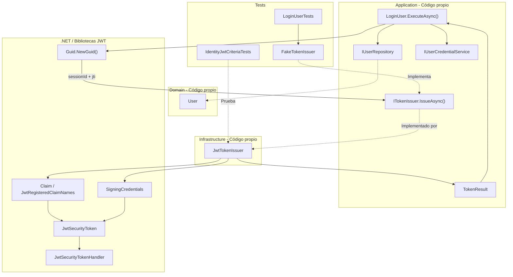
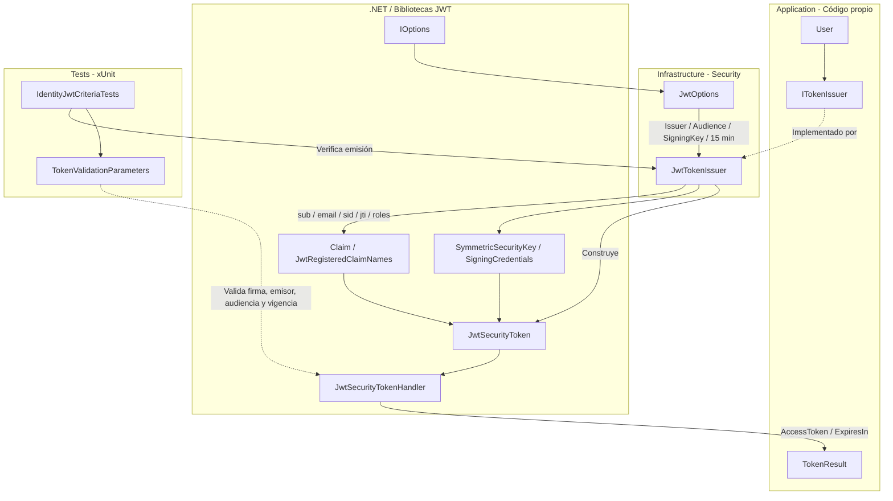
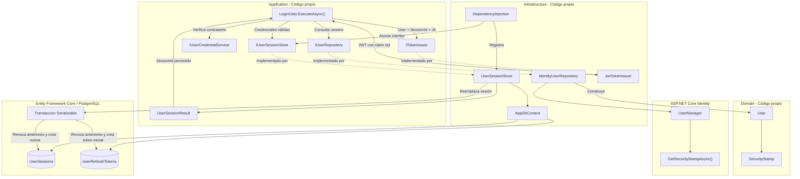

# Implementar: 09-sesion-unica-y-validacion-jwt

## PASOS

### 1. Verificar docker compose ps.

---

### 2. Extender el contrato de emisión con SessionId y Jti.

#### 1. Componentes implementados

| Componente                 | Acción | Tipo             | Capa                       | Responsabilidad                                                            |
| -------------------------- | ------ | ---------------- | -------------------------- | -------------------------------------------------------------------------- |
| `ITokenIssuer`             | Update | Interfaz         | Application / Abstractions | Extiende el contrato de emisión incorporando `sessionId` y `jti`.          |
| `LoginUser`                | Update | Caso de uso      | Application                | Genera identificadores de sesión y token para invocar el emisor.           |
| `JwtTokenIssuer`           | Update | Servicio         | Infrastructure / Security  | Adapta la firma de `IssueAsync()` para recibir los nuevos identificadores. |
| `IdentityJwtCriteriaTests` | Update | Clase de pruebas | Tests                      | Actualiza las invocaciones del emisor JWT.                                 |
| `LoginUserTests`           | Update | Clase de pruebas | Tests                      | Adapta `FakeTokenIssuer` al nuevo contrato.                                |

**Contrato actualizado:**

```csharp
Task<TokenResult> IssueAsync(
    User user,
    Guid sessionId,
    string jti,
    CancellationToken cancellationToken = default);
```

#### 2. Métodos principales

| Clase                      | Método                                                       | Responsabilidad                                                                                       |
| -------------------------- | ------------------------------------------------------------ | ----------------------------------------------------------------------------------------------------- |
| `ITokenIssuer`             | `IssueAsync()`                                               | Define la emisión de tokens asociados a un identificador de sesión y un identificador único de token. |
| `LoginUser`                | `ExecuteAsync()`                                             | Valida las credenciales y genera `sessionId` y `jti` antes de solicitar el token.                     |
| `JwtTokenIssuer`           | `IssueAsync()`                                               | Implementa el contrato actualizado y genera un JWT firmado.                                           |
| `IdentityJwtCriteriaTests` | `JwtIssuer_EmitsAdminTokenWithExpectedClaims()`              | Verifica los claims existentes y la configuración del JWT.                                            |
| `IdentityJwtCriteriaTests` | `JwtValidation_RejectsIncorrectSignatureIssuerAndAudience()` | Verifica el rechazo de JWT con firma, emisor o audiencia incorrectos.                                 |
| `FakeTokenIssuer`          | `IssueAsync()`                                               | Implementa el contrato actualizado para las pruebas de `LoginUser`.                                   |

**Parámetros incorporados:**

| Parámetro   | Tipo     | Propósito                              | Implementación actual                                                                            |
| ----------- | -------- | -------------------------------------- | ------------------------------------------------------------------------------------------------ |
| `sessionId` | `Guid`   | Identificar la sesión asociada al JWT. | `LoginUser` genera un GUID, pero `JwtTokenIssuer` todavía no lo incorpora al token.              |
| `jti`       | `string` | Identificar individualmente el JWT.    | `LoginUser` genera un identificador, pero `JwtTokenIssuer` genera otro GUID para el claim `jti`. |

#### 3. Componentes de .NET y bibliotecas externas

| Componente / Método       | Origen                                     | Función                                        | Uso en el proyecto                                 |
| ------------------------- | ------------------------------------------ | ---------------------------------------------- | -------------------------------------------------- |
| `Guid.NewGuid()`          | .NET / System                              | Genera identificadores GUID.                   | Crea `sessionId` y `jti` desde `LoginUser`.        |
| `Guid.ToString("N")`      | .NET / System                              | Representa un GUID sin separadores.            | Genera el identificador textual `jti`.             |
| `CancellationToken`       | .NET / System.Threading                    | Permite cancelar operaciones asíncronas.       | Se mantiene en el contrato de emisión.             |
| `JwtRegisteredClaimNames` | Biblioteca Microsoft.IdentityModel / JWT   | Proporciona nombres registrados de claims JWT. | Define `sub`, `email` y `jti`.                     |
| `Claim`                   | .NET / System.Security.Claims              | Representa información de identidad.           | Construye los claims del JWT.                      |
| `JwtSecurityToken`        | Biblioteca System.IdentityModel.Tokens.Jwt | Representa un JWT.                             | Construye el token con claims, vigencia y firma.   |
| `JwtSecurityTokenHandler` | Biblioteca System.IdentityModel.Tokens.Jwt | Procesa y serializa JWT.                       | Convierte el token firmado en una cadena.          |
| `SigningCredentials`      | Biblioteca Microsoft.IdentityModel.Tokens  | Define credenciales criptográficas de firma.   | Firma el JWT mediante HMAC-SHA256.                 |
| `ITokenIssuer`            | Código propio / Application                | Puerto de emisión de tokens.                   | Desacopla el caso de uso de la implementación JWT. |
| `JwtTokenIssuer`          | Código propio / Infrastructure             | Adaptador de emisión JWT.                      | Implementa `ITokenIssuer`.                         |
| `TokenResult`             | Código propio / Application                | Resultado de emisión.                          | Devuelve `AccessToken` y `ExpiresIn`.              |

#### 4. Flujo funcional

| Paso | Operación                                         | Componente                             |
| ---- | ------------------------------------------------- | -------------------------------------- |
| 1    | Buscar el usuario mediante su correo electrónico. | `LoginUser` → `IUserRepository`        |
| 2    | Verificar las credenciales del usuario.           | `LoginUser` → `IUserCredentialService` |
| 3    | Generar un GUID para identificar la sesión.       | `LoginUser`                            |
| 4    | Generar un GUID textual para identificar el JWT.  | `LoginUser`                            |
| 5    | Invocar `IssueAsync(user, sessionId, jti)`.       | `ITokenIssuer`                         |
| 6    | Construir y firmar el JWT.                        | `JwtTokenIssuer`                       |
| 7    | Devolver `AccessToken` y `ExpiresIn`.             | `TokenResult`                          |

**Estado de los identificadores:**

| Identificador | Comportamiento implementado      | Limitación                                                                                  |
| ------------- | -------------------------------- | ------------------------------------------------------------------------------------------- |
| `sessionId`   | Se genera y transmite al emisor. | No se incorpora a los claims ni se vincula con una sesión persistida en el código mostrado. |
| `jti`         | Se genera y transmite al emisor. | El JWT utiliza un GUID diferente, generado internamente por `JwtTokenIssuer`.               |

**Alcance:** El contrato y sus implementaciones aceptan los nuevos parámetros, pero todavía no se establece una vinculación efectiva entre el JWT y una sesión persistida.

#### 5. Diagrama de arquitectura



**Nota:** El diagrama representa la transmisión de `sessionId` y `jti` hasta el emisor, no su inclusión efectiva en el JWT.

#### 6. Resultado

Se extiende `ITokenIssuer` para recibir `sessionId` y `jti`, actualizando `LoginUser`, `JwtTokenIssuer` y sus pruebas.

La implementación todavía no incorpora `sessionId` al JWT ni utiliza el `jti` recibido; ambos comportamientos quedan pendientes en el código proporcionado.

---

### 3. Configurar claims, expiración de 15 minutos, issuer y audience.

#### 1. Componentes implementados

| Componente                 | Acción      | Tipo                   | Capa                       | Responsabilidad                                                                             |
| -------------------------- | ----------- | ---------------------- | -------------------------- | ------------------------------------------------------------------------------------------- |
| `JwtOptions`               | Update      | Clase de configuración | Infrastructure / Security  | Establece 15 minutos como duración predeterminada del access token.                         |
| `JwtTokenIssuer`           | Update      | Servicio / Adaptador   | Infrastructure / Security  | Incorpora los claims `sid` y `jti` recibidos mediante `ITokenIssuer`.                       |
| `IdentityJwtCriteriaTests` | Update      | Clase de pruebas       | Tests                      | Verifica los nuevos claims, la duración del JWT y las validaciones de seguridad existentes. |
| `ITokenIssuer`             | Sin cambios | Interfaz               | Application / Abstractions | Mantiene el contrato de emisión definido en el paso anterior.                               |
| `TokenResult`              | Sin cambios | Record                 | Application / Abstractions | Devuelve el JWT y su duración en segundos.                                                  |

#### 2. Métodos principales

| Clase                      | Método                                                       | Responsabilidad                                                                                 |
| -------------------------- | ------------------------------------------------------------ | ----------------------------------------------------------------------------------------------- |
| `JwtTokenIssuer`           | `IssueAsync()`                                               | Genera un JWT firmado con identidad, roles, sesión, identificador único y vigencia configurada. |
| `IdentityJwtCriteriaTests` | `JwtIssuer_EmitsAdminTokenWithExpectedClaims()`              | Comprueba issuer, audience, claims `email`, `sid`, `jti`, rol y duración de 900 segundos.       |
| `IdentityJwtCriteriaTests` | `JwtValidation_RejectsIncorrectSignatureIssuerAndAudience()` | Verifica el rechazo de JWT con firma, issuer o audience incorrectos.                            |
| `IdentityJwtCriteriaTests` | `JwtValidation_RejectsExpiredToken()`                        | Verifica el rechazo de tokens expirados.                                                        |
| `IdentityJwtCriteriaTests` | `CreateJwtOptions()`                                         | Proporciona configuración JWT de prueba con vigencia de 15 minutos.                             |
| `IdentityJwtCriteriaTests` | `CreateConfiguration()`                                      | Configura los parámetros JWT utilizados durante las pruebas.                                    |
| `IdentityJwtCriteriaTests` | `Validate()`                                                 | Valida firma, issuer, audience y expiración mediante `TokenValidationParameters`.               |

**Claims incorporados y conservados:**

| Claim   | Origen del valor       | Responsabilidad                                             |
| ------- | ---------------------- | ----------------------------------------------------------- |
| `sub`   | `user.Id.Value`        | Identifica al usuario autenticado.                          |
| `email` | `user.Email`           | Identifica el correo del usuario.                           |
| `sid`   | `sessionId.ToString()` | Identifica la sesión asociada al JWT.                       |
| `jti`   | Parámetro `jti`        | Identifica individualmente el JWT.                          |
| `role`  | `user.Roles`           | Incorpora los roles del usuario mediante `ClaimTypes.Role`. |
| `iss`   | `JwtOptions.Issuer`    | Identifica el emisor del JWT.                               |
| `aud`   | `JwtOptions.Audience`  | Identifica la audiencia permitida.                          |
| `nbf`   | `issuedAt`             | Establece el inicio de vigencia.                            |
| `exp`   | `expiresAt`            | Establece la expiración del JWT.                            |

#### 3. Componentes de .NET y bibliotecas externas

| Componente / Método                    | Origen                              | Función                                              | Uso en el proyecto                                            |
| -------------------------------------- | ----------------------------------- | ---------------------------------------------------- | ------------------------------------------------------------- |
| `IOptions<T>`                          | .NET / Microsoft.Extensions.Options | Proporciona configuración tipada.                    | Inyecta `JwtOptions` en `JwtTokenIssuer`.                     |
| `DateTime.UtcNow`                      | .NET / System                       | Obtiene la fecha y hora UTC.                         | Determina emisión y expiración del JWT.                       |
| `Claim`, `ClaimTypes.Role`             | .NET / System.Security.Claims       | Representan información de identidad y roles.        | Construyen los claims del usuario.                            |
| `JwtRegisteredClaimNames`              | System.IdentityModel.Tokens.Jwt     | Define nombres estándar de claims JWT.               | Proporciona `Sub`, `Email`, `Sid` y `Jti`.                    |
| `JwtSecurityToken`                     | System.IdentityModel.Tokens.Jwt     | Representa un JWT.                                   | Construye el token con claims, vigencia y firma.              |
| `JwtSecurityTokenHandler.WriteToken()` | System.IdentityModel.Tokens.Jwt     | Serializa el JWT.                                    | Genera el access token que recibe el cliente.                 |
| `SymmetricSecurityKey`                 | Microsoft.IdentityModel.Tokens      | Representa una clave criptográfica simétrica.        | Utiliza `JwtOptions.SigningKey`.                              |
| `SigningCredentials`                   | Microsoft.IdentityModel.Tokens      | Define las credenciales de firma.                    | Configura la firma del JWT.                                   |
| `SecurityAlgorithms.HmacSha256`        | Microsoft.IdentityModel.Tokens      | Identifica el algoritmo HMAC-SHA256.                 | Firma los tokens de acceso.                                   |
| `TokenValidationParameters`            | Microsoft.IdentityModel.Tokens      | Configura reglas de validación JWT.                  | Verifica firma, issuer, audience y expiración en las pruebas. |
| `ClockSkew`                            | Microsoft.IdentityModel.Tokens      | Define la tolerancia temporal durante la validación. | Se establece en cero en el método de prueba `Validate()`.     |
| `Assert`                               | xUnit                               | Verifica resultados de pruebas.                      | Comprueba claims, duración y excepciones de validación.       |
| `JwtOptions`                           | Código propio / Infrastructure      | Define la configuración de emisión JWT.              | Contiene issuer, audience, clave de firma y duración.         |
| `JwtTokenIssuer`                       | Código propio / Infrastructure      | Implementa el emisor JWT.                            | Genera tokens compatibles con `ITokenIssuer`.                 |

#### 4. Flujo funcional

**Emisión del JWT: `JwtTokenIssuer.IssueAsync()`**

| Paso | Operación                                                 | Componente                |
| ---- | --------------------------------------------------------- | ------------------------- |
| 1    | Recibir usuario, `sessionId` y `jti`.                     | `ITokenIssuer`            |
| 2    | Obtener la fecha UTC de emisión.                          | `DateTime.UtcNow`         |
| 3    | Calcular expiración sumando `AccessTokenLifetimeMinutes`. | `JwtOptions`              |
| 4    | Construir claims `sub`, `email`, `sid`, `jti` y roles.    | `Claim`                   |
| 5    | Obtener issuer, audience y clave de firma.                | `JwtOptions`              |
| 6    | Configurar firma HMAC-SHA256.                             | `SigningCredentials`      |
| 7    | Construir el JWT con claims y vigencia.                   | `JwtSecurityToken`        |
| 8    | Serializar el token.                                      | `JwtSecurityTokenHandler` |
| 9    | Devolver JWT y duración en segundos.                      | `TokenResult`             |

**Configuración y validaciones:**

| Propiedad / Regla            | Configuración                     | Resultado                                                      |
| ---------------------------- | --------------------------------- | -------------------------------------------------------------- |
| `AccessTokenLifetimeMinutes` | `15`                              | Duración predeterminada de 15 minutos.                         |
| `ExpiresIn`                  | `900`                             | Duración devuelta en segundos cuando se configuran 15 minutos. |
| `Issuer`                     | `JwtOptions.Issuer`               | Se incorpora al JWT.                                           |
| `Audience`                   | `JwtOptions.Audience`             | Se incorpora al JWT.                                           |
| `SigningKey`                 | `JwtOptions.SigningKey`           | Se utiliza para generar la firma.                              |
| `sid`                        | `sessionId.ToString()`            | Conserva el identificador recibido del llamador.               |
| `jti`                        | Parámetro `jti`                   | Conserva el identificador recibido del llamador.               |
| Firma incorrecta             | `ValidateIssuerSigningKey = true` | Token rechazado en las pruebas.                                |
| Issuer incorrecto            | `ValidateIssuer = true`           | Token rechazado en las pruebas.                                |
| Audience incorrecta          | `ValidateAudience = true`         | Token rechazado en las pruebas.                                |
| Token expirado               | `ValidateLifetime = true`         | Token rechazado en las pruebas.                                |

**Cambio respecto al paso 2:** `JwtTokenIssuer` ahora incorpora efectivamente `sessionId` y `jti` en los claims `sid` y `jti`, eliminando la generación interna de un identificador diferente para el JWT.

**Alcance:** Los 15 minutos constituyen el valor predeterminado de `JwtOptions` y el valor utilizado en las pruebas. La duración efectiva continúa dependiendo de la configuración cargada en ejecución. No se incorpora en este paso una validación de la sesión persistida durante la autenticación.

#### 5. Diagrama de arquitectura



#### 6. Resultado

Se actualiza la emisión JWT incorporando los claims `sid` y `jti` proporcionados por el llamador, manteniendo `sub`, `email`, roles, issuer, audience y firma HMAC-SHA256.

Se establece una duración predeterminada de 15 minutos y se actualizan las pruebas para verificar los claims, la vigencia y las reglas de validación.

---

### 4. Crear sesión y revocar la anterior tras validar login.

#### 1. Componentes implementados

| Componente               | Acción | Tipo                     | Capa                       | Responsabilidad                                                                                   |
| ------------------------ | ------ | ------------------------ | -------------------------- | ------------------------------------------------------------------------------------------------- |
| `IUserSessionStore`      | Create | Interfaz / Puerto        | Application / Abstractions | Define el contrato para crear una sesión autenticada y reemplazar la anterior.                    |
| `UserSessionResult`      | Create | Record                   | Application / Abstractions | Devuelve el identificador de la sesión persistida.                                                |
| `LoginUser`              | Update | Caso de uso              | Application                | Crea la sesión después de validar las credenciales y utiliza su identificador para emitir el JWT. |
| `User`                   | Update | Entidad                  | Domain / Users             | Incorpora `SecurityStamp` al modelo de usuario.                                                   |
| `IdentityUserRepository` | Update | Repositorio / Adaptador  | Infrastructure / Identity  | Obtiene el `SecurityStamp` desde ASP.NET Core Identity y lo incorpora al usuario de Domain.       |
| `UserSessionStore`       | Update | Servicio de persistencia | Infrastructure / Security  | Implementa `IUserSessionStore` reutilizando la operación transaccional de reemplazo de sesiones.  |
| `DependencyInjection`    | Update | Clase estática           | Infrastructure             | Registra `IUserSessionStore` utilizando la instancia de `UserSessionStore`.                       |
| `LoginUserTests`         | Update | Clase de pruebas         | Tests                      | Adapta las pruebas del login al nuevo contrato de sesiones.                                       |
| `FakeUserSessionStore`   | Create | Implementación de prueba | Tests                      | Simula la creación de una sesión sin utilizar persistencia real.                                  |

#### 2. Métodos principales

| Clase                                  | Método                                          | Responsabilidad                                                                                                        |
| -------------------------------------- | ----------------------------------------------- | ---------------------------------------------------------------------------------------------------------------------- |
| `LoginUser`                            | `ExecuteAsync()`                                | Valida credenciales, crea una sesión persistida y emite un JWT asociado a su `SessionId`.                              |
| `IUserSessionStore`                    | `ReplaceActiveSessionAsync()`                   | Define el reemplazo de la sesión activa de un usuario autenticado.                                                     |
| `UserSessionStore`                     | `IUserSessionStore.ReplaceActiveSessionAsync()` | Adapta el contrato de Application a la implementación existente de Infrastructure.                                     |
| `UserSessionStore`                     | `ReplaceActiveSessionAsync()`                   | Revoca sesiones activas anteriores y sus refresh tokens utilizables; crea una nueva sesión y su refresh token inicial. |
| `IdentityUserRepository`               | `FindByEmailAsync()`                            | Obtiene el usuario, sus roles y su `SecurityStamp` desde Identity.                                                     |
| `UserManager<ApplicationIdentityUser>` | `GetSecurityStampAsync()`                       | Obtiene el sello de seguridad vigente del usuario.                                                                     |
| `DependencyInjection`                  | `AddInfrastructure()`                           | Registra `IUserSessionStore` y su implementación.                                                                      |

**Adaptación del contrato:**

| Operación                                       | Entrada                                                     | Resultado                                            |
| ----------------------------------------------- | ----------------------------------------------------------- | ---------------------------------------------------- |
| `IUserSessionStore.ReplaceActiveSessionAsync()` | `User`, fecha de creación y expiración                      | `UserSessionResult(SessionId)`                       |
| `UserSessionStore.ReplaceActiveSessionAsync()`  | `UserId`, `SecurityStamp`, fechas de sesión y refresh token | `UserSessionCreationResult(SessionId, RefreshToken)` |

La implementación explícita de `IUserSessionStore` delega en el método existente de `UserSessionStore`, utilizando la misma fecha de expiración para la sesión y el refresh token.

#### 3. Componentes de .NET y bibliotecas externas

| Componente / Método           | Origen                         | Función                                              | Uso en el proyecto                                                                 |
| ----------------------------- | ------------------------------ | ---------------------------------------------------- | ---------------------------------------------------------------------------------- |
| `UserManager<TUser>`          | ASP.NET Core Identity          | Administra usuarios y sus propiedades de seguridad.  | Permite consultar el `SecurityStamp` del usuario.                                  |
| `GetSecurityStampAsync()`     | ASP.NET Core Identity          | Recupera el sello de seguridad vigente.              | Proporciona el valor que se almacena al crear la sesión.                           |
| `AddScoped<T>()`              | .NET / Dependency Injection    | Registra servicios con ciclo de vida Scoped.         | Mantiene el registro de `UserSessionStore`.                                        |
| `GetRequiredService<T>()`     | .NET / Dependency Injection    | Resuelve un servicio registrado.                     | Permite que `IUserSessionStore` utilice la instancia Scoped de `UserSessionStore`. |
| `DateTimeOffset.UtcNow`       | .NET / System                  | Obtiene la fecha y hora UTC.                         | Establece el instante de creación de la sesión.                                    |
| `DateTimeOffset.AddMinutes()` | .NET / System                  | Calcula una fecha posterior.                         | Establece una vigencia de 15 minutos para la sesión.                               |
| `Guid.NewGuid()`              | .NET / System                  | Genera identificadores GUID.                         | Genera el `jti` enviado al emisor JWT.                                             |
| `IUserSessionStore`           | Código propio / Application    | Contrato de persistencia de sesiones.                | Desacopla `LoginUser` de Infrastructure.                                           |
| `UserSessionStore`            | Código propio / Infrastructure | Gestiona sesiones y refresh tokens mediante EF Core. | Reemplaza la sesión activa después de validar credenciales.                        |
| `ITokenIssuer`                | Código propio / Application    | Contrato de emisión de tokens.                       | Emite el JWT asociado al identificador de sesión persistido.                       |

#### 4. Flujo funcional

**Inicio de sesión: `LoginUser.ExecuteAsync()`**

| Paso | Operación                                                                          | Componente                          |
| ---- | ---------------------------------------------------------------------------------- | ----------------------------------- |
| 1    | Buscar el usuario mediante su correo electrónico.                                  | `IUserRepository`                   |
| 2    | Obtener sus roles y `SecurityStamp`.                                               | `IdentityUserRepository` / Identity |
| 3    | Verificar la contraseña.                                                           | `IUserCredentialService`            |
| 4    | Rechazar credenciales inválidas sin crear una sesión.                              | `LoginUser`                         |
| 5    | Obtener la fecha UTC y calcular una expiración de 15 minutos.                      | `LoginUser`                         |
| 6    | Solicitar el reemplazo de la sesión activa.                                        | `IUserSessionStore`                 |
| 7    | Revocar las sesiones anteriores y sus refresh tokens utilizables.                  | `UserSessionStore`                  |
| 8    | Crear una sesión activa con el `SecurityStamp` vigente y un refresh token inicial. | `UserSessionStore`                  |
| 9    | Persistir los cambios mediante una transacción serializable.                       | EF Core / `AppDbContext`            |
| 10   | Devolver el `SessionId` persistido.                                                | `UserSessionResult`                 |
| 11   | Generar un `jti` y emitir el JWT utilizando el `SessionId` real.                   | `ITokenIssuer`                      |
| 12   | Devolver el access token y su duración.                                            | `TokenResult`                       |

**Reglas implementadas:**

| Regla                        | Implementación                                                                 |
| ---------------------------- | ------------------------------------------------------------------------------ |
| Credenciales válidas         | La creación de sesión ocurre únicamente después de verificar la contraseña.    |
| Sesión única                 | Se revocan las sesiones activas anteriores antes de crear una nueva.           |
| Revocación de refresh tokens | Se revocan los tokens no consumidos ni revocados de las sesiones reemplazadas. |
| Identificador persistido     | El JWT recibe el `SessionId` devuelto por `UserSessionStore`.                  |
| Sello de seguridad           | Se obtiene desde Identity y se almacena en la nueva sesión.                    |
| Vigencia de sesión           | Se establece en 15 minutos desde la ejecución del login.                       |
| Vigencia del refresh token   | El adaptador utiliza la misma fecha de expiración que la sesión.               |
| Persistencia transaccional   | El reemplazo de sesión utiliza una transacción serializable.                   |
| Credenciales inválidas       | Se devuelve `AuthenticationError` sin invocar el almacén de sesiones.          |

**Alcance de la implementación:**

- `UserSessionStore` genera un refresh token inicial, pero la implementación de `IUserSessionStore` devuelve únicamente `SessionId`. El login no entrega ese refresh token al cliente.
- La emisión del JWT ocurre después de confirmar la transacción de creación de sesión; ambas operaciones no forman parte de una misma transacción.
- La sesión persistida y el refresh token inicial tienen una vigencia de 15 minutos en este flujo.
- `LoginUserTests` incorpora `FakeUserSessionStore`, pero las pruebas mostradas no verifican explícitamente la revocación de sesiones anteriores ni la correspondencia entre el `SessionId` persistido y el claim `sid` del JWT.

#### 5. Diagrama de arquitectura



#### 6. Resultado

Se integra la persistencia de sesiones en `LoginUser` mediante `IUserSessionStore`, creando una nueva sesión y revocando las anteriores después de validar las credenciales.

El JWT utiliza el `SessionId` persistido y el usuario incorpora su `SecurityStamp` vigente; el refresh token inicial se almacena, pero no se devuelve al cliente en este flujo.

---

### 5. Validar sesión persistida en Bearer.

---

### 6. Rechazar sesiones inexistentes, revocadas, vencidas o con stamp diferente.

---

### 7. Mapear rechazos a 401 authentication_required.

---

### 8. Probar login sucesivo desde dos equipos.

---

### 9. Probar cambio de stamp y expiración con PostgreSQL real.

---

### 10. Ejecutar build, pruebas y verificación de pgAdmin sin cambios de esquema.

---

### ?. Ajustes por pruebas manuales

**Levantar PostgreSQL y pgAdmin:**

```powershell
docker compose up -d
```

**Compilación y pruebas:**

```powershell
dotnet restore FEPP-ContaOps.slnx
dotnet build FEPP-ContaOps.slnx
dotnet test FEPP-ContaOps.slnx
```

---

### ?. Validación, ejecución local y Git

**Prerrequisitos:** Docker disponible; crear un archivo `.env` local a partir de `.env.example` y sustituir todos los valores de ejemplo por credenciales y secretos propios. **No subir `.env` a Git.**

**Iniciar API:**

```powershell
.\run-local.ps1
```

---

### ?. Validación del spec (flujo de trabajo existente):

```powershell
/spec-acceptance-validator @specs/09-sesion-unica-y-validacion-jwt.md
```

Revisar el spec: [`09-sesion-unica-y-validacion-jwt.md`](../09-sesion-unica-y-validacion-jwt.md).

---

### ?. Diagrama Final: Arquitectura del spec-09-sesion-unica-y-validacion-jwt

---

### ?. Comandos Git / PR\*\* (una vez validada la implementación y revisados los cambios)

```powershell
git add .
git commit -m "FEPP-ContaOps - spec-09-sesion-unica-y-validacion-jwt -  Implementado"
git push -u origin spec-09-sesion-unica-y-validacion-jwt

# Después de aprobar y fusionar el Pull Request:
git switch main
git pull
git branch -d spec-09-sesion-unica-y-validacion-jwt
```
