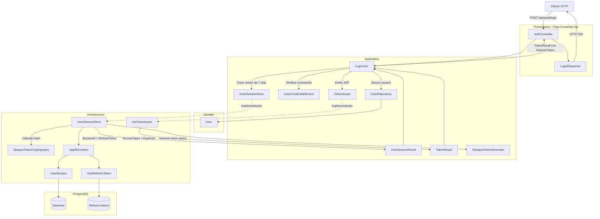
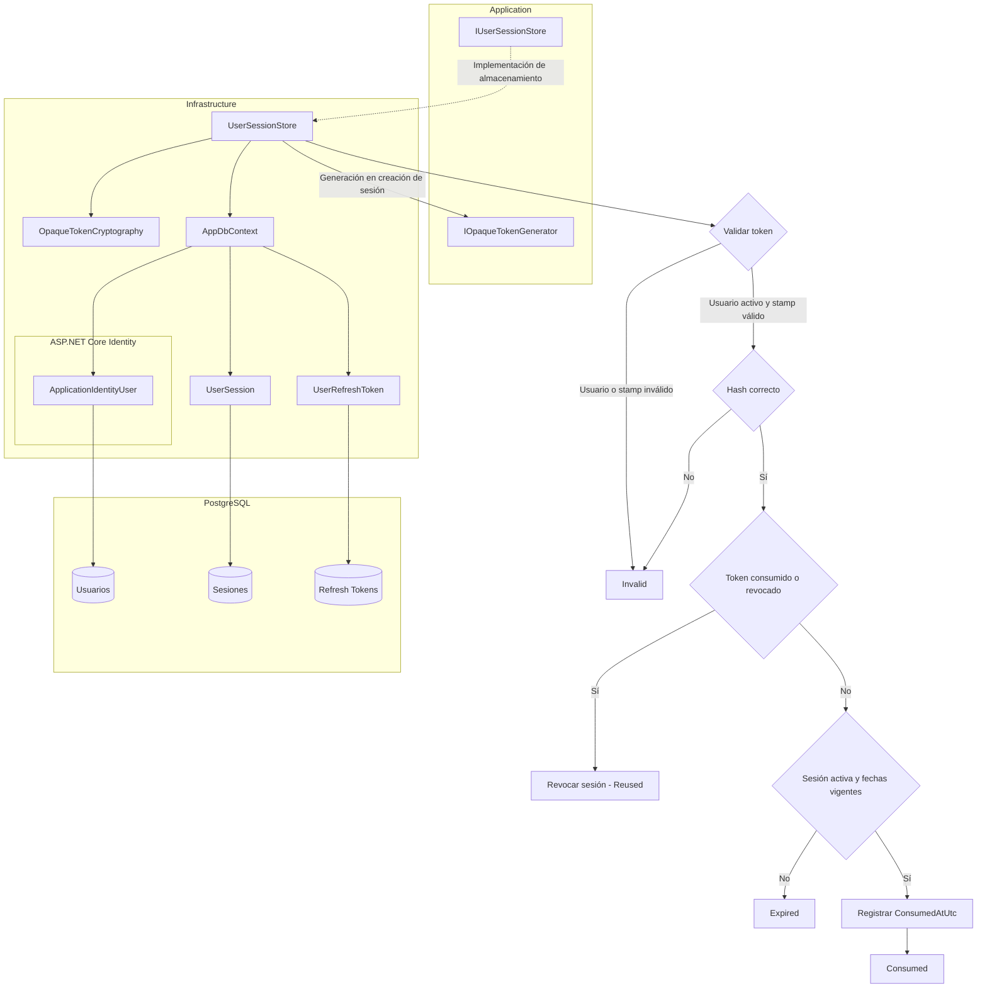

# Implementar: 10-rotacion-refresh-y-logout

## PASOS

### 1. Verificar servicios con docker compose ps.

---

### 2. Añadir refresh token al login y limitar la sesión a 7 días

#### 1. Componentes implementados

| Componente                | Acción      | Tipo                     | Capa           | Responsabilidad                                                                         |
| ------------------------- | ----------- | ------------------------ | -------------- | --------------------------------------------------------------------------------------- |
| `LoginResponse`           | Update      | Record (DTO)             | Presentation   | Incorpora `RefreshToken` a la respuesta HTTP del login.                                 |
| `AuthController`          | Update      | Controller               | Presentation   | Devuelve el JWT, su duración y el refresh token generado.                               |
| `TokenResult`             | Update      | Record                   | Application    | Transporta `AccessToken`, `ExpiresIn` y `RefreshToken` entre capas.                     |
| `ITokenIssuer`            | Sin cambios | Interface                | Application    | Contrato para emitir JWT asociados a una sesión.                                        |
| `IUserSessionStore`       | Update      | Interface                | Application    | Devuelve el identificador de sesión y el refresh token inicial.                         |
| `UserSessionResult`       | Create      | Record                   | Application    | Representa el resultado de crear una sesión autenticada.                                |
| `LoginUser`               | Update      | Caso de uso              | Application    | Autentica credenciales, crea una sesión de 7 días y entrega ambos tokens.               |
| `JwtTokenIssuer`          | Sin cambios | Servicio                 | Infrastructure | Genera el JWT firmado con los claims `sub`, `sid` y `jti`.                              |
| `UserSessionStore`        | Update      | Servicio de persistencia | Infrastructure | Reemplaza sesiones anteriores y genera un refresh token opaco almacenado mediante hash. |
| `UserSession`             | Uso         | Entidad de persistencia  | Infrastructure | Almacena el estado, propietario, `SecurityStamp` y vencimiento de la sesión.            |
| `UserRefreshToken`        | Uso         | Entidad de persistencia  | Infrastructure | Almacena el hash, vencimiento y estado de consumo o revocación del refresh token.       |
| `AppDbContext`            | Uso         | DbContext                | Infrastructure | Proporciona acceso transaccional a sesiones, refresh tokens y usuarios.                 |
| `IOpaqueTokenGenerator`   | Uso         | Interface                | Application    | Contrato para generar tokens opacos.                                                    |
| `OpaqueTokenCryptography` | Uso         | Servicio criptográfico   | Infrastructure | Calcula el hash del refresh token y permite verificarlo.                                |
| `LoginUserTests`          | Sin cambios | Pruebas unitarias        | Tests          | Verifica autenticación válida e inválida mediante implementaciones simuladas.           |

#### 2. Métodos principales

| Clase                     | Método                                   | Responsabilidad                                                                                                        |
| ------------------------- | ---------------------------------------- | ---------------------------------------------------------------------------------------------------------------------- |
| `AuthController`          | `Login()`                                | Ejecuta el caso de uso y devuelve `LoginResponse`, incluyendo el refresh token.                                        |
| `LoginUser`               | `ExecuteAsync()`                         | Valida credenciales, establece una vigencia de 7 días y solicita la creación de sesión y emisión del JWT.              |
| `IUserSessionStore`       | `ReplaceActiveSessionAsync()`            | Define el contrato para reemplazar una sesión y devolver `UserSessionResult`.                                          |
| `UserSessionStore`        | `ReplaceActiveSessionAsync(User, ...)`   | Implementa el contrato y utiliza la misma expiración para la sesión y el refresh token.                                |
| `UserSessionStore`        | `ReplaceActiveSessionAsync(string, ...)` | Revoca sesiones anteriores y sus refresh tokens utilizables; crea una nueva sesión y persiste el hash del nuevo token. |
| `JwtTokenIssuer`          | `IssueAsync()`                           | Genera un JWT firmado, asociado al identificador de sesión y con expiración independiente.                             |
| `OpaqueTokenCryptography` | `Hash()`                                 | Calcula el hash utilizado para almacenar el refresh token sin persistir su valor original.                             |
| `UserSessionStore`        | `ConsumeRefreshTokenAsync()`             | Valida y consume un refresh token mediante una transacción; detecta tokens inválidos, reutilizados o expirados.        |
| `UserSessionStore`        | `RevokeSessionAsync()`                   | Revoca una sesión y sus refresh tokens todavía utilizables.                                                            |
| `UserSessionStore`        | `ExpireSessionsAsync()`                  | Marca como expiradas las sesiones activas cuyo plazo terminó.                                                          |
| `UserSessionStore`        | `IsSessionActiveAsync()`                 | Verifica usuario, estado de sesión, vigencia y coincidencia del `SecurityStamp`.                                       |

#### 3. Componentes de .NET y bibliotecas externas

| Componente / Método                            | Origen                                | Función                                                                | Uso en el proyecto                                               |
| ---------------------------------------------- | ------------------------------------- | ---------------------------------------------------------------------- | ---------------------------------------------------------------- |
| `LoginUser`, `UserSessionStore`, `TokenResult` | Código propio                         | Implementación de autenticación y sesiones.                            | Coordinar login, emisión de tokens y persistencia.               |
| `ControllerBase.Ok()`                          | ASP.NET Core MVC                      | Genera respuestas HTTP 200.                                            | Entregar `LoginResponse`.                                        |
| `DateTimeOffset.UtcNow`                        | .NET                                  | Obtiene la fecha y hora UTC.                                           | Establecer el inicio de la sesión.                               |
| `DateTimeOffset.AddDays()`                     | .NET                                  | Calcula una fecha posterior.                                           | Definir el vencimiento a 7 días.                                 |
| `Guid.NewGuid()`                               | .NET                                  | Genera identificadores únicos.                                         | Identificar sesiones, tokens y JWT.                              |
| `record` y expresión `with`                    | C# / .NET                             | Representan datos y permiten crear copias con propiedades modificadas. | Incorporar el refresh token al resultado emitido.                |
| `JwtSecurityToken`                             | Microsoft.IdentityModel / JWT         | Representa un JWT.                                                     | Construir el access token.                                       |
| `JwtSecurityTokenHandler.WriteToken()`         | Microsoft.IdentityModel / JWT         | Serializa el JWT.                                                      | Obtener el token enviado al cliente.                             |
| `SymmetricSecurityKey`                         | Microsoft.IdentityModel.Tokens        | Representa una clave simétrica.                                        | Firmar el JWT.                                                   |
| `SecurityAlgorithms.HmacSha256`                | Microsoft.IdentityModel.Tokens        | Identifica el algoritmo HS256.                                         | Configurar la firma del JWT.                                     |
| `ApplicationIdentityUser.SecurityStamp`        | ASP.NET Core Identity / Código propio | Propiedad de seguridad del usuario Identity.                           | Asociar y validar la sesión frente al estado actual del usuario. |
| `DbContext.Database.BeginTransactionAsync()`   | Entity Framework Core                 | Inicia una transacción.                                                | Ejecutar cambios de sesión y tokens de forma transaccional.      |
| `IsolationLevel.Serializable`                  | .NET / System.Data                    | Define el nivel de aislamiento de transacciones.                       | Proteger operaciones de reemplazo y consumo de tokens.           |
| `ToListAsync()` / `SingleOrDefaultAsync()`     | Entity Framework Core                 | Ejecutan consultas asíncronas.                                         | Consultar sesiones y refresh tokens.                             |
| `SaveChangesAsync()`                           | Entity Framework Core                 | Persiste modificaciones.                                               | Guardar sesiones, hashes y revocaciones.                         |
| `IOpaqueTokenGenerator`                        | Código propio                         | Define la generación de tokens opacos.                                 | Obtener el refresh token inicial.                                |
| `OpaqueTokenCryptography`                      | Código propio                         | Proporciona operaciones criptográficas sobre tokens.                   | Almacenar y comparar hashes.                                     |
| `[Fact]` / `[Theory]`                          | xUnit                                 | Definen pruebas unitarias.                                             | Verificar resultados del caso de uso de login.                   |

#### 4. Flujo funcional

| Paso | Componente         | Operación                                                 | Validación / Resultado                                                     |
| ---- | ------------------ | --------------------------------------------------------- | -------------------------------------------------------------------------- |
| 1    | `AuthController`   | Recibe `POST /api/auth/login`.                            | Obtiene correo y contraseña.                                               |
| 2    | `LoginUser`        | Busca al usuario mediante `IUserRepository`.              | Si no existe, devuelve `AuthenticationError`.                              |
| 3    | `LoginUser`        | Verifica la contraseña mediante `IUserCredentialService`. | Si es incorrecta, devuelve `AuthenticationError`.                          |
| 4    | `LoginUser`        | Calcula `createdAtUtc` y `expiresAtUtc`.                  | La sesión vence exactamente 7 días después de su creación.                 |
| 5    | `UserSessionStore` | Inicia una transacción serializable.                      | Protege el reemplazo de la sesión.                                         |
| 6    | `UserSessionStore` | Consulta sesiones activas anteriores.                     | Revoca sus refresh tokens utilizables y marca las sesiones como `Revoked`. |
| 7    | `UserSessionStore` | Genera un refresh token opaco.                            | Utiliza `IOpaqueTokenGenerator.Generate()`.                                |
| 8    | `UserSessionStore` | Crea `UserSession` y `UserRefreshToken`.                  | Ambos reciben el mismo vencimiento de 7 días.                              |
| 9    | `UserSessionStore` | Calcula y almacena `TokenHash`.                           | El refresh token original no se almacena en texto plano.                   |
| 10   | `UserSessionStore` | Guarda los cambios y confirma la transacción.             | Devuelve `SessionId` y refresh token original.                             |
| 11   | `JwtTokenIssuer`   | Genera el JWT asociado a la nueva sesión.                 | Incluye `sub`, `sid`, `jti` y vigencia configurada en `JwtOptions`.        |
| 12   | `LoginUser`        | Incorpora el refresh token a `TokenResult`.               | Devuelve ambos tokens mediante `Result.Success()`.                         |
| 13   | `AuthController`   | Construye `LoginResponse`.                                | HTTP 200 con `AccessToken`, `TokenType`, `ExpiresIn` y `RefreshToken`.     |

**Consideraciones de vigencia**

| Elemento              | Vigencia               | Comportamiento                                                     |
| --------------------- | ---------------------- | ------------------------------------------------------------------ |
| Sesión autenticada    | 7 días                 | Se establece mediante `SessionLifetimeDays = 7`.                   |
| Refresh token inicial | 7 días                 | Comparte la fecha de expiración de la sesión.                      |
| Access token JWT      | Configurable           | Utiliza `JwtOptions.AccessTokenLifetimeMinutes`.                   |
| Login posterior       | Nueva sesión de 7 días | Revoca la sesión activa anterior y sus refresh tokens utilizables. |

**Alcance:** este paso implementa la emisión y entrega del refresh token durante el login. El código presentado no incorpora un endpoint HTTP para renovar el access token.

#### 5. Diagrama de arquitectura



#### 6. Resultado

El login ahora devuelve un JWT y un refresh token opaco, cuyo hash se almacena en PostgreSQL junto con una sesión autenticada limitada a **7 días**. Cada nuevo inicio de sesión reemplaza la sesión activa anterior, conservando la vigencia independiente del access token configurada en `JwtOptions`.

---

### 3. Validar hash, sesión, stamp y expiración

#### 1. Componentes implementados

| Componente                | Acción | Tipo                           | Capa           | Responsabilidad                                                                                                                                          |
| ------------------------- | ------ | ------------------------------ | -------------- | -------------------------------------------------------------------------------------------------------------------------------------------------------- |
| `UserSessionStore`        | Update | Servicio de persistencia       | Infrastructure | Amplía la validación del refresh token para comprobar el usuario, su estado y la coincidencia del `SecurityStamp`, además del hash, sesión y expiración. |
| `ApplicationIdentityUser` | Uso    | Entidad Identity personalizada | Infrastructure | Proporciona el estado actual del usuario y su `SecurityStamp` para validar el refresh token.                                                             |
| `UserSession`             | Uso    | Entidad de persistencia        | Infrastructure | Contiene el estado, vencimiento y `SecurityStamp` asociado a la sesión.                                                                                  |
| `UserRefreshToken`        | Uso    | Entidad de persistencia        | Infrastructure | Contiene el hash, vencimiento y estado de consumo o revocación del token.                                                                                |
| `OpaqueTokenCryptography` | Uso    | Servicio criptográfico         | Infrastructure | Compara el refresh token recibido con su hash persistido.                                                                                                |
| `AppDbContext`            | Uso    | DbContext                      | Infrastructure | Consulta usuarios, sesiones y refresh tokens mediante EF Core.                                                                                           |
| `UserSessionStoreTests`   | Update | Pruebas unitarias con SQLite   | Tests          | Incorpora la prueba de rechazo de refresh tokens cuando cambia el `SecurityStamp` del usuario.                                                           |

#### 2. Métodos principales

| Clase                     | Método                                              | Responsabilidad                                                                                                                     |
| ------------------------- | --------------------------------------------------- | ----------------------------------------------------------------------------------------------------------------------------------- |
| `UserSessionStore`        | `ConsumeRefreshTokenAsync()`                        | Valida el hash, existencia y estado del usuario, `SecurityStamp`, estado de sesión y expiración antes de consumir el refresh token. |
| `OpaqueTokenCryptography` | `Matches()`                                         | Comprueba que el token recibido corresponde al hash almacenado.                                                                     |
| `UserSessionStore`        | `RevokeSessionStateAsync()`                         | Revoca la sesión y sus tokens disponibles cuando se detecta reutilización.                                                          |
| `UserSessionStore`        | `MarkSessionExpired()`                              | Marca como expirada una sesión activa cuyo vencimiento ya se cumplió.                                                               |
| `UserSessionStore`        | `IsSessionActiveAsync()`                            | Valida la vigencia de una sesión asociada a un JWT, incluyendo el estado del usuario y su `SecurityStamp`.                          |
| `UserSessionStoreTests`   | `ConsumeRefreshToken_RejectsChangedSecurityStamp()` | Comprueba que modificar el `SecurityStamp` invalida el refresh token previamente emitido.                                           |

#### 3. Componentes de .NET y bibliotecas externas

| Componente / Método                 | Origen                                                 | Función                                                          | Uso en el proyecto                                                |
| ----------------------------------- | ------------------------------------------------------ | ---------------------------------------------------------------- | ----------------------------------------------------------------- |
| `UserSessionStore`                  | Código propio                                          | Implementa las reglas de validación y consumo de refresh tokens. | Rechazar tokens que no cumplan las condiciones de seguridad.      |
| `OpaqueTokenCryptography.Matches()` | Código propio                                          | Compara criptográficamente el token con su hash.                 | Verificar la autenticidad del refresh token.                      |
| `ApplicationIdentityUser`           | Código propio / ASP.NET Core Identity                  | Extiende la identidad persistida del usuario.                    | Consultar `Status` y `SecurityStamp`.                             |
| `SecurityStamp`                     | ASP.NET Core Identity                                  | Representa el sello de seguridad del usuario.                    | Invalidar tokens asociados a un sello anterior.                   |
| `BeginTransactionAsync()`           | Entity Framework Core                                  | Inicia una transacción de base de datos.                         | Garantizar la consistencia durante el consumo del token.          |
| `IsolationLevel.Serializable`       | .NET / System.Data                                     | Nivel de aislamiento transaccional.                              | Proteger las operaciones de consumo frente a concurrencia.        |
| `SingleOrDefaultAsync()`            | Entity Framework Core                                  | Recupera una entidad o `null`.                                   | Consultar sesión, refresh token y usuario.                        |
| `SaveChangesAsync()`                | Entity Framework Core                                  | Persiste modificaciones.                                         | Registrar consumo, revocación o expiración.                       |
| `CommitAsync()` / `RollbackAsync()` | Entity Framework Core / Transacciones de base de datos | Confirman o revierten una transacción.                           | Completar o revertir las operaciones de validación y consumo.     |
| `Microsoft.Data.Sqlite`             | Proveedor ADO.NET / NuGet                              | Proporciona conexiones SQLite.                                   | Ejecutar pruebas con una base de datos en memoria.                |
| `UseSqlite()`                       | EF Core SQLite / NuGet                                 | Configura el proveedor SQLite.                                   | Crear el contexto de persistencia utilizado en las pruebas.       |
| `[Fact]` / `Assert.Equal()`         | xUnit                                                  | Definen pruebas y verificaciones.                                | Comprobar el rechazo de tokens con un `SecurityStamp` modificado. |

#### 4. Flujo funcional

| Paso | Componente                | Operación                                                                 | Validación / Resultado                                                             |
| ---- | ------------------------- | ------------------------------------------------------------------------- | ---------------------------------------------------------------------------------- |
| 1    | `UserSessionStore`        | Recibe `sessionId`, `refreshToken` y `nowUtc`.                            | Verifica que el token recibido no sea nulo ni vacío.                               |
| 2    | `UserSessionStore`        | Inicia una transacción serializable.                                      | Protege el proceso de validación y consumo.                                        |
| 3    | `AppDbContext`            | Consulta la sesión, el refresh token persistido y el usuario propietario. | Los tres registros deben existir.                                                  |
| 4    | `ApplicationIdentityUser` | Comprueba el estado del usuario.                                          | Debe ser `UserStatus.Active`.                                                      |
| 5    | `UserSessionStore`        | Compara el `SecurityStamp` de la sesión con el actual del usuario.        | Si son diferentes, devuelve `Invalid`.                                             |
| 6    | `OpaqueTokenCryptography` | Compara el token recibido con `TokenHash`.                                | Si no coincide, devuelve `Invalid`.                                                |
| 7    | `UserSessionStore`        | Comprueba si el token fue consumido o revocado.                           | Si existe reutilización, revoca la sesión y devuelve `Reused`.                     |
| 8    | `UserSessionStore`        | Verifica el estado de la sesión y las fechas de expiración.               | La sesión debe estar activa y ambos vencimientos deben ser posteriores a `nowUtc`. |
| 9    | `UserSessionStore`        | Procesa una sesión o token no vigente.                                    | Marca la sesión como expirada cuando corresponde y devuelve `Expired`.             |
| 10   | `UserSessionStore`        | Registra `ConsumedAtUtc = nowUtc`.                                        | Si todas las validaciones son correctas, consume el token y devuelve `Consumed`.   |
| 11   | `UserSessionStore`        | Confirma la transacción.                                                  | Persiste los cambios; ante una excepción, realiza rollback.                        |

**Resultados de validación**

| Estado     | Condición                                                                                          |
| ---------- | -------------------------------------------------------------------------------------------------- |
| `Invalid`  | Sesión, token o usuario inexistente; usuario inactivo; `SecurityStamp` diferente; hash incorrecto. |
| `Reused`   | Refresh token previamente consumido o revocado. Se revoca la sesión asociada.                      |
| `Expired`  | Sesión no activa o vencimiento de sesión o refresh token alcanzado.                                |
| `Consumed` | Todas las validaciones son correctas y el token queda marcado como consumido.                      |

**Prueba incorporada**

| Prueba                                            | Escenario                                                                                                              | Resultado esperado                       |
| ------------------------------------------------- | ---------------------------------------------------------------------------------------------------------------------- | ---------------------------------------- |
| `ConsumeRefreshToken_RejectsChangedSecurityStamp` | Se crea una sesión con `stamp-1`, se actualiza el usuario a `stamp-2` y se intenta consumir el refresh token original. | `RefreshTokenConsumptionStatus.Invalid`. |

**Alcance:** el cambio principal se concentra en `ConsumeRefreshTokenAsync()`. Los mecanismos de expiración, detección de reutilización y validación de sesiones JWT ya estaban presentes y se conservan.

#### 5. Diagrama de arquitectura



#### 6. Resultado

La validación del refresh token ahora exige que el usuario exista, esté activo y conserve el mismo `SecurityStamp` registrado al crear la sesión. Estas comprobaciones se integran con la validación existente del hash, estado de sesión, expiración y consumo único, manteniendo la operación transaccional.

---

### 4. Consumir atómicamente el refresh y crear su reemplazo.

---

### 5. Detectar reutilización y revocar la sesión.

---

### 6. Implementar POST /api/auth/refresh.

---

### 7. Implementar POST /api/auth/logout.

---

### 8. Probar concurrencia, reutilización, expiración y logout.

---

### 9. Verificar la invalidación de JWT anteriores.

---

### 10. Ejecutar build, pruebas, Swagger y comprobación de tablas.

---

### 11. Ajustes por pruebas manuales

**Levantar PostgreSQL y pgAdmin:**

```powershell
docker compose up -d
```

**Compilación y pruebas:**

```powershell
dotnet restore FEPP-ContaOps.slnx
dotnet build FEPP-ContaOps.slnx
dotnet test FEPP-ContaOps.slnx
```

---

### 12. Validación, ejecución local y Git

**Prerrequisitos:** Docker disponible; crear un archivo `.env` local a partir de `.env.example` y sustituir todos los valores de ejemplo por credenciales y secretos propios. **No subir `.env` a Git.**

**Iniciar API:**

```powershell
.\run-local.ps1
```

---

### 13. Validación del spec (flujo de trabajo existente):

```powershell
/spec-acceptance-validator @specs/10-rotacion-refresh-y-logout.md
```

Revisar el spec: [`10-rotacion-refresh-y-logout.md`](../10-rotacion-refresh-y-logout.md).

---

### 14. Diagrama Final: Arquitectura del spec-10-rotacion-refresh-y-logout

---

### 15. Comandos Git / PR\*\* (una vez validada la implementación y revisados los cambios)

```powershell
git add .
git commit -m "FEPP-ContaOps - spec-10-rotacion-refresh-y-logout -  Implementado"
git push -u origin spec-10-rotacion-refresh-y-logout

# Después de aprobar y fusionar el Pull Request:
git switch main
git pull
git branch -d spec-10-rotacion-refresh-y-logout
```
