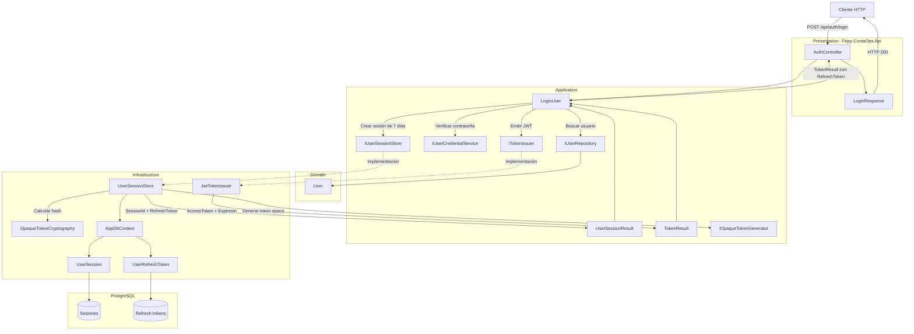
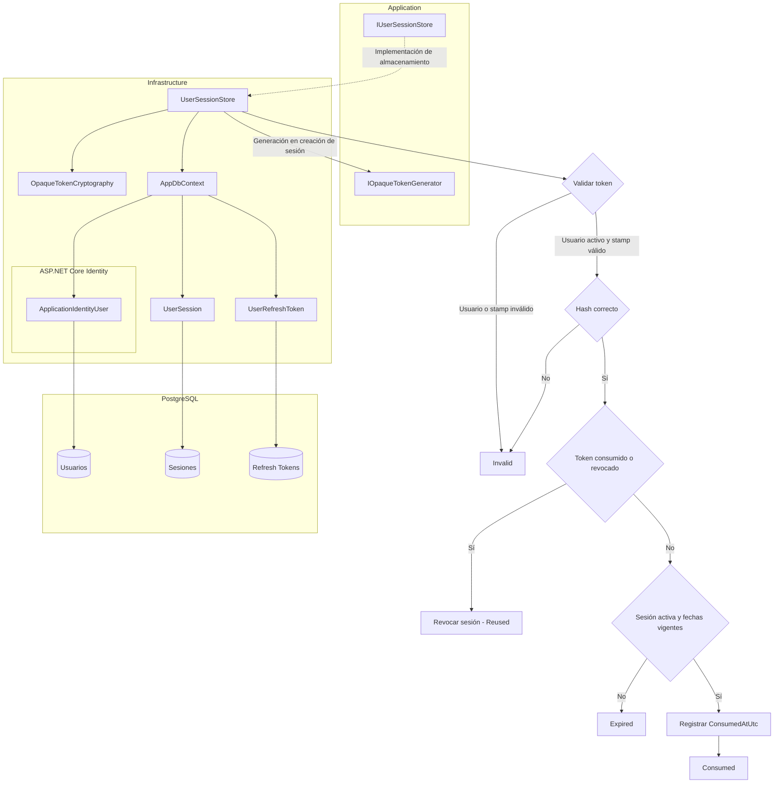
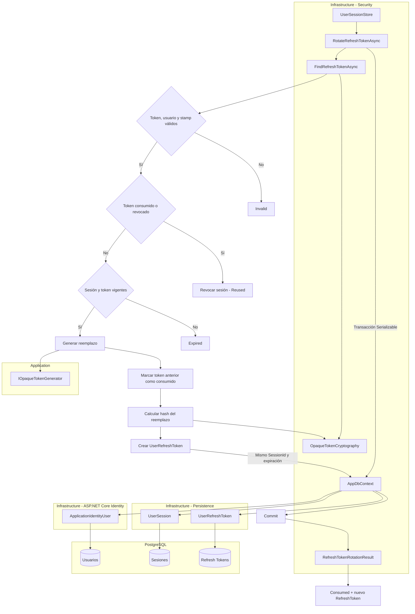
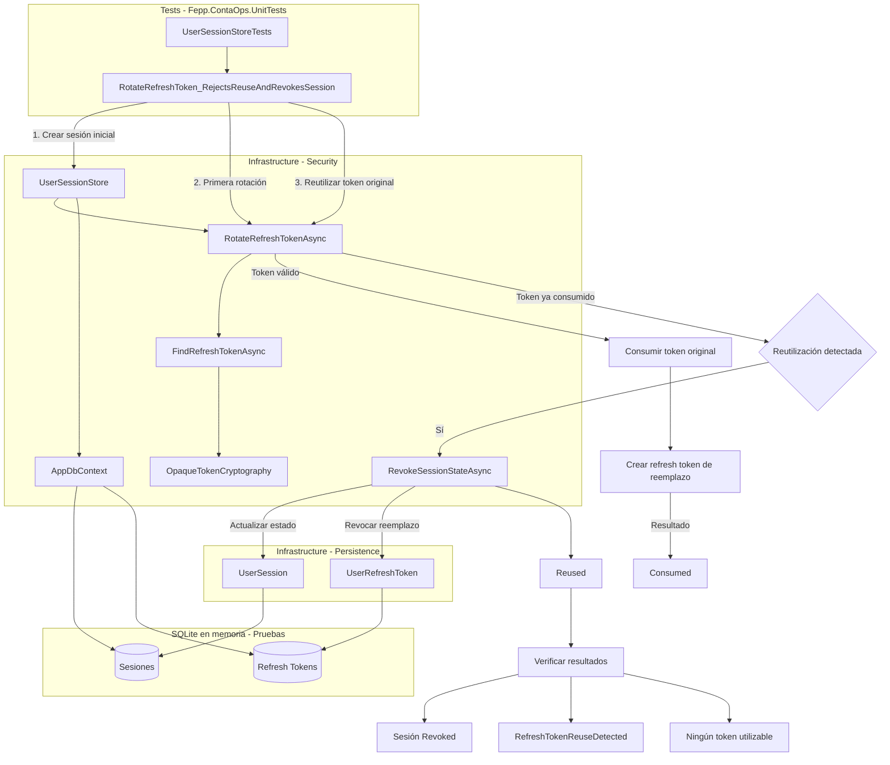
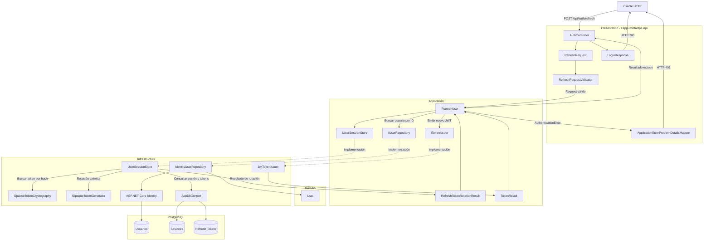
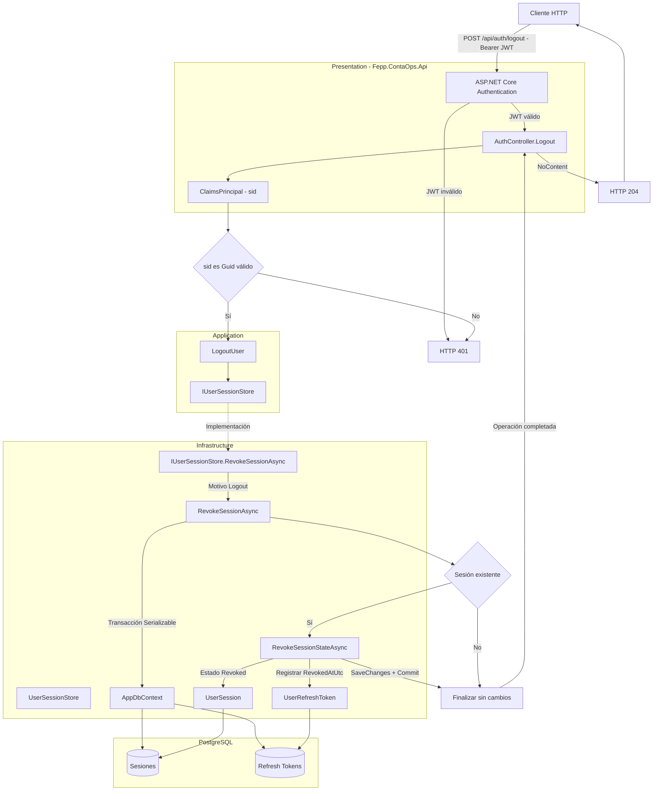

# Implementar: 10-rotacion-refresh-y-logout

## PASOS

### 1. Verificar servicios con docker compose ps.

---

### 2. Añadir refresh token al login y limitar la sesión a 7 días

#### 1. Componentes implementados

| Componente                | Acción      | Tipo                     | Capa           | Responsabilidad                                                                         |
| ------------------------- | ----------- | ------------------------ | -------------- | --------------------------------------------------------------------------------------- |
| `LoginResponse`           | Update      | Record (DTO)             | Presentation   | Incorpora `RefreshToken` a la respuesta HTTP del login.                                 |
| `AuthController`          | Update      | Controller               | Presentation   | Devuelve el JWT, su duración y el refresh token generado.                               |
| `TokenResult`             | Update      | Record                   | Application    | Transporta `AccessToken`, `ExpiresIn` y `RefreshToken` entre capas.                     |
| `ITokenIssuer`            | Sin cambios | Interface                | Application    | Contrato para emitir JWT asociados a una sesión.                                        |
| `IUserSessionStore`       | Update      | Interface                | Application    | Devuelve el identificador de sesión y el refresh token inicial.                         |
| `UserSessionResult`       | Create      | Record                   | Application    | Representa el resultado de crear una sesión autenticada.                                |
| `LoginUser`               | Update      | Caso de uso              | Application    | Autentica credenciales, crea una sesión de 7 días y entrega ambos tokens.               |
| `JwtTokenIssuer`          | Sin cambios | Servicio                 | Infrastructure | Genera el JWT firmado con los claims `sub`, `sid` y `jti`.                              |
| `UserSessionStore`        | Update      | Servicio de persistencia | Infrastructure | Reemplaza sesiones anteriores y genera un refresh token opaco almacenado mediante hash. |
| `UserSession`             | Uso         | Entidad de persistencia  | Infrastructure | Almacena el estado, propietario, `SecurityStamp` y vencimiento de la sesión.            |
| `UserRefreshToken`        | Uso         | Entidad de persistencia  | Infrastructure | Almacena el hash, vencimiento y estado de consumo o revocación del refresh token.       |
| `AppDbContext`            | Uso         | DbContext                | Infrastructure | Proporciona acceso transaccional a sesiones, refresh tokens y usuarios.                 |
| `IOpaqueTokenGenerator`   | Uso         | Interface                | Application    | Contrato para generar tokens opacos.                                                    |
| `OpaqueTokenCryptography` | Uso         | Servicio criptográfico   | Infrastructure | Calcula el hash del refresh token y permite verificarlo.                                |
| `LoginUserTests`          | Sin cambios | Pruebas unitarias        | Tests          | Verifica autenticación válida e inválida mediante implementaciones simuladas.           |

#### 2. Métodos principales

| Clase                     | Método                                   | Responsabilidad                                                                                                        |
| ------------------------- | ---------------------------------------- | ---------------------------------------------------------------------------------------------------------------------- |
| `AuthController`          | `Login()`                                | Ejecuta el caso de uso y devuelve `LoginResponse`, incluyendo el refresh token.                                        |
| `LoginUser`               | `ExecuteAsync()`                         | Valida credenciales, establece una vigencia de 7 días y solicita la creación de sesión y emisión del JWT.              |
| `IUserSessionStore`       | `ReplaceActiveSessionAsync()`            | Define el contrato para reemplazar una sesión y devolver `UserSessionResult`.                                          |
| `UserSessionStore`        | `ReplaceActiveSessionAsync(User, ...)`   | Implementa el contrato y utiliza la misma expiración para la sesión y el refresh token.                                |
| `UserSessionStore`        | `ReplaceActiveSessionAsync(string, ...)` | Revoca sesiones anteriores y sus refresh tokens utilizables; crea una nueva sesión y persiste el hash del nuevo token. |
| `JwtTokenIssuer`          | `IssueAsync()`                           | Genera un JWT firmado, asociado al identificador de sesión y con expiración independiente.                             |
| `OpaqueTokenCryptography` | `Hash()`                                 | Calcula el hash utilizado para almacenar el refresh token sin persistir su valor original.                             |
| `UserSessionStore`        | `ConsumeRefreshTokenAsync()`             | Valida y consume un refresh token mediante una transacción; detecta tokens inválidos, reutilizados o expirados.        |
| `UserSessionStore`        | `RevokeSessionAsync()`                   | Revoca una sesión y sus refresh tokens todavía utilizables.                                                            |
| `UserSessionStore`        | `ExpireSessionsAsync()`                  | Marca como expiradas las sesiones activas cuyo plazo terminó.                                                          |
| `UserSessionStore`        | `IsSessionActiveAsync()`                 | Verifica usuario, estado de sesión, vigencia y coincidencia del `SecurityStamp`.                                       |

#### 3. Componentes de .NET y bibliotecas externas

| Componente / Método                            | Origen                                | Función                                                                | Uso en el proyecto                                               |
| ---------------------------------------------- | ------------------------------------- | ---------------------------------------------------------------------- | ---------------------------------------------------------------- |
| `LoginUser`, `UserSessionStore`, `TokenResult` | Código propio                         | Implementación de autenticación y sesiones.                            | Coordinar login, emisión de tokens y persistencia.               |
| `ControllerBase.Ok()`                          | ASP.NET Core MVC                      | Genera respuestas HTTP 200.                                            | Entregar `LoginResponse`.                                        |
| `DateTimeOffset.UtcNow`                        | .NET                                  | Obtiene la fecha y hora UTC.                                           | Establecer el inicio de la sesión.                               |
| `DateTimeOffset.AddDays()`                     | .NET                                  | Calcula una fecha posterior.                                           | Definir el vencimiento a 7 días.                                 |
| `Guid.NewGuid()`                               | .NET                                  | Genera identificadores únicos.                                         | Identificar sesiones, tokens y JWT.                              |
| `record` y expresión `with`                    | C# / .NET                             | Representan datos y permiten crear copias con propiedades modificadas. | Incorporar el refresh token al resultado emitido.                |
| `JwtSecurityToken`                             | Microsoft.IdentityModel / JWT         | Representa un JWT.                                                     | Construir el access token.                                       |
| `JwtSecurityTokenHandler.WriteToken()`         | Microsoft.IdentityModel / JWT         | Serializa el JWT.                                                      | Obtener el token enviado al cliente.                             |
| `SymmetricSecurityKey`                         | Microsoft.IdentityModel.Tokens        | Representa una clave simétrica.                                        | Firmar el JWT.                                                   |
| `SecurityAlgorithms.HmacSha256`                | Microsoft.IdentityModel.Tokens        | Identifica el algoritmo HS256.                                         | Configurar la firma del JWT.                                     |
| `ApplicationIdentityUser.SecurityStamp`        | ASP.NET Core Identity / Código propio | Propiedad de seguridad del usuario Identity.                           | Asociar y validar la sesión frente al estado actual del usuario. |
| `DbContext.Database.BeginTransactionAsync()`   | Entity Framework Core                 | Inicia una transacción.                                                | Ejecutar cambios de sesión y tokens de forma transaccional.      |
| `IsolationLevel.Serializable`                  | .NET / System.Data                    | Define el nivel de aislamiento de transacciones.                       | Proteger operaciones de reemplazo y consumo de tokens.           |
| `ToListAsync()` / `SingleOrDefaultAsync()`     | Entity Framework Core                 | Ejecutan consultas asíncronas.                                         | Consultar sesiones y refresh tokens.                             |
| `SaveChangesAsync()`                           | Entity Framework Core                 | Persiste modificaciones.                                               | Guardar sesiones, hashes y revocaciones.                         |
| `IOpaqueTokenGenerator`                        | Código propio                         | Define la generación de tokens opacos.                                 | Obtener el refresh token inicial.                                |
| `OpaqueTokenCryptography`                      | Código propio                         | Proporciona operaciones criptográficas sobre tokens.                   | Almacenar y comparar hashes.                                     |
| `[Fact]` / `[Theory]`                          | xUnit                                 | Definen pruebas unitarias.                                             | Verificar resultados del caso de uso de login.                   |

#### 4. Flujo funcional

| Paso | Componente         | Operación                                                 | Validación / Resultado                                                     |
| ---- | ------------------ | --------------------------------------------------------- | -------------------------------------------------------------------------- |
| 1    | `AuthController`   | Recibe `POST /api/auth/login`.                            | Obtiene correo y contraseña.                                               |
| 2    | `LoginUser`        | Busca al usuario mediante `IUserRepository`.              | Si no existe, devuelve `AuthenticationError`.                              |
| 3    | `LoginUser`        | Verifica la contraseña mediante `IUserCredentialService`. | Si es incorrecta, devuelve `AuthenticationError`.                          |
| 4    | `LoginUser`        | Calcula `createdAtUtc` y `expiresAtUtc`.                  | La sesión vence exactamente 7 días después de su creación.                 |
| 5    | `UserSessionStore` | Inicia una transacción serializable.                      | Protege el reemplazo de la sesión.                                         |
| 6    | `UserSessionStore` | Consulta sesiones activas anteriores.                     | Revoca sus refresh tokens utilizables y marca las sesiones como `Revoked`. |
| 7    | `UserSessionStore` | Genera un refresh token opaco.                            | Utiliza `IOpaqueTokenGenerator.Generate()`.                                |
| 8    | `UserSessionStore` | Crea `UserSession` y `UserRefreshToken`.                  | Ambos reciben el mismo vencimiento de 7 días.                              |
| 9    | `UserSessionStore` | Calcula y almacena `TokenHash`.                           | El refresh token original no se almacena en texto plano.                   |
| 10   | `UserSessionStore` | Guarda los cambios y confirma la transacción.             | Devuelve `SessionId` y refresh token original.                             |
| 11   | `JwtTokenIssuer`   | Genera el JWT asociado a la nueva sesión.                 | Incluye `sub`, `sid`, `jti` y vigencia configurada en `JwtOptions`.        |
| 12   | `LoginUser`        | Incorpora el refresh token a `TokenResult`.               | Devuelve ambos tokens mediante `Result.Success()`.                         |
| 13   | `AuthController`   | Construye `LoginResponse`.                                | HTTP 200 con `AccessToken`, `TokenType`, `ExpiresIn` y `RefreshToken`.     |

**Consideraciones de vigencia**

| Elemento              | Vigencia               | Comportamiento                                                     |
| --------------------- | ---------------------- | ------------------------------------------------------------------ |
| Sesión autenticada    | 7 días                 | Se establece mediante `SessionLifetimeDays = 7`.                   |
| Refresh token inicial | 7 días                 | Comparte la fecha de expiración de la sesión.                      |
| Access token JWT      | Configurable           | Utiliza `JwtOptions.AccessTokenLifetimeMinutes`.                   |
| Login posterior       | Nueva sesión de 7 días | Revoca la sesión activa anterior y sus refresh tokens utilizables. |

**Alcance:** este paso implementa la emisión y entrega del refresh token durante el login. El código presentado no incorpora un endpoint HTTP para renovar el access token.

#### 5. Diagrama de arquitectura



#### 6. Resultado

El login ahora devuelve un JWT y un refresh token opaco, cuyo hash se almacena en PostgreSQL junto con una sesión autenticada limitada a **7 días**. Cada nuevo inicio de sesión reemplaza la sesión activa anterior, conservando la vigencia independiente del access token configurada en `JwtOptions`.

---

### 3. Validar hash, sesión, stamp y expiración

#### 1. Componentes implementados

| Componente                | Acción | Tipo                           | Capa           | Responsabilidad                                                                                                                                          |
| ------------------------- | ------ | ------------------------------ | -------------- | -------------------------------------------------------------------------------------------------------------------------------------------------------- |
| `UserSessionStore`        | Update | Servicio de persistencia       | Infrastructure | Amplía la validación del refresh token para comprobar el usuario, su estado y la coincidencia del `SecurityStamp`, además del hash, sesión y expiración. |
| `ApplicationIdentityUser` | Uso    | Entidad Identity personalizada | Infrastructure | Proporciona el estado actual del usuario y su `SecurityStamp` para validar el refresh token.                                                             |
| `UserSession`             | Uso    | Entidad de persistencia        | Infrastructure | Contiene el estado, vencimiento y `SecurityStamp` asociado a la sesión.                                                                                  |
| `UserRefreshToken`        | Uso    | Entidad de persistencia        | Infrastructure | Contiene el hash, vencimiento y estado de consumo o revocación del token.                                                                                |
| `OpaqueTokenCryptography` | Uso    | Servicio criptográfico         | Infrastructure | Compara el refresh token recibido con su hash persistido.                                                                                                |
| `AppDbContext`            | Uso    | DbContext                      | Infrastructure | Consulta usuarios, sesiones y refresh tokens mediante EF Core.                                                                                           |
| `UserSessionStoreTests`   | Update | Pruebas unitarias con SQLite   | Tests          | Incorpora la prueba de rechazo de refresh tokens cuando cambia el `SecurityStamp` del usuario.                                                           |

#### 2. Métodos principales

| Clase                     | Método                                              | Responsabilidad                                                                                                                     |
| ------------------------- | --------------------------------------------------- | ----------------------------------------------------------------------------------------------------------------------------------- |
| `UserSessionStore`        | `ConsumeRefreshTokenAsync()`                        | Valida el hash, existencia y estado del usuario, `SecurityStamp`, estado de sesión y expiración antes de consumir el refresh token. |
| `OpaqueTokenCryptography` | `Matches()`                                         | Comprueba que el token recibido corresponde al hash almacenado.                                                                     |
| `UserSessionStore`        | `RevokeSessionStateAsync()`                         | Revoca la sesión y sus tokens disponibles cuando se detecta reutilización.                                                          |
| `UserSessionStore`        | `MarkSessionExpired()`                              | Marca como expirada una sesión activa cuyo vencimiento ya se cumplió.                                                               |
| `UserSessionStore`        | `IsSessionActiveAsync()`                            | Valida la vigencia de una sesión asociada a un JWT, incluyendo el estado del usuario y su `SecurityStamp`.                          |
| `UserSessionStoreTests`   | `ConsumeRefreshToken_RejectsChangedSecurityStamp()` | Comprueba que modificar el `SecurityStamp` invalida el refresh token previamente emitido.                                           |

#### 3. Componentes de .NET y bibliotecas externas

| Componente / Método                 | Origen                                                 | Función                                                          | Uso en el proyecto                                                |
| ----------------------------------- | ------------------------------------------------------ | ---------------------------------------------------------------- | ----------------------------------------------------------------- |
| `UserSessionStore`                  | Código propio                                          | Implementa las reglas de validación y consumo de refresh tokens. | Rechazar tokens que no cumplan las condiciones de seguridad.      |
| `OpaqueTokenCryptography.Matches()` | Código propio                                          | Compara criptográficamente el token con su hash.                 | Verificar la autenticidad del refresh token.                      |
| `ApplicationIdentityUser`           | Código propio / ASP.NET Core Identity                  | Extiende la identidad persistida del usuario.                    | Consultar `Status` y `SecurityStamp`.                             |
| `SecurityStamp`                     | ASP.NET Core Identity                                  | Representa el sello de seguridad del usuario.                    | Invalidar tokens asociados a un sello anterior.                   |
| `BeginTransactionAsync()`           | Entity Framework Core                                  | Inicia una transacción de base de datos.                         | Garantizar la consistencia durante el consumo del token.          |
| `IsolationLevel.Serializable`       | .NET / System.Data                                     | Nivel de aislamiento transaccional.                              | Proteger las operaciones de consumo frente a concurrencia.        |
| `SingleOrDefaultAsync()`            | Entity Framework Core                                  | Recupera una entidad o `null`.                                   | Consultar sesión, refresh token y usuario.                        |
| `SaveChangesAsync()`                | Entity Framework Core                                  | Persiste modificaciones.                                         | Registrar consumo, revocación o expiración.                       |
| `CommitAsync()` / `RollbackAsync()` | Entity Framework Core / Transacciones de base de datos | Confirman o revierten una transacción.                           | Completar o revertir las operaciones de validación y consumo.     |
| `Microsoft.Data.Sqlite`             | Proveedor ADO.NET / NuGet                              | Proporciona conexiones SQLite.                                   | Ejecutar pruebas con una base de datos en memoria.                |
| `UseSqlite()`                       | EF Core SQLite / NuGet                                 | Configura el proveedor SQLite.                                   | Crear el contexto de persistencia utilizado en las pruebas.       |
| `[Fact]` / `Assert.Equal()`         | xUnit                                                  | Definen pruebas y verificaciones.                                | Comprobar el rechazo de tokens con un `SecurityStamp` modificado. |

#### 4. Flujo funcional

| Paso | Componente                | Operación                                                                 | Validación / Resultado                                                             |
| ---- | ------------------------- | ------------------------------------------------------------------------- | ---------------------------------------------------------------------------------- |
| 1    | `UserSessionStore`        | Recibe `sessionId`, `refreshToken` y `nowUtc`.                            | Verifica que el token recibido no sea nulo ni vacío.                               |
| 2    | `UserSessionStore`        | Inicia una transacción serializable.                                      | Protege el proceso de validación y consumo.                                        |
| 3    | `AppDbContext`            | Consulta la sesión, el refresh token persistido y el usuario propietario. | Los tres registros deben existir.                                                  |
| 4    | `ApplicationIdentityUser` | Comprueba el estado del usuario.                                          | Debe ser `UserStatus.Active`.                                                      |
| 5    | `UserSessionStore`        | Compara el `SecurityStamp` de la sesión con el actual del usuario.        | Si son diferentes, devuelve `Invalid`.                                             |
| 6    | `OpaqueTokenCryptography` | Compara el token recibido con `TokenHash`.                                | Si no coincide, devuelve `Invalid`.                                                |
| 7    | `UserSessionStore`        | Comprueba si el token fue consumido o revocado.                           | Si existe reutilización, revoca la sesión y devuelve `Reused`.                     |
| 8    | `UserSessionStore`        | Verifica el estado de la sesión y las fechas de expiración.               | La sesión debe estar activa y ambos vencimientos deben ser posteriores a `nowUtc`. |
| 9    | `UserSessionStore`        | Procesa una sesión o token no vigente.                                    | Marca la sesión como expirada cuando corresponde y devuelve `Expired`.             |
| 10   | `UserSessionStore`        | Registra `ConsumedAtUtc = nowUtc`.                                        | Si todas las validaciones son correctas, consume el token y devuelve `Consumed`.   |
| 11   | `UserSessionStore`        | Confirma la transacción.                                                  | Persiste los cambios; ante una excepción, realiza rollback.                        |

**Resultados de validación**

| Estado     | Condición                                                                                          |
| ---------- | -------------------------------------------------------------------------------------------------- |
| `Invalid`  | Sesión, token o usuario inexistente; usuario inactivo; `SecurityStamp` diferente; hash incorrecto. |
| `Reused`   | Refresh token previamente consumido o revocado. Se revoca la sesión asociada.                      |
| `Expired`  | Sesión no activa o vencimiento de sesión o refresh token alcanzado.                                |
| `Consumed` | Todas las validaciones son correctas y el token queda marcado como consumido.                      |

**Prueba incorporada**

| Prueba                                            | Escenario                                                                                                              | Resultado esperado                       |
| ------------------------------------------------- | ---------------------------------------------------------------------------------------------------------------------- | ---------------------------------------- |
| `ConsumeRefreshToken_RejectsChangedSecurityStamp` | Se crea una sesión con `stamp-1`, se actualiza el usuario a `stamp-2` y se intenta consumir el refresh token original. | `RefreshTokenConsumptionStatus.Invalid`. |

**Alcance:** el cambio principal se concentra en `ConsumeRefreshTokenAsync()`. Los mecanismos de expiración, detección de reutilización y validación de sesiones JWT ya estaban presentes y se conservan.

#### 5. Diagrama de arquitectura



#### 6. Resultado

La validación del refresh token ahora exige que el usuario exista, esté activo y conserve el mismo `SecurityStamp` registrado al crear la sesión. Estas comprobaciones se integran con la validación existente del hash, estado de sesión, expiración y consumo único, manteniendo la operación transaccional.

---

### 4. Consumir atómicamente el refresh y crear su reemplazo

#### 1. Componentes implementados

| Componente                      | Acción      | Tipo                           | Capa           | Responsabilidad                                                                                                 |
| ------------------------------- | ----------- | ------------------------------ | -------------- | --------------------------------------------------------------------------------------------------------------- |
| `RefreshTokenRotationResult`    | Create      | Record                         | Infrastructure | Devuelve el estado de la rotación y el nuevo refresh token cuando la operación es exitosa.                      |
| `RefreshTokenConsumptionStatus` | Sin cambios | Enum                           | Infrastructure | Representa los resultados `Consumed`, `Invalid`, `Reused` y `Expired`.                                          |
| `UserSessionStore`              | Update      | Servicio de persistencia       | Infrastructure | Implementa la rotación atómica de refresh tokens y permite consultar múltiples tokens asociados a una sesión.   |
| `UserRefreshToken`              | Uso         | Entidad de persistencia        | Infrastructure | Conserva el historial de tokens consumidos y almacena los reemplazos generados.                                 |
| `UserSession`                   | Uso         | Entidad de persistencia        | Infrastructure | Mantiene la sesión original y su fecha máxima de expiración durante las rotaciones.                             |
| `ApplicationIdentityUser`       | Uso         | Entidad Identity personalizada | Infrastructure | Proporciona el estado del usuario y su `SecurityStamp` para autorizar la rotación.                              |
| `IOpaqueTokenGenerator`         | Uso         | Interface                      | Application    | Define el contrato para generar un nuevo refresh token opaco.                                                   |
| `OpaqueTokenCryptography`       | Uso         | Servicio criptográfico         | Infrastructure | Verifica hashes de tokens existentes y calcula el hash del reemplazo.                                           |
| `AppDbContext`                  | Uso         | DbContext                      | Infrastructure | Persiste el consumo y la creación del reemplazo dentro de una misma transacción.                                |
| `UserSessionStoreTests`         | Update      | Pruebas unitarias              | Tests          | Incorpora una prueba que verifica el consumo del token anterior y la creación de un único reemplazo utilizable. |

#### 2. Métodos principales

| Clase                     | Método                                                             | Responsabilidad                                                                                          |
| ------------------------- | ------------------------------------------------------------------ | -------------------------------------------------------------------------------------------------------- |
| `UserSessionStore`        | `RotateRefreshTokenAsync()`                                        | Valida el refresh token, consume el anterior y crea su reemplazo dentro de una transacción serializable. |
| `UserSessionStore`        | `FindRefreshTokenAsync()`                                          | Busca entre los tokens asociados a una sesión y devuelve aquel cuyo hash coincide con el token recibido. |
| `UserSessionStore`        | `ConsumeRefreshTokenAsync()`                                       | Utiliza la nueva búsqueda por hash para localizar y consumir un token existente sin generar reemplazo.   |
| `IOpaqueTokenGenerator`   | `Generate()`                                                       | Genera un nuevo refresh token opaco mediante su implementación registrada.                               |
| `OpaqueTokenCryptography` | `Matches()`                                                        | Comprueba la correspondencia entre el refresh token recibido y un hash persistido.                       |
| `OpaqueTokenCryptography` | `Hash()`                                                           | Calcula el hash del nuevo refresh token antes de almacenarlo.                                            |
| `UserSessionStore`        | `RevokeSessionStateAsync()`                                        | Revoca la sesión y sus tokens utilizables cuando se detecta reutilización.                               |
| `UserSessionStore`        | `MarkSessionExpired()`                                             | Marca una sesión como expirada cuando ha alcanzado su vencimiento.                                       |
| `UserSessionStoreTests`   | `RotateRefreshToken_ConsumesPresentedTokenAndCreatesReplacement()` | Verifica que la rotación consume el token original y persiste un reemplazo diferente.                    |

#### 3. Componentes de .NET y bibliotecas externas

| Componente / Método                 | Origen                                   | Función                                                             | Uso en el proyecto                                                 |
| ----------------------------------- | ---------------------------------------- | ------------------------------------------------------------------- | ------------------------------------------------------------------ |
| `UserSessionStore`                  | Código propio                            | Implementa las reglas de rotación y persistencia de refresh tokens. | Coordinar el consumo y reemplazo de tokens.                        |
| `RefreshTokenRotationResult`        | Código propio                            | Representa el resultado de la operación.                            | Devolver el estado y el nuevo token.                               |
| `OpaqueTokenCryptography`           | Código propio                            | Implementa operaciones de hash y comparación.                       | Verificar tokens y proteger sus valores persistidos.               |
| `ApplicationIdentityUser`           | Código propio / ASP.NET Core Identity    | Representa al usuario persistido con Identity.                      | Validar estado y `SecurityStamp` antes de rotar.                   |
| `SecurityStamp`                     | ASP.NET Core Identity                    | Sello de seguridad asociado al usuario.                             | Invalidar tokens vinculados a un sello anterior.                   |
| `Guid.NewGuid()`                    | .NET                                     | Genera identificadores únicos.                                      | Asignar un identificador al nuevo refresh token.                   |
| `DateTimeOffset`                    | .NET                                     | Representa fechas con desplazamiento horario.                       | Registrar consumo, creación y expiración.                          |
| `IsolationLevel.Serializable`       | .NET / System.Data                       | Define el nivel de aislamiento de una transacción.                  | Proteger el consumo y reemplazo frente a operaciones concurrentes. |
| `BeginTransactionAsync()`           | Entity Framework Core                    | Inicia una transacción de base de datos.                            | Agrupar consumo y creación del reemplazo.                          |
| `Where()` / `ToListAsync()`         | LINQ / Entity Framework Core             | Filtran y materializan consultas.                                   | Recuperar los tokens asociados a una sesión.                       |
| `SingleOrDefault()`                 | LINQ / .NET                              | Obtiene un único elemento coincidente o `null`.                     | Identificar el token cuyo hash coincide.                           |
| `SaveChangesAsync()`                | Entity Framework Core                    | Persiste los cambios del contexto.                                  | Guardar el consumo y el reemplazo.                                 |
| `CommitAsync()` / `RollbackAsync()` | EF Core / Transacciones de base de datos | Confirman o revierten cambios transaccionales.                      | Evitar persistencias parciales ante excepciones.                   |
| `Microsoft.Data.Sqlite`             | Proveedor ADO.NET / NuGet                | Proporciona conexiones SQLite.                                      | Ejecutar pruebas sobre una base en memoria.                        |
| `UseSqlite()`                       | EF Core SQLite / NuGet                   | Configura EF Core para utilizar SQLite.                             | Crear el entorno de persistencia de pruebas.                       |
| `[Fact]` / `Assert.Single()`        | xUnit                                    | Definen pruebas y verificaciones.                                   | Comprobar que existe un único reemplazo utilizable.                |

#### 4. Flujo funcional

| Paso | Componente                | Operación                                                       | Validación / Resultado                                                                   |
| ---- | ------------------------- | --------------------------------------------------------------- | ---------------------------------------------------------------------------------------- |
| 1    | `UserSessionStore`        | Recibe `sessionId`, `refreshToken` y `nowUtc`.                  | Rechaza un token nulo o vacío.                                                           |
| 2    | `UserSessionStore`        | Inicia una transacción con aislamiento `Serializable`.          | Agrupa la validación, el consumo y la creación del reemplazo.                            |
| 3    | `AppDbContext`            | Recupera la sesión y su usuario propietario.                    | Ambos deben existir.                                                                     |
| 4    | `FindRefreshTokenAsync()` | Consulta los tokens asociados a la sesión y compara sus hashes. | Selecciona el token coincidente o devuelve `null`.                                       |
| 5    | `UserSessionStore`        | Verifica el usuario y su `SecurityStamp`.                       | El usuario debe estar activo y conservar el sello registrado en la sesión.               |
| 6    | `UserSessionStore`        | Comprueba si el token fue consumido o revocado anteriormente.   | Si fue reutilizado, revoca la sesión y devuelve `Reused`.                                |
| 7    | `UserSessionStore`        | Comprueba el estado de la sesión y los vencimientos.            | Si la sesión no está activa o alguno de los vencimientos se alcanzó, devuelve `Expired`. |
| 8    | `IOpaqueTokenGenerator`   | Genera un nuevo refresh token.                                  | Obtiene un valor opaco diferente para el reemplazo.                                      |
| 9    | `UserSessionStore`        | Marca el token anterior con `ConsumedAtUtc = nowUtc`.           | Impide que siga siendo un token utilizable.                                              |
| 10   | `UserSessionStore`        | Crea un nuevo `UserRefreshToken`.                               | Conserva el mismo `SessionId` y establece `ExpiresAtUtc = session.ExpiresAtUtc`.         |
| 11   | `OpaqueTokenCryptography` | Calcula el hash del reemplazo.                                  | Persiste `TokenHash`, no el valor original.                                              |
| 12   | `AppDbContext`            | Guarda los cambios y confirma la transacción.                   | Consumo y reemplazo se persisten conjuntamente.                                          |
| 13   | `UserSessionStore`        | Devuelve `RefreshTokenRotationResult`.                          | Retorna `Consumed` junto con el nuevo refresh token.                                     |

**Resultados de la rotación**

| Estado     | Condición                                                                          | Acción                                                                  |
| ---------- | ---------------------------------------------------------------------------------- | ----------------------------------------------------------------------- |
| `Invalid`  | Sesión, token o usuario inexistente; usuario inactivo o `SecurityStamp` diferente. | Rechaza la operación sin generar un token.                              |
| `Reused`   | El token presentado ya fue consumido o revocado.                                   | Revoca la sesión y sus tokens todavía utilizables.                      |
| `Expired`  | Sesión no activa, sesión vencida o refresh token vencido.                          | Rechaza la rotación y marca la sesión como expirada cuando corresponde. |
| `Consumed` | Todas las validaciones son correctas.                                              | Consume el token anterior y devuelve su reemplazo.                      |

**Reglas de rotación**

| Regla                      | Implementación                                                                              |
| -------------------------- | ------------------------------------------------------------------------------------------- |
| Consumo único              | El token anterior queda marcado mediante `ConsumedAtUtc`.                                   |
| Reemplazo                  | Se genera un nuevo token opaco y se almacena su hash.                                       |
| Historial                  | Los tokens anteriores permanecen persistidos para identificar reutilizaciones.              |
| Sesión                     | Se conserva el mismo `SessionId`; no se crea una nueva sesión.                              |
| Expiración                 | El reemplazo hereda `session.ExpiresAtUtc`, sin extender la duración original de la sesión. |
| Atomicidad                 | Consumo y creación se ejecutan en una única transacción serializable.                       |
| Detección de reutilización | Presentar nuevamente un token consumido o revocado provoca la revocación de la sesión.      |

**Prueba incorporada**

| Prueba                                                           | Escenario                            | Verificaciones                                                                                                         |
| ---------------------------------------------------------------- | ------------------------------------ | ---------------------------------------------------------------------------------------------------------------------- |
| `RotateRefreshToken_ConsumesPresentedTokenAndCreatesReplacement` | Rotación de un refresh token válido. | Devuelve `Consumed`, genera un token diferente, conserva dos registros y deja exactamente uno sin consumir ni revocar. |

**Alcance:** se implementa la rotación en `Infrastructure`. El código presentado no incorpora todavía un caso de uso en `Application` ni un endpoint HTTP para solicitar la renovación.

#### 5. Diagrama de arquitectura



#### 6. Resultado

Se implementa la **rotación atómica de refresh tokens**, consumiendo el token anterior y creando su reemplazo en una única transacción. El reemplazo conserva la sesión y su vencimiento original, mientras que los tokens consumidos permanecen registrados para detectar reutilizaciones y revocar la sesión cuando corresponda.

---

### 5. Detectar reutilización y revocar la sesión

#### 1. Componentes implementados

| Componente                      | Acción      | Tipo                           | Capa           | Responsabilidad                                                                                                      |
| ------------------------------- | ----------- | ------------------------------ | -------------- | -------------------------------------------------------------------------------------------------------------------- |
| `UserSessionStoreTests`         | Update      | Clase de pruebas unitarias     | Tests          | Incorpora una prueba para verificar que reutilizar un refresh token rotado revoca la sesión y el token de reemplazo. |
| `UserSessionStore`              | Sin cambios | Servicio de persistencia       | Infrastructure | Detecta la reutilización de refresh tokens y ejecuta la revocación transaccional de la sesión.                       |
| `RefreshTokenRotationResult`    | Uso         | Record                         | Infrastructure | Devuelve `Reused` y un refresh token nulo cuando se detecta reutilización.                                           |
| `RefreshTokenConsumptionStatus` | Uso         | Enum                           | Infrastructure | Identifica los resultados `Consumed` y `Reused` utilizados en la prueba.                                             |
| `UserSession`                   | Uso         | Entidad de persistencia        | Infrastructure | Registra el estado `Revoked` y el motivo `RefreshTokenReuseDetected`.                                                |
| `UserRefreshToken`              | Uso         | Entidad de persistencia        | Infrastructure | Conserva el token consumido y registra la revocación del reemplazo todavía utilizable.                               |
| `AppDbContext`                  | Uso         | DbContext                      | Infrastructure | Consulta y verifica los cambios persistidos sobre sesiones y refresh tokens.                                         |
| `ApplicationIdentityUser`       | Uso         | Entidad Identity personalizada | Infrastructure | Representa al usuario propietario de la sesión durante las pruebas.                                                  |
| `OpaqueTokenGenerator`          | Uso         | Servicio criptográfico         | Infrastructure | Genera los refresh tokens utilizados durante las pruebas.                                                            |
| `OpaqueTokenCryptography`       | Uso         | Servicio criptográfico         | Infrastructure | Permite identificar los tokens mediante la comparación de hashes.                                                    |

#### 2. Métodos principales

| Clase                   | Método                                               | Responsabilidad                                                                                              |
| ----------------------- | ---------------------------------------------------- | ------------------------------------------------------------------------------------------------------------ |
| `UserSessionStoreTests` | `RotateRefreshToken_RejectsReuseAndRevokesSession()` | Verifica que reutilizar un token previamente rotado revoca la sesión y todos sus refresh tokens utilizables. |
| `UserSessionStore`      | `ReplaceActiveSessionAsync()`                        | Crea la sesión inicial y su refresh token para la prueba.                                                    |
| `UserSessionStore`      | `RotateRefreshTokenAsync()`                          | Consume el token original, genera su reemplazo y detecta un segundo intento de uso del token anterior.       |
| `UserSessionStore`      | `RevokeSessionStateAsync()`                          | Revoca la sesión y los refresh tokens que todavía no fueron consumidos ni revocados.                         |
| `UserSessionStore`      | `FindRefreshTokenAsync()`                            | Identifica el token presentado comparándolo con los hashes asociados a la sesión.                            |
| `UserSessionStoreTests` | `CreateStore()`                                      | Construye el servicio de persistencia con las dependencias utilizadas en las pruebas.                        |

#### 3. Componentes de .NET y bibliotecas externas

| Componente / Método          | Origen                                | Función                                                       | Uso en el proyecto                                               |
| ---------------------------- | ------------------------------------- | ------------------------------------------------------------- | ---------------------------------------------------------------- |
| `UserSessionStore`           | Código propio                         | Implementa rotación, detección de reutilización y revocación. | Ejecutar las operaciones de seguridad verificadas por la prueba. |
| `RefreshTokenRotationResult` | Código propio                         | Representa el resultado de una rotación.                      | Comprobar que la reutilización devuelve `Reused`.                |
| `UserSessionStatus.Revoked`  | Código propio                         | Estado de una sesión revocada.                                | Verificar que la sesión deja de estar activa.                    |
| `ApplicationIdentityUser`    | Código propio / ASP.NET Core Identity | Representa al usuario Identity persistido.                    | Proporcionar el usuario asociado a la sesión de prueba.          |
| `DbContextOptionsBuilder<T>` | Entity Framework Core                 | Configura las opciones de un contexto.                        | Preparar `AppDbContext` para las pruebas.                        |
| `UseSqlite()`                | EF Core SQLite / NuGet                | Configura el proveedor SQLite.                                | Utilizar una base de datos SQLite en memoria.                    |
| `SqliteConnection`           | Microsoft.Data.Sqlite / NuGet         | Administra conexiones SQLite.                                 | Mantener disponible la base de datos durante cada prueba.        |
| `EnsureCreatedAsync()`       | Entity Framework Core                 | Crea el esquema de base de datos a partir del modelo.         | Inicializar las tablas necesarias para las pruebas.              |
| `Where()` / `ToListAsync()`  | LINQ / Entity Framework Core          | Filtran y recuperan registros.                                | Consultar los refresh tokens asociados a la sesión.              |
| `SingleAsync()`              | Entity Framework Core                 | Recupera una única entidad.                                   | Consultar la sesión revocada.                                    |
| `IAsyncLifetime`             | xUnit                                 | Define inicialización y limpieza asíncronas.                  | Preparar y liberar la base de datos de prueba.                   |
| `[Fact]`                     | xUnit                                 | Identifica una prueba unitaria.                               | Ejecutar el escenario de reutilización.                          |
| `Assert.Equal()`             | xUnit                                 | Compara valores esperados y obtenidos.                        | Verificar los estados de rotación y sesión.                      |
| `Assert.All()`               | xUnit                                 | Comprueba una condición sobre todos los elementos.            | Verificar que ningún refresh token permanece utilizable.         |
| `Assert.NotNull()`           | xUnit                                 | Comprueba que un valor no sea nulo.                           | Verificar el registro de consumo o revocación de cada token.     |

#### 4. Flujo funcional

| Paso | Componente              | Operación                                                 | Validación / Resultado                                                  |
| ---- | ----------------------- | --------------------------------------------------------- | ----------------------------------------------------------------------- |
| 1    | `UserSessionStoreTests` | Crea una sesión mediante `ReplaceActiveSessionAsync()`.   | Obtiene el identificador de sesión y el refresh token inicial.          |
| 2    | `UserSessionStore`      | Ejecuta la primera llamada a `RotateRefreshTokenAsync()`. | El token original es válido y no fue consumido.                         |
| 3    | `UserSessionStore`      | Consume el token original y genera su reemplazo.          | Devuelve `RefreshTokenConsumptionStatus.Consumed`.                      |
| 4    | `UserSessionStoreTests` | Presenta nuevamente el token original.                    | Intenta reutilizar un refresh token previamente consumido.              |
| 5    | `UserSessionStore`      | Localiza el token y comprueba `ConsumedAtUtc`.            | Detecta que el token ya fue utilizado.                                  |
| 6    | `UserSessionStore`      | Ejecuta `RevokeSessionStateAsync()`.                      | Cambia el estado de la sesión a `Revoked`.                              |
| 7    | `UserSessionStore`      | Registra el motivo de revocación.                         | Establece `RevocationReason = "RefreshTokenReuseDetected"`.             |
| 8    | `UserSessionStore`      | Revoca los refresh tokens todavía utilizables.            | El token de reemplazo recibe `RevokedAtUtc`.                            |
| 9    | `UserSessionStore`      | Confirma la transacción.                                  | Devuelve `RefreshTokenConsumptionStatus.Reused` sin generar otro token. |
| 10   | `UserSessionStoreTests` | Consulta la sesión y sus refresh tokens.                  | Verifica la revocación y que ningún token permanezca utilizable.        |

**Validaciones de la prueba**

| Condición                                      | Resultado esperado                                  |
| ---------------------------------------------- | --------------------------------------------------- |
| Primera rotación con token válido              | `RefreshTokenConsumptionStatus.Consumed`.           |
| Segunda rotación utilizando el token original  | `RefreshTokenConsumptionStatus.Reused`.             |
| Estado final de la sesión                      | `UserSessionStatus.Revoked`.                        |
| Motivo de revocación                           | `RefreshTokenReuseDetected`.                        |
| Token original                                 | Conserva su registro de consumo en `ConsumedAtUtc`. |
| Token de reemplazo                             | Queda revocado mediante `RevokedAtUtc`.             |
| Tokens utilizables después de la reutilización | Ninguno.                                            |

**Alcance:** este paso agrega la prueba `RotateRefreshToken_RejectsReuseAndRevokesSession()`. El mecanismo de detección y revocación ya fue implementado en el paso anterior; no se presentan modificaciones adicionales a `UserSessionStore`.

#### 5. Diagrama de arquitectura



#### 6. Resultado

Se incorpora una prueba unitaria que verifica la **detección de reutilización de refresh tokens** y la revocación de la sesión comprometida. La prueba confirma que el token de reemplazo también queda invalidado y que ningún refresh token asociado permanece utilizable.

---

### 6. Implementar POST /api/auth/refresh

#### 1. Componentes implementados

| Componente                             | Acción | Tipo                           | Capa           | Responsabilidad                                                                                                                |
| -------------------------------------- | ------ | ------------------------------ | -------------- | ------------------------------------------------------------------------------------------------------------------------------ |
| `RefreshRequest`                       | Create | Record (DTO)                   | Presentation   | Recibe el refresh token opaco enviado por el cliente.                                                                          |
| `RefreshRequestValidator`              | Create | Validador FluentValidation     | Presentation   | Verifica que el refresh token no esté vacío y tenga como máximo 512 caracteres.                                                |
| `AuthController`                       | Update | Controller                     | Presentation   | Expone `POST /api/auth/refresh` y devuelve los nuevos tokens o un error HTTP.                                                  |
| `RefreshUser`                          | Create | Caso de uso                    | Application    | Coordina la rotación del refresh token, recupera al usuario y emite un nuevo JWT.                                              |
| `IUserSessionStore`                    | Update | Interface                      | Application    | Incorpora un contrato de rotación que recibe únicamente el refresh token, sin requerir el identificador de sesión del cliente. |
| `RefreshTokenRotationStatus`           | Create | Enum                           | Application    | Define los resultados `Rotated`, `Invalid`, `Reused` y `Expired`.                                                              |
| `RefreshTokenRotationResult`           | Create | Record                         | Application    | Transporta el estado de rotación, identificadores internos y nuevo refresh token.                                              |
| `IUserRepository`                      | Update | Interface                      | Application    | Añade la búsqueda de usuarios mediante su identificador técnico.                                                               |
| `DependencyInjection`                  | Update | Configuración DI               | Application    | Registra `RefreshUser` con ciclo de vida `Scoped`.                                                                             |
| `IdentityUserRepository`               | Update | Repositorio / Adaptador        | Infrastructure | Implementa `FindByIdAsync()` utilizando ASP.NET Core Identity y transforma el resultado al modelo de Domain.                   |
| `UserSessionStore`                     | Update | Servicio de persistencia       | Infrastructure | Resuelve la sesión desde el refresh token y adapta el resultado de la rotación al contrato de Application.                     |
| `JwtTokenIssuer`                       | Uso    | Servicio JWT                   | Infrastructure | Emite un nuevo access token asociado a la sesión existente.                                                                    |
| `ApplicationIdentityUser`              | Uso    | Entidad Identity personalizada | Infrastructure | Proporciona identidad, estado, roles y `SecurityStamp` del usuario.                                                            |
| `User`                                 | Uso    | Entidad                        | Domain         | Representa al usuario autenticable utilizado por el caso de uso.                                                               |
| `LoginResponse`                        | Uso    | Record (DTO)                   | Presentation   | Reutiliza el contrato de respuesta del login para entregar ambos tokens.                                                       |
| `ApplicationErrorProblemDetailsMapper` | Uso    | Servicio                       | Presentation   | Convierte los errores de Application en respuestas HTTP.                                                                       |
| `LoginUserTests`                       | Update | Pruebas unitarias              | Tests          | Actualiza los dobles de prueba para implementar los nuevos métodos de los contratos.                                           |

#### 2. Métodos principales

| Clase                    | Método                                        | Responsabilidad                                                                                                         |
| ------------------------ | --------------------------------------------- | ----------------------------------------------------------------------------------------------------------------------- |
| `AuthController`         | `Refresh()`                                   | Recibe el refresh token, ejecuta `RefreshUser` y responde con nuevos tokens o un error HTTP.                            |
| `RefreshUser`            | `ExecuteAsync()`                              | Valida la entrada, solicita la rotación, recupera el usuario activo y genera un nuevo JWT.                              |
| `IUserSessionStore`      | `RotateRefreshTokenAsync()`                   | Define el contrato para rotar un token sin recibir el identificador de sesión.                                          |
| `UserSessionStore`       | `IUserSessionStore.RotateRefreshTokenAsync()` | Localiza el token, obtiene la sesión, ejecuta la rotación y transforma el resultado interno al contrato de Application. |
| `UserSessionStore`       | `FindRefreshTokenByValueAsync()`              | Busca el refresh token comparando su valor con los hashes almacenados.                                                  |
| `UserSessionStore`       | `RotateRefreshTokenAsync(Guid, ...)`          | Ejecuta la rotación transaccional del token asociado a una sesión identificada.                                         |
| `IUserRepository`        | `FindByIdAsync()`                             | Define el contrato para consultar un usuario mediante su identificador.                                                 |
| `IdentityUserRepository` | `FindByIdAsync()`                             | Recupera el usuario mediante Identity y construye una entidad `User` con sus roles, estado y `SecurityStamp`.           |
| `ITokenIssuer`           | `IssueAsync()`                                | Define la emisión de un JWT asociado al usuario y a la sesión.                                                          |
| `DependencyInjection`    | `AddApplication()`                            | Registra el nuevo caso de uso en el contenedor de dependencias.                                                         |

#### 3. Componentes de .NET y bibliotecas externas

| Componente / Método                      | Origen                                   | Función                                                                     | Uso en el proyecto                                       |
| ---------------------------------------- | ---------------------------------------- | --------------------------------------------------------------------------- | -------------------------------------------------------- |
| `RefreshUser`                            | Código propio                            | Implementa el caso de uso de renovación.                                    | Coordinar rotación y emisión del nuevo JWT.              |
| `UserSessionStore`                       | Código propio                            | Implementa persistencia y rotación de tokens.                               | Validar y reemplazar refresh tokens.                     |
| `IdentityUserRepository`                 | Código propio                            | Adapta ASP.NET Core Identity al modelo de Domain.                           | Recuperar usuarios autenticables.                        |
| `[ApiController]`                        | ASP.NET Core MVC                         | Habilita comportamientos propios de controladores API.                      | Gestionar solicitudes HTTP y validación del modelo.      |
| `[HttpPost("refresh")]`                  | ASP.NET Core MVC                         | Define una ruta HTTP POST.                                                  | Exponer `/api/auth/refresh`.                             |
| `[AllowAnonymous]`                       | ASP.NET Core Authorization               | Permite acceder sin autenticación Bearer previa.                            | Autorizar el ingreso al endpoint mediante refresh token. |
| `[ProducesResponseType]`                 | ASP.NET Core MVC                         | Documenta los tipos de respuesta HTTP.                                      | Declarar respuestas 200, 400 y 401.                      |
| `ControllerBase.Ok()`                    | ASP.NET Core MVC                         | Genera una respuesta HTTP 200.                                              | Entregar los tokens renovados.                           |
| `ProblemDetails`                         | ASP.NET Core MVC                         | Representa errores HTTP estructurados.                                      | Documentar las respuestas de error.                      |
| `AbstractValidator<T>`                   | FluentValidation / NuGet                 | Clase base para validadores.                                                | Implementar `RefreshRequestValidator`.                   |
| `RuleFor()`                              | FluentValidation / NuGet                 | Define reglas para propiedades.                                             | Validar `RefreshToken`.                                  |
| `NotEmpty()`                             | FluentValidation / NuGet                 | Rechaza valores vacíos.                                                     | Exigir un refresh token.                                 |
| `MaximumLength(512)`                     | FluentValidation / NuGet                 | Limita la longitud de una cadena.                                           | Restringir el tamaño del token recibido.                 |
| `UserManager<T>.FindByIdAsync()`         | ASP.NET Core Identity                    | Busca un usuario por identificador.                                         | Implementar `IdentityUserRepository.FindByIdAsync()`.    |
| `UserManager<T>.GetRolesAsync()`         | ASP.NET Core Identity                    | Recupera los roles asignados al usuario.                                    | Construir la entidad `User` de Domain.                   |
| `UserManager<T>.GetSecurityStampAsync()` | ASP.NET Core Identity                    | Recupera el sello de seguridad actual.                                      | Incorporar el `SecurityStamp` al usuario de Domain.      |
| `IServiceCollection.AddScoped<T>()`      | Microsoft.Extensions.DependencyInjection | Registra servicios con ciclo de vida por ámbito.                            | Registrar `RefreshUser`.                                 |
| `DateTimeOffset.UtcNow`                  | .NET                                     | Obtiene la fecha UTC actual.                                                | Evaluar la vigencia del refresh token.                   |
| `Guid.NewGuid()`                         | .NET                                     | Genera un identificador único.                                              | Crear el `jti` del nuevo JWT.                            |
| `DbContext` / `AsNoTracking()`           | Entity Framework Core                    | Permiten consultar entidades sin seguimiento de cambios.                    | Recuperar la sesión asociada al token.                   |
| `ToListAsync()`                          | Entity Framework Core                    | Materializa consultas asíncronas.                                           | Recuperar refresh tokens persistidos.                    |
| `SingleOrDefault()`                      | LINQ / .NET                              | Obtiene un único elemento coincidente o `null`.                             | Identificar el refresh token por su hash.                |
| `record` / expresión `with`              | C# / .NET                                | Representan resultados y permiten crear copias con propiedades modificadas. | Incorporar el refresh token rotado al `TokenResult`.     |

#### 4. Flujo funcional

| Paso | Componente                | Operación                                                 | Validación / Resultado                                                             |
| ---- | ------------------------- | --------------------------------------------------------- | ---------------------------------------------------------------------------------- |
| 1    | `AuthController`          | Recibe `POST /api/auth/refresh`.                          | No requiere un JWT Bearer previo.                                                  |
| 2    | `RefreshRequestValidator` | Valida `RefreshToken`.                                    | Debe contener un valor y no superar 512 caracteres.                                |
| 3    | `RefreshUser`             | Ejecuta `ExecuteAsync()`.                                 | Rechaza valores nulos, vacíos o compuestos únicamente por espacios.                |
| 4    | `IUserSessionStore`       | Solicita la rotación mediante el refresh token.           | El cliente no necesita proporcionar `SessionId`.                                   |
| 5    | `UserSessionStore`        | Busca el token mediante `FindRefreshTokenByValueAsync()`. | Compara el valor recibido con los hashes persistidos.                              |
| 6    | `UserSessionStore`        | Recupera la sesión asociada al token.                     | Si no existe el token o su sesión, devuelve `Invalid`.                             |
| 7    | `UserSessionStore`        | Ejecuta la rotación transaccional existente.              | Valida usuario, `SecurityStamp`, estado de sesión, expiración y reutilización.     |
| 8    | `UserSessionStore`        | Consume el token anterior y genera su reemplazo.          | Conserva el `SessionId` y la expiración original de la sesión.                     |
| 9    | `UserSessionStore`        | Traduce el resultado interno al contrato de Application.  | Convierte `Consumed` en `Rotated` y conserva los demás estados.                    |
| 10   | `RefreshUser`             | Comprueba el resultado de la rotación.                    | Solo continúa si recibe `Rotated`, `UserId`, `SessionId` y el nuevo refresh token. |
| 11   | `IUserRepository`         | Recupera el usuario mediante `FindByIdAsync()`.           | El usuario debe existir y tener estado `Active`.                                   |
| 12   | `ITokenIssuer`            | Emite un nuevo JWT.                                       | Utiliza el usuario, la sesión existente y un nuevo `jti`.                          |
| 13   | `RefreshUser`             | Construye `TokenResult`.                                  | Incorpora el refresh token generado durante la rotación.                           |
| 14   | `AuthController`          | Devuelve `LoginResponse`.                                 | HTTP 200 con `AccessToken`, `TokenType`, `ExpiresIn` y `RefreshToken`.             |

**Contrato HTTP**

| Elemento     | Valor               | Descripción                             |
| ------------ | ------------------- | --------------------------------------- |
| Método       | `POST`              | Solicitud de renovación.                |
| Ruta         | `/api/auth/refresh` | Endpoint de autenticación.              |
| Autorización | `[AllowAnonymous]`  | No requiere un JWT previo.              |
| Request      | `RefreshRequest`    | Contiene únicamente `RefreshToken`.     |
| Response 200 | `LoginResponse`     | Devuelve JWT y refresh token renovados. |
| Response 400 | `ProblemDetails`    | Error de validación de la solicitud.    |
| Response 401 | `ProblemDetails`    | Error de autenticación o renovación.    |

**Resultados de la rotación**

| Estado en Application | Estado interno | Comportamiento                                                       |
| --------------------- | -------------- | -------------------------------------------------------------------- |
| `Rotated`             | `Consumed`     | Devuelve un nuevo refresh token y permite emitir otro JWT.           |
| `Invalid`             | `Invalid`      | Rechaza el refresh token.                                            |
| `Reused`              | `Reused`       | Rechaza la renovación; la lógica de Infrastructure revoca la sesión. |
| `Expired`             | `Expired`      | Rechaza la renovación por vencimiento o estado no activo.            |

Todos los resultados distintos de `Rotated` se traducen a `AuthenticationError.Instance` desde `RefreshUser`, evitando exponer al cliente la causa interna del rechazo.

**Cambios relevantes respecto al paso anterior**

| Antes                                                                | Ahora                                                                                         |
| -------------------------------------------------------------------- | --------------------------------------------------------------------------------------------- |
| La rotación requería `SessionId` y refresh token.                    | Application recibe únicamente el refresh token.                                               |
| La rotación estaba disponible directamente en Infrastructure.        | Se incorpora el caso de uso `RefreshUser`.                                                    |
| El resultado de rotación pertenecía a Infrastructure.                | Se introduce un resultado independiente en Application.                                       |
| No existía un endpoint de renovación.                                | Se expone `POST /api/auth/refresh`.                                                           |
| El usuario se recuperaba mediante los datos de la sesión persistida. | Application también recupera al usuario de Domain mediante `IUserRepository.FindByIdAsync()`. |
| La rotación devolvía un refresh token nuevo.                         | El flujo completo devuelve refresh token y JWT nuevos.                                        |

**Alcance:** la búsqueda inicial del refresh token recupera los tokens persistidos y compara sus hashes en memoria mediante `FindRefreshTokenByValueAsync()`. La rotación mantiene el vencimiento original de la sesión, establecido en 7 días durante el login.

#### 5. Diagrama de arquitectura



#### 6. Resultado

Se implementa **`POST /api/auth/refresh`** para renovar el JWT mediante un refresh token opaco, sin requerir credenciales ni un access token vigente. La operación rota el refresh token, conserva la sesión original y devuelve ambos tokens renovados, manteniendo la separación de responsabilidades entre Presentation, Application e Infrastructure.

---

### 7. Implementar POST /api/auth/logout

#### 1. Componentes implementados

| Componente              | Acción | Tipo                         | Capa           | Responsabilidad                                                                                                    |
| ----------------------- | ------ | ---------------------------- | -------------- | ------------------------------------------------------------------------------------------------------------------ |
| `AuthController`        | Update | Controller                   | Presentation   | Expone `POST /api/auth/logout`, exige autenticación JWT y obtiene el identificador de sesión desde el claim `sid`. |
| `LogoutUser`            | Create | Caso de uso                  | Application    | Coordina la revocación de la sesión autenticada mediante `IUserSessionStore`.                                      |
| `IUserSessionStore`     | Update | Interface                    | Application    | Incorpora el contrato `RevokeSessionAsync()` para revocar sesiones sin exponer detalles de persistencia.           |
| `DependencyInjection`   | Update | Configuración DI             | Application    | Registra `LogoutUser` con ciclo de vida `Scoped`.                                                                  |
| `UserSessionStore`      | Update | Servicio de persistencia     | Infrastructure | Implementa el contrato de revocación de Application y establece el motivo `Logout`.                                |
| `UserSession`           | Uso    | Entidad de persistencia      | Infrastructure | Almacena el estado `Revoked`, la fecha y el motivo de revocación.                                                  |
| `UserRefreshToken`      | Uso    | Entidad de persistencia      | Infrastructure | Registra la revocación de los refresh tokens todavía utilizables asociados a la sesión.                            |
| `AppDbContext`          | Uso    | DbContext                    | Infrastructure | Gestiona la actualización transaccional de sesiones y refresh tokens.                                              |
| `LoginUserTests`        | Update | Pruebas unitarias            | Tests          | Actualiza `FakeUserSessionStore` para implementar el nuevo contrato de revocación.                                 |
| `UserSessionStoreTests` | Update | Pruebas unitarias con SQLite | Tests          | Incorpora una prueba que verifica la revocación persistente de la sesión y su refresh token.                       |

#### 2. Métodos principales

| Clase                   | Método                                          | Responsabilidad                                                                                                 |
| ----------------------- | ----------------------------------------------- | --------------------------------------------------------------------------------------------------------------- |
| `AuthController`        | `Logout()`                                      | Obtiene el claim `sid` del usuario autenticado, valida su formato y ejecuta el caso de uso de cierre de sesión. |
| `LogoutUser`            | `ExecuteAsync()`                                | Solicita la revocación de la sesión utilizando su identificador y la fecha UTC actual.                          |
| `IUserSessionStore`     | `RevokeSessionAsync()`                          | Define el contrato para revocar una sesión mediante `sessionId` y `revokedAtUtc`.                               |
| `UserSessionStore`      | `IUserSessionStore.RevokeSessionAsync()`        | Adapta el contrato de Application al método de persistencia y asigna el motivo `Logout`.                        |
| `UserSessionStore`      | `RevokeSessionAsync(Guid, string, ...)`         | Busca la sesión y ejecuta su revocación dentro de una transacción serializable.                                 |
| `UserSessionStore`      | `RevokeSessionStateAsync()`                     | Marca la sesión como revocada e invalida sus refresh tokens no consumidos ni revocados.                         |
| `UserSessionStoreTests` | `RevokeSession_RevokesSessionAndRefreshToken()` | Comprueba que el logout revoca persistentemente la sesión y su refresh token.                                   |
| `DependencyInjection`   | `AddApplication()`                              | Registra `LogoutUser` en el contenedor de dependencias.                                                         |

#### 3. Componentes de .NET y bibliotecas externas

| Componente / Método                              | Origen                                   | Función                                                                       | Uso en el proyecto                                     |
| ------------------------------------------------ | ---------------------------------------- | ----------------------------------------------------------------------------- | ------------------------------------------------------ |
| `LogoutUser`                                     | Código propio                            | Implementa el caso de uso de cierre de sesión.                                | Coordinar la revocación desde Application.             |
| `UserSessionStore`                               | Código propio                            | Implementa la persistencia y revocación de sesiones.                          | Invalidar sesiones y refresh tokens.                   |
| `IUserSessionStore`                              | Código propio                            | Define las operaciones disponibles sobre sesiones.                            | Desacoplar Application de Infrastructure.              |
| `[Authorize]`                                    | ASP.NET Core Authorization               | Exige que la solicitud esté autenticada.                                      | Proteger `POST /api/auth/logout`.                      |
| `[HttpPost("logout")]`                           | ASP.NET Core MVC                         | Define un endpoint HTTP POST.                                                 | Exponer la ruta `/api/auth/logout`.                    |
| `[ProducesResponseType]`                         | ASP.NET Core MVC                         | Declara las respuestas HTTP del endpoint.                                     | Documentar respuestas 204 y 401.                       |
| `ControllerBase.User`                            | ASP.NET Core MVC                         | Proporciona el `ClaimsPrincipal` autenticado.                                 | Acceder a los claims del JWT.                          |
| `ClaimsPrincipal.FindFirst()`                    | .NET / System.Security.Claims            | Busca un claim por su tipo.                                                   | Recuperar el identificador de sesión.                  |
| `JwtRegisteredClaimNames.Sid`                    | System.IdentityModel.Tokens.Jwt          | Identifica el claim JWT `sid`.                                                | Localizar la sesión asociada al access token.          |
| `ClaimTypes.Sid`                                 | .NET / System.Security.Claims            | Identifica el claim de sesión en el modelo de claims de .NET.                 | Admitir la representación alternativa del claim `sid`. |
| `Guid.TryParse()`                                | .NET                                     | Convierte una cadena en `Guid` sin lanzar una excepción por formato inválido. | Validar el identificador de sesión.                    |
| `DateTimeOffset.UtcNow`                          | .NET                                     | Obtiene la fecha y hora UTC actual.                                           | Registrar el momento del logout.                       |
| `ControllerBase.Unauthorized()`                  | ASP.NET Core MVC                         | Genera una respuesta HTTP 401.                                                | Rechazar solicitudes sin un `sid` válido.              |
| `ControllerBase.NoContent()`                     | ASP.NET Core MVC                         | Genera una respuesta HTTP 204.                                                | Confirmar el cierre de sesión.                         |
| `IServiceCollection.AddScoped<T>()`              | Microsoft.Extensions.DependencyInjection | Registra un servicio con ciclo de vida por ámbito.                            | Registrar `LogoutUser`.                                |
| `IsolationLevel.Serializable`                    | .NET / System.Data                       | Define el aislamiento de la transacción.                                      | Proteger la revocación de sesión y tokens.             |
| `BeginTransactionAsync()`                        | Entity Framework Core                    | Inicia una transacción de base de datos.                                      | Agrupar los cambios de revocación.                     |
| `SingleOrDefaultAsync()`                         | Entity Framework Core                    | Recupera una entidad o `null`.                                                | Localizar la sesión por identificador.                 |
| `Where()` / `ToListAsync()`                      | LINQ / Entity Framework Core             | Filtran y recuperan entidades.                                                | Obtener refresh tokens todavía utilizables.            |
| `SaveChangesAsync()`                             | Entity Framework Core                    | Persiste los cambios del contexto.                                            | Guardar el estado de revocación.                       |
| `CommitAsync()` / `RollbackAsync()`              | EF Core / Transacciones de base de datos | Confirman o revierten una transacción.                                        | Mantener la consistencia de la revocación.             |
| `Microsoft.Data.Sqlite`                          | Proveedor ADO.NET / NuGet                | Proporciona conexiones SQLite.                                                | Ejecutar pruebas con una base de datos en memoria.     |
| `[Fact]` / `Assert.Equal()` / `Assert.NotNull()` | xUnit                                    | Definen pruebas y verificaciones.                                             | Comprobar la revocación persistente.                   |

#### 4. Flujo funcional

| Paso | Componente                  | Operación                                        | Validación / Resultado                                                     |
| ---- | --------------------------- | ------------------------------------------------ | -------------------------------------------------------------------------- |
| 1    | `AuthController`            | Recibe `POST /api/auth/logout`.                  | El endpoint requiere autenticación mediante `[Authorize]`.                 |
| 2    | ASP.NET Core Authentication | Procesa el JWT Bearer recibido.                  | La autenticación debe ser válida para ejecutar el endpoint.                |
| 3    | `AuthController`            | Recupera el claim `sid`.                         | Busca `JwtRegisteredClaimNames.Sid` y, alternativamente, `ClaimTypes.Sid`. |
| 4    | `AuthController`            | Convierte `sid` mediante `Guid.TryParse()`.      | Si el identificador es inválido o inexistente, devuelve HTTP 401.          |
| 5    | `LogoutUser`                | Ejecuta `ExecuteAsync(sessionId)`.               | Utiliza `DateTimeOffset.UtcNow` como fecha de revocación.                  |
| 6    | `IUserSessionStore`         | Solicita `RevokeSessionAsync()`.                 | Delega la persistencia a Infrastructure.                                   |
| 7    | `UserSessionStore`          | Asigna el motivo de revocación.                  | Utiliza `LogoutRevocationReason = "Logout"`.                               |
| 8    | `UserSessionStore`          | Inicia una transacción serializable.             | Protege la actualización de sesión y refresh tokens.                       |
| 9    | `UserSessionStore`          | Busca la sesión mediante `SessionId`.            | Si no existe, confirma la transacción y finaliza sin realizar cambios.     |
| 10   | `UserSessionStore`          | Ejecuta `RevokeSessionStateAsync()`.             | Marca la sesión como `Revoked` y registra fecha y motivo.                  |
| 11   | `UserSessionStore`          | Consulta los refresh tokens todavía utilizables. | Selecciona aquellos sin `ConsumedAtUtc` ni `RevokedAtUtc`.                 |
| 12   | `UserSessionStore`          | Revoca los refresh tokens encontrados.           | Registra `RevokedAtUtc` en cada token.                                     |
| 13   | `AppDbContext`              | Persiste y confirma la transacción.              | Guarda los cambios; ante una excepción, ejecuta rollback.                  |
| 14   | `AuthController`            | Devuelve `NoContent()`.                          | HTTP 204 sin cuerpo de respuesta.                                          |

**Contrato HTTP**

| Elemento     | Valor                                  | Descripción                                                            |
| ------------ | -------------------------------------- | ---------------------------------------------------------------------- |
| Método       | `POST`                                 | Solicitud de cierre de sesión.                                         |
| Ruta         | `/api/auth/logout`                     | Endpoint de autenticación.                                             |
| Autorización | `[Authorize]`                          | Requiere un usuario autenticado.                                       |
| Header       | `Authorization: Bearer <access_token>` | JWT asociado a la sesión que se revocará.                              |
| Request body | No requerido                           | La sesión se identifica mediante el claim `sid`.                       |
| Response 204 | `No Content`                           | Operación completada.                                                  |
| Response 401 | `Unauthorized`                         | Autenticación inválida o identificador de sesión ausente o incorrecto. |

**Efectos del logout**

| Elemento                              | Comportamiento                                                                                  |
| ------------------------------------- | ----------------------------------------------------------------------------------------------- |
| Sesión persistida                     | Cambia a `UserSessionStatus.Revoked`.                                                           |
| Fecha de revocación                   | Se registra en `RevokedAtUtc`.                                                                  |
| Motivo de revocación                  | Se establece `Logout`.                                                                          |
| Refresh token vigente                 | Se marca como revocado mediante `RevokedAtUtc`.                                                 |
| Refresh tokens previamente consumidos | Conservan su historial de consumo.                                                              |
| JWT emitidos para la sesión           | Dejan de superar la validación de sesión activa, aunque su fecha `exp` todavía no haya vencido. |
| Sesiones inexistentes                 | La operación de persistencia finaliza sin cambios.                                              |

**Prueba incorporada**

| Prueba                                        | Escenario                                                                                      | Verificaciones                                                                                                       |
| --------------------------------------------- | ---------------------------------------------------------------------------------------------- | -------------------------------------------------------------------------------------------------------------------- |
| `RevokeSession_RevokesSessionAndRefreshToken` | Se crea una sesión con refresh token y posteriormente se revoca utilizando el motivo `Logout`. | La sesión queda en estado `Revoked`, registra `RevocationReason = "Logout"` y el refresh token tiene `RevokedAtUtc`. |

**Alcance:** el logout revoca la sesión persistida asociada al JWT presentado; no elimina físicamente los registros ni modifica el `SecurityStamp` del usuario. La invalidación del JWT depende de la validación de sesión activa implementada previamente.

#### 5. Diagrama de arquitectura



#### 6. Resultado

Se implementa **`POST /api/auth/logout`** para cerrar la sesión autenticada mediante su identificador `sid`, obtenido del JWT Bearer. La operación revoca persistentemente la sesión y sus refresh tokens utilizables, invalidando los access tokens asociados mediante la validación de sesiones existente.

---

### 8. Probar concurrencia, reutilización, expiración y logout.

---

### 9. Verificar la invalidación de JWT anteriores.

---

### 10. Ejecutar build, pruebas, Swagger y comprobación de tablas.

---

### 11. Ajustes por pruebas manuales

**Levantar PostgreSQL y pgAdmin:**

```powershell
docker compose up -d
```

**Compilación y pruebas:**

```powershell
dotnet restore FEPP-ContaOps.slnx
dotnet build FEPP-ContaOps.slnx
dotnet test FEPP-ContaOps.slnx
```

---

### 12. Validación, ejecución local y Git

**Prerrequisitos:** Docker disponible; crear un archivo `.env` local a partir de `.env.example` y sustituir todos los valores de ejemplo por credenciales y secretos propios. **No subir `.env` a Git.**

**Iniciar API:**

```powershell
.\run-local.ps1
```

---

### 13. Validación del spec (flujo de trabajo existente):

```powershell
/spec-acceptance-validator @specs/10-rotacion-refresh-y-logout.md
```

Revisar el spec: [`10-rotacion-refresh-y-logout.md`](../10-rotacion-refresh-y-logout.md).

---

### 14. Diagrama Final: Arquitectura del spec-10-rotacion-refresh-y-logout

---

### 15. Comandos Git / PR\*\* (una vez validada la implementación y revisados los cambios)

```powershell
git add .
git commit -m "FEPP-ContaOps - spec-10-rotacion-refresh-y-logout -  Implementado"
git push -u origin spec-10-rotacion-refresh-y-logout

# Después de aprobar y fusionar el Pull Request:
git switch main
git pull
git branch -d spec-10-rotacion-refresh-y-logout
```
